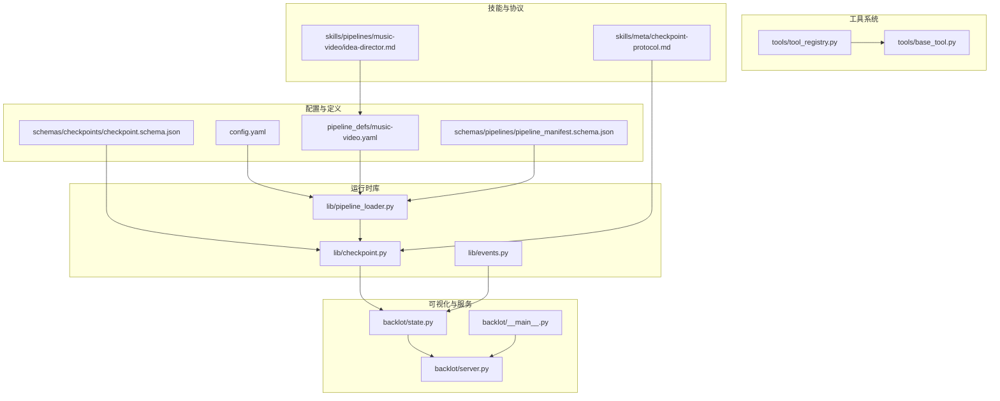
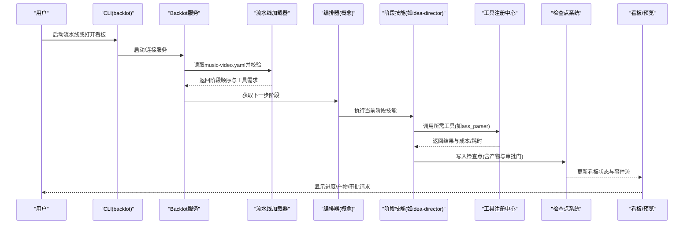
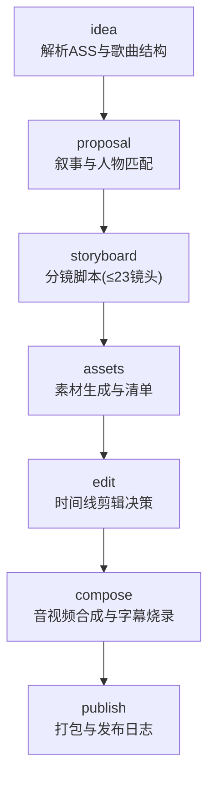
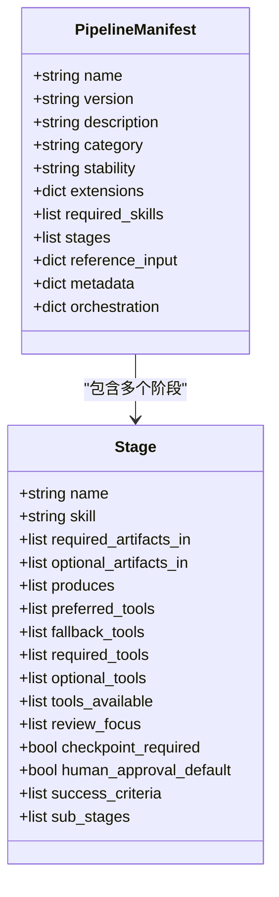
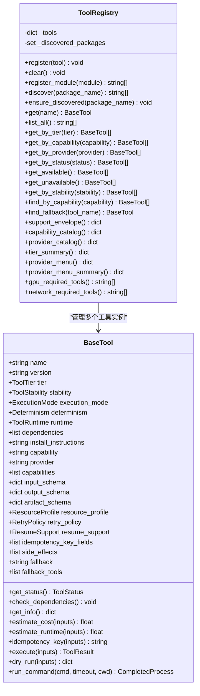
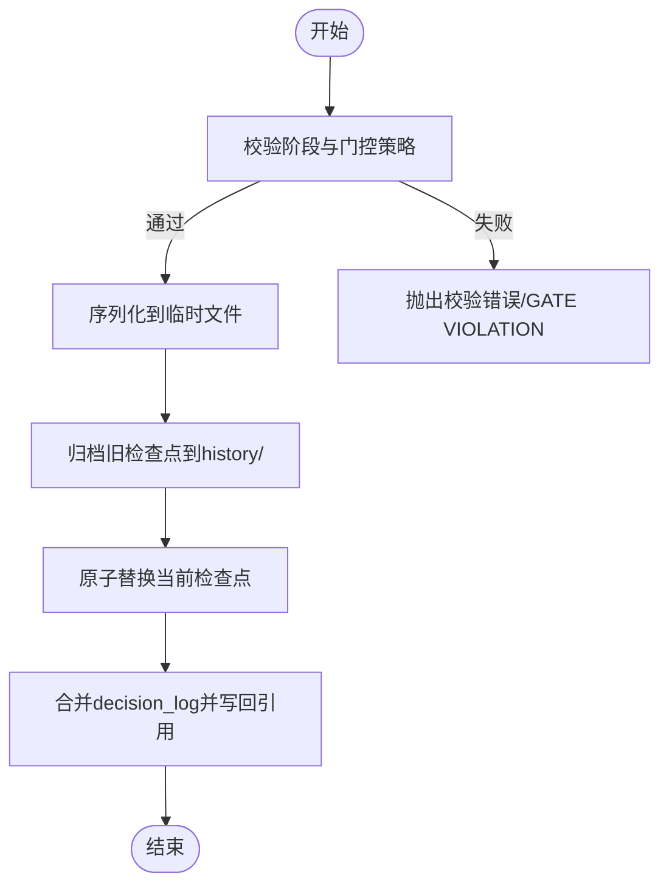
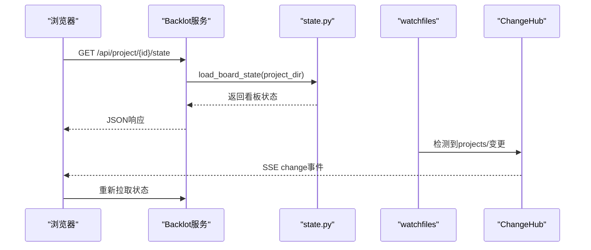
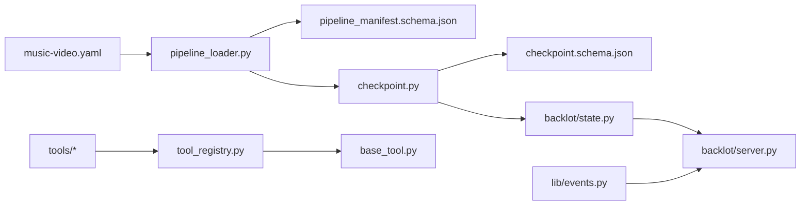

# AI流水线引擎

<cite>
**本文引用的文件**   
- [config.yaml](file://config.yaml)
- [music-video.yaml](file://pipeline_defs/music-video.yaml)
- [pipeline_manifest.schema.json](file://schemas/pipelines/pipeline_manifest.schema.json)
- [checkpoint.schema.json](file://schemas/checkpoints/checkpoint.schema.json)
- [pipeline_loader.py](file://lib/pipeline_loader.py)
- [checkpoint.py](file://lib/checkpoint.py)
- [events.py](file://lib/events.py)
- [base_tool.py](file://tools/base_tool.py)
- [tool_registry.py](file://tools/tool_registry.py)
- [server.py](file://backlot/server.py)
- [__main__.py](file://backlot/__main__.py)
- [state.py](file://backlot/state.py)
- [checkpoint-protocol.md](file://skills/meta/checkpoint-protocol.md)
- [idea-director.md](file://skills/pipelines/music-video/idea-director.md)
</cite>

## 目录
1. [简介](#简介)
2. [项目结构](#项目结构)
3. [核心组件](#核心组件)
4. [架构总览](#架构总览)
5. [详细组件分析](#详细组件分析)
6. [依赖关系分析](#依赖关系分析)
7. [性能考量](#性能考量)
8. [故障排查指南](#故障排查指南)
9. [结论](#结论)
10. [附录](#附录)

## 简介
本文件为 OpenMontage-MV 的“AI流水线引擎”技术文档，聚焦音乐视频（Music Video）7阶段制作流水线的完整流程与实现机制。内容涵盖：
- 7阶段流水线定义与YAML配置语法
- 技能管理与调用机制（注册、发现、执行）
- 检查点协议与版本控制策略
- 扩展指南（新增阶段与自定义技能）
- 使用示例与最佳实践

该引擎以声明式流水线清单驱动编排，结合检查点持久化、工具注册与Backlot可视化界面，提供可恢复、可审计、可扩展的AI制作流水线。

## 项目结构
仓库采用分层组织：
- 流水线定义：pipeline_defs/*.yaml
- 元数据与Schema：schemas/*
- 运行时库：lib/*（加载器、检查点、事件等）
- 工具与注册：tools/* + tools/tool_registry.py
- 技能说明：skills/*（含meta协议与各阶段导演技能）
- 前端与服务器：backlot/*（FastAPI服务、状态推导、SSE事件）
- 运行配置：config.yaml

**图表来源** 
- [config.yaml:1-20](file://config.yaml#L1-L20)
- [music-video.yaml:1-187](file://pipeline_defs/music-video.yaml#L1-L187)
- [pipeline_manifest.schema.json:1-162](file://schemas/pipelines/pipeline_manifest.schema.json#L1-L162)
- [checkpoint.schema.json:1-47](file://schemas/checkpoints/checkpoint.schema.json#L1-L47)
- [pipeline_loader.py:1-241](file://lib/pipeline_loader.py#L1-L241)
- [checkpoint.py:1-537](file://lib/checkpoint.py#L1-L537)
- [events.py:1-119](file://lib/events.py#L1-L119)
- [base_tool.py:1-481](file://tools/base_tool.py#L1-L481)
- [tool_registry.py:1-493](file://tools/tool_registry.py#L1-L493)
- [server.py:1-504](file://backlot/server.py#L1-L504)
- [__main__.py:1-145](file://backlot/__main__.py#L1-L145)
- [state.py:1-714](file://backlot/state.py#L1-L714)
- [checkpoint-protocol.md:1-201](file://skills/meta/checkpoint-protocol.md#L1-L201)
- [idea-director.md:1-81](file://skills/pipelines/music-video/idea-director.md#L1-L81)

**章节来源**
- [config.yaml:1-20](file://config.yaml#L1-L20)
- [music-video.yaml:1-187](file://pipeline_defs/music-video.yaml#L1-L187)

## 核心组件
- 流水线清单加载器：负责读取并校验YAML清单，缓存与查询阶段顺序、工具能力、扩展权限等。
- 检查点系统：负责阶段产物持久化、人类审批门控、历史归档与恢复。
- 工具注册中心：自动发现、分类、报告工具能力与可用性，支持回退与资源画像。
- Backlot服务：提供看板、媒体访问、SSE实时事件流与Studio聊天工作区。
- 技能与协议：以Markdown描述各阶段行为与检查点协议，指导Agent按规范执行。

**章节来源**
- [pipeline_loader.py:1-241](file://lib/pipeline_loader.py#L1-L241)
- [checkpoint.py:1-537](file://lib/checkpoint.py#L1-L537)
- [tool_registry.py:1-493](file://tools/tool_registry.py#L1-L493)
- [server.py:1-504](file://backlot/server.py#L1-L504)
- [checkpoint-protocol.md:1-201](file://skills/meta/checkpoint-protocol.md#L1-L201)

## 架构总览
下图展示从用户输入到最终发布的端到端流程，以及关键子系统交互。

**图表来源** 
- [music-video.yaml:1-187](file://pipeline_defs/music-video.yaml#L1-L187)
- [pipeline_loader.py:1-241](file://lib/pipeline_loader.py#L1-L241)
- [tool_registry.py:1-493](file://tools/tool_registry.py#L1-L493)
- [checkpoint.py:1-537](file://lib/checkpoint.py#L1-L537)
- [server.py:1-504](file://backlot/server.py#L1-L504)
- [__main__.py:1-145](file://backlot/__main__.py#L1-L145)

## 详细组件分析

### 7阶段MV流水线流程（idea → proposal → storyboard → assets → edit → compose → publish）
- idea：解析ASS歌词、分析歌曲结构与风格，产出brief。
- proposal：基于brief制定叙事风格、人物匹配与音乐方案，产出proposal_packet与decision_log。
- storyboard：生成最多23个镜头的分镜脚本（每镜4-15秒），输出storyboard.json与markdown。
- assets：根据分镜生成素材片段，产出asset_manifest并回填素材路径。
- edit：依据分镜时间线排列素材，对齐音频与字幕计划，产出edit_decisions。
- compose：使用video_stitch、audio_mixer与可选color_grade进行合成渲染，产出render_report与final_review。
- publish：打包交付物（视频+分镜markdown+JSON），产出publish_log。

**图表来源** 
- [music-video.yaml:36-187](file://pipeline_defs/music-video.yaml#L36-L187)

**章节来源**
- [music-video.yaml:36-187](file://pipeline_defs/music-video.yaml#L36-L187)

### 流水线定义文件格式与YAML配置语法
- 顶层字段：name、version、description、category、stability、default_checkpoint_policy、extensions、required_skills、compatible_playbooks、stages、reference_input、metadata、orchestration。
- stages数组：每个阶段包含name、skill、required_artifacts_in、optional_artifacts_in、produces、preferred_tools/fallback_tools/required_tools/optional_tools/tools_available、review_focus、checkpoint_required、human_approval_default、success_criteria、sub_stages等。
- extensions：控制custom_scripts、custom_playbooks、custom_skills、custom_tools是否允许。
- reference_input：声明参考视频输入支持与相关分析工具。

**图表来源** 
- [pipeline_manifest.schema.json:1-162](file://schemas/pipelines/pipeline_manifest.schema.json#L1-L162)

**章节来源**
- [pipeline_manifest.schema.json:1-162](file://schemas/pipelines/pipeline_manifest.schema.json#L1-L162)
- [music-video.yaml:1-187](file://pipeline_defs/music-video.yaml#L1-L187)

### 技能管理与调用机制（注册、发现、执行）
- BaseTool：统一工具契约，包含身份、能力、资源画像、重试策略、执行接口execute()、成本估算、幂等键、命令执行封装等；所有子类自动注入Backlot事件埋点。
- ToolRegistry：扫描tools包下模块，自动注册BaseTool子类；提供按能力、提供者、状态、稳定性等查询；生成支持信封、能力目录、提供者菜单与摘要。
- 执行流程：阶段技能通过工具名查找实例，调用execute(inputs)，返回ToolResult（success、data、artifacts、cost_usd、duration_seconds等）。

**图表来源** 
- [base_tool.py:1-481](file://tools/base_tool.py#L1-L481)
- [tool_registry.py:1-493](file://tools/tool_registry.py#L1-L493)

**章节来源**
- [base_tool.py:1-481](file://tools/base_tool.py#L1-L481)
- [tool_registry.py:1-493](file://tools/tool_registry.py#L1-L493)

### 检查点协议与版本控制策略
- 检查点结构：包含version、project_id、pipeline_type、stage、status、timestamp、artifacts、review、cost_snapshot、error、metadata等字段，受schema约束。
- 写入流程：write_checkpoint先验证阶段合法性与门控策略，再序列化临时文件，归档旧版本至history/，原子替换当前检查点。
- 门控策略：若manifest中human_approval_default为true或调用方传入human_approval_required，则completed必须附带human_approved=True，否则抛出GATE VIOLATION。
- 恢复机制：get_next_stage基于已完成检查点决定下一步；in_progress检查点支持断点续跑，partial_progress存放中间态。
- 决策日志：合并decision_log到项目级decision_log.json，并在proposal_packet与render_report中引用。

**图表来源** 
- [checkpoint.schema.json:1-47](file://schemas/checkpoints/checkpoint.schema.json#L1-L47)
- [checkpoint.py:336-467](file://lib/checkpoint.py#L336-L467)
- [checkpoint.py:523-537](file://lib/checkpoint.py#L523-L537)

**章节来源**
- [checkpoint.schema.json:1-47](file://schemas/checkpoints/checkpoint.schema.json#L1-L47)
- [checkpoint.py:1-537](file://lib/checkpoint.py#L1-L537)
- [checkpoint-protocol.md:1-201](file://skills/meta/checkpoint-protocol.md#L1-L201)

### Backlot服务与看板状态推导
- FastAPI应用：提供健康检查、项目列表、项目状态、事件流、媒体与缩略图、UI页面等接口。
- 状态推导：load_board_state聚合marker、checkpoints、history、artifacts、events、storyboard、media、cost等信息，构建stage rail与看板视图。
- SSE事件：watchfiles监听projects/变化，推送change事件；客户端订阅后刷新状态。

**图表来源** 
- [server.py:151-406](file://backlot/server.py#L151-L406)
- [state.py:586-656](file://backlot/state.py#L586-L656)

**章节来源**
- [server.py:1-504](file://backlot/server.py#L1-504)
- [state.py:1-714](file://backlot/state.py#L1-714)

### 实际使用示例与最佳实践
- 初始化项目：调用init_project创建标准目录布局与project.json标记。
- 打开看板：使用backlot open <project-id>启动服务并打开浏览器。
- 阶段执行：按checkpoint-protocol.md要求，在每个阶段开始前写入in_progress，完成后写入completed或awaiting_human。
- 恢复运行：每次启动先调用get_next_stage判断下一步，若存在in_progress则加载partial_progress继续。
- 工具选择：通过ToolRegistry.provider_menu_summary获取可用能力与安装提示，优先选择available工具。

**章节来源**
- [checkpoint.py:178-227](file://lib/checkpoint.py#L178-L227)
- [__main__.py:81-107](file://backlot/__main__.py#L81-L107)
- [checkpoint-protocol.md:74-100](file://skills/meta/checkpoint-protocol.md#L74-L100)
- [tool_registry.py:316-471](file://tools/tool_registry.py#L316-L471)

## 依赖关系分析
- 流水线清单加载依赖JSON Schema校验与YAML解析，缓存以提升热路径性能。
- 检查点系统依赖artifact schema与pipeline manifest的阶段列表，确保一致性。
- 工具注册依赖BaseTool抽象与模块扫描，支持环境变量加载与依赖检测。
- Backlot服务依赖watchfiles与FastAPI，提供SSE与静态资源服务。

**图表来源** 
- [pipeline_loader.py:1-241](file://lib/pipeline_loader.py#L1-L241)
- [checkpoint.py:1-537](file://lib/checkpoint.py#L1-L537)
- [tool_registry.py:1-493](file://tools/tool_registry.py#L1-L493)
- [server.py:1-504](file://backlot/server.py#L1-L504)

**章节来源**
- [pipeline_loader.py:1-241](file://lib/pipeline_loader.py#L1-L241)
- [checkpoint.py:1-537](file://lib/checkpoint.py#L1-L537)
- [tool_registry.py:1-493](file://tools/tool_registry.py#L1-L493)
- [server.py:1-504](file://backlot/server.py#L1-L504)

## 性能考量
- 清单加载缓存：_load_manifest_schema与_load_pipeline_cached避免重复解析与校验。
- 事件写入锁：events.jsonl使用线程锁保证并发安全，读操作容忍损坏行。
- 缩略图缓存：/thumb端点对图片/视频帧进行缓存，减少重复处理。
- 状态推导优化：_cached_summaries缓存项目摘要，变更时失效。

[本节为通用指导，不直接分析具体文件]

## 故障排查指南
- 检查点校验失败：确认stage在有效阶段列表中，artifacts符合schema；查看CheckpointValidationError详情。
- 门控违规：若human_approval_default为true，completed必须附带human_approved=True；否则会抛出GATE VIOLATION。
- 工具不可用：通过ToolRegistry.get_unavailable()与provider_menu_summary查看缺失依赖与环境变量。
- 看板无更新：检查watchfiles是否可用，确认projects/目录有变更；查看events.jsonl是否有新事件。

**章节来源**
- [checkpoint.py:140-171](file://lib/checkpoint.py#L140-L171)
- [checkpoint.py:378-405](file://lib/checkpoint.py#L378-L405)
- [tool_registry.py:165-175](file://tools/tool_registry.py#L165-L175)
- [events.py:98-119](file://lib/events.py#L98-L119)

## 结论
OpenMontage-MV的AI流水线引擎以声明式清单驱动、严格检查点协议与健壮的工具注册体系，实现了可恢复、可审计、可扩展的音乐视频制作流水线。通过Backlot服务提供实时可视化与交互，开发者可便捷地扩展阶段与技能，满足多样化制作需求。

[本节为总结性内容，不直接分析具体文件]

## 附录

### 扩展指南：添加新阶段与自定义技能
- 新增阶段：在music-video.yaml的stages数组中添加新阶段定义，指定skill、produces、tools_available等。
- 自定义技能：在skills/pipelines/music-video/目录下创建新的director.md，遵循checkpoint-protocol.md编写行为说明。
- 工具扩展：在tools/下实现新的BaseTool子类，ToolRegistry会自动发现并注册。
- 权限控制：在extensions中启用custom_skills或custom_tools以允许相应扩展。

**章节来源**
- [music-video.yaml:16-31](file://pipeline_defs/music-video.yaml#L16-L31)
- [checkpoint-protocol.md:1-201](file://skills/meta/checkpoint-protocol.md#L1-L201)
- [tool_registry.py:118-134](file://tools/tool_registry.py#L118-L134)