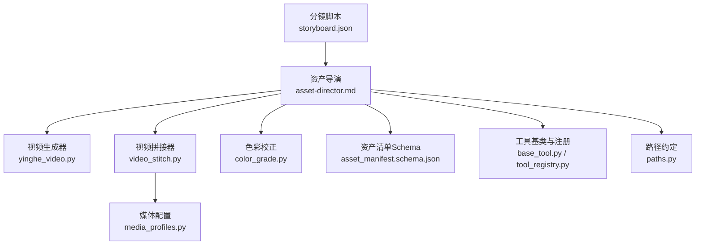
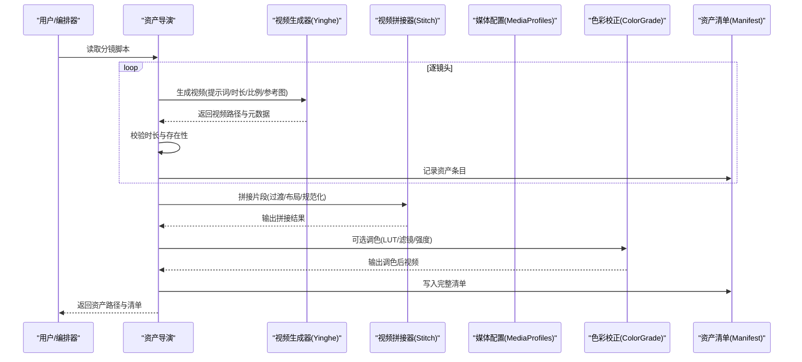
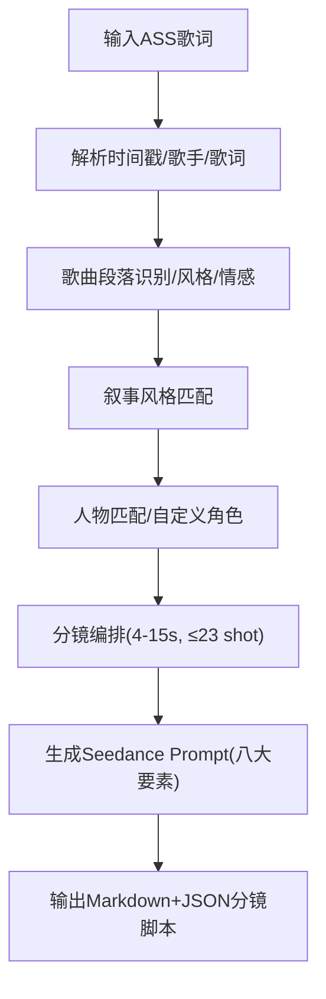
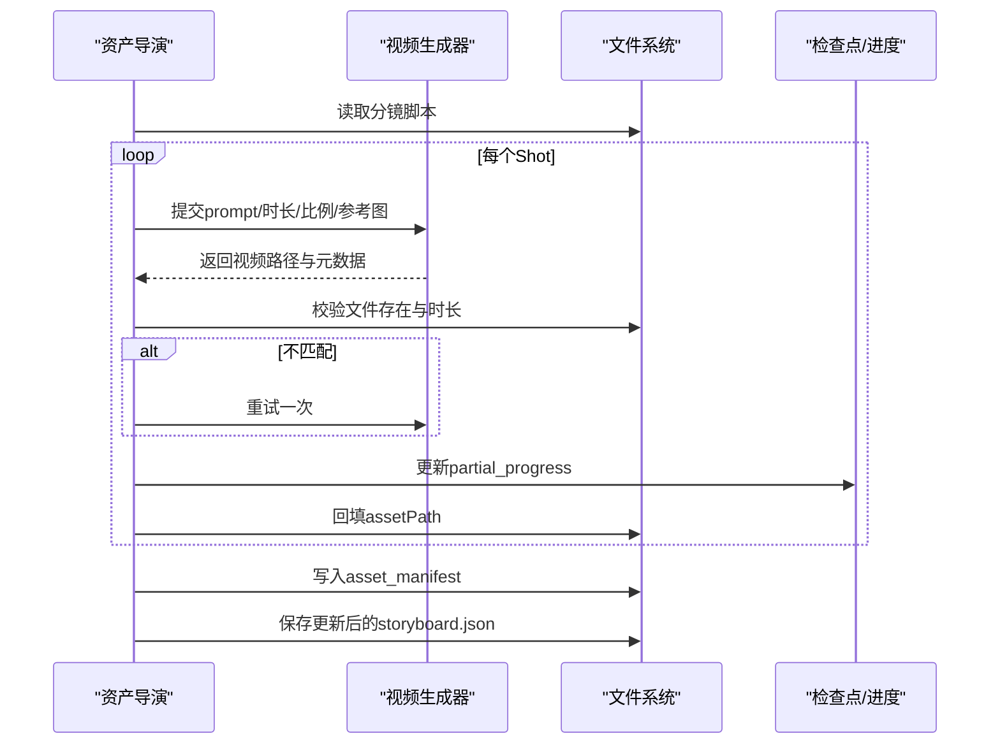
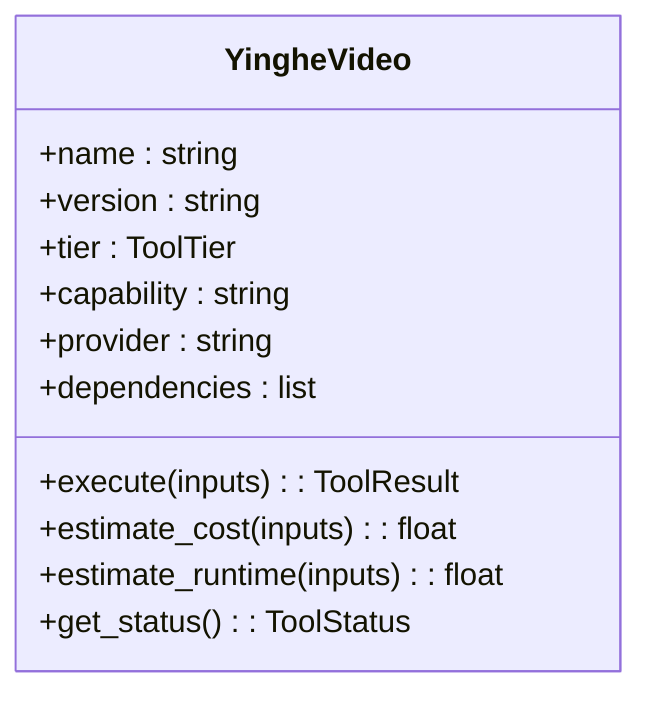
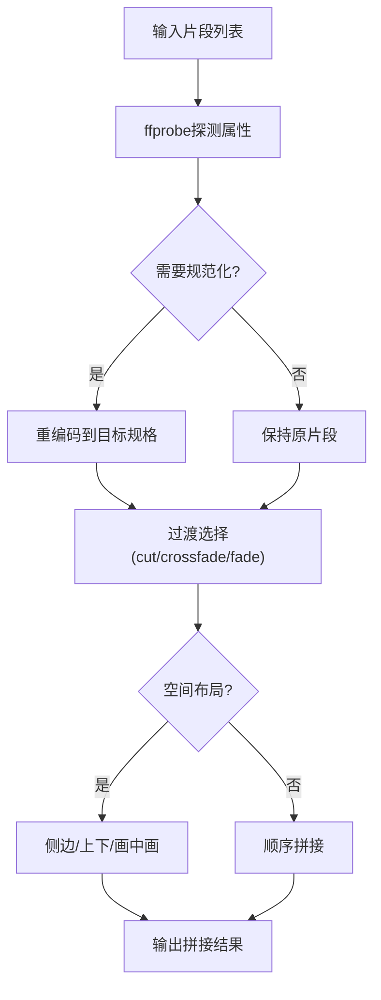
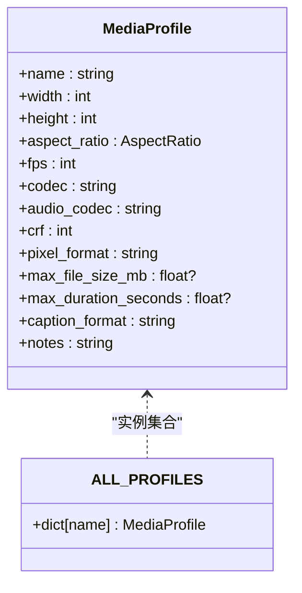
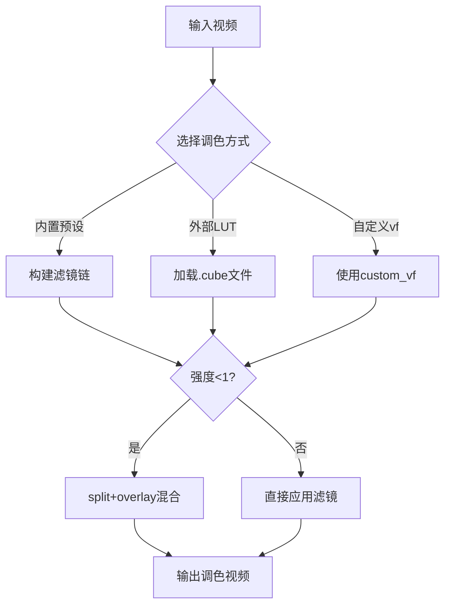
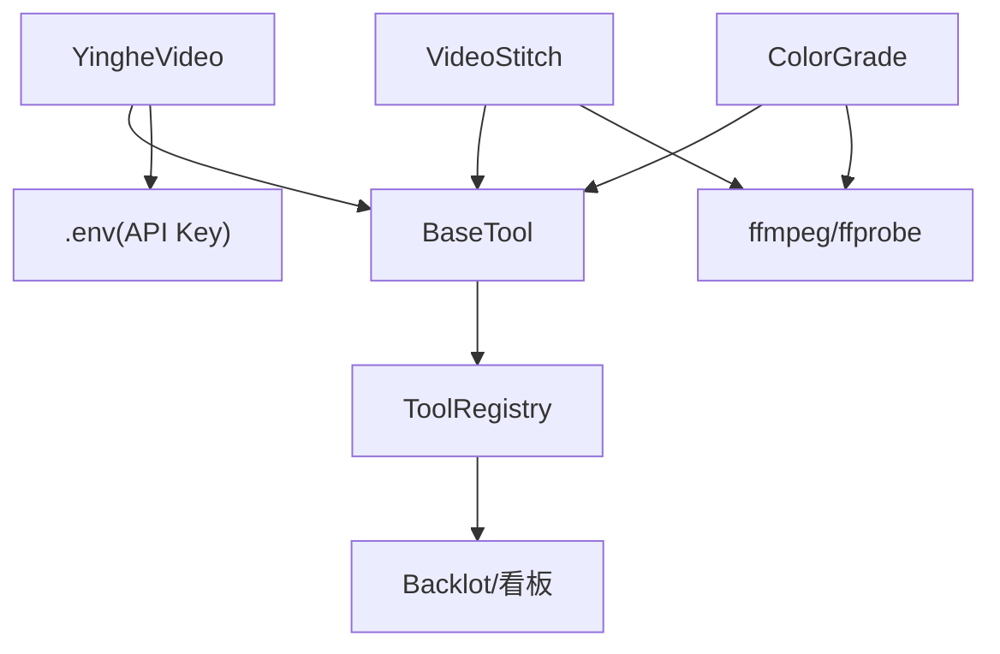

# Assets阶段 - 视觉资产生成

<cite>
**本文引用的文件**   
- [skills/pipelines/music-video/asset-director.md](file://skills/pipelines/music-video/asset-director.md)
- [.agents/skills/mv-storyboard/Skill.md](file://.agents/skills/mv-storyboard/Skill.md)
- [.agents/skills/mv-storyboard/assets/storyboard-schema.json](file://.agents/skills/mv-storyboard/assets/storyboard-schema.json)
- [.agents/skills/mv-storyboard/assets/storyboard-template.md](file://.agents/skills/mv-storyboard/assets/storyboard-template.md)
- [.agents/skills/mv-storyboard/assets/camera-language-reference.md](file://.agents/skills/mv-storyboard/assets/camera-language-reference.md)
- [.agents/skills/mv-storyboard/assets/seedance-prompt-guide.md](file://.agents/skills/mv-storyboard/assets/seedance-prompt-guide.md)
- [tools/video/yinghe_video.py](file://tools/video/yinghe_video.py)
- [tools/video/video_stitch.py](file://tools/video/video_stitch.py)
- [lib/media_profiles.py](file://lib/media_profiles.py)
- [tools/enhancement/color_grade.py](file://tools/enhancement/color_grade.py)
- [schemas/artifacts/asset_manifest.schema.json](file://schemas/artifacts/asset_manifest.schema.json)
- [tools/base_tool.py](file://tools/base_tool.py)
- [tools/tool_registry.py](file://tools/tool_registry.py)
- [lib/paths.py](file://lib/paths.py)
</cite>

## 目录
1. [简介](#简介)
2. [项目结构](#项目结构)
3. [核心组件](#核心组件)
4. [架构总览](#架构总览)
5. [详细组件分析](#详细组件分析)
6. [依赖关系分析](#依赖关系分析)
7. [性能考量](#性能考量)
8. [故障排查指南](#故障排查指南)
9. [结论](#结论)
10. [附录](#附录)

## 简介
本章节聚焦于OpenMontage-MV的Assets阶段，即“视觉资产生成”。该阶段将分镜脚本（Storyboard）转化为实际可编辑的视频片段与配套素材，涵盖：
- 基于分镜脚本自动生成图像、视频片段与特效素材
- 媒体配置文件管理（分辨率、帧率、编码等）
- 色彩校正流程（内置LUT与滤镜链）
- 资源命名规范、存储结构与版本控制策略
- 资产搜索、预览与替换能力

通过统一的工具契约与注册机制，系统对AI生成、本地转码、拼接与调色进行标准化编排，确保从脚本到成片的一致性与可追溯性。

## 项目结构
Assets阶段涉及的关键目录与文件：
- 分镜脚本生成与模板：.agents/skills/mv-storyboard/*
- 资产生成执行器：skills/pipelines/music-video/asset-director.md
- 视频生成提供者：tools/video/yinghe_video.py
- 视频拼接与空间布局：tools/video/video_stitch.py
- 媒体输出配置：lib/media_profiles.py
- 色彩校正工具：tools/enhancement/color_grade.py
- 资产清单Schema：schemas/artifacts/asset_manifest.schema.json
- 工具基类与注册：tools/base_tool.py, tools/tool_registry.py
- 路径约定：lib/paths.py

图表来源
- [skills/pipelines/music-video/asset-director.md:1-63](file://skills/pipelines/music-video/asset-director.md#L1-L63)
- [tools/video/yinghe_video.py:1-120](file://tools/video/yinghe_video.py#L1-L120)
- [tools/video/video_stitch.py:1-120](file://tools/video/video_stitch.py#L1-L120)
- [lib/media_profiles.py:1-166](file://lib/media_profiles.py#L1-L166)
- [tools/enhancement/color_grade.py:1-120](file://tools/enhancement/color_grade.py#L1-L120)
- [schemas/artifacts/asset_manifest.schema.json:1-63](file://schemas/artifacts/asset_manifest.schema.json#L1-L63)
- [tools/base_tool.py:1-120](file://tools/base_tool.py#L1-L120)
- [tools/tool_registry.py:1-120](file://tools/tool_registry.py#L1-L120)
- [lib/paths.py:1-18](file://lib/paths.py#L1-L18)

章节来源
- [skills/pipelines/music-video/asset-director.md:1-63](file://skills/pipelines/music-video/asset-director.md#L1-L63)
- [.agents/skills/mv-storyboard/Skill.md:1-120](file://.agents/skills/mv-storyboard/Skill.md#L1-L120)
- [lib/paths.py:1-18](file://lib/paths.py#L1-L18)

## 核心组件
- 资产导演（Asset Director）：按分镜逐条调用视频生成器，校验时长与一致性，回填资产路径并产出资产清单。
- 视频生成器（Yinghe Video）：文本/参考图驱动的视频生成API封装，支持时长、比例、音频合成与下载。
- 视频拼接器（Video Stitch）：多片段顺序拼接、交叉淡入淡出、黑场过渡、空间布局（左右、上下、画中画），并提供预览与自动规范化。
- 媒体配置（Media Profiles）：平台化输出参数（分辨率、宽高比、帧率、编码、CRF、字幕格式等）。
- 色彩校正（Color Grade）：内置滤镜预设与外部CUBE LUT，支持强度混合与自定义滤镜链。
- 资产清单（Asset Manifest）：统一记录每个资产的类型、路径、来源工具、场景ID、提示词、模型、成本、时长、分辨率、质量评分等。
- 工具契约与注册（BaseTool & ToolRegistry）：统一接口、依赖检查、状态报告、能力目录与回退策略。

章节来源
- [skills/pipelines/music-video/asset-director.md:1-63](file://skills/pipelines/music-video/asset-director.md#L1-L63)
- [tools/video/yinghe_video.py:1-120](file://tools/video/yinghe_video.py#L1-L120)
- [tools/video/video_stitch.py:1-120](file://tools/video/video_stitch.py#L1-L120)
- [lib/media_profiles.py:1-166](file://lib/media_profiles.py#L1-L166)
- [tools/enhancement/color_grade.py:1-120](file://tools/enhancement/color_grade.py#L1-L120)
- [schemas/artifacts/asset_manifest.schema.json:1-63](file://schemas/artifacts/asset_manifest.schema.json#L1-L63)
- [tools/base_tool.py:1-120](file://tools/base_tool.py#L1-L120)
- [tools/tool_registry.py:1-120](file://tools/tool_registry.py#L1-L120)

## 架构总览
Assets阶段的数据流与控制流如下：
- 输入：分镜脚本（包含每镜头的Seedance Prompt、时长、可选参考图）
- 处理：逐镜头生成视频片段 → 验证时长与存在性 → 回填路径 → 拼接/转场 → 可选调色 → 生成资产清单
- 输出：各镜头视频片段、最终拼接结果、资产清单、更新后的分镜脚本

图表来源
- [skills/pipelines/music-video/asset-director.md:1-63](file://skills/pipelines/music-video/asset-director.md#L1-L63)
- [tools/video/yinghe_video.py:1-120](file://tools/video/yinghe_video.py#L1-L120)
- [tools/video/video_stitch.py:1-120](file://tools/video/video_stitch.py#L1-L120)
- [lib/media_profiles.py:1-166](file://lib/media_profiles.py#L1-L166)
- [tools/enhancement/color_grade.py:1-120](file://tools/enhancement/color_grade.py#L1-L120)
- [schemas/artifacts/asset_manifest.schema.json:1-63](file://schemas/artifacts/asset_manifest.schema.json#L1-L63)

## 详细组件分析

### 分镜脚本与Prompt工程
- 分镜脚本由ASS歌词解析、歌曲结构分析、叙事风格匹配、人物匹配、分镜编排与Prompt生成组成，输出Markdown与JSON双格式。
- JSON Schema定义meta、characters、songSections、shots等字段，约束shot数量、时长范围、镜头语言术语与Seedance Prompt内容。
- 镜头语言参考表提供景别、角度、运镜与转场的标准术语库，保证Prompt与后期的一致性。

图表来源
- [.agents/skills/mv-storyboard/Skill.md:1-120](file://.agents/skills/mv-storyboard/Skill.md#L1-L120)
- [.agents/skills/mv-storyboard/assets/storyboard-schema.json:1-120](file://.agents/skills/mv-storyboard/assets/storyboard-schema.json#L1-L120)
- [.agents/skills/mv-storyboard/assets/camera-language-reference.md:1-120](file://.agents/skills/mv-storyboard/assets/camera-language-reference.md#L1-L120)
- [.agents/skills/mv-storyboard/assets/seedance-prompt-guide.md:1-120](file://.agents/skills/mv-storyboard/assets/seedance-prompt-guide.md#L1-L120)

章节来源
- [.agents/skills/mv-storyboard/Skill.md:1-120](file://.agents/skills/mv-storyboard/Skill.md#L1-L120)
- [.agents/skills/mv-storyboard/assets/storyboard-schema.json:1-120](file://.agents/skills/mv-storyboard/assets/storyboard-schema.json#L1-L120)
- [.agents/skills/mv-storyboard/assets/storyboard-template.md:1-120](file://.agents/skills/mv-storyboard/assets/storyboard-template.md#L1-L120)
- [.agents/skills/mv-storyboard/assets/camera-language-reference.md:1-120](file://.agents/skills/mv-storyboard/assets/camera-language-reference.md#L1-L120)
- [.agents/skills/mv-storyboard/assets/seedance-prompt-guide.md:1-120](file://.agents/skills/mv-storyboard/assets/seedance-prompt-guide.md#L1-L120)

### 资产生成执行（Asset Director）
- 按分镜顺序逐条调用视频生成器，优先使用参考图锁定人物身份。
- 生成后校验时长与存在性，失败则重试一次；成功后回填assetPath并刷新进度。
- 生成资产清单（符合Schema），持久化更新后的分镜脚本。

图表来源
- [skills/pipelines/music-video/asset-director.md:1-63](file://skills/pipelines/music-video/asset-director.md#L1-L63)
- [tools/video/yinghe_video.py:1-120](file://tools/video/yinghe_video.py#L1-L120)

章节来源
- [skills/pipelines/music-video/asset-director.md:1-63](file://skills/pipelines/music-video/asset-director.md#L1-L63)

### 视频生成器（Yinghe Video）
- 支持文本到视频与参考图到视频，默认模型doubao-seedance-2.0，可通过环境变量覆盖。
- 任务创建→轮询→成功时下载视频至磁盘；失败或超时返回错误信息。
- 支持时长、比例、是否合成音频、水印开关；幂等键避免重复计费。

图表来源
- [tools/video/yinghe_video.py:1-120](file://tools/video/yinghe_video.py#L1-L120)

章节来源
- [tools/video/yinghe_video.py:1-120](file://tools/video/yinghe_video.py#L1-L120)

### 视频拼接与预览（Video Stitch）
- 支持cut、crossfade、fade-through-black三种过渡；N段剪辑链式xfade。
- 自动检测并补齐无声片段的音轨；必要时自动规范化分辨率、帧率、编码。
- 提供preview_stitch低分辨率预览；支持side_by_side、vertical_stack、picture_in_picture布局。

图表来源
- [tools/video/video_stitch.py:1-200](file://tools/video/video_stitch.py#L1-L200)

章节来源
- [tools/video/video_stitch.py:1-200](file://tools/video/video_stitch.py#L1-L200)

### 媒体配置文件管理（Media Profiles）
- 集中定义平台化输出参数：分辨率、宽高比、帧率、编码、CRF、像素格式、字幕格式、最大文件大小/时长等。
- 提供查询接口与FFmpeg输出参数生成，便于拼接与导出阶段统一规格。

图表来源
- [lib/media_profiles.py:1-166](file://lib/media_profiles.py#L1-L166)

章节来源
- [lib/media_profiles.py:1-166](file://lib/media_profiles.py#L1-L166)

### 色彩校正流程（Color Grade）
- 内置多种滤镜预设（暖/冷/暗/亮/胶片/高对比/中性），支持外部CUBE LUT与自定义滤镜链。
- 支持强度混合（0~1），实现原始画面与调色结果的平滑叠加。
- 输出带时间统计与产物路径，便于追踪与回溯。

图表来源
- [tools/enhancement/color_grade.py:1-120](file://tools/enhancement/color_grade.py#L1-L120)

章节来源
- [tools/enhancement/color_grade.py:1-120](file://tools/enhancement/color_grade.py#L1-L120)

### 资产清单与命名规范
- 资产清单Schema规定每个资产必须包含id、type、path、source_tool、scene_id等必填字段，以及prompt、model、duration_seconds、resolution、quality_score等扩展字段。
- 命名建议：
  - 视频片段：assets/video/shot_NN.mp4（NN为两位序号）
  - 资产清单：artifacts/asset_manifest.json
  - 分镜脚本：artifacts/storyboard.json
  - 调色输出：在原名基础上加后缀（如_graded）
- 存储结构：
  - projects/<id>/assets/video/...（生成的视频片段）
  - projects/<id>/artifacts/...（清单、分镜脚本、检查点）
  - 临时文件：stitch_tmp/、.stitch_tmp/（拼接中间产物）

章节来源
- [schemas/artifacts/asset_manifest.schema.json:1-63](file://schemas/artifacts/asset_manifest.schema.json#L1-L63)
- [lib/paths.py:1-18](file://lib/paths.py#L1-L18)
- [tools/video/video_stitch.py:1-120](file://tools/video/video_stitch.py#L1-L120)

### 版本控制与变更追踪
- 每次资产生成完成后更新asset_manifest与storyboard.json，作为版本快照。
- 检查点协议（checkpoint_assets.json）记录partial_progress与关键元数据，便于中断恢复与审计。
- 工具执行事件（events.jsonl）记录start/finish/error，支撑看板实时活动与成本归因。

章节来源
- [skills/pipelines/music-video/asset-director.md:1-63](file://skills/pipelines/music-video/asset-director.md#L1-L63)
- [tools/base_tool.py:1-200](file://tools/base_tool.py#L1-L200)

### 资产搜索、预览与替换
- 搜索：通过asset_manifest中的type、scene_id、prompt、model等字段检索资产；结合backlot状态模块渲染可渲染标记。
- 预览：使用video_stitch.preview_stitch生成低分辨率预览，快速确认拼接效果与转场。
- 替换：重新生成某镜头视频并覆盖原路径，随后刷新asset_manifest与storyboard.json；若需调整调色，可再次调用color_grade并更新清单。

章节来源
- [tools/video/video_stitch.py:1-200](file://tools/video/video_stitch.py#L1-L200)
- [schemas/artifacts/asset_manifest.schema.json:1-63](file://schemas/artifacts/asset_manifest.schema.json#L1-L63)
- [backlot/state.py:329-346](file://backlot/state.py#L329-L346)

## 依赖关系分析
- 工具基类与注册：所有工具继承BaseTool，通过ToolRegistry发现与分组，支持按能力、提供商、稳定性筛选与回退。
- 外部依赖：ffmpeg/ffprobe用于探测与转码；requests用于API调用；.env加载API密钥。
- 路径与环境：REPO_ROOT与PROJECTS_DIR统一项目根目录，确保事件、检查点与看板一致。

图表来源
- [tools/base_tool.py:1-200](file://tools/base_tool.py#L1-L200)
- [tools/tool_registry.py:1-200](file://tools/tool_registry.py#L1-L200)
- [tools/video/yinghe_video.py:1-120](file://tools/video/yinghe_video.py#L1-L120)
- [tools/video/video_stitch.py:1-120](file://tools/video/video_stitch.py#L1-L120)
- [tools/enhancement/color_grade.py:1-120](file://tools/enhancement/color_grade.py#L1-L120)
- [lib/paths.py:1-18](file://lib/paths.py#L1-L18)

章节来源
- [tools/base_tool.py:1-200](file://tools/base_tool.py#L1-L200)
- [tools/tool_registry.py:1-200](file://tools/tool_registry.py#L1-L200)
- [lib/paths.py:1-18](file://lib/paths.py#L1-L18)

## 性能考量
- 视频生成：异步任务轮询，默认等待上限与间隔可调；建议批量提交与并行下载以提升吞吐。
- 拼接与转场：跨片段xfade会触发多次filtergraph构建，N段剪辑复杂度随段数线性增长；预览模式降低分辨率与CRF以加速。
- 调色：内置滤镜链计算开销较低；外部LUT与自定义滤镜可能增加CPU占用；强度混合引入split/overlay额外步骤。
- 资源限制：工具声明CPU/RAM/Disk/VRAM需求，建议在编排时根据硬件预算选择合适profile与并发度。

[本节为通用指导，无需具体文件引用]

## 故障排查指南
- API不可用：检查VIDEO_API_KEY与可选BASE_URL/MODEL环境变量；查看工具状态与安装说明。
- 时长不匹配：使用ffprobe探测片段时长，若偏差超过容差则重新生成；确认分镜duration为整数秒且处于4-15秒范围。
- 拼接失败：检查片段分辨率、帧率、编码是否一致；开启auto_normalize或使用非cut过渡；确保无声音片段已补齐音轨。
- 调色异常：确认输入路径存在、滤镜链有效；尝试切换预设或降低强度；核对CRF与像素格式兼容性。
- 清单不一致：重新运行资产导演，确保asset_manifest与storyboard.json同步更新；检查检查点partial_progress。

章节来源
- [tools/video/yinghe_video.py:1-120](file://tools/video/yinghe_video.py#L1-L120)
- [tools/video/video_stitch.py:1-200](file://tools/video/video_stitch.py#L1-L200)
- [tools/enhancement/color_grade.py:1-120](file://tools/enhancement/color_grade.py#L1-L120)
- [skills/pipelines/music-video/asset-director.md:1-63](file://skills/pipelines/music-video/asset-director.md#L1-L63)

## 结论
Assets阶段通过标准化的工具契约与清晰的职责划分，实现了从分镜脚本到可编辑视频资产的自动化流水线。借助媒体配置、色彩校正与拼接工具，系统在保证质量的同时兼顾效率与可维护性。统一的资产清单与版本控制策略为后续编辑、发布与审计提供了坚实基础。

[本节为总结性内容，无需具体文件引用]

## 附录
- 分镜模板与镜头语言参考：用于规范Prompt与后期一致性
- 媒体配置示例：YouTube/TikTok/Instagram等平台输出参数
- 调色预设说明：内置滤镜链与LUT使用建议
- 资产清单字段字典：type枚举、必填字段与扩展字段说明

[本节为补充材料，无需具体文件引用]