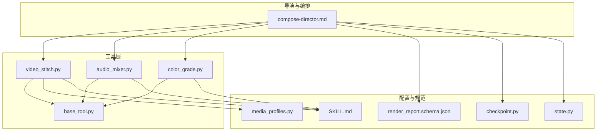
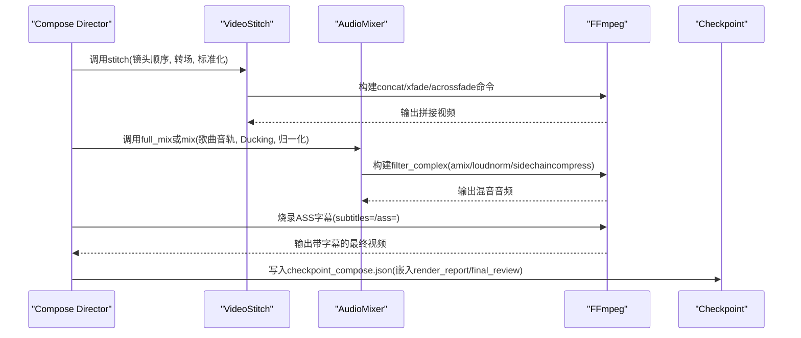
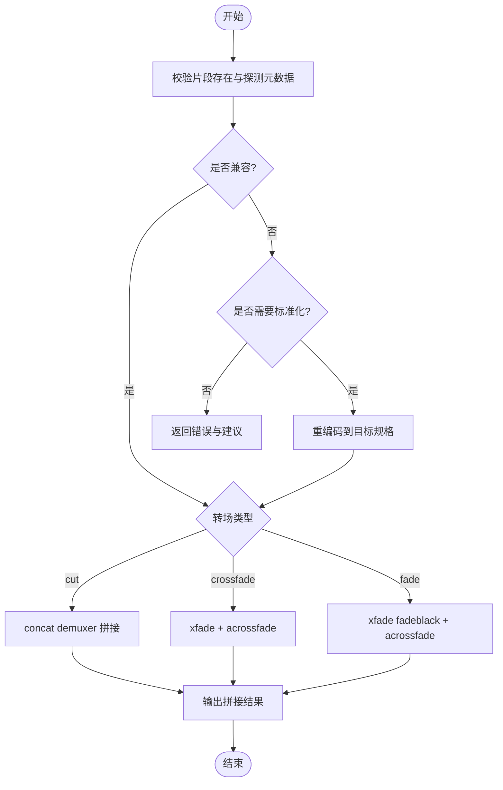
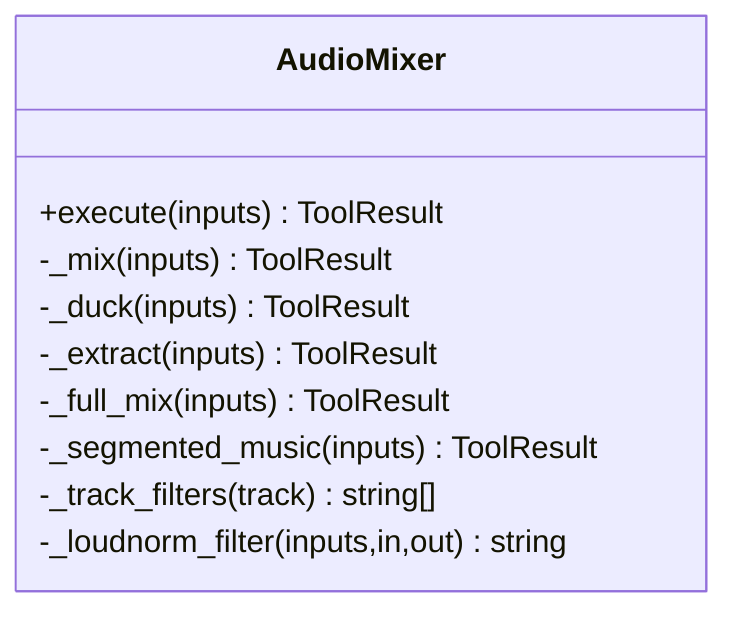
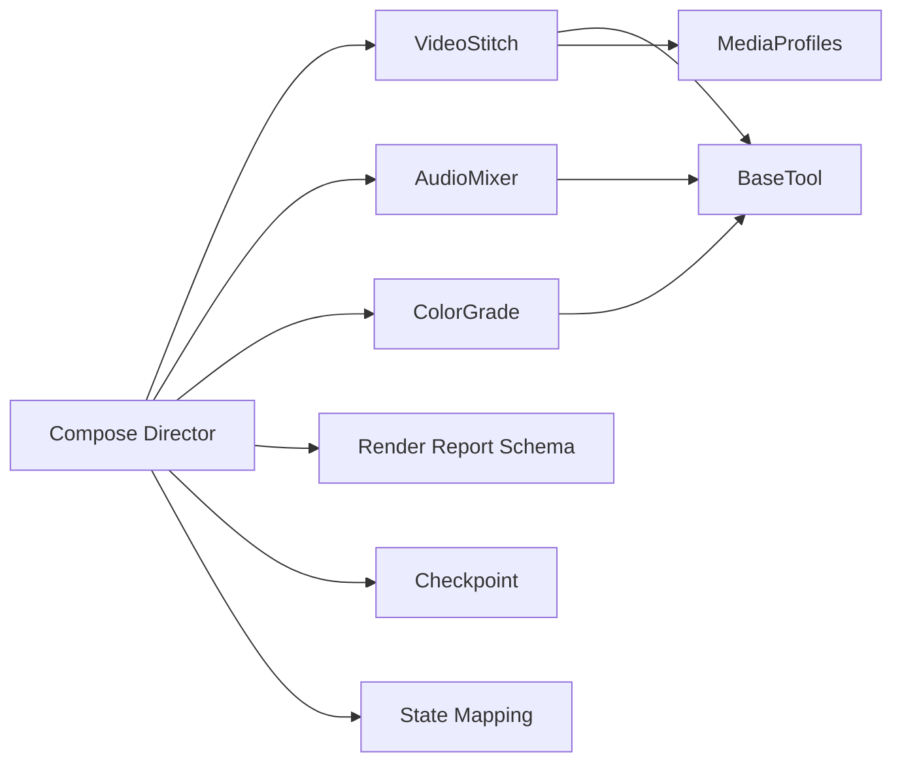

# Compose阶段 - 视频合成与渲染

<cite>
**本文引用的文件**   
- [compose-director.md](file://skills/pipelines/music-video/compose-director.md)
- [video_stitch.py](file://tools/video/video_stitch.py)
- [audio_mixer.py](file://tools/audio/audio_mixer.py)
- [color_grade.py](file://tools/enhancement/color_grade.py)
- [media_profiles.py](file://lib/media_profiles.py)
- [base_tool.py](file://tools/base_tool.py)
- [render_report.schema.json](file://schemas/artifacts/render_report.schema.json)
- [checkpoint.py](file://lib/checkpoint.py)
- [state.py](file://backlot/state.py)
- [SKILL.md](file://.agents/skills/ffmpeg/SKILL.md)
</cite>

## 目录
1. [简介](#简介)
2. [项目结构](#项目结构)
3. [核心组件](#核心组件)
4. [架构总览](#架构总览)
5. [详细组件分析](#详细组件分析)
6. [依赖关系分析](#依赖关系分析)
7. [性能考量](#性能考量)
8. [故障排查指南](#故障排查指南)
9. [结论](#结论)
10. [附录](#附录)

## 简介
Compose阶段负责将编辑决策（edit_decisions）与素材（asset_manifest）合成为最终MV成品，并输出渲染报告（render_report）与最终审查（final_review）。该阶段以FFmpeg为核心执行引擎，完成镜头拼接、音频混音、卡拉OK字幕烧录以及可选的调色处理。整个流程无“运行时合成”通道，渲染始终由FFmpeg驱动。

## 项目结构
Compose阶段涉及的关键代码与文档分布如下：
- 导演技能说明：skills/pipelines/music-video/compose-director.md
- 视频拼接工具：tools/video/video_stitch.py
- 音频混音工具：tools/audio/audio_mixer.py
- 可选调色工具：tools/enhancement/color_grade.py
- 媒体规格配置：lib/media_profiles.py
- 工具基类与命令执行封装：tools/base_tool.py
- 渲染报告Schema：schemas/artifacts/render_report.schema.json
- 检查点与产物管理：lib/checkpoint.py、backlot/state.py
- FFmpeg使用参考：.agents/skills/ffmpeg/SKILL.md

**图表来源** 
- [compose-director.md:1-56](file://skills/pipelines/music-video/compose-director.md#L1-L56)
- [video_stitch.py:1-150](file://tools/video/video_stitch.py#L1-L150)
- [audio_mixer.py:1-120](file://tools/audio/audio_mixer.py#L1-L120)
- [color_grade.py:1-120](file://tools/enhancement/color_grade.py#L1-L120)
- [media_profiles.py:1-120](file://lib/media_profiles.py#L1-L120)
- [render_report.schema.json:1-64](file://schemas/artifacts/render_report.schema.json#L1-L64)
- [checkpoint.py:1-120](file://lib/checkpoint.py#L1-L120)
- [state.py:230-260](file://backlot/state.py#L230-L260)
- [SKILL.md:1-120](file://.agents/skills/ffmpeg/SKILL.md#L1-L120)

**章节来源**
- [compose-director.md:1-56](file://skills/pipelines/music-video/compose-director.md#L1-L56)
- [video_stitch.py:1-150](file://tools/video/video_stitch.py#L1-L150)
- [audio_mixer.py:1-120](file://tools/audio/audio_mixer.py#L1-L120)
- [color_grade.py:1-120](file://tools/enhancement/color_grade.py#L1-L120)
- [media_profiles.py:1-120](file://lib/media_profiles.py#L1-L120)
- [render_report.schema.json:1-64](file://schemas/artifacts/render_report.schema.json#L1-L64)
- [checkpoint.py:1-120](file://lib/checkpoint.py#L1-L120)
- [state.py:230-260](file://backlot/state.py#L230-L260)
- [SKILL.md:1-120](file://.agents/skills/ffmpeg/SKILL.md#L1-L120)

## 核心组件
- VideoStitch（视频拼接）
  - 能力：验证片段、顺序拼接、交叉淡入淡出、黑场过渡、空间布局（左右分屏、垂直堆叠、画中画）、预览拼接
  - 关键逻辑：自动检测/补齐音频流、兼容性校验与标准化、xfade/acrossfade滤镜链、临时文件清理
- AudioMixer（音频混音）
  - 能力：多轨混合、人声旁白与音乐侧链压缩（Ducking）、提取音频、分段背景音乐、响度归一化（loudnorm）
  - 关键逻辑：按轨道角色构建filter_complex、统一采样率/声道格式、amix合并、音量表达式控制
- ColorGrade（可选调色）
  - 能力：内置预设、外部LUT、自定义滤镜链、强度混合
  - 关键逻辑：根据profile/lut/custom_vf生成-vf参数，支持split+blend强度混合
- MediaProfile（媒体规格）
  - 能力：平台化编码参数（分辨率、帧率、编解码器、CRF等），提供FFmpeg输出参数生成
- BaseTool（工具基类）
  - 能力：依赖检查、命令执行封装（run_command）、错误包装、幂等键、资源与重试策略、事件埋点
- Checkpoint与State（检查点与状态）
  - 能力：阶段产物校验、归档历史、决策日志合并、产物映射与解析

**章节来源**
- [video_stitch.py:1-150](file://tools/video/video_stitch.py#L1-L150)
- [audio_mixer.py:1-120](file://tools/audio/audio_mixer.py#L1-L120)
- [color_grade.py:1-120](file://tools/enhancement/color_grade.py#L1-L120)
- [media_profiles.py:1-120](file://lib/media_profiles.py#L1-L120)
- [base_tool.py:1-120](file://tools/base_tool.py#L1-L120)
- [checkpoint.py:1-120](file://lib/checkpoint.py#L1-L120)
- [state.py:230-260](file://backlot/state.py#L230-L260)

## 架构总览
Compose阶段的端到端流程如下：
- 输入：edit_decisions（含镜头顺序、转场、时长裁剪、字幕计划）、asset_manifest（素材清单）、原始ASS字幕路径
- 步骤：
  1) 视频拼接：按镜头顺序拼接，应用转场，必要时标准化与静音/剥离原片音频
  2) 音频铺设：将歌曲作为单一音轨从t=0铺入，校验视觉时长与歌曲时长一致
  3) 字幕烧录：对组装后的视频烧录原始ASS（保留逐字卡拉OK时序与样式）
  4) 可选调色：按Storyboard的visualTone进行统一调色
  5) 验证与报告：ffprobe校验时长、抽验A/V同步与字幕时机，写入render_report与final_review
- 输出：最终视频、render_report、final_review、checkpoint_compose.json

**图表来源** 
- [compose-director.md:19-56](file://skills/pipelines/music-video/compose-director.md#L19-L56)
- [video_stitch.py:480-583](file://tools/video/video_stitch.py#L480-L583)
- [audio_mixer.py:471-627](file://tools/audio/audio_mixer.py#L471-L627)
- [SKILL.md:100-140](file://.agents/skills/ffmpeg/SKILL.md#L100-L140)
- [checkpoint.py:336-467](file://lib/checkpoint.py#L336-L467)

## 详细组件分析

### 视频拼接（VideoStitch）
- 输入模式：validate、stitch、preview_stitch、spatial
- 转场类型：cut、crossfade、fade（黑场过渡）
- 空间布局：side_by_side、vertical_stack、picture_in_picture
- 关键实现要点：
  - 片段探测与兼容性比较（分辨率、帧率、编解码器、像素格式、音频采样率/声道）
  - 自动标准化：当片段不兼容且需要转场时，重编码到统一目标（可指定profile或显式target_resolution/target_fps）
  - 无音频片段补静音AAC，确保acrossfade成功
  - xfade滤镜链：两片段直接xfade；N片段通过循环构建复杂滤镜图
  - 预览模式：低分辨率、低码率、快速preset
  - 空间布局：vstack/amix组合，PiP位置与缩放、边距可调

**图表来源** 
- [video_stitch.py:314-400](file://tools/video/video_stitch.py#L314-L400)
- [video_stitch.py:480-583](file://tools/video/video_stitch.py#L480-L583)
- [video_stitch.py:609-736](file://tools/video/video_stitch.py#L609-L736)

**章节来源**
- [video_stitch.py:1-150](file://tools/video/video_stitch.py#L1-L150)
- [video_stitch.py:314-400](file://tools/video/video_stitch.py#L314-L400)
- [video_stitch.py:480-583](file://tools/video/video_stitch.py#L480-L583)
- [video_stitch.py:609-736](file://tools/video/video_stitch.py#L609-L736)

### 音频混音（AudioMixer）
- 操作类型：mix、duck、extract、full_mix、segmented_music
- 关键实现要点：
  - mix：为每条轨道构建volume/afade/adelay等滤镜，最后amix合并
  - duck：基于speech侧链压缩music，支持简单API与tracks数组两种输入格式
  - full_mix：单调用完成多轨混合、Ducking与响度归一化（loudnorm），推荐用于Compose
  - segmented_music：在指定时间段内叠加背景乐，边界平滑淡入淡出，非活动段静音
  - extract：从视频中提取音频（PCM/采样率/声道数）
  - loudnorm：支持按平台目标LUFS（如-14/-16）动态生成filter

**图表来源** 
- [audio_mixer.py:26-120](file://tools/audio/audio_mixer.py#L26-L120)
- [audio_mixer.py:272-331](file://tools/audio/audio_mixer.py#L272-L331)
- [audio_mixer.py:332-437](file://tools/audio/audio_mixer.py#L332-L437)
- [audio_mixer.py:471-627](file://tools/audio/audio_mixer.py#L471-L627)
- [audio_mixer.py:629-736](file://tools/audio/audio_mixer.py#L629-L736)

**章节来源**
- [audio_mixer.py:1-120](file://tools/audio/audio_mixer.py#L1-L120)
- [audio_mixer.py:272-331](file://tools/audio/audio_mixer.py#L272-L331)
- [audio_mixer.py:332-437](file://tools/audio/audio_mixer.py#L332-L437)
- [audio_mixer.py:471-627](file://tools/audio/audio_mixer.py#L471-L627)
- [audio_mixer.py:629-736](file://tools/audio/audio_mixer.py#L629-L736)

### 可选调色（ColorGrade）
- 能力：内置profile、外部.cube LUT、自定义vf、强度混合
- 关键实现要点：
  - 优先级：custom_vf > lut_path > profile
  - 强度混合：split[original][tograde] → [tograde]{vf}[graded] → blend all_mode=normal opacity=intensity
  - 输出：保持音频copy，视频按codec/crf编码

**章节来源**
- [color_grade.py:1-120](file://tools/enhancement/color_grade.py#L1-L120)
- [color_grade.py:134-179](file://tools/enhancement/color_grade.py#L134-L179)
- [color_grade.py:181-207](file://tools/enhancement/color_grade.py#L181-L207)

### 媒体规格（MediaProfiles）
- 定义平台化MediaProfile（分辨率、宽高比、fps、编解码器、CRF、像素格式、最大尺寸/时长等）
- 提供ffmpeg_output_args(profile)生成输出参数，便于在各工具中复用

**章节来源**
- [media_profiles.py:1-120](file://lib/media_profiles.py#L1-L120)
- [media_profiles.py:150-165](file://lib/media_profiles.py#L150-L165)

### 工具基类（BaseTool）
- 统一契约：name/version/tier/stability/execution_mode/determinism/provider/capabilities/input_schema等
- 依赖检查：cmd:/env:/python:前缀解析
- 命令执行：run_command封装subprocess，UTF-8解码、错误包装ToolCommandError
- 幂等与成本估算：idempotency_key_fields、estimate_cost/estimate_runtime
- 事件埋点：@_instrument_execute注入start/finish/error事件

**章节来源**
- [base_tool.py:1-120](file://tools/base_tool.py#L1-L120)
- [base_tool.py:227-373](file://tools/base_tool.py#L227-L373)
- [base_tool.py:411-454](file://tools/base_tool.py#L411-L454)

### 渲染报告与检查点
- render_report.schema.json：定义outputs数组（path/format/resolution/duration/file_size/platform_target等）、render_time_seconds、warnings、verification_notes、render_grammar、metadata等
- checkpoint.py：写检查点、归档历史、合并decision_log、引用写入proposal_packet/render_report、校验stage与artifacts schema
- state.py：产物文件名映射（render_report.json、final_review.json等），从checkpoints回填artifacts

**章节来源**
- [render_report.schema.json:1-64](file://schemas/artifacts/render_report.schema.json#L1-L64)
- [checkpoint.py:336-467](file://lib/checkpoint.py#L336-L467)
- [checkpoint.py:436-449](file://lib/checkpoint.py#L436-L449)
- [state.py:230-260](file://backlot/state.py#L230-L260)

## 依赖关系分析
- 工具间依赖：
  - video_stitch依赖base_tool（命令执行）、media_profiles（规格）
  - audio_mixer依赖base_tool（命令执行）
  - color_grade依赖base_tool（命令执行）
- 外部依赖：
  - ffmpeg与ffprobe（二进制命令）
  - pydub（可选，用于高级混音，但当前实现主要用FFmpeg）
- 产物与状态：
  - checkpoint与state管理检查点与产物映射，保证阶段产物完整性与可追溯性

**图表来源** 
- [video_stitch.py:1-150](file://tools/video/video_stitch.py#L1-L150)
- [audio_mixer.py:1-120](file://tools/audio/audio_mixer.py#L1-L120)
- [color_grade.py:1-120](file://tools/enhancement/color_grade.py#L1-L120)
- [media_profiles.py:1-120](file://lib/media_profiles.py#L1-L120)
- [base_tool.py:1-120](file://tools/base_tool.py#L1-L120)
- [render_report.schema.json:1-64](file://schemas/artifacts/render_report.schema.json#L1-L64)
- [checkpoint.py:1-120](file://lib/checkpoint.py#L1-L120)
- [state.py:230-260](file://backlot/state.py#L230-L260)

**章节来源**
- [video_stitch.py:1-150](file://tools/video/video_stitch.py#L1-L150)
- [audio_mixer.py:1-120](file://tools/audio/audio_mixer.py#L1-L120)
- [color_grade.py:1-120](file://tools/enhancement/color_grade.py#L1-L120)
- [media_profiles.py:1-120](file://lib/media_profiles.py#L1-L120)
- [base_tool.py:1-120](file://tools/base_tool.py#L1-L120)
- [render_report.schema.json:1-64](file://schemas/artifacts/render_report.schema.json#L1-L64)
- [checkpoint.py:1-120](file://lib/checkpoint.py#L1-L120)
- [state.py:230-260](file://backlot/state.py#L230-L260)

## 性能考量
- 编码参数调优：
  - CRF与preset选择：高质量存档（CRF 18, slow）、生产（20-22, medium）、Web预览（23-25, fast）、草稿（28+, veryfast）
  - 像素格式与movflags：yuv420p与faststart提升兼容性/加载速度
- 转场与滤镜复杂度：
  - N片段xfade链会显著增加CPU负载，建议批量预处理标准化后再拼接
  - 预览模式使用ultrafast与低分辨率降低耗时
- 音频处理：
  - loudnorm单次计算开销较大，可在full_mix中集中执行
  - 分段音乐使用表达式避免多次重编码
- 资源与并发：
  - BaseTool的resource_profile可用于调度器限制CPU/RAM/Disk
  - 长任务可通过checkpoint断点续跑（FROM_START）

**章节来源**
- [SKILL.md:237-245](file://.agents/skills/ffmpeg/SKILL.md#L237-L245)
- [video_stitch.py:741-775](file://tools/video/video_stitch.py#L741-L775)
- [audio_mixer.py:197-215](file://tools/audio/audio_mixer.py#L197-L215)
- [base_tool.py:110-120](file://tools/base_tool.py#L110-L120)

## 故障排查指南
- 常见错误与修复：
  - “高度不可被2整除”：添加scale filter强制偶数尺寸
  - 浏览器无法播放：启用faststart、yuv420p、libx264
  - 变速后音画不同步：使用filter_complex同时调整setpts与atempo
  - 文件过大：提高CRF或降低分辨率
  - 输出0字节：查看完整stderr定位失败原因
- 工具级错误：
  - run_command抛出ToolCommandError，包含returncode/cmd/stderr/detail
  - 依赖缺失：check_dependencies抛出DependencyError，提示安装指引
- 检查点与产物：
  - 若checkpoint校验失败，确认stage与artifacts符合schema
  - 若render_report缺失outputs或duration异常，检查ffprobe与时长对齐

**章节来源**
- [SKILL.md:395-408](file://.agents/skills/ffmpeg/SKILL.md#L395-L408)
- [base_tool.py:456-481](file://tools/base_tool.py#L456-L481)
- [checkpoint.py:140-172](file://lib/checkpoint.py#L140-L172)
- [render_report.schema.json:1-64](file://schemas/artifacts/render_report.schema.json#L1-L64)

## 结论
Compose阶段以FFmpeg为核心，通过VideoStitch、AudioMixer与ColorGrade三大工具协同完成视频合成、音频混音与可选调色，并以render_report与final_review保障质量与可审计性。借助BaseTool的统一契约与Checkpoint/State的状态管理，系统具备高可靠性、可恢复性与可扩展性。结合媒体规格与FFmpeg最佳实践，可在质量与性能之间取得平衡，满足多平台分发需求。

## 附录
- FFmpeg常用命令参考（GIF转MP4、缩放、压缩、提取音频、拼接、淡入淡出、速度调整、平台优化等）
- 平台输出建议（YouTube/Twitter/LinkedIn/Web/GIF）
- 批处理脚本示例（多平台导出）

**章节来源**
- [SKILL.md:1-120](file://.agents/skills/ffmpeg/SKILL.md#L1-L120)
- [SKILL.md:246-393](file://.agents/skills/ffmpeg/SKILL.md#L246-L393)