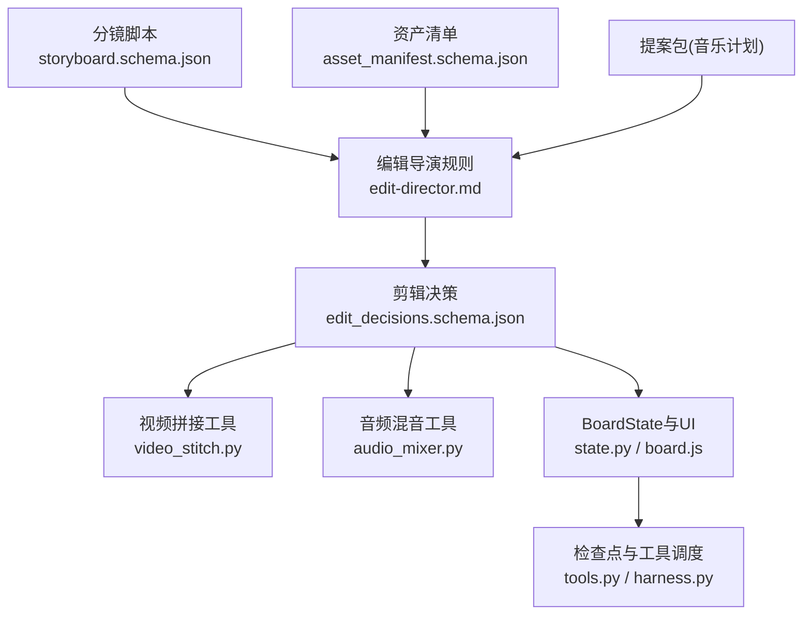
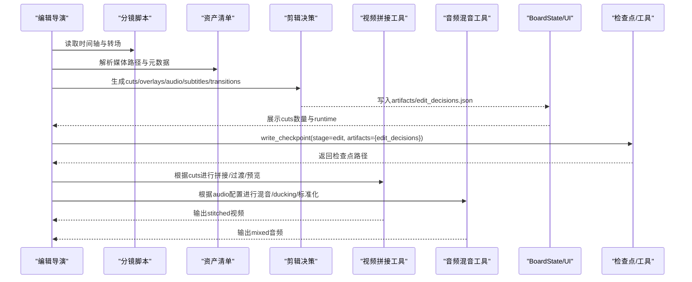
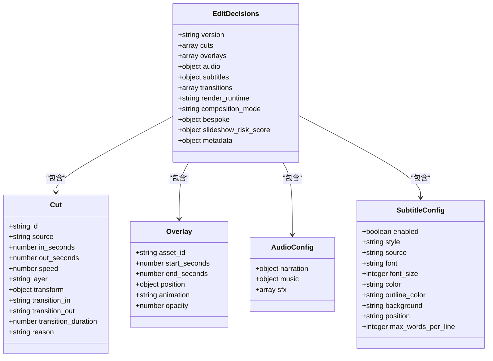
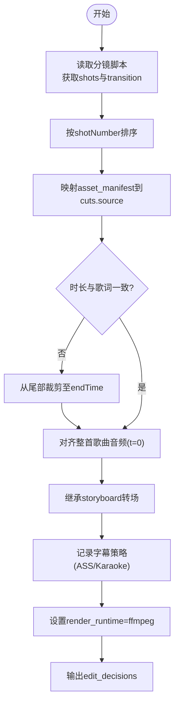
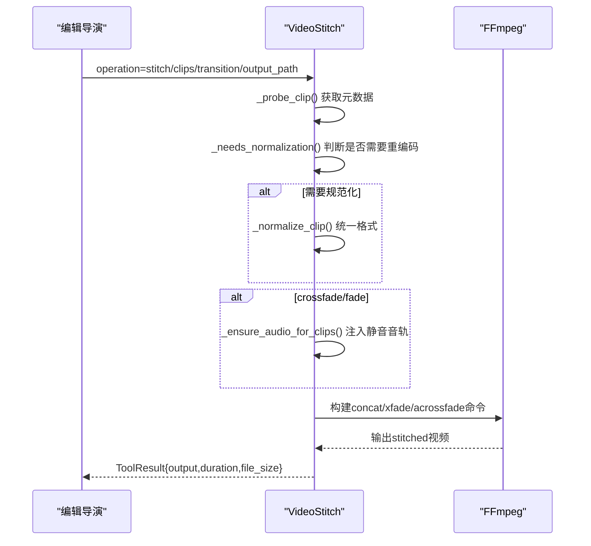
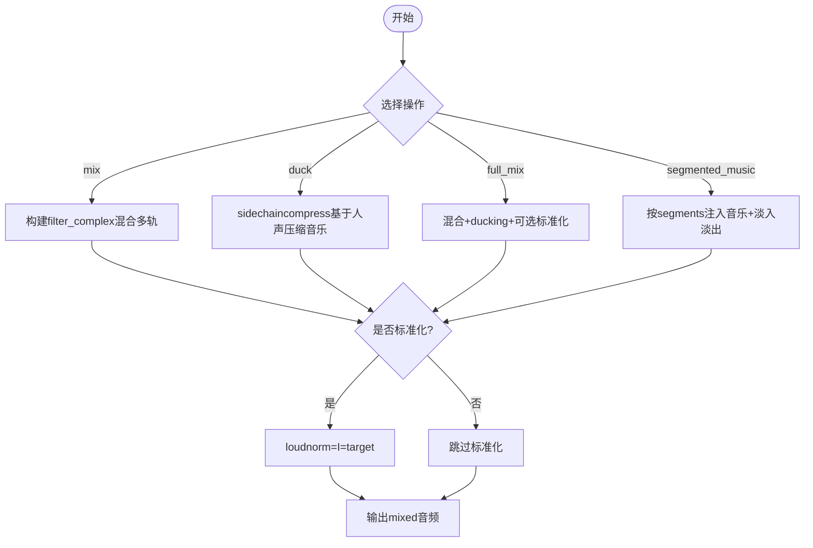
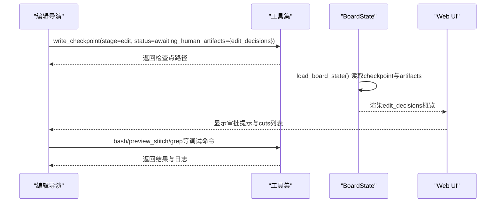
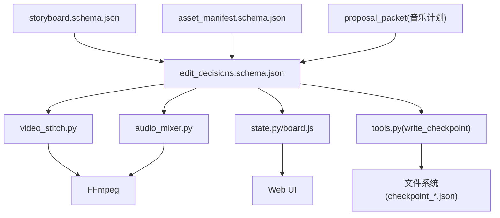

# Edit阶段 - 剪辑决策与时序规划

<cite>
**本文引用的文件**   
- [edit_decisions.schema.json](file://schemas/artifacts/edit_decisions.schema.json)
- [edit-director.md](file://skills/pipelines/music-video/edit-director.md)
- [storyboard.schema.json](file://schemas/artifacts/storyboard.schema.json)
- [asset_manifest.schema.json](file://schemas/artifacts/asset_manifest.schema.json)
- [video_stitch.py](file://tools/video/video_stitch.py)
- [audio_mixer.py](file://tools/audio/audio_mixer.py)
- [state.py](file://backlot/state.py)
- [board.js](file://backlot/ui/board.js)
- [tools.py](file://backlot/agent/tools.py)
- [harness.py](file://backlot/agent/harness.py)
</cite>

## 目录
1. [简介](#简介)
2. [项目结构](#项目结构)
3. [核心组件](#核心组件)
4. [架构总览](#架构总览)
5. [详细组件分析](#详细组件分析)
6. [依赖关系分析](#依赖关系分析)
7. [性能考量](#性能考量)
8. [故障排查指南](#故障排查指南)
9. [结论](#结论)
10. [附录](#附录)

## 简介
本文件聚焦OpenMontage-MV项目的Edit阶段，系统化阐述“剪辑决策的自动化算法、时序规划与剪辑点确定”。在音乐视频流水线中，时间轴由歌词时间戳预先固定，Edit阶段的核心职责是校验并组装：将分镜（storyboard）与资产清单（asset_manifest）映射为精确的剪辑指令（edit_decisions），确保镜头顺序、转场、字幕与音频对齐严格符合创作意图。文档同时覆盖批量处理能力、手动干预接口、预览与调试工具，以及剪辑质量评估与自动优化建议。

## 项目结构
Edit阶段涉及的关键产物与工具如下：
- 输入产物：分镜脚本（storyboard）、资产清单（asset_manifest）、提案包（proposal_packet，含音乐计划）
- 输出产物：剪辑决策（edit_decisions），用于Compose阶段执行
- 工具层：视频拼接（video_stitch）、音频混音（audio_mixer）
- 工作区状态与UI：BoardState与前端展示（state.py、board.js）
- Agent编排与检查点：工具调用与检查点写入（tools.py、harness.py）

图表来源 
- [edit_director.md:1-58](file://skills/pipelines/music-video/edit-director.md#L1-L58)
- [storyboard.schema.json:1-289](file://schemas/artifacts/storyboard.schema.json#L1-L289)
- [asset_manifest.schema.json:1-63](file://schemas/artifacts/asset_manifest.schema.json#L1-L63)
- [edit_decisions.schema.json:1-234](file://schemas/artifacts/edit_decisions.schema.json#L1-L234)
- [video_stitch.py:1-800](file://tools/video/video_stitch.py#L1-L800)
- [audio_mixer.py:1-736](file://tools/audio/audio_mixer.py#L1-L736)
- [state.py:225-241](file://backlot/state.py#L225-L241)
- [board.js:410-489](file://backlot/ui/board.js#L410-L489)
- [tools.py:219-250](file://backlot/agent/tools.py#L219-L250)
- [harness.py:268-390](file://backlot/agent/harness.py#L268-L390)

章节来源
- [edit-director.md:1-58](file://skills/pipelines/music-video/edit-director.md#L1-L58)
- [edit_decisions.schema.json:1-234](file://schemas/artifacts/edit_decisions.schema.json#L1-L234)
- [storyboard.schema.json:1-289](file://schemas/artifacts/storyboard.schema.json#L1-L289)
- [asset_manifest.schema.json:1-63](file://schemas/artifacts/asset_manifest.schema.json#L1-L63)
- [video_stitch.py:1-800](file://tools/video/video_stitch.py#L1-L800)
- [audio_mixer.py:1-736](file://tools/audio/audio_mixer.py#L1-L736)
- [state.py:225-241](file://backlot/state.py#L225-L241)
- [board.js:410-489](file://backlot/ui/board.js#L410-L489)
- [tools.py:219-250](file://backlot/agent/tools.py#L219-L250)
- [harness.py:268-390](file://backlot/agent/harness.py#L268-L390)

## 核心组件
- 剪辑决策数据结构（edit_decisions）：定义cuts、overlays、audio、subtitles、transitions、render_runtime、composition_mode等字段，约束剪辑点、速度、层级、变换、转场类型与时长、字幕样式与位置、音频轨道配置等。
- 编辑导演规则（edit-director.md）：规定MV剪辑流程——按shotNumber排序、严格使用storyboard的时间区间、对齐整首歌曲音频、继承storyboard的转场、记录字幕策略、固定render_runtime为ffmpeg。
- 分镜脚本（storyboard.schema.json）：提供每镜的起止时间、转场方式、节奏、歌词段落等信息，作为Edit阶段的权威时间轴。
- 资产清单（asset_manifest.schema.json）：提供生成或引入的媒体资源路径、类型、时长、分辨率等元数据，供Edit阶段映射到cuts.source。
- 视频拼接工具（video_stitch.py）：实现验证、拼接、过渡（硬切/交叉淡入淡出/黑场过渡）、空间布局（侧边并列/垂直堆叠/画中画）、预览与批处理能力。
- 音频混音工具（audio_mixer.py）：实现多轨混合、人声优先的Ducking、淡入淡出、响度标准化（loudnorm）、分段背景音乐注入等。
- BoardState与UI（state.py、board.js）：读取检查点与artifacts，渲染edit_decisions概览（cuts数量、runtime等），支持人工审批与审查。
- Agent工具与检查点（tools.py、harness.py）：write_checkpoint强制记录edit_decisions；harness驱动Agent循环与权限控制。

章节来源
- [edit_decisions.schema.json:1-234](file://schemas/artifacts/edit_decisions.schema.json#L1-L234)
- [edit-director.md:1-58](file://skills/pipelines/music-video/edit-director.md#L1-L58)
- [storyboard.schema.json:1-289](file://schemas/artifacts/storyboard.schema.json#L1-L289)
- [asset_manifest.schema.json:1-63](file://schemas/artifacts/asset_manifest.schema.json#L1-L63)
- [video_stitch.py:1-800](file://tools/video/video_stitch.py#L1-L800)
- [audio_mixer.py:1-736](file://tools/audio/audio_mixer.py#L1-L736)
- [state.py:225-241](file://backlot/state.py#L225-L241)
- [board.js:410-489](file://backlot/ui/board.js#L410-L489)
- [tools.py:219-250](file://backlot/agent/tools.py#L219-L250)
- [harness.py:268-390](file://backlot/agent/harness.py#L268-L390)

## 架构总览
Edit阶段以“分镜+资产”为输入，依据编辑导演规则生成“剪辑决策”，再由Compose阶段通过FFmpeg工具链执行拼接与混音。BoardState负责聚合检查点与artifacts，并在Web UI中呈现edit_decisions摘要，便于人工审阅与批准。

图表来源 
- [edit-director.md:1-58](file://skills/pipelines/music-video/edit-director.md#L1-L58)
- [edit_decisions.schema.json:1-234](file://schemas/artifacts/edit_decisions.schema.json#L1-L234)
- [video_stitch.py:1-800](file://tools/video/video_stitch.py#L1-L800)
- [audio_mixer.py:1-736](file://tools/audio/audio_mixer.py#L1-L736)
- [state.py:225-241](file://backlot/state.py#L225-L241)
- [board.js:410-489](file://backlot/ui/board.js#L410-L489)
- [tools.py:219-250](file://backlot/agent/tools.py#L219-L250)

## 详细组件分析

### 剪辑决策数据结构（edit_decisions）
- cuts数组：每个元素包含id、source（文件或asset-manifest ID）、in_seconds/out_seconds（剪辑点）、speed（速度）、layer（primary/overlay/background）、transform（scale/position/animation/crop）、transition_in/transition_out（进入/离开转场）、transition_duration（转场时长）、reason（决策原因）。
- overlays：叠加层（如字幕、图形）的asset_id、起止秒数、position（x/y/width/height）、opacity、animation。
- audio：narration（旁白片段）、music（背景乐音量、淡入淡出、ducking参数）、sfx（音效片段）。
- subtitles：enabled、style（sentence/word-by-word/karaoke）、source（ASS路径或asset ID）、字体、颜色、位置、每行最大词数。
- transitions：全局转场列表（type、at_seconds、duration_seconds）。
- render_runtime/composition_mode/bespoke：锁定技术运行时与组合模式，atelier模式下需要bespoke合同（entry、composition_id、art_direction等）。
- slideshow_risk_score：幻灯片风险评估（average、verdict）。
- metadata：扩展信息（如loudnorm_target）。

图表来源 
- [edit_decisions.schema.json:1-234](file://schemas/artifacts/edit_decisions.schema.json#L1-L234)

章节来源
- [edit_decisions.schema.json:1-234](file://schemas/artifacts/edit_decisions.schema.json#L1-L234)

### 编辑导演规则与剪辑点计算
- 镜头排序：严格按shotNumber排列，每个镜头占用storyboard中的[startTime, endTime]区间。若生成素材过长，从尾部裁剪，不重新对齐歌词时间。
- 音频对齐：整首歌曲音频作为唯一音轨，t=0对齐；禁止ducking或混入素材自带音频；需验证最后一镜endTime等于歌曲时长。
- 转场继承：将storyboard的transition字段原样映射到compose级转场（硬切→straight cut；叠化/闪白/黑场/匹配剪辑→对应转场），不添加未指定的转场。
- 字幕策略：记录是否烧录原始ASS（保留逐字karaoke时间），若用户拒绝则明确记录。
- 运行时：固定render_runtime为ffmpeg（拼接+歌曲音频+ASS烧录）。

图表来源 
- [edit-director.md:1-58](file://skills/pipelines/music-video/edit-director.md#L1-L58)
- [storyboard.schema.json:1-289](file://schemas/artifacts/storyboard.schema.json#L1-L289)
- [asset_manifest.schema.json:1-63](file://schemas/artifacts/asset_manifest.schema.json#L1-L63)

章节来源
- [edit-director.md:1-58](file://skills/pipelines/music-video/edit-director.md#L1-L58)
- [storyboard.schema.json:1-289](file://schemas/artifacts/storyboard.schema.json#L1-L289)
- [asset_manifest.schema.json:1-63](file://schemas/artifacts/asset_manifest.schema.json#L1-L63)

### 视频拼接与过渡效果（video_stitch）
- 操作类型：validate（兼容性检查）、stitch（顺序拼接）、preview_stitch（低分辨率预览）、spatial（侧边并列/垂直堆叠/画中画）。
- 过渡类型：cut（默认）、crossfade（交叉淡入淡出）、fade（黑场过渡）。
- 自动规范化：当属性不一致且auto_normalize开启时，重编码为统一分辨率/FPS/编解码器。
- 音频保障：对无音频流的素材（如图片生成的视频）注入静音AAC轨道，确保acrossfade不失败。
- xfade链式处理：N个素材时使用复杂滤镜图逐步应用xfade，计算offset基于前一段时长减去过渡时长。
- 预览模式：降低分辨率（640x360）、FPS（24）、CRF（30）、preset（ultrafast）快速预览。

图表来源 
- [video_stitch.py:1-800](file://tools/video/video_stitch.py#L1-L800)

章节来源
- [video_stitch.py:1-800](file://tools/video/video_stitch.py#L1-L800)

### 音频混音与Ducking（audio_mixer）
- 操作类型：mix（多轨混合）、duck（人声优先降音乐音量）、extract（提取音频）、full_mix（一键混合+ducking+标准化）、segmented_music（分段背景音乐注入）。
- Ducking实现：使用sidechaincompress，以人声为key信号压缩音乐轨，attack/release可配。
- 标准化：loudnorm过滤器，支持LUFS目标（-16/-14等），与edit_decisions.metadata.loudnorm_target对齐。
- 分段音乐：通过volume表达式在指定时间段内注入音乐，边界平滑淡入淡出，非活动段静音。

图表来源 
- [audio_mixer.py:1-736](file://tools/audio/audio_mixer.py#L1-L736)

章节来源
- [audio_mixer.py:1-736](file://tools/audio/audio_mixer.py#L1-L736)

### 手动干预接口、预览与调试
- 检查点协议：write_checkpoint强制记录edit_decisions，支持human_approval_required与human_approved字段，用于人工审批门控。
- BoardState与UI：state.py聚合checkpoints与artifacts，board.js渲染edit_decisions概览（cuts数量、runtime），并提供审批引导。
- 预览功能：video_stitch.preview_stitch生成低分辨率预览，便于快速验证剪辑顺序与过渡。
- 调试工具：tools.py提供bash/read_file/write_file/grep/glob等，便于定位问题与检查中间产物。

图表来源 
- [tools.py:219-250](file://backlot/agent/tools.py#L219-L250)
- [state.py:225-241](file://backlot/state.py#L225-L241)
- [board.js:410-489](file://backlot/ui/board.js#L410-L489)
- [video_stitch.py:1-800](file://tools/video/video_stitch.py#L1-L800)

章节来源
- [tools.py:219-250](file://backlot/agent/tools.py#L219-L250)
- [state.py:225-241](file://backlot/state.py#L225-L241)
- [board.js:410-489](file://backlot/ui/board.js#L410-L489)
- [video_stitch.py:1-800](file://tools/video/video_stitch.py#L1-L800)

### 批量处理能力
- video_stitch.validate：批量探测clips元数据，报告分辨率/FPS/编解码器等不匹配项。
- video_stitch.stitch：支持N个素材的顺序拼接与过渡，自动处理音频流缺失。
- audio_mixer.full_mix：一次性混合多轨、应用ducking与标准化，减少多次调用开销。
- segmented_music：按segments批量注入背景音乐，避免逐段处理。

章节来源
- [video_stitch.py:1-800](file://tools/video/video_stitch.py#L1-L800)
- [audio_mixer.py:1-736](file://tools/audio/audio_mixer.py#L1-L736)

### 剪辑质量评估与自动优化建议
- slideshow_risk_score：edit_decisions中包含slideshow_risk_score（average、verdict），用于评估“幻灯片风险”（静态图像过多导致单调）。
- storyboard.variety与runtime review：reviewer.md建议在storyboard与edit阶段检查多样性与运行时选择，避免“所有镜头看起来一样”。
- 自动优化建议：
  - 若cuts.speed接近1.0且无transform.animation，考虑增加Ken Burns或平移缩放以提升动态感。
  - 若transitions均为cut，可在副歌或桥段插入dissolve或fadeblack增强情绪。
  - 若audio.music.ducking未启用，建议在旁白密集段启用ducking提升清晰度。
  - 若subtitle.style为sentence，可尝试word-by-word或karaoke增强互动性。

章节来源
- [edit_decisions.schema.json:1-234](file://schemas/artifacts/edit_decisions.schema.json#L1-L234)
- [reviewer.md:142-169](file://skills/meta/reviewer.md#L142-L169)

## 依赖关系分析
Edit阶段依赖分镜脚本、资产清单与提案包，输出剪辑决策，并由视频与音频工具执行。BoardState与UI提供可视化与审批通道，Agent工具确保检查点写入与调试能力。

图表来源 
- [storyboard.schema.json:1-289](file://schemas/artifacts/storyboard.schema.json#L1-L289)
- [asset_manifest.schema.json:1-63](file://schemas/artifacts/asset_manifest.schema.json#L1-L63)
- [edit_decisions.schema.json:1-234](file://schemas/artifacts/edit_decisions.schema.json#L1-L234)
- [video_stitch.py:1-800](file://tools/video/video_stitch.py#L1-L800)
- [audio_mixer.py:1-736](file://tools/audio/audio_mixer.py#L1-L736)
- [state.py:225-241](file://backlot/state.py#L225-L241)
- [board.js:410-489](file://backlot/ui/board.js#L410-L489)
- [tools.py:219-250](file://backlot/agent/tools.py#L219-L250)

章节来源
- [storyboard.schema.json:1-289](file://schemas/artifacts/storyboard.schema.json#L1-L289)
- [asset_manifest.schema.json:1-63](file://schemas/artifacts/asset_manifest.schema.json#L1-L63)
- [edit_decisions.schema.json:1-234](file://schemas/artifacts/edit_decisions.schema.json#L1-L234)
- [video_stitch.py:1-800](file://tools/video/video_stitch.py#L1-L800)
- [audio_mixer.py:1-736](file://tools/audio/audio_mixer.py#L1-L736)
- [state.py:225-241](file://backlot/state.py#L225-L241)
- [board.js:410-489](file://backlot/ui/board.js#L410-L489)
- [tools.py:219-250](file://backlot/agent/tools.py#L219-L250)

## 性能考量
- 视频拼接：
  - 避免不必要的重编码：仅在属性不匹配或transition非cut时启用auto_normalize。
  - 使用xfade链式滤镜时，合理设置transition_duration以减少计算量。
  - 预览模式使用低分辨率与快速preset加速迭代。
- 音频混音：
  - full_mix减少多次调用开销，但需注意filter_complex复杂度。
  - loudnorm标准化会增加处理时间，按需启用。
  - segmented_music的volume表达式应避免过细的segments划分。
- 系统资源：
  - video_stitch与audio_mixer均声明CPU/RAM需求，确保环境满足。
  - FFmpeg进程超时与中断机制（tools.py）防止长时间阻塞。

[本节为通用指导，无需特定文件引用]

## 故障排查指南
- 常见错误：
  - clips未找到：video_stitch.validate返回missing列表，检查asset_manifest.path是否正确。
  - 属性不匹配：validate报告resolution/fps/codec差异，启用auto_normalize或调整源素材。
  - 音频缺失：crossfade/fade要求每个clip有音频流，_ensure_audio_for_clips会自动注入静音AAC。
  - 检查点写入失败：write_checkpoint返回错误信息，确认project_id与stage名称正确。
- 调试步骤：
  - 使用grep搜索错误关键词（如“Clip not found”、“Failed to probe clip”）。
  - 通过read_file查看中间产物（如concat_list.txt、临时规范文件）。
  - 使用preview_stitch快速验证剪辑顺序与过渡。
  - 检查BoardState的stages与artifacts，确认edit_decisions已写入。

章节来源
- [video_stitch.py:1-800](file://tools/video/video_stitch.py#L1-L800)
- [tools.py:219-250](file://backlot/agent/tools.py#L219-L250)
- [state.py:225-241](file://backlot/state.py#L225-L241)

## 结论
Edit阶段在音乐视频流水线中承担“校验与组装”的关键角色：基于分镜与资产清单生成精确的剪辑决策，确保时间轴、转场、字幕与音频对齐严格符合歌词与创作意图。通过video_stitch与audio_mixer工具链，实现高效拼接、过渡、混音与标准化；借助BoardState与UI，提供可视化审批与调试能力。结合slideshow_risk_score与reviewer建议，可实现质量评估与自动优化，提升最终成片的视觉与听觉体验。

[本节为总结，无需特定文件引用]

## 附录
- 关键术语：
  - cuts：剪辑片段，包含source、in/out秒数、速度、层级、变换、转场等。
  - overlays：叠加层，如字幕、图形，包含位置、透明度、动画。
  - audio：音频配置，包括旁白、音乐、音效与ducking参数。
  - subtitles：字幕配置，支持句子、逐字、卡拉OK样式。
  - transitions：全局转场列表，定义时间与类型。
  - render_runtime：技术运行时（固定为ffmpeg）。
  - composition_mode：组合模式（templated/atelier）。
  - bespoke：atelier模式的自定义Remotion合同。
- 最佳实践：
  - 保持storyboard时间轴权威，不重新对齐歌词。
  - 继承storyboard转场，不擅自添加。
  - 使用preview_stitch加速迭代。
  - 启用ducking提升旁白清晰度。
  - 记录decision_log确保审计可追溯。

[本节为补充说明，无需特定文件引用]