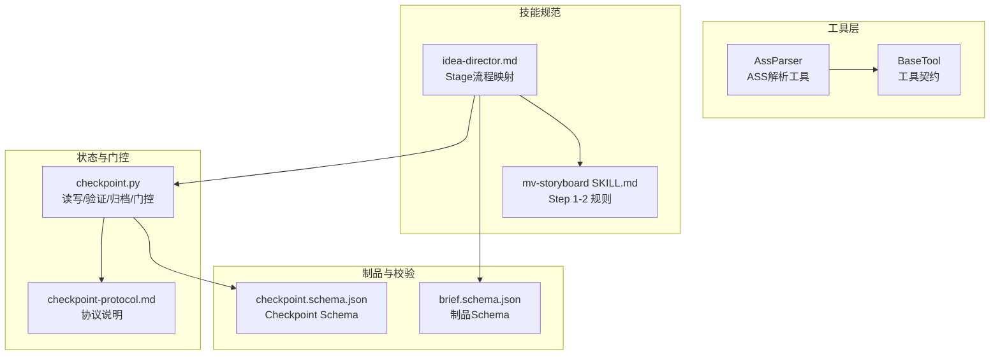
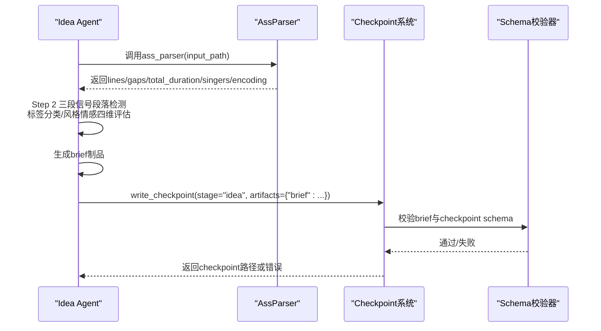
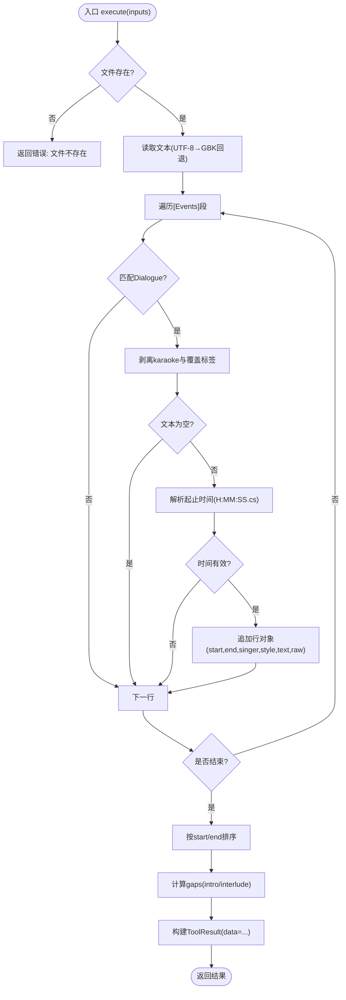
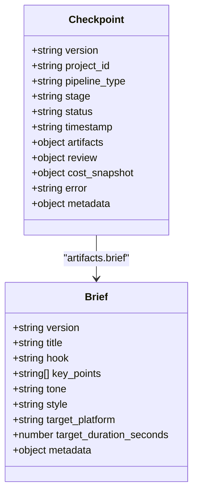
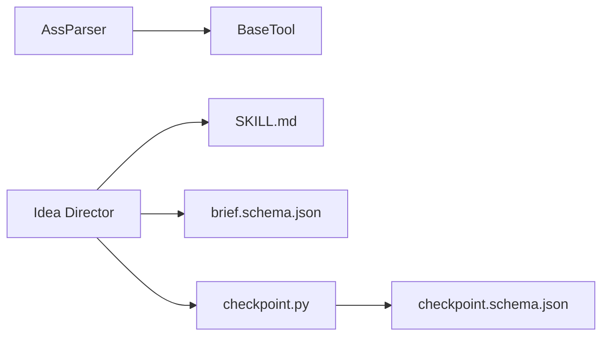

# Idea阶段 - 歌词解析与创意构思

<cite>
**本文引用的文件**   
- [ass_parser.py](file://tools/analysis/ass_parser.py)
- [base_tool.py](file://tools/base_tool.py)
- [SKILL.md](file://.agents/skills/mv-storyboard/SKILL.md)
- [idea-director.md](file://skills/pipelines/music-video/idea-director.md)
- [brief.schema.json](file://schemas/artifacts/brief.schema.json)
- [checkpoint.schema.json](file://schemas/checkpoints/checkpoint.schema.json)
- [checkpoint.py](file://lib/checkpoint.py)
- [checkpoint-protocol.md](file://skills/meta/checkpoint-protocol.md)
</cite>

## 目录
1. [简介](#简介)
2. [项目结构](#项目结构)
3. [核心组件](#核心组件)
4. [架构总览](#架构总览)
5. [详细组件分析](#详细组件分析)
6. [依赖关系分析](#依赖关系分析)
7. [性能考量](#性能考量)
8. [故障排除指南](#故障排除指南)
9. [结论](#结论)
10. [附录](#附录)

## 简介
本文件聚焦Idea阶段的完整实现：从ASS卡拉OK歌词文件的解析，到歌曲结构分析与风格情感评估，再到“brief”制品的生成、校验与checkpoint协议落地。目标是让读者既能理解底层工具行为（ass_parser），也能掌握上层Agent认知任务（段落检测、风格情感四维评估）以及制品治理（schema校验、审批门控、历史归档）。

## 项目结构
Idea阶段涉及的关键位置与职责：
- 工具层：tools/analysis/ass_parser.py 提供确定性ASS解析能力；tools/base_tool.py 定义工具契约与执行框架。
- 技能规范：.agents/skills/mv-storyboard/SKILL.md 规定Step 1（解析）与Step 2（结构分析）的规则；skills/pipelines/music-video/idea-director.md 将规则映射到OpenMontage stage流程。
- 制品与校验：schemas/artifacts/brief.schema.json 约束brief结构；schemas/checkpoints/checkpoint.schema.json 约束checkpoint结构。
- 状态与门控：lib/checkpoint.py 负责checkpoint读写、验证、归档与审批门控；skills/meta/checkpoint-protocol.md 描述协议与最佳实践。

图表来源
- [ass_parser.py:102-146](file://tools/analysis/ass_parser.py#L102-L146)
- [base_tool.py:227-372](file://tools/base_tool.py#L227-L372)
- [SKILL.md:37-125](file://.agents/skills/mv-storyboard/SKILL.md#L37-L125)
- [idea-director.md:23-66](file://skills/pipelines/music-video/idea-director.md#L23-L66)
- [brief.schema.json:1-49](file://schemas/artifacts/brief.schema.json#L1-L49)
- [checkpoint.schema.json:1-47](file://schemas/checkpoints/checkpoint.schema.json#L1-L47)
- [checkpoint.py:336-467](file://lib/checkpoint.py#L336-L467)
- [checkpoint-protocol.md:10-100](file://skills/meta/checkpoint-protocol.md#L10-L100)

章节来源
- [ass_parser.py:1-244](file://tools/analysis/ass_parser.py#L1-L244)
- [base_tool.py:1-481](file://tools/base_tool.py#L1-L481)
- [SKILL.md:1-598](file://.agents/skills/mv-storyboard/SKILL.md#L1-L598)
- [idea-director.md:1-81](file://skills/pipelines/music-video/idea-director.md#L1-L81)
- [brief.schema.json:1-49](file://schemas/artifacts/brief.schema.json#L1-L49)
- [checkpoint.schema.json:1-47](file://schemas/checkpoints/checkpoint.schema.json#L1-L47)
- [checkpoint.py:1-537](file://lib/checkpoint.py#L1-L537)
- [checkpoint-protocol.md:1-201](file://skills/meta/checkpoint-protocol.md#L1-L201)

## 核心组件
- AssParser（工具）：确定性解析ASS歌词，完成编码探测、Dialogue提取、标签剥离、歌手角色映射、时间转换，并输出结构化行列表、时长、歌手集合与gaps（前奏/间奏）。
- BaseTool（基类）：统一工具契约（身份、资源、重试、幂等、执行、成本估算、事件埋点等），所有工具继承此基类。
- idea-director（Stage流程）：调用ass_parser进行Step 1，随后在Agent侧执行Step 2（三段信号段落检测、标签分类、风格情感四维评估），最终产出brief并通过checkpoint写入。
- checkpoint系统：负责checkpoint读写、schema校验、审批门控、历史归档与决策日志合并。

章节来源
- [ass_parser.py:102-244](file://tools/analysis/ass_parser.py#L102-L244)
- [base_tool.py:227-372](file://tools/base_tool.py#L227-L372)
- [idea-director.md:23-66](file://skills/pipelines/music-video/idea-director.md#L23-L66)
- [checkpoint.py:336-467](file://lib/checkpoint.py#L336-L467)

## 架构总览
Idea阶段的数据流与控制流如下：

图表来源
- [ass_parser.py:153-244](file://tools/analysis/ass_parser.py#L153-L244)
- [checkpoint.py:336-467](file://lib/checkpoint.py#L336-L467)
- [checkpoint.schema.json:1-47](file://schemas/checkpoints/checkpoint.schema.json#L1-L47)
- [brief.schema.json:1-49](file://schemas/artifacts/brief.schema.json#L1-L49)

## 详细组件分析

### ASS解析工具（ass_parser）
- 编码处理：优先UTF-8，若出现替换字符、控制字符或无CJK则回退GBK；自动去除BOM。
- Dialogue提取：仅处理[Events]段，使用正则匹配10字段，过滤空文本行。
- 标签剥离：先移除karaoke标签{\K28}/{\k28}，再移除其他覆盖标签，同时规范化硬换行/空格。
- 歌手映射：根据Style名称识别男/女/合唱/配唱/默认。
- 时间转换：H:MM:SS.cs转秒，保留厘秒精度。
- gaps计算：首句前为intro；相邻行间隔>3s标记interlude；尾奏不可知（仅记录前奏与间奏）。
- 输出结构：包含file、encoding、line_count、lines、total_duration、singers、gaps。

图表来源
- [ass_parser.py:46-69](file://tools/analysis/ass_parser.py#L46-L69)
- [ass_parser.py:72-99](file://tools/analysis/ass_parser.py#L72-L99)
- [ass_parser.py:153-244](file://tools/analysis/ass_parser.py#L153-L244)

章节来源
- [ass_parser.py:1-244](file://tools/analysis/ass_parser.py#L1-L244)

### 歌曲结构分析算法（Agent认知任务）
依据SKILL.md Step 2，使用三种信号综合判断段落：
- 信号1（时间间隔）：首句前为intro；行间隔>3s为interlude；末句后为outro（仅能推断intro）。
- 信号2（歌词重复）：重复出现的段落多为chorus；首次出现可标记verseA/B。
- 信号3（歌手变化）：男→女→合的变化常出现在chorus；单人独唱多为verse。

段落标签分类：
- intro / verseA / verseB / preChorus / chorus / bridge / interlude / outro

风格与情感四维评估：
- 语言维度：中文/韩文/英文/混合
- 节奏密度：字/秒划分快/中/慢
- 主题关键词：爱情/校园/古风/都市/分手等
- 歌手配置多样性：独唱/对唱/合唱

输出metadata包括songStyle、emotionalTone、language、duration、tempo、sections（带类型、时间、歌手）、emotionalArc等。

章节来源
- [SKILL.md:128-215](file://.agents/skills/mv-storyboard/SKILL.md#L128-L215)
- [idea-director.md:37-48](file://skills/pipelines/music-video/idea-director.md#L37-L48)

### brief制品生成与校验
- 必填字段：version、title、hook、key_points、tone、style、target_platform、target_duration_seconds
- 可选字段：core_message、cta、target_audience、reference_material、angle_options、selected_angle、metadata
- metadata需包含Step 2全量输出与ass_parse摘要（line_count、singers、encoding、gaps）
- target_platform枚举：youtube、instagram、tiktok、linkedin、generic

校验机制：
- checkpoint系统在write时会对artifacts中的已知制品名进行schema校验
- brief.schema.json约束结构与字段类型，禁止额外属性

章节来源
- [idea-director.md:51-66](file://skills/pipelines/music-video/idea-director.md#L51-L66)
- [brief.schema.json:1-49](file://schemas/artifacts/brief.schema.json#L1-L49)
- [checkpoint.py:104-137](file://lib/checkpoint.py#L104-L137)

### checkpoint协议实现
- 写入流程：准备stage/status/artifacts/metadata → 校验 → 原子写入（临时文件+替换）→ 归档旧版本至history/ → 合并decision_log
- 门控策略：manifest中human_approval_default决定是否需要人类审批；若需要，必须写status="awaiting_human"并在用户批准后重写为completed且human_approved=True
- 状态枚举：completed、failed、awaiting_human、in_progress
- 恢复支持：进入阶段先写in_progress；后续每次重要进展更新partial_progress；重启时读取最新checkpoint并继续

图表来源
- [checkpoint.schema.json:1-47](file://schemas/checkpoints/checkpoint.schema.json#L1-L47)
- [brief.schema.json:1-49](file://schemas/artifacts/brief.schema.json#L1-L49)
- [checkpoint.py:336-467](file://lib/checkpoint.py#L336-L467)

章节来源
- [checkpoint.py:1-537](file://lib/checkpoint.py#L1-L537)
- [checkpoint-protocol.md:10-100](file://skills/meta/checkpoint-protocol.md#L10-L100)

## 依赖关系分析
- ass_parser依赖BaseTool契约，遵循统一的工具元数据与执行模型
- idea-director依赖SKILL.md规则与brief.schema.json约束
- checkpoint系统依赖checkpoint.schema.json与artifact schema注册表，确保制品一致性
- 整体耦合度低：工具与Stage解耦，Stage与Schema解耦，Checkpoint作为横切关注点

图表来源
- [ass_parser.py:102-146](file://tools/analysis/ass_parser.py#L102-L146)
- [base_tool.py:227-372](file://tools/base_tool.py#L227-L372)
- [SKILL.md:37-125](file://.agents/skills/mv-storyboard/SKILL.md#L37-L125)
- [brief.schema.json:1-49](file://schemas/artifacts/brief.schema.json#L1-L49)
- [checkpoint.py:336-467](file://lib/checkpoint.py#L336-L467)
- [checkpoint.schema.json:1-47](file://schemas/checkpoints/checkpoint.schema.json#L1-L47)

## 性能考量
- 解析复杂度：线性扫描ASS文本，正则匹配与字符串操作均为O(n)，n为行数
- 时间转换与排序：时间解析常数时间，排序O(n log n)
- 内存占用：逐行处理，不加载整个文件到内存（除文本解码），适合大文件
- 工具资源：CPU 1核、RAM 64MB、无需GPU/网络，轻量级本地执行
- 幂等性：基于input_path生成idempotency_key，避免重复计算

章节来源
- [ass_parser.py:138-143](file://tools/analysis/ass_parser.py#L138-L143)
- [ass_parser.py:153-244](file://tools/analysis/ass_parser.py#L153-L244)

## 故障排除指南
常见错误与处理策略：
- 文件不存在：ass_parser直接返回success=False与错误信息
- 编码问题：UTF-8失败自动回退GBK；若仍失败，提示用户检查文件编码
- 时间戳格式错误：跳过该行而不中断整个解析过程
- 无Dialogue行：返回错误提示未找到任何歌词行
- checkpoint校验失败：检查artifacts是否符合schema，确认stage与status合法
- 门控违规：若manifest要求人类审批，不能直接写completed；需先写awaiting_human等待批准

排查步骤：
1. 检查ass_parser输出是否包含lines与gaps
2. 验证brief字段完整性与类型正确性
3. 查看checkpoint错误字段获取具体校验失败原因
4. 确认pipeline_type与stage是否在manifest中声明
5. 如需恢复，检查history/下的历史checkpoint与partial_progress

章节来源
- [ass_parser.py:153-204](file://tools/analysis/ass_parser.py#L153-L204)
- [checkpoint.py:104-172](file://lib/checkpoint.py#L104-L172)
- [checkpoint-protocol.md:102-156](file://skills/meta/checkpoint-protocol.md#L102-L156)

## 结论
Idea阶段通过确定性的ass_parser工具与严谨的checkpoint协议，实现了从ASS歌词解析到创意brief生成的完整流水线。三段信号段落检测与四维风格情感评估确保了音乐结构的准确理解与创意方向的合理引导。Schema校验与门控机制保障了制品质量与流程合规性，为后续Storyboard与Compose阶段奠定了坚实基础。

## 附录
- 工具调用示例：ass_parser输入仅需input_path字段
- 最佳实践：始终先写in_progress checkpoint，频繁更新partial_progress以支持断点续传
- 审核要点：编码正确、歌词完整、无标签残留、段落结构基于三信号、风格情感有歌词证据支撑