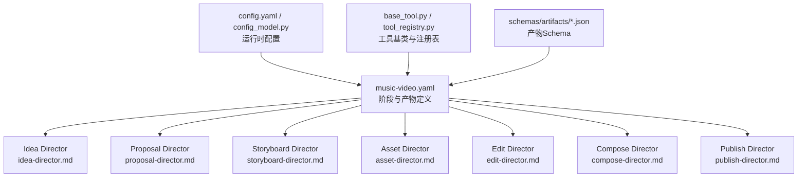
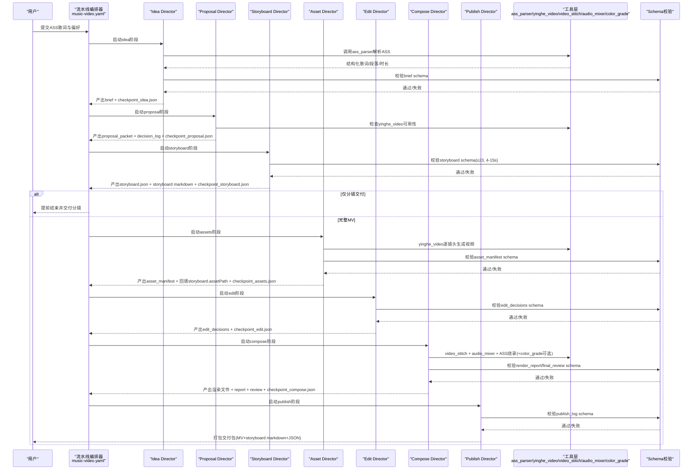
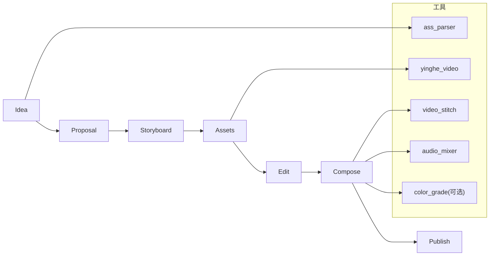

# MV制作阶段详解

<cite>
**本文引用的文件**   
- [music-video.yaml](file://pipeline_defs/music-video.yaml)
- [idea-director.md](file://skills/pipelines/music-video/idea-director.md)
- [proposal-director.md](file://skills/pipelines/music-video/proposal-director.md)
- [storyboard-director.md](file://skills/pipelines/music-video/storyboard-director.md)
- [asset-director.md](file://skills/pipelines/music-video/asset-director.md)
- [edit-director.md](file://skills/pipelines/music-video/edit-director.md)
- [compose-director.md](file://skills/pipelines/music-video/compose-director.md)
- [publish-director.md](file://skills/pipelines/music-video/publish-director.md)
- [config.yaml](file://config.yaml)
- [config_model.py](file://lib/config_model.py)
- [base_tool.py](file://tools/base_tool.py)
- [tool_registry.py](file://tools/tool_registry.py)
- [brief.schema.json](file://schemas/artifacts/brief.schema.json)
- [storyboard.schema.json](file://schemas/artifacts/storyboard.schema.json)
- [asset_manifest.schema.json](file://schemas/artifacts/asset_manifest.schema.json)
- [edit_decisions.schema.json](file://schemas/artifacts/edit_decisions.schema.json)
</cite>

## 目录
1. [简介](#简介)
2. [项目结构](#项目结构)
3. [核心组件](#核心组件)
4. [架构总览](#架构总览)
5. [详细阶段分析](#详细阶段分析)
6. [依赖关系分析](#依赖关系分析)
7. [性能考量](#性能考量)
8. [故障排除指南](#故障排除指南)
9. [结论](#结论)
10. [附录](#附录)

## 简介
本文件系统化阐述OpenMontage-MV的七个MV制作阶段：idea、proposal、storyboard、assets、edit、compose、publish。每个阶段均包含功能说明、输入输出、处理逻辑、验证规则、配置选项、错误处理与故障排除要点，帮助读者从“歌词解析”到“最终交付”完整理解流水线行为与约束。

## 项目结构
- 流水线定义位于 pipeline_defs/music-video.yaml，声明了7个阶段、所需技能、工具、产物与校验重点。
- 各阶段的具体执行策略由 skills/pipelines/music-video/*-director.md 描述。
- 运行时配置由 config.yaml 与 lib/config_model.py 提供类型化加载与路径解析。
- 工具基类与注册表在 tools/base_tool.py 与 tools/tool_registry.py，统一能力发现、状态检查、事件埋点与依赖校验。
- 产物Schema集中在 schemas/artifacts/*.json，用于严格校验各阶段产出。

**图表来源** 
- [music-video.yaml:1-187](file://pipeline_defs/music-video.yaml#L1-L187)
- [config.yaml:1-20](file://config.yaml#L1-L20)
- [config_model.py:1-70](file://lib/config_model.py#L1-L70)
- [base_tool.py:1-481](file://tools/base_tool.py#L1-L481)
- [tool_registry.py:1-493](file://tools/tool_registry.py#L1-L493)

**章节来源**
- [music-video.yaml:1-187](file://pipeline_defs/music-video.yaml#L1-L187)
- [config.yaml:1-20](file://config.yaml#L1-L20)
- [config_model.py:1-70](file://lib/config_model.py#L1-L70)

## 核心组件
- 阶段编排器（music-video.yaml）：声明阶段顺序、输入/输出产物、可用工具、Checkpoint策略、人类审批默认值、审查焦点与成功标准。
- 导演文档（*-director.md）：为每个阶段提供步骤、前置条件、输出格式、自检清单与Checkpoint写入规范。
- 配置模型（config_model.py + config.yaml）：加载并校验运行时参数（编码、分辨率、帧率、CRF、路径等），提供路径解析。
- 工具基础设施（base_tool.py + tool_registry.py）：统一工具契约、依赖检查、状态报告、能力目录、提供者菜单、事件埋点与重试策略。
- 产物Schema（schemas/artifacts/*.json）：对Brief、Storyboard、Asset Manifest、Edit Decisions等进行强类型校验。

**章节来源**
- [music-video.yaml:1-187](file://pipeline_defs/music-video.yaml#L1-L187)
- [idea-director.md:1-81](file://skills/pipelines/music-video/idea-director.md#L1-L81)
- [proposal-director.md:1-95](file://skills/pipelines/music-video/proposal-director.md#L1-L95)
- [storyboard-director.md:1-93](file://skills/pipelines/music-video/storyboard-director.md#L1-L93)
- [asset-director.md:1-63](file://skills/pipelines/music-video/asset-director.md#L1-L63)
- [edit-director.md:1-58](file://skills/pipelines/music-video/edit-director.md#L1-L58)
- [compose-director.md:1-56](file://skills/pipelines/music-video/compose-director.md#L1-L56)
- [publish-director.md:1-48](file://skills/pipelines/music-video/publish-director.md#L1-L48)
- [config_model.py:1-70](file://lib/config_model.py#L1-L70)
- [base_tool.py:1-481](file://tools/base_tool.py#L1-L481)
- [tool_registry.py:1-493](file://tools/tool_registry.py#L1-L493)

## 架构总览
下图展示从ASS歌词到最终MV交付的整体数据流与各阶段交互。

**图表来源** 
- [music-video.yaml:1-187](file://pipeline_defs/music-video.yaml#L1-L187)
- [idea-director.md:1-81](file://skills/pipelines/music-video/idea-director.md#L1-L81)
- [proposal-director.md:1-95](file://skills/pipelines/music-video/proposal-director.md#L1-L95)
- [storyboard-director.md:1-93](file://skills/pipelines/music-video/storyboard-director.md#L1-L93)
- [asset-director.md:1-63](file://skills/pipelines/music-video/asset-director.md#L1-L63)
- [edit-director.md:1-58](file://skills/pipelines/music-video/edit-director.md#L1-L58)
- [compose-director.md:1-56](file://skills/pipelines/music-video/compose-director.md#L1-L56)
- [publish-director.md:1-48](file://skills/pipelines/music-video/publish-director.md#L1-L48)

## 详细阶段分析

### Idea阶段（歌词解析与创意构思）
- 功能：将ASS卡拉OK歌词解析为结构化数据，进行歌曲段落识别与风格情感判断，产出Brief。
- 输入：ASS歌词文件；工具ass_parser；参考Layer3文档与brief schema。
- 处理逻辑：
  - 调用ass_parser完成编码回退、对话提取、标签清理、歌手映射、时间戳转换。
  - 基于三段信号（间隔、重复、歌手变化）划分段落，标注类型与时间。
  - 四维度风格与情感判定，形成hook、key_points、tone/style等字段。
- 输出：brief（schema校验）、checkpoint_idea.json。
- 验证规则：
  - brief schema必填字段齐全且合法。
  - ass_parser摘要包含行数、总时长、歌手、间隔信息。
  - 段落覆盖全曲时长无遗漏。
- 配置选项：
  - 目标平台target_platform（默认generic）。
  - 目标时长target_duration_seconds来自ass_parser。
- 错误处理与排障：
  - 若解析乱码或为空，直接提示编码问题而非猜测。
  - 段落划分需引用歌词证据，否则自审不通过。

**章节来源**
- [idea-director.md:1-81](file://skills/pipelines/music-video/idea-director.md#L1-L81)
- [music-video.yaml:37-53](file://pipeline_defs/music-video.yaml#L37-L53)
- [brief.schema.json:1-49](file://schemas/artifacts/brief.schema.json#L1-L49)

### Proposal阶段（制作提案与决策制定）
- 功能：基于Brief匹配叙事风格与人物，确定音乐方案、供应商可用性、交付形态，形成提案包与决策日志。
- 输入：brief；人物库；Layer3风格指南；proposal schema与decision_log schema。
- 处理逻辑：
  - 依据songStyle/emotionalTone/tempo/structure匹配7种叙事风格之一，冲突按优先级解决。
  - 匹配人物并记录参考图路径（若有），确保跨镜头一致性。
  - 确认音乐源（原曲音频），若无则降级为storyboard-only并在提案中明确。
  - 检查唯一视频供应商yinghe_video可用性，记录provider_selection与render_runtime_selection（ffmpeg）。
  - 明确交付形态（仅分镜 vs 完整MV）及范围（≤23镜头，每镜头4-15秒）。
- 输出：proposal_packet、decision_log、checkpoint_proposal.json。
- 验证规则：
  - proposal_packet与decision_log schema有效。
  - decision_log包含供应商选择与ffmpeg渲染运行时选择。
  - 音乐计划已解决或明确降级记录。
- 错误处理与排障：
  - 供应商不可用时显式升级阻塞，不隐藏问题。
  - 无音频时必须在提案阶段降级，避免后续阶段暴露。

**章节来源**
- [proposal-director.md:1-95](file://skills/pipelines/music-video/proposal-director.md#L1-L95)
- [music-video.yaml:55-74](file://pipeline_defs/music-video.yaml#L55-L74)

### Storyboard阶段（分镜脚本生成）
- 功能：将Brief与提案转化为分镜脚本，生成18维字段与Seedance优化prompt，输出双格式。
- 输入：brief、proposal_packet；storyboard schema；Layer3镜头语言与prompt指南。
- 处理逻辑：
  - 按段落驱动分镜，保证时间线连续、无重叠/空隙，整数秒4-15。
  - 每镜头写seedancePrompt（八要素公式），单运镜、低强度动作、强制约束包（画质/稳定/字幕兜底/水印Logo兜底，双人加双胞胎兜底）。
  - 输出storyboard.json与storyboard markdown模板填充版。
  - 元数据meta.provenance记录生成者、流水线名、工具版本与seed策略。
- 输出：storyboard.json、{songName}_storyboard.md、checkpoint_storyboard.json。
- 验证规则：
  - ≤23镜头，duration整数且在4-15秒内；时间线连续。
  - 每镜头seedancePrompt通过八要素自检。
  - 空镜服务于叙事而非填充。
- 错误处理与排障：
  - Schema拒绝即视为分镜缺陷，不得放宽约束。
  - 若为storyboard-only交付，此阶段即为终点。

**章节来源**
- [storyboard-director.md:1-93](file://skills/pipelines/music-video/storyboard-director.md#L1-L93)
- [music-video.yaml:76-97](file://pipeline_defs/music-video.yaml#L76-L97)
- [storyboard.schema.json:1-289](file://schemas/artifacts/storyboard.schema.json#L1-L289)

### Assets阶段（视觉资产生成）
- 功能：按分镜逐镜头生成视频片段，建立资产清单并回填分镜路径。
- 输入：storyboard（含seedancePrompt、duration、referenceImages）；proposal_packet/decision_log。
- 处理逻辑：
  - 直接调用yinghe_video（唯一供应商），不可用则显式升级阻塞。
  - 逐镜头生成：绑定参考图（M4）以锁定人物一致性；duration取分镜整数秒；输出至projects/<id>/assets/video/shot_NN.mp4。
  - ffprobe校验时长（±0.5s容差），不一致则再生一次仍失败则上报。
  - 回填storyboard.shots[].assetPath，刷新partial_progress。
- 输出：asset_manifest（schema校验）、更新后的storyboard.json、checkpoint_assets.json。
- 验证规则：
  - 每个clip时长等于对应分镜时长。
  - 人物一致性保持（有参考图时）。
  - 动作遵循Seedance低强度连续性规则。
- 错误处理与排障：
  - 供应商不可用需立即阻断并提示。
  - 时长不匹配需二次尝试后上报。

**章节来源**
- [asset-director.md:1-63](file://skills/pipelines/music-video/asset-director.md#L1-L63)
- [music-video.yaml:99-119](file://pipeline_defs/music-video.yaml#L99-L119)
- [asset_manifest.schema.json:1-63](file://schemas/artifacts/asset_manifest.schema.json#L1-L63)

### Edit阶段（剪辑决策与时序规划）
- 功能：基于分镜与资产清单生成精确的组装计划，固定歌词时序，不做创造性重剪。
- 输入：storyboard、asset_manifest、proposal_packet（音乐源）。
- 处理逻辑：
  - 严格按shotNumber排序，每段占用[startTime, endTime]；若素材超长，尾部裁剪，不迁就歌词。
  - 全曲音频作为唯一音轨对齐t=0，禁止混入片段自带音频。
  - 转场继承分镜transition字段（硬切/叠化/闪白/黑场/匹配剪辑）。
  - 字幕计划：compose阶段烧录原始ASS（保留逐字卡拉OK时间与样式），如用户拒绝则记录opt-out。
  - render_runtime固定为ffmpeg。
- 输出：edit_decisions（schema校验）、checkpoint_edit.json。
- 验证规则：
  - edit_decisions schema有效。
  - 剪辑覆盖全曲时长。
- 错误处理与排障：
  - 若最后镜头endTime≠歌曲时长，需修正裁剪或分段计划。

**章节来源**
- [edit-director.md:1-58](file://skills/pipelines/music-video/edit-director.md#L1-L58)
- [music-video.yaml:121-137](file://pipeline_defs/music-video.yaml#L121-L137)
- [edit_decisions.schema.json:1-234](file://schemas/artifacts/edit_decisions.schema.json#L1-L234)

### Compose阶段（视频合成与渲染）
- 功能：执行edit_decisions，使用ffmpeg串联画面、铺原曲、烧录ASS卡拉OK字幕，可选调色。
- 输入：edit_decisions、asset_manifest、原始ASS路径。
- 处理逻辑：
  - video_stitch按镜头顺序拼接，按edit_decisions裁剪尾段，静音/剥离片段原生音频。
  - audio_mixer铺设原曲音频于t=0，校验画面时长≈歌曲时长。
  - 烧录原始ASS（subtitles/ass滤镜），保留逐字卡拉OK时间与样式；仅在用户opt-out时跳过。
  - 可选color_grade统一色调（谨慎使用）。
  - ffprobe校验输出总时长≈歌曲时长（±0.1s），抽查多镜头边界A/V同步与字幕时机。
- 输出：最终MV文件、render_report、final_review、checkpoint_compose.json。
- 验证规则：
  - render_report与final_review schema有效。
  - 输出文件存在并通过ffprobe校验。
- 错误处理与排障：
  - 时长偏差超限需回溯edit_decisions与素材时长。
  - 字幕错位需核对ASS原始时间轴。

**章节来源**
- [compose-director.md:1-56](file://skills/pipelines/music-video/compose-director.md#L1-L56)
- [music-video.yaml:139-167](file://pipeline_defs/music-video.yaml#L139-L167)

### Publish阶段（发布与交付）
- 功能：打包最终MV与配套分镜文档，生成发布日志。
- 输入：render_report、final_review、可选storyboard。
- 处理逻辑：
  - 打包三件套：最终MV、{songName}_storyboard.md、storyboard.json，置于renders目录或用户指定导出路径。
  - 校验三者存在；若为storyboard-only却到达publish，属治理错误需上报。
  - 编写元数据（歌名、时长、叙事风格、镜头数、供应商、生成日期）。
  - 生成publish_log（含路径、大小、必要时校验和）。
- 输出：publish_log（schema校验）、checkpoint_publish.json。
- 验证规则：
  - publish_log schema有效。
  - 导出包包含视频、storyboard markdown与JSON。
- 错误处理与排障：
  - 缺失任一交付文件需立即补齐或报错。

**章节来源**
- [publish-director.md:1-48](file://skills/pipelines/music-video/publish-director.md#L1-L48)
- [music-video.yaml:169-186](file://pipeline_defs/music-video.yaml#L169-L186)

## 依赖关系分析
- 阶段间依赖：
  - idea → proposal → storyboard → assets → edit → compose → publish
  - storyboard-only模式可在storyboard阶段提前终止。
- 工具依赖：
  - idea: ass_parser
  - assets: yinghe_video
  - compose: video_stitch、audio_mixer、（可选）color_grade
- 配置与环境：
  - config.yaml定义输出格式、编码、分辨率、帧率、CRF与路径。
  - base_tool.py/.env自动加载环境变量（API Key等），tool_registry.py负责能力发现与状态汇总。

**图表来源** 
- [music-video.yaml:22-31](file://pipeline_defs/music-video.yaml#L22-L31)
- [music-video.yaml:37-186](file://pipeline_defs/music-video.yaml#L37-L186)

**章节来源**
- [music-video.yaml:1-187](file://pipeline_defs/music-video.yaml#L1-L187)
- [base_tool.py:1-481](file://tools/base_tool.py#L1-L481)
- [tool_registry.py:1-493](file://tools/tool_registry.py#L1-L493)

## 性能考量
- 分镜数量上限23、单镜头时长4-15秒，控制生成总量与渲染时长。
- ffmpeg为唯一渲染后端，建议合理设置CRF与分辨率以平衡质量与体积。
- 逐镜头生成可结合partial_progress提升可视化反馈效率。
- 批量操作（如stitch/mix）尽量单次完成以减少IO开销。

[本节为通用指导，无需特定文件引用]

## 故障排除指南
- 编码问题（Idea）：
  - 现象：解析乱码或空输出。
  - 处理：提示编码问题，要求用户提供正确编码的ASS。
- 供应商不可用（Proposal/Assets）：
  - 现象：yinghe_video不可用或缺少API Key。
  - 处理：显式升级阻塞，记录decision_log，等待修复后再继续。
- 时长不匹配（Assets/Compose）：
  - 现象：生成片段时长与分镜不一致或最终时长≠歌曲时长。
  - 处理：Assets阶段二次尝试；Compose阶段回溯edit_decisions与素材时长。
- 字幕错位（Compose）：
  - 现象：卡拉OK字幕与歌词不同步。
  - 处理：核对原始ASS时间轴，确保未修改或重计时。
- 交付不完整（Publish）：
  - 现象：缺少MV或分镜文档。
  - 处理：补齐缺失文件，或上报治理错误（storyboard-only误达publish）。

**章节来源**
- [idea-director.md:25-36](file://skills/pipelines/music-video/idea-director.md#L25-L36)
- [proposal-director.md:57-69](file://skills/pipelines/music-video/proposal-director.md#L57-L69)
- [asset-director.md:20-44](file://skills/pipelines/music-video/asset-director.md#L20-L44)
- [compose-director.md:31-50](file://skills/pipelines/music-video/compose-director.md#L31-L50)
- [publish-director.md:18-31](file://skills/pipelines/music-video/publish-director.md#L18-L31)

## 结论
OpenMontage-MV通过严格的阶段契约与Schema校验，将ASS歌词转化为高质量MV成品。每个阶段职责清晰、输入输出明确、错误处理透明，配合统一的工具基类与注册表，实现可观测、可恢复、可扩展的流水线体验。建议在开发中严格遵守各阶段self-check与success_criteria，以确保稳定性与可复现性。

[本节为总结性内容，无需特定文件引用]

## 附录
- 运行时配置键（config.yaml）：
  - checkpoint.policy/storage_dir
  - output.default_format/default_codec/default_audio_codec/default_resolution/default_fps/default_crf
  - paths.pipeline_dir/library_dir/styles_dir/skills_dir/output_dir
- 配置模型（config_model.py）：
  - OpenMontageConfig.load()加载YAML并返回类型化对象
  - resolve_path(key, project_root)解析相对路径

**章节来源**
- [config.yaml:1-20](file://config.yaml#L1-L20)
- [config_model.py:1-70](file://lib/config_model.py#L1-L70)