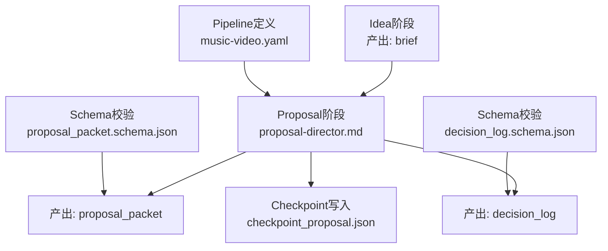
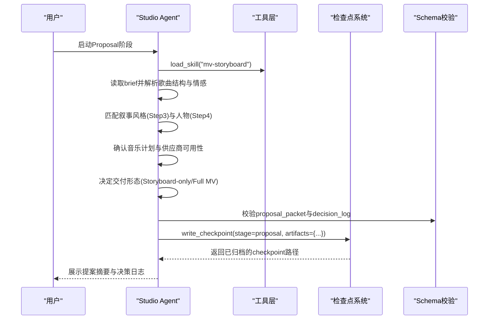
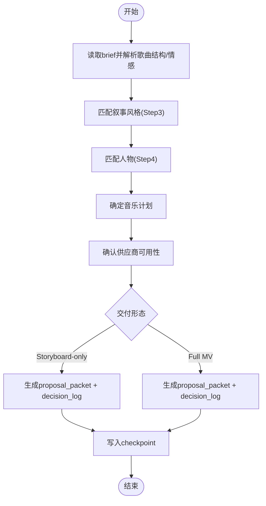
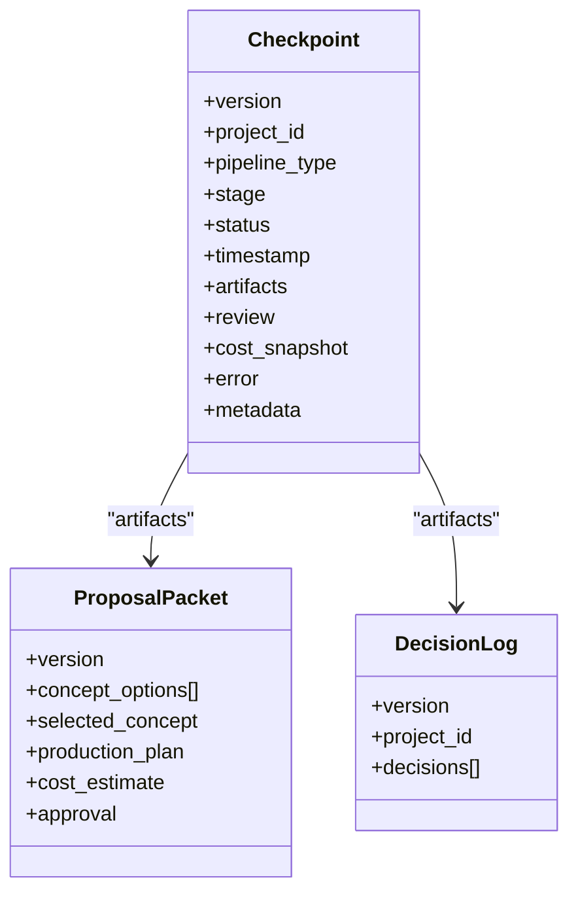
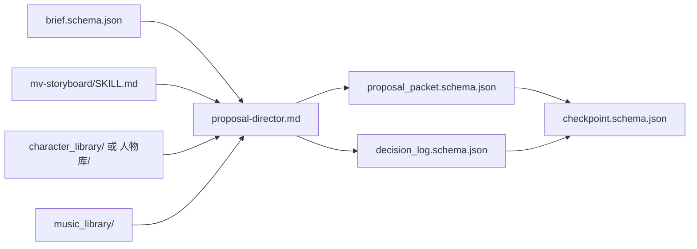

# Proposal阶段 - 制作提案与决策制定

<cite>
**本文引用的文件**   
- [skills/pipelines/music-video/proposal-director.md](file://skills/pipelines/music-video/proposal-director.md)
- [schemas/artifacts/proposal_packet.schema.json](file://schemas/artifacts/proposal_packet.schema.json)
- [schemas/artifacts/decision_log.schema.json](file://schemas/artifacts/decision_log.schema.json)
- [schemas/artifacts/brief.schema.json](file://schemas/artifacts/brief.schema.json)
- [.agents/skills/mv-storyboard/SKILL.md](file://.agents/skills/mv-storyboard/SKILL.md)
- [pipeline_defs/music-video.yaml](file://pipeline_defs/music-video.yaml)
- [lib/checkpoint.py](file://lib/checkpoint.py)
- [backlot/agent/tools.py](file://backlot/agent/tools.py)
- [backlot/ui/board.js](file://backlot/ui/board.js)
</cite>

## 目录
1. [引言](#引言)
2. [项目结构](#项目结构)
3. [核心组件](#核心组件)
4. [架构总览](#架构总览)
5. [详细组件分析](#详细组件分析)
6. [依赖关系分析](#依赖关系分析)
7. [性能考量](#性能考量)
8. [故障排查指南](#故障排查指南)
9. [结论](#结论)
10. [附录](#附录)

## 引言
本文件聚焦于“Proposal（提案）”阶段的完整实现与使用方式，说明如何基于Idea阶段的brief生成完整的提案文档，包括视觉风格建议、场景设计、特效方案与技术要求；并解释决策日志的记录格式、审批流程与版本管理。同时给出提案模板字段、自定义选项与自动化决策规则，以及评审标准与修改建议机制。

## 项目结构
Proposal阶段位于音乐视频流水线中，由“proposal-director”技能驱动，输入为Idea阶段产出的brief，输出为proposal_packet与decision_log，并通过checkpoint协议持久化状态。

图表来源
- [pipeline_defs/music-video.yaml:55-74](file://pipeline_defs/music-video.yaml#L55-L74)
- [skills/pipelines/music-video/proposal-director.md:1-95](file://skills/pipelines/music-video/proposal-director.md#L1-L95)
- [schemas/artifacts/proposal_packet.schema.json:1-379](file://schemas/artifacts/proposal_packet.schema.json#L1-L379)
- [schemas/artifacts/decision_log.schema.json:1-104](file://schemas/artifacts/decision_log.schema.json#L1-L104)

章节来源
- [pipeline_defs/music-video.yaml:55-74](file://pipeline_defs/music-video.yaml#L55-L74)
- [skills/pipelines/music-video/proposal-director.md:1-95](file://skills/pipelines/music-video/proposal-director.md#L1-L95)

## 核心组件
- 提案生成器（proposal-director）：依据SKILL.md的叙事风格匹配与人物匹配规则，结合资源库与用户输入，生成提案包与决策日志。
- 提案包Schema（proposal_packet.schema.json）：约束概念选项、生产计划、成本估算、审批等字段。
- 决策日志Schema（decision_log.schema.json）：记录每个关键选择的类别、选项、评分与理由。
- 检查点协议（checkpoint.py）：负责阶段状态持久化、归档与决策日志合并。
- 工具层（tools.py）：提供init_project与write_checkpoint等原生工具，确保合规写入与校验。
- 流水线定义（music-video.yaml）：声明proposal阶段的输入/输出、审查重点与成功标准。

章节来源
- [skills/pipelines/music-video/proposal-director.md:1-95](file://skills/pipelines/music-video/proposal-director.md#L1-L95)
- [schemas/artifacts/proposal_packet.schema.json:1-379](file://schemas/artifacts/proposal_packet.schema.json#L1-L379)
- [schemas/artifacts/decision_log.schema.json:1-104](file://schemas/artifacts/decision_log.schema.json#L1-L104)
- [lib/checkpoint.py:336-467](file://lib/checkpoint.py#L336-L467)
- [backlot/agent/tools.py:219-251](file://backlot/agent/tools.py#L219-L251)
- [pipeline_defs/music-video.yaml:55-74](file://pipeline_defs/music-video.yaml#L55-L74)

## 架构总览
Proposal阶段的核心数据流如下：从brief出发，按SKILL.md的规则进行叙事风格与人物匹配，确定音乐计划与供应商可用性，决定交付形态（仅分镜或完整MV），最终产出proposal_packet与decision_log，并通过checkpoint协议保存。

图表来源
- [skills/pipelines/music-video/proposal-director.md:23-90](file://skills/pipelines/music-video/proposal-director.md#L23-L90)
- [lib/checkpoint.py:336-467](file://lib/checkpoint.py#L336-L467)
- [backlot/agent/tools.py:219-251](file://backlot/agent/tools.py#L219-L251)

## 详细组件分析

### 提案生成流程（基于brief到proposal_packet）
- 输入：brief（来自Idea阶段）
- 处理：
  - 叙事风格匹配：根据歌曲风格、情感基调、节奏与结构映射到7种叙事风格之一；冲突时遵循优先级；支持用户覆盖并记录。
  - 人物匹配：读取人物库（优先character_library/，回退至人物库/），依据“适配歌曲风格”字段匹配；若存在PNG参考图则记录路径以保障跨镜头一致性。
  - 音乐计划：必须明确音频来源（music_library/或用户提供路径）；若无音频则降级为storyboard-only并在提案中明示。
  - 供应商确认：当前唯一视频供应商为yinghe_video；需检查注册表与依赖（API Key）是否满足；不可用则显式上报阻塞；仍需在decision_log记录provider_selection。
  - 渲染运行时：固定为ffmpeg（拼接+原曲+ASS字幕烧录），记录render_runtime_selection。
  - 交付形态：明确storyboard-only或full MV；full MV需说明预计shot数量（≤23）与单镜头时长（4-15s）。
- 输出：proposal_packet与decision_log，随后通过checkpoint协议写入。

图表来源
- [skills/pipelines/music-video/proposal-director.md:23-90](file://skills/pipelines/music-video/proposal-director.md#L23-L90)
- [.agents/skills/mv-storyboard/SKILL.md:218-312](file://.agents/skills/mv-storyboard/SKILL.md#L218-L312)

章节来源
- [skills/pipelines/music-video/proposal-director.md:23-90](file://skills/pipelines/music-video/proposal-director.md#L23-L90)
- [.agents/skills/mv-storyboard/SKILL.md:218-312](file://.agents/skills/mv-storyboard/SKILL.md#L218-L312)

### 提案包结构（proposal_packet.schema.json）
- 版本与概念选项：至少3个不同方向的概念，包含标题、钩子、叙事结构、视觉策略、目标时长、受众、平台、关键要点、核心信息、CTA、调性、依据与理由。
- 选定概念：concept_id与rationale，可选modifications。
- 生产计划：pipeline、playbook、stages（含工具、角色、可用性、成本与选择理由）、质量权衡、替代路径、交付承诺（promise_type、motion_required、tone_mode、quality_floor等）、渲染家族与运行时、组合模式、艺术指导、品味画像、音乐来源、配音选择、决策日志引用、供应商排名。
- 成本估算：总成本、明细项、预算上限与判定、节省选项。
- 审批：status（pending/approved/approved_with_changes/rejected）、用户备注、批准预算。

章节来源
- [schemas/artifacts/proposal_packet.schema.json:1-379](file://schemas/artifacts/proposal_packet.schema.json#L1-L379)

### 决策日志结构（decision_log.schema.json）
- 版本与项目ID。
- decisions数组：每项包含decision_id、stage、category（如provider_selection、render_runtime_selection、composition_mode、music_source等）、subject、options_considered（option_id、label、score、reason、rejected_because）、selected、reason、user_visible、user_approved、confidence。

章节来源
- [schemas/artifacts/decision_log.schema.json:1-104](file://schemas/artifacts/decision_log.schema.json#L1-L104)

### 检查点与版本管理（checkpoint.py）
- 写入checkpoint：校验阶段合法性、强制人类审批门控（human_approval_default）、归档历史版本、合并decision_log并回填引用。
- 归档策略：对非in_progress的旧checkpoint复制到history目录，保留审计轨迹。
- 决策日志合并：去重追加，确保全量可审计。

图表来源
- [schemas/checkpoints/checkpoint.schema.json:1-47](file://schemas/checkpoints/checkpoint.schema.json#L1-L47)
- [schemas/artifacts/proposal_packet.schema.json:1-379](file://schemas/artifacts/proposal_packet.schema.json#L1-L379)
- [schemas/artifacts/decision_log.schema.json:1-104](file://schemas/artifacts/decision_log.schema.json#L1-L104)
- [lib/checkpoint.py:336-467](file://lib/checkpoint.py#L336-L467)

章节来源
- [lib/checkpoint.py:336-467](file://lib/checkpoint.py#L336-L467)

### 工具与审批流程（tools.py与UI）
- 工具：init_project创建项目工作区；write_checkpoint用于阶段完成或等待人类审批（awaiting_human）。
- UI展示：board.js针对proposal_packet渲染关键事实（runtime、pipeline、estimated cost、concepts数）与选中概念的rationale，便于用户审阅与反馈。

章节来源
- [backlot/agent/tools.py:219-251](file://backlot/agent/tools.py#L219-L251)
- [backlot/ui/board.js:354-384](file://backlot/ui/board.js#L354-L384)

## 依赖关系分析
- 上游依赖：Idea阶段的brief（schema约束title/hook/key_points/tone/style/target_platform/target_duration_seconds等）。
- 内部依赖：SKILL.md的叙事风格与人物匹配规则；人物库（character_library/或人物库/）；音乐库（music_library/）。
- 下游依赖：assets阶段需要storyboard与asset_manifest；compose阶段需要edit_decisions与asset_manifest。

图表来源
- [schemas/artifacts/brief.schema.json:1-49](file://schemas/artifacts/brief.schema.json#L1-L49)
- [.agents/skills/mv-storyboard/SKILL.md:218-312](file://.agents/skills/mv-storyboard/SKILL.md#L218-L312)
- [schemas/artifacts/proposal_packet.schema.json:1-379](file://schemas/artifacts/proposal_packet.schema.json#L1-L379)
- [schemas/artifacts/decision_log.schema.json:1-104](file://schemas/artifacts/decision_log.schema.json#L1-L104)
- [schemas/checkpoints/checkpoint.schema.json:1-47](file://schemas/checkpoints/checkpoint.schema.json#L1-L47)

章节来源
- [schemas/artifacts/brief.schema.json:1-49](file://schemas/artifacts/brief.schema.json#L1-L49)
- [.agents/skills/mv-storyboard/SKILL.md:218-312](file://.agents/skills/mv-storyboard/SKILL.md#L218-L312)

## 性能考量
- 文案与Prompt生成：SKILL.md强调每镜头prompt控制在80-200字，避免冗余，提升生成效率与稳定性。
- Shot数量限制：最多23个shot，单镜头时长整数秒且4-15秒，减少后续资产生成与合成压力。
- 供应商与运行时：固定ffmpeg作为渲染运行时，降低多引擎切换带来的复杂度与不确定性。

[本节为通用指导，不直接分析具体文件]

## 故障排查指南
- 无音频可用：在Proposal阶段应降级为storyboard-only，并在proposal_packet与decision_log中明确记录；避免在assets阶段才暴露问题。
- 供应商不可用：检查yinghe_video注册表与API Key；不可用时显式上报阻塞，并在decision_log记录provider_selection。
- 审批门控失败：若stage配置human_approval_default=true，必须以awaiting_human状态写入checkpoint，待用户批准后再次写入completed并设置human_approved=true。
- Schema校验错误：确保proposal_packet与decision_log严格符合对应schema；必要时根据错误提示修正字段类型或必填项。

章节来源
- [skills/pipelines/music-video/proposal-director.md:46-74](file://skills/pipelines/music-video/proposal-director.md#L46-L74)
- [lib/checkpoint.py:378-406](file://lib/checkpoint.py#L378-L406)
- [schemas/artifacts/proposal_packet.schema.json:1-379](file://schemas/artifacts/proposal_packet.schema.json#L1-L379)
- [schemas/artifacts/decision_log.schema.json:1-104](file://schemas/artifacts/decision_log.schema.json#L1-L104)

## 结论
Proposal阶段通过严谨的SKILL.md规则与schema约束，将brief转化为可执行的提案包与决策日志，确保视觉风格、场景设计、特效方案与技术要求清晰透明；借助checkpoint协议与工具层，实现版本管理与审批门控。该阶段为后续assets、edit、compose与publish奠定坚实基础。

[本节为总结性内容，不直接分析具体文件]

## 附录

### 提案模板与字段说明（节选）
- 概念选项：id、title、hook、narrative_structure、visual_approach、target_duration_seconds、key_points、core_message、cta、tone、grounded_in、why_this_works、suggested_playbook、target_audience、target_platform。
- 生产计划：pipeline、playbook、stages（含tool_name、role、provider、available、estimated_cost_usd、why_this_provider）、quality_tradeoffs、alternative_paths、delivery_promise、renderer_family、render_runtime、composition_mode、art_direction、taste_profile、music_source、voice_selection、decision_log_ref、provider_rankings。
- 成本估算：total_estimated_usd、line_items（tool、operation、quantity、estimated_usd、notes）、budget_cap_usd、budget_verdict、savings_options。
- 审批：status、user_notes、approved_budget_usd。

章节来源
- [schemas/artifacts/proposal_packet.schema.json:10-333](file://schemas/artifacts/proposal_packet.schema.json#L10-L333)

### 决策日志记录格式（节选）
- 决策项：decision_id、stage、category（如provider_selection、render_runtime_selection、music_source、composition_mode等）、subject、options_considered（option_id、label、score、reason、rejected_because）、selected、reason、user_visible、user_approved、confidence。

章节来源
- [schemas/artifacts/decision_log.schema.json:11-100](file://schemas/artifacts/decision_log.schema.json#L11-L100)

### 自动化决策规则与自定义选项
- 叙事风格匹配：依据songStyle、emotionalTone、tempo、structure映射到7种叙事风格；冲突时按优先级处理；支持narrative_override并记录。
- 人物匹配：依据“适配歌曲风格”字段匹配；支持自定义人物描述；若PNG存在则绑定参考图路径。
- 音乐计划：必须明确来源；无音频则降级为storyboard-only。
- 供应商确认：唯一供应商yinghe_video；需检查可用性并记录。
- 渲染运行时：固定ffmpeg；记录render_runtime_selection。
- 交付形态：明确storyboard-only或full MV；full MV需说明shot数量与时长范围。

章节来源
- [.agents/skills/mv-storyboard/SKILL.md:218-312](file://.agents/skills/mv-storyboard/SKILL.md#L218-L312)
- [skills/pipelines/music-video/proposal-director.md:23-90](file://skills/pipelines/music-video/proposal-director.md#L23-L90)

### 提案评审标准与修改建议机制
- 评审重点：叙事风格匹配证据、人物匹配依据、音乐计划解决情况、供应商可用性确认、交付形态明确性。
- 成功标准：proposal_packet与decision_log schema有效；decision_log包含provider_selection与render_runtime_selection；音乐计划已解决或降级记录。
- 修改建议：用户在UI中查看proposal_packet摘要与rationale后，可通过chat回复提出修改意见；Agent据此更新proposal_packet并重新提交审批。

章节来源
- [pipeline_defs/music-video.yaml:55-74](file://pipeline_defs/music-video.yaml#L55-L74)
- [backlot/ui/board.js:354-384](file://backlot/ui/board.js#L354-L384)