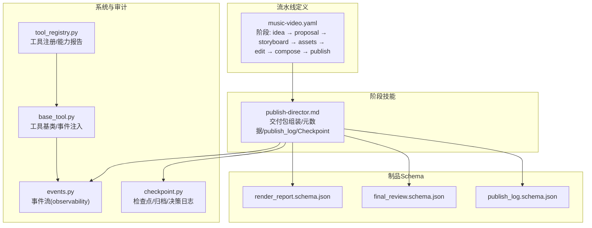
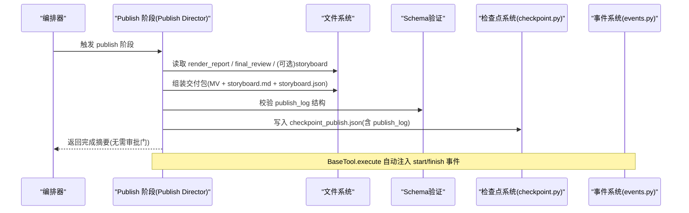
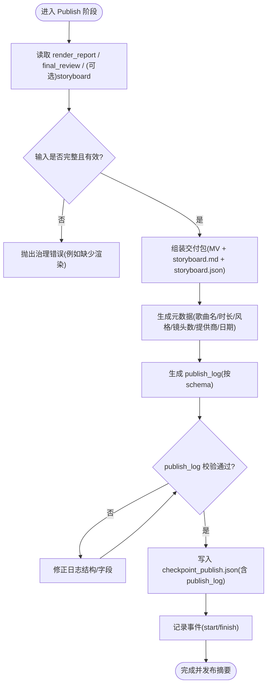
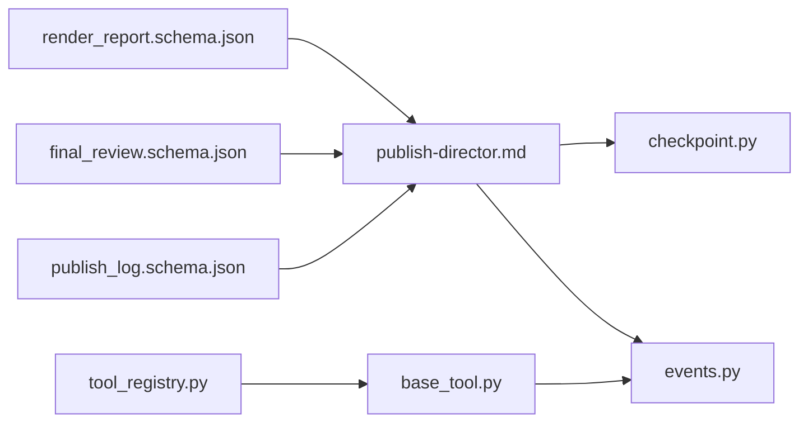

# Publish阶段 - 发布与交付

<cite>
**本文引用的文件**   
- [publish-director.md](file://skills/pipelines/music-video/publish-director.md)
- [publish_log.schema.json](file://schemas/artifacts/publish_log.schema.json)
- [final_review.schema.json](file://schemas/artifacts/final_review.schema.json)
- [render_report.schema.json](file://schemas/artifacts/render_report.schema.json)
- [music-video.yaml](file://pipeline_defs/music-video.yaml)
- [checkpoint.py](file://lib/checkpoint.py)
- [events.py](file://lib/events.py)
- [base_tool.py](file://tools/base_tool.py)
- [tool_registry.py](file://tools/tool_registry.py)
</cite>

## 目录
1. [简介](#简介)
2. [项目结构](#项目结构)
3. [核心组件](#核心组件)
4. [架构总览](#架构总览)
5. [详细组件分析](#详细组件分析)
6. [依赖关系分析](#依赖关系分析)
7. [性能考虑](#性能考虑)
8. [故障排查指南](#故障排查指南)
9. [结论](#结论)
10. [附录](#附录)

## 简介
本章节聚焦于音乐视频流水线中的“Publish（发布）”阶段，说明最终审阅流程、质量保证检查与交付准备。内容涵盖：生成可发布文件、元数据打包与分发格式、最终审阅清单、审批工作流与版本标记、发布日志结构与审计追踪、合规报告、导出模板、平台优化与自动化发布工作流、文件校验与完整性检查、备份策略等。所有说明均基于仓库中已定义的制品模式、阶段契约与工具基础设施。

## 项目结构
Publish 阶段位于 music-video 流水线的最后一步，负责将渲染产物与配套素材打包为交付包，并产出符合 schema 的 publish_log 作为审计与分发的依据。关键位置与职责如下：
- 阶段定义与准入/产出：在 pipeline manifest 中声明了 publish 阶段的输入、输出、工具与审查要点。
- 阶段技能（Skill）：publish-director.md 描述了该阶段的执行步骤、前置条件、产物与 checkpoint 写入要求。
- 制品 Schema：publish_log.schema.json 定义了发布日志的结构；final_review.schema.json 与 render_report.schema.json 提供质量与渲染报告的约束。
- 检查点与审计：checkpoint.py 负责阶段完成后的状态持久化、归档与决策日志合并；events.py 记录工具级事件用于看板与审计。
- 工具基座：base_tool.py 与 tool_registry.py 提供工具运行、能力发现与状态报告的基础设施。

**图示来源** 
- [music-video.yaml:1-187](file://pipeline_defs/music-video.yaml#L1-L187)
- [publish-director.md:1-48](file://skills/pipelines/music-video/publish-director.md#L1-L48)
- [publish_log.schema.json:1-41](file://schemas/artifacts/publish_log.schema.json#L1-L41)
- [final_review.schema.json:1-171](file://schemas/artifacts/final_review.schema.json#L1-L171)
- [render_report.schema.json:1-64](file://schemas/artifacts/render_report.schema.json#L1-L64)
- [checkpoint.py:1-537](file://lib/checkpoint.py#L1-L537)
- [events.py:1-119](file://lib/events.py#L1-L119)
- [base_tool.py:1-481](file://tools/base_tool.py#L1-L481)
- [tool_registry.py:1-493](file://tools/tool_registry.py#L1-L493)

**章节来源**
- [music-video.yaml:36-187](file://pipeline_defs/music-video.yaml#L36-L187)
- [publish-director.md:1-48](file://skills/pipelines/music-video/publish-director.md#L1-L48)

## 核心组件
- 阶段契约（Pipeline Manifest）
  - 明确 publish 阶段的 required_artifacts_in（render_report, final_review）、optional_artifacts_in（storyboard）、produces（publish_log）、tools_available（空，表示无外部工具依赖）、review_focus 与 success_criteria。
- 阶段技能（Publish Director Skill）
  - 交付包三件套：最终MV、可读版分镜脚本（markdown）、机器可读分镜（JSON）。
  - 元数据：歌曲名、时长、叙事风格、镜头数、提供商、生成日期等。
  - 发布日志：按 schema 列出每个交付文件的 path、size、checksum（如需要）。
  - Checkpoint：写入 checkpoint_publish.json 并嵌入 publish_log；自动完成，无需人工审批门。
- 制品 Schema
  - publish_log：version、entries（platform/status/url/video_id/visibility/export_path/timestamp/metadata_used/error）、metadata。
  - final_review：技术探测、视觉抽检、音频抽检、承诺保持、字幕检查、可选转录对比、Atelier 规则检查等。
  - render_report：outputs（path/format/resolution/duration/file_size/platform_target 等）、render_time_seconds、warnings、verification_notes、render_grammar、slideshow_risk_score、decision_log_ref、final_review_ref、metadata。
- 检查点与审计
  - checkpoint.py：校验 stage/artifact 一致性、强制人类审批门（若配置）、归档历史、合并 decision_log、原子写入。
  - events.py：工具执行事件追加到 events.jsonl，供看板与审计消费。
  - base_tool.py：execute 包装器自动注入事件；ToolTier.PUBLISH 标识发布类工具。
  - tool_registry.py：工具能力与状态汇总，支持预检与报告。

**章节来源**
- [music-video.yaml:169-187](file://pipeline_defs/music-video.yaml#L169-L187)
- [publish-director.md:1-48](file://skills/pipelines/music-video/publish-director.md#L1-L48)
- [publish_log.schema.json:1-41](file://schemas/artifacts/publish_log.schema.json#L1-L41)
- [final_review.schema.json:1-171](file://schemas/artifacts/final_review.schema.json#L1-L171)
- [render_report.schema.json:1-64](file://schemas/artifacts/render_report.schema.json#L1-L64)
- [checkpoint.py:1-537](file://lib/checkpoint.py#L1-L537)
- [events.py:1-119](file://lib/events.py#L1-L119)
- [base_tool.py:1-481](file://tools/base_tool.py#L1-L481)
- [tool_registry.py:1-493](file://tools/tool_registry.py#L1-L493)

## 架构总览
Publish 阶段以“技能驱动 + 制品校验 + 检查点归档”为核心，结合事件流实现可观测性。整体调用链如下：

**图示来源** 
- [publish-director.md:1-48](file://skills/pipelines/music-video/publish-director.md#L1-L48)
- [checkpoint.py:336-467](file://lib/checkpoint.py#L336-L467)
- [events.py:77-96](file://lib/events.py#L77-L96)
- [base_tool.py:148-224](file://tools/base_tool.py#L148-L224)

## 详细组件分析

### 阶段契约与准入条件（music-video.yaml）
- 输入：render_report、final_review；可选 storyboard。
- 产出：publish_log。
- 工具：无（tools_available 为空），强调纯编排与校验。
- 审查焦点：交付包完整性、元数据一致性。
- 成功标准：publish_log 符合 schema；导出包包含视频、storyboard markdown 与 JSON。

**章节来源**
- [music-video.yaml:169-187](file://pipeline_defs/music-video.yaml#L169-L187)

### 发布技能（Publish Director）
- 交付包三件套：最终MV、{songName}_storyboard.md、storyboard.json。
- 元数据：歌曲名、时长、叙事风格、镜头数、提供商、生成日期。
- 发布日志：按 schema 列出每个交付文件的 path、size、checksum（如需要）。
- Checkpoint：写入 checkpoint_publish.json，嵌入 publish_log；自动完成，无需审批门。

**章节来源**
- [publish-director.md:1-48](file://skills/pipelines/music-video/publish-director.md#L1-L48)

### 制品 Schema 详解

#### publish_log.schema.json
- 顶层字段：version（固定值）、entries（数组）、metadata（对象）。
- entries 项关键字段：platform、status（published/exported/failed/draft/pending_review）、url、video_id、visibility（public/private/unlisted）、export_path、timestamp（date-time）、metadata_used（title/description/hashtags/chapters）、error。
- additionalProperties=false 确保严格结构。

**章节来源**
- [publish_log.schema.json:1-41](file://schemas/artifacts/publish_log.schema.json#L1-L41)

#### final_review.schema.json
- 关键字段：version、output_path、status（pass/revise/fail）、checks（technical_probe、visual_spotcheck、audio_spotcheck、promise_preservation、subtitle_check、transcript_comparison、atelier）。
- checks 内各子项提供细粒度质量指标与问题列表 issues。
- recommended_action 指导下一步动作（present_to_user/re_render/revise_edit/revise_assets/block/re_author）。

**章节来源**
- [final_review.schema.json:1-171](file://schemas/artifacts/final_review.schema.json#L1-L171)

#### render_report.schema.json
- outputs 数组：path、format、resolution、duration_seconds、codec、audio_codec、fps、file_size_bytes、platform_target。
- 其他字段：render_time_seconds、warnings、verification_notes、render_grammar、slideshow_risk_score、decision_log_ref、final_review_ref、metadata。

**章节来源**
- [render_report.schema.json:1-64](file://schemas/artifacts/render_report.schema.json#L1-L64)

### 检查点与审计（checkpoint.py）
- 写入 checkpoint：校验 stage 与 artifacts、强制人类审批门（若配置）、归档历史、合并 decision_log、原子写入。
- 归档策略：对非 in_progress 的旧 checkpoint 复制到 history/ 保留版本与审计轨迹。
- 决策日志合并：将新决策追加至 project-level decision_log.json，并在相关 artifact 中写入引用。

**章节来源**
- [checkpoint.py:336-467](file://lib/checkpoint.py#L336-L467)
- [checkpoint.py:306-334](file://lib/checkpoint.py#L306-L334)
- [checkpoint.py:263-300](file://lib/checkpoint.py#L263-L300)

### 事件流与可观测性（events.py、base_tool.py）
- BaseTool.execute 包装器自动注入 start/finish/error 事件到 events.jsonl。
- events.py 提供 emit_event/read_events，线程安全追加，容错读取。
- 通过 infer_project_dir 从输入路径推断项目归属，避免误写。

**章节来源**
- [base_tool.py:148-224](file://tools/base_tool.py#L148-L224)
- [events.py:77-119](file://lib/events.py#L77-L119)

### 工具注册与能力报告（tool_registry.py）
- 发现与注册工具，提供 support_envelope/capability_catalog/provider_menu 等报告。
- 支持按 tier/capability/provider/status 查询，便于预检与发布前能力确认。

**章节来源**
- [tool_registry.py:1-493](file://tools/tool_registry.py#L1-L493)

### 发布阶段流程图（算法视角）

**图示来源** 
- [publish-director.md:1-48](file://skills/pipelines/music-video/publish-director.md#L1-L48)
- [publish_log.schema.json:1-41](file://schemas/artifacts/publish_log.schema.json#L1-L41)
- [checkpoint.py:336-467](file://lib/checkpoint.py#L336-L467)
- [events.py:77-96](file://lib/events.py#L77-L96)

## 依赖关系分析
- 阶段依赖：publish 阶段依赖 compose 产出的 render_report 与 final_review，可选依赖 storyboard。
- 校验依赖：publish_log 必须通过 schemas/artifacts/publish_log.schema.json 校验。
- 审计依赖：checkpoint.py 负责阶段状态持久化与归档；events.py 提供事件追加；base_tool.py 注入事件。
- 工具依赖：publish 阶段 tools_available 为空，不依赖外部工具，但可通过 registry 进行能力预检。

**图示来源** 
- [publish-log.schema.json:1-41](file://schemas/artifacts/publish_log.schema.json#L1-L41)
- [final_review.schema.json:1-171](file://schemas/artifacts/final_review.schema.json#L1-L171)
- [render_report.schema.json:1-64](file://schemas/artifacts/render_report.schema.json#L1-L64)
- [publish-director.md:1-48](file://skills/pipelines/music-video/publish-director.md#L1-L48)
- [checkpoint.py:1-537](file://lib/checkpoint.py#L1-L537)
- [events.py:1-119](file://lib/events.py#L1-L119)
- [base_tool.py:1-481](file://tools/base_tool.py#L1-L481)
- [tool_registry.py:1-493](file://tools/tool_registry.py#L1-L493)

**章节来源**
- [music-video.yaml:169-187](file://pipeline_defs/music-video.yaml#L169-L187)
- [publish-director.md:1-48](file://skills/pipelines/music-video/publish-director.md#L1-L48)
- [publish_log.schema.json:1-41](file://schemas/artifacts/publish_log.schema.json#L1-L41)
- [final_review.schema.json:1-171](file://schemas/artifacts/final_review.schema.json#L1-L171)
- [render_report.schema.json:1-64](file://schemas/artifacts/render_report.schema.json#L1-L64)
- [checkpoint.py:1-537](file://lib/checkpoint.py#L1-L537)
- [events.py:1-119](file://lib/events.py#L1-L119)
- [base_tool.py:1-481](file://tools/base_tool.py#L1-L481)
- [tool_registry.py:1-493](file://tools/tool_registry.py#L1-L493)

## 性能考虑
- 事件写入采用 O_APPEND 追加与线程锁，保证高并发下的稳定性与低开销。
- 检查点写入使用临时文件 + os.replace 原子替换，避免部分写入导致的状态不一致。
- 历史归档仅对非 in_progress 的 checkpoint 复制，减少 I/O 压力。
- 工具层 execute 包装的事件发射为“尽力而为”，失败不影响主流程。

[本节为通用性能建议，不直接分析具体文件]

## 故障排查指南
- 缺少渲染产物：若 delivery shape 为 storyboard-only，应在 storyboard 阶段结束；到达 publish 却无渲染属于治理错误，需暴露而非掩盖。
- publish_log 校验失败：检查 platform/status/timestamp/metadata_used 等必填字段是否符合 schema。
- 检查点写入失败：确认 checkpoint 结构合法、stage 与 artifacts 一致；查看 history/ 归档是否被占用或权限不足。
- 事件丢失：检查 events.jsonl 是否存在、写入权限是否正常；确认 infer_project_dir 能正确推断项目目录。
- 工具不可用：通过 tool_registry.provider_menu_summary 预检能力与依赖，补齐环境变量或安装指令。

**章节来源**
- [publish-director.md:1-48](file://skills/pipelines/music-video/publish-director.md#L1-L48)
- [publish_log.schema.json:1-41](file://schemas/artifacts/publish_log.schema.json#L1-L41)
- [checkpoint.py:263-300](file://lib/checkpoint.py#L263-L300)
- [events.py:77-119](file://lib/events.py#L77-L119)
- [tool_registry.py:316-471](file://tools/tool_registry.py#L316-L471)

## 结论
Publish 阶段以严格的制品 schema 与检查点协议保障交付质量与可审计性。通过交付包三件套、元数据与 publish_log 的组合，形成完整的发布闭环；配合事件流与历史归档，提供端到端的可观测性与合规报告基础。建议在发布前使用工具注册表进行能力预检，并确保所有校验与归档流程顺利执行。

[本节为总结性内容，不直接分析具体文件]

## 附录

### 最终审阅清单（Final Review Checklist）
- 技术探测：容器有效、时长/分辨率/FPS/编码/文件大小、issues 列表。
- 视觉抽检：采样帧数≥4、黑帧/破损叠加/缺失资产/不可读文本检测。
- 音频抽检：旁白/音乐存在性、意外静音/削波/混音可懂度。
- 承诺保持：交付承诺遵守、实际运行时与提案一致、运行时切换检测、静默降级检测。
- 字幕检查：预期/存在、覆盖率、时间漂移。
- 可选转录对比：转录与脚本匹配度、词准确率。
- Atelier 规则：库存复用检测、违规导入、艺术方向声明。

**章节来源**
- [final_review.schema.json:1-171](file://schemas/artifacts/final_review.schema.json#L1-L171)

### 发布日志结构（Publish Log Structure）
- version: 固定值
- entries: 平台条目数组（platform/status/url/video_id/visibility/export_path/timestamp/metadata_used/error）
- metadata: 扩展元数据对象

**章节来源**
- [publish_log.schema.json:1-41](file://schemas/artifacts/publish_log.schema.json#L1-L41)

### 导出模板与平台优化
- 导出模板：MV 文件、{songName}_storyboard.md、storyboard.json。
- 平台优化：根据 render_report.outputs.platform_target 与 visibility 设置目标平台与可见性；metadata_used.title/description/hashtags/chapters 适配平台元数据需求。

**章节来源**
- [publish-director.md:1-48](file://skills/pipelines/music-video/publish-director.md#L1-L48)
- [render_report.schema.json:1-64](file://schemas/artifacts/render_report.schema.json#L1-L64)
- [publish_log.schema.json:1-41](file://schemas/artifacts/publish_log.schema.json#L1-L41)

### 自动化发布工作流
- 触发：编排器在 compose 完成后进入 publish。
- 执行：读取输入 → 组装交付包 → 生成元数据 → 生成 publish_log → 校验 schema → 写入 checkpoint → 记录事件 → 返回完成摘要。
- 审批：publish 阶段 human_approval_default=false，自动完成。

**章节来源**
- [music-video.yaml:169-187](file://pipeline_defs/music-video.yaml#L169-L187)
- [publish-director.md:1-48](file://skills/pipelines/music-video/publish-director.md#L1-L48)
- [checkpoint.py:336-467](file://lib/checkpoint.py#L336-L467)
- [events.py:77-96](file://lib/events.py#L77-L96)

### 文件校验与完整性检查
- 文件存在性：MV、storyboard.md、storyboard.json 必须在 renders 目录存在。
- 结构校验：publish_log 通过 jsonschema 校验；final_review 与 render_report 遵循各自 schema。
- 完整性：entries 中记录 export_path、size、checksum（如需要）；final_review.checks.*.issues 汇总问题。

**章节来源**
- [publish-director.md:1-48](file://skills/pipelines/music-video/publish-director.md#L1-L48)
- [publish_log.schema.json:1-41](file://schemas/artifacts/publish_log.schema.json#L1-L41)
- [final_review.schema.json:1-171](file://schemas/artifacts/final_review.schema.json#L1-L171)
- [render_report.schema.json:1-64](file://schemas/artifacts/render_report.schema.json#L1-L64)

### 备份策略
- 检查点历史：history/ 目录保存被覆盖的 checkpoint，保留版本与审计轨迹。
- 事件日志：events.jsonl 追加写入，容忍损坏行，便于回放与诊断。
- 决策日志：project-level decision_log.json 累积合并，贯穿多阶段。

**章节来源**
- [checkpoint.py:263-300](file://lib/checkpoint.py#L263-L300)
- [events.py:98-119](file://lib/events.py#L98-L119)
- [checkpoint.py:306-334](file://lib/checkpoint.py#L306-L334)