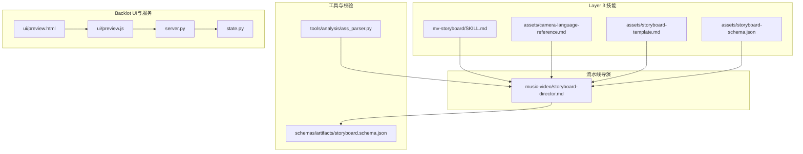
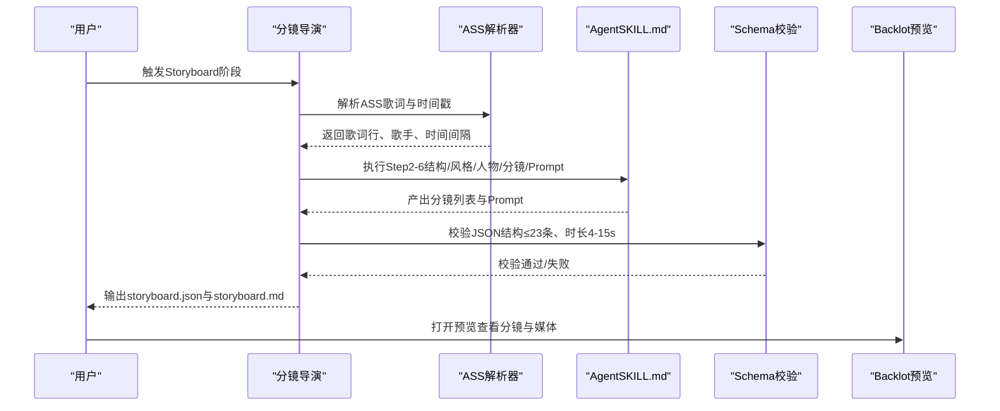
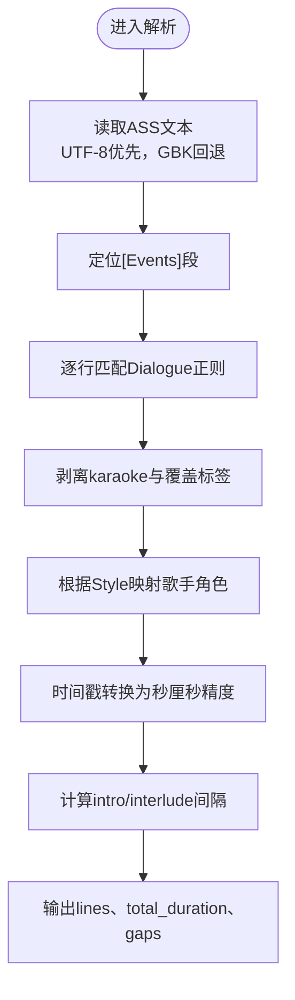
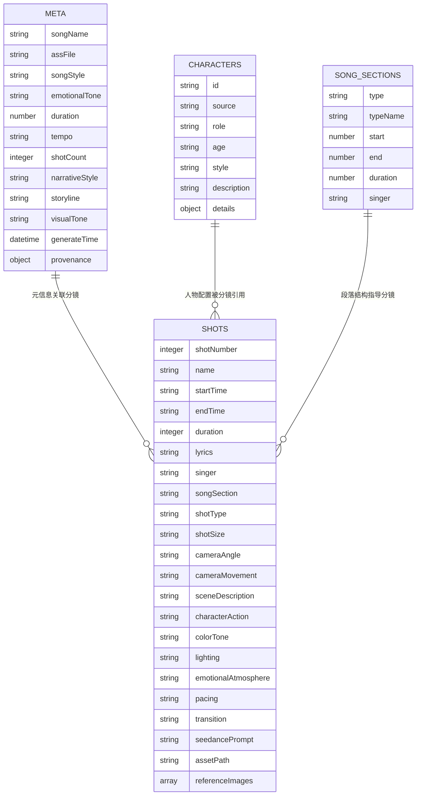
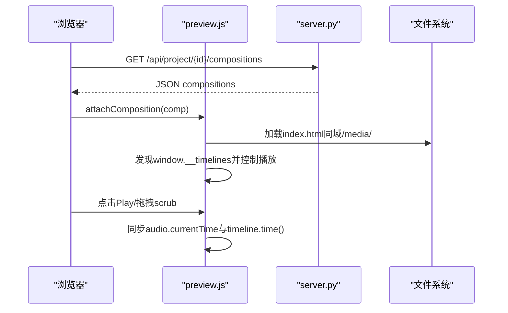
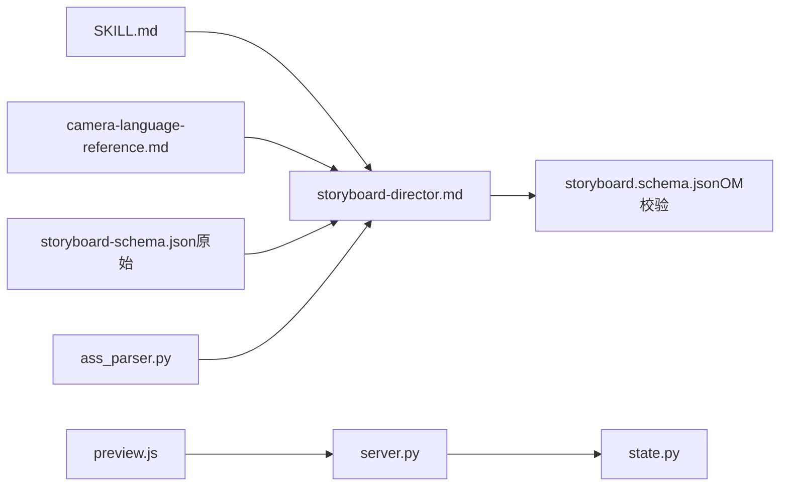

# Storyboard阶段 - 分镜脚本生成

<cite>
**本文引用的文件**   
- [SKILL.md](file://.agents/skills/mv-storyboard/SKILL.md)
- [README.md（移植说明）](file://.agents/skills/mv-storyboard/README.md)
- [storyboard-schema.json（原始Schema）](file://.agents/skills/mv-storyboard/assets/storyboard-schema.json)
- [storyboard-template.md（Markdown模板）](file://.agents/skills/mv-storyboard/assets/storyboard-template.md)
- [camera-language-reference.md（镜头语言参考）](file://.agents/skills/mv-storyboard/assets/camera-language-reference.md)
- [storyboard-director.md（流水线导演）](file://skills/pipelines/music-video/storyboard-director.md)
- [ass_parser.py（ASS解析工具）](file://tools/analysis/ass_parser.py)
- [storyboard.schema.json（OpenMontage校验Schema）](file://schemas/artifacts/storyboard.schema.json)
- [preview.html（预览页面）](file://backlot/ui/preview.html)
- [preview.js（预览逻辑）](file://backlot/ui/preview.js)
- [server.py（Backlot服务）](file://backlot/server.py)
- [state.py（状态与Storyboard拼装）](file://backlot/state.py)
</cite>

## 目录
1. [简介](#简介)
2. [项目结构](#项目结构)
3. [核心组件](#核心组件)
4. [架构总览](#架构总览)
5. [详细组件分析](#详细组件分析)
6. [依赖关系分析](#依赖关系分析)
7. [性能考量](#性能考量)
8. [故障排查指南](#故障排查指南)
9. [结论](#结论)
10. [附录](#附录)

## 简介
本章节聚焦Storyboard阶段的完整实现：从ASS歌词到MV分镜脚本的自动生成，涵盖分镜编排、镜头设计、时序规划、Seedance提示词生成与双格式输出。文档同时解释分镜JSON结构的字段含义、验证规则与最佳实践，并给出分镜模板、自定义参数与批量生成功能的使用要点，以及分镜预览与编辑接口。

## 项目结构
- Layer 3技能定义位于 .agents/skills/mv-storyboard，包含全流程规则、镜头语言参考、Schema与模板。
- 流水线导演位于 skills/pipelines/music-video，负责将上游提案转化为分镜产物，并驱动Step 5-7执行。
- ASS解析由确定性工具 tools/analysis/ass_parser.py 提供，保证时间戳与歌词行提取稳定可靠。
- OpenMontage侧的机器校验使用 schemas/artifacts/storyboard.schema.json，对≤23条分镜、整数秒时长等硬约束进行强制校验。
- Backlot UI提供分镜预览与编辑能力，通过 server.py 暴露API与SSE事件流，state.py 拼装Storyboard视图。

**图示来源** 
- [SKILL.md](file://.agents/skills/mv-storyboard/SKILL.md)
- [camera-language-reference.md](file://.agents/skills/mv-storyboard/assets/camera-language-reference.md)
- [storyboard-schema.json（原始Schema）](file://.agents/skills/mv-storyboard/assets/storyboard-schema.json)
- [storyboard-template.md（Markdown模板）](file://.agents/skills/mv-storyboard/assets/storyboard-template.md)
- [storyboard-director.md（流水线导演）](file://skills/pipelines/music-video/storyboard-director.md)
- [ass_parser.py（ASS解析工具）](file://tools/analysis/ass_parser.py)
- [storyboard.schema.json（OpenMontage校验Schema）](file://schemas/artifacts/storyboard.schema.json)
- [preview.html（预览页面）](file://backlot/ui/preview.html)
- [preview.js（预览逻辑）](file://backlot/ui/preview.js)
- [server.py（Backlot服务）](file://backlot/server.py)
- [state.py（状态与Storyboard拼装）](file://backlot/state.py)

**章节来源**
- [README.md（移植说明）](file://.agents/skills/mv-storyboard/README.md)

## 核心组件
- ASS解析器（ass_parser.py）：确定性地读取ASS、剥离标签、识别歌手角色、计算时间间隔，为后续段落分析与分镜编排提供基础数据。
- 分镜导演（storyboard-director.md）：依据SKILL.md Step 5-7完成分镜编排、Seedance提示词撰写与双格式输出，并遵循OpenMontage Schema校验。
- 镜头语言参考（camera-language-reference.md）：提供景别、角度、运镜与转场的术语库与选择原则。
- 分镜Schema（storyboard.schema.json）：定义meta、characters、songSections、shots等字段的类型、枚举与约束（如≤23条分镜、时长4-15秒整数）。
- Markdown模板（storyboard-template.md）：用于渲染人类可读的分镜脚本。
- Backlot预览（preview.html/js + server.py + state.py）：加载项目中的HyperFrames组成，播放并支持时间轴控制；state.py将scene_plan、script、asset_manifest拼装为Storyboard视图。

**章节来源**
- [ass_parser.py（ASS解析工具）](file://tools/analysis/ass_parser.py)
- [storyboard-director.md（流水线导演）](file://skills/pipelines/music-video/storyboard-director.md)
- [camera-language-reference.md（镜头语言参考）](file://.agents/skills/mv-storyboard/assets/camera-language-reference.md)
- [storyboard.schema.json（OpenMontage校验Schema）](file://schemas/artifacts/storyboard.schema.json)
- [storyboard-template.md（Markdown模板）](file://.agents/skills/mv-storyboard/assets/storyboard-template.md)
- [preview.html（预览页面）](file://backlot/ui/preview.html)
- [preview.js（预览逻辑）](file://backlot/ui/preview.js)
- [server.py（Backlot服务）](file://backlot/server.py)
- [state.py（状态与Storyboard拼装）](file://backlot/state.py)

## 架构总览
分镜生成流程从ASS解析开始，经Agent按SKILL.md执行歌曲结构分析、叙事风格匹配、人物匹配、分镜编排与提示词生成，最终输出JSON与Markdown双格式。OpenMontage侧通过Schema校验确保质量，Backlot提供预览与编辑能力。

**图示来源** 
- [storyboard-director.md（流水线导演）](file://skills/pipelines/music-video/storyboard-director.md)
- [ass_parser.py（ASS解析工具）](file://tools/analysis/ass_parser.py)
- [SKILL.md](file://.agents/skills/mv-storyboard/SKILL.md)
- [storyboard.schema.json（OpenMontage校验Schema）](file://schemas/artifacts/storyboard.schema.json)
- [preview.html（预览页面）](file://backlot/ui/preview.html)

## 详细组件分析

### ASS解析器（ass_parser.py）
- 功能：UTF-8优先读取，GBK回退；仅解析[Events]段；正则提取Dialogue字段；剥离karaoke与覆盖标签；映射歌手角色；H:MM:SS.cs→秒数（厘秒精度保留）；计算intro/interlude/gaps供Agent使用。
- 复杂度：线性扫描文本，正则匹配每行，时间复杂度O(N)，空间复杂度O(N)存储解析结果。
- 错误处理：编码异常、无有效Dialogue行时返回错误信息；时间戳解析失败跳过该行。
- 输出：lines数组（start/end/singer/style/text/raw）、total_duration、gaps（intro/interlude）。

**图示来源** 
- [ass_parser.py（ASS解析工具）](file://tools/analysis/ass_parser.py)

**章节来源**
- [ass_parser.py（ASS解析工具）](file://tools/analysis/ass_parser.py)

### 分镜导演（storyboard-director.md）
- 职责：依据SKILL.md Step 5-7完成分镜编排（18维度）、Seedance提示词撰写（八大要素）、双格式输出（JSON+Markdown），并写入标准路径。
- 前置条件：schema校验（≤23条分镜、整数秒4-15s）、输入brief与proposal_packet。
- 自检：逐项核对SKILL.md清单，失败则修正而非放宽schema。
- 交付：若delivery shape为“仅分镜”，则直接输出并结束流水线。

**章节来源**
- [storyboard-director.md（流水线导演）](file://skills/pipelines/music-video/storyboard-director.md)

### 分镜编排与18维度（SKILL.md Step 5）
- 划分原则：按歌曲段落划分，段落内每1-3句歌词对应一个分镜；空镜分配于前奏/间奏/尾奏；时长必须为整数秒且4-15秒；时间线连续无缝隙。
- 连贯性：同一场景人物着装一致；副歌用更具冲击力的镜头；主歌平稳；情感高潮慢镜或特写；色调随情感变化。
- Shot数量控制：硬性上限23条；超过时合并相邻shot、删减次要shot、精简空镜；最终验证清单包括时长、连续性等。

**章节来源**
- [SKILL.md](file://.agents/skills/mv-storyboard/SKILL.md)

### Seedance提示词生成（SKILL.md Step 6）
- 八大要素公式：精准主体 + 动作细节 + 场景环境 + 光影色调 + 镜头运镜 + 视觉风格 + 画质 + 约束条件。
- 写作规则：中文prompt；80-200字；避免不确定词汇；空镜强化氛围感；一镜一运镜；动作优先低缓；情绪具象外化；强制兜底包（稳定包、字幕兜底、水印Logo兜底；双人镜追加双胞胎兜底）。
- 特殊字符：背景音乐（）、音效<>、台词{}、字幕【】。

**章节来源**
- [SKILL.md](file://.agents/skills/mv-storyboard/SKILL.md)

### 分镜Schema与校验（storyboard.schema.json）
- meta：包含songName、assFile、songStyle、emotionalTone、duration、tempo、shotCount（≤23）、narrativeStyle、storyline、visualTone、generateTime、provenance（OpenMontage惯例）。
- characters：id、source（人物库/自定义）、role（女主/男主）、age、style、description、details（hair/top/coat/bottom/shoes/accessories）。
- songSections：type、typeName、start、end、duration、singer。
- shots：18个必填字段（shotNumber、name、startTime、endTime、duration、lyrics、singer、songSection、shotType、shotSize、cameraAngle、cameraMovement、sceneDescription、characterAction、colorTone、lighting、emotionalAtmosphere、pacing、transition、seedancePrompt），以及可选assetPath与referenceImages。
- 硬约束：maxItems=23；duration为整数且在4-15之间；各枚举值限定。

**图示来源** 
- [storyboard.schema.json（OpenMontage校验Schema）](file://schemas/artifacts/storyboard.schema.json)

**章节来源**
- [storyboard.schema.json（OpenMontage校验Schema）](file://schemas/artifacts/storyboard.schema.json)

### 分镜模板（storyboard-template.md）
- 模板包含元信息表、人物配置、歌曲结构总览、分镜列表（每个Shot的18维度表格与Seedance Prompt代码块）、附录（情感走向、镜头统计、段落分布）。
- 占位符{{...}}在渲染时替换为实际数据。

**章节来源**
- [storyboard-template.md（Markdown模板）](file://.agents/skills/mv-storyboard/assets/storyboard-template.md)

### 镜头语言参考（camera-language-reference.md）
- 景别：大远景/远景/全景/中景/近景/特写/大特写及适用场景与选择原则。
- 角度：平视/仰视/俯视/鸟瞰/荷兰角与情感暗示。
- 运镜：固定/推/拉/摇/移/跟/升降/环绕/手持/一镜到底及修饰词（缓慢/匀速/快速/急速/微微）。
- 组合模式：情感升温、环境交代、离别疏离、蒙太奇快切、意境流动。
- 转场：硬切/叠化/闪白/黑场/匹配剪辑/无。
- 节奏：快切/慢镜头/正常/延时/慢动作。

**章节来源**
- [camera-language-reference.md（镜头语言参考）](file://.agents/skills/mv-storyboard/assets/camera-language-reference.md)

### 分镜预览与编辑接口（Backlot）
- preview.html/js：加载项目中的HyperFrames组成，嵌入iframe播放；支持播放/暂停、时间轴拖拽、键盘快捷键；当存在音频时以音频为主时钟同步timeline。
- server.py：FastAPI应用，提供/api/project/{id}/compositions、/api/project/{id}/events（SSE）等接口；watchfiles监听项目变更并通过SSE推送。
- state.py：将scene_plan、script、asset_manifest拼装为Storyboard视图，支持按时间重叠匹配script section。

**图示来源** 
- [preview.html（预览页面）](file://backlot/ui/preview.html)
- [preview.js（预览逻辑）](file://backlot/ui/preview.js)
- [server.py（Backlot服务）](file://backlot/server.py)
- [state.py（状态与Storyboard拼装）](file://backlot/state.py)

**章节来源**
- [preview.html（预览页面）](file://backlot/ui/preview.html)
- [preview.js（预览逻辑）](file://backlot/ui/preview.js)
- [server.py（Backlot服务）](file://backlot/server.py)
- [state.py（状态与Storyboard拼装）](file://backlot/state.py)

## 依赖关系分析
- 分镜导演依赖SKILL.md的规则与镜头语言参考，依赖ass_parser提供的结构化歌词与时间信息，依赖storyboard.schema.json进行强校验。
- Backlot预览依赖server.py的API与SSE事件流，依赖state.py的状态拼装逻辑。
- 无循环依赖；分层清晰：Layer 3技能 → 导演 → 工具/校验 → UI服务。

**图示来源** 
- [SKILL.md](file://.agents/skills/mv-storyboard/SKILL.md)
- [camera-language-reference.md（镜头语言参考）](file://.agents/skills/mv-storyboard/assets/camera-language-reference.md)
- [storyboard-schema.json（原始Schema）](file://.agents/skills/mv-storyboard/assets/storyboard-schema.json)
- [ass_parser.py（ASS解析工具）](file://tools/analysis/ass_parser.py)
- [storyboard-director.md（流水线导演）](file://skills/pipelines/music-video/storyboard-director.md)
- [storyboard.schema.json（OpenMontage校验Schema）](file://schemas/artifacts/storyboard.schema.json)
- [server.py（Backlot服务）](file://backlot/server.py)
- [state.py（状态与Storyboard拼装）](file://backlot/state.py)

**章节来源**
- [storyboard-director.md（流水线导演）](file://skills/pipelines/music-video/storyboard-director.md)
- [ass_parser.py（ASS解析工具）](file://tools/analysis/ass_parser.py)
- [storyboard.schema.json（OpenMontage校验Schema）](file://schemas/artifacts/storyboard.schema.json)

## 性能考量
- ASS解析为线性扫描，内存占用与行数成正比；正则匹配开销小，适合大规模歌词文件。
- 分镜编排受≤23条限制，减少后续资产生成与渲染压力。
- 预览端以音频为主时钟，降低时间漂移；iframe同域访问避免跨域开销。
- Backlot使用watchfiles与SSE增量更新，避免全量轮询。

## 故障排查指南
- ASS编码问题：UTF-8乱码自动回退GBK；若无CJK字符或出现控制字符，检查源文件编码。
- 无Dialogue行：确认[Events]段存在且包含有效Dialogue；时间戳格式需符合H:MM:SS.cs。
- Schema校验失败：检查shot数量是否≤23、duration是否为整数且在4-15之间、枚举值是否正确。
- 预览无法播放：确认项目存在HyperFrames组成（hyperframes.json），iframe可加载index.html；检查window.__timelines是否存在。
- SSE无更新：确认watchfiles可用且PROJECTS_DIR可被监听；检查服务器日志与网络连通性。

**章节来源**
- [ass_parser.py（ASS解析工具）](file://tools/analysis/ass_parser.py)
- [storyboard.schema.json（OpenMontage校验Schema）](file://schemas/artifacts/storyboard.schema.json)
- [preview.js（预览逻辑）](file://backlot/ui/preview.js)
- [server.py（Backlot服务）](file://backlot/server.py)

## 结论
Storyboard阶段通过确定性ASS解析与严格的Schema校验，结合SKILL.md的分镜编排与Seedance提示词规范，实现了高质量、可复现的MV分镜脚本生成。Backlot预览与编辑接口提供了直观的用户体验，便于迭代与批量化生产。遵循本文档的最佳实践与约束，可显著提升分镜质量与生产效率。

## 附录
- 分镜模板使用：填充{{...}}占位符，确保每个Shot的18维度完整。
- 自定义参数：人物库匹配失败时使用自定义人物描述；output_dir可指定输出路径。
- 批量生成：按shot顺序逐个生成视频片段，校验时长并回填assetPath；进度通过checkpoint刷新。