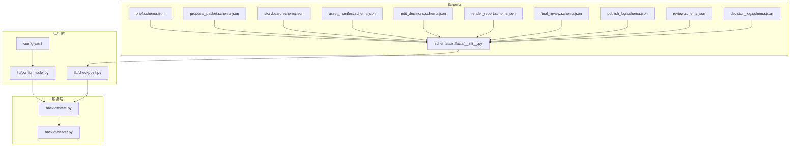
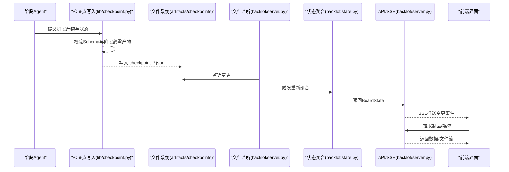
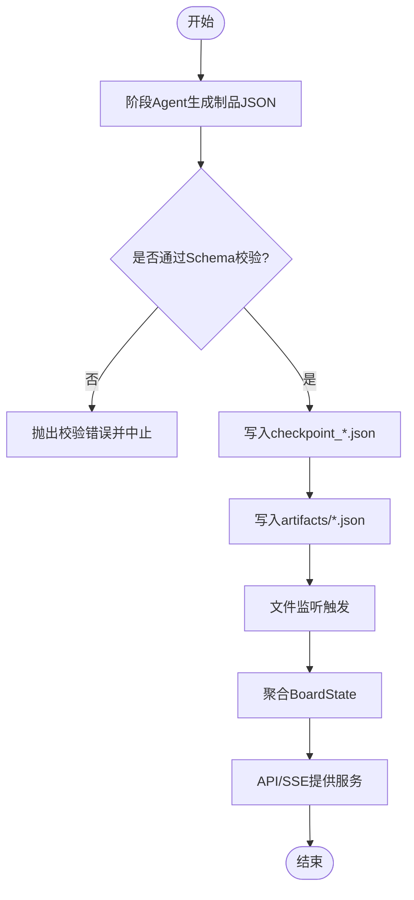
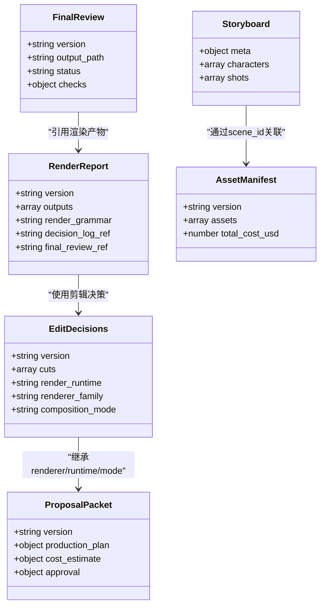

# 制品管理系统

<cite>
**本文引用的文件**   
- [backlot/server.py](file://backlot/server.py)
- [backlot/state.py](file://backlot/state.py)
- [lib/config_model.py](file://lib/config_model.py)
- [config.yaml](file://config.yaml)
- [schemas/artifacts/__init__.py](file://schemas/artifacts/__init__.py)
- [schemas/artifacts/brief.schema.json](file://schemas/artifacts/brief.schema.json)
- [schemas/artifacts/proposal_packet.schema.json](file://schemas/artifacts/proposal_packet.schema.json)
- [schemas/artifacts/storyboard.schema.json](file://schemas/artifacts/storyboard.schema.json)
- [schemas/artifacts/asset_manifest.schema.json](file://schemas/artifacts/asset_manifest.schema.json)
- [schemas/artifacts/edit_decisions.schema.json](file://schemas/artifacts/edit_decisions.schema.json)
- [schemas/artifacts/render_report.schema.json](file://schemas/artifacts/render_report.schema.json)
- [schemas/artifacts/final_review.schema.json](file://schemas/artifacts/final_review.schema.json)
- [schemas/artifacts/publish_log.schema.json](file://schemas/artifacts/publish_log.schema.json)
- [schemas/artifacts/review.schema.json](file://schemas/artifacts/review.schema.json)
- [schemas/artifacts/decision_log.schema.json](file://schemas/artifacts/decision_log.schema.json)
- [lib/checkpoint.py](file://lib/checkpoint.py)
</cite>

## 目录
1. [简介](#简介)
2. [项目结构](#项目结构)
3. [核心组件](#核心组件)
4. [架构总览](#架构总览)
5. [详细组件分析](#详细组件分析)
6. [依赖关系分析](#依赖关系分析)
7. [性能考量](#性能考量)
8. [故障排查指南](#故障排查指南)
9. [结论](#结论)
10. [附录](#附录)

## 简介
本文件系统化阐述 OpenMontage-MV 的“制品（Artifact）”体系与生命周期管理，覆盖以下方面：
- 制品概念、生命周期与管理机制
- 各制品类型的 JSON Schema 定义与字段含义
- 制品的创建、验证、存储与检索流程
- 制品之间的依赖关系与版本控制策略
- 制品格式转换与兼容性处理指导

该体系以 JSON Schema 为核心契约，结合流水线阶段（checkpoint）与后端服务（Backlot）提供统一的读取、展示与事件推送能力。

## 项目结构
- 制品 Schema 集中存放于 schemas/artifacts/*.schema.json，统一由 schemas/artifacts/__init__.py 加载与校验。
- 运行时配置通过 lib/config_model.py 与 config.yaml 管理路径、输出参数等。
- Backlot 服务（FastAPI）负责项目状态聚合、SSE 事件推送、媒体与缩略图访问。
- 看板状态与制品发现逻辑集中在 backlot/state.py，实现只读、健壮的解析与降级。
- 检查点（Checkpoint）写入与校验在 lib/checkpoint.py 中完成，确保阶段产物与 Schema 一致性。

**图表来源** 
- [schemas/artifacts/__init__.py:1-44](file://schemas/artifacts/__init__.py#L1-L44)
- [backlot/server.py:151-406](file://backlot/server.py#L151-L406)
- [backlot/state.py:586-656](file://backlot/state.py#L586-L656)
- [lib/config_model.py:44-70](file://lib/config_model.py#L44-L70)
- [config.yaml:1-20](file://config.yaml#L1-L20)
- [lib/checkpoint.py:1-42](file://lib/checkpoint.py#L1-L42)

**章节来源**
- [backlot/server.py:151-406](file://backlot/server.py#L151-L406)
- [backlot/state.py:586-656](file://backlot/state.py#L586-L656)
- [lib/config_model.py:44-70](file://lib/config_model.py#L44-L70)
- [config.yaml:1-20](file://config.yaml#L1-L20)
- [schemas/artifacts/__init__.py:1-44](file://schemas/artifacts/__init__.py#L1-L44)

## 核心组件
- 制品 Schema 与校验器
  - 所有制品类型均对应一个 JSON Schema，并通过 schemas/artifacts/__init__.py 提供的 validate_artifact 进行强校验。
- 检查点与阶段产物
  - 每个流水线阶段完成后写入 checkpoint_*.json，包含 artifacts 引用或内联数据；lib/checkpoint.py 对阶段必需产物进行约束与校验。
- 看板状态聚合
  - backlot/state.py 将 artifacts、checkpoints、events 合并为 BoardState，供前端展示与 SSE 推送。
- 后端服务
  - backlot/server.py 暴露 REST/SSE 接口，提供项目列表、状态查询、媒体与缩略图访问。

**章节来源**
- [schemas/artifacts/__init__.py:1-44](file://schemas/artifacts/__init__.py#L1-L44)
- [lib/checkpoint.py:102-135](file://lib/checkpoint.py#L102-L135)
- [backlot/state.py:244-264](file://backlot/state.py#L244-L264)
- [backlot/server.py:174-214](file://backlot/server.py#L174-L214)

## 架构总览
制品从生成到消费的整体流程如下：
- 阶段产出 artifacts（JSON），并写入 checkpoint_*.json。
- 检查点写入时触发 Schema 校验与阶段必需产物校验。
- Backlot 服务监听项目目录变更，聚合 artifacts、events、media 生成 BoardState。
- 前端通过 SSE 实时获取变更，拉取制品与媒体资源。

**图表来源** 
- [lib/checkpoint.py:102-135](file://lib/checkpoint.py#L102-L135)
- [backlot/server.py:132-148](file://backlot/server.py#L132-L148)
- [backlot/state.py:586-656](file://backlot/state.py#L586-L656)

## 详细组件分析

### 制品类型与 JSON Schema 定义
以下为关键制品类型的结构与要点说明（字段含义与约束来源于各自 schema 文件）。

- brief（创意简报）
  - 关键字段：version、title、hook、key_points、tone、style、target_platform、target_duration_seconds
  - 可选扩展：core_message、cta、target_audience、reference_material、angle_options、selected_angle、metadata
  - 用途：idea 阶段的创意摘要，用于后续提案与分镜生成

- proposal_packet（提案包）
  - 关键字段：version、concept_options、selected_concept、production_plan、cost_estimate、approval
  - production_plan 包含 pipeline、stages、render_runtime、renderer_family、composition_mode、delivery_promise 等
  - cost_estimate 包含 total_estimated_usd、line_items、budget_verdict 等
  - approval 记录用户审批状态与预算批准
  - 用途：生产前方案确认，锁定渲染语法与技术运行环境

- storyboard（MV 分镜脚本）
  - 关键字段：meta（songName、assFile、duration、shotCount 等）、characters、shots
  - shots 数组限制 maxItems=23，duration 整数秒且 4-15 秒
  - 增补字段：assetPath、referenceImages 用于资产回填与人物参考
  - 用途：基于 ASS 歌词的结构化分镜，驱动 AI 视频生成

- asset_manifest（资产清单）
  - 关键字段：version、assets[]（id、type、path、source_tool、scene_id 等）
  - 支持 image/video/audio/narration/music/sfx/diagram/animation/code_snippet/subtitle/font/lut 等类型
  - 可选：prompt、seed、model、cost_usd、duration_seconds、resolution、format、quality_score、provider、license 等
  - 用途：记录所有生成/引入的素材及其元信息

- edit_decisions（剪辑决策）
  - 关键字段：version、cuts[]、render_runtime
  - cuts 描述片段来源、入出点、速度、层级、变换、转场、原因等
  - overlays、audio（narration/music/sfx）、subtitles、transitions、renderer_family、composition_mode、bespoke（atelier 模式）
  - 用途：编辑阶段的镜头与音频编排决策

- render_report（渲染报告）
  - 关键字段：version、outputs[]（path、format、resolution、duration_seconds 等）
  - 附加：render_time_seconds、warnings、verification_notes、render_grammar、slideshow_risk_score、decision_log_ref、final_review_ref
  - 用途：compose 阶段渲染后的产物与质量自检引用

- final_review（最终审查）
  - 关键字段：version、output_path、status（pass/revise/fail）、checks
  - checks 包括 technical_probe、visual_spotcheck、audio_spotcheck、promise_preservation、subtitle_check、transcript_comparison、atelier
  - 用途：对实际渲染输出的结构化自检，决定是否可交付

- publish_log（发布日志）
  - 关键字段：version、entries[]（platform、status、timestamp、url、visibility、export_path、metadata_used、error）
  - 用途：多平台发布/导出结果记录

- review（阶段评审）
  - 关键字段：version、stage、round、findings[]（id、severity、category、description、disposition、agent_response）
  - 用途：Reviewer 对各阶段的评审发现与处置

- decision_log（决策日志）
  - 关键字段：version、project_id、decisions[]（decision_id、stage、category、subject、options_considered、selected、reason 等）
  - 用途：全链路审计追踪，防止隐藏行为与上下文漂移

**章节来源**
- [schemas/artifacts/brief.schema.json:1-49](file://schemas/artifacts/brief.schema.json#L1-L49)
- [schemas/artifacts/proposal_packet.schema.json:1-379](file://schemas/artifacts/proposal_packet.schema.json#L1-L379)
- [schemas/artifacts/storyboard.schema.json:1-289](file://schemas/artifacts/storyboard.schema.json#L1-L289)
- [schemas/artifacts/asset_manifest.schema.json:1-63](file://schemas/artifacts/asset_manifest.schema.json#L1-L63)
- [schemas/artifacts/edit_decisions.schema.json:1-234](file://schemas/artifacts/edit_decisions.schema.json#L1-L234)
- [schemas/artifacts/render_report.schema.json:1-64](file://schemas/artifacts/render_report.schema.json#L1-L64)
- [schemas/artifacts/final_review.schema.json:1-171](file://schemas/artifacts/final_review.schema.json#L1-L171)
- [schemas/artifacts/publish_log.schema.json:1-41](file://schemas/artifacts/publish_log.schema.json#L1-L41)
- [schemas/artifacts/review.schema.json:1-36](file://schemas/artifacts/review.schema.json#L1-L36)
- [schemas/artifacts/decision_log.schema.json:1-104](file://schemas/artifacts/decision_log.schema.json#L1-L104)

### 制品的创建、验证、存储与检索流程
- 创建
  - 阶段 Agent 生成制品 JSON，写入 artifacts/<name>.json 或嵌入 checkpoint 的 artifacts 字段。
- 验证
  - 写入检查点时，lib/checkpoint.py 调用 schemas/artifacts/__init__.py 的 validate_artifact 进行 Schema 校验，并检查阶段必需产物。
- 存储
  - artifacts/*.json 与 checkpoint_*.json 持久化；history 目录保存历史版本。
- 检索
  - backlot/state.py 聚合 artifacts、checkpoints、events，构建 BoardState；API 提供 /api/project/{id}/state 与 SSE 事件。

**图表来源** 
- [lib/checkpoint.py:102-135](file://lib/checkpoint.py#L102-L135)
- [schemas/artifacts/__init__.py:27-40](file://schemas/artifacts/__init__.py#L27-L40)
- [backlot/state.py:244-264](file://backlot/state.py#L244-L264)
- [backlot/server.py:174-214](file://backlot/server.py#L174-L214)

**章节来源**
- [lib/checkpoint.py:102-135](file://lib/checkpoint.py#L102-L135)
- [schemas/artifacts/__init__.py:27-40](file://schemas/artifacts/__init__.py#L27-L40)
- [backlot/state.py:244-264](file://backlot/state.py#L244-L264)
- [backlot/server.py:174-214](file://backlot/server.py#L174-L214)

### 制品依赖关系与版本控制策略
- 依赖关系
  - proposal_packet 锁定 renderer_family、render_runtime、composition_mode，edit_decisions 与 render_report 必须保持一致。
  - storyboard 与 asset_manifest 关联 scene_id，用于场景级资产定位。
  - final_review 与 render_report 通过 final_review_ref 建立审计链接。
- 版本控制
  - checkpoints 按阶段命名 checkpoint_<stage>.json；历史版本归档至 history/checkpoint_<stage>_<version>.json。
  - BoardState 聚合当前与历史版本，提供 stages.history_entries 时间线。

**图表来源** 
- [schemas/artifacts/proposal_packet.schema.json:1-379](file://schemas/artifacts/proposal_packet.schema.json#L1-L379)
- [schemas/artifacts/edit_decisions.schema.json:1-234](file://schemas/artifacts/edit_decisions.schema.json#L1-L234)
- [schemas/artifacts/render_report.schema.json:1-64](file://schemas/artifacts/render_report.schema.json#L1-L64)
- [schemas/artifacts/final_review.schema.json:1-171](file://schemas/artifacts/final_review.schema.json#L1-L171)
- [schemas/artifacts/asset_manifest.schema.json:1-63](file://schemas/artifacts/asset_manifest.schema.json#L1-L63)
- [schemas/artifacts/storyboard.schema.json:1-289](file://schemas/artifacts/storyboard.schema.json#L1-L289)

**章节来源**
- [backlot/state.py:116-140](file://backlot/state.py#L116-L140)
- [backlot/state.py:143-222](file://backlot/state.py#L143-L222)

### 制品格式转换与兼容性处理
- 兼容读取
  - backlot/state.py 的 _resolve_asset_path 支持多种路径形式（项目相对、仓库相对、绝对路径），并对不可见路径做安全过滤。
  - _collect_artifacts 同时从 artifacts/*.json 与 checkpoint 的 artifacts 字段回填，保证旧版数据可用。
- 降级策略
  - 若缺少某些制品或解析失败，BoardState 会降级显示（如 missing 指示、快照回退），不阻断整体流程。
- 转换建议
  - 新增字段应向后兼容，避免破坏现有读取逻辑；必要时在 metadata 中保留额外信息。
  - 对于路径类字段，优先使用项目相对路径，并在服务端进行存在性与可见性校验。

**章节来源**
- [backlot/state.py:271-296](file://backlot/state.py#L271-L296)
- [backlot/state.py:244-264](file://backlot/state.py#L244-L264)
- [backlot/state.py:299-346](file://backlot/state.py#L299-L346)

## 依赖关系分析
- 组件耦合
  - schemas/artifacts/__init__.py 被 lib/checkpoint.py 用于校验；backlot/state.py 聚合 artifacts 与 checkpoints；backlot/server.py 暴露 API 与 SSE。
- 外部依赖
  - FastAPI、watchfiles、jsonschema、Pillow、ffmpeg 等用于网络服务、文件监听、Schema 校验与媒体处理。
- 潜在循环依赖
  - 当前设计为单向依赖（Schema → Checkpoint → State → Server），无循环导入风险。

**图表来源** 
- [schemas/artifacts/__init__.py:1-44](file://schemas/artifacts/__init__.py#L1-L44)
- [lib/checkpoint.py:102-135](file://lib/checkpoint.py#L102-L135)
- [backlot/state.py:244-264](file://backlot/state.py#L244-L264)
- [backlot/server.py:174-214](file://backlot/server.py#L174-L214)

**章节来源**
- [schemas/artifacts/__init__.py:1-44](file://schemas/artifacts/__init__.py#L1-L44)
- [lib/checkpoint.py:102-135](file://lib/checkpoint.py#L102-L135)
- [backlot/state.py:244-264](file://backlot/state.py#L244-L264)
- [backlot/server.py:174-214](file://backlot/server.py#L174-L214)

## 性能考量
- 文件监听与事件聚合
  - watchfiles 批量监听，去重后仅推送相关项目 ID，避免队列拥塞。
- 缓存策略
  - 库摘要（summarize_project）按项目缓存，变更时失效；缩略图按哈希缓存 JPEG。
- I/O 优化
  - 媒体响应使用 FileRange；UI 资源设置 no-cache 以便快速更新。
- 健壮性
  - 解析失败与缺失文件均降级处理，不中断服务。

[本节为通用指导，不直接分析具体文件]

## 故障排查指南
- 常见错误
  - Schema 校验失败：检查 artifacts/*.json 是否符合对应 schema 定义。
  - 阶段必需产物缺失：确认 checkpoint 中 artifacts 包含阶段要求的产物。
  - 路径解析失败：确保 path 字段在项目目录下可解析且可见。
- 诊断步骤
  - 查看 events.jsonl 最近事件，确认阶段执行状态。
  - 检查 history 目录中的历史 checkpoint，对比版本差异。
  - 使用 /api/project/{id}/state 获取 BoardState，核对 artifacts 与 media。

**章节来源**
- [lib/checkpoint.py:102-135](file://lib/checkpoint.py#L102-L135)
- [backlot/state.py:586-656](file://backlot/state.py#L586-L656)
- [backlot/server.py:174-214](file://backlot/server.py#L174-L214)

## 结论
OpenMontage-MV 的制品管理体系以 JSON Schema 为契约，结合检查点与看板状态聚合，实现了高内聚、低耦合、可审计、可恢复的生产流程。通过严格的校验与兼容读取策略，系统在保证稳定性的同时，提供了灵活的扩展空间。建议在新增制品类型或字段时遵循向后兼容原则，并在 metadata 中保留扩展信息。

[本节为总结，不直接分析具体文件]

## 附录
- 运行时配置
  - config.yaml 定义默认输出格式、编码、分辨率、帧率、CRF 等；lib/config_model.py 提供类型化访问与路径解析。
- 常用 API
  - /api/projects：项目列表
  - /api/project/{id}/state：项目状态
  - /api/project/{id}/events：SSE 事件流
  - /thumb/{id}/{path}：缩略图
  - /media/{id}/{path}：媒体文件

**章节来源**
- [config.yaml:1-20](file://config.yaml#L1-L20)
- [lib/config_model.py:44-70](file://lib/config_model.py#L44-L70)
- [backlot/server.py:170-214](file://backlot/server.py#L170-L214)