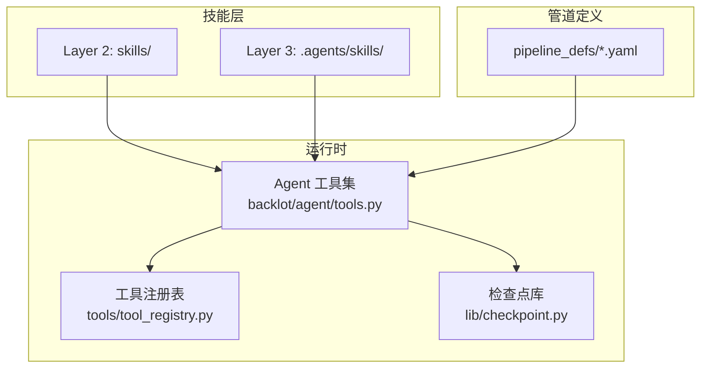
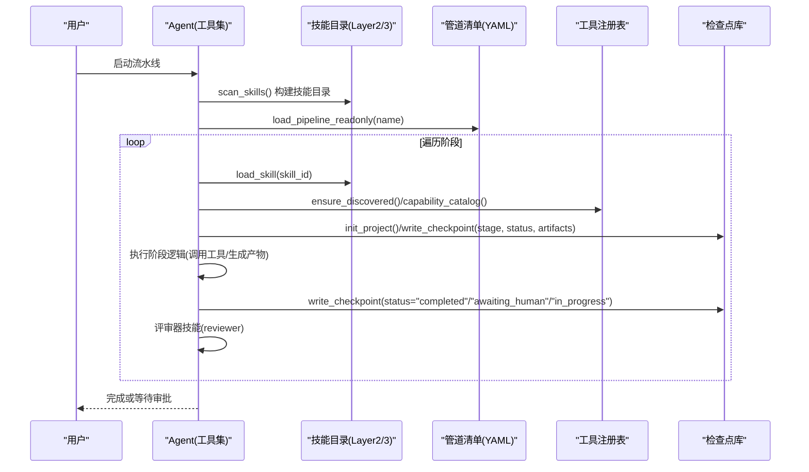
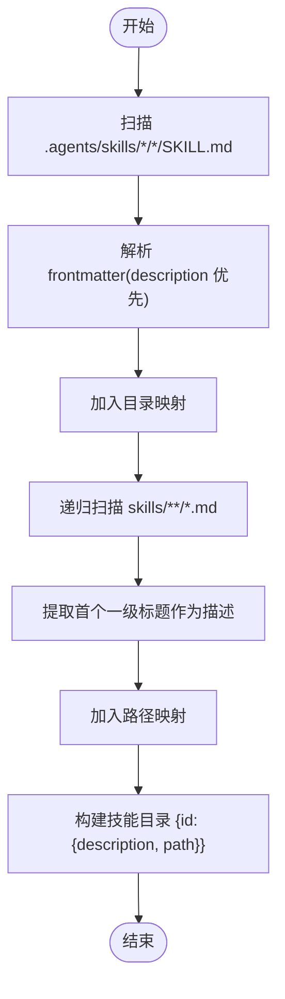
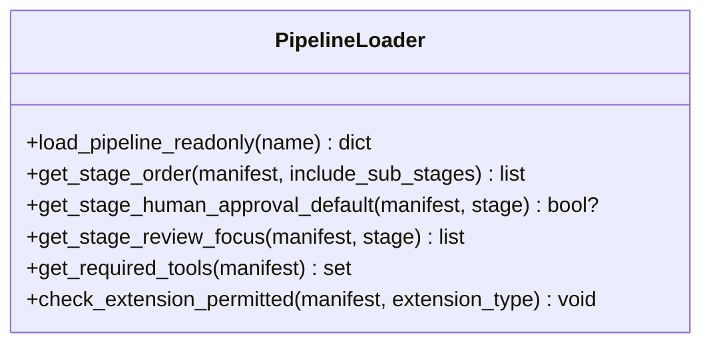
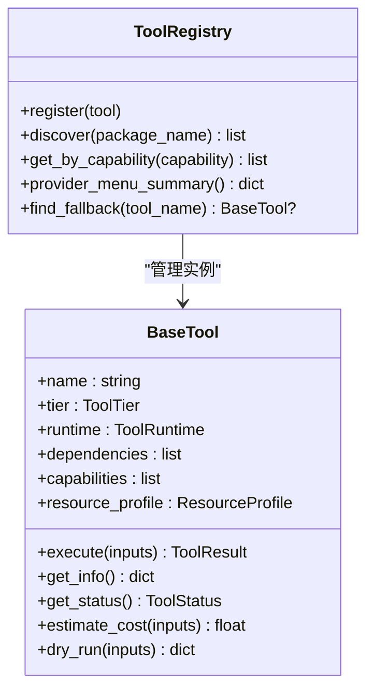
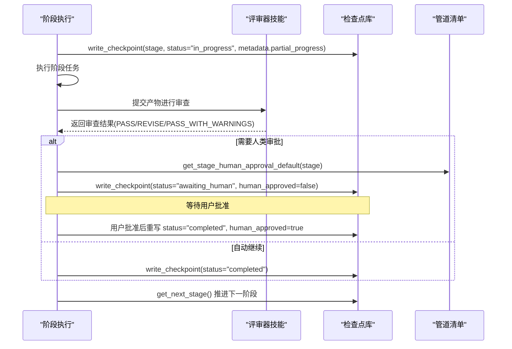
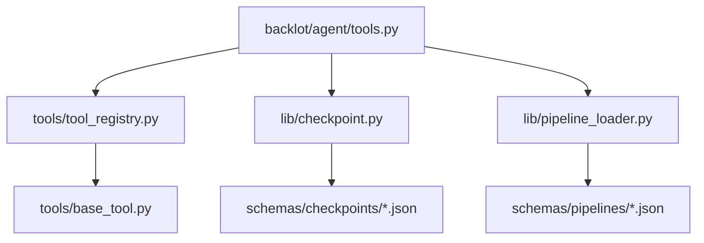

# 技能管理系统

<cite>
**本文引用的文件**   
- [skills/meta/checkpoint-protocol.md](file://skills/meta/checkpoint-protocol.md)
- [skills/meta/reviewer.md](file://skills/meta/reviewer.md)
- [lib/checkpoint.py](file://lib/checkpoint.py)
- [tools/tool_registry.py](file://tools/tool_registry.py)
- [backlot/agent/tools.py](file://backlot/agent/tools.py)
- [pipeline_defs/music-video.yaml](file://pipeline_defs/music-video.yaml)
- [lib/pipeline_loader.py](file://lib/pipeline_loader.py)
- [tools/base_tool.py](file://tools/base_tool.py)
- [schemas/checkpoints/checkpoint.schema.json](file://schemas/checkpoints/checkpoint.schema.json)
- [schemas/artifacts/brief.schema.json](file://schemas/artifacts/brief.schema.json)
- [skills/pipelines/music-video/asset-director.md](file://skills/pipelines/music-video/asset-director.md)
</cite>

## 目录
1. [简介](#简介)
2. [项目结构](#项目结构)
3. [核心组件](#核心组件)
4. [架构总览](#架构总览)
5. [详细组件分析](#详细组件分析)
6. [依赖关系分析](#依赖关系分析)
7. [性能考量](#性能考量)
8. [故障排查指南](#故障排查指南)
9. [结论](#结论)
10. [附录：自定义技能开发指南](#附录自定义技能开发指南)

## 简介
本文件系统性地文档化 OpenMontage-MV 的技能管理体系，涵盖技能的注册与发现机制、执行框架、技能文件格式与 Markdown 规范（含元数据 frontmatter、描述、参数定义、工具调用接口与错误处理）、以及元技能系统（检查点协议与评审器技能）的作用与用法。同时提供自定义技能的开发指南，帮助读者创建新的制作技能并扩展现有功能。

## 项目结构
OpenMontage-MV 将“技能”分为两层：
- Layer 2（skills/）：面向生产流程的指令型技能，以 Markdown 形式声明阶段职责、输入输出、工具约束与审查要点。
- Layer 3（.agents/skills/）：面向 Agent 的技术知识技能，用于指导模型如何调用底层工具或 API。

此外，管道定义通过 YAML 清单组织，校验与加载由专用模块完成；运行时通过工具注册表自动发现能力，并通过检查点实现可恢复性与人工门禁。

图表来源
- [backlot/agent/tools.py:307-339](file://backlot/agent/tools.py#L307-L339)
- [lib/pipeline_loader.py:39-71](file://lib/pipeline_loader.py#L39-L71)
- [tools/tool_registry.py:118-134](file://tools/tool_registry.py#L118-L134)
- [lib/checkpoint.py:336-467](file://lib/checkpoint.py#L336-L467)

章节来源
- [backlot/agent/tools.py:307-339](file://backlot/agent/tools.py#L307-L339)
- [lib/pipeline_loader.py:39-71](file://lib/pipeline_loader.py#L39-L71)
- [tools/tool_registry.py:118-134](file://tools/tool_registry.py#L118-L134)
- [lib/checkpoint.py:336-467](file://lib/checkpoint.py#L336-L467)

## 核心组件
- 技能发现与加载：扫描 Layer 2 与 Layer 3 的 Markdown 文件，解析 frontmatter 与标题作为描述，生成技能目录并提供按 ID 加载全文的能力。
- 管道清单加载与校验：从 pipeline_defs 读取 YAML，按 JSON Schema 校验，提供阶段顺序、人类审批默认值、审查焦点等查询接口。
- 工具注册与能力报告：基于 BaseTool 抽象类，自动发现工具、报告状态、能力分组、回退策略与资源需求。
- 检查点协议：统一的 checkpoint 写入/读取、归档、门禁校验、决策日志合并与进度恢复。

章节来源
- [backlot/agent/tools.py:307-339](file://backlot/agent/tools.py#L307-L339)
- [lib/pipeline_loader.py:39-71](file://lib/pipeline_loader.py#L39-L71)
- [tools/tool_registry.py:55-134](file://tools/tool_registry.py#L55-L134)
- [lib/checkpoint.py:336-467](file://lib/checkpoint.py#L336-L467)

## 架构总览
技能管理系统的运行流程如下：
- 启动时，Agent 工具集扫描技能目录，构建技能目录；加载管道清单，确定阶段顺序与工具可用性。
- 每个阶段开始前，Agent 根据清单中的 skill 引用加载对应 Markdown 技能，按步骤执行。
- 执行过程中，通过 write_checkpoint 记录进度与产物，必要时触发 human_approval_default 门禁。
- 评审器技能在每个阶段完成后进行质量把关，产出 review 摘要并写入检查点。
- 工具注册表为各阶段提供可用工具列表与能力报告，支持回退与资源评估。

图表来源
- [backlot/agent/tools.py:307-339](file://backlot/agent/tools.py#L307-L339)
- [lib/pipeline_loader.py:39-71](file://lib/pipeline_loader.py#L39-L71)
- [tools/tool_registry.py:118-134](file://tools/tool_registry.py#L118-L134)
- [lib/checkpoint.py:336-467](file://lib/checkpoint.py#L336-L467)

## 详细组件分析

### 技能注册与发现机制
- 扫描范围：
  - Layer 3：.agents/skills/<skill_dir>/SKILL.md，ID 为目录名。
  - Layer 2：skills/**/*.md，ID 为相对路径（去除 .md）。
- Frontmatter 解析：若存在 YAML frontmatter，则取 description 字段；否则取首个一级标题的前 200 字符作为描述。
- 加载函数：list_skills 返回可读列表；load_skill 按 ID 精确匹配并容错常见变体（路径、后缀、SKILL.md 引用）。

图表来源
- [backlot/agent/tools.py:307-339](file://backlot/agent/tools.py#L307-L339)

章节来源
- [backlot/agent/tools.py:307-339](file://backlot/agent/tools.py#L307-L339)

### 管道清单与阶段编排
- 清单位置：pipeline_defs/*.yaml，包含 name、version、stages、required_skills、extensions 等。
- 加载与校验：load_pipeline_readonly 使用缓存加载并按 schemas/pipelines/pipeline_manifest.schema.json 校验。
- 阶段信息：get_stage_order、get_stage_human_approval_default、get_stage_review_focus、get_required_tools 等提供阶段级元数据。
- 扩展控制：check_extension_permitted 强制启用 custom_scripts/custom_playbooks/custom_skills/custom_tools。

图表来源
- [lib/pipeline_loader.py:39-71](file://lib/pipeline_loader.py#L39-L71)
- [lib/pipeline_loader.py:125-183](file://lib/pipeline_loader.py#L125-L183)
- [lib/pipeline_loader.py:201-241](file://lib/pipeline_loader.py#L201-L241)

章节来源
- [pipeline_defs/music-video.yaml:1-187](file://pipeline_defs/music-video.yaml#L1-L187)
- [lib/pipeline_loader.py:39-71](file://lib/pipeline_loader.py#L39-L71)
- [lib/pipeline_loader.py:125-183](file://lib/pipeline_loader.py#L125-L183)
- [lib/pipeline_loader.py:201-241](file://lib/pipeline_loader.py#L201-L241)

### 工具注册与能力报告
- BaseTool 抽象：统一身份、能力、资源、重试、幂等、执行模式、回退、Agent 技能引用等元数据。
- 自动发现：ToolRegistry.discover 递归导入 tools 包，注册所有非抽象 BaseTool 子类。
- 能力报告：support_envelope、capability_catalog、provider_menu、provider_menu_summary 提供分层视图与人类可读摘要。
- 状态与回退：get_status、find_fallback 支持动态可用性与降级策略。

图表来源
- [tools/base_tool.py:227-373](file://tools/base_tool.py#L227-L373)
- [tools/tool_registry.py:55-134](file://tools/tool_registry.py#L55-L134)
- [tools/tool_registry.py:198-231](file://tools/tool_registry.py#L198-L231)
- [tools/tool_registry.py:316-471](file://tools/tool_registry.py#L316-L471)

章节来源
- [tools/base_tool.py:227-373](file://tools/base_tool.py#L227-L373)
- [tools/tool_registry.py:55-134](file://tools/tool_registry.py#L55-L134)
- [tools/tool_registry.py:198-231](file://tools/tool_registry.py#L198-L231)
- [tools/tool_registry.py:316-471](file://tools/tool_registry.py#L316-L471)

### 检查点协议与评审器技能
- 检查点协议（checkpoint-protocol）：规定何时写 checkpoint、如何准备数据、如何处理 human_approval_default、如何存档历史、如何恢复 in_progress 进度。
- 评审器技能（reviewer）：在每阶段完成后进行质量把关，依据 review_focus、success_criteria、playbook 规则与 taste_profile 进行严格审查，决定 PASS/REVISE/PASS_WITH_WARNINGS。
- 检查点库（lib/checkpoint.py）：实现 write_checkpoint、read_checkpoint、get_next_stage、init_project、归档、门禁校验、决策日志合并等。

图表来源
- [skills/meta/checkpoint-protocol.md:1-201](file://skills/meta/checkpoint-protocol.md#L1-L201)
- [skills/meta/reviewer.md:1-203](file://skills/meta/reviewer.md#L1-L203)
- [lib/checkpoint.py:336-467](file://lib/checkpoint.py#L336-L467)
- [lib/pipeline_loader.py:173-183](file://lib/pipeline_loader.py#L173-L183)

章节来源
- [skills/meta/checkpoint-protocol.md:1-201](file://skills/meta/checkpoint-protocol.md#L1-L201)
- [skills/meta/reviewer.md:1-203](file://skills/meta/reviewer.md#L1-L203)
- [lib/checkpoint.py:336-467](file://lib/checkpoint.py#L336-L467)
- [lib/pipeline_loader.py:173-183](file://lib/pipeline_loader.py#L173-L183)

### 技能文件格式与 Markdown 语法规范
- 文件位置与命名：
  - Layer 3：.agents/skills/<skill_dir>/SKILL.md
  - Layer 2：skills/**/*.md
- Frontmatter：可选 YAML frontmatter，推荐包含 description；若无则取首个一级标题作为描述。
- 内容结构建议：
  - When To Use：说明适用场景与前置条件
  - Prerequisites：输入产物、外部知识、Schema 约束
  - Process：分步执行流程，明确工具调用与产物落盘路径
  - Review Focus Reminders：审查关注点
  - Checkpoint：检查点写入约定（status、artifacts、metadata）
- 示例参考：music-video 资产生成技能（asset-director.md）展示了标准结构与关键步骤。

章节来源
- [backlot/agent/tools.py:307-339](file://backlot/agent/tools.py#L307-L339)
- [skills/pipelines/music-video/asset-director.md:1-63](file://skills/pipelines/music-video/asset-director.md#L1-L63)

### 参数定义、工具调用接口与错误处理
- 工具定义：backlot/agent/tools.py 中 TOOL_DEFINITIONS 定义了 bash/read_file/write_file/edit_file/grep/glob/init_project/write_checkpoint/todo_write/list_skills/load_skill 等工具的输入 schema。
- 参数校验：write_checkpoint 对 artifacts/metadata 进行 JSON 解析与类型校验；CheckpointValidationError 在门禁违规或 schema 不合法时抛出。
- 错误处理：工具调用封装 call_tool_handler，捕获异常并返回结构化错误文本；bash 工具支持超时与进程树终止；文件操作限制在仓库根内（safe_path）。

章节来源
- [backlot/agent/tools.py:370-469](file://backlot/agent/tools.py#L370-L469)
- [lib/checkpoint.py:94-172](file://lib/checkpoint.py#L94-L172)
- [backlot/agent/tools.py:502-511](file://backlot/agent/tools.py#L502-L511)

### 元技能系统：检查点协议与评审器技能
- 检查点协议：强调“始终记录已完成工作”、“仅在清单要求时请求人类审批”、“保留历史版本”、“支持中断恢复”。
- 评审器技能：遵循 CHAI 三原则（准确、完整、建设性），按 review_focus 与 success_criteria 逐项评估，必要时提出具体修复方案；决策日志贯穿全生命周期。

章节来源
- [skills/meta/checkpoint-protocol.md:1-201](file://skills/meta/checkpoint-protocol.md#L1-L201)
- [skills/meta/reviewer.md:1-203](file://skills/meta/reviewer.md#L1-L203)

## 依赖关系分析
- 技能发现依赖 backlot/agent/tools.py 的 scan_skills/load_skill。
- 管道清单依赖 lib/pipeline_loader.py 的 load_pipeline_readonly 与校验。
- 工具能力依赖 tools/tool_registry.py 的 ToolRegistry 与 tools/base_tool.py 的 BaseTool。
- 检查点依赖 lib/checkpoint.py 的 write_checkpoint/read_checkpoint/get_next_stage。

图表来源
- [backlot/agent/tools.py:307-339](file://backlot/agent/tools.py#L307-L339)
- [tools/tool_registry.py:118-134](file://tools/tool_registry.py#L118-L134)
- [lib/pipeline_loader.py:39-71](file://lib/pipeline_loader.py#L39-L71)
- [lib/checkpoint.py:336-467](file://lib/checkpoint.py#L336-L467)

章节来源
- [backlot/agent/tools.py:307-339](file://backlot/agent/tools.py#L307-L339)
- [tools/tool_registry.py:118-134](file://tools/tool_registry.py#L118-L134)
- [lib/pipeline_loader.py:39-71](file://lib/pipeline_loader.py#L39-L71)
- [lib/checkpoint.py:336-467](file://lib/checkpoint.py#L336-L467)

## 性能考量
- 清单加载缓存：load_pipeline_readonly 使用 lru_cache 避免重复解析与校验。
- 检查点写入原子性：先写临时文件再替换，避免损坏当前检查点；归档历史时采用拷贝而非移动，降低锁竞争。
- 工具执行监控：BaseTool.execute 被装饰器包裹，记录 start/finish/error 事件，便于看板实时显示与成本统计。
- 输出截断：bash/grep/glob 等工具对输出长度进行限制，防止上下文过大。

章节来源
- [lib/pipeline_loader.py:27-36](file://lib/pipeline_loader.py#L27-L36)
- [lib/checkpoint.py:452-467](file://lib/checkpoint.py#L452-L467)
- [tools/base_tool.py:148-224](file://tools/base_tool.py#L148-L224)
- [backlot/agent/tools.py:50-88](file://backlot/agent/tools.py#L50-L88)

## 故障排查指南
- 检查点门禁违规：当 gated 阶段写入 completed 且 human_approved=False 时，会抛出 GATE VIOLATION。应改为 awaiting_human，待用户批准后再重写为 completed。
- Schema 校验失败：artifacts 必须满足对应 schema；检查字段类型、必填项与枚举值。
- 工具不可用：通过 provider_menu_summary 查看 unavailable 工具与安装提示；确保环境变量或二进制已配置。
- 管道清单缺失或拼写错误：load_pipeline_readonly 会抛出 FileNotFoundError；核对 pipeline_defs 下的文件名与名称。
- 恢复失败：确认 in_progress 检查点存在且 metadata.partial_progress 有效；按协议加载部分产物并跳过已完成子任务。

章节来源
- [lib/checkpoint.py:378-406](file://lib/checkpoint.py#L378-L406)
- [lib/checkpoint.py:104-172](file://lib/checkpoint.py#L104-L172)
- [tools/tool_registry.py:316-471](file://tools/tool_registry.py#L316-L471)
- [lib/pipeline_loader.py:39-71](file://lib/pipeline_loader.py#L39-L71)

## 结论
OpenMontage-MV 的技能管理系统以 Markdown 驱动的阶段指令为核心，结合 YAML 管道清单、工具注册表与检查点协议，实现了高内聚、低耦合、可扩展的生产流水线。元技能（检查点协议与评审器技能）确保了质量与可恢复性，工具注册表提供了强大的能力发现与回退机制。通过本文档，读者可以掌握技能格式规范、注册与发现流程、执行框架与错误处理，并能够按照指南开发自定义技能。

## 附录：自定义技能开发指南
- 选择层级：
  - Layer 2（skills/）：适用于生产流程阶段技能，如 asset-director.md。
  - Layer 3（.agents/skills/）：适用于技术知识与 API 使用指南。
- 文件结构：
  - SKILL.md（Layer 3）或任意 .md（Layer 2），包含 frontmatter 与结构化内容。
  - 建议包含：When To Use、Prerequisites、Process、Review Focus Reminders、Checkpoint。
- 参数与工具：
  - 在清单中声明 required_artifacts_in、optional_artifacts_in、tools_available、required_tools。
  - 使用 backlot/agent/tools.py 提供的工具接口（如 write_checkpoint、bash、read_file 等）。
- 检查点与恢复：
  - 进入阶段立即写入 in_progress 检查点，逐步更新 partial_progress。
  - 重启时读取 in_progress 检查点，加载已有产物并跳过已完成步骤。
- 评审与门禁：
  - 遵循 reviewer 技能的要求，按 review_focus 与 success_criteria 进行审查。
  - 遵守 human_approval_default，必要时暂停等待用户批准。
- 验证与调试：
  - 使用 list_skills 与 load_skill 验证技能是否被发现与加载。
  - 通过 provider_menu_summary 检查工具可用性与环境配置。
  - 利用检查点历史与决策日志追踪问题与变更。

章节来源
- [skills/pipelines/music-video/asset-director.md:1-63](file://skills/pipelines/music-video/asset-director.md#L1-L63)
- [backlot/agent/tools.py:307-339](file://backlot/agent/tools.py#L307-L339)
- [lib/checkpoint.py:336-467](file://lib/checkpoint.py#L336-L467)
- [tools/tool_registry.py:316-471](file://tools/tool_registry.py#L316-L471)