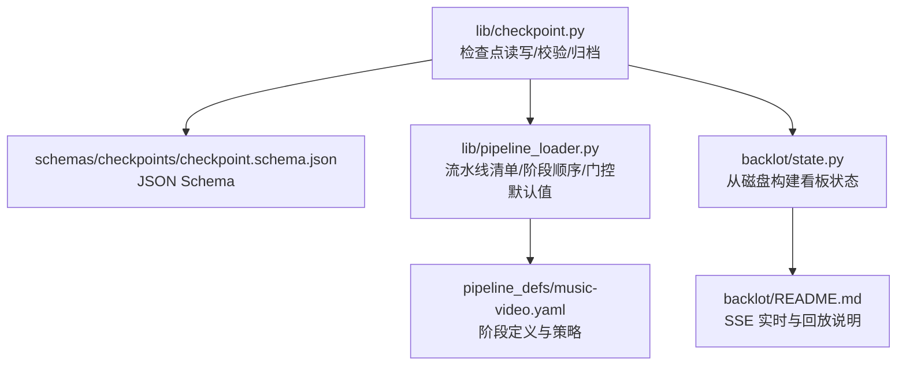
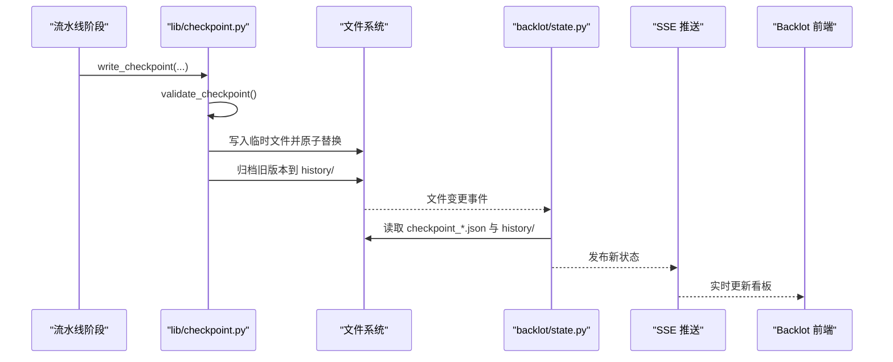
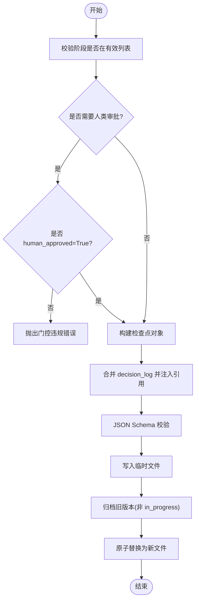
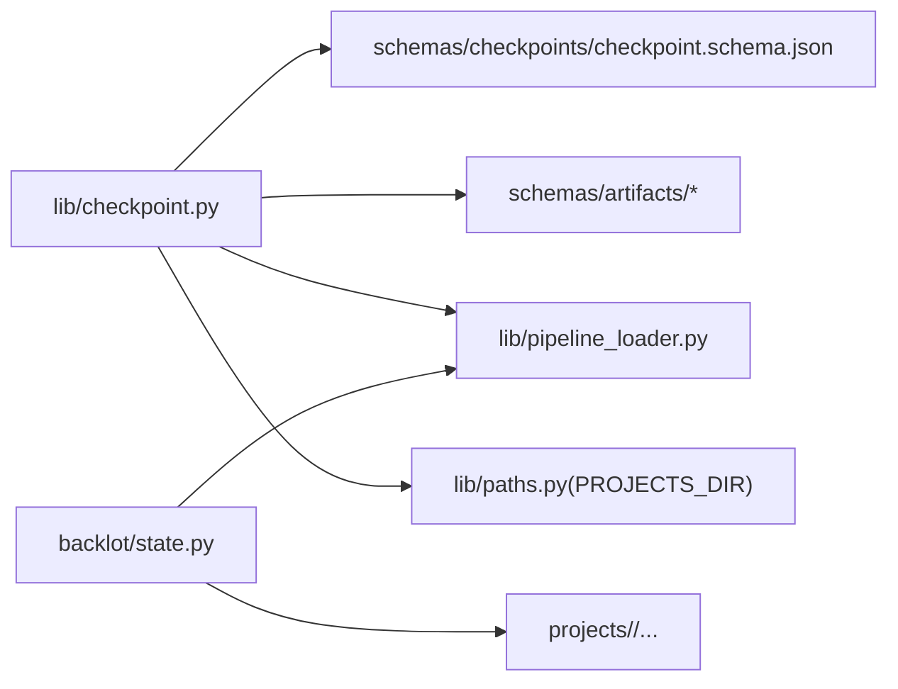

# 检查点系统

<cite>
**本文引用的文件**   
- [lib/checkpoint.py](file://lib/checkpoint.py)
- [schemas/checkpoints/checkpoint.schema.json](file://schemas/checkpoints/checkpoint.schema.json)
- [skills/meta/checkpoint-protocol.md](file://skills/meta/checkpoint-protocol.md)
- [lib/pipeline_loader.py](file://lib/pipeline_loader.py)
- [pipeline_defs/music-video.yaml](file://pipeline_defs/music-video.yaml)
- [backlot/state.py](file://backlot/state.py)
- [backlot/README.md](file://backlot/README.md)
</cite>

## 目录
1. [简介](#简介)
2. [项目结构](#项目结构)
3. [核心组件](#核心组件)
4. [架构总览](#架构总览)
5. [详细组件分析](#详细组件分析)
6. [依赖关系分析](#依赖关系分析)
7. [性能与一致性](#性能与一致性)
8. [故障恢复与数据一致性](#故障恢复与数据一致性)
9. [排错指南](#排错指南)
10. [结论](#结论)
11. [附录：JSON Schema 定义](#附录json-schema-定义)

## 简介
本文件系统化阐述 OpenMontage-MV 的检查点（Checkpoint）机制，包括其概念、作用、工作原理、协议数据结构与 JSON Schema、创建/保存/加载/恢复流程、策略配置（自动、手动、条件）、以及故障恢复与数据一致性保障。该机制为流水线各阶段提供可恢复的“存档点”，支持人类审批门控、审计追踪、进度可视化与回放。

## 项目结构
检查点系统由以下关键部分组成：
- 运行时实现：lib/checkpoint.py（读写、校验、归档、决策日志合并等）
- 协议与规则：skills/meta/checkpoint-protocol.md（何时写、如何写、审批门控、恢复协议）
- 数据模型约束：schemas/checkpoints/checkpoint.schema.json（JSON Schema）
- 流水线清单与阶段顺序：lib/pipeline_loader.py + pipeline_defs/*.yaml（如 music-video.yaml）
- 看板与状态推导：backlot/state.py（读取 checkpoint/history 生成 UI 状态）
- 看板说明：backlot/README.md（SSE 实时刷新、回放能力）

图表来源
- [lib/checkpoint.py:1-120](file://lib/checkpoint.py#L1-L120)
- [schemas/checkpoints/checkpoint.schema.json:1-47](file://schemas/checkpoints/checkpoint.schema.json#L1-L47)
- [lib/pipeline_loader.py:125-182](file://lib/pipeline_loader.py#L125-L182)
- [pipeline_defs/music-video.yaml:1-187](file://pipeline_defs/music-video.yaml#L1-L187)
- [backlot/state.py:116-140](file://backlot/state.py#L116-L140)
- [backlot/README.md:1-43](file://backlot/README.md#L1-L43)

章节来源
- [lib/checkpoint.py:1-120](file://lib/checkpoint.py#L1-L120)
- [schemas/checkpoints/checkpoint.schema.json:1-47](file://schemas/checkpoints/checkpoint.schema.json#L1-L47)
- [lib/pipeline_loader.py:125-182](file://lib/pipeline_loader.py#L125-L182)
- [pipeline_defs/music-video.yaml:1-187](file://pipeline_defs/music-video.yaml#L1-L187)
- [backlot/state.py:116-140](file://backlot/state.py#L116-L140)
- [backlot/README.md:1-43](file://backlot/README.md#L1-L43)

## 核心组件
- 检查点写入器/读取器：负责序列化、校验、归档、原子替换、决策日志合并
- 校验器：基于 JSON Schema 和阶段契约校验检查点与产物
- 流水线清单加载器：解析 YAML 清单，提供阶段顺序、门控默认值、工具能力等
- 看板状态推导器：扫描磁盘上的 checkpoint/history 文件，构建 UI 所需的状态视图
- 协议文档：指导 Agent 在何时、以何种状态写入检查点，以及人类审批流程

章节来源
- [lib/checkpoint.py:140-172](file://lib/checkpoint.py#L140-L172)
- [lib/checkpoint.py:336-467](file://lib/checkpoint.py#L336-L467)
- [lib/pipeline_loader.py:125-182](file://lib/pipeline_loader.py#L125-L182)
- [backlot/state.py:116-140](file://backlot/state.py#L116-L140)
- [skills/meta/checkpoint-protocol.md:1-201](file://skills/meta/checkpoint-protocol.md#L1-L201)

## 架构总览
检查点系统贯穿“流水线执行—持久化—UI 展示—恢复”的全链路：
- 阶段完成后调用 write_checkpoint，完成校验、归档、写入
- read_checkpoint/get_latest_checkpoint/get_next_stage 用于恢复与推进
- Backlot 通过 watchfiles 监听 projects/<id>/ 变化，SSE 推送至浏览器
- 历史版本保存在 history/，支持回放与审计

图表来源
- [lib/checkpoint.py:336-467](file://lib/checkpoint.py#L336-L467)
- [backlot/state.py:116-140](file://backlot/state.py#L116-L140)
- [backlot/README.md:14-33](file://backlot/README.md#L14-L33)

## 详细组件分析

### 检查点协议与数据结构
- 版本信息：version 固定为 "1.0"
- 阶段状态：status ∈ {completed, failed, awaiting_human, in_progress}
- 产物引用：artifacts 为对象映射，包含阶段产物的键值或路径
- 时间戳：timestamp ISO 8601 字符串
- 元数据：metadata 任意对象；review/cost_snapshot/error/style_playbook 可选字段
- 门控相关：checkpoint_policy、human_approval_required、human_approved
- 流水线类型：pipeline_type 用于阶段白名单与门控策略解析

章节来源
- [schemas/checkpoints/checkpoint.schema.json:1-47](file://schemas/checkpoints/checkpoint.schema.json#L1-L47)
- [lib/checkpoint.py:140-172](file://lib/checkpoint.py#L140-L172)
- [skills/meta/checkpoint-protocol.md:10-60](file://skills/meta/checkpoint-protocol.md#L10-L60)

#### JSON Schema 要点
- 必填字段：version、project_id、pipeline_type、stage、status、timestamp、artifacts
- status 枚举限制
- artifacts 允许 additionalProperties，但内部按已知 artifact 名称进行 schema 校验
- 其他可选字段：style_playbook、checkpoint_policy、human_approval_required、human_approved、review、cost_snapshot、error、metadata

章节来源
- [schemas/checkpoints/checkpoint.schema.json:1-47](file://schemas/checkpoints/checkpoint.schema.json#L1-L47)

### 检查点的创建与保存
- 入口：write_checkpoint(pipeline_dir, project_id, stage, status, artifacts, ...)
- 关键行为：
  - 回填 pipeline_type（若未传入则从 project.json 推断）
  - 校验阶段有效性（基于清单或回退集合）
  - 门控强制：若阶段需要人类审批，禁止直接写入 completed 且 human_approved=False
  - 合并 decision_log（若存在），并在 proposal_packet/render_report 中写入引用
  - 先写入临时文件，再原子替换，确保幂等与完整性
  - 归档被覆盖的非 in_progress 版本到 history/
- 返回：已写入的文件路径

图表来源
- [lib/checkpoint.py:336-467](file://lib/checkpoint.py#L336-L467)
- [lib/checkpoint.py:306-334](file://lib/checkpoint.py#L306-L334)

章节来源
- [lib/checkpoint.py:336-467](file://lib/checkpoint.py#L336-L467)
- [lib/checkpoint.py:306-334](file://lib/checkpoint.py#L306-L334)

### 检查点的加载与恢复
- 读取单个阶段：read_checkpoint(pipeline_dir, project_id, stage)
- 获取最新检查点：get_latest_checkpoint(pipeline_dir, project_id)（按 mtime）
- 获取已完成阶段：get_completed_stages(pipeline_dir, project_id, pipeline_type?)
- 计算下一步阶段：get_next_stage(pipeline_dir, project_id, pipeline_type?)
- 恢复协议（来自协议文档）：
  - 进入阶段前先写 in_progress 心跳
  - 长任务阶段定期刷新 metadata.partial_progress
  - 启动时优先检测 next_stage 与是否存在 in_progress 检查点
  - 若存在 awaiting_human，需呈现摘要等待用户批准

章节来源
- [lib/checkpoint.py:470-537](file://lib/checkpoint.py#L470-L537)
- [skills/meta/checkpoint-protocol.md:74-189](file://skills/meta/checkpoint-protocol.md#L74-L189)

### 检查点策略配置选项
- checkpoint_policy 取值：guided、manual_all、auto_noncreative
- 人类审批门控：
  - 清单字段 human_approval_default 决定阶段是否必须人类审批
  - 调用方可设置 human_approval_required 加强门控（只可更严格，不可放宽）
- 流水线清单示例（music-video.yaml）：
  - default_checkpoint_policy: guided
  - 各阶段 checkpoint_required 与 human_approval_default 声明
- 看板对门控的展示：
  - gated 标志来源于清单 human_approval_default
  - 若 completed 却从未出现 awaiting_human 的历史记录，视为跳过门控

章节来源
- [schemas/checkpoints/checkpoint.schema.json:22-24](file://schemas/checkpoints/checkpoint.schema.json#L22-L24)
- [lib/pipeline_loader.py:173-182](file://lib/pipeline_loader.py#L173-L182)
- [pipeline_defs/music-video.yaml:14-181](file://pipeline_defs/music-video.yaml#L14-L181)
- [backlot/state.py:62-92](file://backlot/state.py#L62-L92)
- [backlot/state.py:174-181](file://backlot/state.py#L174-L181)

### 产物与阶段契约
- 每个阶段有“规范产物”（canonical artifact），例如 idea→brief、assets→asset_manifest 等
- 校验逻辑会要求处于 completed/awaiting_human 状态的阶段必须包含其规范产物
- 除规范产物外，还可附带补充产物（如 source_media_review、final_review、video_analysis_brief）

章节来源
- [lib/checkpoint.py:30-48](file://lib/checkpoint.py#L30-L48)
- [lib/checkpoint.py:104-138](file://lib/checkpoint.py#L104-L138)

### 看板集成与状态推导
- 看板读取当前检查点与 history 版本，构建阶段轨道（rail）
- 支持渲染 review、cost_snapshot、error、partial_progress、versions 等
- 通过 SSE 实时推送，无需 Agent 参与

章节来源
- [backlot/state.py:116-140](file://backlot/state.py#L116-L140)
- [backlot/state.py:143-222](file://backlot/state.py#L143-L222)
- [backlot/README.md:14-33](file://backlot/README.md#L14-L33)

## 依赖关系分析
- lib/checkpoint.py 依赖：
  - schemas/artifacts.* 中的 ARTIFACT_NAMES 与 validate_artifact
  - schemas/checkpoints/checkpoint.schema.json（JSON Schema）
  - lib/pipeline_loader.py（阶段顺序、门控默认值）
  - lib/paths.PROJECTS_DIR（项目根目录）
- backlot/state.py 依赖：
  - 文件系统（checkpoint_*.json、history/、project.json）
  - 清单加载（用于阶段顺序与门控标志）

图表来源
- [lib/checkpoint.py:1-20](file://lib/checkpoint.py#L1-L20)
- [lib/checkpoint.py:77-88](file://lib/checkpoint.py#L77-L88)
- [backlot/state.py:62-92](file://backlot/state.py#L62-L92)

章节来源
- [lib/checkpoint.py:1-20](file://lib/checkpoint.py#L1-L20)
- [lib/checkpoint.py:77-88](file://lib/checkpoint.py#L77-L88)
- [backlot/state.py:62-92](file://backlot/state.py#L62-L92)

## 性能与一致性
- 原子写入：先写 .tmp 再 os.replace，避免部分写入导致损坏
- 缓存：_load_checkpoint_schema 使用 lru_cache，减少重复 I/O
- 归档策略：仅归档非 in_progress 的版本，避免心跳频繁复制
- 看板状态推导：按 mtime 排序最新检查点，O(n) 扫描，适合小量项目
- 决策日志合并：去重写入，避免重复条目

章节来源
- [lib/checkpoint.py:98-102](file://lib/checkpoint.py#L98-L102)
- [lib/checkpoint.py:452-467](file://lib/checkpoint.py#L452-L467)
- [lib/checkpoint.py:263-300](file://lib/checkpoint.py#L263-L300)
- [lib/checkpoint.py:306-334](file://lib/checkpoint.py#L306-L334)

## 故障恢复与数据一致性
- 失败保护：
  - 写入失败不会留下截断文件（临时文件+原子替换）
  - 归档失败不影响主流程（异常吞掉并记录警告）
- 一致性保证：
  - 所有读操作均进行 JSON Schema 校验
  - 门控策略在写入时强制执行，防止绕过人类审批
  - 历史版本保留完整轨迹，支持审计与回放
- 恢复流程：
  - 启动时 get_next_stage 定位下一待执行阶段
  - 若存在 in_progress，读取 metadata.partial_progress 继续
  - 若存在 awaiting_human，呈现摘要等待用户批准

章节来源
- [lib/checkpoint.py:452-467](file://lib/checkpoint.py#L452-L467)
- [lib/checkpoint.py:263-300](file://lib/checkpoint.py#L263-L300)
- [lib/checkpoint.py:470-537](file://lib/checkpoint.py#L470-L537)
- [skills/meta/checkpoint-protocol.md:167-189](file://skills/meta/checkpoint-protocol.md#L167-L189)

## 排错指南
- 常见错误：
  - 阶段不在有效列表：检查 pipeline_type 与清单阶段名
  - 缺少规范产物：completed/awaiting_human 状态必须包含对应 canonical artifact
  - 门控违规：需要人类审批的阶段不能直接写入 completed 且 human_approved=False
  - JSON Schema 校验失败：检查 artifacts 结构与类型
- 诊断建议：
  - 查看 history/ 下的历史版本，确认阶段演进与门控轨迹
  - 检查 project.json 与 pipeline_type 是否一致
  - 关注 decision_log 是否被正确合并与引用

章节来源
- [lib/checkpoint.py:140-172](file://lib/checkpoint.py#L140-L172)
- [lib/checkpoint.py:378-406](file://lib/checkpoint.py#L378-L406)
- [backlot/state.py:174-181](file://backlot/state.py#L174-L181)

## 结论
检查点系统为 OpenMontage-MV 提供了稳健的流水线状态管理方案：通过严格的 JSON Schema 校验、门控策略与历史归档，实现了高可靠的可恢复性与可审计性；结合 Backlot 看板与 SSE，提供实时可视化与回放能力。遵循协议文档的写入与恢复流程，可确保人类监督与自动化执行的平衡。

## 附录：JSON Schema 定义
- 版本：version="1.0"
- 必需字段：version、project_id、pipeline_type、stage、status、timestamp、artifacts
- 状态枚举：completed、failed、awaiting_human、in_progress
- 策略与门控：checkpoint_policy、human_approval_required、human_approved
- 可选扩展：style_playbook、review、cost_snapshot、error、metadata

章节来源
- [schemas/checkpoints/checkpoint.schema.json:1-47](file://schemas/checkpoints/checkpoint.schema.json#L1-L47)