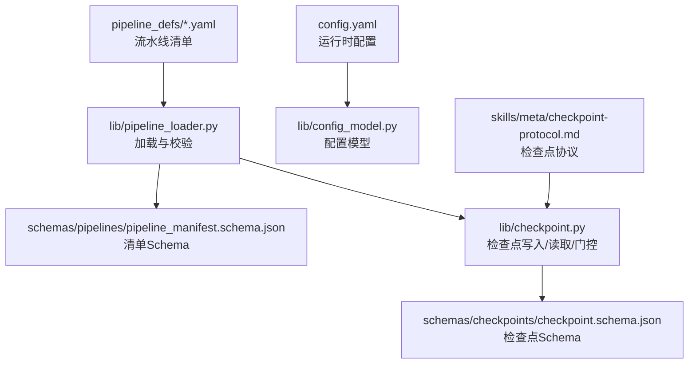
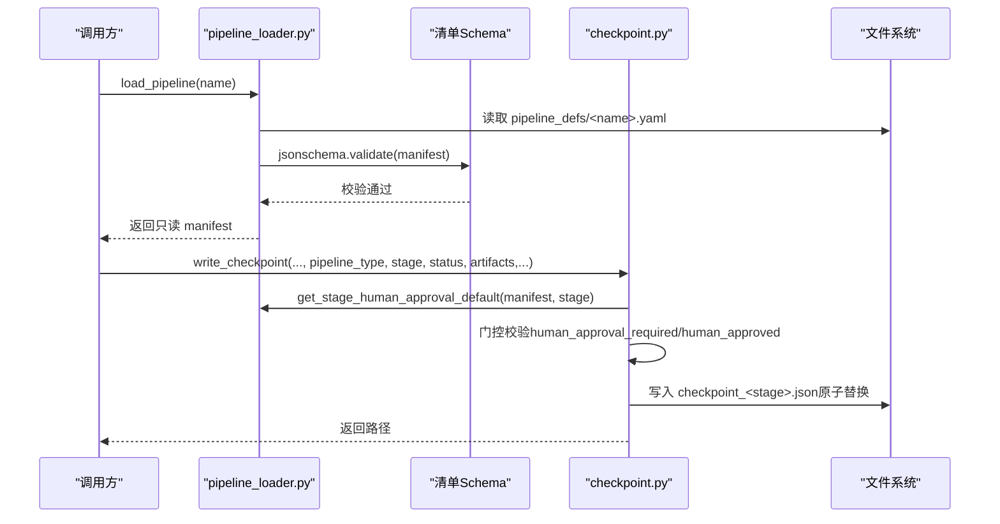
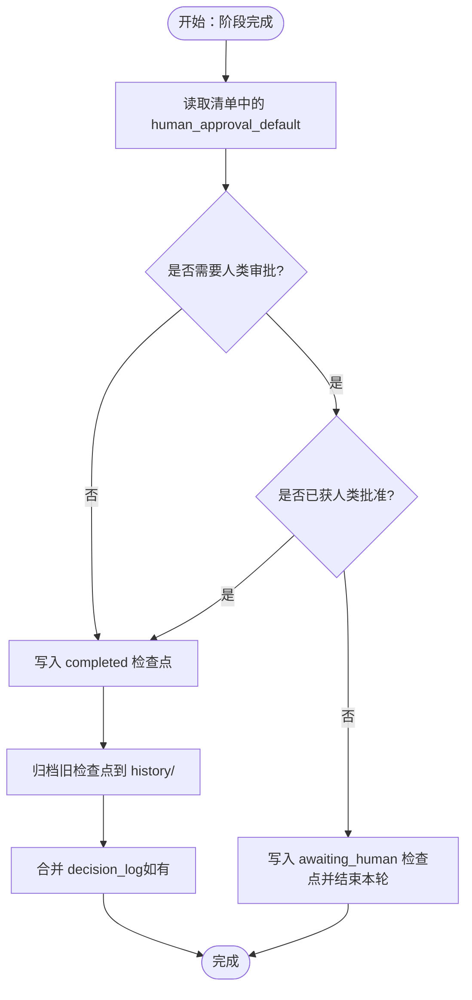
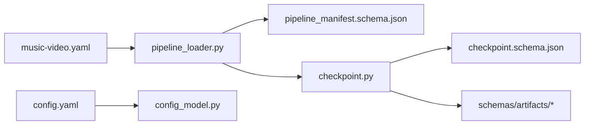

# 流水线定义与配置

<cite>
**本文引用的文件**   
- [music-video.yaml](file://pipeline_defs/music-video.yaml)
- [pipeline_manifest.schema.json](file://schemas/pipelines/pipeline_manifest.schema.json)
- [checkpoint.schema.json](file://schemas/checkpoints/checkpoint.schema.json)
- [pipeline_loader.py](file://lib/pipeline_loader.py)
- [checkpoint.py](file://lib/checkpoint.py)
- [config_model.py](file://lib/config_model.py)
- [config.yaml](file://config.yaml)
- [checkpoint-protocol.md](file://skills/meta/checkpoint-protocol.md)
</cite>

## 目录
1. [简介](#简介)
2. [项目结构](#项目结构)
3. [核心组件](#核心组件)
4. [架构总览](#架构总览)
5. [详细组件分析](#详细组件分析)
6. [依赖关系分析](#依赖关系分析)
7. [性能考量](#性能考量)
8. [故障排查指南](#故障排查指南)
9. [结论](#结论)
10. [附录：完整配置示例与最佳实践](#附录完整配置示例与最佳实践)

## 简介
本文件系统化说明 OpenMontage-MV 的“流水线定义与配置”，聚焦 YAML 格式的流水线清单（manifest）结构与运行时校验、阶段编排、产物契约、工具能力声明、检查点策略与人类审批门控等。文档以 music-video 流水线为实例，结合 schema 约束与加载器实现，帮助读者准确理解并安全扩展流水线定义。

## 项目结构
与流水线定义与配置直接相关的目录与文件如下：
- pipeline_defs：存放各流水线的 YAML 清单
- schemas/pipelines：流水线清单 JSON Schema
- schemas/checkpoints：检查点 JSON Schema
- lib：流水线加载、配置模型、检查点读写等运行时库
- skills/meta：元技能（如检查点协议、审查者）

图表来源 
- [music-video.yaml:1-187](file://pipeline_defs/music-video.yaml#L1-L187)
- [pipeline_manifest.schema.json:1-162](file://schemas/pipelines/pipeline_manifest.schema.json#L1-L162)
- [checkpoint.schema.json:1-47](file://schemas/checkpoints/checkpoint.schema.json#L1-L47)
- [pipeline_loader.py:1-241](file://lib/pipeline_loader.py#L1-L241)
- [checkpoint.py:1-537](file://lib/checkpoint.py#L1-L537)
- [config_model.py:1-70](file://lib/config_model.py#L1-L70)
- [config.yaml:1-20](file://config.yaml#L1-L20)
- [checkpoint-protocol.md:1-201](file://skills/meta/checkpoint-protocol.md#L1-L201)

章节来源
- [music-video.yaml:1-187](file://pipeline_defs/music-video.yaml#L1-L187)
- [pipeline_manifest.schema.json:1-162](file://schemas/pipelines/pipeline_manifest.schema.json#L1-L162)
- [checkpoint.schema.json:1-47](file://schemas/checkpoints/checkpoint.schema.json#L1-L47)
- [pipeline_loader.py:1-241](file://lib/pipeline_loader.py#L1-L241)
- [checkpoint.py:1-537](file://lib/checkpoint.py#L1-L537)
- [config_model.py:1-70](file://lib/config_model.py#L1-L70)
- [config.yaml:1-20](file://config.yaml#L1-L20)
- [checkpoint-protocol.md:1-201](file://skills/meta/checkpoint-protocol.md#L1-L201)

## 核心组件
- 流水线清单（YAML manifest）：描述流水线元数据、扩展权限、必需技能、兼容剧本、阶段序列及每个阶段的输入/输出、工具可用性、检查点策略、人类审批默认值、审查重点与成功标准。
- 清单 Schema（JSON Schema）：对 manifest 的结构与取值范围进行强约束，确保一致性。
- 加载器（pipeline_loader）：解析 YAML、校验 Schema、缓存结果、提供查询接口（阶段顺序、工具集合、子阶段、人类审批默认值等）。
- 检查点（checkpoint）：阶段完成后的可恢复快照，包含状态、产物、时间戳、策略、人类审批标记等；支持归档历史、合并决策日志、门控校验。
- 运行时配置（config_model + config.yaml）：全局路径、输出参数、检查点策略等。

章节来源
- [pipeline_manifest.schema.json:1-162](file://schemas/pipelines/pipeline_manifest.schema.json#L1-L162)
- [pipeline_loader.py:1-241](file://lib/pipeline_loader.py#L1-L241)
- [checkpoint.py:1-537](file://lib/checkpoint.py#L1-L537)
- [config_model.py:1-70](file://lib/config_model.py#L1-L70)
- [config.yaml:1-20](file://config.yaml#L1-L20)

## 架构总览
流水线从 YAML 清单到运行时的关键流程：
- 加载清单：按名称查找 YAML，使用 JSON Schema 校验，返回只读字典。
- 阶段编排：根据清单生成阶段顺序（含可选子阶段），计算所需工具集合。
- 检查点门控：写入检查点时依据清单中 human_approval_default 强制门控，未通过则拒绝“completed”状态。
- 产物校验：产物按 artifact schema 校验，保证下游消费稳定。

图表来源 
- [pipeline_loader.py:39-71](file://lib/pipeline_loader.py#L39-L71)
- [checkpoint.py:336-467](file://lib/checkpoint.py#L336-L467)
- [pipeline_manifest.schema.json:1-162](file://schemas/pipelines/pipeline_manifest.schema.json#L1-L162)

## 详细组件分析

### 流水线清单字段详解（YAML）
- 元数据字段
  - name：字符串，必填。流水线标识名。
  - version：字符串，必填。版本标识。
  - description：字符串，可选。流水线描述。
  - category：枚举，可选。分类，如 music_video、cinematic 等。
  - stability：枚举，可选。稳定性等级（production/beta）。
- 扩展选项 extensions
  - custom_scripts：布尔，是否允许自定义脚本。
  - custom_playbooks：布尔，是否允许自定义剧本。
  - custom_skills：布尔，是否允许自定义技能。
  - custom_tools：布尔，是否允许自定义工具。
- 必需技能 required_skills：字符串数组，声明该流水线所需的技能路径。
- 兼容剧本 compatible_playbooks：可为字符串数组或对象（recommended/also_works/custom_allowed）。
- 默认检查点策略 default_checkpoint_policy：guided/manual_all/auto_noncreative。
- stages：阶段数组，每个阶段包含以下关键字段：
  - name：阶段名（必填）。
  - skill：指令驱动的技能路径（如 pipelines/music-video/idea-director）。
  - required_artifacts_in：前置必须产物。
  - optional_artifacts_in：可选前置产物。
  - produces：本阶段产出的产物名列表。
  - tools_available：本阶段可用的工具集合（required+optional 的并集）。
  - required_tools：必须可用的工具（否则失败）。
  - optional_tools：增强型可选工具。
  - review_focus：审查关注点（文本项列表）。
  - success_criteria：成功标准（文本项列表）。
  - checkpoint_required：是否必须写检查点（默认 true）。
  - human_approval_default：是否默认需要人类审批（默认 false）。
  - sub_stages：可选的子阶段（条件激活、独立工具与审查焦点）。

章节来源
- [pipeline_manifest.schema.json:1-162](file://schemas/pipelines/pipeline_manifest.schema.json#L1-L162)
- [music-video.yaml:1-187](file://pipeline_defs/music-video.yaml#L1-L187)

### 阶段配置语法与语义
- 阶段名称 name：唯一标识，用于定位阶段、生成检查点文件名、决定执行顺序。
- 技能引用 skill：指向 skills 目录下的指令文档，指导 Agent 如何工作。
- 产物声明 produces：声明本阶段产出哪些 artifact，供下游阶段通过 required_artifacts_in 引用。
- 工具可用性 tools_available：Agent 在本阶段可使用的工具集合；required_tools 是硬性要求，optional_tools 是增强能力。
- 检查点策略 checkpoint_required：控制是否必须落盘检查点；配合 default_checkpoint_policy 决定整体策略。
- 人类审批设置 human_approval_default：门控开关，true 表示该阶段完成后需人类批准才能继续。
- 审查重点 review_focus：给审查者/自审的检查清单。
- 成功标准 success_criteria：判定阶段完成的验收条目。

章节来源
- [music-video.yaml:36-187](file://pipeline_defs/music-video.yaml#L36-L187)
- [pipeline_manifest.schema.json:41-118](file://schemas/pipelines/pipeline_manifest.schema.json#L41-L118)

### 检查点与人类审批门控
- 检查点结构：包含版本、项目ID、流水线类型、阶段名、状态、时间戳、产物映射、策略、人类审批标记、成本快照、错误信息、元数据等。
- 门控规则：若清单中 human_approval_default 为 true，则写入 completed 时必须附带 human_approved=true，否则抛出门控违规错误。
- 归档与恢复：覆盖前将旧检查点归档至 history/；支持 in_progress 部分进度保存与恢复。
- 决策日志合并：当产物包含 decision_log 时，自动合并到项目级 decision_log.json，并在相关产物中回写引用。

图表来源 
- [checkpoint.py:336-467](file://lib/checkpoint.py#L336-L467)
- [checkpoint.schema.json:1-47](file://schemas/checkpoints/checkpoint.schema.json#L1-L47)
- [checkpoint-protocol.md:1-201](file://skills/meta/checkpoint-protocol.md#L1-L201)

章节来源
- [checkpoint.py:1-537](file://lib/checkpoint.py#L1-L537)
- [checkpoint.schema.json:1-47](file://schemas/checkpoints/checkpoint.schema.json#L1-L47)
- [checkpoint-protocol.md:1-201](file://skills/meta/checkpoint-protocol.md#L1-L201)

### 扩展选项与权限校验
- 扩展类型：custom_scripts、custom_playbooks、custom_skills、custom_tools。
- 校验逻辑：若清单未开启对应扩展，则尝试使用该扩展时会抛出 ExtensionNotPermitted 异常。
- 获取权限：可通过 get_permitted_extensions 获取当前清单允许的扩展标志。

章节来源
- [pipeline_loader.py:197-241](file://lib/pipeline_loader.py#L197-L241)
- [pipeline_manifest.schema.json:148-158](file://schemas/pipelines/pipeline_manifest.schema.json#L148-L158)

### 兼容剧本 compatible_playbooks
- 支持两种形式：
  - 字符串数组：直接列出兼容的剧本名。
  - 对象：包含 recommended、also_works、custom_allowed 三个字段，其中 custom_allowed 默认为 false。
- 用途：限制或推荐特定风格/模板的使用，保障生产一致性。

章节来源
- [pipeline_manifest.schema.json:21-36](file://schemas/pipelines/pipeline_manifest.schema.json#L21-L36)
- [music-video.yaml:33-35](file://pipeline_defs/music-video.yaml#L33-L35)

### 参考输入（reference_input）
- supported：布尔，是否支持参考视频输入。
- analysis_depth：transcript_only/standard/deep。
- analysis_tools：分析所需的工具集合。
- 加载器会聚合 reference_input.analysis_tools 到全量工具集合中。

章节来源
- [pipeline_manifest.schema.json:125-133](file://schemas/pipelines/pipeline_manifest.schema.json#L125-L133)
- [pipeline_loader.py:88-96](file://lib/pipeline_loader.py#L88-L96)

### 运行时配置（config_model + config.yaml）
- checkpoint.policy：guided/manual_all/auto_noncreative。
- output.*：默认格式、编解码器、分辨率、帧率、CRF 等。
- paths.*：pipeline_dir、library_dir、styles_dir、skills_dir、output_dir。
- 提供 model_validate 与 resolve_path 等方法，统一路径解析与类型校验。

章节来源
- [config_model.py:1-70](file://lib/config_model.py#L1-L70)
- [config.yaml:1-20](file://config.yaml#L1-L20)

## 依赖关系分析
- 清单加载依赖 JSON Schema 校验，确保字段合法。
- 检查点写入依赖清单中的人类审批默认值，形成门控。
- 阶段顺序与工具集合由加载器统一计算，避免硬编码。
- 产物校验依赖 schemas/artifacts 下的各 artifact schema（在检查点写入时触发）。

图表来源 
- [music-video.yaml:1-187](file://pipeline_defs/music-video.yaml#L1-L187)
- [pipeline_loader.py:1-241](file://lib/pipeline_loader.py#L1-L241)
- [pipeline_manifest.schema.json:1-162](file://schemas/pipelines/pipeline_manifest.schema.json#L1-L162)
- [checkpoint.py:1-537](file://lib/checkpoint.py#L1-L537)
- [checkpoint.schema.json:1-47](file://schemas/checkpoints/checkpoint.schema.json#L1-L47)
- [config.yaml:1-20](file://config.yaml#L1-L20)
- [config_model.py:1-70](file://lib/config_model.py#L1-L70)

章节来源
- [pipeline_loader.py:1-241](file://lib/pipeline_loader.py#L1-L241)
- [checkpoint.py:1-537](file://lib/checkpoint.py#L1-L537)

## 性能考量
- 清单加载采用 lru_cache 缓存，避免重复解析与校验，适合高频调用（如每次检查点写入都读取人类审批默认值）。
- 检查点写入采用临时文件 + os.replace 原子替换，防止中断导致损坏。
- 归档旧检查点采用拷贝而非移动，避免 Windows 下文件占用导致的失败。
- 建议：
  - 尽量复用只读清单，避免频繁重新加载。
  - 合理设置 checkpoint_required，减少不必要的 I/O。
  - 产物过大时优先存储路径引用，避免检查点膨胀。

[本节为通用指导，不直接分析具体文件]

## 故障排查指南
- 清单校验失败：检查字段类型、枚举值、必填项是否符合 pipeline_manifest.schema.json。
- 门控违规（GATE VIOLATION）：若 human_approval_default 为 true，写入 completed 而未设置 human_approved=true 将报错。应改为 awaiting_human 并在获得批准后再次写入 completed。
- 产物校验失败：确认产物符合对应 artifact schema；必要时先写入 metadata.partial_progress 保存草稿。
- 工具缺失：required_tools 未满足会导致阶段失败；tools_available 仅暴露可用工具，不会强制安装。
- 扩展权限不足：使用未被清单允许的扩展会抛出 ExtensionNotPermitted，需在清单 extensions 中开启相应开关。

章节来源
- [checkpoint.py:378-406](file://lib/checkpoint.py#L378-L406)
- [pipeline_loader.py:197-241](file://lib/pipeline_loader.py#L197-L241)
- [checkpoint.schema.json:1-47](file://schemas/checkpoints/checkpoint.schema.json#L1-L47)

## 结论
OpenMontage-MV 的流水线定义通过 YAML 清单与 JSON Schema 双重约束，结合加载器的缓存与查询能力、检查点的门控与归档机制，实现了高内聚、低耦合、可恢复且可审计的生产流水线。遵循本文档的字段规范与最佳实践，可快速构建稳定可靠的自定义流水线。

[本节为总结性内容，不直接分析具体文件]

## 附录：完整配置示例与最佳实践

### 完整配置示例（music-video）
- 元数据：name、version、description、category、stability、default_checkpoint_policy。
- 扩展选项：extensions.custom_* 按需开启。
- 必需技能：required_skills 列出所有导演技能与元技能。
- 兼容剧本：compatible_playbooks 指定 allowed/recommended。
- 阶段序列：idea → proposal → storyboard → assets → edit → compose → publish，每个阶段明确 skill、produces、tools_available、review_focus、success_criteria、checkpoint_required、human_approval_default。

章节来源
- [music-video.yaml:1-187](file://pipeline_defs/music-video.yaml#L1-L187)

### 最佳实践
- 严格使用 schema：任何新增字段都应先在 schema 中声明，再在清单中使用。
- 最小化人类审批：仅在关键质量门处启用 human_approval_default，提升自动化效率。
- 明确产物契约：produces 与 required_artifacts_in 要一一对应，避免下游找不到产物。
- 工具声明清晰：required_tools 与 optional_tools 分离，tools_available 作为并集对外暴露。
- 审查与成功标准：review_focus 与 success_criteria 要可验证、可度量，便于自动化与人工复核。
- 检查点策略：长耗时阶段务必写入 in_progress 检查点，支持断点续跑。
- 扩展权限：谨慎开启 custom_* 扩展，避免引入不可控行为。

[本节为通用指导，不直接分析具体文件]