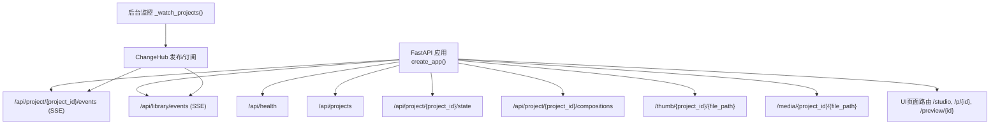
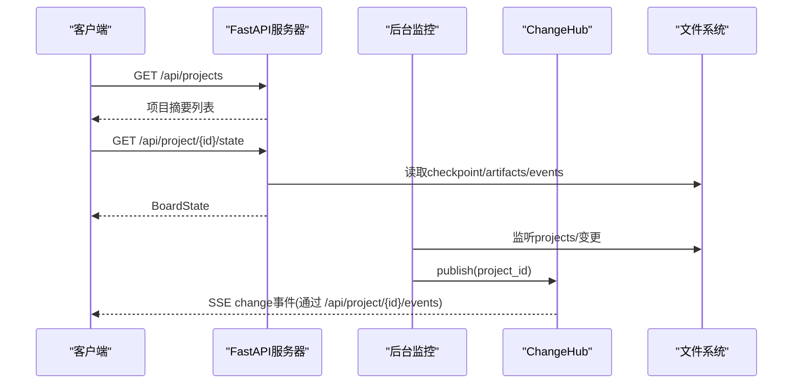

# REST API端点参考

<cite>
**本文引用的文件**   
- [server.py](file://backlot/server.py)
- [state.py](file://backlot/state.py)
- [paths.py](file://lib/paths.py)
- [events.py](file://lib/events.py)
- [__main__.py](file://backlot/__main__.py)
- [__init__.py](file://backlot/__init__.py)
</cite>

## 目录
1. [简介](#简介)
2. [项目结构](#项目结构)
3. [核心组件](#核心组件)
4. [架构总览](#架构总览)
5. [详细端点说明](#详细端点说明)
6. [依赖关系与调用顺序](#依赖关系与调用顺序)
7. [性能考量](#性能考量)
8. [故障排查指南](#故障排查指南)
9. [结论](#结论)
10. [附录：客户端集成最佳实践](#附录客户端集成最佳实践)

## 简介
本参考文档面向OpenMontage-MV的Backlot服务，系统化梳理其REST API端点，重点覆盖健康检查、项目列表、项目状态、组合（compositions）等关键接口。文档包含每个端点的HTTP方法、URL模式、请求参数、响应格式、错误码说明、示例以及业务逻辑解释，并给出端点间的依赖关系、调用顺序和客户端集成建议。

## 项目结构
Backlot基于FastAPI构建，提供REST API与SSE事件流，同时提供媒体与缩略图访问能力。核心入口为FastAPI应用创建函数，并在启动时开启后台任务监听项目目录变更，通过SSE推送变化通知。



图表来源
- [server.py:151-243](file://backlot/server.py#L151-L243)
- [server.py:329-361](file://backlot/server.py#L329-L361)

章节来源
- [server.py:151-243](file://backlot/server.py#L151-L243)
- [__main__.py:110-117](file://backlot/__main__.py#L110-L117)
- [__init__.py:14-17](file://backlot/__init__.py#L14-L17)

## 核心组件
- FastAPI应用与路由：集中定义所有API端点，包括REST与SSE。
- 状态派生：从项目目录读取checkpoint、artifacts、events等，生成BoardState。
- 事件系统：append-only的事件日志，用于驱动实时状态与生成中指示。
- 路径管理：统一仓库根与项目根路径，支持环境变量覆盖。
- SSE与后台监控：watchfiles监听项目目录变更，通过ChangeHub广播给订阅者。

章节来源
- [server.py:151-243](file://backlot/server.py#L151-L243)
- [state.py:586-656](file://backlot/state.py#L586-L656)
- [events.py:77-119](file://lib/events.py#L77-L119)
- [paths.py:13-17](file://lib/paths.py#L13-L17)

## 架构总览
Backlot采用“只读观察”的设计原则：服务端不写入项目目录，仅读取由流水线产生的checkpoint、artifacts、events等文件，并通过SSE将变更推送到前端。媒体与缩略图通过专用路由安全地暴露。



图表来源
- [server.py:132-149](file://backlot/server.py#L132-L149)
- [server.py:185-214](file://backlot/server.py#L185-L214)
- [state.py:586-656](file://backlot/state.py#L586-L656)

## 详细端点说明

### 健康检查
- 方法：GET
- URL：/api/health
- 请求参数：无
- 响应体：{"ok": true, "app": "backlot"}
- 错误码：无（成功即返回200）
- 说明：用于进程存活探测与服务可用性检测。

章节来源
- [server.py:166-168](file://backlot/server.py#L166-L168)

### 项目列表
- 方法：GET
- URL：/api/projects
- 请求参数：无
- 响应体：数组，每项为一个项目的摘要信息，字段包括：
  - project_id: string
  - title: string
  - pipeline_type: string
  - has_pipeline_state: boolean
  - poster: string|null
  - live: boolean
  - last_activity: number
  - active_stage: string|null
  - awaiting_human: boolean
  - stage_states: array<{name, status}>
  - completed_count: number
  - render_count: number
  - scene_count: number
  - error?: string（当项目不可读时出现）
- 错误码：无（成功即返回200）
- 说明：返回按“活跃优先、最近活动排序”的项目摘要；内部对每个项目做轻量摘要计算并缓存，变更时失效。

章节来源
- [server.py:170-172](file://backlot/server.py#L170-L172)
- [state.py:659-681](file://backlot/state.py#L659-L681)

### 项目状态
- 方法：GET
- URL：/api/project/{project_id}/state
- 路径参数：
  - project_id: string（不允许包含“/”、“\”、“:”，且不能为“.”或“..”）
- 响应体：BoardState对象，主要字段包括：
  - project_id: string
  - title: string
  - pipeline: {pipeline_type, stages[], known: boolean}
  - style_playbook: any|null
  - created_at: string|null
  - has_marker: boolean
  - has_pipeline_state: boolean
  - stages: array<{name, gated, produces[], status, timestamp, review, cost_snapshot, error, human_approved, partial_progress, versions, history_entries[], gate_skipped?, stalled?, stalled_minutes?}>
  - artifacts: object（键为artifact名，值为对应JSON内容）
  - storyboard: {scenes[], total_duration_seconds?, style_playbook?}|null
  - media: {renders[], snapshots[], music[]}
  - events: array<object>（最近N条工具事件）
  - cost: object|null
  - last_activity: number
  - live: boolean
  - poster: string|null
- 错误码：
  - 400 invalid project id（非法project_id）
  - 404 unknown project（项目不存在）
- 说明：该接口是重计算接口，会读取checkpoint、artifacts、events并组装BoardState；若某阶段长时间无活动会被标记stalled。

章节来源
- [server.py:174-177](file://backlot/server.py#L174-L177)
- [state.py:586-656](file://backlot/state.py#L586-L656)
- [server.py:409-417](file://backlot/server.py#L409-L417)

### 项目组合（HyperFrames compositions）
- 方法：GET
- URL：/api/project/{project_id}/compositions
- 路径参数：同项目状态
- 响应体：数组，每项为一个组合条目，字段包括：
  - path: string（相对于项目根的相对路径）
  - name: string（优先使用manifest.name，否则目录名）
  - duration?: number
  - fps?: number
  - resolution?: string
  - audio?: string（音频相对路径，若存在且可解析）
- 错误码：
  - 400 invalid project id
  - 404 unknown project
- 说明：扫描项目内含hyperframes.json及index.html的目录，深度限制为2层；音频路径需位于项目根下才可被/media路由访问。

章节来源
- [server.py:179-183](file://backlot/server.py#L179-L183)
- [server.py:420-453](file://backlot/server.py#L420-L453)

### 项目事件流（SSE）
- 方法：GET
- URL：/api/project/{project_id}/events
- 路径参数：同项目状态
- 查询参数：无
- 响应体：text/event-stream，事件类型：
  - hello：首次连接确认，包含project_id
  - heartbeat：心跳，包含ts时间戳
  - change：项目变更通知，包含project_id
- 错误码：
  - 404 unknown project（未知项目）
- 说明：长连接SSE，每15秒发送一次心跳；变更消息会合并突发，避免队列拥塞。

章节来源
- [server.py:185-214](file://backlot/server.py#L185-L214)

### 库级事件流（SSE）
- 方法：GET
- URL：/api/library/events
- 请求参数：无
- 响应体：text/event-stream，事件类型：
  - hello：首次连接确认
  - heartbeat：心跳，包含ts
  - change：任意项目变更，包含project_id
- 说明：订阅所有项目变更，适合全局刷新场景。

章节来源
- [server.py:216-242](file://backlot/server.py#L216-L242)

### 缩略图
- 方法：GET
- URL：/thumb/{project_id}/{file_path}
- 路径参数：
  - project_id: string
  - file_path: string（必须位于项目目录下）
- 查询参数：
  - w: int（目标宽度，默认640；可选值集合为[320,640,960]中最接近的值）
- 响应体：image/jpeg（缩略图），若无法生成则可能直接返回原图（非视频图片）或404
- 错误码：
  - 403 path escapes project（路径越界）
  - 404 media not found（文件不存在）
  - 404 no poster frame available（视频无法提取海报帧）
- 说明：对图片进行缩放缓存，对视频尝试用ffmpeg抽取一帧作为海报；失败时针对视频返回404，避免向返回原始视频字节。

章节来源
- [server.py:329-347](file://backlot/server.py#L329-L347)

### 媒体文件
- 方法：GET
- URL：/media/{project_id}/{file_path}
- 路径参数：
  - project_id: string
  - file_path: string（必须位于项目目录下）
- 响应体：原始文件（支持Range请求）
- 错误码：
  - 403 path escapes project
  - 404 media not found
- 说明：用于播放媒体或下载资源，服务端不做内容转换。

章节来源
- [server.py:351-361](file://backlot/server.py#L351-L361)

### UI页面（非API）
- /studio：Studio工作区页面
- /preview/{project_id}：预览页面（校验项目存在）
- /studio/{session_id}：带会话ID的Studio页面
- /p/{project_id}：看板页面
- /p/{project_path:path}：看板页面（路径形式）
- /：库首页
- 说明：这些路由返回HTML页面，并注入静态资源版本以强制条件缓存验证。

章节来源
- [server.py:365-388](file://backlot/server.py#L365-L388)

## 依赖关系与调用顺序
- /api/projects：调用_cached_summaries，内部遍历PROJECTS_DIR并对每个项目执行summarize_project（轻量摘要）。
- /api/project/{id}/state：调用load_board_state，读取checkpoint、artifacts、events，组装BoardState。
- /api/project/{id}/compositions：调用_scan_compositions，扫描hyperframes.json与index.html。
- /api/project/{id}/events与/api/library/events：通过ChangeHub订阅变更，后台_watch_projects监听文件系统变更并发布到hub。
- /thumb与/media：校验路径安全性后返回文件或缓存结果。

```mermaid
flowchart TD
Start(["请求进入"]) --> Route{"路由匹配"}
Route --> |/api/projects| Projects["_cached_summaries()"]
Route --> |/api/project/{id}/state| State["load_board_state()"]
Route --> |/api/project/{id}/compositions| Comps["_scan_compositions()"]
Route --> |/api/project/{id}/events| SSE1["SSE订阅(ChangeHub)"]
Route --> |/api/library/events| SSE2["SSE订阅(ChangeHub)"]
Route --> |/thumb/*| Thumb["缩略图生成/缓存"]
Route --> |/media/*| Media["文件直出"]
Projects --> End(["响应"])
State --> End
Comps --> End
SSE1 --> End
SSE2 --> End
Thumb --> End
Media --> End
```

图表来源
- [server.py:170-183](file://backlot/server.py#L170-L183)
- [server.py:185-242](file://backlot/server.py#L185-L242)
- [server.py:329-361](file://backlot/server.py#L329-L361)
- [state.py:586-656](file://backlot/state.py#L586-L656)

章节来源
- [server.py:170-242](file://backlot/server.py#L170-L242)
- [state.py:586-656](file://backlot/state.py#L586-L656)

## 性能考量
- 项目摘要缓存：_cached_summaries对每个项目摘要进行缓存，变更时失效，减少重复解析成本。
- 后台监控：watchfiles异步监听，批量处理变更并去重，避免频繁通知。
- SSE心跳：15秒心跳防止连接超时；变更消息合并，降低网络负载。
- 缩略图缓存：按源文件元数据与目标宽度生成唯一缓存键，避免重复计算。
- 媒体传输：FileResponse原生支持Range请求，利于大文件分段加载。

章节来源
- [server.py:76-108](file://backlot/server.py#L76-L108)
- [server.py:132-149](file://backlot/server.py#L132-L149)
- [server.py:185-214](file://backlot/server.py#L185-L214)
- [server.py:460-500](file://backlot/server.py#L460-L500)

## 故障排查指南
- 400 invalid project id：project_id包含非法字符或为“.”、“..”。请检查URL编码与输入合法性。
- 403 path escapes project：缩略图或媒体路径试图访问项目外目录。确保file_path在项目根下。
- 404 unknown project：项目不存在。确认OPENMONTAGE_PROJECTS_DIR配置与项目目录命名。
- 404 media not found：媒体文件缺失。检查renders、snapshots或assets路径是否正确。
- 404 no poster frame available：视频无法提取海报帧。确认ffmpeg可用且视频可读。
- 409冲突：聊天会话相关接口在忙或无待审批时返回409。重试或检查会话状态。
- SSE断连：客户端需实现重连与心跳处理；服务端每15秒发送心跳，断线后可重新订阅。

章节来源
- [server.py:409-417](file://backlot/server.py#L409-L417)
- [server.py:329-347](file://backlot/server.py#L329-L347)
- [server.py:351-361](file://backlot/server.py#L351-L361)
- [server.py:267-300](file://backlot/server.py#L267-L300)

## 结论
Backlot的REST API围绕“只读观察”与“实时推送”展开，提供健康检查、项目列表、项目状态、组合清单、SSE事件流以及安全的媒体与缩略图访问。通过缓存、后台监控与SSE心跳机制，系统在性能与可靠性之间取得平衡。客户端应遵循路径安全、错误处理与重连策略，以获得稳定体验。

## 附录：客户端集成最佳实践
- 健康检查：启动时轮询/api/health，失败则等待并重试。
- 项目列表：首次加载获取/api/projects，后续可通过/api/library/events增量更新。
- 项目状态：按需拉取/api/project/{id}/state，结合SSE事件触发刷新。
- 组合浏览：先获取/compositions，再根据path拼接/media或/thumb访问资源。
- SSE订阅：实现心跳与断线重连；收到change事件后选择性刷新状态。
- 缩略图与媒体：优先使用/thumb获取缩略图，必要时回退到/media；注意404与403错误处理。
- 安全校验：严格校验project_id与file_path，避免路径穿越攻击。

章节来源
- [__main__.py:35-40](file://backlot/__main__.py#L35-L40)
- [server.py:166-168](file://backlot/server.py#L166-L168)
- [server.py:170-183](file://backlot/server.py#L170-L183)
- [server.py:185-242](file://backlot/server.py#L185-L242)
- [server.py:329-361](file://backlot/server.py#L329-L361)