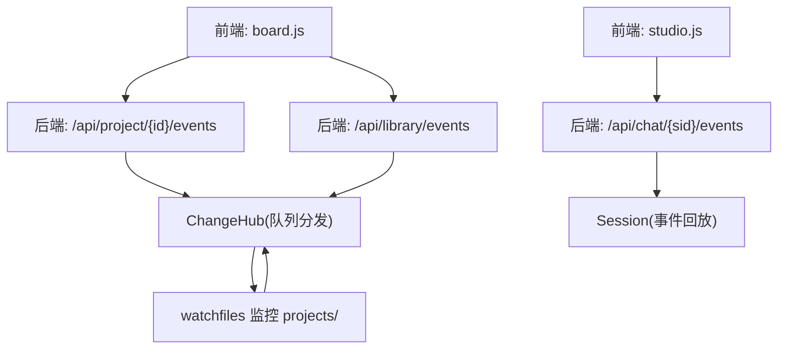
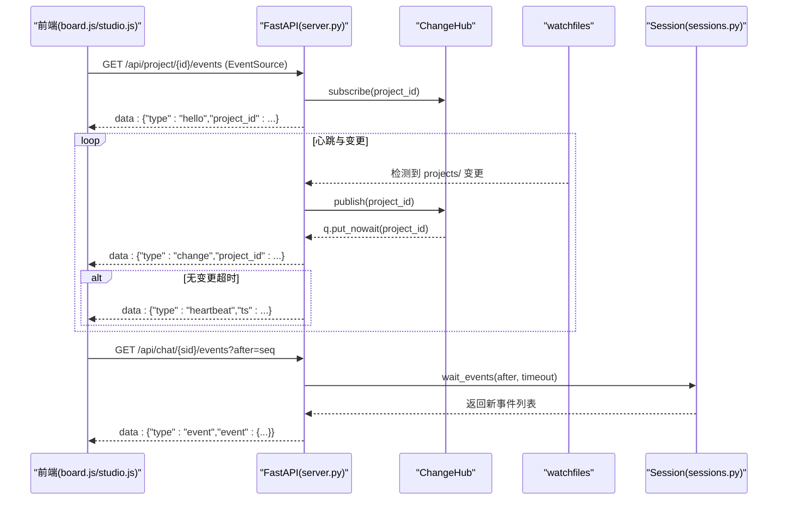
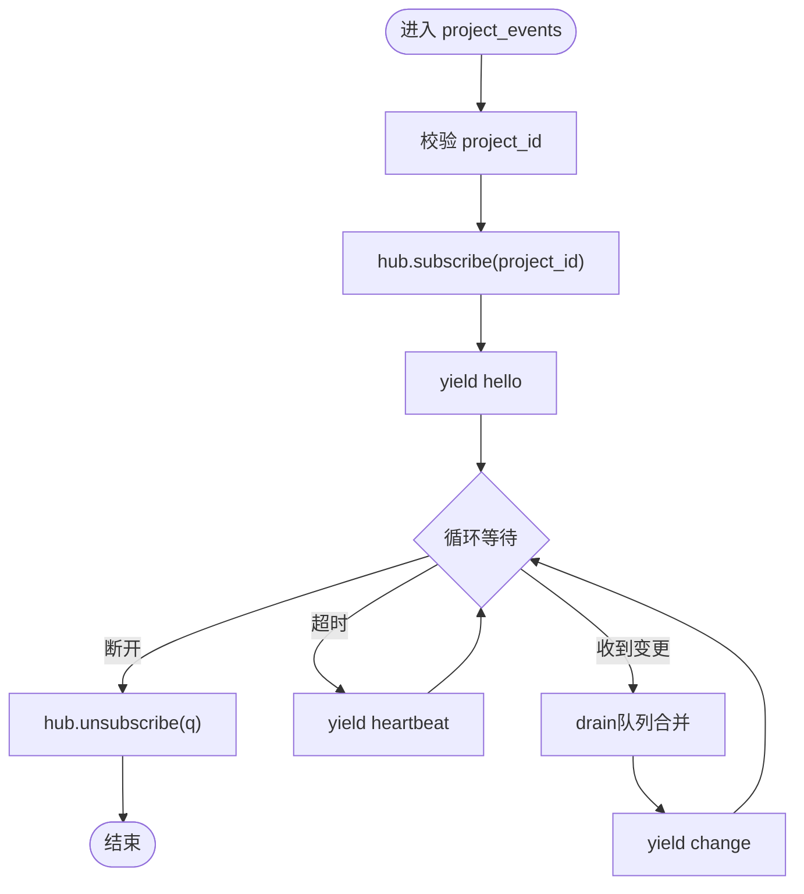
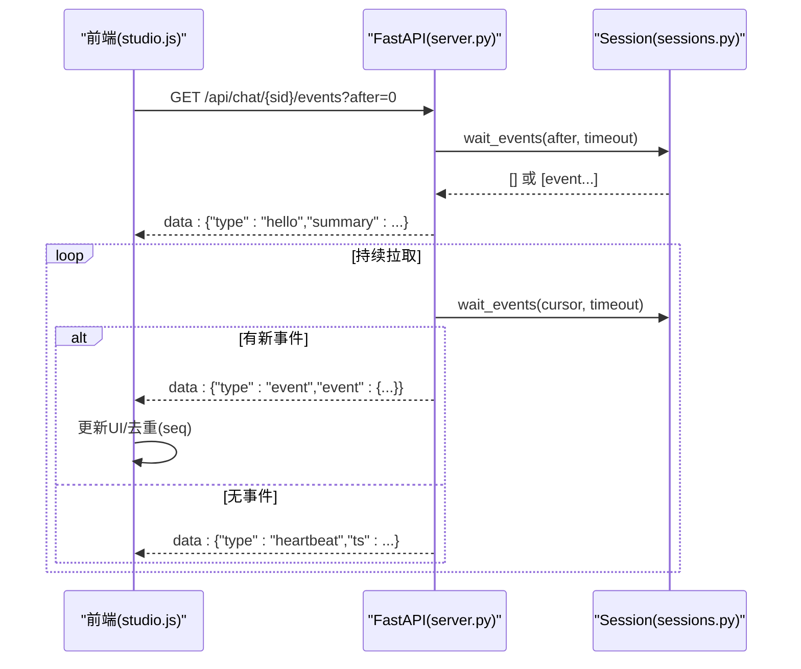
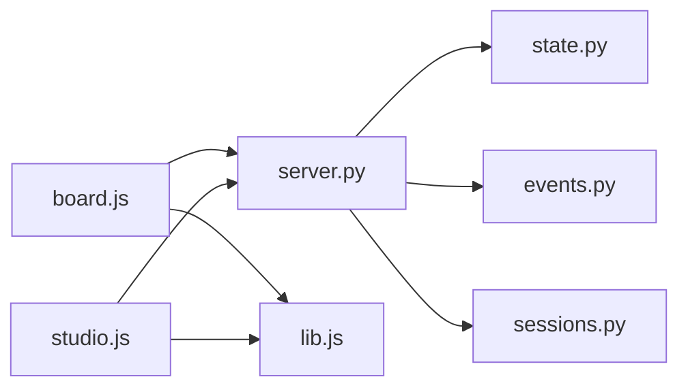

# SSE实时通信

<cite>
**本文引用的文件**   
- [server.py](file://backlot/server.py)
- [events.py](file://lib/events.py)
- [state.py](file://backlot/state.py)
- [studio.js](file://backlot/ui/studio.js)
- [board.js](file://backlot/ui/board.js)
- [lib.js](file://backlot/ui/lib.js)
- [sessions.py](file://backlot/agent/sessions.py)
</cite>

## 目录
1. [简介](#简介)
2. [项目结构](#项目结构)
3. [核心组件](#核心组件)
4. [架构总览](#架构总览)
5. [详细组件分析](#详细组件分析)
6. [依赖关系分析](#依赖关系分析)
7. [性能考量](#性能考量)
8. [故障排查指南](#故障排查指南)
9. [结论](#结论)
10. [附录](#附录)

## 简介
本文件系统性梳理 OpenMontage-MV 项目中基于 FastAPI 的 SSE（Server-Sent Events）实时通信实现，覆盖事件流连接建立、消息格式、事件类型与生命周期管理；详细说明项目状态变更事件、库事件和聊天事件的具体实现；解释心跳机制、连接重连策略与错误处理；并提供前端 JavaScript 客户端的完整实现示例（连接管理、事件监听、状态同步），以及性能优化建议与调试技巧。

## 项目结构
SSE 相关代码主要分布在以下位置：
- 后端服务与 SSE 端点：backlot/server.py
- 工具事件日志（append-only JSONL）：lib/events.py
- 项目状态推导与摘要：backlot/state.py
- 前端库与通用工具：backlot/ui/lib.js
- 项目看板（Board）前端：backlot/ui/board.js
- 工作室聊天（Studio）前端：backlot/ui/studio.js
- 会话管理与事件回放：backlot/agent/sessions.py

**图表来源** 
- [server.py:186-242](file://backlot/server.py#L186-L242)
- [server.py:303-325](file://backlot/server.py#L303-L325)
- [lib.js:66-81](file://backlot/ui/lib.js#L66-L81)
- [studio.js:263-279](file://backlot/ui/studio.js#L263-L279)
- [board.js:1-10](file://backlot/ui/board.js#L1-L10)

**章节来源**
- [server.py:1-504](file://backlot/server.py#L1-L504)
- [lib.js:1-104](file://backlot/ui/lib.js#L1-L104)
- [board.js:1-800](file://backlot/ui/board.js#L1-L800)
- [studio.js:1-440](file://backlot/ui/studio.js#L1-L440)

## 核心组件
- ChangeHub：按项目过滤的 fan-out 通知中心，使用 asyncio.Queue 为每个订阅者维护独立队列，避免无关项目的事件风暴。
- SSE 端点：
  - /api/project/{project_id}/events：项目级事件流，推送 change 与 heartbeat。
  - /api/library/events：库级事件流，推送所有项目的 change。
  - /api/chat/{session_id}/events：聊天事件流，支持 after 游标进行历史回放。
- 文件系统监控：watchfiles 异步监控 projects/ 目录变化，去抖后通过 ChangeHub.publish 触发通知。
- 事件日志：lib/events.py 提供 append-only 的 events.jsonl，供看板活动面板展示。
- 会话管理：backlot/agent/sessions.py 维护会话事件序列号 seq，用于去重与回放。

**章节来源**
- [server.py:43-74](file://backlot/server.py#L43-L74)
- [server.py:132-148](file://backlot/server.py#L132-L148)
- [server.py:186-242](file://backlot/server.py#L186-L242)
- [server.py:303-325](file://backlot/server.py#L303-L325)
- [events.py:77-119](file://lib/events.py#L77-L119)
- [sessions.py:136-149](file://backlot/agent/sessions.py#L136-L149)

## 架构总览
SSE 整体流程如下：
- 前端通过 EventSource 建立长连接，服务端返回 text/event-stream。
- 项目变更由 watchfiles 检测并聚合，调用 ChangeHub.publish(project_id)。
- 对应订阅者的队列被唤醒，服务端发送 {type:"change", project_id} 或 {type:"heartbeat"}。
- 聊天事件流由 Session.wait_events 阻塞等待新事件，支持 after 游标回放历史。

**图表来源** 
- [server.py:186-242](file://backlot/server.py#L186-L242)
- [server.py:303-325](file://backlot/server.py#L303-L325)
- [server.py:132-148](file://backlot/server.py#L132-L148)
- [sessions.py:136-149](file://backlot/agent/sessions.py#L136-L149)

## 详细组件分析

### 项目状态变更事件流（/api/project/{project_id}/events）
- 连接建立：
  - 校验 project_id 有效性，防止路径穿越。
  - 订阅 ChangeHub 并按 project_id 过滤。
  - 首条消息为 hello，包含 project_id。
- 事件类型：
  - change：当该项目的文件系统有变更时推送，携带 project_id。
  - heartbeat：在 SSE_HEARTBEAT_SECONDS（15秒）内无变更时发送，保持连接活跃。
- 去抖与合并：
  - 队列满时丢弃多余项（已保证至少一次唤醒）。
  - 消费侧 drain 队列以合并突发变更，减少前端刷新频率。
- 断开处理：
  - request.is_disconnected() 立即退出流，finally 中取消订阅。

**图表来源** 
- [server.py:186-214](file://backlot/server.py#L186-L214)

**章节来源**
- [server.py:186-214](file://backlot/server.py#L186-L214)

### 库事件流（/api/library/events）
- 连接建立：
  - 订阅 ChangeHub（不限制 project_id）。
  - 首条消息为 hello（无 project_id）。
- 事件类型：
  - change：携带 changed project_id。
  - heartbeat：同项目流的心跳。
- 适用场景：
  - 库页面需要感知所有项目变更，用于刷新项目卡片与“live”状态。

**章节来源**
- [server.py:217-242](file://backlot/server.py#L217-L242)

### 聊天事件流（/api/chat/{session_id}/events）
- 连接建立：
  - 校验 session_id 是否存在。
  - 首条消息为 hello，包含 session_id 与 summary（当前状态、todos、project_id）。
- 事件类型：
  - event：封装一个具体事件（user、assistant、tool_call、tool_result、approval_request、state、turn_done、error 等）。
  - heartbeat：超时未有新事件时发送。
- 历史回放：
  - after 参数指定 lastSeq，服务端从 seq > after 开始回放，前端用 seq 去重。
- 会话状态：
  - state 事件中的 status 控制运行态（idle/running/awaiting_approval）。

**图表来源** 
- [server.py:303-325](file://backlot/server.py#L303-L325)
- [sessions.py:136-149](file://backlot/agent/sessions.py#L136-L149)

**章节来源**
- [server.py:303-325](file://backlot/server.py#L303-L325)
- [sessions.py:136-149](file://backlot/agent/sessions.py#L136-L149)

### 工具事件日志（events.jsonl）
- 写入：
  - emit_event(project_dir, payload) 追加一行 JSON，字段包括 ts 与 payload 非空键。
  - 线程锁保护单进程并发写，跨进程未同步但 O_APPEND 基本安全。
- 读取：
  - read_events(project_dir, limit) 容忍损坏行，返回最近 N 条。
- 用途：
  - 看板右侧 Activity 面板展示工具执行 start/finish/error 等事件。

**章节来源**
- [events.py:77-119](file://lib/events.py#L77-L119)

### 项目状态推导（BoardState）
- load_board_state(project_dir) 汇总 pipeline、artifacts、storyboard、media、events、cost、last_activity、live 等。
- summarize_project(project_dir) 生成库卡片摘要，含 active_stage、awaiting_human、stage_states 等。
- live 判定：last_activity 距今小于 LIVE_WINDOW_SECONDS（5分钟）。
- stalled 检测：in_progress 阶段超过 STALL_WINDOW_SECONDS（10分钟）无活动标记为 stalled。

**章节来源**
- [state.py:586-656](file://backlot/state.py#L586-L656)
- [state.py:659-681](file://backlot/state.py#L659-L681)

## 依赖关系分析
- server.py 依赖：
  - backlot.state：load_board_state、summarize_project、list_projects。
  - lib.events：read_events（用于 BoardState 的活动面板）。
  - backlot.agent.sessions：Session、manager（聊天功能）。
  - watchfiles：监控 projects/ 目录。
- 前端依赖：
  - lib.js：getJSON、subscribe(EventSource)、媒体URL构造。
  - board.js：订阅项目事件流，渲染看板。
  - studio.js：订阅聊天事件流，渲染对话与审批。

**图表来源** 
- [server.py:1-504](file://backlot/server.py#L1-L504)
- [board.js:1-10](file://backlot/ui/board.js#L1-L10)
- [studio.js:1-10](file://backlot/ui/studio.js#L1-L10)
- [lib.js:1-104](file://backlot/ui/lib.js#L1-L104)

**章节来源**
- [server.py:1-504](file://backlot/server.py#L1-L504)
- [lib.js:1-104](file://backlot/ui/lib.js#L1-L104)

## 性能考量
- 事件合并与去抖：
  - ChangeHub 队列最大长度 64，满则丢弃多余项，避免内存膨胀。
  - 消费侧 drain 合并突发变更，降低前端渲染压力。
- 心跳间隔：
  - SSE_HEARTBEAT_SECONDS=15，平衡连接存活与带宽开销。
- 缓存与静态资源：
  - UI 资源 no-cache，强制条件请求（ETag）提升更新效率。
  - 缩略图缓存到磁盘，避免重复转码。
- 文件系统扫描：
  - _scan_media 仅扫描必要目录，排除 node_modules/.git/__pycache__ 等噪声。
- 事件回放上限：
  - Session 最多回放 MAX_EVENT_REPLAY=2000 条，避免过大历史拖慢连接。

[本节为通用指导，无需引用具体文件]

## 故障排查指南
- 连接断开与重连：
  - 前端 EventSource 自动重连；建议在 onerror 中记录日志与重试计数。
  - 检查服务端是否返回正确的 text/event-stream 与必要的响应头（no-cache、X-Accel-Buffering=no）。
- 心跳缺失：
  - 若长时间无 heartbeat，检查 SSE_HEARTBEAT_SECONDS 配置与队列是否阻塞。
- 事件丢失：
  - 项目流：确认 ChangeHub.publish 是否被调用（watchfiles 是否正常）。
  - 聊天流：确认 after 游标是否正确递增，避免重复或遗漏。
- 权限与安全：
  - 确保 project_id 校验通过，防止路径穿越（server.py 中的 _safe_project_dir）。
- 性能问题：
  - 观察前端 subscribe 的去抖逻辑（250ms）是否合理。
  - 检查缩略图生成失败导致的回退行为（视频无 poster 时返回 404）。

**章节来源**
- [server.py:186-242](file://backlot/server.py#L186-L242)
- [server.py:303-325](file://backlot/server.py#L303-L325)
- [lib.js:66-81](file://backlot/ui/lib.js#L66-L81)

## 结论
本项目通过 FastAPI + SSE 实现了高效、可靠的实时通信：
- 项目变更与库级变更通过 ChangeHub 统一分发，前端按需订阅。
- 聊天事件流支持历史回放与去重，保障会话一致性。
- 心跳机制维持连接活性，错误处理健壮。
- 前端采用 EventSource 与轻量库函数，实现简洁的连接管理与状态同步。

[本节为总结性内容，无需引用具体文件]

## 附录

### 前端 JavaScript 客户端实现要点（board.js 与 studio.js）
- 连接管理：
  - board.js：通过 lib.js 的 subscribe(url, onChange) 建立 EventSource，解析 change 事件后触发刷新。
  - studio.js：直接 new EventSource(`/api/chat/${sessionId}/events?after=${lastSeq}`)，处理 hello 与 event 类型。
- 事件监听：
  - board.js：监听 change 事件，重新获取项目状态（/api/project/{id}/state）。
  - studio.js：根据 event.type 分派到不同处理器（user、assistant、tool_call、approval_request 等）。
- 状态同步：
  - 使用 seq 去重，避免重连导致重复渲染。
  - 根据 state.status 更新运行态（idle/running/awaiting_approval）。

**章节来源**
- [lib.js:66-81](file://backlot/ui/lib.js#L66-L81)
- [board.js:1-10](file://backlot/ui/board.js#L1-L10)
- [studio.js:263-279](file://backlot/ui/studio.js#L263-L279)

### SSE 消息格式规范
- hello：
  - 项目流：{type:"hello", project_id:"..."}
  - 库流：{type:"hello"}
  - 聊天流：{type:"hello", session_id:"...", summary:{...}}
- change：
  - {type:"change", project_id:"..."}
- heartbeat：
  - {type:"heartbeat", ts: number}
- event（聊天）：
  - {type:"event", event:{seq:number, ts:number, type:string, data:{...}}}

**章节来源**
- [server.py:186-214](file://backlot/server.py#L186-L214)
- [server.py:217-242](file://backlot/server.py#L217-L242)
- [server.py:303-325](file://backlot/server.py#L303-L325)

### 性能优化建议
- 前端：
  - 合理使用 subscribe 的去抖（250ms），避免频繁 DOM 操作。
  - 对大图/视频使用缩略图与懒加载。
- 后端：
  - 调整 SSE_HEARTBEAT_SECONDS 以适应网络环境。
  - 监控 ChangeHub 队列长度，必要时扩容或引入限流。
  - 定期清理缩略图缓存，避免磁盘膨胀。

[本节为通用指导，无需引用具体文件]

### 调试技巧
- 浏览器开发者工具：
  - Network 面板查看 SSE 连接状态与消息内容。
  - Console 打印错误与重连次数。
- 服务端日志：
  - 在 ChangeHub.publish 与 SSE 端点添加日志，追踪事件流向。
  - 检查 watchfiles 是否捕获到预期变更。
- 数据验证：
  - 使用 curl 或 HTTP 客户端测试 SSE 端点，验证消息格式。
  - 检查 events.jsonl 是否按预期写入。

**章节来源**
- [server.py:186-242](file://backlot/server.py#L186-L242)
- [events.py:77-119](file://lib/events.py#L77-L119)