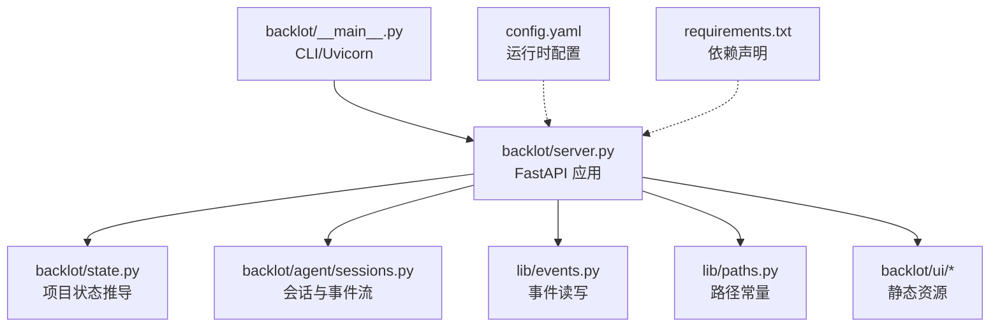
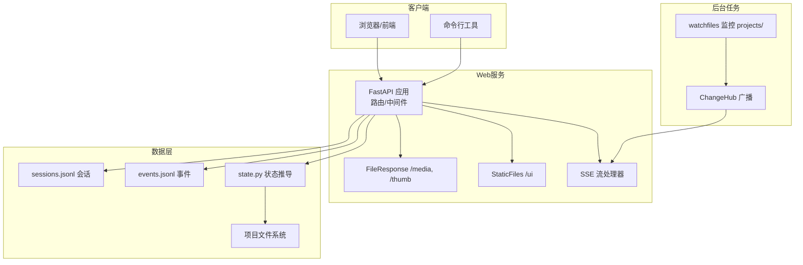
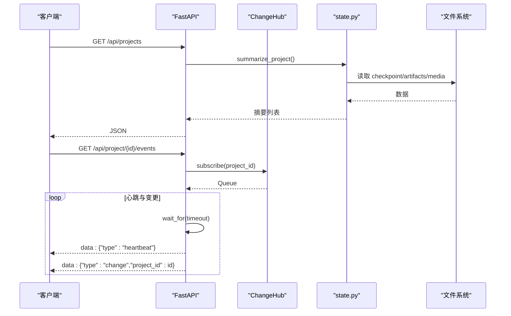
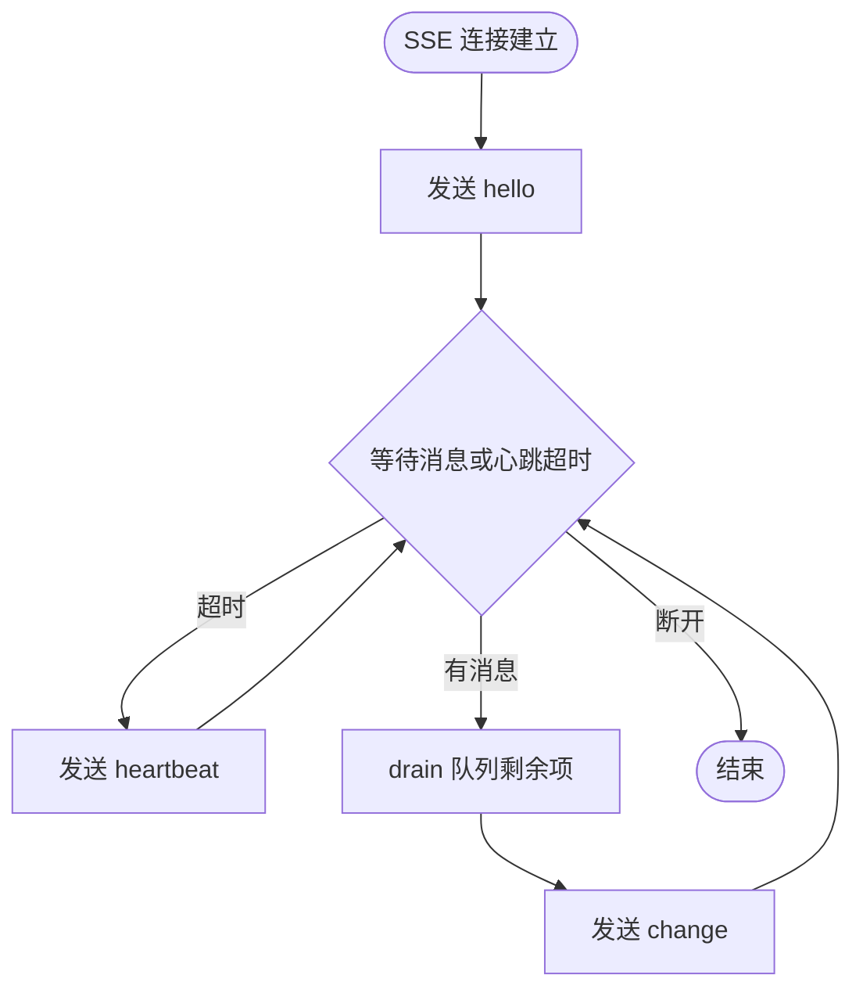
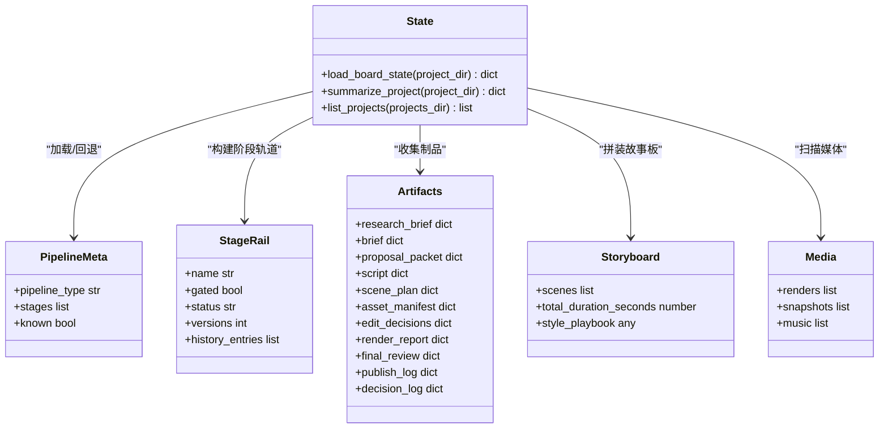
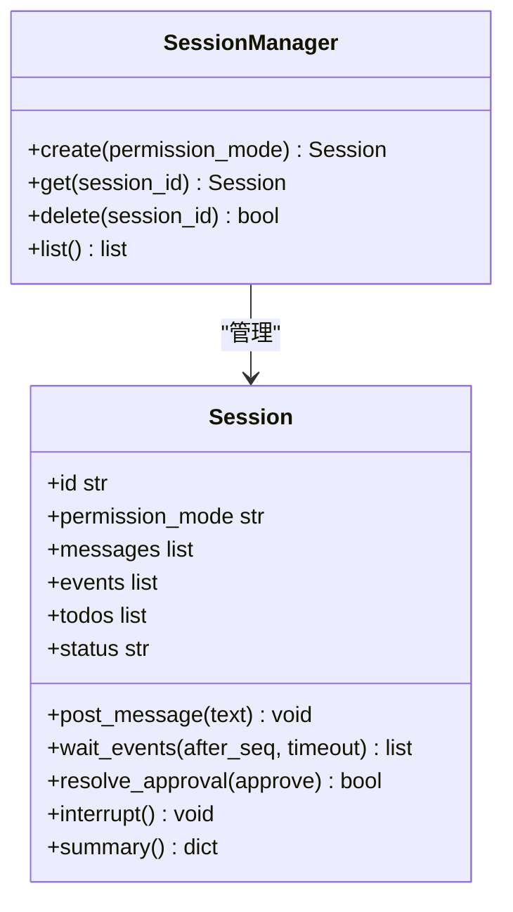
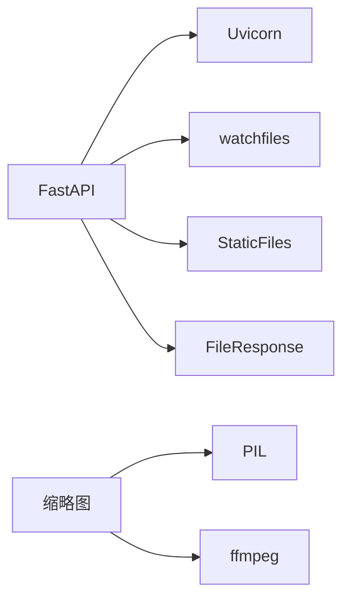

# Web服务器与API

<cite>
**本文引用的文件**   
- [backlot/server.py](file://backlot/server.py)
- [backlot/__main__.py](file://backlot/__main__.py)
- [backlot/state.py](file://backlot/state.py)
- [backlot/agent/sessions.py](file://backlot/agent/sessions.py)
- [lib/events.py](file://lib/events.py)
- [lib/paths.py](file://lib/paths.py)
- [config.yaml](file://config.yaml)
- [requirements.txt](file://requirements.txt)
- [backlot/ui/index.html](file://backlot/ui/index.html)
- [backlot/ui/studio.html](file://backlot/ui/studio.html)
</cite>

## 目录
1. [简介](#简介)
2. [项目结构](#项目结构)
3. [核心组件](#核心组件)
4. [架构总览](#架构总览)
5. [详细组件分析](#详细组件分析)
6. [依赖关系分析](#依赖关系分析)
7. [性能考虑](#性能考虑)
8. [故障排查指南](#故障排查指南)
9. [结论](#结论)
10. [附录：API端点清单与使用示例](#附录api端点清单与使用示例)

## 简介
本仓库包含一个基于 FastAPI 的本地 Web 服务（Backlot），用于可视化和管理“项目”的生产管线状态、提供实时事件流（SSE）、以及嵌入式的 Studio 聊天工作区。服务端负责：
- 暴露 REST API，查询项目列表、单个项目的完整状态、媒体与缩略图资源等
- 通过 SSE 推送文件系统变更、会话事件等实时数据
- 静态资源服务（UI）与媒体范围请求支持
- 启动器与日志轮转、端口配置等运维能力

## 项目结构
- backlot/server.py：FastAPI 应用定义、路由、中间件、SSE 实现、缩略图与媒体服务
- backlot/__main__.py：命令行入口，serve/open/studio 子命令，Uvicorn 启动
- backlot/state.py：将项目目录解析为可渲染的状态（阶段轨道、制品、故事板、媒体扫描等）
- backlot/agent/sessions.py：Studio 聊天会话管理、事件流、审批流程、持久化
- lib/events.py：工具调用事件写入与读取（append-only JSONL）
- lib/paths.py：全局路径常量（REPO_ROOT、PROJECTS_DIR）
- config.yaml：运行时配置（输出格式、编解码、路径等）
- requirements.txt：核心依赖（FastAPI、Uvicorn、watchfiles 等）
- backlot/ui/*：前端页面与脚本（Library、Studio、Board、Preview）

图表来源
- [backlot/server.py:151-406](file://backlot/server.py#L151-L406)
- [backlot/state.py:586-656](file://backlot/state.py#L586-L656)
- [backlot/agent/sessions.py:269-326](file://backlot/agent/sessions.py#L269-L326)
- [lib/events.py:77-119](file://lib/events.py#L77-L119)
- [lib/paths.py:13-18](file://lib/paths.py#L13-L18)
- [backlot/__main__.py:110-117](file://backlot/__main__.py#L110-L117)

章节来源
- [backlot/server.py:1-504](file://backlot/server.py#L1-L504)
- [backlot/__main__.py:1-145](file://backlot/__main__.py#L1-L145)
- [backlot/state.py:1-714](file://backlot/state.py#L1-L714)
- [backlot/agent/sessions.py:1-326](file://backlot/agent/sessions.py#L1-L326)
- [lib/events.py:1-119](file://lib/events.py#L1-L119)
- [lib/paths.py:1-18](file://lib/paths.py#L1-L18)
- [config.yaml:1-20](file://config.yaml#L1-L20)
- [requirements.txt:1-12](file://requirements.txt#L1-L12)

## 核心组件
- FastAPI 应用与生命周期：创建 app、注册路由、挂载静态目录、设置中间件；在启动时开启 watch 任务，关闭时取消任务
- 变更通知中心 ChangeHub：按项目过滤订阅者队列，发布去抖合并，避免无关项目风暴
- 项目状态推导 state：只读、容错地聚合 checkpoint、history、artifacts、events、media，生成 board 所需状态
- 会话管理 sessions：线程安全的事件流、审批等待、中断、持久化到 .studio/sessions/*.jsonl
- 事件系统 events：append-only JSONL，自动推断 project_dir，供 board 展示“正在生成”等状态
- 静态与媒体服务：/ui 静态目录、/media 范围请求、/thumb 缩略图缓存（PIL/ffmpeg）

章节来源
- [backlot/server.py:151-406](file://backlot/server.py#L151-L406)
- [backlot/server.py:43-74](file://backlot/server.py#L43-L74)
- [backlot/state.py:586-656](file://backlot/state.py#L586-L656)
- [backlot/agent/sessions.py:36-267](file://backlot/agent/sessions.py#L36-L267)
- [lib/events.py:77-119](file://lib/events.py#L77-L119)

## 架构总览
下图展示了 Backlot 的核心交互：客户端通过 HTTP/SSE 与 FastAPI 通信；watchers 监听 projects 目录变化并广播至 ChangeHub；state 模块从磁盘读取并组装状态；sessions 模块驱动 Studio 聊天与会话事件流。

图表来源
- [backlot/server.py:151-406](file://backlot/server.py#L151-L406)
- [backlot/server.py:132-149](file://backlot/server.py#L132-L149)
- [backlot/state.py:586-656](file://backlot/state.py#L586-L656)
- [lib/events.py:77-119](file://lib/events.py#L77-L119)
- [backlot/agent/sessions.py:269-326](file://backlot/agent/sessions.py#L269-L326)

## 详细组件分析

### FastAPI 应用与路由
- 应用初始化：title、禁用 docs/redoc（可按需启用）
- 生命周期：startup 启动 watch 任务；shutdown 取消任务
- 路由分组：
  - 健康检查与项目列表
  - 项目状态与组合（compositions）
  - SSE 事件流（项目级与库级）
  - Studio 聊天会话 CRUD 与消息、审批、中断、事件流
  - 缩略图与媒体访问
  - UI 页面路由与静态资源挂载
- 中间件：对 /、/ui、/p/、/studio 强制 no-cache，确保前端热更新

图表来源
- [backlot/server.py:166-173](file://backlot/server.py#L166-L173)
- [backlot/server.py:185-214](file://backlot/server.py#L185-L214)
- [backlot/server.py:216-242](file://backlot/server.py#L216-L242)
- [backlot/state.py:659-681](file://backlot/state.py#L659-L681)

章节来源
- [backlot/server.py:151-406](file://backlot/server.py#L151-L406)

### SSE 事件流实现
- 连接处理：StreamingResponse + text/event-stream，设置 no-cache 与 X-Accel-Buffering:no
- 心跳机制：每 SSE_HEARTBEAT_SECONDS 秒发送 heartbeat
- 事件类型：
  - hello：握手，携带 session_id 或 project_id
  - heartbeat：保活
  - change：项目变更通知（含 project_id）
  - event：会话事件（event 字段为具体事件对象）
- 去抖合并：消费队列时一次性 drain，避免突发消息风暴

图表来源
- [backlot/server.py:185-214](file://backlot/server.py#L185-L214)
- [backlot/server.py:216-242](file://backlot/server.py#L216-L242)
- [backlot/server.py:302-325](file://backlot/server.py#L302-L325)

章节来源
- [backlot/server.py:185-242](file://backlot/server.py#L185-L242)
- [backlot/server.py:302-325](file://backlot/server.py#L302-L325)

### 项目状态推导（state.py）
- 输入：项目目录
- 输出：board_state（包含 pipeline、stages、artifacts、storyboard、media、events、cost、live 等）
- 关键逻辑：
  - 加载 pipeline manifest（未知则回退默认阶段）
  - 收集 checkpoints/history，构建 stage rail 与 gate 审计
  - 收集 artifacts（artifacts/*.json 与 checkpoint 内嵌）
  - 构建 storyboard（scene_plan × script × asset_manifest，结合 events 判断“正在生成”）
  - 扫描 media（renders、snapshots、music）
  - 计算 last_activity 与 live 标志，检测 stalled 阶段

图表来源
- [backlot/state.py:62-92](file://backlot/state.py#L62-L92)
- [backlot/state.py:143-222](file://backlot/state.py#L143-L222)
- [backlot/state.py:244-264](file://backlot/state.py#L244-L264)
- [backlot/state.py:401-493](file://backlot/state.py#L401-L493)
- [backlot/state.py:500-532](file://backlot/state.py#L500-L532)
- [backlot/state.py:586-656](file://backlot/state.py#L586-L656)

章节来源
- [backlot/state.py:1-714](file://backlot/state.py#L1-L714)

### 会话管理与事件流（sessions.py）
- Session：维护消息历史、事件序列、待办、权限模式、运行状态；线程安全并发控制
- SessionManager：会话创建/获取/删除/列表，持久化加载 .studio/sessions/*.jsonl
- 事件流：wait_events(after_seq, timeout) 返回增量事件；SSE 端以 event 类型推送
- 审批流程：request_approval -> resolve_approval，阻塞等待人类决策
- 中断：interrupt 信号唤醒等待

图表来源
- [backlot/agent/sessions.py:36-267](file://backlot/agent/sessions.py#L36-L267)
- [backlot/agent/sessions.py:269-326](file://backlot/agent/sessions.py#L269-L326)

章节来源
- [backlot/agent/sessions.py:1-326](file://backlot/agent/sessions.py#L1-L326)

### 事件系统（events.py）
- emit_event：append-only 写入 events.jsonl，线程锁保护写操作，失败静默丢弃
- read_events：读取并跳过损坏行，支持 limit
- 项目推断：根据输入参数中的显式键或路径提示推断 project_dir，仅允许 PROJECTS_DIR 下的路径

章节来源
- [lib/events.py:1-119](file://lib/events.py#L1-L119)

### 静态资源与媒体服务
- 静态资源：/ui 目录由 StaticFiles 提供，HTML 模板注入版本参数避免缓存
- 媒体服务：/media/{project_id}/{file_path:path} 支持 Range 请求（FileResponse）
- 缩略图：/thumb/{project_id}/{file_path:path}?w=... 生成 JPEG 缓存（图片用 PIL，视频用 ffmpeg 提取帧）

章节来源
- [backlot/server.py:329-361](file://backlot/server.py#L329-L361)
- [backlot/server.py:390-406](file://backlot/server.py#L390-L406)
- [backlot/server.py:460-500](file://backlot/server.py#L460-L500)

## 依赖关系分析
- FastAPI + Uvicorn：HTTP 服务器与异步框架
- watchfiles：文件系统监控，触发变更广播
- PIL/ffmpeg：缩略图生成（可选依赖，失败降级）
- PyYAML/Pydantic/jsonschema/python-dotenv/requests：通用依赖（当前 server 未直接引用，但属于项目依赖）

图表来源
- [requirements.txt:8-12](file://requirements.txt#L8-L12)
- [backlot/server.py:16-18](file://backlot/server.py#L16-L18)
- [backlot/server.py:460-500](file://backlot/server.py#L460-L500)

章节来源
- [requirements.txt:1-12](file://requirements.txt#L1-L12)

## 性能考虑
- 变更广播去抖：ChangeHub 队列满时丢弃多余通知，保证单订阅者不被淹没
- 摘要缓存：_cached_summaries 缓存项目摘要，变更时失效
- 只读与容错：state.py 对异常与缺失文件进行降级处理，避免阻塞
- 心跳与节流：SSE 心跳间隔固定，批量消费队列减少网络抖动
- 缩略图缓存：按源文件 mtime/size/宽度哈希缓存，避免重复生成
- 静态资源无缓存策略：/、/ui、/p/、/studio 强制 no-cache，便于开发迭代

[本节为通用指导，不直接分析具体文件]

## 故障排查指南
- 404 未知项目：_safe_project_dir 校验项目是否存在
- 403 路径逃逸：thumb/media 接口拒绝超出项目目录的路径
- 400 无效项目ID：禁止包含 / \ : 及 . ..
- 409 冲突：会话忙（SessionBusyError）或审批无待决项
- 400 空消息：chat message 校验文本非空
- SSE 断连：is_disconnected 检测，及时释放订阅
- 缩略图不可用：视频无海报帧或非图像格式时返回 404

章节来源
- [backlot/server.py:409-417](file://backlot/server.py#L409-L417)
- [backlot/server.py:329-347](file://backlot/server.py#L329-L347)
- [backlot/server.py:277-300](file://backlot/server.py#L277-L300)
- [backlot/server.py:185-214](file://backlot/server.py#L185-L214)

## 结论
Backlot 以 FastAPI 为核心，结合 watchfiles 与 SSE 实现了高响应性的看板与 Studio 工作区。其设计强调只读、容错与可观测性，既能满足本地开发体验，也为后续扩展提供了清晰的扩展点。建议在生产部署中：
- 明确 BACKLOT_HOST 绑定地址，谨慎暴露端口
- 合理调整 SSE_HEARTBEAT_SECONDS 与队列大小
- 监控 .studio 与缩略图缓存目录空间
- 按需启用 FastAPI docs/redoc 以便调试

[本节为总结，不直接分析具体文件]

## 附录：API端点清单与使用示例

### 健康检查
- GET /api/health
  - 响应：{ ok: true, app: "backlot" }

### 项目与状态
- GET /api/projects
  - 响应：项目摘要数组（标题、流水线类型、是否活跃、最近活动、场景数等）
- GET /api/project/{project_id}/state
  - 响应：完整 board_state（pipeline、stages、artifacts、storyboard、media、events、cost、live）
- GET /api/project/{project_id}/compositions
  - 响应：HyperFrames compositions 列表（path、name、duration、fps、resolution、audio）

### SSE 事件流
- GET /api/project/{project_id}/events
  - 内容类型：text/event-stream
  - 事件类型：hello、heartbeat、change
- GET /api/library/events
  - 内容类型：text/event-stream
  - 事件类型：hello、heartbeat、change（跨项目）

### Studio 聊天会话
- GET /api/chat/sessions
  - 响应：会话摘要列表
- POST /api/chat/sessions
  - 请求体：{ permission_mode: "auto"|"confirm" }
  - 响应：会话摘要
- GET /api/chat/{session_id}
  - 响应：会话摘要
- DELETE /api/chat/{session_id}
  - 响应：{ ok: true }
- POST /api/chat/{session_id}/message
  - 请求体：{ text: "..." }
  - 响应：{ ok: true }
- POST /api/chat/{session_id}/approve
  - 请求体：{ approve: boolean }
  - 响应：{ ok: true }
- POST /api/chat/{session_id}/interrupt
  - 响应：{ ok: true }
- GET /api/chat/{session_id}/events?after={seq}
  - 内容类型：text/event-stream
  - 事件类型：hello、heartbeat、event（event 字段为具体事件对象）

### 缩略图与媒体
- GET /thumb/{project_id}/{file_path:path}?w={width}
  - 成功：JPEG 缩略图或原图（非视频）
  - 失败：404（无海报帧或文件不存在）
- GET /media/{project_id}/{file_path:path}
  - 成功：原始文件（支持 Range）
  - 失败：404（文件不存在）

### UI 页面
- GET / → Library 页面
- GET /studio → Studio 页面
- GET /preview/{project_id} → Preview 页面
- GET /studio/{session_id} → Studio 页面（带 session）
- GET /p/{project_id} 或 /p/{project_path:path} → Board 页面

### 认证与安全
- 当前未实现认证与授权（适合本地开发）
- 生产环境建议增加鉴权（如 JWT、反向代理认证）
- 路径校验防止目录穿越（_safe_project_dir、thumb/media 相对路径校验）

### 错误处理策略
- 统一使用 HTTPException 返回标准状态码
- SSE 连接断开自动清理订阅
- 文件系统异常与 JSON 解析失败均降级处理，不阻断服务

### 客户端实现指南
- 使用 EventSource（浏览器）或自定义 SSE 客户端（Node/Python）
- 处理 hello/heartbeat/change/event 事件类型
- 重连策略：心跳超时后指数退避重连
- 缩略图与媒体：遵循 Range 协议，利用浏览器原生播放能力

### 性能优化技巧
- 前端分页/懒加载长列表（library 项目列表）
- 合理设置 SSE_HEARTBEAT_SECONDS，平衡实时性与带宽
- 缩略图尺寸选择接近显示尺寸的宽度，减少传输体积
- 静态资源使用条件请求（ETag/Last-Modified）配合 no-cache

章节来源
- [backlot/server.py:166-406](file://backlot/server.py#L166-L406)
- [backlot/server.py:409-417](file://backlot/server.py#L409-L417)
- [backlot/server.py:460-500](file://backlot/server.py#L460-L500)
- [backlot/ui/index.html:1-28](file://backlot/ui/index.html#L1-L28)
- [backlot/ui/studio.html:1-83](file://backlot/ui/studio.html#L1-L83)