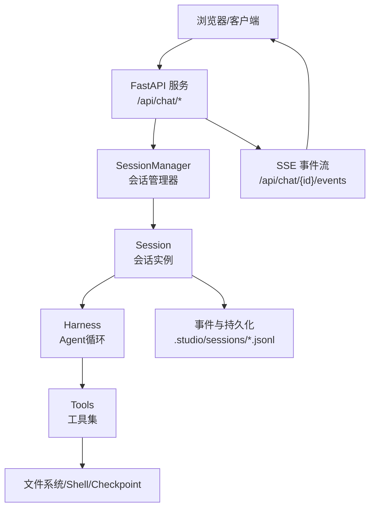
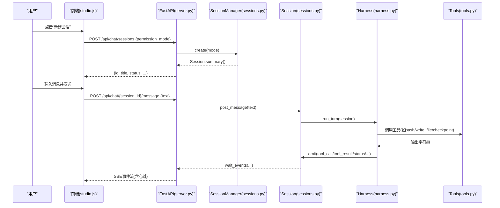
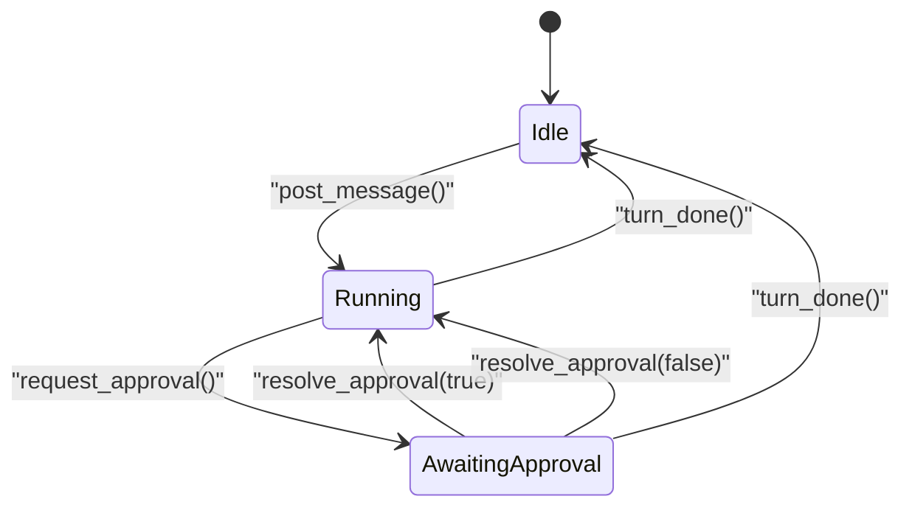
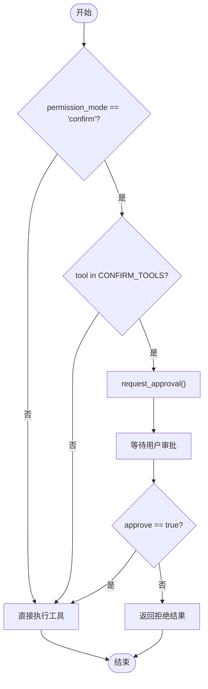
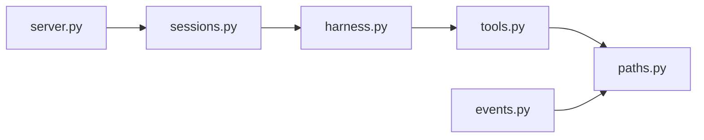

# 聊天会话API

<cite>
**本文引用的文件**
- [server.py](file://backlot/server.py)
- [sessions.py](file://backlot/agent/sessions.py)
- [harness.py](file://backlot/agent/harness.py)
- [tools.py](file://backlot/agent/tools.py)
- [events.py](file://lib/events.py)
- [paths.py](file://lib/paths.py)
- [studio.js](file://backlot/ui/studio.js)
</cite>

## 目录
1. [简介](#简介)
2. [项目结构](#项目结构)
3. [核心组件](#核心组件)
4. [架构总览](#架构总览)
5. [详细组件分析](#详细组件分析)
6. [依赖关系分析](#依赖关系分析)
7. [性能考量](#性能考量)
8. [故障排查指南](#故障排查指南)
9. [结论](#结论)
10. [附录：API使用示例与最佳实践](#附录api使用示例与最佳实践)

## 简介
本文件面向“聊天会话API”的完整说明，覆盖会话创建、查询、删除、消息发送、事件流与实时通知、审批流程、中断控制、错误处理策略，以及与AI代理（工具执行、上下文压缩、重试与降级）的集成方式。文档同时给出前端交互模式与后端实现映射，帮助读者快速上手并安全扩展。

## 项目结构
聊天会话能力由FastAPI服务暴露REST与SSE接口；会话状态、持久化与并发由Session与SessionManager管理；Agent循环通过harness驱动模型调用与工具执行；工具层提供文件系统、Shell命令、Checkpoint协议等能力；事件系统为项目级活动日志；前端通过EventSource订阅SSE事件流。

图表来源
- [server.py:151-326](file://backlot/server.py#L151-L326)
- [sessions.py:269-326](file://backlot/agent/sessions.py#L269-L326)
- [harness.py:268-390](file://backlot/agent/harness.py#L268-L390)
- [tools.py:370-511](file://backlot/agent/tools.py#L370-L511)
- [events.py:77-119](file://lib/events.py#L77-L119)

章节来源
- [server.py:151-326](file://backlot/server.py#L151-L326)
- [sessions.py:1-326](file://backlot/agent/sessions.py#L1-L326)
- [harness.py:1-390](file://backlot/agent/harness.py#L1-L390)
- [tools.py:1-511](file://backlot/agent/tools.py#L1-L511)
- [events.py:1-119](file://lib/events.py#L1-L119)

## 核心组件
- FastAPI路由层：定义聊天会话相关REST端点与SSE事件流，负责参数校验、异常转换与并发调度。
- SessionManager：维护会话集合、加载历史会话、创建/删除会话，保证线程安全。
- Session：封装单会话状态机、事件队列、持久化、审批门控、中断信号、事件等待与回放。
- Harness：Agent主循环，负责模型调用、工具执行、上下文压缩、错误恢复与重试。
- Tools：工具定义与处理器，包含bash、文件读写、glob/grep、Checkpoint、技能目录等。
- Events：项目级事件追加日志，供看板与实时活动展示。
- UI前端：基于EventSource的SSE消费，渲染用户消息、助手回复、工具调用/结果、待审批卡片、Todo列表等。

章节来源
- [server.py:244-326](file://backlot/server.py#L244-L326)
- [sessions.py:36-326](file://backlot/agent/sessions.py#L36-L326)
- [harness.py:268-390](file://backlot/agent/harness.py#L268-L390)
- [tools.py:370-511](file://backlot/agent/tools.py#L370-L511)
- [events.py:77-119](file://lib/events.py#L77-L119)
- [studio.js:1-440](file://backlot/ui/studio.js#L1-L440)

## 架构总览
聊天会话API采用“REST + SSE”的组合：
- REST用于会话生命周期操作（创建、查询、删除）、消息提交、审批与中断。
- SSE用于事件流推送（用户消息、助手文本、工具调用/结果、待审批、状态变更、心跳）。

图表来源
- [server.py:252-326](file://backlot/server.py#L252-L326)
- [sessions.py:182-225](file://backlot/agent/sessions.py#L182-L225)
- [harness.py:268-390](file://backlot/agent/harness.py#L268-L390)
- [tools.py:475-511](file://backlot/agent/tools.py#L475-L511)

## 详细组件分析

### 会话管理端点（REST）
- GET /api/chat/sessions
  - 返回所有会话摘要列表，按创建时间倒序。
- POST /api/chat/sessions
  - 请求体可选{permission_mode: "auto"|"confirm"}，默认auto。
  - 返回会话摘要（id、title、status、project_id、last_seq、todos等）。
- GET /api/chat/{session_id}
  - 返回单个会话摘要。
- DELETE /api/chat/{session_id}
  - 删除会话及其持久化记录；若会话仍在运行则返回409冲突。
- POST /api/chat/{session_id}/message
  - 提交用户消息{text}；空消息返回400；会话忙返回409。
- POST /api/chat/{session_id}/approve
  - 审批工具调用：{approve: true|false}；无待审批时返回409。
- POST /api/chat/{session_id}/interrupt
  - 中断当前Agent轮次。
- GET /api/chat/{session_id}/events?after=0
  - SSE事件流，首条hello携带summary，后续event事件，心跳保活。

章节来源
- [server.py:252-326](file://backlot/server.py#L252-L326)

### 会话状态机与并发
- 状态字段status：idle | running | awaiting_approval。
- 并发控制：
  - 每个会话独立线程执行Agent轮次，避免阻塞HTTP线程。
  - 写锁保护消息追加、事件发射、审批决策。
  - 条件变量wait_events支持超时等待与批量合并。
- 持久化：
  - .studio/sessions/<id>.jsonl，append-only；重启后自动加载。
  - 对话历史可能压缩重写，确保可恢复一致性。

图表来源
- [sessions.py:36-106](file://backlot/agent/sessions.py#L36-L106)
- [sessions.py:159-178](file://backlot/agent/sessions.py#L159-L178)
- [sessions.py:202-225](file://backlot/agent/sessions.py#L202-L225)

章节来源
- [sessions.py:36-106](file://backlot/agent/sessions.py#L36-L106)
- [sessions.py:182-225](file://backlot/agent/sessions.py#L182-L225)

### 权限控制与审批流程
- permission_mode：
  - auto：直接执行工具。
  - confirm：对敏感工具（bash、write_file、edit_file）触发审批。
- 审批流程：
  - harness在工具执行前检查permission_mode与CONFIRM_TOOLS。
  - 若需审批，调用session.request_approval进入awaiting_approval。
  - 前端收到approval_request事件，显示审批卡片。
  - 调用POST /api/chat/{id}/approve传递approve布尔值。
  - session.resolve_approval唤醒harness继续或拒绝执行。

图表来源
- [harness.py:358-372](file://backlot/agent/harness.py#L358-L372)
- [sessions.py:159-178](file://backlot/agent/sessions.py#L159-L178)
- [tools.py:471-472](file://backlot/agent/tools.py#L471-L472)

章节来源
- [harness.py:358-372](file://backlot/agent/harness.py#L358-L372)
- [sessions.py:159-178](file://backlot/agent/sessions.py#L159-L178)
- [tools.py:471-472](file://backlot/agent/tools.py#L471-L472)

### 中断控制
- 用户可通过POST /api/chat/{id}/interrupt设置中断信号。
- harness每轮检查session.interrupted()，并在工具执行前检查cancel_check。
- 长耗时命令（bash）支持进程树终止，避免卡死。

章节来源
- [sessions.py:251-255](file://backlot/agent/sessions.py#L251-L255)
- [harness.py:285-287](file://backlot/agent/harness.py#L285-L287)
- [tools.py:50-102](file://backlot/agent/tools.py#L50-L102)

### 事件流与实时通知（SSE）
- 端点：GET /api/chat/{session_id}/events?after=0
- 事件类型：
  - hello：首次连接，携带session.summary()
  - event：具体事件（user、assistant、status、tool_call、tool_result、todos、approval_request、project、state、turn_done、error）
  - heartbeat：心跳，保持连接活跃
- 去重与回放：
  - 客户端维护lastSeq，服务端按seq过滤，断线重连从after游标回放。
- 心跳间隔：约15秒，防止中间件/代理超时。

章节来源
- [server.py:302-326](file://backlot/server.py#L302-L326)
- [sessions.py:136-149](file://backlot/agent/sessions.py#L136-L149)
- [studio.js:263-279](file://backlot/ui/studio.js#L263-L279)

### 消息格式与事件规范
- 用户消息：role=user，content=text
- 助手消息：role=assistant，content为文本块列表（标准化为JSON序列化的dict）
- 工具调用：type=tool_use，name、input
- 工具结果：type=tool_result，tool_use_id、content
- 事件对象：{seq, ts, type, data}，seq单调递增

章节来源
- [harness.py:107-134](file://backlot/agent/harness.py#L107-L134)
- [sessions.py:109-116](file://backlot/agent/sessions.py#L109-L116)

### 与AI代理的集成与最佳实践
- 模型客户端：支持mock与Anthropic SDK，环境变量MODEL_ID、ANTHROPIC_API_KEY、ANTHROPIC_BASE_URL、FALLBACK_MODEL_ID。
- 错误恢复：
  - 速率限制/过载：指数退避+切换备用模型。
  - 上下文过长：微压缩（裁剪旧tool_result）与反应式压缩（生成摘要替换历史）。
  - max_tokens截断：提升预算并续写。
- 工具边界：
  - bash允许强能力但受timeout与中断控制。
  - 文件操作限定仓库根路径，防止越权访问。
  - checkpoint写入必须通过专用工具，保障流水线状态一致。
- 技能目录：扫描skills/与.agents/skills/，动态注入到system prompt。

章节来源
- [harness.py:49-68](file://backlot/agent/harness.py#L49-L68)
- [harness.py:187-212](file://backlot/agent/harness.py#L187-L212)
- [harness.py:219-262](file://backlot/agent/harness.py#L219-L262)
- [tools.py:35-44](file://backlot/agent/tools.py#L35-L44)
- [tools.py:202-251](file://backlot/agent/tools.py#L202-L251)
- [tools.py:307-339](file://backlot/agent/tools.py#L307-L339)

## 依赖关系分析
- server.py依赖sessions.manager进行会话管理，依赖state.py进行项目状态聚合（非聊天核心），依赖lib.events进行事件读取（非聊天核心）。
- sessions.py依赖harness.run_turn驱动Agent循环，依赖tools构建工具处理器。
- harness依赖tools.TOOL_DEFINITIONS与build_handlers，依赖lib.env_loader加载环境变量。
- tools依赖lib.paths获取REPO_ROOT与PROJECTS_DIR。
- events.py依赖lib.paths确定PROJECTS_DIR。

图表来源
- [server.py:20-21](file://backlot/server.py#L20-L21)
- [sessions.py:22-23](file://backlot/agent/sessions.py#L22-L23)
- [harness.py:23-25](file://backlot/agent/harness.py#L23-L25)
- [tools.py:24](file://backlot/agent/tools.py#L24)
- [events.py:22](file://lib/events.py#L22)

章节来源
- [server.py:20-21](file://backlot/server.py#L20-L21)
- [sessions.py:22-23](file://backlot/agent/sessions.py#L22-L23)
- [harness.py:23-25](file://backlot/agent/harness.py#L23-L25)
- [tools.py:24](file://backlot/agent/tools.py#L24)
- [events.py:22](file://lib/events.py#L22)

## 性能考量
- SSE事件合并：服务器侧合并突发事件，减少前端抖动。
- 心跳机制：15秒心跳避免代理/浏览器超时。
- 会话持久化：append-only JSONL，重启恢复；必要时全量重写。
- Agent上下文压缩：micro_compact与reactive_compact降低token消耗。
- 工具输出限制：最大输出长度限制，避免大响应阻塞。
- 并发隔离：每会话独立线程，避免相互阻塞。

[本节为通用指导，不直接分析具体文件]

## 故障排查指南
- 400 空消息：POST message时text为空。
- 404 未知会话：DELETE或GET/POST消息时session_id不存在。
- 409 会话忙：删除或发消息时Agent仍在运行，需先interrupt。
- 409 无待审批：approve调用时无pending approval。
- 模型不可用：检查MODEL_ID、ANTHROPIC_API_KEY、网络连通性；查看harness重试与降级日志。
- SSE断开：检查after游标是否回退；确认心跳正常；检查代理缓存头。
- 工具执行失败：检查bash超时、权限、路径合法性；查看工具返回的错误信息。

章节来源
- [server.py:267-300](file://backlot/server.py#L267-L300)
- [sessions.py:302-316](file://backlot/agent/sessions.py#L302-L316)
- [harness.py:187-212](file://backlot/agent/harness.py#L187-L212)
- [tools.py:50-102](file://backlot/agent/tools.py#L50-L102)

## 结论
聊天会话API以清晰的REST+SSE设计实现了完整的会话生命周期、实时事件流、审批门控与中断控制，并通过稳健的Agent循环与工具边界保障稳定性与安全性。遵循本文档的用法与最佳实践，可高效集成OpenMontage AI代理，支撑视频制作工作流的自动化与协作。

[本节为总结，不直接分析具体文件]

## 附录：API使用示例与最佳实践

### 会话生命周期管理
- 创建会话
  - 请求：POST /api/chat/sessions
  - 请求体：{permission_mode: "auto"| "confirm"}
  - 响应：{id, title, status, project_id, last_seq, todos, created_at}
- 查询会话
  - 请求：GET /api/chat/{session_id}
  - 响应：同上摘要
- 删除会话
  - 请求：DELETE /api/chat/{session_id}
  - 成功：{"ok": true}
  - 失败：404/409（忙）

章节来源
- [server.py:252-276](file://backlot/server.py#L252-L276)

### 消息交互模式
- 发送消息
  - 请求：POST /api/chat/{session_id}/message
  - 请求体：{text: "你的指令"}
  - 响应：{"ok": true}
- 订阅事件
  - 请求：GET /api/chat/{session_id}/events?after=0
  - 事件：hello -> event* -> heartbeat
  - 前端维护lastSeq去重

章节来源
- [server.py:277-326](file://backlot/server.py#L277-L326)
- [studio.js:263-279](file://backlot/ui/studio.js#L263-L279)

### 审批与中断
- 审批
  - 请求：POST /api/chat/{session_id}/approve
  - 请求体：{approve: true|false}
  - 响应：{"ok": true} 或 409（无待审批）
- 中断
  - 请求：POST /api/chat/{session_id}/interrupt
  - 响应：{"ok": true}

章节来源
- [server.py:289-300](file://backlot/server.py#L289-L300)
- [sessions.py:251-255](file://backlot/agent/sessions.py#L251-L255)

### 与AI代理集成要点
- 环境变量
  - MODEL_ID：模型ID（可用mock进行测试）
  - ANTHROPIC_API_KEY / ANTHROPIC_AUTH_TOKEN：认证凭据
  - ANTHROPIC_BASE_URL：兼容提供商地址
  - FALLBACK_MODEL_ID：备用模型
- 工具边界
  - bash：支持长时间任务，注意timeout与中断
  - 文件操作：限制在REPO_ROOT内
  - checkpoint：必须通过write_checkpoint工具写入
- 技能目录
  - 自动扫描skills/与.agents/skills/，注入system prompt

章节来源
- [harness.py:49-68](file://backlot/agent/harness.py#L49-L68)
- [tools.py:35-44](file://backlot/agent/tools.py#L35-L44)
- [tools.py:202-251](file://backlot/agent/tools.py#L202-L251)
- [tools.py:307-339](file://backlot/agent/tools.py#L307-L339)

### 前端交互模式（参考）
- 新建会话：选择权限模式，创建并自动订阅SSE
- 发送消息：回车或点击发送，禁用按钮直到完成
- 审批卡片：显示工具调用摘要，Approve/Deny
- Todo列表：实时更新任务状态
- 项目面板：自动嵌入board页面，预览链接动态刷新

章节来源
- [studio.js:1-440](file://backlot/ui/studio.js#L1-L440)