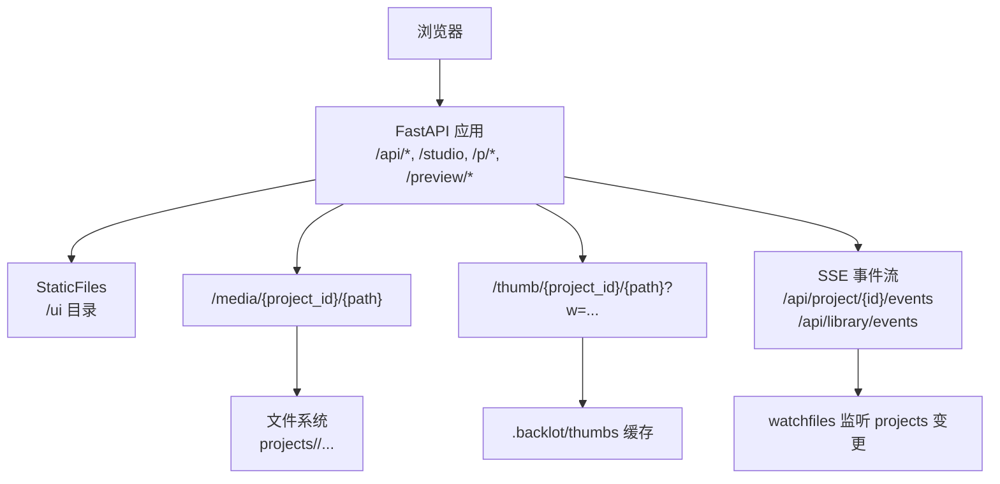
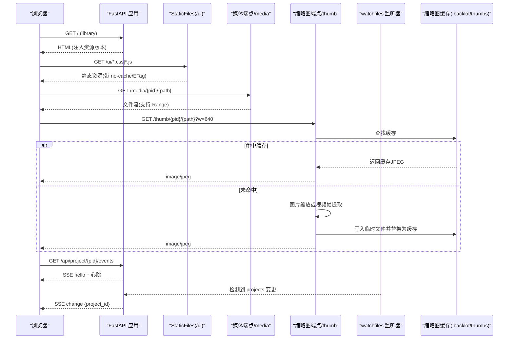
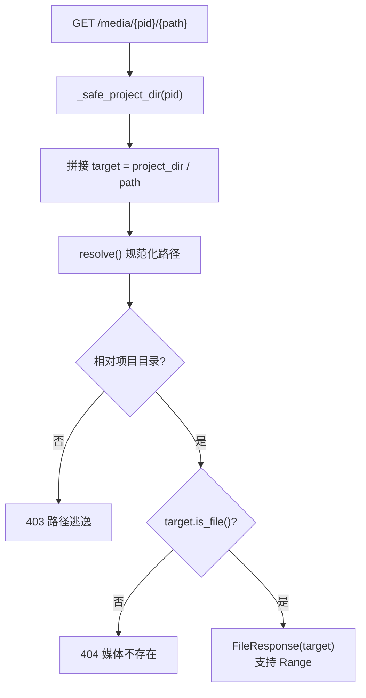
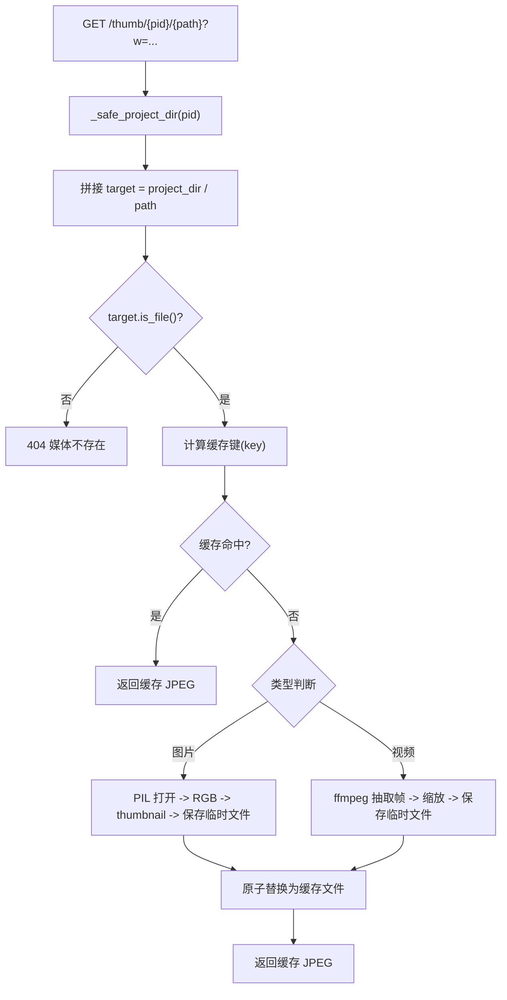
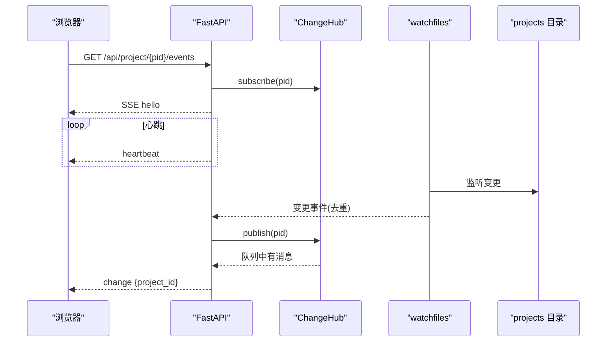
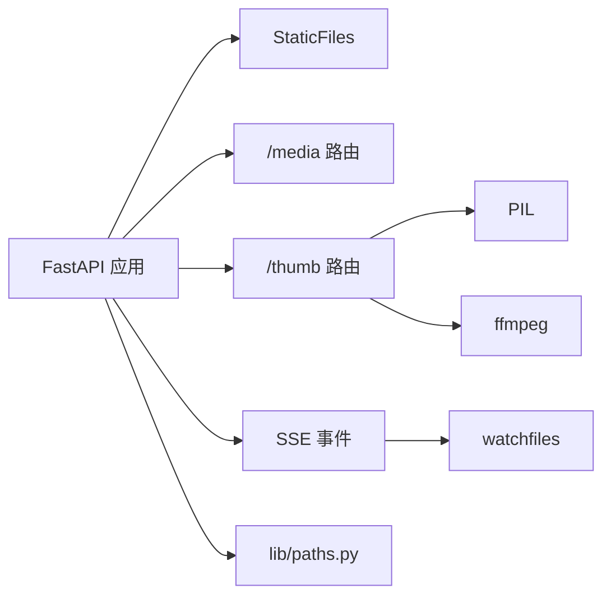

# 静态资源服务

<cite>
**本文引用的文件**   
- [server.py](file://backlot/server.py)
- [__main__.py](file://backlot/__main__.py)
- [state.py](file://backlot/state.py)
- [paths.py](file://lib/paths.py)
- [config.yaml](file://config.yaml)
- [requirements.txt](file://requirements.txt)
- [index.html](file://backlot/ui/index.html)
</cite>

## 目录
1. [简介](#简介)
2. [项目结构](#项目结构)
3. [核心组件](#核心组件)
4. [架构总览](#架构总览)
5. [详细组件分析](#详细组件分析)
6. [依赖关系分析](#依赖关系分析)
7. [性能考虑](#性能考虑)
8. [故障排查指南](#故障排查指南)
9. [结论](#结论)
10. [附录](#附录)

## 简介
本文件面向 OpenMontage-MV 的 Backlot 静态资源服务，系统性说明 UI 页面路由、静态文件服务与缓存策略；缩略图生成（图片处理、视频帧提取）与缓存机制；媒体访问控制、路径验证与安全策略；文件上传下载、Range 请求支持与流式传输；资源版本管理、条件请求与性能优化；以及自定义静态资源的配置与扩展方法。文档以代码为依据，提供可视化图示与可操作的实践建议。

## 项目结构
Backlot 基于 FastAPI 提供 Web 服务，UI 资源位于 backlot/ui，媒体与项目数据位于 projects 目录（由环境变量或默认路径决定）。服务器启动后：
- 挂载 /ui 静态目录，供浏览器加载 HTML/CSS/JS
- 暴露 /api/* 接口用于状态查询与事件推送
- 提供 /media/* 与 /thumb/* 用于媒体与缩略图访问
- 通过 SSE 推送变更事件，驱动前端刷新



图表来源
- [server.py:151-406](file://backlot/server.py#L151-L406)
- [server.py:329-361](file://backlot/server.py#L329-L361)
- [server.py:132-149](file://backlot/server.py#L132-L149)

章节来源
- [server.py:151-406](file://backlot/server.py#L151-L406)
- [paths.py:13-18](file://lib/paths.py#L13-L18)

## 核心组件
- 应用创建与生命周期：FastAPI 应用构建、启动/关闭钩子、后台任务
- 页面路由：/、/studio、/p/{id}、/preview/{id} 等，动态注入资源版本号
- 静态文件服务：/ui 目录挂载，配合中间件控制缓存策略
- 媒体访问：/media/{project_id}/{file_path}，支持 Range 请求
- 缩略图服务：/thumb/{project_id}/{file_path}?w=...，图片缩放与视频帧提取，磁盘缓存
- 事件推送：SSE 长连接，按项目过滤，心跳保活
- 安全校验：项目 ID 白名单、路径穿越防护、越权访问拒绝

章节来源
- [server.py:151-406](file://backlot/server.py#L151-L406)
- [server.py:329-361](file://backlot/server.py#L329-L361)
- [server.py:409-417](file://backlot/server.py#L409-L417)

## 架构总览
下图展示从浏览器到后端各组件的交互流程，包括页面加载、静态资源、媒体与缩略图、SSE 事件流与文件监听。



图表来源
- [server.py:151-406](file://backlot/server.py#L151-L406)
- [server.py:329-361](file://backlot/server.py#L329-L361)
- [server.py:132-149](file://backlot/server.py#L132-L149)

## 详细组件分析

### UI 页面路由与资源版本管理
- 路由定义：/、/studio、/p/{project_id}、/p/{project_path:path}、/preview/{project_id}、/studio/{session_id}
- 资源注入：_ui_html 读取模板 HTML，扫描指定资源文件，若存在则追加 ?v={mtime} 实现强缓存失效
- 中间件：对 /、/ui、/p/、/studio 路径设置 Cache-Control: no-cache，确保每次加载都进行条件请求（ETag），便于快速修复 UI 问题

```mermaid
flowchart TD
Start(["请求进入"]) --> CheckPath{"路径匹配?"}
CheckPath --> |/| LoadIndex["加载 index.html"]
CheckPath --> |/studio| LoadStudio["加载 studio.html"]
CheckPath --> |/p/{id}| LoadBoard["加载 board.html"]
CheckPath --> |/preview/{id}| LoadPreview["加载 preview.html"]
LoadIndex --> Inject["注入资源版本 v=mtime"]
LoadStudio --> Inject
LoadBoard --> Inject
LoadPreview --> Inject
Inject --> SetHeaders["设置 no-cache 头"]
SetHeaders --> Return["返回 HTML 响应"]
```

图表来源
- [server.py:33-40](file://backlot/server.py#L33-L40)
- [server.py:365-388](file://backlot/server.py#L365-L388)
- [server.py:397-404](file://backlot/server.py#L397-L404)

章节来源
- [server.py:33-40](file://backlot/server.py#L33-L40)
- [server.py:365-388](file://backlot/server.py#L365-L388)
- [server.py:397-404](file://backlot/server.py#L397-L404)

### 静态文件服务与缓存策略
- 静态目录：/ui 通过 StaticFiles 挂载，直接服务于 CSS/JS/HTML
- 缓存策略：
  - UI 相关路径强制 no-cache，浏览器会发起条件请求（If-None-Match/If-Modified-Since），服务端返回 ETag/Last-Modified 实现 304
  - 媒体与缩略图使用默认缓存策略（由客户端/代理根据 Content-Type 和文件名决定）
- 资源版本：模板中资源路径自动附加 ?v={mtime}，避免浏览器长期缓存旧资源

章节来源
- [server.py:390-404](file://backlot/server.py#L390-L404)
- [server.py:33-40](file://backlot/server.py#L33-L40)

### 媒体文件访问控制与路径验证
- 路由：/media/{project_id}/{file_path}
- 安全校验：
  - _safe_project_dir 校验 project_id 合法性（禁止 / \ : 及 . ..），不存在则 404
  - 目标路径必须属于项目目录，否则 403（防止路径穿越）
  - 文件不存在返回 404
- Range 支持：FileResponse 原生支持 Range 请求，适合大文件分段传输与断点续传



图表来源
- [server.py:351-361](file://backlot/server.py#L351-L361)
- [server.py:409-417](file://backlot/server.py#L409-L417)

章节来源
- [server.py:351-361](file://backlot/server.py#L351-L361)
- [server.py:409-417](file://backlot/server.py#L409-L417)

### 缩略图生成服务（图片处理、视频帧提取与缓存）
- 路由：/thumb/{project_id}/{file_path}?w=...
- 处理逻辑：
  - 图片：使用 PIL 将图像转为 RGB，thumbnail 缩放至目标宽度（保持宽高比），保存为 JPEG（质量 82）
  - 视频：调用 ffmpeg 在 1.5s 处抽取一帧，缩放至目标宽度，输出 JPEG
  - 缓存键：基于源文件路径、mtime_ns、文件大小与目标宽度计算 SHA1，生成唯一 key
  - 并发安全：每个未命中请求生成独立临时文件，完成后原子替换为最终缓存
  - 失败回退：非可缩略图片直接返回原图；视频无可用帧时返回 404
- 缓存目录：.backlot/thumbs（自动创建）



图表来源
- [server.py:329-347](file://backlot/server.py#L329-L347)
- [server.py:460-500](file://backlot/server.py#L460-L500)

章节来源
- [server.py:329-347](file://backlot/server.py#L329-L347)
- [server.py:460-500](file://backlot/server.py#L460-L500)

### 事件推送（SSE）与变更监听
- 端点：/api/project/{project_id}/events、/api/library/events、/api/chat/{session_id}/events
- 订阅模型：ChangeHub 维护队列，按 project_id 过滤，避免无关项目消息风暴
- 心跳：每 15 秒发送 heartbeat，超时断开重连
- 变更监听：watchfiles 监听 projects 目录，去重后发布变更，触发 SSE 推送
- 头部：no-cache、X-Accel-Buffering: no，确保实时性



图表来源
- [server.py:185-214](file://backlot/server.py#L185-L214)
- [server.py:216-242](file://backlot/server.py#L216-L242)
- [server.py:132-149](file://backlot/server.py#L132-L149)

章节来源
- [server.py:185-214](file://backlot/server.py#L185-L214)
- [server.py:216-242](file://backlot/server.py#L216-L242)
- [server.py:132-149](file://backlot/server.py#L132-L149)

### 文件上传与下载
- 下载：/media 端点通过 FileResponse 提供下载与播放，支持 Range 分段传输
- 上传：当前代码库未实现上传端点；如需扩展，可在 FastAPI 中添加 POST 路由，结合 Pydantic 校验与存储路径校验，遵循现有安全策略

章节来源
- [server.py:351-361](file://backlot/server.py#L351-L361)

### 资源版本管理与条件请求
- 模板注入：_ui_html 为资源路径追加 ?v={mtime}，强制浏览器重新获取新版本
- 条件请求：中间件对 UI 路径设置 no-cache，浏览器携带 If-None-Match/If-Modified-Since，FastAPI/StaticFiles 返回 304 减少带宽
- 媒体与缩略图：不强制 no-cache，依赖文件名与内容哈希（缩略图 key）实现稳定缓存

章节来源
- [server.py:33-40](file://backlot/server.py#L33-L40)
- [server.py:397-404](file://backlot/server.py#L397-L404)

### 性能优化策略
- 缩略图缓存：避免重复处理，降低 CPU 与 I/O 压力
- 变更聚合：watchfiles 批量变更去重，减少 SSE 推送频率
- 异步执行：耗时操作（如 summarize_project）通过 asyncio.to_thread 避免阻塞事件循环
- 内存限制：SSE 队列最大 64，满则丢弃冗余消息，保证关键通知可达
- 日志轮转：CLI 启动时自动轮转 server.log，避免磁盘占满

章节来源
- [server.py:460-500](file://backlot/server.py#L460-L500)
- [server.py:132-149](file://backlot/server.py#L132-L149)
- [server.py:170-173](file://backlot/server.py#L170-L173)
- [__main__.py:43-51](file://backlot/__main__.py#L43-L51)

## 依赖关系分析
- FastAPI/Uvicorn：Web 框架与 ASGI 服务器
- watchfiles：文件系统监听，驱动 SSE 变更推送
- PIL/Pillow：图像处理（缩略图）
- ffmpeg：视频帧提取（外部命令）
- 路径与配置：lib/paths.py 提供 REPO_ROOT 与 PROJECTS_DIR 单点定义；config.yaml 定义输出参数（与静态资源服务间接相关）



图表来源
- [server.py:151-406](file://backlot/server.py#L151-L406)
- [paths.py:13-18](file://lib/paths.py#L13-L18)

章节来源
- [requirements.txt:8-12](file://requirements.txt#L8-L12)
- [paths.py:13-18](file://lib/paths.py#L13-L18)

## 性能考虑
- 缩略图生成应尽量避免频繁调用 ffmpeg，优先命中缓存；必要时预热常用分辨率
- 媒体大文件建议使用 CDN 或反向代理（Nginx/Apache）缓存与加速，利用 Range 与 ETag
- SSE 心跳间隔可根据网络状况调整，避免过多无效请求
- 监控 .backlot/thumbs 目录大小，定期清理过期或无用缓存

[本节为通用指导，不直接分析具体文件]

## 故障排查指南
- 403 路径逃逸：检查 file_path 是否包含 ../ 或绝对路径，确保目标在项目目录下
- 404 媒体不存在：确认文件路径正确且存在于项目中
- 缩略图生成失败：检查 ffmpeg 是否安装并可执行；确认输入文件格式受支持；查看临时文件是否生成
- SSE 连接中断：检查浏览器控制台与服务器日志，确认心跳正常；排查防火墙或代理拦截
- UI 未更新：清除浏览器缓存或强制刷新；确认资源路径已注入 ?v={mtime}

章节来源
- [server.py:329-361](file://backlot/server.py#L329-L361)
- [server.py:460-500](file://backlot/server.py#L460-L500)
- [server.py:185-214](file://backlot/server.py#L185-L214)

## 结论
Backlot 静态资源服务以 FastAPI 为核心，提供安全的媒体访问、高效的缩略图生成与缓存、实时的 SSE 事件推送与严格的权限控制。通过模板版本注入与中间件策略，兼顾了开发体验与生产性能。建议在扩展上传功能时沿用现有安全模型，并在大规模部署时引入 CDN 与反向代理优化。

[本节为总结，不直接分析具体文件]

## 附录

### 自定义静态资源与扩展指南
- 新增 UI 页面：在 backlot/ui 添加模板与资源，在 create_app 中注册路由，并通过 _ui_html 注入版本
- 新增静态目录：使用 app.mount("/new", StaticFiles(directory=NEW_DIR)) 挂载新目录
- 自定义缓存策略：在中间件中针对特定路径设置 Cache-Control、ETag、Last-Modified
- 扩展缩略图格式：在 _thumbnail_for 中增加新的后缀判断与处理逻辑（如 GIF/WebP）
- 扩展媒体类型：在 state.py 的 MEDIA_* 集合中添加新扩展名，确保扫描与分类正确

章节来源
- [server.py:390-404](file://backlot/server.py#L390-L404)
- [server.py:33-40](file://backlot/server.py#L33-L40)
- [state.py:18-23](file://backlot/state.py#L18-L23)

### 运行与配置
- 启动服务：python -m backlot serve --port 4750
- 打开界面：python -m backlot open [project-id]
- 端口与环境变量：BACKLOT_PORT、BACKLOT_HOST、OPENMONTAGE_PROJECTS_DIR
- 配置文件：config.yaml 定义输出参数（与媒体处理相关）

章节来源
- [__main__.py:110-117](file://backlot/__main__.py#L110-L117)
- [__main__.py:28-33](file://backlot/__main__.py#L28-L33)
- [paths.py:15-18](file://lib/paths.py#L15-L18)
- [config.yaml:1-20](file://config.yaml#L1-L20)