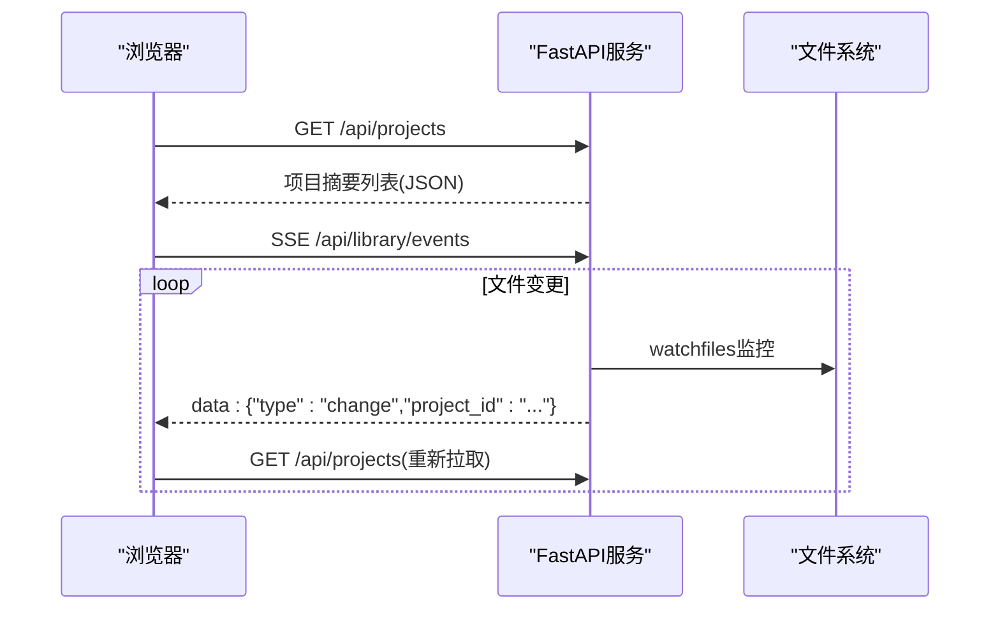
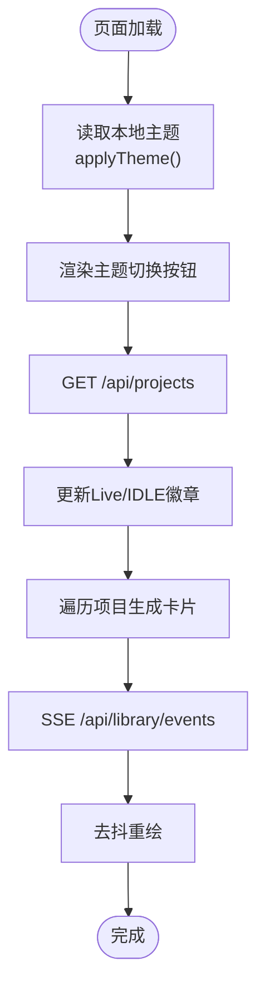
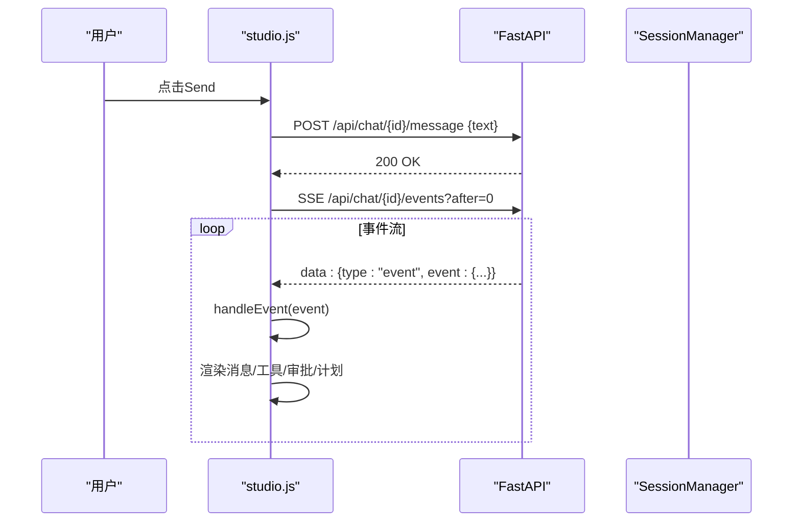
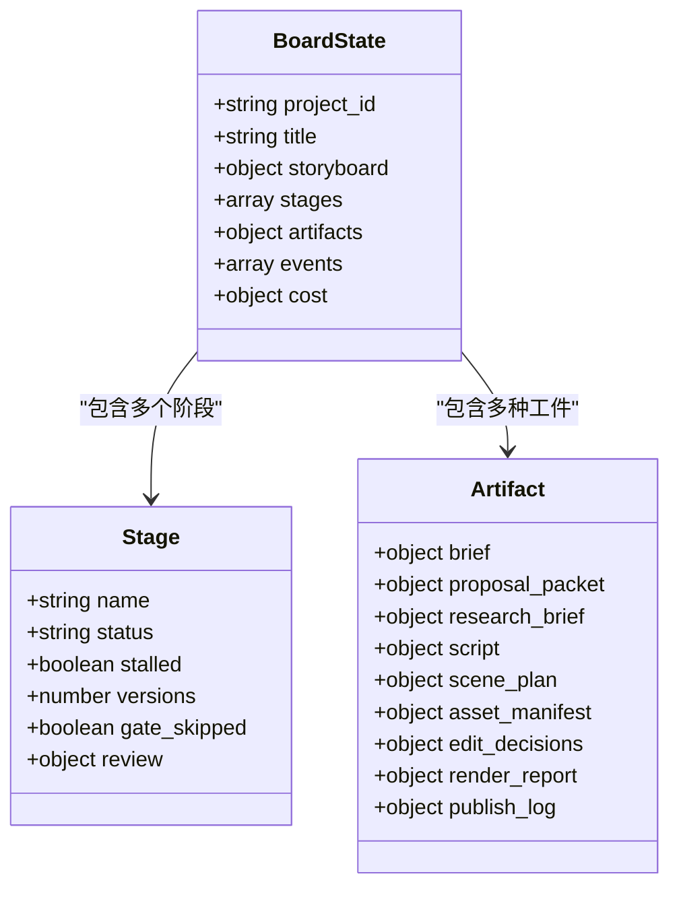
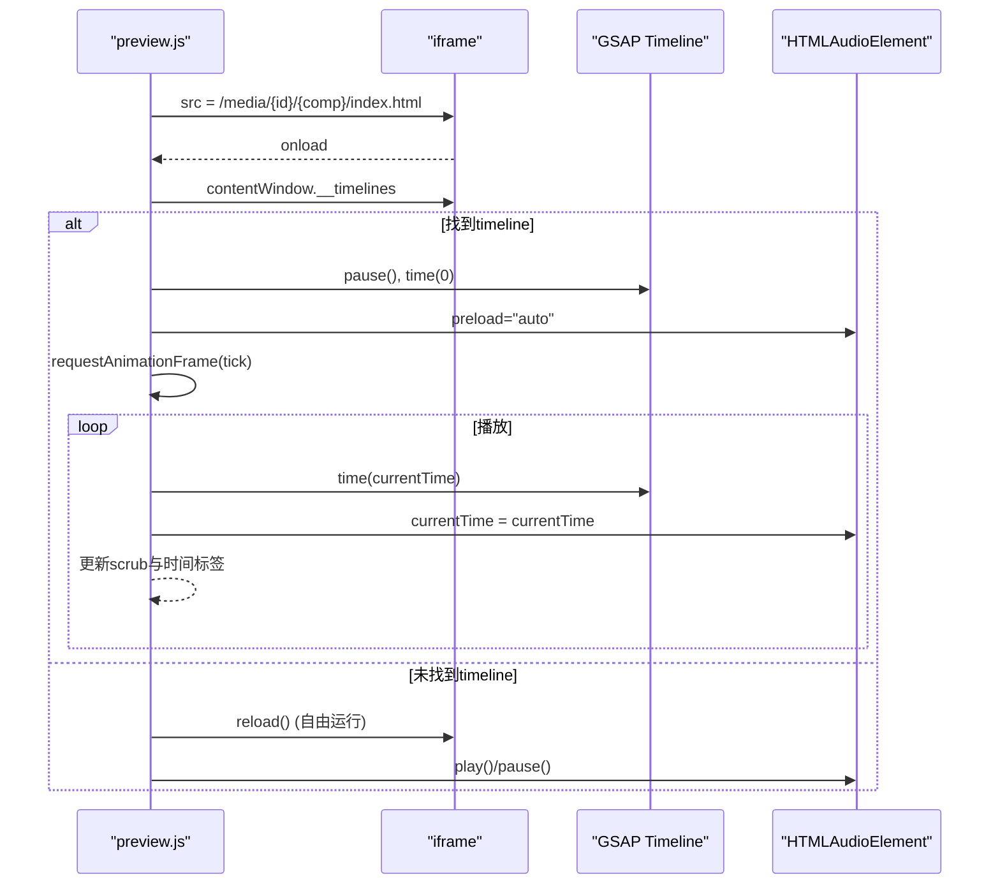
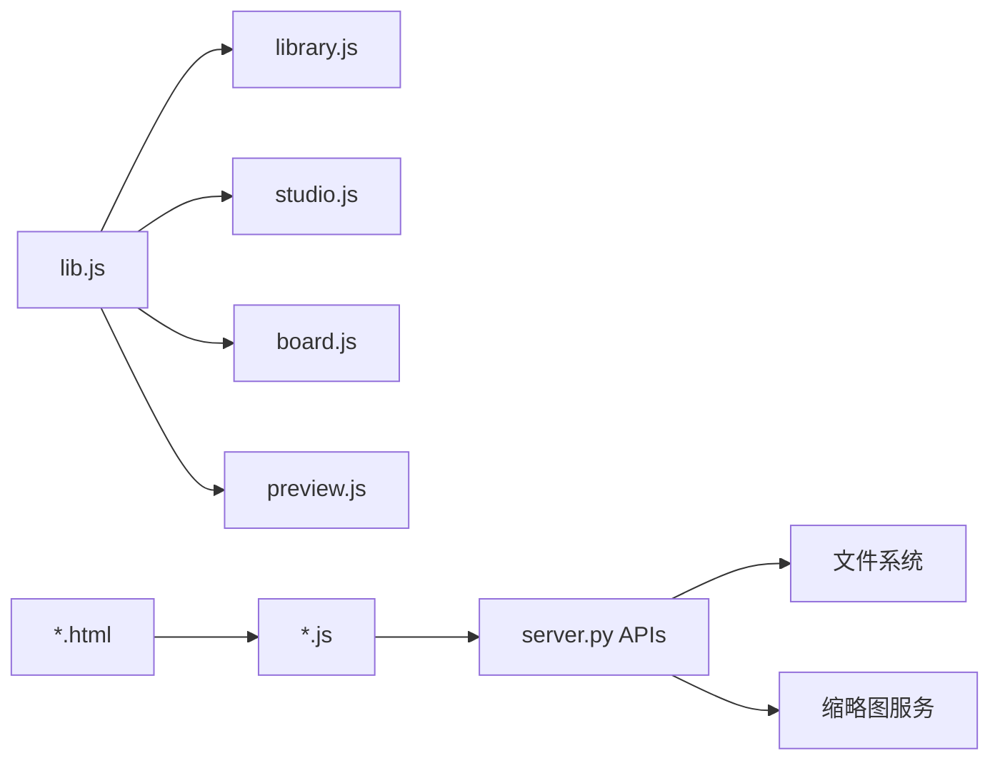

# UI组件库

<cite>
**本文引用的文件**   
- [backlot/ui/index.html](file://backlot/ui/index.html)
- [backlot/ui/studio.html](file://backlot/ui/studio.html)
- [backlot/ui/board.html](file://backlot/ui/board.html)
- [backlot/ui/preview.html](file://backlot/ui/preview.html)
- [backlot/ui/library.js](file://backlot/ui/library.js)
- [backlot/ui/studio.js](file://backlot/ui/studio.js)
- [backlot/ui/board.js](file://backlot/ui/board.js)
- [backlot/ui/preview.js](file://backlot/ui/preview.js)
- [backlot/ui/lib.js](file://backlot/ui/lib.js)
- [backlot/ui/board.css](file://backlot/ui/board.css)
- [backlot/ui/studio.css](file://backlot/ui/studio.css)
- [backlot/server.py](file://backlot/server.py)
- [backlot/__main__.py](file://backlot/__main__.py)
- [backlot/README.md](file://backlot/README.md)
</cite>

## 目录
1. [简介](#简介)
2. [项目结构](#项目结构)
3. [核心组件](#核心组件)
4. [架构总览](#架构总览)
5. [详细组件分析](#详细组件分析)
6. [依赖关系分析](#依赖关系分析)
7. [性能与可访问性](#性能与可访问性)
8. [主题定制与样式覆盖](#主题定制与样式覆盖)
9. [测试方法与最佳实践](#测试方法与最佳实践)
10. [常见问题排查](#常见问题排查)
11. [结论](#结论)

## 简介
本UI组件库为OpenMontage-MV的Backlot前端，提供“项目库”、“Studio对话工作台”、“项目看板”和“媒体预览播放器”四大页面。其设计目标是：
- 以可复用的DOM构建器、事件订阅、SSE流式更新为核心，实现高内聚、低耦合的前端组件化
- 通过CSS变量与数据主题开关，支持深色/浅色主题切换与样式覆盖
- 提供统一的API封装（JSON请求、媒体URL、缩略图URL、时间格式化等）
- 面向视频/图像媒体的播放、预览、时间轴控制与音频同步

该文档将系统梳理组件API、属性配置、事件回调、常用组件用法、主题机制、测试方法以及集成指南。

## 项目结构
- 静态页面入口
  - index.html：项目库首页，展示项目卡片网格
  - studio.html：Studio对话工作台，包含会话侧栏、聊天区、计划条、右侧看板面板
  - board.html：项目看板，包含头部信息、阶段轨道、剧本卡片、分镜胶片条、决策与活动面板
  - preview.html：媒体预览页，用于播放HyperFrames合成产物
- 脚本模块
  - lib.js：通用工具函数（el、getJSON、fmtXxx、mediaURL、thumbURL、subscribe、waveBars、STAGE_ICONS）
  - library.js：项目库渲染与主题切换
  - studio.js：会话管理、SSE事件处理、消息发送、审批交互、看板联动
  - board.js：看板状态渲染、阶段抽屉、剧本模态框、分镜胶片条、活动与决策面板、预览弹窗
  - preview.js：媒体播放器（iframe + GSAP timeline + 音频同步）
- 样式
  - board.css：全局设计系统（颜色、字体、动画、布局、组件样式）
  - studio.css：Studio三栏布局与组件样式
- 后端服务
  - server.py：FastAPI应用，提供API、SSE、媒体与缩略图服务、静态资源挂载
  - __main__.py：CLI启动器（serve/open/studio）
  - README.md：使用说明与工作原理概览

```mermaid
graph TB
subgraph "浏览器"
A["index.html<br/>library.js"]
B["studio.html<br/>studio.js"]
C["board.html<br/>board.js"]
D["preview.html<br/>preview.js"]
U["lib.js"]
S["board.css / studio.css"]
end
subgraph "服务器"
E["server.py<br/>FastAPI"]
end
A --> |GET /api/projects| E
A --> |SSE /api/library/events| E
B --> |POST/GET/DELETE /api/chat/*| E
B --> |SSE /api/chat/{id}/events| E
C --> |GET /api/project/{id}/state| E
C --> |SSE /api/project/{id}/events| E
C --> |GET /api/project/{id}/compositions| E
D --> |GET /api/project/{id}/compositions| E
A --> |/ui/*| E
B --> |/ui/*| E
C --> |/ui/*| E
D --> |/ui/*| E
A --> |/media/*| E
B --> |/media/*| E
C --> |/media/*| E
D --> |/media/*| E
A --> |/thumb/*| E
B --> |/thumb/*| E
C --> |/thumb/*| E
D --> |/thumb/*| E
```

**图表来源**
- [backlot/server.py:151-406](file://backlot/server.py#L151-L406)
- [backlot/ui/index.html:1-28](file://backlot/ui/index.html#L1-L28)
- [backlot/ui/studio.html:1-83](file://backlot/ui/studio.html#L1-L83)
- [backlot/ui/board.html:1-16](file://backlot/ui/board.html#L1-L16)
- [backlot/ui/preview.html:1-76](file://backlot/ui/preview.html#L1-L76)

**章节来源**
- [backlot/README.md:1-43](file://backlot/README.md#L1-L43)
- [backlot/server.py:151-406](file://backlot/server.py#L151-L406)

## 核心组件
- DOM构建器 el(tag, attrs, ...children)
  - 作用：创建元素并批量设置属性与事件监听
  - 输入：标签名、属性对象、子节点（扁平化）
  - 输出：DOM节点
  - 使用场景：所有页面的组件渲染
- JSON请求 getJSON(url)
  - 作用：统一fetch封装，错误抛出
  - 使用场景：获取项目列表、项目状态、组合清单等
- 媒体与缩略图 URL 生成
  - mediaURL(projectId, relPath)：构造/media路径
  - thumbURL(projectId, relPath, w=640)：构造/thumb路径并带宽度参数
- 时间格式化
  - fmtDuration(seconds)、fmtMoney(v)、fmtAgo(epochSeconds)、fmtClock(iso)
- SSE订阅 subscribe(url, onChange)
  - 作用：基于EventSource建立连接，去抖触发onChange
  - 使用场景：库页面实时刷新、项目看板实时更新
- 波形可视化 waveBars(container, seedStr, count, maxH)
  - 作用：根据种子字符串生成确定性波形条
- 阶段图标 STAGE_ICONS
  - 映射：completed/in_progress/awaiting_human/failed → 符号

这些工具函数在library.js、studio.js、board.js、preview.js中被广泛复用，形成一致的组件构建模式。

**章节来源**
- [backlot/ui/lib.js:1-104](file://backlot/ui/lib.js#L1-L104)

## 架构总览
- 前端采用SPA模式，每个页面独立加载JS模块，通过lib.js共享能力
- 后端FastAPI提供REST API与SSE流，负责：
  - 项目元数据与状态读取
  - 会话管理与事件回放
  - 媒体与缩略图服务
  - 静态资源托管与缓存策略
- 实时通信：
  - 库页面订阅/api/library/events
  - 看板页面订阅/api/project/{id}/events
  - Studio会话订阅/api/chat/{id}/events



**图表来源**
- [backlot/server.py:166-242](file://backlot/server.py#L166-L242)
- [backlot/server.py:132-149](file://backlot/server.py#L132-L149)

**章节来源**
- [backlot/server.py:151-406](file://backlot/server.py#L151-L406)

## 详细组件分析

### 项目库组件（Library）
- 功能要点
  - 显示项目卡片网格，包含海报、状态徽章、阶段迷你轨道
  - 主题切换按钮（深色/浅色），持久化到localStorage
  - 实时刷新：订阅库事件，去抖后重绘
- 关键API调用
  - GET /api/projects：获取项目摘要
  - SSE /api/library/events：变更通知
- 主题机制
  - 通过document.documentElement.dataset.theme切换
  - 使用CSS变量定义两套配色方案
- 渲染流程
  - 初始化时读取本地主题，应用主题
  - 渲染主题切换按钮并插入到头部
  - 拉取项目列表，计算live数量，更新徽章
  - 遍历项目数组，生成卡片节点并追加到网格



**图表来源**
- [backlot/ui/library.js:1-92](file://backlot/ui/library.js#L1-L92)
- [backlot/server.py:170-242](file://backlot/server.py#L170-L242)

**章节来源**
- [backlot/ui/index.html:1-28](file://backlot/ui/index.html#L1-L28)
- [backlot/ui/library.js:1-92](file://backlot/ui/library.js#L1-L92)

### Studio对话工作台（Studio）
- 功能要点
  - 会话侧栏：新建、切换、删除会话；右键菜单
  - 聊天区：用户/助手消息、状态提示、错误提示
  - 工具调用卡片：折叠展示输入/输出，支持拒绝/完成标记
  - 审批卡片：人工审批，决定通过或拒绝
  - 计划条：任务状态（待办/进行中/完成）
  - 看板面板：嵌入项目看板iframe，自动更新预览链接
- 事件处理
  - user/assistant/status/error/tool_call/tool_result/todos/approval_request/project/state/turn_done
  - 去重逻辑：基于seq字段避免重复渲染
- 关键API调用
  - POST /api/chat/sessions：创建会话
  - GET /api/chat/sessions：列出会话
  - DELETE /api/chat/{id}：删除会话
  - POST /api/chat/{id}/message：发送消息
  - POST /api/chat/{id}/approve：审批
  - POST /api/chat/{id}/interrupt：中断
  - SSE /api/chat/{id}/events：事件流（含hello+summary）



**图表来源**
- [backlot/ui/studio.js:1-440](file://backlot/ui/studio.js#L1-L440)
- [backlot/server.py:252-326](file://backlot/server.py#L252-L326)

**章节来源**
- [backlot/ui/studio.html:1-83](file://backlot/ui/studio.html#L1-L83)
- [backlot/ui/studio.js:1-440](file://backlot/ui/studio.js#L1-L440)

### 项目看板（Board）
- 功能要点
  - 头部信息：项目名称、流水线类型、时长、风格、成本进度条、Live/Idle状态
  - 阶段轨道：按流水线顺序显示阶段状态，支持展开抽屉查看工件
  - 剧本卡片：预览与全屏模态框，支持展开完整剧本
  - 分镜胶片条：场景卡片，支持图片/视频缩略、生成中占位、规格占位
  - 决策面板：聚合decision_log，显示最新选择与备选
  - 活动面板：events.jsonl解析，显示工具执行开始/结束/错误
  - 预览弹窗：打开HyperFrames合成预览iframe
- 关键API调用
  - GET /api/project/{id}/state：项目状态
  - SSE /api/project/{id}/events：变更通知
  - GET /api/project/{id}/compositions：组合清单
- 渲染逻辑
  - 根据stage_states与artifacts动态渲染
  - 针对特定artifact类型（brief/proposal_packet/research_brief/script/scene_plan/asset_manifest/edit_decisions/render_report/publish_log）提供专用摘要视图
  - 支持replay模式（已完成运行回放）



**图表来源**
- [backlot/ui/board.js:1-800](file://backlot/ui/board.js#L1-L800)

**章节来源**
- [backlot/ui/board.html:1-16](file://backlot/ui/board.html#L1-L16)
- [backlot/ui/board.js:1-800](file://backlot/ui/board.js#L1-L800)

### 媒体预览播放器（Preview）
- 功能要点
  - 加载组合清单，选择并加载对应iframe
  - 发现GSAP timeline（window.__timelines），驱动播放/暂停/跳转
  - 音频同步：优先以HTMLAudioElement作为主时钟，无timeline时回退自由运行
  - 响应式缩放：根据分辨率自适应容器尺寸
  - 键盘快捷键：空格播放/暂停，ESC关闭（嵌入模式下向父窗口postMessage）
- 关键API调用
  - GET /api/project/{id}/compositions：获取组合清单
- 播放控制流程
  - attachComposition：设置duration、audio、frame.src
  - findTimeline：尝试从iframe.contentWindow获取__timelines
  - play/pause：维护requestAnimationFrame循环，同步timeline与audio.currentTime
  - seek：根据scrub输入调整时间



**图表来源**
- [backlot/ui/preview.js:1-220](file://backlot/ui/preview.js#L1-L220)

**章节来源**
- [backlot/ui/preview.html:1-76](file://backlot/ui/preview.html#L1-L76)
- [backlot/ui/preview.js:1-220](file://backlot/ui/preview.js#L1-L220)

## 依赖关系分析
- 模块依赖
  - library.js、studio.js、board.js、preview.js均依赖lib.js提供的工具函数
  - 页面HTML通过script type="module"引入对应JS模块
- 服务端依赖
  - FastAPI路由与中间件：静态资源、缓存控制、SSE心跳
  - watchfiles监控projects目录变化，发布变更事件
  - 缩略图服务：PIL图像处理与ffmpeg提取视频帧
- 外部依赖
  - Google Fonts（Inter、JetBrains Mono、Courier Prime）
  - EventSource（SSE）
  - GSAP（由iframe内的composition注册timeline）



**图表来源**
- [backlot/ui/lib.js:1-104](file://backlot/ui/lib.js#L1-L104)
- [backlot/server.py:151-504](file://backlot/server.py#L151-L504)

**章节来源**
- [backlot/server.py:151-504](file://backlot/server.py#L151-L504)

## 性能与可访问性
- 性能优化
  - 缩略图缓存：/thumb接口对图片进行缩放与JPEG缓存，视频提取首帧作为poster
  - SSE去抖：subscribe函数对变更事件进行250ms去抖，避免频繁重绘
  - 懒加载：图片loading="lazy"，减少初始负载
  - 资源版本化：_ui_html为静态资源附加?v=mtime，便于条件缓存
- 可访问性
  - 主题切换按钮包含aria-label与aria-pressed
  - 模态框支持Escape键关闭，focus管理合理
  - 语义化标签与标题层级清晰

[本节为通用指导，不直接分析具体文件]

## 主题定制与样式覆盖
- 主题机制
  - 通过document.documentElement.dataset.theme切换light/dark
  - CSS变量集中定义颜色、字体、阴影等，light主题下覆盖相应变量
- 自定义建议
  - 扩展CSS变量：在根级添加新变量并在组件中使用
  - 覆盖组件类名：通过新增类名提升优先级或使用!important（谨慎）
  - 字体与字号：--fs-scale控制全局字号比例，便于无障碍阅读

**章节来源**
- [backlot/ui/board.css:1-120](file://backlot/ui/board.css#L1-L120)
- [backlot/ui/library.js:1-30](file://backlot/ui/library.js#L1-L30)
- [backlot/ui/board.js:23-44](file://backlot/ui/board.js#L23-L44)

## 测试方法与最佳实践
- 单元测试建议
  - 对lib.js工具函数编写断言（如fmtDuration、fmtMoney、thumbURL拼接）
  - 模拟SSE事件流，验证handleEvent分支覆盖
  - 模拟fetch失败，验证错误处理路径
- 集成测试建议
  - 启动本地FastAPI服务，使用Playwright/Cypress自动化测试页面交互
  - 验证SSE连接建立与事件接收
  - 验证媒体播放与控制（play/pause/seek）
- 最佳实践
  - 保持el函数幂等，避免重复创建节点
  - 使用事件委托减少监听器数量
  - 对长列表使用虚拟滚动（如需扩展）
  - 错误边界：网络异常、资源缺失时的降级显示

[本节为通用指导，不直接分析具体文件]

## 常见问题排查
- SSE连接断开
  - 检查浏览器控制台EventSource错误
  - 确认后端心跳正常（每15秒）
- 媒体无法加载
  - 检查/media路径是否正确编码
  - 确认文件存在且权限正确
- 缩略图404
  - 非图片格式（mp4/webm/mov）需有poster帧
  - 检查thumb缓存目录是否存在
- 主题不生效
  - 检查localStorage中的backlot.theme值
  - 确认CSS变量覆盖正确

**章节来源**
- [backlot/server.py:329-361](file://backlot/server.py#L329-L361)
- [backlot/server.py:460-500](file://backlot/server.py#L460-L500)

## 结论
Backlot UI组件库以lib.js为核心，结合模块化JS与CSS变量主题系统，实现了高内聚、易扩展的前端架构。通过SSE实时通信与FastAPI后端协作，提供了流畅的项目库浏览、Studio对话工作区、项目看板和媒体预览体验。遵循本文档的API规范、主题定制指南与测试建议，可快速集成与扩展新的UI组件。