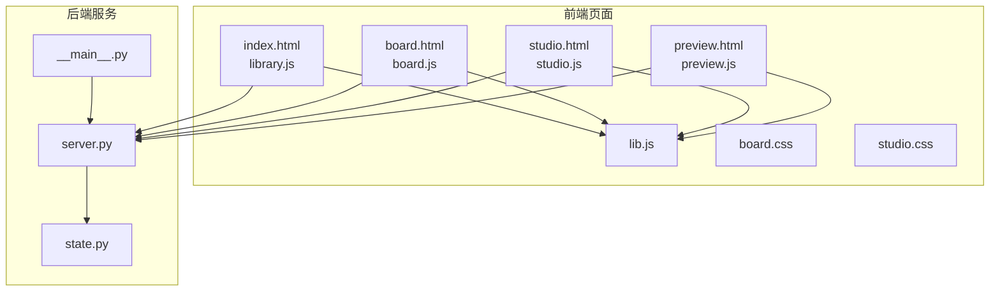
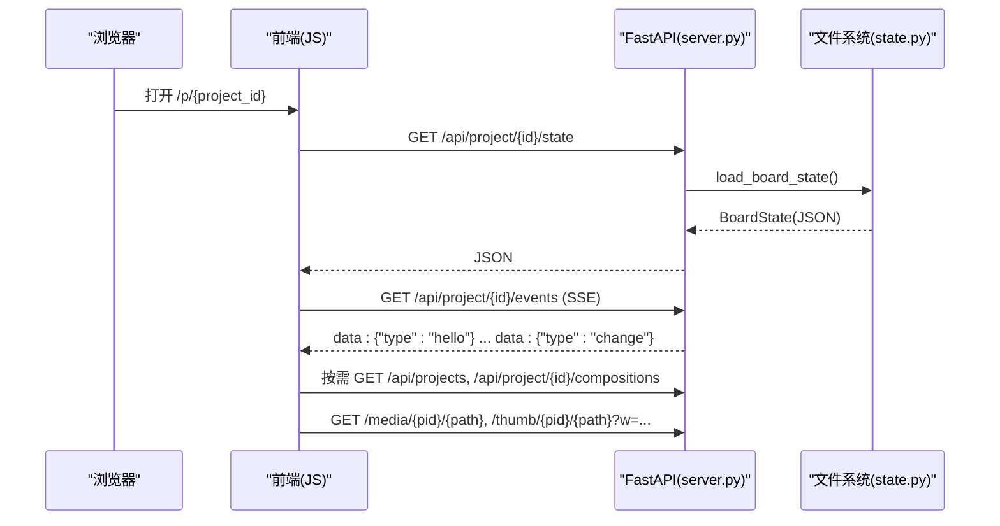
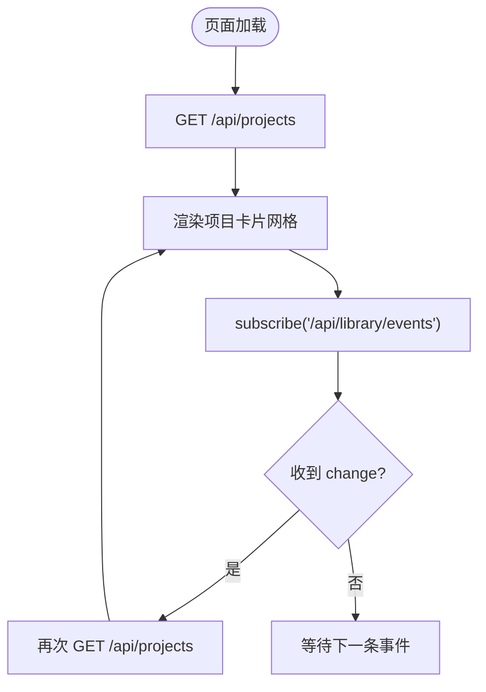
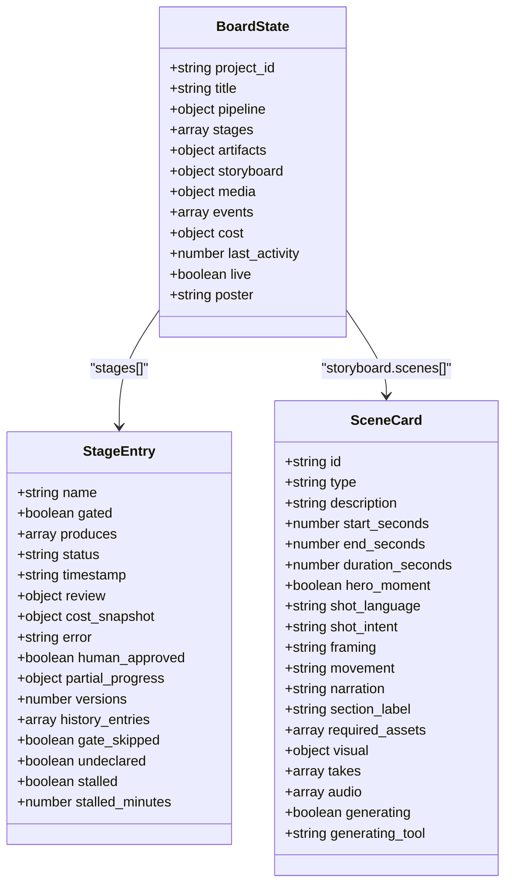
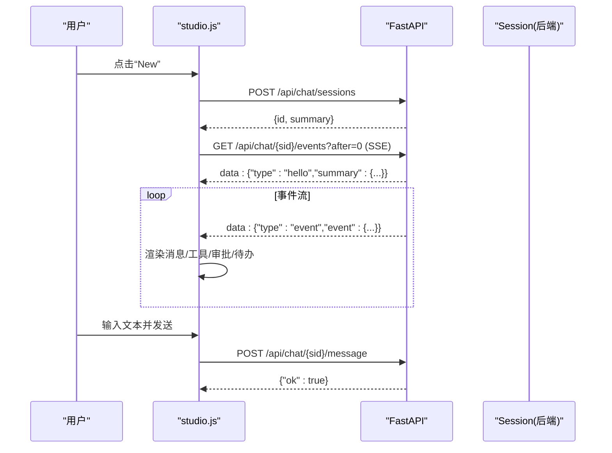
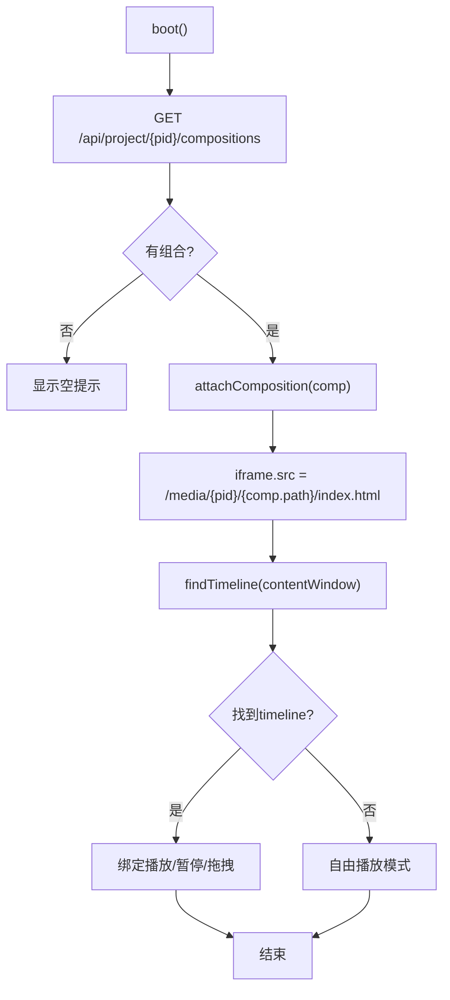
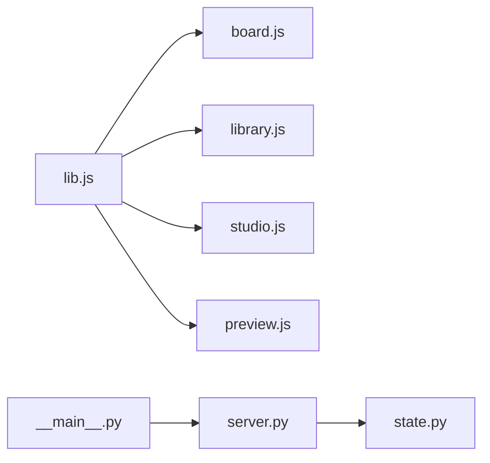

# 前端界面

<cite>
**本文引用的文件**   
- [index.html](file://backlot/ui/index.html)
- [board.html](file://backlot/ui/board.html)
- [studio.html](file://backlot/ui/studio.html)
- [preview.html](file://backlot/ui/preview.html)
- [board.js](file://backlot/ui/board.js)
- [studio.js](file://backlot/ui/studio.js)
- [preview.js](file://backlot/ui/preview.js)
- [library.js](file://backlot/ui/library.js)
- [lib.js](file://backlot/ui/lib.js)
- [board.css](file://backlot/ui/board.css)
- [studio.css](file://backlot/ui/studio.css)
- [server.py](file://backlot/server.py)
- [state.py](file://backlot/state.py)
- [__main__.py](file://backlot/__main__.py)
- [README.md](file://backlot/README.md)
</cite>

## 目录
1. [简介](#简介)
2. [项目结构](#项目结构)
3. [核心组件](#核心组件)
4. [架构总览](#架构总览)
5. [详细组件分析](#详细组件分析)
6. [依赖关系分析](#依赖关系分析)
7. [性能考虑](#性能考虑)
8. [故障排查指南](#故障排查指南)
9. [结论](#结论)
10. [附录](#附录)

## 简介
本文件面向 OpenMontage-MV 的 Backlot 前端界面，系统性说明 UI 组件架构与页面结构设计，重点阐述实时通信（SSE）连接管理、事件监听与状态更新机制。文档覆盖项目看板（Board）、工作室（Studio）界面的功能与交互逻辑，并详解状态可视化、媒体预览、文件管理等核心能力。同时给出响应式设计、可访问性合规与跨浏览器兼容性建议，以及界面定制选项与主题支持、前端开发指南与调试技巧。

## 项目结构
Backlot 的前端由若干 HTML 页面与对应的 JS/CSS 模块组成，通过后端 FastAPI 服务统一提供路由、静态资源与 SSE 流：
- 页面入口
  - 库视图：index.html + library.js
  - 项目看板：board.html + board.js
  - 工作室：studio.html + studio.js
  - 媒体预览：preview.html + preview.js
- 共享工具：lib.js（JSON 请求、SSE 订阅、时间/金额格式化、媒体 URL 构造等）
- 样式系统：board.css（全局设计令牌、暗/亮主题、动画与布局），studio.css（工作室三栏布局）
- 后端服务：server.py（FastAPI 路由、SSE、缩略图与媒体服务、UI 模板注入），state.py（看板状态派生），__main__.py（CLI 启动）

图表来源
- [index.html:1-28](file://backlot/ui/index.html#L1-L28)
- [board.html:1-16](file://backlot/ui/board.html#L1-L16)
- [studio.html:1-83](file://backlot/ui/studio.html#L1-L83)
- [preview.html:1-76](file://backlot/ui/preview.html#L1-L76)
- [library.js:1-92](file://backlot/ui/library.js#L1-L92)
- [board.js:1-800](file://backlot/ui/board.js#L1-L800)
- [studio.js:1-440](file://backlot/ui/studio.js#L1-L440)
- [preview.js:1-220](file://backlot/ui/preview.js#L1-L220)
- [lib.js:1-104](file://backlot/ui/lib.js#L1-L104)
- [board.css:1-800](file://backlot/ui/board.css#L1-L800)
- [studio.css:1-253](file://backlot/ui/studio.css#L1-L253)
- [server.py:1-504](file://backlot/server.py#L1-L504)
- [state.py:1-714](file://backlot/state.py#L1-L714)
- [__main__.py:1-145](file://backlot/__main__.py#L1-L145)

章节来源
- [README.md:1-43](file://backlot/README.md#L1-L43)

## 核心组件
- 库视图（Library）
  - 展示所有项目的卡片式网格，包含海报、阶段进度条、运行状态与“等待人工审批”提示；通过 SSE 订阅 /api/library/events 实现实时更新。
- 项目看板（Board）
  - 以“阶段轨道 + 剧本卡片 + 分镜胶片条 + 决策与活动面板”为核心，呈现生产全生命周期；支持剧本展开、场景缩略图播放、生成中占位、审批门控与回放模式。
- 工作室（Studio）
  - 聊天工作台，左侧会话列表，中间消息区（用户/助手/工具调用/审批请求/待办），右侧内嵌看板 iframe；通过 SSE 订阅会话事件流，驱动 UI 增量渲染。
- 媒体预览（Preview）
  - 独立页面或嵌入看板弹窗，加载 HyperFrames 组合，控制播放/暂停、时间轴拖拽、音频同步与缩放适配。

章节来源
- [library.js:1-92](file://backlot/ui/library.js#L1-L92)
- [board.js:1-800](file://backlot/ui/board.js#L1-L800)
- [studio.js:1-440](file://backlot/ui/studio.js#L1-L440)
- [preview.js:1-220](file://backlot/ui/preview.js#L1-L220)

## 架构总览
前后端通过 REST + SSE 协作：
- 库视图与看板通过 /api/projects、/api/project/{id}/state、/api/project/{id}/events 获取数据与变更通知。
- 工作室通过 /api/chat/sessions、/api/chat/{sid}、/api/chat/{sid}/message、/api/chat/{sid}/approve、/api/chat/{sid}/interrupt、/api/chat/{sid}/events 完成会话管理与事件流。
- 媒体与缩略图通过 /media/{pid}/{path} 与 /thumb/{pid}/{path}?w=... 提供。

图表来源
- [server.py:170-242](file://backlot/server.py#L170-L242)
- [state.py:586-656](file://backlot/state.py#L586-L656)
- [board.js:1-800](file://backlot/ui/board.js#L1-L800)
- [library.js:1-92](file://backlot/ui/library.js#L1-L92)

## 详细组件分析

### 库视图（Library）
- 功能要点
  - 项目卡片聚合：标题、类型、场景数、渲染数、最近活动时间、是否 LIVE、是否等待人工审批。
  - 迷你阶段轨道：显示各阶段状态（完成/进行中/等待）。
  - 实时刷新：使用 lib.js 的 subscribe() 订阅 /api/library/events，收到 change 后重新拉取 /api/projects。
- 关键流程
  - 初始化时拉取项目列表，渲染网格；若存在 live 项目则点亮状态灯。
  - SSE 心跳保活，去抖合并批量变更，避免频繁重绘。

图表来源
- [library.js:76-92](file://backlot/ui/library.js#L76-L92)
- [lib.js:66-81](file://backlot/ui/lib.js#L66-L81)
- [server.py:216-242](file://backlot/server.py#L216-L242)

章节来源
- [index.html:1-28](file://backlot/ui/index.html#L1-L28)
- [library.js:1-92](file://backlot/ui/library.js#L1-L92)

### 项目看板（Board）
- 功能要点
  - 阶段轨道：按流水线清单顺序展示阶段状态，支持未声明阶段回退定位，显示“等待人工审批/停滞/进行中/完成/失败”。
  - 剧本卡片：分段展示脚本内容，支持展开全屏查看。
  - 分镜胶片条：根据 scene_plan × script × asset_manifest 组装，支持图片/视频缩略图、生成中 shimmer、缺失占位、点击播放。
  - 审批门控：当 stage.status == awaiting_human 时，展示评审摘要与操作入口。
  - 决策与活动：聚合 decision_log 与 events.jsonl，显示最新选择与工具执行轨迹。
  - 成本与预算：从 checkpoint cost_snapshot 计算已花费与预算占比。
  - 主题切换：dark/light 双主题，持久化到 localStorage。
- 关键流程
  - 首次拉取 state，渲染各区域；订阅 /api/project/{id}/events 增量更新。
  - 组合预览：拉取 compositions，弹窗 iframe 加载 /preview/{pid}?embed=1&c=...。

图表来源
- [state.py:586-656](file://backlot/state.py#L586-L656)
- [board.js:1-800](file://backlot/ui/board.js#L1-L800)

章节来源
- [board.html:1-16](file://backlot/ui/board.html#L1-L16)
- [board.js:1-800](file://backlot/ui/board.js#L1-L800)
- [board.css:1-800](file://backlot/ui/board.css#L1-L800)

### 工作室（Studio）
- 功能要点
  - 会话侧栏：新建/切换/删除会话，右键菜单，运行状态标记。
  - 聊天主区：用户消息、助手回复（Markdown 简化渲染）、工具调用卡片、工具结果、审批请求、待办清单。
  - 看板面板：内嵌 iframe 显示对应项目的看板，自动加载/切换项目。
  - 状态指示：WORKING/IDLE，中断按钮。
- 关键流程
  - 创建会话 → 建立 EventSource(/api/chat/{sid}/events?after=0) → 处理 hello/summary → 逐条 event 渲染。
  - 发送消息 → POST /api/chat/{sid}/message → 等待事件流推进。
  - 审批请求 → 弹出确认卡片 → POST /api/chat/{sid}/approve。

图表来源
- [studio.js:241-279](file://backlot/ui/studio.js#L241-L279)
- [server.py:252-325](file://backlot/server.py#L252-L325)

章节来源
- [studio.html:1-83](file://backlot/ui/studio.html#L1-L83)
- [studio.js:1-440](file://backlot/ui/studio.js#L1-L440)
- [studio.css:1-253](file://backlot/ui/studio.css#L1-L253)

### 媒体预览（Preview）
- 功能要点
  - 列出项目中的 HyperFrames 组合（hyperframes.json + index.html），支持选择与切换。
  - 通过 iframe 加载组合页面，尝试从 contentWindow.__timelines 获取 GSAP timeline 进行精确控制。
  - 无 timeline 时进入自由播放模式，基于 Audio.currentTime 或 requestAnimationFrame 驱动时间轴。
  - 支持播放/暂停、拖拽进度条、键盘快捷键（空格播放/暂停，ESC 关闭嵌入窗口）。
- 关键流程
  - 拉取 compositions → 选择默认或指定 c → 加载 index.html → 发现 timeline → 绑定播放控制。

图表来源
- [preview.js:188-219](file://backlot/ui/preview.js#L188-L219)
- [server.py:420-453](file://backlot/server.py#L420-L453)

章节来源
- [preview.html:1-76](file://backlot/ui/preview.html#L1-L76)
- [preview.js:1-220](file://backlot/ui/preview.js#L1-L220)

## 依赖关系分析
- 前端模块依赖
  - board.js、library.js、studio.js、preview.js 均依赖 lib.js 提供的通用能力（getJSON、el、fmt*、mediaURL、thumbURL、subscribe）。
- 后端依赖
  - server.py 依赖 state.py 进行 BoardState 派生；watchfiles 用于文件系统监控（可选）；PIL/ffmpeg 用于缩略图生成（可选）。
- 运行时依赖
  - __main__.py 负责启动 uvicorn 服务与浏览器打开；环境变量 BACKLOT_PORT、BACKLOT_HOST 控制端口与绑定地址。

图表来源
- [lib.js:1-104](file://backlot/ui/lib.js#L1-L104)
- [board.js:1-800](file://backlot/ui/board.js#L1-L800)
- [library.js:1-92](file://backlot/ui/library.js#L1-L92)
- [studio.js:1-440](file://backlot/ui/studio.js#L1-L440)
- [preview.js:1-220](file://backlot/ui/preview.js#L1-L220)
- [server.py:1-504](file://backlot/server.py#L1-L504)
- [state.py:1-714](file://backlot/state.py#L1-L714)
- [__main__.py:1-145](file://backlot/__main__.py#L1-L145)

章节来源
- [lib.js:1-104](file://backlot/ui/lib.js#L1-L104)
- [server.py:1-504](file://backlot/server.py#L1-L504)
- [state.py:1-714](file://backlot/state.py#L1-L714)
- [__main__.py:1-145](file://backlot/__main__.py#L1-L145)

## 性能考虑
- 缩略图缓存
  - /thumb 接口对图片降采样与视频抽帧，结果缓存至 .backlot/thumbs，减少重复计算与带宽消耗。
- SSE 去抖与心跳
  - 前端 subscribe() 对 burst 事件做 250ms 去抖；后端 SSE 每 15s 发送心跳保持连接活跃。
- 只读与降级
  - state.py 读取 JSON 失败或缺失字段时优雅降级，保证看板不崩溃；无 pipeline manifest 时使用回退阶段表。
- 媒体播放优化
  - 视频缩略图使用 object-fit: cover 确保填充；无 timeline 时采用 requestAnimationFrame 驱动，避免阻塞。
- 资源缓存策略
  - UI 资源设置 no-cache 强制条件校验（ETag），媒体与缩略图正常缓存。

章节来源
- [server.py:327-361](file://backlot/server.py#L327-L361)
- [lib.js:66-81](file://backlot/ui/lib.js#L66-L81)
- [board.css:700-730](file://backlot/ui/board.css#L700-L730)
- [preview.js:130-148](file://backlot/ui/preview.js#L130-L148)

## 故障排查指南
- 常见问题
  - 项目 ID 非法或不存在：/api/project/{id}/state 返回 404；检查路径与权限。
  - 媒体不可用：/media 或 /thumb 返回 404；确认文件在项目目录下且后缀合法。
  - SSE 断连：EventSource 自动重连；检查网络与服务端心跳。
  - 审批失败：POST approve 返回 409；确认存在待审批项。
- 调试技巧
  - 浏览器开发者工具 Network 面板观察 SSE 流与 JSON 响应。
  - 控制台日志：library.js 与 board.js 在错误分支打印 console.error。
  - 本地模拟运行：scripts/backlot_simulate_run.py 生成演示数据，便于快速验证。
  - 日志文件：.studio/server.log 记录服务端启动与异常。

章节来源
- [server.py:409-417](file://backlot/server.py#L409-L417)
- [library.js:88-92](file://backlot/ui/library.js#L88-L92)
- [board.js:1-800](file://backlot/ui/board.js#L1-L800)
- [README.md:35-40](file://backlot/README.md#L35-L40)
- [__main__.py:43-51](file://backlot/__main__.py#L43-L51)

## 结论
Backlot 前端以清晰的模块化结构与稳健的 SSE 实时通信为基础，提供了从库视图到项目看板、工作室工作区与媒体预览的完整体验。通过主题系统与响应式 CSS，兼顾了视觉一致性与多端适配。结合后端只读派生与优雅降级策略，确保了高可用与可扩展性。建议在后续迭代中继续完善无障碍增强、国际化与更细粒度的权限控制。

## 附录

### 实时通信实现（SSE）
- 库视图订阅
  - 前端：subscribe("/api/library/events", onChange)
  - 后端：StreamingResponse 推送 hello/heartbeat/change
- 看板订阅
  - 前端：GET /api/project/{id}/events
  - 后端：按项目过滤队列，合并突发，发送 change
- 工作室会话
  - 前端：EventSource("/api/chat/{sid}/events?after=0")
  - 后端：按 seq 去重，推送 hello/summary/event

章节来源
- [lib.js:66-81](file://backlot/ui/lib.js#L66-L81)
- [server.py:185-242](file://backlot/server.py#L185-L242)
- [studio.js:249-279](file://backlot/ui/studio.js#L249-L279)

### 状态可视化与媒体预览
- 状态可视化
  - 阶段轨道、审批门控、成本进度、活动日志与决策历史均由 state.py 派生，前端按需渲染。
- 媒体预览
  - compositions 扫描 hyperframes.json，iframe 加载组合页面，优先控制 timeline，否则自由播放。

章节来源
- [state.py:586-656](file://backlot/state.py#L586-L656)
- [server.py:420-453](file://backlot/server.py#L420-L453)
- [preview.js:188-219](file://backlot/ui/preview.js#L188-L219)

### 响应式设计、可访问性与跨浏览器兼容
- 响应式
  - 工作室三栏布局在小屏隐藏看板面板；字体大小通过 --fs-scale 统一缩放。
- 可访问性
  - 主题切换按钮具备 aria-label 与 aria-pressed；模态框支持 ESC 关闭；焦点可见性样式。
- 跨浏览器
  - 使用标准 EventSource、fetch、requestAnimationFrame；媒体使用原生 <video>/<audio>；缩略图 fallback 到原始图片或 404 提示。

章节来源
- [studio.css:249-253](file://backlot/ui/studio.css#L249-L253)
- [board.css:44-86](file://backlot/ui/board.css#L44-L86)
- [board.js:23-44](file://backlot/ui/board.js#L23-L44)
- [library.js:13-29](file://backlot/ui/library.js#L13-L29)

### 界面定制与主题支持
- 主题
  - dark/light 双主题，通过 documentElement.dataset.theme 切换，localStorage 持久化。
- 设计令牌
  - 颜色、字体、间距等通过 CSS 变量集中管理，便于扩展新主题。
- 布局
  - 看板与工作室均采用 CSS Grid/Flex 布局，易于调整列宽与间距。

章节来源
- [board.css:8-86](file://backlot/ui/board.css#L8-L86)
- [board.js:23-44](file://backlot/ui/board.js#L23-L44)
- [library.js:7-29](file://backlot/ui/library.js#L7-L29)

### 前端开发指南与调试技巧
- 开发环境
  - 使用 python -m backlot serve --port 4750 启动服务；python -m backlot open 打开浏览器。
- 常用命令
  - 模拟运行：scripts/backlot_simulate_run.py
  - 查看日志：.studio/server.log
- 调试建议
  - 关注 SSE 事件类型与顺序；核对 BoardState 字段是否符合预期；检查媒体路径与缩略图缓存命中情况。

章节来源
- [__main__.py:120-140](file://backlot/__main__.py#L120-L140)
- [README.md:8-12](file://backlot/README.md#L8-L12)
- [server.py:151-166](file://backlot/server.py#L151-L166)