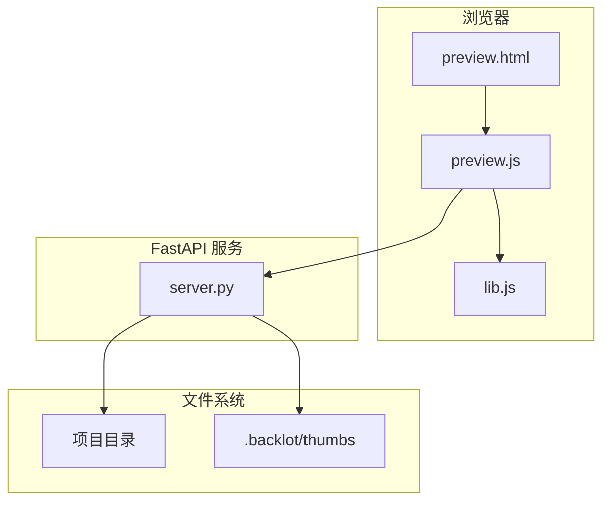
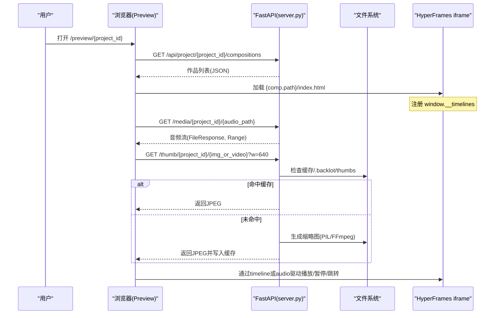
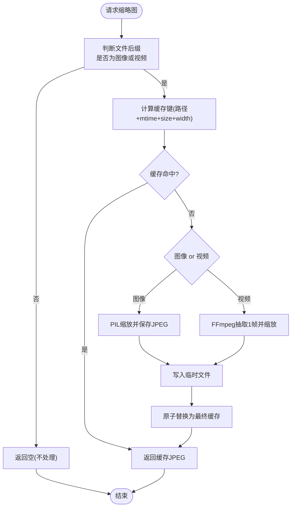
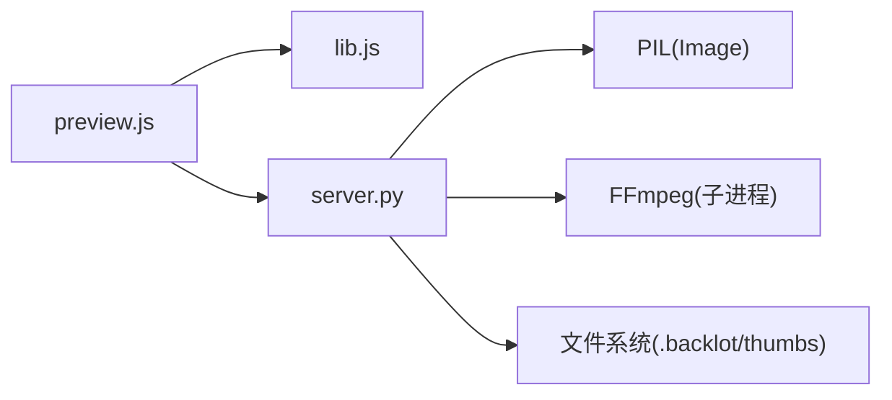

# 媒体预览功能

<cite>
**本文引用的文件**   
- [backlot/server.py](file://backlot/server.py)
- [backlot/ui/preview.html](file://backlot/ui/preview.html)
- [backlot/ui/preview.js](file://backlot/ui/preview.js)
- [backlot/ui/lib.js](file://backlot/ui/lib.js)
- [lib/media_profiles.py](file://lib/media_profiles.py)
- [config.yaml](file://config.yaml)
- [backlot/state.py](file://backlot/state.py)
</cite>

## 目录
1. [简介](#简介)
2. [项目结构](#项目结构)
3. [核心组件](#核心组件)
4. [架构总览](#架构总览)
5. [详细组件分析](#详细组件分析)
6. [依赖关系分析](#依赖关系分析)
7. [性能与内存优化](#性能与内存优化)
8. [故障排查指南](#故障排查指南)
9. [结论](#结论)
10. [附录：配置与扩展](#附录配置与扩展)

## 简介
本文件面向“媒体预览”能力，覆盖图片、音频、视频等媒体类型的预览实现，包括缩略图生成、懒加载与缓存策略；文档化媒体播放器的控制（播放/暂停、进度条、时间显示）、以及与旁白音频同步的时序机制。同时说明大文件预览的性能优化与内存管理、媒体格式支持与兼容性处理，并提供自定义配置与扩展方法。

## 项目结构
媒体预览由后端服务与前端页面协同完成：
- 后端 FastAPI 提供媒体访问、缩略图生成、SSE 事件流、以及 HyperFrames 作品扫描接口。
- 前端 preview.html + preview.js 负责渲染预览界面、加载并驱动 HyperFrames 作品、与音频同步播放。
- 通用工具 lib.js 提供媒体 URL 构造、缩略图 URL 构造、SSE 订阅等。
- 媒体配置文件 media_profiles.py 定义平台输出规格，辅助生成与兼容。
- 全局配置 config.yaml 定义默认输出参数。
- state.py 定义媒体类型常量与资源发现逻辑，为 UI 展示与缩略图选择提供依据。



图表来源 
- [backlot/server.py:151-406](file://backlot/server.py#L151-L406)
- [backlot/ui/preview.html:1-76](file://backlot/ui/preview.html#L1-L76)
- [backlot/ui/preview.js:1-220](file://backlot/ui/preview.js#L1-L220)
- [backlot/ui/lib.js:56-63](file://backlot/ui/lib.js#L56-L63)

章节来源
- [backlot/server.py:151-406](file://backlot/server.py#L151-L406)
- [backlot/ui/preview.html:1-76](file://backlot/ui/preview.html#L1-L76)
- [backlot/ui/preview.js:1-220](file://backlot/ui/preview.js#L1-L220)
- [backlot/ui/lib.js:56-63](file://backlot/ui/lib.js#L56-L63)

## 核心组件
- 媒体路由与范围请求：/media/{project_id}/{file_path} 直接返回原文件，利用 FileResponse 支持 Range 请求，便于大文件按需加载。
- 缩略图路由：/thumb/{project_id}/{file_path}?w=... 根据宽度生成或读取缓存 JPEG；对视频在固定时间点抽取一帧作为海报图。
- 作品扫描：/api/project/{project_id}/compositions 扫描 hyperframes.json 与 index.html，返回轻量元数据（名称、时长、分辨率、帧率、旁路音频路径）。
- 预览播放器：iframe 内嵌 HyperFrames 作品，通过 window.__timelines 获取 GSAP timeline 进行精确控制；若无 timeline，则进入自由运行模式并由 HTMLAudioElement 驱动时间轴。
- 通用工具：mediaURL、thumbURL 统一构建跨域安全的相对路径；SSE 订阅用于状态更新。

章节来源
- [backlot/server.py:327-361](file://backlot/server.py#L327-L361)
- [backlot/server.py:420-453](file://backlot/server.py#L420-L453)
- [backlot/ui/preview.js:31-34](file://backlot/ui/preview.js#L31-L34)
- [backlot/ui/lib.js:56-63](file://backlot/ui/lib.js#L56-L63)

## 架构总览
下图展示了从浏览器到后端的完整调用链，包括媒体与缩略图的访问路径、SSE 事件流、以及 HyperFrames 作品的加载与播放控制。



图表来源 
- [backlot/server.py:179-184](file://backlot/server.py#L179-L184)
- [backlot/server.py:327-361](file://backlot/server.py#L327-L361)
- [backlot/server.py:460-500](file://backlot/server.py#L460-L500)
- [backlot/ui/preview.js:36-100](file://backlot/ui/preview.js#L36-L100)

## 详细组件分析

### 缩略图生成与缓存策略
- 支持的源格式：
  - 图像：png、jpg、jpeg、webp、gif
  - 视频：mp4、webm、mov
- 生成策略：
  - 图像：使用 PIL 缩放并保存为 JPEG（质量 82），尺寸按目标宽度自适应高度。
  - 视频：使用 FFmpeg 在 1.5s 处抽取一帧，按目标宽度缩放为 JPEG。
- 缓存键：基于源文件路径、mtime_ns、文件大小与目标宽度计算 SHA1，文件名前缀为哈希，避免并发冲突使用临时文件再原子替换。
- 回退行为：若无法生成缩略图且为视频，返回 404（禁止将原始视频字节作为  消费）；非视频不可缩略的图片直接返回原图。



图表来源 
- [backlot/server.py:460-500](file://backlot/server.py#L460-L500)

章节来源
- [backlot/server.py:327-361](file://backlot/server.py#L327-L361)
- [backlot/server.py:460-500](file://backlot/server.py#L460-L500)

### 媒体播放器与播放控制
- 播放载体：
  - 优先使用 HyperFrames 作品内的 GSAP timeline（window.__timelines），实现精确的时间同步与跳转。
  - 若无 timeline，进入“自由运行”模式，以 HTMLAudioElement 作为主时钟驱动时间推进。
- 控制项：
  - 播放/暂停：按钮切换，Space 快捷键支持。
  - 进度条：range 输入控件，拖动时暂停-跳转-恢复播放。
  - 时间显示：当前时间/总时长格式化。
  - 音量调节：由浏览器原生 <audio> 控件提供（可通过扩展增加 UI 控件）。
  - 字幕显示：当前实现未内置字幕轨道解析与渲染，可在 HyperFrames 内部或扩展层添加。
- 响应式布局：根据作品分辨率自动计算缩放比例，保持宽高比适配容器。

```mermaid
sequenceDiagram
participant U as "用户"
participant P as "preview.js"
participant A as "HTMLAudioElement"
participant T as "GSAP Timeline(可选)"
participant I as "HyperFrames iframe"
U->>P : 点击播放
P->>A : currentTime = t; play()
alt 存在timeline
P->>T : time(t)
T-->>I : 驱动动画/画面
else 无timeline
P->>I : reload() 自由运行
end
loop requestAnimationFrame
P->>A : 读取currentTime(若有)
P->>P : 计算t并更新UI(进度条/时间)
P->>T : time(t) (若有)
end
U->>P : 拖动进度条
P->>P : seek(new_t)
P->>A : currentTime = new_t
P->>T : time(new_t) (若有)
```

图表来源 
- [backlot/ui/preview.js:120-184](file://backlot/ui/preview.js#L120-L184)
- [backlot/ui/preview.js:36-100](file://backlot/ui/preview.js#L36-L100)

章节来源
- [backlot/ui/preview.js:120-184](file://backlot/ui/preview.js#L120-L184)
- [backlot/ui/preview.js:36-100](file://backlot/ui/preview.js#L36-L100)

### 懒加载与资源加载策略
- 媒体资源：通过 /media 路由返回原文件，浏览器根据 <video>/<audio> 的 Range 请求按需加载片段，降低首屏带宽占用。
- 缩略图：仅在需要时请求缩略图 URL，避免加载全尺寸图片；视频缩略图为单帧 JPEG，显著减小体积。
- 作品清单：首次加载 compositions 列表，按需选择并加载对应 index.html，减少不必要的 DOM 与脚本开销。

章节来源
- [backlot/server.py:349-361](file://backlot/server.py#L349-L361)
- [backlot/ui/preview.js:188-217](file://backlot/ui/preview.js#L188-L217)

### 媒体格式支持与兼容性
- 图像：png、jpg、jpeg、webp、gif（缩略图生成）；svg 被识别为媒体类型但不参与缩略图生成。
- 视频：mp4、webm、mov（缩略图抽取帧；浏览器原生播放需考虑编解码器兼容性）。
- 音频：mp3、wav、m4a、ogg（作为旁白音轨加载）。
- 平台输出规范：lib/media_profiles.py 提供多平台 MediaProfile（分辨率、帧率、编码、CRF、像素格式等），可用于后续渲染与发布阶段的兼容性保障。

章节来源
- [backlot/state.py:18-20](file://backlot/state.py#L18-L20)
- [backlot/server.py:460-466](file://backlot/server.py#L460-L466)
- [lib/media_profiles.py:22-38](file://lib/media_profiles.py#L22-L38)

### 大文件预览的性能优化与内存管理
- 服务端：FileResponse 原生支持 HTTP Range，浏览器仅下载所需字节段，避免一次性载入大文件。
- 客户端：
  - 使用 <audio preload="auto"> 预加载旁白，但实际播放仍受用户交互与网络条件影响。
  - 通过 requestAnimationFrame 驱动时间推进，避免阻塞主线程。
  - 无 timeline 时采用自由运行模式，必要时重新加载 iframe 内容，确保播放连续性。
- 缩略图缓存：磁盘缓存 JPEG，减少重复生成成本；并发安全通过临时文件+原子替换保证。

章节来源
- [backlot/server.py:349-361](file://backlot/server.py#L349-L361)
- [backlot/ui/preview.js:62-66](file://backlot/ui/preview.js#L62-L66)
- [backlot/server.py:460-500](file://backlot/server.py#L460-L500)

## 依赖关系分析
- server.py 依赖：
  - FastAPI 路由与静态文件挂载
  - watchfiles（可选）用于项目变更监听与 SSE 推送
  - PIL（图像处理）与 FFmpeg（视频帧抽取）
- 前端依赖：
  - 浏览器原生 API（fetch、EventSource、requestAnimationFrame、HTMLMediaElement）
  - HyperFrames 作品需在 iframe 中暴露 window.__timelines



图表来源 
- [backlot/server.py:460-500](file://backlot/server.py#L460-L500)
- [backlot/ui/lib.js:56-63](file://backlot/ui/lib.js#L56-L63)
- [backlot/ui/preview.js:188-217](file://backlot/ui/preview.js#L188-L217)

章节来源
- [backlot/server.py:460-500](file://backlot/server.py#L460-L500)
- [backlot/ui/lib.js:56-63](file://backlot/ui/lib.js#L56-L63)
- [backlot/ui/preview.js:188-217](file://backlot/ui/preview.js#L188-L217)

## 性能与内存优化
- 首屏优化：
  - 仅加载必要的 compositions 列表与首个作品的 index.html。
  - 缩略图按需加载，避免大图阻塞。
- 播放优化：
  - 有 timeline 时使用精确时间同步；无 timeline 时以音频为主时钟，减少跳帧。
  - 使用 requestAnimationFrame 平滑更新 UI。
- 存储优化：
  - 缩略图 JPEG 缓存，复用率高。
  - 视频 Range 分段加载，降低内存峰值。
- 可扩展点：
  - 增加 Web Worker 处理耗时任务（如批量缩略图生成）。
  - 引入 CDN 或反向代理缓存提升热点资源命中率。

[本节为通用指导，无需特定文件引用]

## 故障排查指南
- 缩略图 404（视频）：当无法抽取帧或 FFmpeg 失败时返回 404，检查 ffmpeg 是否可用、输入文件是否损坏。
- 播放无声音：确认音频路径正确、浏览器允许自动播放策略；必要时触发用户交互后再播放。
- 进度条无效：在无 timeline 模式下，拖动不会改变画面位置（仅影响音频时间）；需等待 timeline 可用或改用自由运行模式。
- 预览空白：检查 compositions 列表是否返回、hyperframes.json 与 index.html 是否存在于作品目录。

章节来源
- [backlot/server.py:327-361](file://backlot/server.py#L327-L361)
- [backlot/server.py:460-500](file://backlot/server.py#L460-L500)
- [backlot/ui/preview.js:188-217](file://backlot/ui/preview.js#L188-L217)

## 结论
该媒体预览方案通过后端高效的路由与缓存、前端的精准播放控制与懒加载，实现了图片、音频、视频的流畅预览体验。缩略图生成兼顾图像与视频，缓存策略保证高命中率与并发安全；播放控制以 timeline 优先、音频为辅，确保时间同步与用户体验。未来可进一步扩展字幕、音量 UI、Web Worker 处理与 CDN 缓存以提升性能与可用性。

[本节为总结性内容，无需特定文件引用]

## 附录：配置与扩展
- 默认输出配置（config.yaml）：
  - 默认格式、编码器、分辨率、帧率、CRF 等参数，适用于后续渲染与发布阶段。
- 媒体规格（lib/media_profiles.py）：
  - 提供多平台 MediaProfile，包含分辨率、帧率、编码、CRF、像素格式、最大文件大小/时长、字幕格式等。
- 扩展建议：
  - 在 preview.js 中增加音量滑块与静音按钮，绑定 audio.volume 与 muted。
  - 在 HyperFrames 作品中集成字幕轨道（如 WebVTT），并在 preview.js 中渲染。
  - 在 server.py 中增加缩略图尺寸配置项（THUMB_WIDTHS）与缓存清理策略。
  - 增加 SSE 事件中的媒体元数据变化通知，以便 UI 实时刷新。

章节来源
- [config.yaml:1-20](file://config.yaml#L1-L20)
- [lib/media_profiles.py:22-38](file://lib/media_profiles.py#L22-L38)
- [lib/media_profiles.py:150-165](file://lib/media_profiles.py#L150-L165)
- [backlot/server.py:24-26](file://backlot/server.py#L24-L26)