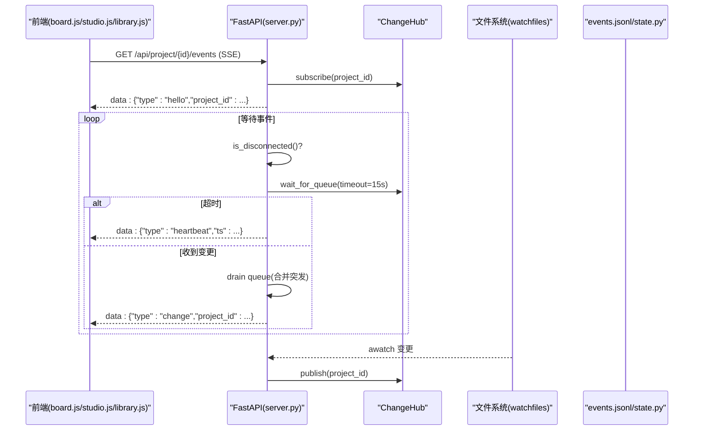
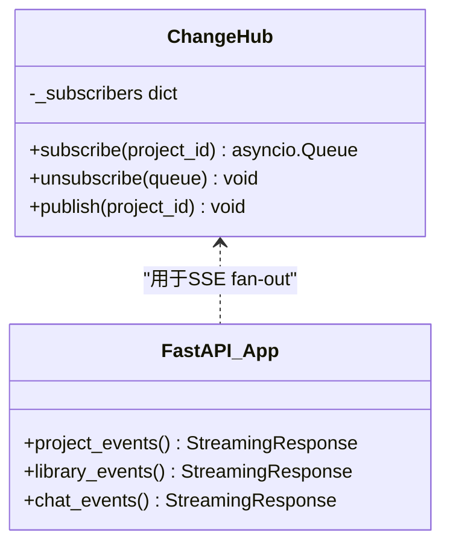
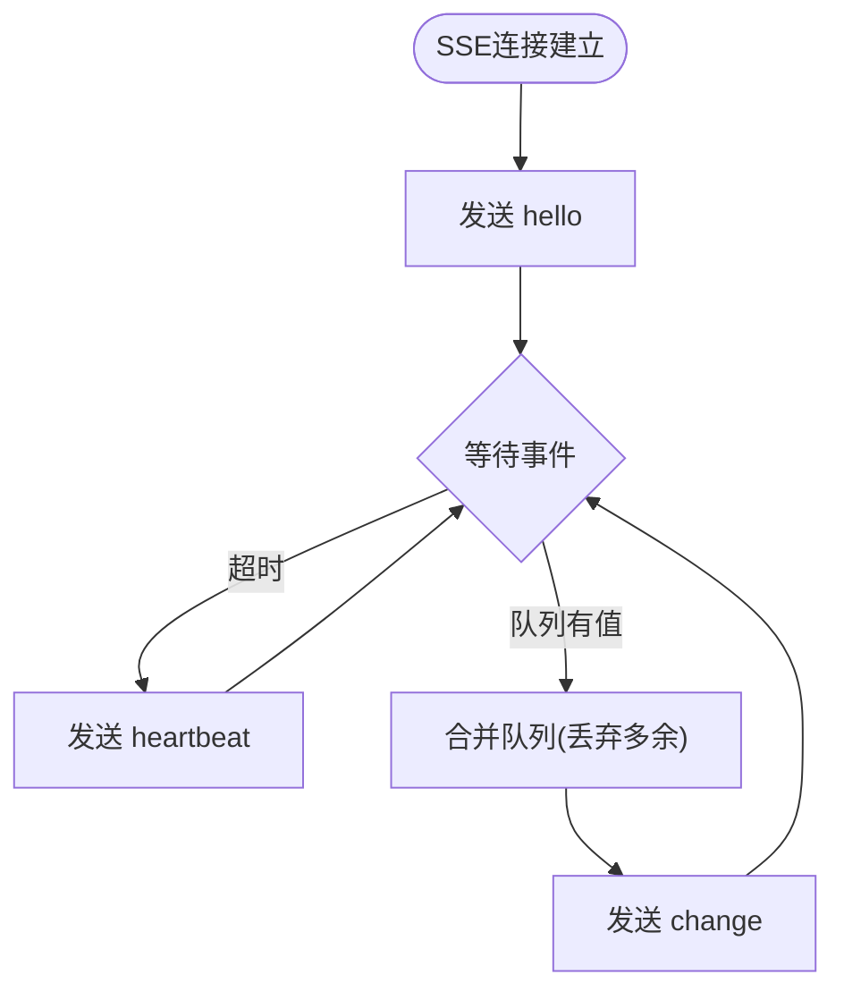
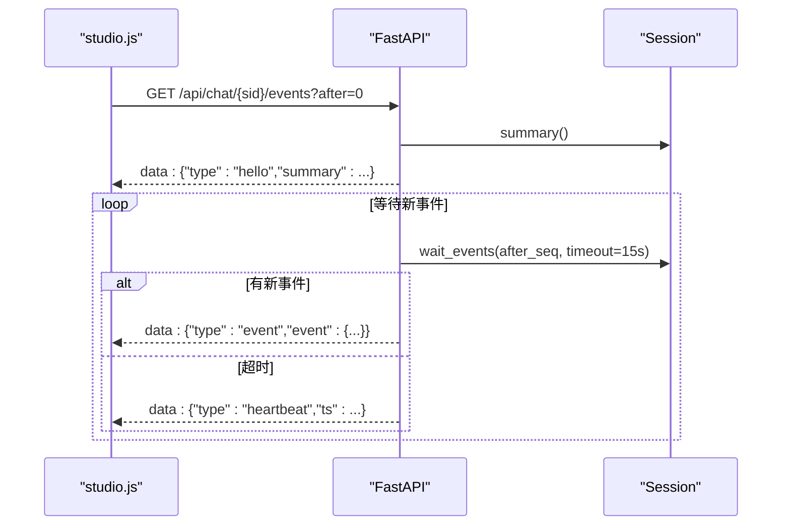
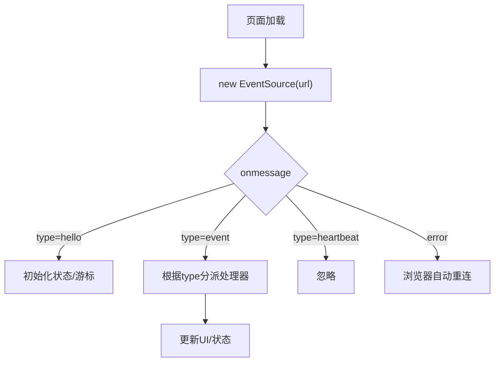
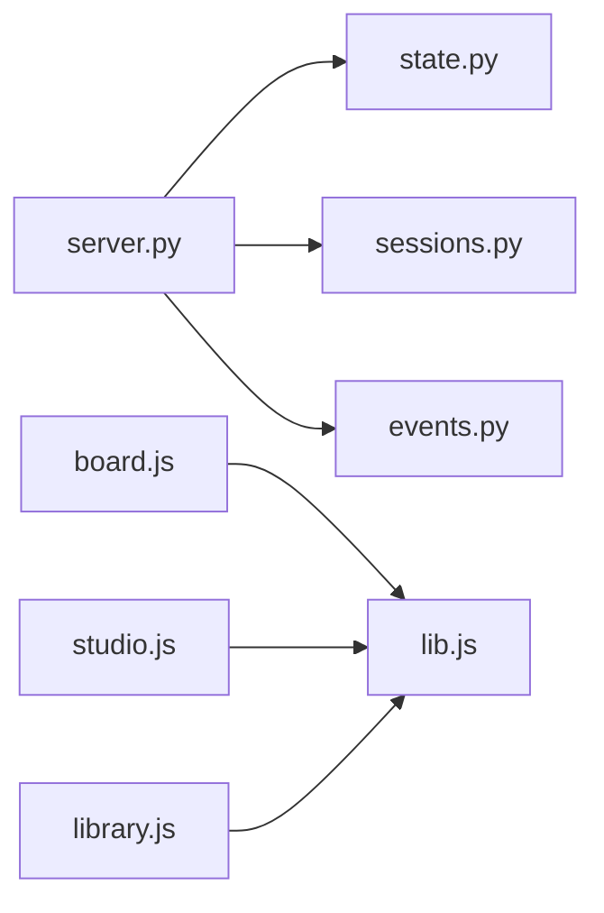

# 实时通信系统

<cite>
**本文引用的文件**   
- [server.py](file://backlot/server.py)
- [events.py](file://lib/events.py)
- [state.py](file://backlot/state.py)
- [sessions.py](file://backlot/agent/sessions.py)
- [board.js](file://backlot/ui/board.js)
- [studio.js](file://backlot/ui/studio.js)
- [library.js](file://backlot/ui/library.js)
- [lib.js](file://backlot/ui/lib.js)
</cite>

## 目录
1. [简介](#简介)
2. [项目结构](#项目结构)
3. [核心组件](#核心组件)
4. [架构总览](#架构总览)
5. [详细组件分析](#详细组件分析)
6. [依赖关系分析](#依赖关系分析)
7. [性能考量](#性能考量)
8. [故障排除指南](#故障排除指南)
9. [结论](#结论)
10. [附录：事件类型与消息格式](#附录事件类型与消息格式)

## 简介
本文件面向OpenMontage-MV中的实时通信子系统，重点说明SSE（Server-Sent Events）连接管理、事件监听机制、前端重连策略、事件类型定义、消息格式与数据处理流程。同时覆盖多用户协作时的状态同步机制、冲突解决策略、连接状态监控、错误处理与性能优化，并提供调试工具与故障排除建议。

## 项目结构
后端基于FastAPI提供REST API与SSE流式接口；前端通过浏览器EventSource建立SSE连接，订阅项目变更、库级变更与会话事件。关键路径如下：
- 后端服务与SSE端点：backlot/server.py
- 事件写入与读取（工具调用日志）：lib/events.py
- 项目状态聚合与看板数据：backlot/state.py
- 会话管理与聊天事件流：backlot/agent/sessions.py
- 前端页面与SSE消费：backlot/ui/board.js, studio.js, library.js, lib.js

```mermaid
graph TB
subgraph "前端"
B["board.js"]
S["studio.js"]
L["library.js"]
U["lib.js"]
end
subgraph "后端"
F["FastAPI server.py"]
H["ChangeHub 变更分发"]
W["watch_projects 文件监听"]
E["events.jsonl 工具事件"]
ST["state.py 看板状态"]
SESS["sessions.py 会话事件流"]
end
B --> |EventSource /api/project/{id}/events| F
L --> |EventSource /api/library/events| F
S --> |EventSource /api/chat/{sid}/events| F
F --> H
W --> H
H --> |推送 project_id| F
F --> |text/event-stream| B
F --> |text/event-stream| L
F --> |text/event-stream| S
E --> ST
ST --> F
SESS --> F
```

图表来源
- [server.py:151-242](file://backlot/server.py#L151-L242)
- [server.py:132-149](file://backlot/server.py#L132-L149)
- [events.py:77-96](file://lib/events.py#L77-L96)
- [state.py:586-656](file://backlot/state.py#L586-L656)
- [sessions.py:302-325](file://backlot/agent/sessions.py#L302-L325)

章节来源
- [server.py:151-242](file://backlot/server.py#L151-L242)
- [board.js:1227](file://backlot/ui/board.js#L1227)
- [library.js:90](file://backlot/ui/library.js#L90)
- [studio.js:263](file://backlot/ui/studio.js#L263)

## 核心组件
- ChangeHub：按项目过滤的扇出通知中心，将文件系统变更映射为project_id推送给订阅者队列，避免无关项目噪声。
- SSE端点：
  - /api/project/{project_id}/events：项目级变更流，发送hello、heartbeat、change三类事件。
  - /api/library/events：全局库级变更流，广播所有项目变更。
  - /api/chat/{session_id}/events：会话事件流，支持after游标回放与心跳。
- events.jsonl：追加型工具事件日志，供看板活动面板与“正在生成”状态使用。
- state.py：聚合checkpoint、artifacts、media、events等，输出BoardState供前端渲染。
- sessions.py：会话线程模型，维护事件序列号seq，支持断线重连回放与审批流。

章节来源
- [server.py:43-74](file://backlot/server.py#L43-L74)
- [server.py:185-242](file://backlot/server.py#L185-L242)
- [events.py:77-96](file://lib/events.py#L77-L96)
- [state.py:586-656](file://backlot/state.py#L586-L656)
- [sessions.py:136-149](file://backlot/agent/sessions.py#L136-L149)

## 架构总览
SSE连接生命周期：
- 前端创建EventSource连接服务端SSE端点。
- 服务端返回hello事件并进入循环等待队列或会话事件。
- 无事件时按心跳间隔发送heartbeat保持连接活跃。
- 有变更时合并队列中多余项，仅发送一次change事件，前端去抖后刷新状态。
- 连接断开由浏览器自动重连，前端通过lastSeq或after参数实现幂等回放。



图表来源
- [server.py:185-242](file://backlot/server.py#L185-L242)
- [server.py:132-149](file://backlot/server.py#L132-L149)

章节来源
- [server.py:185-242](file://backlot/server.py#L185-L242)

## 详细组件分析

### 后端SSE与变更分发（ChangeHub）
- 订阅与取消：每个SSE连接持有独立asyncio.Queue，支持按project_id过滤。
- 发布与合并：watch_files触发变更→_invalidate_summary→hub.publish(project_id)。消费者侧在收到事件后drain队列，确保突发合并为单次change。
- 心跳：SSE_HEARTBEAT_SECONDS=15秒，防止代理/浏览器超时。



图表来源
- [server.py:43-74](file://backlot/server.py#L43-L74)
- [server.py:185-242](file://backlot/server.py#L185-L242)

章节来源
- [server.py:43-74](file://backlot/server.py#L43-L74)
- [server.py:185-242](file://backlot/server.py#L185-L242)

### 项目事件流（/api/project/{project_id}/events）
- hello：携带project_id，确认订阅成功。
- heartbeat：周期性时间戳，维持连接活性。
- change：包含project_id，前端据此拉取最新BoardState。



图表来源
- [server.py:185-214](file://backlot/server.py#L185-L214)

章节来源
- [server.py:185-214](file://backlot/server.py#L185-L214)

### 库级事件流（/api/library/events）
- 广播所有项目变更，适用于首页项目列表实时更新。
- 同样遵循hello/heartbeat/change模式。

章节来源
- [server.py:216-242](file://backlot/server.py#L216-L242)

### 会话事件流（/api/chat/{session_id}/events）
- after游标：从指定seq之后回放历史，避免重复。
- hello：携带会话summary（含status、todos、project_id）。
- event：封装具体事件（user/assistant/tool_call/tool_result/todos/approval_request/project/state/turn_done/error）。
- heartbeat：保持连接。



图表来源
- [server.py:302-325](file://backlot/server.py#L302-L325)
- [sessions.py:136-149](file://backlot/agent/sessions.py#L136-L149)

章节来源
- [server.py:302-325](file://backlot/server.py#L302-L325)
- [sessions.py:136-149](file://backlot/agent/sessions.py#L136-L149)

### 前端SSE消费与重连
- board.js：使用lib.js的subscribe封装EventSource，对change事件进行250ms去抖，再调用refresh刷新BoardState。
- studio.js：直接new EventSource，解析hello与event，维护lastSeq去重，自动重连由浏览器处理。
- library.js：订阅库级事件，刷新项目网格。



图表来源
- [lib.js:66-81](file://backlot/ui/lib.js#L66-L81)
- [studio.js:263-279](file://backlot/ui/studio.js#L263-L279)
- [board.js:1227](file://backlot/ui/board.js#L1227)

章节来源
- [lib.js:66-81](file://backlot/ui/lib.js#L66-L81)
- [studio.js:263-279](file://backlot/ui/studio.js#L263-L279)
- [board.js:1227](file://backlot/ui/board.js#L1227)

### 事件写入与读取（events.jsonl）
- emit_event：追加写入events.jsonl，线程安全锁保证单进程并发安全；跨进程未同步，但容忍损坏行。
- read_events：读取最近N条事件，容错JSON解析失败。
- 用途：看板活动面板、场景“正在生成”状态推断。

章节来源
- [events.py:77-96](file://lib/events.py#L77-L96)
- [events.py:98-119](file://lib/events.py#L98-L119)

### 状态聚合与看板数据（BoardState）
- load_board_state：聚合pipeline元数据、checkpoints、history、artifacts、events、media，计算stages、cost、live、poster等。
- summarize_project：轻量摘要，用于项目卡片与排序。
- 停滞检测：in_progress阶段超过STALL_WINDOW_SECONDS无活动则标记stalled。

章节来源
- [state.py:586-656](file://backlot/state.py#L586-L656)
- [state.py:659-682](file://backlot/state.py#L659-L682)

## 依赖关系分析
- server.py依赖：
  - watchfiles（可选）用于文件系统监听，不可用时降级为手动刷新。
  - session_manager（sessions.py）用于聊天会话。
  - state.py用于项目状态与摘要。
- 前端依赖：
  - lib.js通用工具（getJSON、subscribe、媒体URL等）。
  - board.js、studio.js、library.js分别消费不同SSE端点。



图表来源
- [server.py:151-242](file://backlot/server.py#L151-L242)
- [lib.js:1-104](file://backlot/ui/lib.js#L1-L104)

章节来源
- [server.py:151-242](file://backlot/server.py#L151-L242)
- [lib.js:1-104](file://backlot/ui/lib.js#L1-L104)

## 性能考量
- 变更合并：SSE消费者侧drain队列，避免突发写放大导致频繁刷新。
- 心跳间隔：15秒平衡了连接存活与带宽开销。
- 缓存策略：
  - UI资源no-cache强制条件请求（ETag），媒体/thumb正常缓存。
  - _cached_summaries缓存项目摘要，变更时失效。
- I/O优化：
  - events.jsonl采用O_APPEND追加，容忍损坏行。
  - 缩略图缓存到磁盘，视频帧抽取使用ffmpeg，失败回退原图。
- 前端去抖：250ms节流刷新，降低渲染压力。

章节来源
- [server.py:211-242](file://backlot/server.py#L211-L242)
- [server.py:390-406](file://backlot/server.py#L390-L406)
- [lib.js:66-81](file://backlot/ui/lib.js#L66-L81)
- [events.py:77-96](file://lib/events.py#L77-L96)

## 故障排除指南
- 连接断开与重连：
  - 浏览器EventSource自动重连；studio.js通过lastSeq去重，board.js通过subscribe内部timer去抖。
  - 若长时间无响应，检查心跳是否到达；确认代理未缓冲SSE。
- 事件丢失：
  - chat_events使用after游标回放；若仍缺失，检查服务器重启后会话状态（sessions.py会注入error提示）。
  - events.jsonl可能因并发写入出现损坏行，read_events已跳过异常行。
- 项目不更新：
  - 确认watchfiles可用且PROJECTS_DIR存在；否则降级为手动刷新。
  - 检查_change_of_change过滤逻辑是否误判（忽略node_modules/.git等）。
- 媒体无法显示：
  - 缩略图生成失败时，视频返回404（无海报帧），图片回退原始文件。
  - 检查thumb缓存目录权限与ffmpeg可用性。
- 性能问题：
  - 增大SSE_HEARTBEAT_SECONDS或前端去抖时间；减少不必要的refresh。
  - 关注_summary_cache失效频率，避免频繁全量扫描。

章节来源
- [server.py:132-149](file://backlot/server.py#L132-L149)
- [server.py:328-348](file://backlot/server.py#L328-L348)
- [sessions.py:94-106](file://backlot/agent/sessions.py#L94-L106)
- [events.py:98-119](file://lib/events.py#L98-L119)

## 结论
本实时通信系统以SSE为核心，结合文件系统监听与会话事件流，实现了项目状态、库级动态与聊天交互的实时同步。通过ChangeHub扇出、心跳保活、事件合并与游标回放，系统在可靠性与性能之间取得良好平衡。前端采用统一subscribe封装与去抖策略，简化了连接管理与渲染节奏。整体设计具备可扩展性，便于后续增加更多事件类型与协作能力。

## 附录：事件类型与消息格式
- SSE通用事件类型：
  - hello：连接建立，携带上下文（project_id/session_id/summary）。
  - heartbeat：心跳，包含时间戳。
  - change：变更通知，包含project_id。
  - event：会话事件，封装具体业务事件。
- 会话事件类型（studio.js处理）：
  - user、assistant、status、tool_call、tool_result、todos、approval_request、project、state、turn_done、error。
- BoardState关键字段：
  - project_id、title、pipeline、stages、artifacts、storyboard、media、events、cost、last_activity、live、poster。
- events.jsonl事件字段：
  - ts、event（start/finish/error）、tool、scene_id、duration_s、cost_usd等。

章节来源
- [server.py:185-242](file://backlot/server.py#L185-L242)
- [studio.js:189-208](file://backlot/ui/studio.js#L189-L208)
- [state.py:586-656](file://backlot/state.py#L586-L656)
- [events.py:77-96](file://lib/events.py#L77-L96)