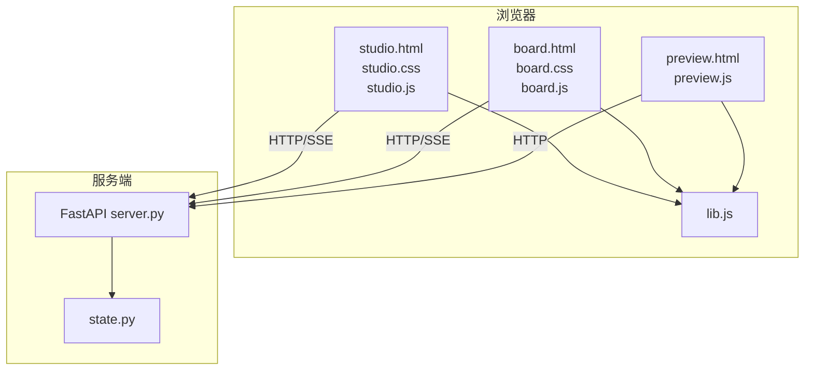
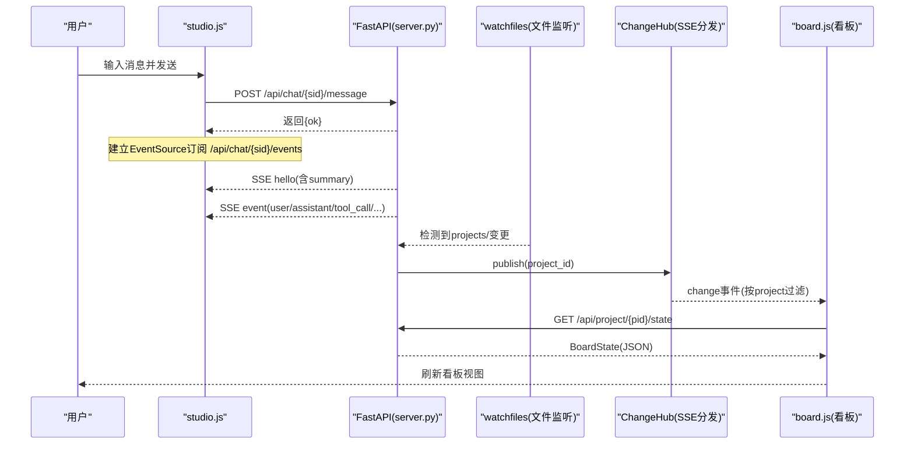
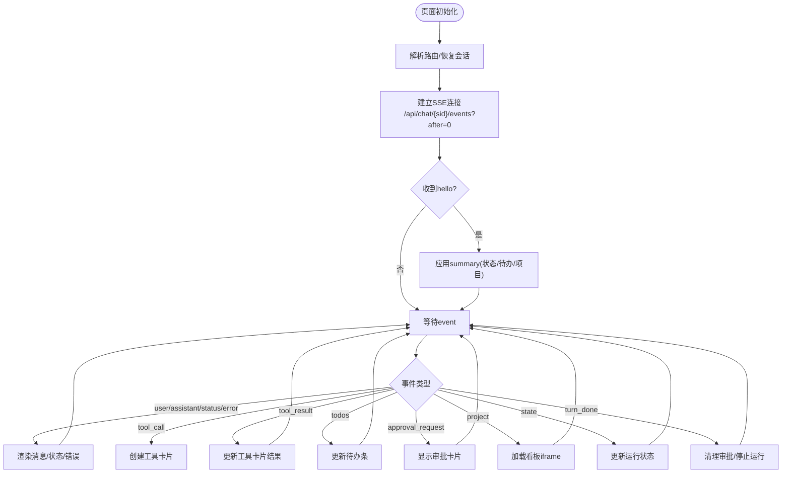
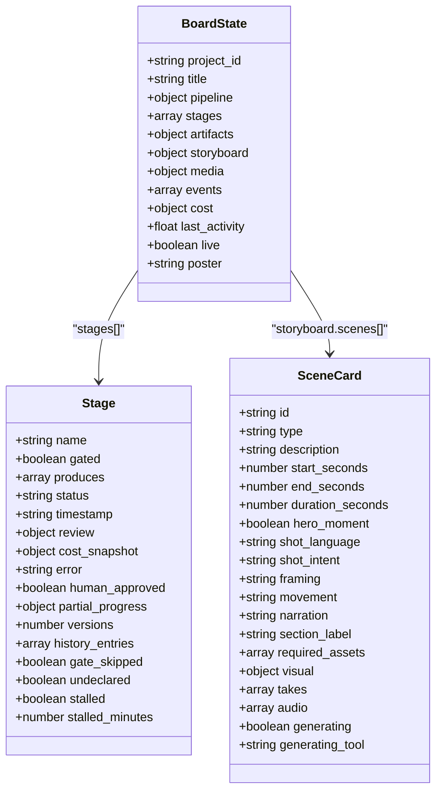
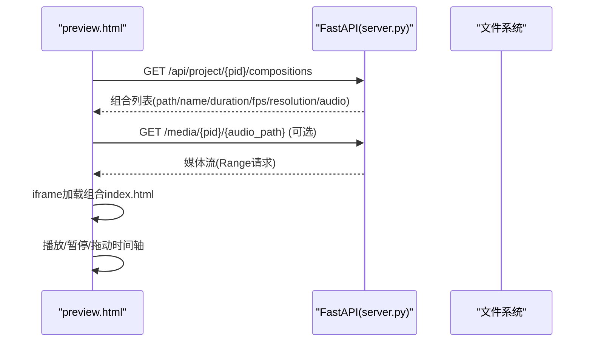
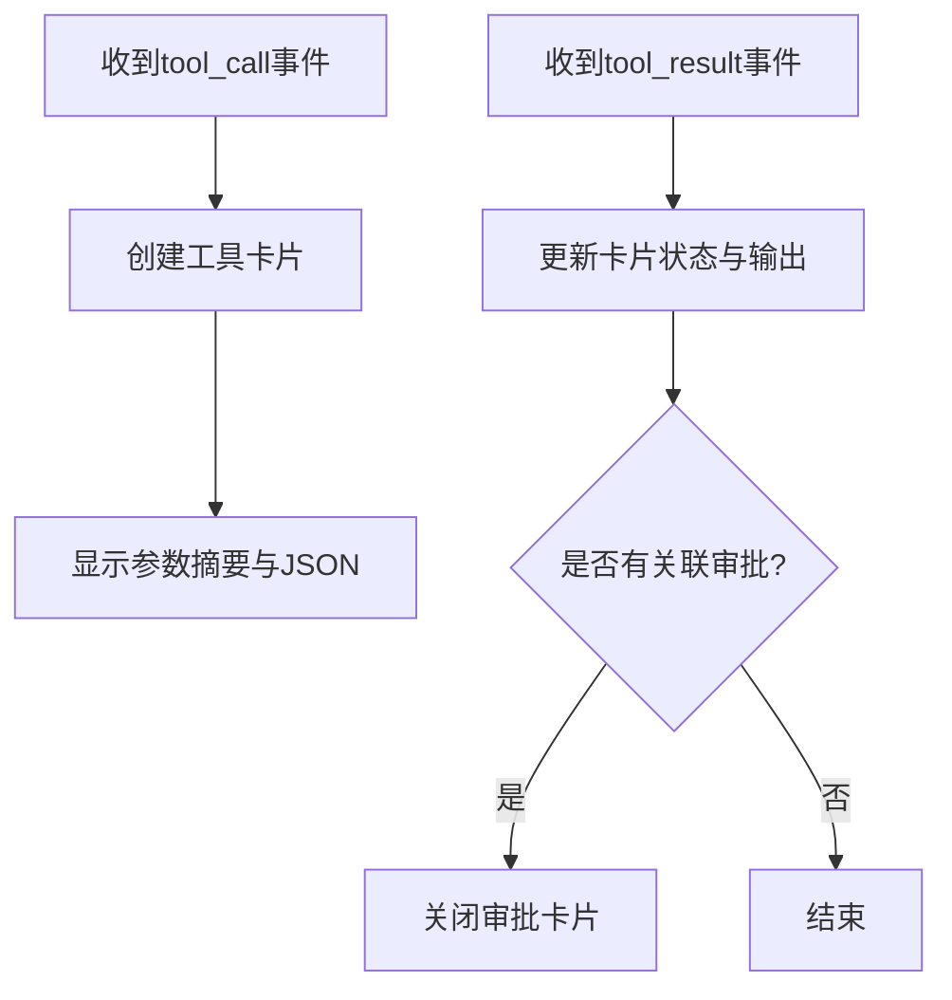
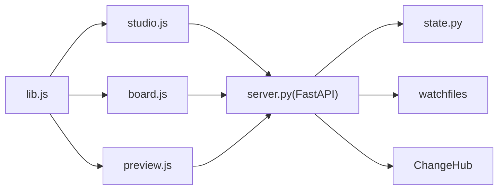

# 工作室界面

<cite>
**本文引用的文件**   
- [studio.html](file://backlot/ui/studio.html)
- [studio.css](file://backlot/ui/studio.css)
- [studio.js](file://backlot/ui/studio.js)
- [board.html](file://backlot/ui/board.html)
- [preview.html](file://backlot/ui/preview.html)
- [lib.js](file://backlot/ui/lib.js)
- [server.py](file://backlot/server.py)
- [state.py](file://backlot/state.py)
</cite>

## 目录
1. [简介](#简介)
2. [项目结构](#项目结构)
3. [核心组件](#核心组件)
4. [架构总览](#架构总览)
5. [详细组件分析](#详细组件分析)
6. [依赖关系分析](#依赖关系分析)
7. [性能考虑](#性能考虑)
8. [故障排查指南](#故障排查指南)
9. [结论](#结论)
10. [附录](#附录)

## 简介
本文件面向“工作室”界面的前端与后端实现，系统性说明页面HTML结构与CSS样式设计、核心功能（分镜编辑器、资产管理器、时间线编辑器、实时预览面板）以及JavaScript交互逻辑（事件驱动、SSE实时通信、工具卡片、审批流、会话管理）。同时给出与后端的实时通信和数据同步机制、复杂交互场景处理策略与性能优化建议。

## 项目结构
工作室界面由三个主要前端页面组成：
- 工作室主界面（聊天工作台 + 项目看板嵌入）：studio.html + studio.css + studio.js
- 项目看板（分镜/资产/媒体等可视化编辑与浏览）：board.html + board.css + board.js
- 预览页（组合播放与时间轴控制）：preview.html + preview.js

后端服务提供：
- FastAPI应用与路由：server.py
- 项目状态推导与数据聚合：state.py
- 共享JS工具函数：lib.js

**图表来源** 
- [studio.html:1-83](file://backlot/ui/studio.html#L1-L83)
- [board.html:1-16](file://backlot/ui/board.html#L1-L16)
- [preview.html:1-76](file://backlot/ui/preview.html#L1-L76)
- [lib.js:1-104](file://backlot/ui/lib.js#L1-L104)
- [server.py:164-406](file://backlot/server.py#L164-L406)
- [state.py:586-656](file://backlot/state.py#L586-L656)

**章节来源**
- [studio.html:1-83](file://backlot/ui/studio.html#L1-L83)
- [board.html:1-16](file://backlot/ui/board.html#L1-L16)
- [preview.html:1-76](file://backlot/ui/preview.html#L1-L76)
- [lib.js:1-104](file://backlot/ui/lib.js#L1-L104)
- [server.py:164-406](file://backlot/server.py#L164-L406)
- [state.py:586-656](file://backlot/state.py#L586-L656)

## 核心组件
- 会话侧栏与会话管理：创建、切换、删除、右键菜单、确认模式开关
- 聊天工作区：消息渲染、工具调用卡片、审批卡片、待办清单、状态徽章
- 项目看板面板：iframe内嵌看板，自动加载项目，支持打开新窗口与预览链接
- 实时通信：基于SSE的事件流，心跳保活，去重与断线重连
- 资源与媒体：缩略图缓存、媒体URL生成、组合发现与预览

**章节来源**
- [studio.js:13-22](file://backlot/ui/studio.js#L13-L22)
- [studio.js:241-279](file://backlot/ui/studio.js#L241-L279)
- [studio.js:355-382](file://backlot/ui/studio.js#L355-L382)
- [server.py:244-326](file://backlot/server.py#L244-L326)
- [server.py:327-362](file://backlot/server.py#L327-L362)

## 架构总览
工作室采用“聊天驱动+看板嵌入”的架构：用户通过聊天指令驱动Agent执行任务，Agent在后台修改项目文件；服务端通过文件系统监听变化并通过SSE推送给前端，前端根据事件类型更新UI（消息、工具卡片、审批、项目看板等）。

**图表来源** 
- [studio.js:263-279](file://backlot/ui/studio.js#L263-L279)
- [server.py:185-242](file://backlot/server.py#L185-L242)
- [server.py:302-326](file://backlot/server.py#L302-L326)
- [server.py:132-149](file://backlot/server.py#L132-L149)
- [server.py:43-74](file://backlot/server.py#L43-L74)

## 详细组件分析

### 工作室主界面（Chat Workbench）
- HTML结构
  - 三栏布局：会话侧栏、聊天列、看板面板
  - 聊天列包含欢迎信息、消息容器、待办条、输入框与发送/中断按钮
  - 看板面板包含项目选择下拉、预览/打开链接、iframe与空态提示
- CSS样式
  - Grid布局定义三栏宽度，响应式窄屏隐藏看板
  - 深色主题变量体系，统一字体缩放、滚动条、动画入场
  - 工具卡片、审批卡片、状态徽章、按钮样式规范
- JavaScript逻辑
  - 事件驱动渲染：user/assistant/status/error/tool_call/tool_result/todos/approval_request/project/state/turn_done
  - SSE连接：EventSource订阅，心跳保活，序列号去重
  - 会话管理：创建、切换、删除、右键菜单、确认模式
  - 看板联动：自动加载项目、刷新预览链接、项目列表轮询

**图表来源** 
- [studio.js:189-208](file://backlot/ui/studio.js#L189-L208)
- [studio.js:263-279](file://backlot/ui/studio.js#L263-L279)
- [studio.js:355-382](file://backlot/ui/studio.js#L355-L382)

**章节来源**
- [studio.html:11-77](file://backlot/ui/studio.html#L11-L77)
- [studio.css:6-253](file://backlot/ui/studio.css#L6-L253)
- [studio.js:1-440](file://backlot/ui/studio.js#L1-L440)

### 项目看板（分镜编辑器/资产管理器/时间线编辑器）
- HTML结构
  - 极简入口：app根节点、模态背景、音频播放器
- CSS样式
  - 设计系统：颜色变量、字体、暗/亮主题、胶片颗粒纹理、入场动画
  - 头部信息条、阶段轨道、脚本卡片、媒体网格、成本进度条
- JavaScript逻辑
  - 读取BoardState，规范化数据结构，渲染阶段轨道、分镜卡片、资产与媒体
  - 支持回放模式、主题切换、SSE增量刷新
  - 与后端API交互：获取项目状态、组合列表、媒体URL与缩略图

**图表来源** 
- [state.py:586-656](file://backlot/state.py#L586-L656)
- [state.py:143-222](file://backlot/state.py#L143-L222)
- [state.py:401-493](file://backlot/state.py#L401-L493)

**章节来源**
- [board.html:1-16](file://backlot/ui/board.html#L1-L16)
- [board.css:1-200](file://backlot/ui/board.css#L1-L200)
- [board.js:1-200](file://backlot/ui/board.js#L1-L200)
- [board.js:1171-1217](file://backlot/ui/board.js#L1171-L1217)
- [state.py:586-656](file://backlot/state.py#L586-L656)

### 实时预览面板
- HTML结构
  - 顶部导航（返回、标题、组合选择）、播放区域（iframe承载组合）、底部控制（播放、时间标签、拖拽滑块）
- CSS样式
  - 全屏布局、暗色背景、控件样式、响应式适配
- JavaScript逻辑
  - 加载组合列表，选择并加载iframe，播放控制与时间同步

**图表来源** 
- [preview.html:1-76](file://backlot/ui/preview.html#L1-L76)
- [server.py:179-184](file://backlot/server.py#L179-L184)
- [server.py:351-362](file://backlot/server.py#L351-L362)

**章节来源**
- [preview.html:1-76](file://backlot/ui/preview.html#L1-L76)
- [server.py:179-184](file://backlot/server.py#L179-L184)
- [server.py:351-362](file://backlot/server.py#L351-L362)

### 工具调用与审批流
- 工具调用卡片：展示工具名称、参数摘要、原始输入JSON
- 工具结果：标记完成/拒绝，输出内容，关联审批卡片关闭
- 审批卡片：显示工具参数，支持批准/拒绝，提交到后端接口

**图表来源** 
- [studio.js:99-122](file://backlot/ui/studio.js#L99-L122)
- [studio.js:138-174](file://backlot/ui/studio.js#L138-L174)

**章节来源**
- [studio.js:99-122](file://backlot/ui/studio.js#L99-L122)
- [studio.js:138-174](file://backlot/ui/studio.js#L138-L174)

## 依赖关系分析
- 前端依赖
  - studio.js依赖lib.js提供的通用工具（getJSON、el、fmtAgo、mediaURL、thumbURL、subscribe等）
  - board.js同样依赖lib.js进行数据获取与格式化
  - preview.js依赖lib.js进行媒体URL与事件订阅
- 后端依赖
  - server.py依赖state.py进行项目状态推导与汇总
  - server.py使用watchfiles监听项目目录变更，通过ChangeHub广播SSE事件
  - 静态资源挂载与中间件用于无缓存策略，确保UI即时更新

**图表来源** 
- [lib.js:1-104](file://backlot/ui/lib.js#L1-L104)
- [server.py:132-149](file://backlot/server.py#L132-L149)
- [server.py:43-74](file://backlot/server.py#L43-L74)

**章节来源**
- [lib.js:1-104](file://backlot/ui/lib.js#L1-L104)
- [server.py:132-149](file://backlot/server.py#L132-L149)
- [server.py:43-74](file://backlot/server.py#L43-L74)

## 性能考虑
- SSE心跳与去抖
  - 服务端每15秒发送心跳，避免连接超时
  - 客户端对change事件进行去抖（250ms），减少频繁刷新
- 缩略图缓存
  - 图片与视频帧生成JPEG缩略图，按哈希键缓存，避免重复计算
  - 并发请求使用临时文件名，避免竞态写入
- 项目状态缓存
  - 库摘要缓存于内存，变更时失效，降低全量解析开销
- UI无缓存策略
  - 对UI相关路径强制no-cache，保证修复即时生效
- 响应式与最小化DOM操作
  - 仅更新必要节点，避免大规模重排重绘

[本节为通用指导，不直接分析具体文件]

## 故障排查指南
- 连接问题
  - 检查SSE连接是否建立，查看控制台错误与网络请求
  - 确认服务器健康端点可访问
- 会话问题
  - 会话不存在或忙碌时，后端返回404/409，需重试或等待
  - 删除会话时需确认，避免误删历史
- 审批失败
  - 审批接口返回409表示无待审批项，检查事件顺序与状态
- 媒体不可用
  - 缩略图生成失败时，视频将返回404，检查ffmpeg可用性与路径权限
- 看板不刷新
  - 检查watchfiles是否安装，若无则需手动刷新
  - 确认SSE订阅未断开，必要时重建连接

**章节来源**
- [server.py:246-301](file://backlot/server.py#L246-L301)
- [server.py:327-362](file://backlot/server.py#L327-L362)
- [server.py:460-501](file://backlot/server.py#L460-L501)

## 结论
工作室界面以聊天驱动为核心，结合看板与预览能力，形成完整的创作工作流。前端通过SSE实现实时同步，后端通过文件系统监听与缓存机制保障性能。整体架构清晰、扩展性强，适合持续迭代与功能增强。

[本节为总结性内容，不直接分析具体文件]

## 附录
- 快捷键与交互
  - Enter发送消息，Shift+Enter换行
  - 右键会话项弹出删除菜单
  - 主题切换按钮支持暗/亮模式
- 关键API路径
  - /api/chat/sessions：会话列表/创建
  - /api/chat/{session_id}/events：事件流
  - /api/project/{project_id}/state：项目状态
  - /api/project/{project_id}/compositions：组合列表
  - /media/{project_id}/{path}：媒体流
  - /thumb/{project_id}/{path}：缩略图

**章节来源**
- [studio.js:402-440](file://backlot/ui/studio.js#L402-L440)
- [server.py:164-406](file://backlot/server.py#L164-L406)