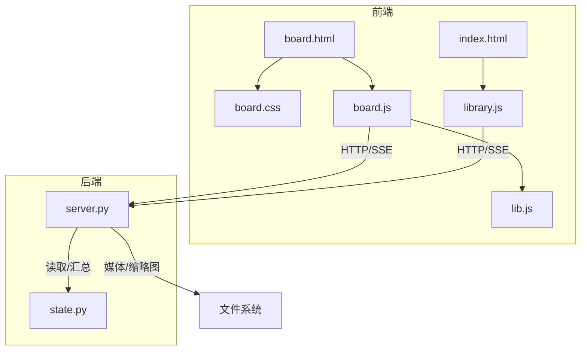
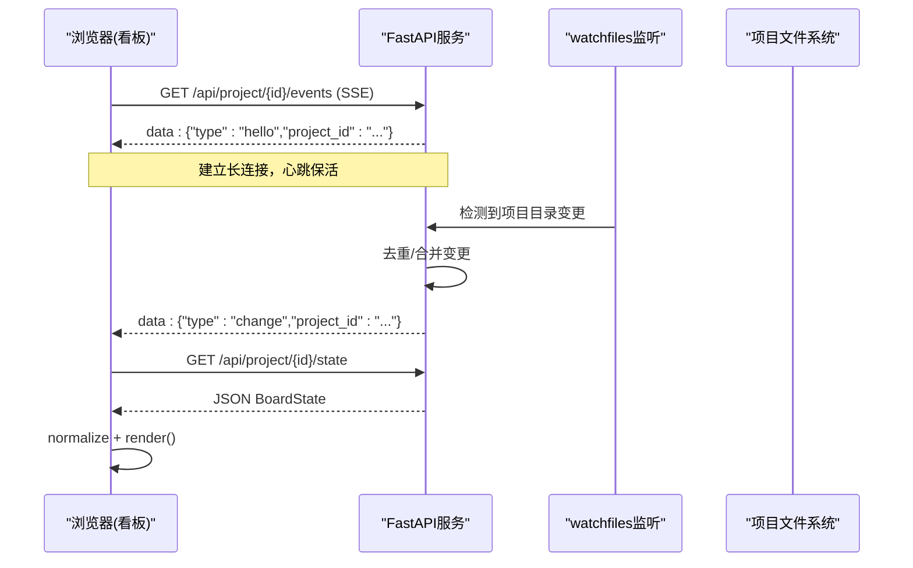
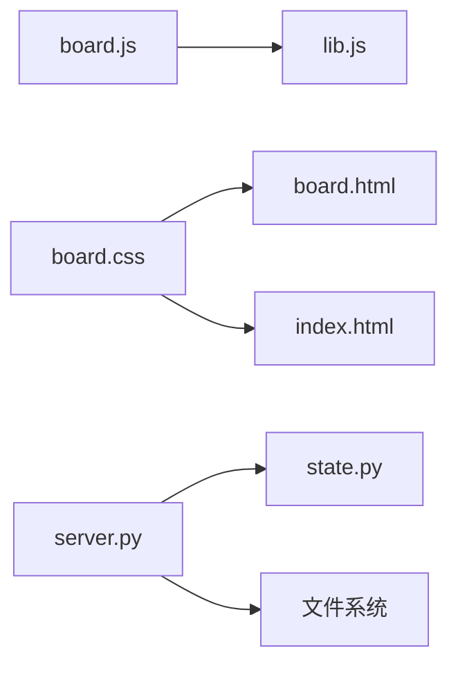
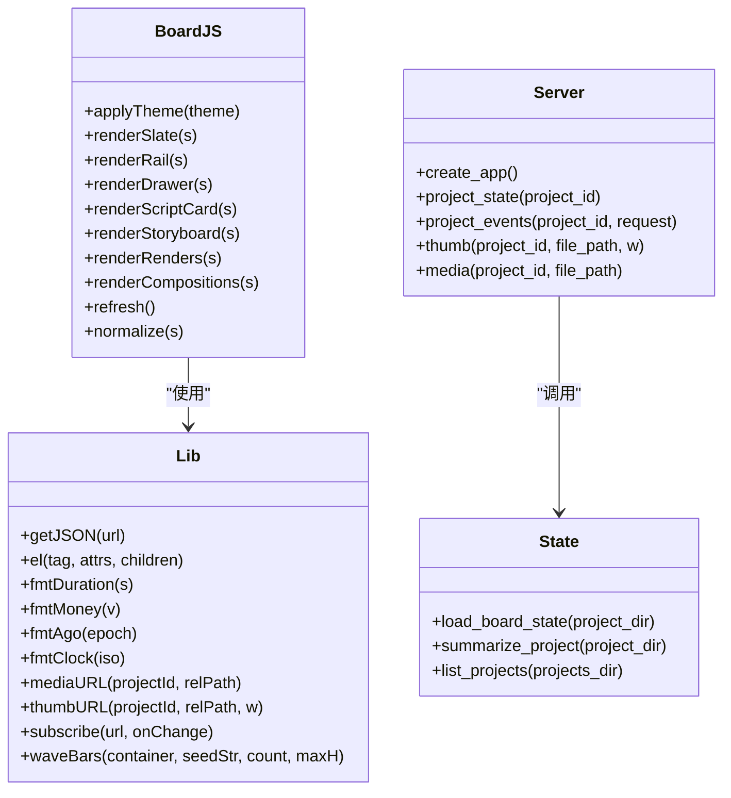
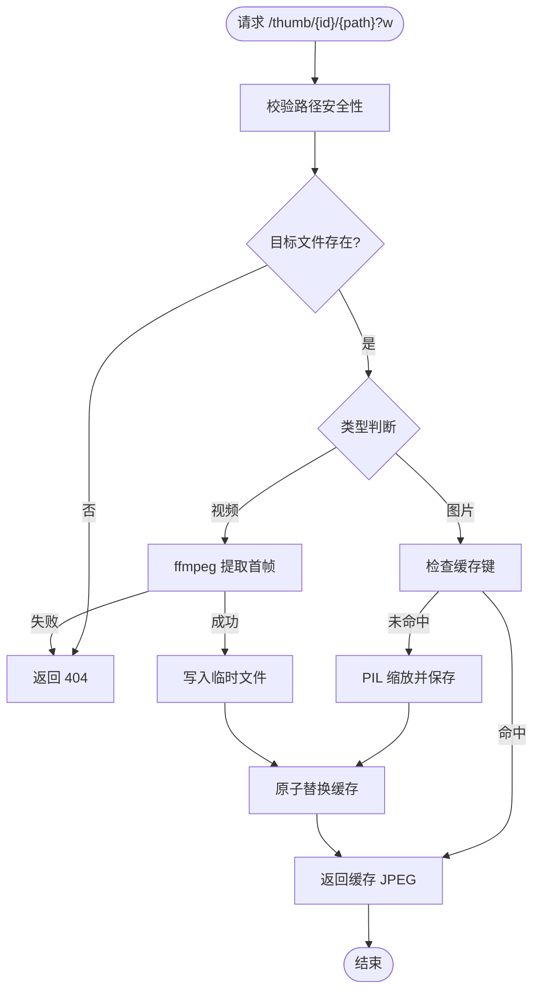

# 项目看板界面

<cite>
**本文引用的文件**   
- [board.html](file://backlot/ui/board.html)
- [board.css](file://backlot/ui/board.css)
- [board.js](file://backlot/ui/board.js)
- [lib.js](file://backlot/ui/lib.js)
- [server.py](file://backlot/server.py)
- [state.py](file://backlot/state.py)
- [index.html](file://backlot/ui/index.html)
- [library.js](file://backlot/ui/library.js)
</cite>

## 目录
1. [简介](#简介)
2. [项目结构](#项目结构)
3. [核心组件](#核心组件)
4. [架构总览](#架构总览)
5. [详细组件分析](#详细组件分析)
6. [依赖关系分析](#依赖关系分析)
7. [性能考量](#性能考量)
8. [故障排查指南](#故障排查指南)
9. [结论](#结论)
10. [附录](#附录)

## 简介
本文件面向“项目看板”（Backlot Board）的前端与后端实现，系统性说明看板页面的HTML结构与CSS样式设计、核心功能（项目列表展示、状态筛选、搜索与批量操作）、JavaScript数据绑定与事件处理、媒体缩略图生成与预览、响应式布局与移动端适配、用户交互流程与错误处理机制。文档同时给出架构图、时序图与流程图，帮助读者快速理解从浏览器到服务端再到文件系统的全链路行为。

## 项目结构
看板相关代码位于 backlot/ui 目录下，包含页面模板、样式与脚本；服务端由 FastAPI 提供 API、SSE 事件流与静态资源服务；状态推导逻辑集中在 state.py。

图表来源
- [board.html:1-16](file://backlot/ui/board.html#L1-L16)
- [board.css:1-120](file://backlot/ui/board.css#L1-L120)
- [board.js:1-60](file://backlot/ui/board.js#L1-L60)
- [lib.js:1-30](file://backlot/ui/lib.js#L1-L30)
- [server.py:150-210](file://backlot/server.py#L150-L210)
- [state.py:586-656](file://backlot/state.py#L586-L656)

章节来源
- [board.html:1-16](file://backlot/ui/board.html#L1-L16)
- [board.css:1-120](file://backlot/ui/board.css#L1-L120)
- [board.js:1-60](file://backlot/ui/board.js#L1-L60)
- [lib.js:1-30](file://backlot/ui/lib.js#L1-L30)
- [server.py:150-210](file://backlot/server.py#L150-L210)
- [state.py:586-656](file://backlot/state.py#L586-L656)

## 核心组件
- 页面入口与容器：board.html 定义最小化骨架，挂载 #app、模态层 #modal 与全局 <audio id="player">。
- 样式系统：board.css 采用 CSS 变量主题（暗/亮），网格布局、胶片条、卡片、时间轴等组件样式统一。
- 看板逻辑：board.js 负责渲染看板状态、事件订阅、模态框、回放、媒体播放与缩略图切换。
- 通用工具：lib.js 提供 DOM 构建、格式化、媒体URL构造、SSE订阅与波形绘制。
- 服务端：server.py 暴露 REST API、SSE 事件流、缩略图与媒体接口，并维护变更通知中心。
- 状态推导：state.py 将项目目录下的 checkpoint/artifacts/events 等文件聚合为可渲染的 BoardState。

章节来源
- [board.html:1-16](file://backlot/ui/board.html#L1-L16)
- [board.css:1-120](file://backlot/ui/board.css#L1-L120)
- [board.js:1-60](file://backlot/ui/board.js#L1-L60)
- [lib.js:1-30](file://backlot/ui/lib.js#L1-L30)
- [server.py:150-210](file://backlot/server.py#L150-L210)
- [state.py:586-656](file://backlot/state.py#L586-L656)

## 架构总览
看板采用前后端分离+实时推送的架构：浏览器通过 SSE 订阅项目变更，收到 change 事件后拉取最新状态并重绘。服务端基于 watchfiles 监听项目目录变化，去重后广播给订阅者。缩略图与媒体通过专用接口提供，支持缓存与范围请求。

图表来源
- [server.py:186-214](file://backlot/server.py#L186-L214)
- [server.py:132-149](file://backlot/server.py#L132-L149)
- [board.js:1210-1229](file://backlot/ui/board.js#L1210-L1229)
- [lib.js:66-81](file://backlot/ui/lib.js#L66-L81)

章节来源
- [server.py:132-149](file://backlot/server.py#L132-L149)
- [server.py:186-214](file://backlot/server.py#L186-L214)
- [board.js:1210-1229](file://backlot/ui/board.js#L1210-L1229)
- [lib.js:66-81](file://backlot/ui/lib.js#L66-L81)

## 详细组件分析

### HTML 结构与语义
- board.html 仅保留必要元素：根容器 #app、模态背景 #modal、全局播放器 <audio id="player">，并通过模块脚本引入 board.js。
- index.html 为库页面入口，使用共享样式 board.css，并由 library.js 驱动项目卡片网格。

章节来源
- [board.html:1-16](file://backlot/ui/board.html#L1-L16)
- [index.html:1-28](file://backlot/ui/index.html#L1-L28)

### CSS 样式与主题系统
- 主题变量：通过 :root 与 [data-theme="light"] 两套变量控制颜色、阴影、滚动条、胶片条、卡片等视觉风格。
- 布局：.wrap 限制最大宽度，.board 使用 grid 两栏布局（主列+侧栏），.solo 用于无侧栏的单列模式。
- 动画：rise 入场、shimmer 生成中、pulse 指示灯、travel 能量线等增强体验。
- 媒体与胶片条：.filmstrip 横向滚动，.thumb 固定比例，视频强制覆盖填充避免错位。
- 响应式：通过 CSS 变量字体缩放、弹性布局与 max-width 约束，配合 viewport meta，适配移动端。

章节来源
- [board.css:1-120](file://backlot/ui/board.css#L1-L120)
- [board.css:498-510](file://backlot/ui/board.css#L498-L510)
- [board.css:680-740](file://backlot/ui/board.css#L680-L740)
- [board.css:100-105](file://backlot/ui/board.css#L100-L105)

### JavaScript 数据绑定与渲染
- 初始化：解析 URL 中的 project_id，创建应用实例，加载主题，首次渲染。
- 数据获取：refresh() 并行拉取 state 与 compositions，normalize() 防御性补齐字段，render() 全量重建DOM。
- 事件订阅：subscribe() 封装 EventSource，对 change 事件做节流，触发 refresh()。
- 状态管理：selectedStage、replay、activeRender、compositions 等局部状态驱动 UI 分支。
- 模态框：openScriptModal/openNarrModal/openPreviewModal/closeModal，ESC/点击遮罩关闭。

章节来源
- [board.js:1-22](file://backlot/ui/board.js#L1-L22)
- [board.js:1210-1229](file://backlot/ui/board.js#L1210-L1229)
- [board.js:1184-1208](file://backlot/ui/board.js#L1184-L1208)
- [board.js:530-571](file://backlot/ui/board.js#L530-L571)

### 看板核心功能
- 项目列表展示：library.js 调用 /api/projects，渲染项目卡片网格，显示海报、状态、场景数、渲染数与最近活动时间。
- 状态筛选：rail 阶段条根据 status 着色（done/active/await/failed），支持点击展开抽屉查看阶段产物与审查信息。
- 搜索功能：当前看板未内置搜索输入；可通过浏览器原生查找或扩展 lib.js 增加过滤逻辑。
- 批量操作：当前以只读为主；审批通过 chat approve 接口完成，非前端批量勾选。

章节来源
- [library.js:1-92](file://backlot/ui/library.js#L1-L92)
- [board.js:129-153](file://backlot/ui/board.js#L129-L153)
- [board.js:202-246](file://backlot/ui/board.js#L202-L246)

### 故事板胶片条与缩略图
- 卡片生成：sceneCard() 根据 duration 动态宽度，拼接 slate、thumb、takes、narration、wave。
- 缩略图策略：
  - 图片：thumbURL 走服务端 /thumb 接口，按宽缓存 JPEG。
  - 视频：thumbURL 同样走 /thumb，失败时回退到 spec 占位。
  - 缺失资产：missing 提示，保持可读性。
  - 文本卡：textcard 直接显示文案片段。
- 多版本切换：takes 区域点击切换 hero thumb（本地预览，不写回）。

章节来源
- [board.js:733-882](file://backlot/ui/board.js#L733-L882)
- [lib.js:60-63](file://backlot/ui/lib.js#L60-L63)
- [server.py:329-347](file://backlot/server.py#L329-L347)

### 媒体播放与预览
- 音频：waveBars 生成确定性波形，点击播放 <audio id="player">。
- 视频：thumb video 内联 controls，点击帧开始播放；Renders 区域支持多版本切换与位置记忆。
- 预览：composition 预览通过 iframe 嵌入 /preview/{id}，支持 ESC 关闭。

章节来源
- [board.js:870-882](file://backlot/ui/board.js#L870-L882)
- [board.js:900-935](file://backlot/ui/board.js#L900-L935)
- [board.js:579-592](file://backlot/ui/board.js#L579-L592)

### 审批与审查面板
- 当存在 awaiting_human 阶段时，渲染 approval-review 面板，展示各 artifact 摘要与选择项，引导用户在聊天中批准或修改。

章节来源
- [board.js:477-528](file://backlot/ui/board.js#L477-L528)

### 回放（Replay）
- 基于 stages.history_entries 与 events.ts 计算时间边界，滑动条回放整个运行过程，每 100ms 步进一次，自动暂停在末尾。

章节来源
- [board.js:972-1129](file://backlot/ui/board.js#L972-L1129)

### 右侧面板：决策与活动
- Decisions：聚合 decision_log.json，按类别+主题去重，显示最终选择与备选。
- Activity：events.jsonl 的 start/finish/error 事件，合并并发任务，展示最近 10 条。

章节来源
- [board.js:635-720](file://backlot/ui/board.js#L635-L720)

### 服务端 API 与 SSE
- /api/project/{id}/state：返回 BoardState。
- /api/project/{id}/events：SSE 事件流，心跳保活，变更合并。
- /api/library/events：库级事件流。
- /thumb/{id}/{path}?w=：缩略图接口，缓存 JPEG，视频提取首帧。
- /media/{id}/{path}：媒体直链，支持 Range。

章节来源
- [server.py:174-214](file://backlot/server.py#L174-L214)
- [server.py:329-361](file://backlot/server.py#L329-L361)

### 状态推导（BoardState）
- load_board_state：聚合 marker/meta/checkpoints/history/artifacts/events，构建 stages/storyboard/media/cost/live 等。
- summarize_project：轻量摘要用于库页。
- _build_storyboard：关联 scene_plan × script × asset_manifest，结合 events 标注 generating/visual/audio。

章节来源
- [state.py:586-656](file://backlot/state.py#L586-L656)
- [state.py:401-493](file://backlot/state.py#L401-L493)
- [state.py:659-682](file://backlot/state.py#L659-L682)

## 依赖关系分析
- 前端依赖：board.js 依赖 lib.js 的工具函数；board.css 被 board.html 与 index.html 引用。
- 后端依赖：server.py 依赖 state.py 进行状态推导；watchfiles 可选监听目录变更。
- 运行时依赖：Pillow（图片缩略）、ffmpeg（视频首帧）、EventSource（SSE）。

图表来源
- [board.js:1-6](file://backlot/ui/board.js#L1-L6)
- [board.html:7-14](file://backlot/ui/board.html#L7-L14)
- [index.html:7-25](file://backlot/ui/index.html#L7-L25)
- [server.py:20-22](file://backlot/server.py#L20-L22)

章节来源
- [board.js:1-6](file://backlot/ui/board.js#L1-L6)
- [board.html:7-14](file://backlot/ui/board.html#L7-L14)
- [index.html:7-25](file://backlot/ui/index.html#L7-L25)
- [server.py:20-22](file://backlot/server.py#L20-L22)

## 性能考量
- 缩略图缓存：/thumb 接口按源文件 mtime/size/width 生成唯一键，缓存 JPEG，减少重复转码。
- SSE 心跳与合并：SSE 心跳 15s，变更队列合并，避免频繁刷新。
- 懒加载：缩略图 img loading="lazy"，降低首屏压力。
- 回放节流：回放每 100ms 一帧，避免卡顿。
- 媒体 Range：FileResponse 支持断点续传，提升大文件播放体验。

章节来源
- [server.py:329-347](file://backlot/server.py#L329-L347)
- [server.py:186-214](file://backlot/server.py#L186-L214)
- [board.js:1094-1129](file://backlot/ui/board.js#L1094-L1129)
- [lib.js:60-63](file://backlot/ui/lib.js#L60-L63)

## 故障排查指南
- 项目不存在：refresh() 捕获异常，渲染 “PROJECT NOT FOUND”。
- 缩略图不可用：图片 onerror 回退至 spec 占位；视频无法提取首帧时返回 404。
- SSE 断开：EventSource 自动重连，无需手动处理。
- 状态不完整：normalize() 兜底补齐字段，确保渲染不崩溃。
- 权限与路径安全：_safe_project_dir 校验 project_id，防止路径穿越。

章节来源
- [board.js:1219-1224](file://backlot/ui/board.js#L1219-L1224)
- [board.js:766-779](file://backlot/ui/board.js#L766-L779)
- [server.py:409-417](file://backlot/server.py#L409-L417)
- [server.py:329-347](file://backlot/server.py#L329-L347)
- [board.js:1184-1208](file://backlot/ui/board.js#L1184-L1208)

## 结论
项目看板通过简洁的 HTML/CSS 与健壮的 JS 渲染逻辑，结合后端 SSE 与状态推导，实现了高可用、低延迟的项目可视化与协作审阅。缩略图与媒体播放优化良好，回放与审批流程完善。建议在后续迭代中补充搜索与批量操作能力，进一步提升效率。

## 附录

### 关键类与函数关系（类图）

图表来源
- [lib.js:1-104](file://backlot/ui/lib.js#L1-L104)
- [board.js:1-1229](file://backlot/ui/board.js#L1-L1229)
- [server.py:151-214](file://backlot/server.py#L151-L214)
- [state.py:586-682](file://backlot/state.py#L586-L682)

### 媒体缩略图生成流程（流程图）

图表来源
- [server.py:329-347](file://backlot/server.py#L329-L347)
- [server.py:460-500](file://backlot/server.py#L460-L500)