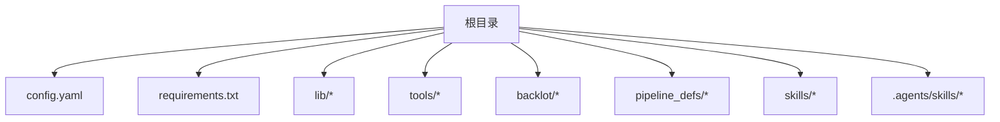
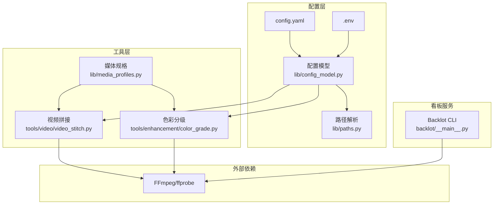
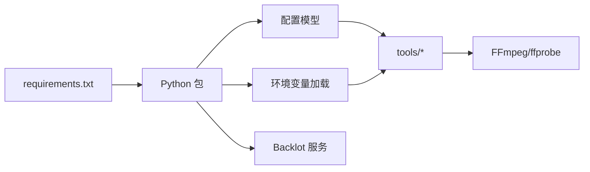

# 安装与配置

<cite>
**本文引用的文件**   
- [config.yaml](file://config.yaml)
- [requirements.txt](file://requirements.txt)
- [lib/config_model.py](file://lib/config_model.py)
- [lib/env_loader.py](file://lib/env_loader.py)
- [lib/paths.py](file://lib/paths.py)
- [backlot/__main__.py](file://backlot/__main__.py)
- [backlot/README.md](file://backlot/README.md)
- [tools/base_tool.py](file://tools/base_tool.py)
- [tools/tool_registry.py](file://tools/tool_registry.py)
- [tools/video/video_stitch.py](file://tools/video/video_stitch.py)
- [tools/enhancement/color_grade.py](file://tools/enhancement/color_grade.py)
- [lib/media_profiles.py](file://lib/media_profiles.py)
- [AGENT_GUIDE.md](file://AGENT_GUIDE.md)
</cite>

## 目录
1. [简介](#简介)
2. [项目结构](#项目结构)
3. [核心组件](#核心组件)
4. [架构总览](#架构总览)
5. [详细组件分析](#详细组件分析)
6. [依赖关系分析](#依赖关系分析)
7. [性能考虑](#性能考虑)
8. [故障排除指南](#故障排除指南)
9. [结论](#结论)
10. [附录](#附录)

## 简介
本文件为 OpenMontage-MV 的安装与配置指南，面向初学者与高级用户。内容涵盖：
- 环境要求（Python、FFmpeg 等）
- 安装步骤与环境变量配置
- config.yaml 配置项详解（检查点策略、输出格式、路径配置等）
- 不同部署场景的配置示例（开发、生产）
- 常见安装问题的排查与解决

## 项目结构
OpenMontage-MV 采用“配置 + 工具 + 流水线”的清晰分层：
- 顶层配置文件：config.yaml（运行时配置）、.env（环境变量）
- Python 依赖：requirements.txt
- 核心库：lib/*（配置模型、路径、检查点、媒体规格等）
- 工具集：tools/*（视频拼接、音频混音、色彩分级等）
- 看板服务：backlot/*（本地可视化看板）
- 流水线定义与技能：pipeline_defs/*、skills/*、.agents/skills/*

**章节来源**
- [config.yaml:1-20](file://config.yaml#L1-L20)
- [requirements.txt:1-12](file://requirements.txt#L1-L12)

## 核心组件
- 配置模型：lib/config_model.py 提供类型化的配置加载与校验，支持从 config.yaml 读取并合并默认值
- 环境变量：lib/env_loader.py 与 tools/base_tool.py、tools/tool_registry.py 共同负责 .env 加载与必需环境变量校验
- 路径管理：lib/paths.py 统一项目根与 projects 目录位置，支持通过环境变量覆盖
- 检查点系统：lib/checkpoint.py 实现阶段状态持久化、归档与校验（不在本节展开）
- 媒体规格：lib/media_profiles.py 生成 FFmpeg 输出参数，配合 tools/* 中的视频处理工具

**章节来源**
- [lib/config_model.py:1-70](file://lib/config_model.py#L1-L70)
- [lib/env_loader.py:1-35](file://lib/env_loader.py#L1-L35)
- [lib/paths.py:1-18](file://lib/paths.py#L1-L18)
- [lib/media_profiles.py:150-165](file://lib/media_profiles.py#L150-L165)

## 架构总览
下图展示安装与运行时的关键组件交互：配置文件、环境变量、工具链与 FFmpeg 的关系。

**图表来源**
- [lib/config_model.py:1-70](file://lib/config_model.py#L1-L70)
- [lib/paths.py:1-18](file://lib/paths.py#L1-L18)
- [tools/video/video_stitch.py:410-439](file://tools/video/video_stitch.py#L410-L439)
- [tools/enhancement/color_grade.py:126-165](file://tools/enhancement/color_grade.py#L126-L165)
- [lib/media_profiles.py:150-165](file://lib/media_profiles.py#L150-L165)
- [backlot/__main__.py:110-117](file://backlot/__main__.py#L110-L117)

## 详细组件分析

### 环境要求与安装步骤
- Python 版本
  - 本项目使用现代 Python 特性与第三方库，建议使用 Python 3.10+（具体以依赖包最低版本为准）
- FFmpeg 与 ffprobe
  - 视频处理工具（拼接、转码、字幕烧录、色彩分级）依赖 FFmpeg；请确保 ffmpeg 与 ffprobe 在系统 PATH 中可用
- Python 依赖
  - 使用 requirements.txt 安装所有 Python 包

建议步骤：
1. 创建并激活虚拟环境（推荐）
2. 安装 Python 依赖：pip install -r requirements.txt
3. 安装 FFmpeg 并确保命令行可用（ffmpeg、ffprobe）
4. 准备 .env 文件（如需 API Key 或自定义环境变量）
5. 初始化项目工作区（按 AGENT_GUIDE.md 指引执行）

**章节来源**
- [requirements.txt:1-12](file://requirements.txt#L1-L12)
- [tools/base_tool.py:304-327](file://tools/base_tool.py#L304-L327)
- [tools/tool_registry.py:86-116](file://tools/tool_registry.py#L86-L116)
- [AGENT_GUIDE.md:66-84](file://AGENT_GUIDE.md#L66-L84)

### 环境变量配置
- .env 文件
  - 位于项目根目录，用于注入 API Key、服务地址等敏感信息
  - 被 tools/base_tool.py 与 tools/tool_registry.py 在导入时自动加载（若存在）
  - lib/env_loader.py 提供 load_env/get_env/require_env 辅助函数
- 常用环境变量
  - OPENMONTAGE_PROJECTS_DIR：覆盖项目产物根目录（默认仓库根下的 projects）
  - BACKLOT_PORT：Backlot 看板端口（默认由 backlot/__main__.py 决定）
  - BACKLOT_HOST：Backlot 监听主机（默认仅本地）
- 必需环境变量
  - 某些工具通过 dependencies 声明 env:* 依赖，缺失将抛出依赖错误

**章节来源**
- [lib/env_loader.py:15-34](file://lib/env_loader.py#L15-L34)
- [lib/paths.py:15-18](file://lib/paths.py#L15-L18)
- [backlot/__main__.py:28-33](file://backlot/__main__.py#L28-L33)
- [backlot/__main__.py:110-117](file://backlot/__main__.py#L110-L117)
- [tools/base_tool.py:304-327](file://tools/base_tool.py#L304-L327)
- [tools/tool_registry.py:86-116](file://tools/tool_registry.py#L86-L116)

### config.yaml 配置详解
- checkpoint（检查点策略）
  - policy：guided | manual_all | auto_noncreative（默认 guided）
  - storage_dir：检查点存储目录（默认 pipeline）
- output（输出格式与编码）
  - default_format：mp4（默认）
  - default_codec：libx264（默认）
  - default_audio_codec：aac（默认）
  - default_resolution：1920x1080（默认）
  - default_fps：30（默认）
  - default_crf：23（默认）
- paths（路径配置）
  - pipeline_dir：pipeline（默认）
  - library_dir：library（默认）
  - styles_dir：styles（默认）
  - skills_dir：skills（默认）
  - output_dir：output（默认）

说明：
- 配置模型 lib/config_model.py 对字段进行类型校验并提供默认值
- 路径解析基于项目根目录，可通过 OPENMONTAGE_PROJECTS_DIR 覆盖全局项目根

**章节来源**
- [config.yaml:1-20](file://config.yaml#L1-L20)
- [lib/config_model.py:16-49](file://lib/config_model.py#L16-L49)
- [lib/config_model.py:64-70](file://lib/config_model.py#L64-L70)
- [lib/paths.py:15-18](file://lib/paths.py#L15-L18)

### 输出与媒体规格
- 媒体规格（lib/media_profiles.py）
  - 根据平台或自定义 profile 生成 FFmpeg 输出参数（分辨率、帧率、像素格式、CRF、编解码器）
- 视频拼接（tools/video/video_stitch.py）
  - 支持目标分辨率、帧率、编解码器的覆盖；默认回退到首片段作为参考
- 色彩分级（tools/enhancement/color_grade.py）
  - 调用 FFmpeg 滤镜链进行调色，支持 CRF 与编解码器设置

**章节来源**
- [lib/media_profiles.py:150-165](file://lib/media_profiles.py#L150-L165)
- [tools/video/video_stitch.py:410-439](file://tools/video/video_stitch.py#L410-L439)
- [tools/enhancement/color_grade.py:126-165](file://tools/enhancement/color_grade.py#L126-L165)

### Backlot 看板服务
- 启动方式
  - python -m backlot open [project-id]：自动启动服务并打开浏览器
  - python -m backlot serve --port N：前台运行服务
- 端口与主机
  - BACKLOT_PORT：端口（默认由代码决定）
  - BACKLOT_HOST：监听主机（默认 127.0.0.1）
- 健康检查
  - 启动后通过 /api/health 探测服务可用性

**章节来源**
- [backlot/README.md:8-12](file://backlot/README.md#L8-L12)
- [backlot/__main__.py:28-33](file://backlot/__main__.py#L28-L33)
- [backlot/__main__.py:110-117](file://backlot/__main__.py#L110-L117)

## 依赖关系分析
- Python 依赖
  - pyyaml、pydantic、jsonschema、python-dotenv、requests
  - fastapi、uvicorn、watchfiles（Backlot 看板）
- 外部二进制依赖
  - FFmpeg/ffprobe（视频处理工具链）
- 环境变量依赖
  - 各工具通过 dependencies 声明 env:* 依赖，缺失将导致依赖检查失败

**图表来源**
- [requirements.txt:1-12](file://requirements.txt#L1-L12)
- [lib/config_model.py:1-70](file://lib/config_model.py#L1-L70)
- [lib/env_loader.py:1-35](file://lib/env_loader.py#L1-L35)
- [backlot/__main__.py:110-117](file://backlot/__main__.py#L110-L117)
- [tools/base_tool.py:304-327](file://tools/base_tool.py#L304-L327)

**章节来源**
- [requirements.txt:1-12](file://requirements.txt#L1-L12)
- [tools/base_tool.py:304-327](file://tools/base_tool.py#L304-L327)
- [tools/tool_registry.py:420-451](file://tools/tool_registry.py#L420-L451)

## 性能考虑
- FFmpeg 编码参数
  - CRF 控制质量与体积平衡（默认 23），可根据需求调整
  - preset（如 slow/medium/fast）影响编码速度与文件大小
- 分辨率与帧率
  - 默认 1920x1080@30fps，按需降低可显著减少资源占用
- 并行与缓存
  - 媒体规格与配置加载具备缓存机制，避免重复计算
- 磁盘 I/O
  - 检查点写入采用临时文件+原子替换，避免损坏；历史归档提升可追溯性

[本节为通用指导，不直接分析具体文件]

## 故障排除指南
- FFmpeg 不可用
  - 症状：视频处理工具报错找不到命令
  - 处理：安装 FFmpeg 并将其加入 PATH；验证 ffmpeg 与 ffprobe 可用
- 缺少 Python 依赖
  - 症状：ImportError 或模块未找到
  - 处理：pip install -r requirements.txt；确认虚拟环境已激活
- 环境变量缺失
  - 症状：DependencyError 提示 env:* 未设置
  - 处理：在项目根目录创建 .env，填入所需键值；或通过系统环境变量设置
- Backlot 服务无法启动
  - 症状：open 命令无响应或端口占用
  - 处理：检查 BACKLOT_PORT 是否冲突；查看 .studio/server.log；尝试更换端口
- 项目路径异常
  - 症状：产物未出现在预期目录
  - 处理：设置 OPENMONTAGE_PROJECTS_DIR 指向正确路径；确认权限与磁盘空间

**章节来源**
- [tools/base_tool.py:304-327](file://tools/base_tool.py#L304-L327)
- [tools/tool_registry.py:86-116](file://tools/tool_registry.py#L86-L116)
- [backlot/__main__.py:24-51](file://backlot/__main__.py#L24-L51)
- [lib/paths.py:15-18](file://lib/paths.py#L15-L18)

## 结论
通过遵循本指南完成环境准备、依赖安装与配置后，即可顺利运行 OpenMontage-MV。建议：
- 开发环境：保持默认配置，便于快速迭代
- 生产环境：明确输出规格、限制分辨率与 CRF，合理分配资源与路径
- 始终维护 .env 安全，避免泄露密钥

[本节为总结，不直接分析具体文件]

## 附录

### 不同部署场景的配置示例
- 开发环境
  - 保留默认 config.yaml 值
  - 设置 OPENMONTAGE_PROJECTS_DIR 指向本地开发目录
  - 使用默认 BACKLOT_PORT（如 4750）
- 生产环境
  - 调整 output.default_crf 与 default_resolution 以满足交付要求
  - 指定独立的 pipeline_dir、output_dir 与 library_dir
  - 固定 BACKLOT_HOST=0.0.0.0（内网访问）与 BACKLOT_PORT
  - 确保 FFmpeg 版本稳定且 PATH 正确

[本节为概念性示例，不直接分析具体文件]

### 检查点策略与输出格式速查
- 检查点策略
  - guided：引导式检查点（默认）
  - manual_all：全部人工审批
  - auto_noncreative：非创意环节自动通过
- 输出格式
  - 默认 mp4/libx264/aac，分辨率 1920x1080，帧率 30，CRF 23

**章节来源**
- [lib/config_model.py:16-34](file://lib/config_model.py#L16-L34)
- [config.yaml:1-20](file://config.yaml#L1-L20)