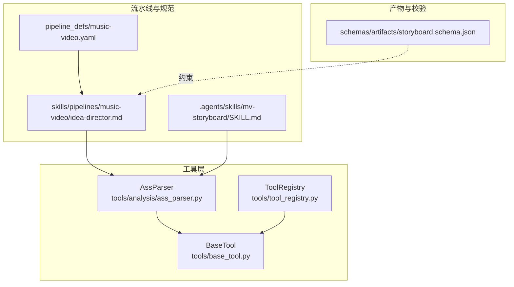
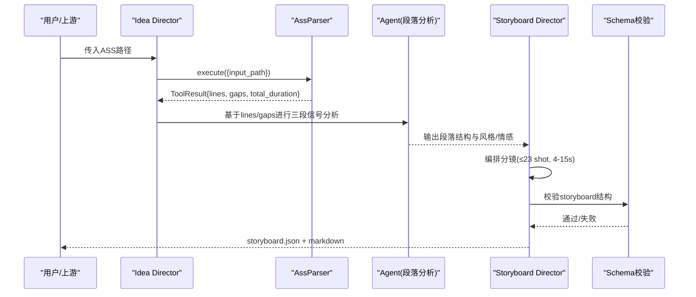
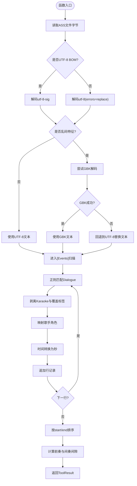
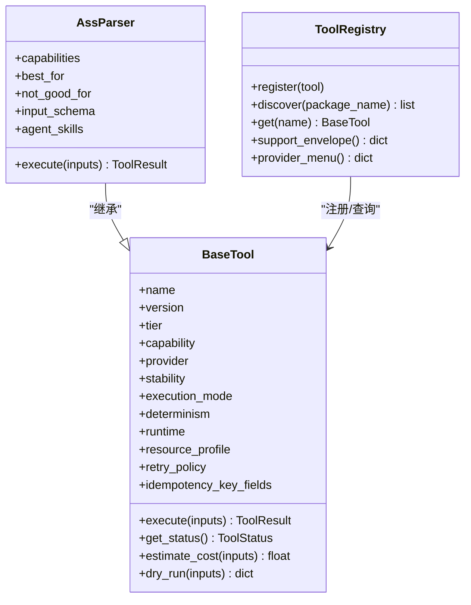

# 分析工具

<cite>
**本文引用的文件**   
- [tools/analysis/ass_parser.py](file://tools/analysis/ass_parser.py)
- [tools/base_tool.py](file://tools/base_tool.py)
- [tools/tool_registry.py](file://tools/tool_registry.py)
- [.agents/skills/mv-storyboard/SKILL.md](file://.agents/skills/mv-storyboard/SKILL.md)
- [skills/pipelines/music-video/idea-director.md](file://skills/pipelines/music-video/idea-director.md)
- [pipeline_defs/music-video.yaml](file://pipeline_defs/music-video.yaml)
- [schemas/artifacts/storyboard.schema.json](file://schemas/artifacts/storyboard.schema.json)
</cite>

## 目录
1. [简介](#简介)
2. [项目结构](#项目结构)
3. [核心组件](#核心组件)
4. [架构总览](#架构总览)
5. [详细组件分析](#详细组件分析)
6. [依赖关系分析](#依赖关系分析)
7. [性能考量](#性能考量)
8. [故障排查指南](#故障排查指南)
9. [结论](#结论)
10. [附录](#附录)

## 简介
本文件为“分析工具”的权威文档，聚焦于ASS歌词解析器在音乐视频流水线中的职责与实现。内容涵盖：
- ASS卡拉OK歌词文件格式解析、时间轴提取与文本处理
- 歌词数据的结构化处理与元信息提取方法
- 歌词与视频时间轴的同步机制和分镜映射规则
- 歌词分析的API接口使用示例与数据处理管道集成方法
- 歌词格式兼容性处理与错误恢复策略

该解析器严格遵循SKILL.md Step 1规范，提供确定性、可复现的歌词解析能力，并为后续的歌曲段落分析、风格判断、分镜编排等Agent任务提供可靠输入。

## 项目结构
围绕ASS解析的核心代码位于 tools/analysis 模块，通过 BaseTool 抽象基类统一工具契约，并由 ToolRegistry 进行发现与注册。MV流水线定义在 pipeline_defs/music-video.yaml 中，SKILL.md 定义了Step 1到Step 7的完整流程，Idea Director 将ass_parser作为Step 1的工具调用入口。

图表来源
- [tools/analysis/ass_parser.py:102-145](file://tools/analysis/ass_parser.py#L102-L145)
- [tools/base_tool.py:227-372](file://tools/base_tool.py#L227-L372)
- [tools/tool_registry.py:55-134](file://tools/tool_registry.py#L55-L134)
- [.agents/skills/mv-storyboard/SKILL.md:37-125](file://.agents/skills/mv-storyboard/SKILL.md#L37-L125)
- [pipeline_defs/music-video.yaml:1-12](file://pipeline_defs/music-video.yaml#L1-L12)
- [skills/pipelines/music-video/idea-director.md:25-32](file://skills/pipelines/music-video/idea-director.md#L25-L32)
- [schemas/artifacts/storyboard.schema.json:171-286](file://schemas/artifacts/storyboard.schema.json#L171-L286)

章节来源
- [tools/analysis/ass_parser.py:1-12](file://tools/analysis/ass_parser.py#L1-L12)
- [tools/base_tool.py:1-10](file://tools/base_tool.py#L1-L10)
- [tools/tool_registry.py:1-10](file://tools/tool_registry.py#L1-L10)
- [.agents/skills/mv-storyboard/SKILL.md:1-10](file://.agents/skills/mv-storyboard/SKILL.md#L1-L10)
- [pipeline_defs/music-video.yaml:1-12](file://pipeline_defs/music-video.yaml#L1-L12)
- [skills/pipelines/music-video/idea-director.md:1-10](file://skills/pipelines/music-video/idea-director.md#L1-L10)
- [schemas/artifacts/storyboard.schema.json:1-10](file://schemas/artifacts/storyboard.schema.json#L1-L10)

## 核心组件
- AssParser（tools/analysis/ass_parser.py）
  - 继承自 BaseTool，声明工具元数据、能力、资源需求、幂等键字段等
  - 实现 execute(inputs) 完成ASS读取、编码回退、[Events]段落扫描、Dialogue正则匹配、Karaoke标签剥离、歌手角色映射、时间转换、排序与间隙计算
  - 返回 ToolResult，包含 lines、total_duration、singers、gaps 等结构化数据

- BaseTool（tools/base_tool.py）
  - 定义工具契约：身份、能力、资源、重试、幂等、执行、成本估算、状态报告等
  - 自动对 execute 进行事件埋点包装，便于Backlot看板追踪

- ToolRegistry（tools/tool_registry.py）
  - 自动发现并注册所有 BaseTool 子类
  - 提供按能力、提供者、稳定性、状态等维度的查询与汇总

章节来源
- [tools/analysis/ass_parser.py:102-145](file://tools/analysis/ass_parser.py#L102-L145)
- [tools/base_tool.py:227-372](file://tools/base_tool.py#L227-L372)
- [tools/tool_registry.py:55-134](file://tools/tool_registry.py#L55-L134)

## 架构总览
ASS解析器在MV流水线中的位置与作用如下：
- Idea Director 阶段调用 ass_parser 完成Step 1（读取与解析ASS），产出结构化歌词行与时间间隙
- 这些输出被用于Step 2的歌曲段落分析（基于时间间隔、歌词重复、歌手变化三信号）
- Storyboard Director 阶段依据SKILL.md Step 5-7生成18维度分镜与Seedance Prompt，并通过schema校验
- Edit Director 阶段以storyboard时间线为准对齐歌曲音频与字幕烧录

图表来源
- [skills/pipelines/music-video/idea-director.md:25-32](file://skills/pipelines/music-video/idea-director.md#L25-L32)
- [.agents/skills/mv-storyboard/SKILL.md:128-160](file://.agents/skills/mv-storyboard/SKILL.md#L128-L160)
- [pipeline_defs/music-video.yaml:76-96](file://pipeline_defs/music-video.yaml#L76-L96)
- [schemas/artifacts/storyboard.schema.json:171-286](file://schemas/artifacts/storyboard.schema.json#L171-L286)

## 详细组件分析

### AssParser 组件分析
- 功能要点
  - 编码检测与回退：优先UTF-8，若出现替换字符、控制字符或无CJK则回退GBK
  - 段落定位：仅处理[Events]段，忽略其他段落
  - Dialogue解析：正则匹配10个字段，提取Start/End/Style/Text等
  - Karaoke标签剥离：去除{\K28}/{\k28}及其他覆盖标签，保留纯歌词
  - 歌手角色映射：根据Style含“男/女/合/配唱/一词”映射为角色
  - 时间转换：H:MM:SS.cs转秒，保留厘秒精度
  - 排序与间隙：按start/end排序；计算前奏与>3秒间奏间隙
  - 结果封装：返回ToolResult，包含lines、total_duration、singers、gaps等

- 数据结构与复杂度
  - 逐行扫描O(N)，正则匹配与字符串操作常数开销
  - 排序O(M log M)，M为有效行数
  - 内存占用与文件大小线性相关

- 错误处理与容错
  - 文件不存在直接返回错误
  - 读取异常捕获并返回错误
  - 时间戳解析失败跳过该行，不中断整体解析
  - 若无任何Dialogue行，返回明确错误信息

图表来源
- [tools/analysis/ass_parser.py:46-69](file://tools/analysis/ass_parser.py#L46-L69)
- [tools/analysis/ass_parser.py:165-206](file://tools/analysis/ass_parser.py#L165-L206)
- [tools/analysis/ass_parser.py:208-243](file://tools/analysis/ass_parser.py#L208-L243)

章节来源
- [tools/analysis/ass_parser.py:46-69](file://tools/analysis/ass_parser.py#L46-L69)
- [tools/analysis/ass_parser.py:165-206](file://tools/analysis/ass_parser.py#L165-L206)
- [tools/analysis/ass_parser.py:208-243](file://tools/analysis/ass_parser.py#L208-L243)

### BaseTool 与 ToolRegistry
- BaseTool
  - 统一工具契约：name/version/tier/capability/provider/stability/execution_mode/determinism/runtime
  - 资源与重试：ResourceProfile、RetryPolicy
  - 幂等性：idempotency_key_fields 与 idempotency_key()
  - 执行包装：execute 自动注入Backlot事件埋点
  - 状态与成本：get_status()、estimate_cost()、dry_run()

- ToolRegistry
  - discover(package_name="tools") 递归导入子模块并注册所有 BaseTool 子类
  - 提供按tier/capability/provider/status/stability等查询
  - support_envelope()/provider_menu()/capability_catalog() 等汇总报表

章节来源
- [tools/base_tool.py:227-372](file://tools/base_tool.py#L227-L372)
- [tools/tool_registry.py:55-134](file://tools/tool_registry.py#L55-L134)

### SKILL.md 与 MV 流水线集成
- SKILL.md Step 1 对应 AssParser 的实现细节（编码、[Events]、Dialogue、Karaoke、歌手映射、时间转换）
- Step 2 歌曲段落分析由Agent基于lines/gaps进行三段信号判断（时间间隔、歌词重复、歌手变化）
- Pipeline manifest 规定 stages 顺序与产物，确保ass_parser在idea阶段被调用
- Idea Director 明确说明ass_parser的输出字段与用途

章节来源
- [.agents/skills/mv-storyboard/SKILL.md:37-125](file://.agents/skills/mv-storyboard/SKILL.md#L37-L125)
- [.agents/skills/mv-storyboard/SKILL.md:128-160](file://.agents/skills/mv-storyboard/SKILL.md#L128-L160)
- [pipeline_defs/music-video.yaml:36-44](file://pipeline_defs/music-video.yaml#L36-L44)
- [skills/pipelines/music-video/idea-director.md:25-32](file://skills/pipelines/music-video/idea-director.md#L25-L32)

### 分镜映射与时间轴同步
- 时间轴权威来源：ASS解析得到的lines[start/end]与total_duration
- 分镜时长约束：整数秒，4-15秒，最多23个shot
- 段落映射：intro/verseA/B/preChorus/chorus/bridge/interlude/outro
- 镜头类型：空镜/人物镜/双人镜，依据是否有歌词与人物决定
- 转场与节奏：硬切/叠化/闪白/黑场/匹配剪辑，依据相邻分镜关系选择

章节来源
- [schemas/artifacts/storyboard.schema.json:171-286](file://schemas/artifacts/storyboard.schema.json#L171-L286)
- [.agents/skills/mv-storyboard/SKILL.md:314-389](file://.agents/skills/mv-storyboard/SKILL.md#L314-L389)

## 依赖关系分析
- AssParser 依赖 BaseTool 提供的工具契约与事件埋点
- ToolRegistry 负责发现与注册 AssParser
- Idea Director 依赖 AssParser 输出作为Step 1产物
- Storyboard Director 依赖 SKILL.md 与 schema 约束生成最终分镜
- Edit Director 依赖 storyboard 时间线对齐歌曲音频与字幕

图表来源
- [tools/base_tool.py:227-372](file://tools/base_tool.py#L227-L372)
- [tools/analysis/ass_parser.py:102-145](file://tools/analysis/ass_parser.py#L102-L145)
- [tools/tool_registry.py:55-134](file://tools/tool_registry.py#L55-L134)

章节来源
- [tools/base_tool.py:227-372](file://tools/base_tool.py#L227-L372)
- [tools/analysis/ass_parser.py:102-145](file://tools/analysis/ass_parser.py#L102-L145)
- [tools/tool_registry.py:55-134](file://tools/tool_registry.py#L55-L134)

## 性能考量
- 解析复杂度：O(N) 行扫描 + O(M log M) 排序，N为总行数，M为有效Dialogue行数
- 内存占用：与文件大小线性相关，适合大文件流式处理（当前实现一次性加载）
- 编码回退：UTF-8失败后GBK尝试一次，避免多次解码开销
- 正则匹配：预编译正则减少重复编译开销
- 建议优化：对超大ASS文件可采用分块读取与惰性解析，降低峰值内存

## 故障排查指南
- 文件未找到：检查 input_path 是否存在且可读
- 编码问题：若出现替换字符或控制字符，工具会自动回退GBK；仍失败需确认原始文件编码
- 无Dialogue行：确认ASS文件包含[Events]段且存在Dialogue行
- 时间戳解析失败：跳过该行，不影响整体解析；检查ASS导出是否正确
- 歌手角色映射：确认Style命名符合约定（男/女/合/配唱/一词）

章节来源
- [tools/analysis/ass_parser.py:153-203](file://tools/analysis/ass_parser.py#L153-L203)

## 结论
AssParser 提供了稳定、确定性的ASS歌词解析能力，严格遵循SKILL.md规范，为MV流水线的段落分析、分镜编排与时间轴同步提供可靠基础。通过BaseTool与ToolRegistry的统一契约，工具易于发现、注册与集成。结合schema校验与流水线定义，整个系统具备高内聚、低耦合、可扩展的特性。

## 附录

### API 使用示例
- 调用方式：通过 ToolRegistry 发现并获取 AssParser，然后调用 execute(inputs)
- 输入参数：{ "input_path": "path/to/file.ass" }
- 输出结构：ToolResult.success / error / data.lines / data.total_duration / data.singers / data.gaps

章节来源
- [tools/tool_registry.py:118-134](file://tools/tool_registry.py#L118-L134)
- [tools/analysis/ass_parser.py:127-145](file://tools/analysis/ass_parser.py#L127-L145)

### 数据处理管道集成方法
- 在 idea 阶段调用 ass_parser 获取结构化歌词与时间间隙
- 将输出传递给 Agent 进行Step 2段落分析
- Storyboard Director 基于SKILL.md Step 5-7生成分镜，并通过schema校验
- Edit Director 以storyboard时间线为准对齐歌曲音频与字幕烧录

章节来源
- [pipeline_defs/music-video.yaml:36-44](file://pipeline_defs/music-video.yaml#L36-L44)
- [skills/pipelines/music-video/idea-director.md:25-32](file://skills/pipelines/music-video/idea-director.md#L25-L32)
- [schemas/artifacts/storyboard.schema.json:171-286](file://schemas/artifacts/storyboard.schema.json#L171-L286)