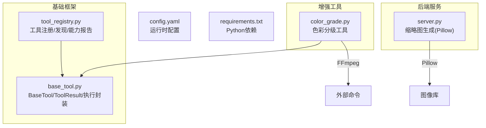
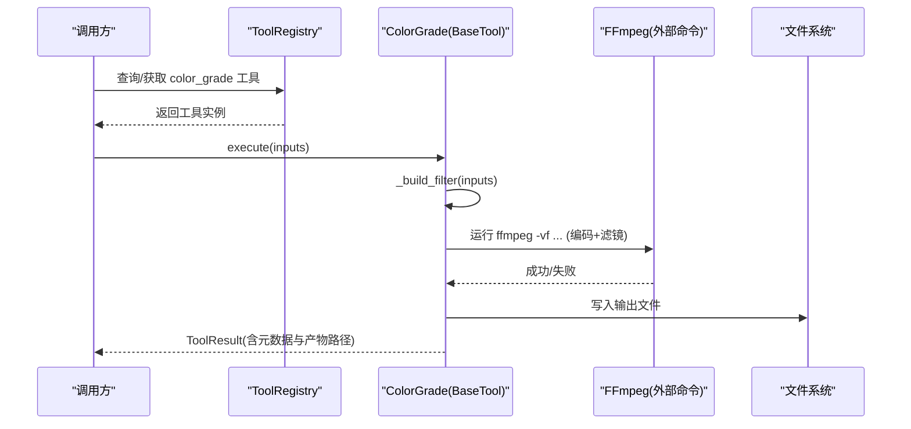
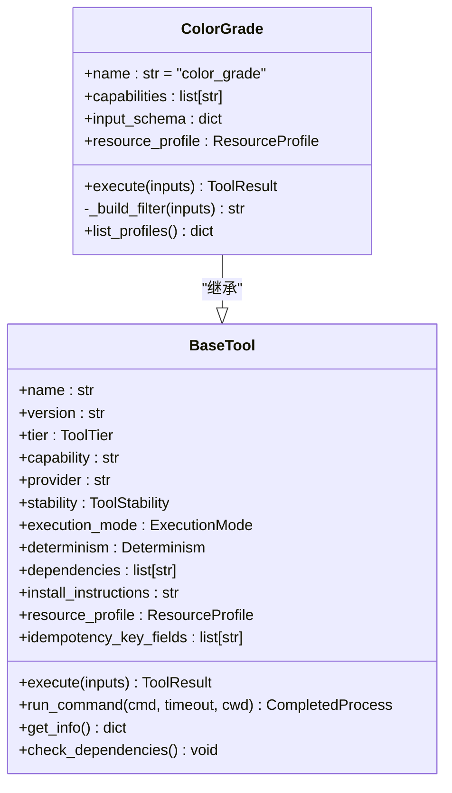
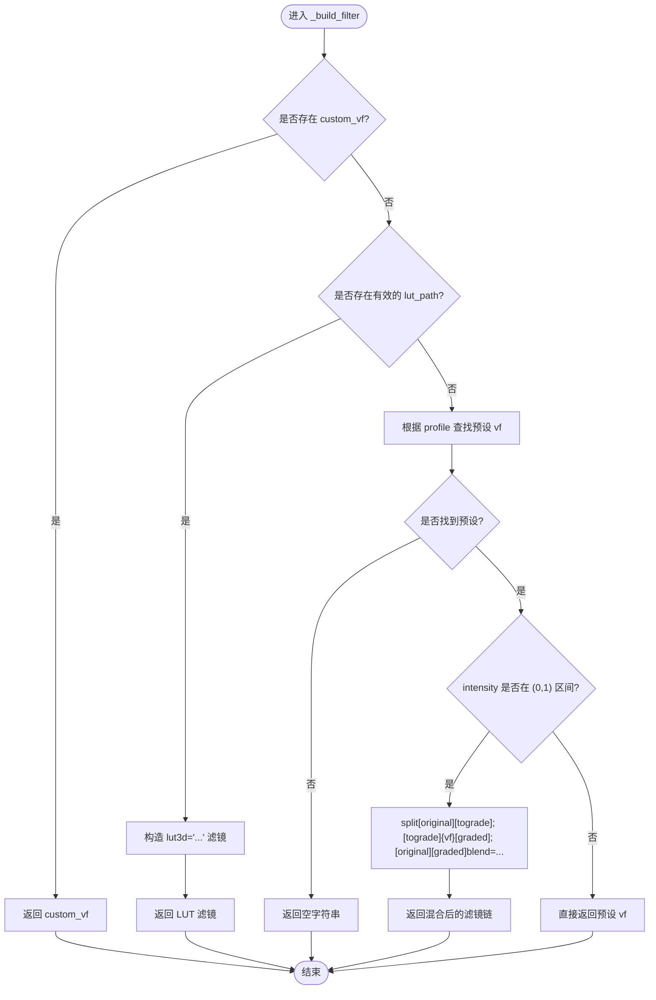
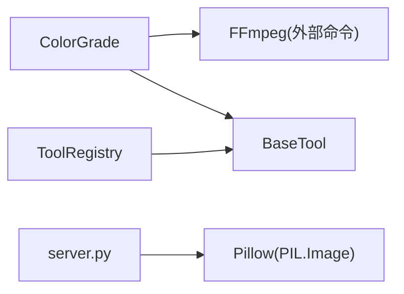

# 图像增强工具

<cite>
**本文引用的文件**   
- [tools/enhancement/color_grade.py](file://tools/enhancement/color_grade.py)
- [tools/base_tool.py](file://tools/base_tool.py)
- [tools/tool_registry.py](file://tools/tool_registry.py)
- [backlot/server.py](file://backlot/server.py)
- [config.yaml](file://config.yaml)
- [requirements.txt](file://requirements.txt)
</cite>

## 目录
1. [简介](#简介)
2. [项目结构](#项目结构)
3. [核心组件](#核心组件)
4. [架构总览](#架构总览)
5. [详细组件分析](#详细组件分析)
6. [依赖关系分析](#依赖关系分析)
7. [性能考虑](#性能考虑)
8. [故障排查指南](#故障排查指南)
9. [结论](#结论)
10. [附录](#附录)

## 简介
本文件为“图像增强工具”的全面技术文档，聚焦色彩分级能力与相关图像处理流程。当前仓库中的增强模块以视频/图像的色彩分级为核心，通过 FFmpeg 滤镜链与 LUT 实现自动调色、白平衡校正与对比度优化；同时提供强度混合（原片与分级结果融合）与批量处理的基础能力。此外，后端服务在生成缩略图时使用了 Pillow 进行图像读取与缩放，体现了项目中对 Pillow 的实际使用方式。

说明：
- 色彩分级：内置多种预设滤镜链（如电影暖色/冷色、高对比、明亮干净等），支持外部 .cube LUT 与自定义滤镜链。
- 批处理：可通过循环调用同一工具的 execute 接口，结合配置文件或清单驱动批量任务。
- 质量评估：提供用户可见的验证项与可观测的执行时长、输出路径等元数据，便于前后对比与回归测试。
- 最佳实践：强调输入校验、参数边界控制、幂等键设计、资源占用估算与错误处理策略。

[本节不直接分析具体文件，故无章节来源]

## 项目结构
与图像增强相关的代码主要位于 tools/enhancement 目录，基础工具框架位于 tools/base_tool.py，工具注册与发现位于 tools/tool_registry.py，后端缩略图生成涉及 backlot/server.py 中对 Pillow 的使用。配置集中在 config.yaml，依赖声明在 requirements.txt。

图表来源 
- [tools/enhancement/color_grade.py:1-213](file://tools/enhancement/color_grade.py#L1-L213)
- [tools/base_tool.py:1-481](file://tools/base_tool.py#L1-L481)
- [tools/tool_registry.py:1-493](file://tools/tool_registry.py#L1-L493)
- [backlot/server.py:460-504](file://backlot/server.py#L460-L504)

章节来源
- [tools/enhancement/color_grade.py:1-213](file://tools/enhancement/color_grade.py#L1-L213)
- [tools/base_tool.py:1-481](file://tools/base_tool.py#L1-L481)
- [tools/tool_registry.py:1-493](file://tools/tool_registry.py#L1-L493)
- [backlot/server.py:460-504](file://backlot/server.py#L460-L504)
- [config.yaml:1-20](file://config.yaml#L1-L20)
- [requirements.txt:1-12](file://requirements.txt#L1-L12)

## 核心组件
- ColorGrade 工具：基于 BaseTool 实现的色彩分级工具，支持预设滤镜、LUT 与自定义滤镜链，具备强度混合、编码参数控制与幂等键设计。
- BaseTool 基类：统一工具契约，包含依赖检查、命令执行封装、事件注入、成本/耗时估计、幂等键计算与状态报告。
- ToolRegistry：工具注册与发现，按能力、提供者、稳定性等维度聚合与筛选，生成能力目录与支持信封。
- 后端缩略图生成：在 server.py 中使用 Pillow 打开图像、转换为 RGB、缩略并缓存 JPEG，用于预览展示。

章节来源
- [tools/enhancement/color_grade.py:78-213](file://tools/enhancement/color_grade.py#L78-L213)
- [tools/base_tool.py:227-481](file://tools/base_tool.py#L227-L481)
- [tools/tool_registry.py:55-493](file://tools/tool_registry.py#L55-L493)
- [backlot/server.py:460-504](file://backlot/server.py#L460-L504)

## 架构总览
整体架构围绕“工具化”展开：每个增强功能以 BaseTool 子类形式存在，由 ToolRegistry 统一发现与管理；ColorGrade 通过 run_command 调用 FFmpeg 完成实际处理；后端服务在需要时调用 Pillow 进行图像预处理与缩略图生成。

图表来源 
- [tools/tool_registry.py:118-134](file://tools/tool_registry.py#L118-L134)
- [tools/enhancement/color_grade.py:134-179](file://tools/enhancement/color_grade.py#L134-L179)
- [tools/base_tool.py:411-454](file://tools/base_tool.py#L411-L454)

## 详细组件分析

### ColorGrade 组件分析
ColorGrade 是增强能力的核心，负责将预设滤镜、LUT 或自定义滤镜链应用到输入媒体，并通过 FFmpeg 完成转码与输出。其关键特性包括：
- 内置多套滤镜预设（如 cinematic_warm、cinematic_cool、moody_dark、bright_clean、vintage_film、high_contrast、neutral）。
- 支持外部 .cube LUT 文件，路径安全化处理以适应不同平台。
- 支持 intensity 混合（0~1），通过 split + blend 将原片与分级结果按比例叠加。
- 编码参数可调（codec、crf），默认音频直通。
- 幂等键字段：input_path、profile、lut_path、intensity，确保相同输入与参数可复用结果。
- 用户可见验证项：颜色准确性、肤色自然度等。

图表来源 
- [tools/base_tool.py:227-481](file://tools/base_tool.py#L227-L481)
- [tools/enhancement/color_grade.py:78-213](file://tools/enhancement/color_grade.py#L78-L213)

#### 滤镜构建与强度混合流程

图表来源 
- [tools/enhancement/color_grade.py:181-207](file://tools/enhancement/color_grade.py#L181-L207)

章节来源
- [tools/enhancement/color_grade.py:24-75](file://tools/enhancement/color_grade.py#L24-L75)
- [tools/enhancement/color_grade.py:134-179](file://tools/enhancement/color_grade.py#L134-L179)
- [tools/enhancement/color_grade.py:181-207](file://tools/enhancement/color_grade.py#L181-L207)

### 基础工具框架（BaseTool）
BaseTool 定义了所有工具的通用契约与行为：
- 依赖检查：支持 cmd:/binary:、env:、python: 三类依赖检测。
- 命令执行封装：跨平台解析可执行文件路径，统一异常包装为 ToolCommandError。
- 事件注入：自动为 execute 方法注入开始/结束/错误事件，便于看板与追踪。
- 成本与耗时估计：预留扩展点，供付费或长耗时工具覆盖。
- 幂等键：基于指定字段生成哈希前缀，便于缓存与去重。
- 状态报告：get_status/get_info 提供工具可用性、能力、资源需求等信息。

章节来源
- [tools/base_tool.py:227-481](file://tools/base_tool.py#L227-L481)

### 工具注册与发现（ToolRegistry）
ToolRegistry 负责：
- 扫描 tools 包下的模块，自动注册所有 BaseTool 子类。
- 按能力、提供者、稳定性、状态等维度过滤与汇总。
- 生成 provider_menu 与 capability_catalog，供上层编排与用户界面展示。
- 提供 support_envelope 完整能力报告，辅助决策引擎选择工具。

章节来源
- [tools/tool_registry.py:55-493](file://tools/tool_registry.py#L55-L493)

### 后端缩略图生成（Pillow 使用）
在 backlot/server.py 中，针对图片与视频生成缩略图：
- 图片：使用 Pillow 打开、转换为 RGB、thumbnail 缩放、保存为 JPEG（质量 82）。
- 视频：通过 FFmpeg 抽取一帧作为海报图，再缩放并缓存。
- 缓存策略：基于源文件路径、修改时间、大小与目标宽度生成唯一 key，避免重复计算。

章节来源
- [backlot/server.py:460-504](file://backlot/server.py#L460-L504)

## 依赖关系分析
- ColorGrade 依赖 FFmpeg（cmd:ffmpeg），通过 BaseTool.run_command 调用。
- BaseTool 依赖标准库与可选事件模块（lib.events），若不可用则降级为无事件模式。
- ToolRegistry 依赖 importlib/pkgutil 动态导入工具模块。
- 后端服务依赖 Pillow（PIL.Image）用于图像缩略图生成。

图表来源 
- [tools/enhancement/color_grade.py:134-179](file://tools/enhancement/color_grade.py#L134-L179)
- [tools/base_tool.py:411-454](file://tools/base_tool.py#L411-L454)
- [tools/tool_registry.py:118-134](file://tools/tool_registry.py#L118-L134)
- [backlot/server.py:490-504](file://backlot/server.py#L490-L504)

章节来源
- [tools/enhancement/color_grade.py:134-179](file://tools/enhancement/color_grade.py#L134-L179)
- [tools/base_tool.py:411-454](file://tools/base_tool.py#L411-L454)
- [tools/tool_registry.py:118-134](file://tools/tool_registry.py#L118-L134)
- [backlot/server.py:490-504](file://backlot/server.py#L490-L504)

## 性能考虑
- 滤镜链复杂度：curves/colorbalance/eq/lut3d 等滤镜会增加 CPU 负载，建议优先使用轻量级滤镜组合，必要时分阶段处理。
- 编码参数：CRF 值影响画质与体积，默认 20 适合高质量输出；批量处理时可适当提高 CRF 以提升速度。
- 内存与磁盘：ResourceProfile 已声明 CPU/内存/磁盘占用，建议在调度层限制并发以避免 OOM。
- 幂等与缓存：利用 idempotency_key_fields 减少重复计算；缩略图缓存机制避免重复生成。
- 并行批处理：对多文件任务可采用线程池或进程池并行执行 ColorGrade.execute，注意 I/O 与 FFmpeg 进程上限。

[本节为通用指导，不直接分析具体文件，故无章节来源]

## 故障排查指南
- 输入不存在：ColorGrade.execute 会返回 success=False 并提示输入路径不存在，请确认路径正确且可读。
- 未指定滤镜：若未提供 custom_vf、lut_path 或有效 profile，_build_filter 返回空串，导致执行失败。
- FFmpeg 执行失败：run_command 捕获 CalledProcessError 并包装为 ToolCommandError，需检查 stderr/stdout 详情。
- 依赖缺失：BaseTool.check_dependencies 会检测 cmd/env/python 依赖，缺失时将抛出 DependencyError。
- 缩略图生成失败：server.py 中 Pillow/FFmpeg 调用异常将被捕获并返回 None，建议检查文件格式与权限。

章节来源
- [tools/enhancement/color_grade.py:134-179](file://tools/enhancement/color_grade.py#L134-L179)
- [tools/base_tool.py:304-328](file://tools/base_tool.py#L304-L328)
- [tools/base_tool.py:411-454](file://tools/base_tool.py#L411-L454)
- [backlot/server.py:460-504](file://backlot/server.py#L460-L504)

## 结论
本项目以 BaseTool 为基础，构建了可扩展的工具生态。ColorGrade 提供了强大的色彩分级能力，涵盖预设、LUT 与自定义滤镜链，并通过强度混合实现精细控制。配合 ToolRegistry 的统一管理，系统具备良好的可发现性与编排能力。后端服务对 Pillow 的使用展示了常见的图像预处理流程。通过合理的参数调优与批处理策略，可在保证画质的前提下提升处理效率。

[本节为总结性内容，不直接分析具体文件，故无章节来源]

## 附录

### 色彩分级预设一览
- cinematic_warm：暖色调电影感，阴影提升、高光偏橙。
- cinematic_cool：冷色调青橙电影感。
- moody_dark：压黑、中灰去饱和、暗氛围。
- bright_clean：明亮干净，阴影提升、色彩鲜艳。
- vintage_film：褪色胶片质感，暖色微染。
- high_contrast：高对比、强动态。
- neutral：最小修正，归一化电平与轻微对比。

章节来源
- [tools/enhancement/color_grade.py:24-75](file://tools/enhancement/color_grade.py#L24-L75)

### 输入参数说明（ColorGrade）
- input_path：必填，输入媒体路径。
- output_path：可选，输出路径（默认在原文件名后加 _graded）。
- profile：可选，预设名称（枚举来自 PROFILES）。
- lut_path：可选，外部 .cube LUT 文件路径。
- intensity：可选，0~1 混合强度（0 原片，1 全量分级）。
- custom_vf：可选，自定义 FFmpeg 滤镜链。
- codec/crf：可选，编码器与质量参数（默认 libx264/20）。

章节来源
- [tools/enhancement/color_grade.py:98-124](file://tools/enhancement/color_grade.py#L98-L124)

### 批处理流程建议
- 准备清单：从配置文件或数据库读取待处理文件列表。
- 参数模板：定义统一的 profile/intensity/codec/crf 等参数。
- 并发控制：根据资源 Profile 设置最大并发数。
- 结果收集：记录 ToolResult.duration_seconds、artifacts 与错误信息。
- 重试策略：对失败任务实施有限次重试（参考 RetryPolicy）。

[本节为通用指导，不直接分析具体文件，故无章节来源]

### 图像质量评估与对比方法
- 主观对比：并排查看原片与分级结果，关注肤色自然度与色彩准确性。
- 客观指标：可引入 PSNR/SSIM/LPIPS 等指标进行量化对比（需在后续扩展中实现）。
- 执行元数据：利用 ToolResult 中的 duration_seconds 与 artifacts 路径进行回归测试与性能监控。

[本节为通用指导，不直接分析具体文件，故无章节来源]

### 配置与依赖
- 运行时配置：config.yaml 定义默认格式、编码器、分辨率、FPS、CRF 等。
- Python 依赖：requirements.txt 列出核心依赖（PyYAML、Pydantic、FastAPI、Uvicorn 等）。

章节来源
- [config.yaml:1-20](file://config.yaml#L1-L20)
- [requirements.txt:1-12](file://requirements.txt#L1-L12)