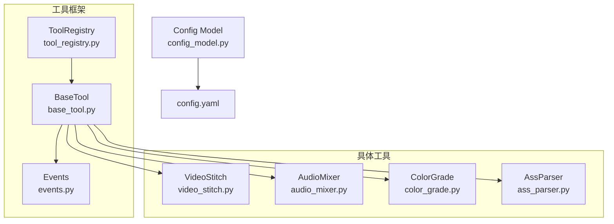
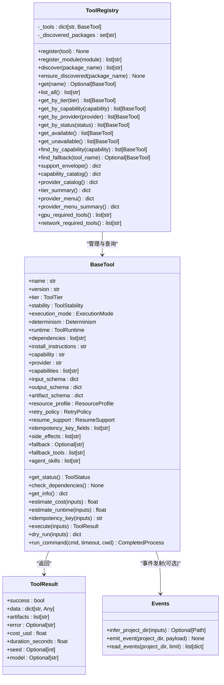
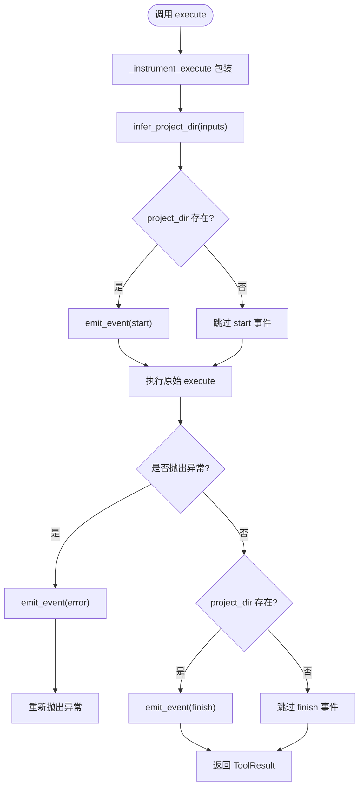
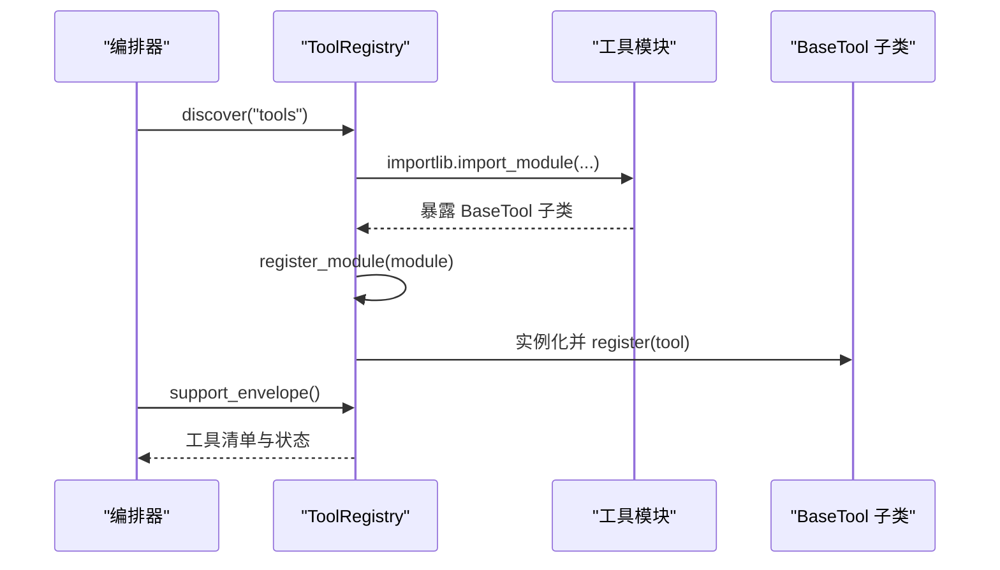
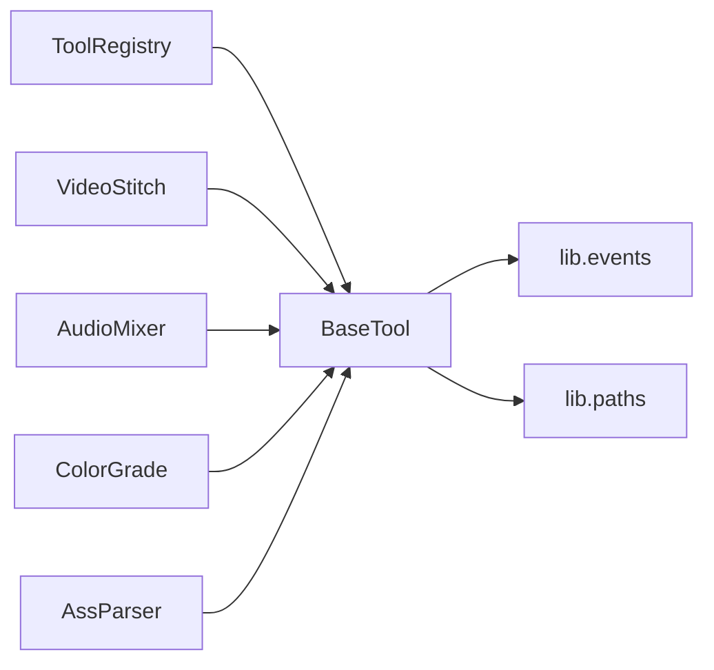

# 基础工具框架

<cite>
**本文引用的文件**   
- [tools/base_tool.py](file://tools/base_tool.py)
- [tools/tool_registry.py](file://tools/tool_registry.py)
- [lib/events.py](file://lib/events.py)
- [lib/config_model.py](file://lib/config_model.py)
- [config.yaml](file://config.yaml)
- [tools/video/video_stitch.py](file://tools/video/video_stitch.py)
- [tools/audio/audio_mixer.py](file://tools/audio/audio_mixer.py)
- [tools/enhancement/color_grade.py](file://tools/enhancement/color_grade.py)
- [tools/analysis/ass_parser.py](file://tools/analysis/ass_parser.py)
</cite>

## 目录
1. [简介](#简介)
2. [项目结构](#项目结构)
3. [核心组件](#核心组件)
4. [架构总览](#架构总览)
5. [详细组件分析](#详细组件分析)
6. [依赖关系分析](#依赖关系分析)
7. [性能考量](#性能考量)
8. [故障排查指南](#故障排查指南)
9. [结论](#结论)
10. [附录：工具开发指南与最佳实践](#附录工具开发指南与最佳实践)

## 简介
本文件系统化阐述 OpenMontage-MV 的基础工具框架，围绕 BaseTool 抽象基类、ToolResult 数据结构、错误处理机制、事件监控集成、工具注册表（自动发现、版本管理、状态监控）以及重试策略与资源配置文件等主题展开。文档同时提供完整的工具开发指南，包括如何继承 BaseTool 实现自定义工具、定义输入输出 Schema、成本估算与确定性控制，并给出实际代码示例路径与最佳实践建议。

## 项目结构
OpenMontage-MV 的工具框架位于 tools/ 目录，核心由 base_tool.py 与 tool_registry.py 组成；具体工具按能力分目录组织（video、audio、enhancement、analysis）。运行时配置通过 lib/config_model.py 加载 config.yaml。事件系统位于 lib/events.py，用于记录工具执行事件以驱动 Backlot 看板活动流。

图表来源
- [tools/base_tool.py:227-481](file://tools/base_tool.py#L227-L481)
- [tools/tool_registry.py:55-492](file://tools/tool_registry.py#L55-L492)
- [lib/events.py:1-119](file://lib/events.py#L1-L119)
- [lib/config_model.py:1-70](file://lib/config_model.py#L1-L70)
- [config.yaml:1-20](file://config.yaml#L1-L20)

章节来源
- [tools/base_tool.py:227-481](file://tools/base_tool.py#L227-L481)
- [tools/tool_registry.py:55-492](file://tools/tool_registry.py#L55-L492)
- [lib/events.py:1-119](file://lib/events.py#L1-L119)
- [lib/config_model.py:1-70](file://lib/config_model.py#L1-L70)
- [config.yaml:1-20](file://config.yaml#L1-L20)

## 核心组件
- BaseTool 抽象基类：统一工具契约，包含生命周期钩子、依赖检查、执行模式、确定性控制、资源与重试配置、成本估算、幂等键、CLI 辅助方法等。
- ToolResult 数据结构：标准化工具执行结果，包含成功标志、数据载荷、产物列表、错误信息、成本、耗时、种子与模型标识。
- ToolRegistry：集中式工具注册与发现，支持按能力、提供者、层级、稳定性、状态筛选，生成支持信封与能力目录，并提供回退工具查找。
- Events：基于 JSONL 的追加型事件流，自动推断项目归属，记录 start/finish/error 事件，供看板实时展示。
- ConfigModel：基于 Pydantic 的配置模型，加载 config.yaml 并提供类型化访问与路径解析。

章节来源
- [tools/base_tool.py:110-139](file://tools/base_tool.py#L110-L139)
- [tools/base_tool.py:227-481](file://tools/base_tool.py#L227-L481)
- [tools/tool_registry.py:55-492](file://tools/tool_registry.py#L55-L492)
- [lib/events.py:1-119](file://lib/events.py#L1-L119)
- [lib/config_model.py:1-70](file://lib/config_model.py#L1-L70)

## 架构总览
下图展示了 BaseTool 与 ToolRegistry、Events 的交互关系，以及具体工具如何继承 BaseTool 并遵循统一契约。

图表来源
- [tools/base_tool.py:227-481](file://tools/base_tool.py#L227-L481)
- [tools/tool_registry.py:55-492](file://tools/tool_registry.py#L55-L492)
- [lib/events.py:1-119](file://lib/events.py#L1-L119)

## 详细组件分析

### BaseTool 抽象基类
- 设计理念
  - 统一契约：所有工具必须实现 execute(inputs) -> ToolResult，确保可被注册表统一管理。
  - 生命周期管理：通过 __init_subclass__ 自动包装 execute，注入事件发射与深度计数，保证观测性。
  - 依赖检查：check_dependencies 支持 cmd:/binary:、env:、python: 三类依赖，失败抛出 DependencyError。
  - 执行模式：ExecutionMode.SYNC/ASYNC 标记同步/异步；Determinism.DETERMINISTIC/SEEDED/STOCHASTIC 控制随机性。
  - 资源与重试：ResourceProfile 描述 CPU/RAM/VRAM/Disk/网络需求；RetryPolicy 定义最大重试次数、退避时间与可重试错误。
  - 成本估算：estimate_cost/estimate_runtime 允许工具声明成本与耗时估计，供编排器决策。
  - 幂等性：idempotency_key_fields 指定参与幂等键计算的字段，默认使用 SHA256 前缀作为缓存键。
  - CLI 辅助：run_command 封装 subprocess 调用，跨平台兼容 Windows 命令解析，异常转换为 ToolCommandError。

- 关键流程
  - 自动事件注入：_instrument_execute 在导入时检测并包装 execute，向 events.jsonl 写入 start/finish/error 事件。
  - 状态报告：get_status 调用 check_dependencies 判定可用性；get_info 汇总全部元数据供注册表与 UI 展示。

图表来源
- [tools/base_tool.py:148-225](file://tools/base_tool.py#L148-L225)
- [lib/events.py:46-96](file://lib/events.py#L46-L96)

章节来源
- [tools/base_tool.py:227-481](file://tools/base_tool.py#L227-L481)
- [lib/events.py:1-119](file://lib/events.py#L1-L119)

### ToolResult 数据结构
- 字段说明
  - success: 布尔值表示执行是否成功。
  - data: 结构化数据载荷，通常包含操作详情、统计信息与中间结果。
  - artifacts: 产物文件路径列表，便于后续阶段消费。
  - error: 错误消息（当 success=False 时有效）。
  - cost_usd: 成本估算（美元），用于计费或预算控制。
  - duration_seconds: 执行耗时（秒），用于性能分析与 SLA 监控。
  - seed/model: 随机种子与模型标识，用于可复现性与溯源。

- 使用建议
  - 始终设置 duration_seconds，便于事件层统计与看板展示。
  - 对付费工具务必实现 estimate_cost 并在 ToolResult.cost_usd 中回填。
  - 产物路径应放入 artifacts，以便流水线追踪与清理。

章节来源
- [tools/base_tool.py:128-139](file://tools/base_tool.py#L128-L139)

### 工具注册表（ToolRegistry）
- 自动发现
  - discover(package_name) 递归导入 tools 包下模块，排除 base_tool 与 tool_registry，扫描所有非抽象的 BaseTool 子类并实例化注册。
  - register_module(module) 将模块内所有符合条件的类实例化并注册。

- 版本管理与状态监控
  - get_info() 返回工具的完整契约信息，包含 name/version/tier/stability/status/runtime/dependencies/capabilities/schema 等。
  - support_envelope() 聚合所有工具信息，供编排器理解系统能力边界。
  - capability_catalog()/provider_catalog() 按能力/提供者分组，便于 UI 展示与筛选。
  - tier_summary() 统计各层级工具的状态分布。

- 回退与筛选
  - find_fallback(tool_name) 根据 fallback/fallback_tools 查找可用替代工具。
  - get_by_* 系列方法支持按 tier/capability/provider/status/stability 筛选。

图表来源
- [tools/tool_registry.py:118-134](file://tools/tool_registry.py#L118-L134)
- [tools/tool_registry.py:73-84](file://tools/tool_registry.py#L73-L84)
- [tools/tool_registry.py:198-210](file://tools/tool_registry.py#L198-L210)

章节来源
- [tools/tool_registry.py:55-492](file://tools/tool_registry.py#L55-L492)

### 事件监控集成（Events）
- 项目归属推断
  - infer_project_dir(inputs) 优先从 project_dir/project_path 显式键获取，否则从 output_path/input_path 等路径键推断，仅接受 projects/ 根下的路径。

- 事件写入
  - emit_event(project_dir, payload) 线程安全地追加到 events.jsonl，忽略异常以保证生产稳定。
  - read_events(project_dir, limit) 读取事件，容忍损坏行。

- 与 BaseTool 的集成
  - _instrument_execute 在 execute 前后自动写入 start/finish/error 事件，支持嵌套深度计数以避免重复统计成本。

章节来源
- [lib/events.py:1-119](file://lib/events.py#L1-L119)
- [tools/base_tool.py:148-225](file://tools/base_tool.py#L148-L225)

### 资源配置文件与重试策略
- ResourceProfile
  - 描述工具运行所需的 CPU 核数、内存、显存、磁盘空间与网络需求，供调度器进行资源分配与容量规划。

- RetryPolicy
  - max_retries/backoff_seconds/retryable_errors 定义重试上限、退避间隔与可重试错误类型，避免瞬时故障导致失败。

- 配置模型
  - OpenMontageConfig 加载 config.yaml，提供 checkpoint/output/paths 等配置项，支持相对路径解析。

章节来源
- [tools/base_tool.py:110-126](file://tools/base_tool.py#L110-L126)
- [lib/config_model.py:1-70](file://lib/config_model.py#L1-L70)
- [config.yaml:1-20](file://config.yaml#L1-L20)

## 依赖关系分析
- BaseTool 依赖
  - 标准库：functools、hashlib、inspect、json、os、platform、subprocess、shutil、time、threading、abc、dataclasses、enum、pathlib、typing。
  - 内部模块：lib.events（事件发射）、lib.paths（项目根路径常量）。

- ToolRegistry 依赖
  - importlib/pkgutil/inspect 用于动态导入与成员扫描。
  - 依赖 base_tool 中的枚举与基类。

- 具体工具依赖
  - video_stitch/audio_mixer/color_grade 依赖 FFmpeg/ffprobe 命令行工具。
  - ass_parser 为纯 Python 实现，无外部依赖。

图表来源
- [tools/base_tool.py:141-146](file://tools/base_tool.py#L141-L146)
- [tools/tool_registry.py:9-15](file://tools/tool_registry.py#L9-L15)

章节来源
- [tools/base_tool.py:141-146](file://tools/base_tool.py#L141-L146)
- [tools/tool_registry.py:9-15](file://tools/tool_registry.py#L9-L15)

## 性能考量
- 事件写入采用线程锁与 O_APPEND 追加，避免竞争条件；读取容忍损坏行，保障看板稳定性。
- run_command 强制 UTF-8 解码与错误替换，防止 Unicode 异常中断渲染进程。
- 资源 Profile 与 estimate_runtime 帮助编排器选择合适节点与并行度。
- 幂等键减少重复计算，结合缓存策略提升吞吐。

## 故障排查指南
- 依赖缺失
  - 现象：get_status() 返回 UNAVAILABLE，check_dependencies() 抛出 DependencyError。
  - 排查：确认 cmd/binary/env/python 依赖是否安装或环境变量是否设置。

- 事件未记录
  - 现象：events.jsonl 无 start/finish/error。
  - 排查：确认 inputs 包含可推断的项目路径（如 output_path 在 projects/ 下），或显式传入 project_dir。

- 命令执行失败
  - 现象：ToolCommandError 包含 returncode/stderr/stdout/detail。
  - 排查：检查命令参数、工作目录与编码问题；Windows 下确保 .cmd/.bat 可通过 shutil.which 解析。

章节来源
- [tools/base_tool.py:296-328](file://tools/base_tool.py#L296-L328)
- [tools/base_tool.py:456-476](file://tools/base_tool.py#L456-L476)
- [lib/events.py:77-96](file://lib/events.py#L77-L96)

## 结论
BaseTool 提供了统一、可扩展且可观测的工具抽象，配合 ToolRegistry 的动态发现与状态管理，以及 Events 的轻量级事件流，构成了 OpenMontage-MV 工具生态的核心骨架。通过明确的 Schema、成本估算、重试策略与资源描述，编排器能够做出更智能的调度与容错决策。

## 附录：工具开发指南与最佳实践

### 继承 BaseTool 创建自定义工具
- 基本步骤
  - 新建类继承 BaseTool，设置 name/version/tier/capability/provider/stability/execution_mode/determinism。
  - 声明 dependencies/install_instructions/capabilities/input_schema/output_schema/artifact_schema。
  - 定义 resource_profile/retry_policy/resume_support/idempotency_key_fields/side_effects/user_visible_verification。
  - 实现 execute(inputs) -> ToolResult，返回成功/失败结果与产物路径。
  - 可选：覆盖 dry_run/estimate_cost/estimate_runtime/get_status 以增强预检与成本估算。

- 输入输出 Schema 定义
  - input_schema 使用 JSON Schema 描述必填字段、类型、枚举、范围与描述，便于前端校验与 Agent 推理。
  - output_schema 描述返回数据的结构与约束，便于下游消费。

- 成本估算与确定性控制
  - estimate_cost(inputs) 返回美元成本，适用于 API 工具或付费服务。
  - determinism 设置为 DETERMINISTIC/SEEDED/STOCHASTIC，影响可复现性与缓存策略。

- 实际示例参考
  - VideoStitch：视频拼接与转场，演示了 validate/stitch/spatial 多操作分支与 FFmpeg 调用。
  - AudioMixer：音频混音与侧链压缩，演示了复杂 filter graph 构建与 loudnorm 标准化。
  - ColorGrade：色彩分级，演示了内置 LUT 与自定义滤镜链。
  - AssParser：ASS 字幕解析，演示了纯 Python 实现的确定性工具。

章节来源
- [tools/video/video_stitch.py:29-174](file://tools/video/video_stitch.py#L29-L174)
- [tools/audio/audio_mixer.py:26-271](file://tools/audio/audio_mixer.py#L26-L271)
- [tools/enhancement/color_grade.py:78-179](file://tools/enhancement/color_grade.py#L78-L179)
- [tools/analysis/ass_parser.py:102-244](file://tools/analysis/ass_parser.py#L102-L244)

### 最佳实践建议
- 明确依赖与环境要求，提供清晰的 install_instructions。
- 使用 input_schema 严格约束输入，减少运行时错误。
- 在 ToolResult 中回填 duration_seconds/cost_usd/artifacts，便于监控与计费。
- 对于长耗时任务，考虑 ASYNC 执行模式与进度上报。
- 合理设置 retry_policy，避免瞬时失败导致整体失败。
- 使用 idempotency_key_fields 避免重复计算，提升效率。
- 通过 agent_skills 关联相关技能文档，辅助 Agent 规划与调用。