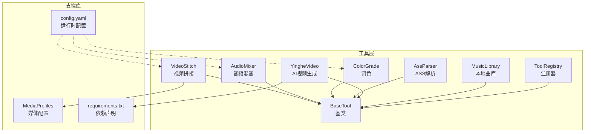
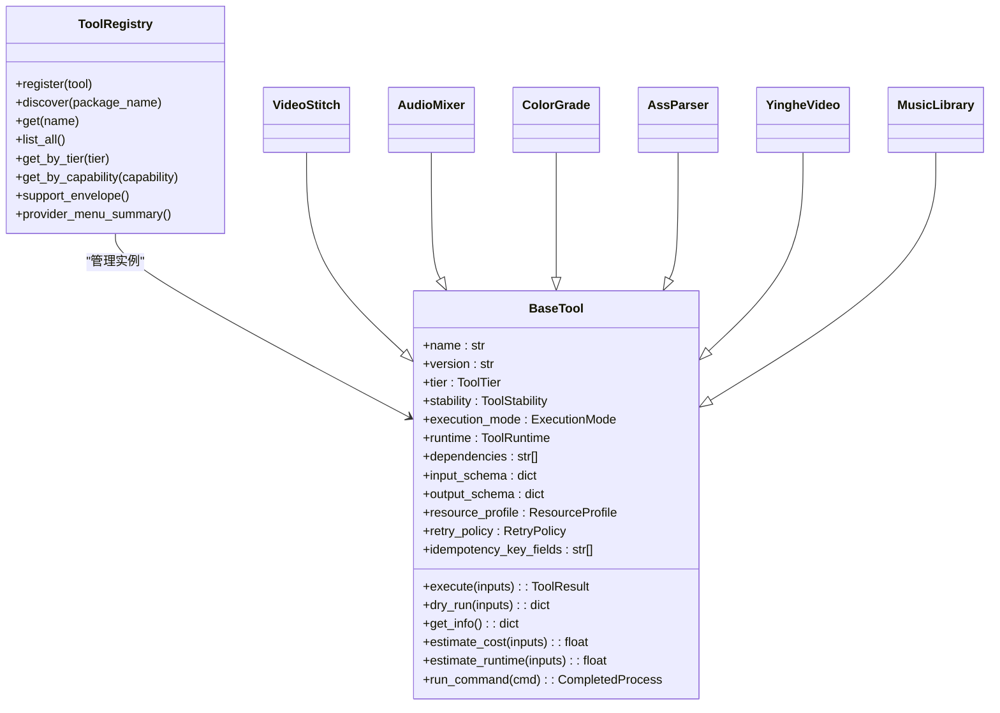
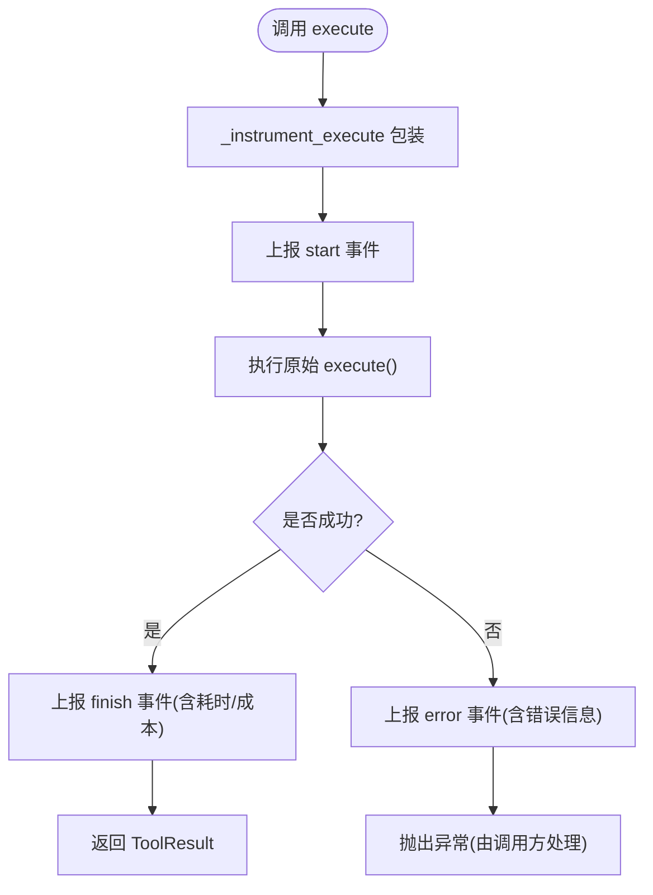
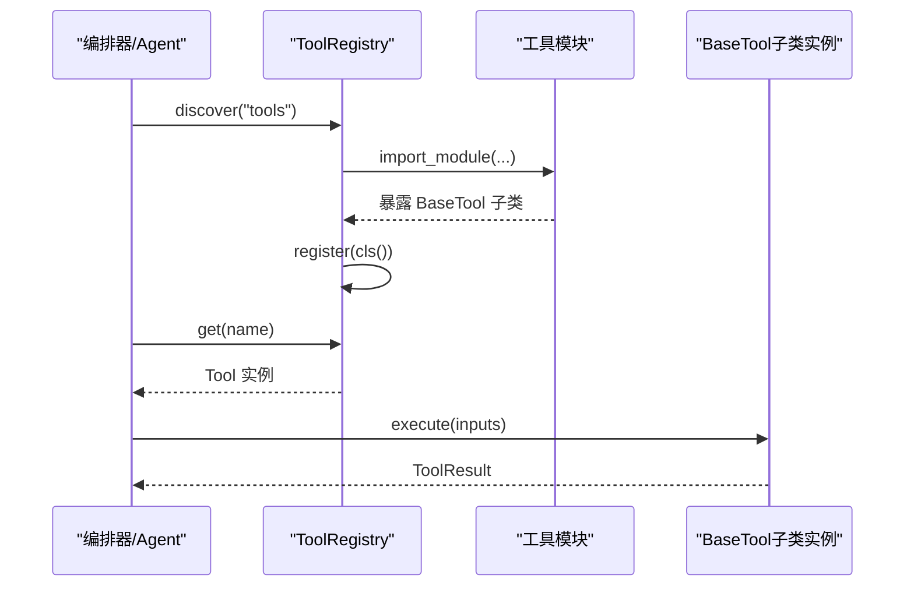
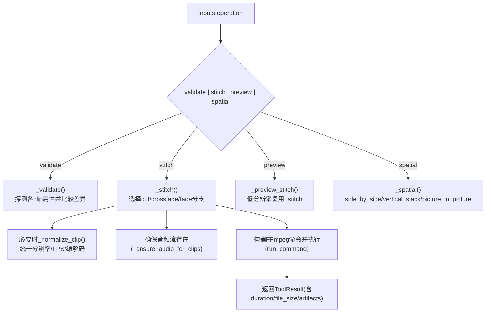
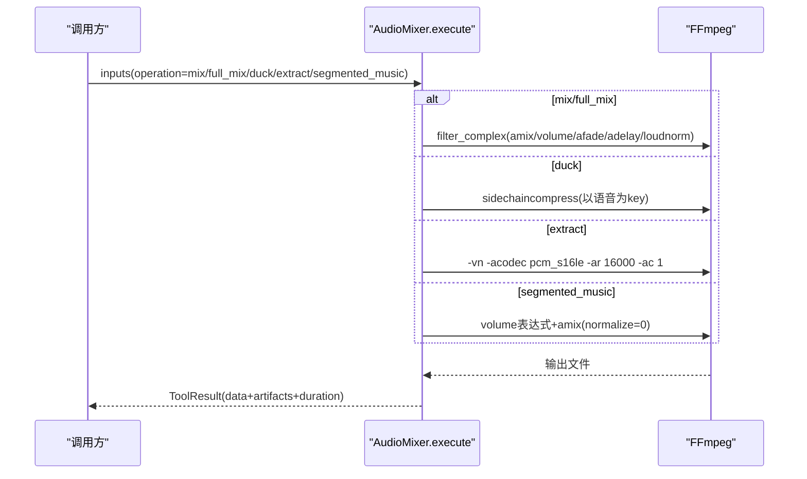
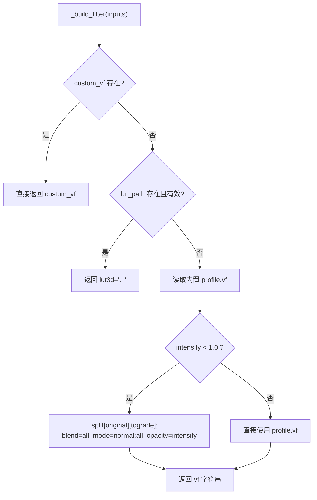
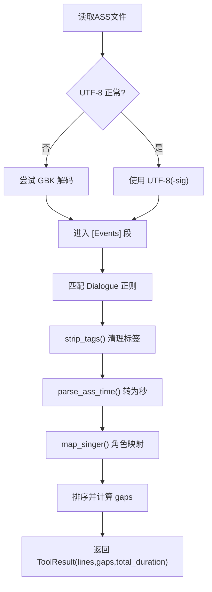
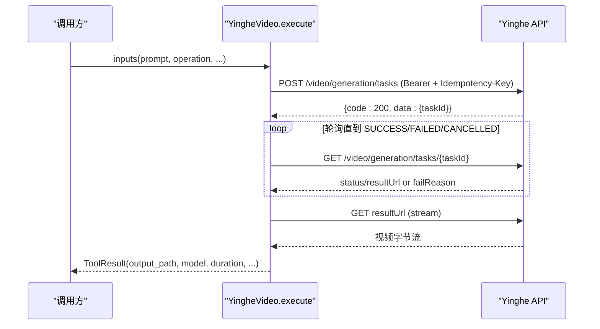
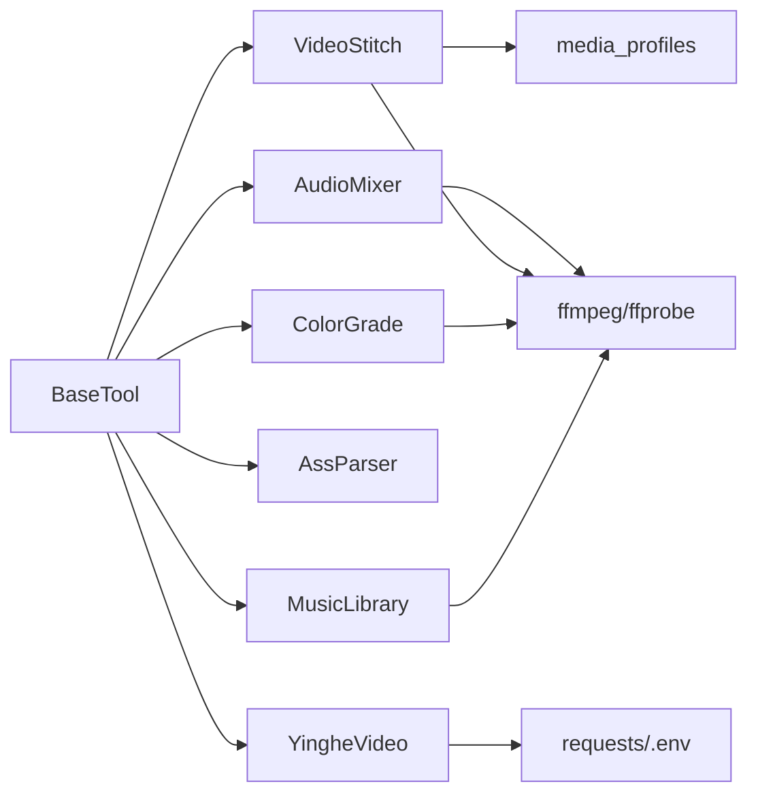

# 工具库系统

<cite>
**本文引用的文件**   
- [tools/base_tool.py](file://tools/base_tool.py)
- [tools/tool_registry.py](file://tools/tool_registry.py)
- [tools/video/video_stitch.py](file://tools/video/video_stitch.py)
- [tools/audio/audio_mixer.py](file://tools/audio/audio_mixer.py)
- [tools/enhancement/color_grade.py](file://tools/enhancement/color_grade.py)
- [tools/analysis/ass_parser.py](file://tools/analysis/ass_parser.py)
- [tools/video/yinghe_video.py](file://tools/video/yinghe_video.py)
- [tools/audio/music_library.py](file://tools/audio/music_library.py)
- [lib/media_profiles.py](file://lib/media_profiles.py)
- [config.yaml](file://config.yaml)
- [requirements.txt](file://requirements.txt)
</cite>

## 目录
1. [简介](#简介)
2. [项目结构](#项目结构)
3. [核心组件](#核心组件)
4. [架构总览](#架构总览)
5. [详细组件分析](#详细组件分析)
6. [依赖关系分析](#依赖关系分析)
7. [性能与资源特性](#性能与资源特性)
8. [故障排查指南](#故障排查指南)
9. [结论](#结论)
10. [附录：自定义工具开发指南](#附录自定义工具开发指南)

## 简介
本文件系统性地梳理 OpenMontage-MV 的工具库体系，围绕 BaseTool 基类设计与工具注册机制展开，覆盖视频处理（拼接、转码、特效）、音频处理（混合、降噪、格式转换）、图像增强（调色、滤镜）与分析工具（ASS 字幕解析）的功能接口。文档同时说明参数配置、错误处理与日志记录方式，并提供自定义工具开发与调用的最佳实践及性能优化建议。

## 项目结构
工具库位于 tools/ 目录下，按能力域划分模块：
- base_tool.py：所有工具的抽象基类与通用运行时契约
- tool_registry.py：工具发现、注册、能力目录与状态报告
- video/：视频相关工具（FFmpeg 封装、外部 API 生成）
- audio/：音频相关工具（混音、降噪、提取、分段音乐）
- enhancement/：图像增强（调色、LUT）
- analysis/：分析工具（ASS 歌词解析）
- lib/media_profiles.py：媒体输出配置文件（分辨率、编码、CRF 等）
- config.yaml：运行时默认输出与路径配置
- requirements.txt：Python 依赖

图表来源
- [tools/base_tool.py:1-481](file://tools/base_tool.py#L1-L481)
- [tools/tool_registry.py:1-493](file://tools/tool_registry.py#L1-L493)
- [tools/video/video_stitch.py:1-963](file://tools/video/video_stitch.py#L1-L963)
- [tools/audio/audio_mixer.py:1-736](file://tools/audio/audio_mixer.py#L1-L736)
- [tools/enhancement/color_grade.py:1-213](file://tools/enhancement/color_grade.py#L1-L213)
- [tools/analysis/ass_parser.py:1-244](file://tools/analysis/ass_parser.py#L1-L244)
- [tools/video/yinghe_video.py:1-263](file://tools/video/yinghe_video.py#L1-L263)
- [tools/audio/music_library.py:1-222](file://tools/audio/music_library.py#L1-L222)
- [lib/media_profiles.py:1-166](file://lib/media_profiles.py#L1-L166)
- [config.yaml:1-20](file://config.yaml#L1-L20)
- [requirements.txt:1-12](file://requirements.txt#L1-L12)

章节来源
- [tools/base_tool.py:1-481](file://tools/base_tool.py#L1-L481)
- [tools/tool_registry.py:1-493](file://tools/tool_registry.py#L1-L493)
- [lib/media_profiles.py:1-166](file://lib/media_profiles.py#L1-L166)
- [config.yaml:1-20](file://config.yaml#L1-L20)
- [requirements.txt:1-12](file://requirements.txt#L1-L12)

## 核心组件
- BaseTool：定义统一的工具契约（身份、能力、依赖、执行模式、幂等键、重试策略、资源画像、结果对象、命令执行封装、事件埋点）。
- ToolRegistry：自动发现 tools 包下的工具类，提供按能力/提供者/层级/状态的查询与汇总报告。
- 具体工具：均继承 BaseTool，实现 execute(inputs) -> ToolResult，并通过 input_schema 描述参数。

关键要点
- 统一返回 ToolResult(success, data, artifacts, error, cost_usd, duration_seconds, seed, model)。
- 通过 dependencies 声明 cmd:/env:/python: 三类依赖；check_dependencies() 校验并抛出 DependencyError。
- run_command() 封装 subprocess 调用，Windows 下自动解析可执行名，异常包装为 ToolCommandError。
- 每个 execute() 被 _instrument_execute 装饰，自动向 Backlot 事件系统上报 start/finish/error。

章节来源
- [tools/base_tool.py:1-481](file://tools/base_tool.py#L1-L481)
- [tools/tool_registry.py:1-493](file://tools/tool_registry.py#L1-L493)

## 架构总览
工具库采用“基类 + 注册器 + 领域工具”的分层架构。注册器在导入时扫描 tools 包，收集所有 BaseTool 子类实例并维护名称到实例的映射。上层编排器或 Agent 通过 registry.get(name) 获取工具，调用 execute(inputs) 完成处理。

图表来源
- [tools/base_tool.py:1-481](file://tools/base_tool.py#L1-L481)
- [tools/tool_registry.py:1-493](file://tools/tool_registry.py#L1-L493)
- [tools/video/video_stitch.py:1-963](file://tools/video/video_stitch.py#L1-L963)
- [tools/audio/audio_mixer.py:1-736](file://tools/audio/audio_mixer.py#L1-L736)
- [tools/enhancement/color_grade.py:1-213](file://tools/enhancement/color_grade.py#L1-L213)
- [tools/analysis/ass_parser.py:1-244](file://tools/analysis/ass_parser.py#L1-L244)
- [tools/video/yinghe_video.py:1-263](file://tools/video/yinghe_video.py#L1-L263)
- [tools/audio/music_library.py:1-222](file://tools/audio/music_library.py#L1-L222)

## 详细组件分析

### BaseTool 基类设计
- 身份与元数据：name/version/tier/stability/runtime/capabilities/provider_matrix 等。
- 依赖检查：cmd:/binary: 检测 PATH 中的命令；env: 检查环境变量；python: 尝试 import。
- 执行与事件：_instrument_execute 对 execute() 进行装饰，捕获 start/finish/error 事件，支持嵌套深度统计与成本累计。
- 幂等与缓存：idempotency_key() 基于 idempotency_key_fields 计算哈希键。
- 子进程封装：run_command() 统一编码、超时、错误包装。

图表来源
- [tools/base_tool.py:148-225](file://tools/base_tool.py#L148-L225)
- [tools/base_tool.py:394-408](file://tools/base_tool.py#L394-L408)
- [tools/base_tool.py:411-454](file://tools/base_tool.py#L411-L454)

章节来源
- [tools/base_tool.py:1-481](file://tools/base_tool.py#L1-L481)

### 工具注册机制（ToolRegistry）
- 自动发现：discover(package_name="tools") 遍历子模块，跳过 base_tool 与 tool_registry 自身，注册所有非抽象的 BaseTool 子类。
- 查询接口：按 tier/capability/provider/status/stability 过滤；支持 support_envelope() 与 provider_menu_summary() 生成用户可读的能力菜单。
- 回退工具：find_fallback() 根据 fallback/fallback_tools 查找可用替代工具。

图表来源
- [tools/tool_registry.py:118-134](file://tools/tool_registry.py#L118-L134)
- [tools/tool_registry.py:62-84](file://tools/tool_registry.py#L62-L84)
- [tools/tool_registry.py:141-176](file://tools/tool_registry.py#L141-L176)

章节来源
- [tools/tool_registry.py:1-493](file://tools/tool_registry.py#L1-L493)

### 视频处理工具：VideoStitch（拼接、转码、特效）
- 功能：validate（兼容性校验）、stitch（顺序拼接）、crossfade/fade（过渡）、spatial（左右/上下/PiP 布局）、preview_stitch（低分辨率预览）。
- 依赖：ffmpeg/ffprobe；可选 media_profiles 指定目标规格。
- 输入：operation/clips/output_path/transition/transition_duration/auto_normalize/target_resolution/target_fps/codec/crf/preset/profile/layout/pip_* 等。
- 输出：ToolResult.data 包含操作类型、时长、文件大小、方法、输出路径等；artifacts 列出产物。

图表来源
- [tools/video/video_stitch.py:148-173](file://tools/video/video_stitch.py#L148-L173)
- [tools/video/video_stitch.py:314-399](file://tools/video/video_stitch.py#L314-L399)
- [tools/video/video_stitch.py:481-583](file://tools/video/video_stitch.py#L481-L583)
- [tools/video/video_stitch.py:584-736](file://tools/video/video_stitch.py#L584-L736)
- [tools/video/video_stitch.py:741-775](file://tools/video/video_stitch.py#L741-L775)
- [tools/video/video_stitch.py:780-800](file://tools/video/video_stitch.py#L780-L800)

章节来源
- [tools/video/video_stitch.py:1-963](file://tools/video/video_stitch.py#L1-L963)
- [lib/media_profiles.py:1-166](file://lib/media_profiles.py#L1-L166)

### 音频处理工具：AudioMixer（混合、降噪、格式转换）
- 功能：mix（多轨混合）、duck（语音优先的侧链压缩降音量）、extract（从视频提取音频）、full_mix（一键混音+降噪+duck）、segmented_music（按时间段混合背景音乐）。
- 依赖：ffmpeg（必需），pydub（可选，用于高级处理）。
- 输入：operation/tracks/primary_audio/secondary_audio/ducking/normalize/loudnorm_target/video_path/music_path/segments 等。
- 输出：ToolResult.data 包含轨道数、是否归一化、输出路径、分段信息等；artifacts 列出产物。

图表来源
- [tools/audio/audio_mixer.py:249-270](file://tools/audio/audio_mixer.py#L249-L270)
- [tools/audio/audio_mixer.py:272-331](file://tools/audio/audio_mixer.py#L272-L331)
- [tools/audio/audio_mixer.py:332-437](file://tools/audio/audio_mixer.py#L332-L437)
- [tools/audio/audio_mixer.py:439-470](file://tools/audio/audio_mixer.py#L439-L470)
- [tools/audio/audio_mixer.py:471-627](file://tools/audio/audio_mixer.py#L471-L627)
- [tools/audio/audio_mixer.py:629-736](file://tools/audio/audio_mixer.py#L629-L736)

章节来源
- [tools/audio/audio_mixer.py:1-736](file://tools/audio/audio_mixer.py#L1-L736)

### 图像增强工具：ColorGrade（调色、滤镜）
- 功能：内置多种 cinematic/neutral 等 profile（colorbalance/curves/eq 组合），支持外部 .cube LUT，支持 intensity 混合强度。
- 依赖：ffmpeg。
- 输入：input_path/output_path/profile/lut_path/intensity/custom_vf/codec/crf。
- 输出：ToolResult.data 包含输入/输出路径、profile/lut、intensity、filter 字符串；artifacts 列出产物。

图表来源
- [tools/enhancement/color_grade.py:134-179](file://tools/enhancement/color_grade.py#L134-L179)
- [tools/enhancement/color_grade.py:181-207](file://tools/enhancement/color_grade.py#L181-L207)

章节来源
- [tools/enhancement/color_grade.py:1-213](file://tools/enhancement/color_grade.py#L1-L213)

### 分析工具：AssParser（ASS 字幕解析）
- 功能：读取 ASS 歌词，UTF-8/GBK 编码自适应，提取 [Events] 中 Dialogue 行，剥离卡拉OK与覆盖标签，映射歌手角色，计算时间间隔（intro/interlude/outro）。
- 依赖：无外部依赖。
- 输入：input_path。
- 输出：ToolResult.data 包含编码、行数、每行起止时间/歌手/文本、总时长、gaps 列表。

图表来源
- [tools/analysis/ass_parser.py:46-92](file://tools/analysis/ass_parser.py#L46-L92)
- [tools/analysis/ass_parser.py:153-244](file://tools/analysis/ass_parser.py#L153-L244)

章节来源
- [tools/analysis/ass_parser.py:1-244](file://tools/analysis/ass_parser.py#L1-L244)

### 外部 API 视频生成：YingheVideo
- 功能：text_to_video / image_to_video，异步任务创建与轮询，下载结果至磁盘。
- 依赖：VIDEO_API_KEY（环境变量），可选 VIDEO_API_BASE_URL、VIDEO_MODEL。
- 输入：prompt/operation/duration/ratio/image_urls/generate_audio/watermark/model/output_path。
- 输出：ToolResult.data 包含 provider/model/prompt/task_id/output/source_url/duration/ratio；cost_usd 由工具估算。

图表来源
- [tools/video/yinghe_video.py:149-263](file://tools/video/yinghe_video.py#L149-L263)

章节来源
- [tools/video/yinghe_video.py:1-263](file://tools/video/yinghe_video.py#L1-L263)

### 本地音乐库：MusicLibrary
- 功能：扫描 music_library/ 目录，列举可用曲目，可选 ffprobe 获取时长。
- 依赖：无强制依赖（ffprobe 可选）。
- 输入：library_dir（可选，支持环境变量 MUSIC_LIBRARY_DIR）。
- 输出：ToolResult.data 包含 library_dir/exist/track_count/total_duration_seconds/tracks[]。

章节来源
- [tools/audio/music_library.py:1-222](file://tools/audio/music_library.py#L1-L222)

## 依赖关系分析
- 工具间耦合度低：各工具仅依赖 BaseTool 提供的公共接口与工具函数。
- 外部依赖：
  - ffmpeg/ffprobe：视频/音频处理核心。
  - requests：YingheVideo 网络请求。
  - python-dotenv：加载 .env 环境变量。
  - pydantic/jsonschema：配置与校验（见 requirements.txt）。
- 平台配置：lib/media_profiles.py 提供跨平台输出规范，供视频工具参考。

图表来源
- [tools/base_tool.py:1-481](file://tools/base_tool.py#L1-L481)
- [lib/media_profiles.py:1-166](file://lib/media_profiles.py#L1-L166)
- [requirements.txt:1-12](file://requirements.txt#L1-L12)

章节来源
- [tools/base_tool.py:1-481](file://tools/base_tool.py#L1-L481)
- [lib/media_profiles.py:1-166](file://lib/media_profiles.py#L1-L166)
- [requirements.txt:1-12](file://requirements.txt#L1-L12)

## 性能与资源特性
- 资源画像：每个工具声明 resource_profile（CPU/RAM/VRAM/Disk/Network），便于编排器调度与容量规划。
- 重试策略：RetryPolicy 支持 max_retries/backoff/retryable_errors，适用于网络不稳定场景（如 YingheVideo）。
- 幂等性：idempotency_key_fields 控制缓存键字段，避免重复计费或重复处理。
- 执行模式：ExecutionMode.SYNC 为主，未来可扩展 ASYNC。
- 预估指标：estimate_cost()/estimate_runtime() 可用于前端展示与排队预估。

章节来源
- [tools/base_tool.py:110-126](file://tools/base_tool.py#L110-L126)
- [tools/base_tool.py:376-391](file://tools/base_tool.py#L376-L391)
- [tools/video/yinghe_video.py:107-113](file://tools/video/yinghe_video.py#L107-L113)

## 故障排查指南
- 依赖缺失：
  - 检查 dependencies 声明（cmd:/env:/python:），运行 check_dependencies() 会抛出 DependencyError 并给出安装提示。
  - 常见：未安装 ffmpeg/ffprobe；未设置 VIDEO_API_KEY。
- 子进程错误：
  - run_command() 失败将抛出 ToolCommandError，包含 returncode/cmd/stdout/stderr/detail，便于定位命令与输出。
- 事件与日志：
  - _instrument_execute 自动上报 start/finish/error 事件，可在 Backlot 看板查看实时活动与错误。
- 常见问题定位：
  - 视频拼接失败：确认 clips 存在、属性一致或启用 auto_normalize；检查 transition 类型与音频流是否存在。
  - 音频混音失败：检查 tracks 路径与 role 标注；确认 loudnorm_target 范围；分段音乐需正确 segments。
  - 调色失败：确认 profile/lut_path/custom_vf 至少一个有效；路径含特殊字符需转义。
  - ASS 解析失败：确认文件编码（UTF-8/GBK）与 [Events] 段存在；时间戳格式正确。

章节来源
- [tools/base_tool.py:304-328](file://tools/base_tool.py#L304-L328)
- [tools/base_tool.py:456-481](file://tools/base_tool.py#L456-L481)
- [tools/base_tool.py:148-225](file://tools/base_tool.py#L148-L225)
- [tools/video/video_stitch.py:314-399](file://tools/video/video_stitch.py#L314-L399)
- [tools/audio/audio_mixer.py:272-331](file://tools/audio/audio_mixer.py#L272-L331)
- [tools/enhancement/color_grade.py:134-179](file://tools/enhancement/color_grade.py#L134-L179)
- [tools/analysis/ass_parser.py:153-244](file://tools/analysis/ass_parser.py#L153-L244)

## 结论
OpenMontage-MV 的工具库以 BaseTool 为核心契约，结合 ToolRegistry 的统一发现与能力报告，实现了高内聚、低耦合的可扩展工具生态。视频、音频、图像与分析工具均以 FFmpeg 或外部 API 为后端，通过标准化的输入输出与错误处理，保障编排器与 Agent 的稳定调用。通过资源画像、重试策略与幂等键，系统在性能与可靠性方面具备良好基础。

## 附录：自定义工具开发指南
- 步骤概览
  1) 新建模块：在 tools/<domain>/your_tool.py 中定义类 YourTool(BaseTool)。
  2) 声明元数据：name/version/tier/capability/provider/stability/execution_mode/determinism/runtime。
  3) 声明依赖：dependencies（cmd:/env:/python:），必要时提供 install_instructions。
  4) 定义输入输出：input_schema/output_schema/artifact_schema（JSON Schema 风格）。
  5) 实现 execute(inputs) -> ToolResult：
     - 参数校验与路径检查
     - 调用外部命令或 API（推荐用 self.run_command()）
     - 返回 ToolResult(success=True/False, data={}, artifacts=[], error=...)
  6) 可选：实现 dry_run()/estimate_cost()/estimate_runtime()/get_status()。
  7) 注册：ToolRegistry().discover("tools") 会自动发现并注册。
- 最佳实践
  - 明确 idempotency_key_fields，避免重复处理。
  - 合理设置 resource_profile，便于调度。
  - 使用 RetryPolicy 处理网络抖动。
  - 通过 user_visible_verification 指导用户验证结果。
  - 使用 agent_skills 关联技能文档，辅助 Agent 决策。
- 调用示例（概念流程）
  - registry = ToolRegistry()
  - registry.discover("tools")
  - tool = registry.get("your_tool_name")
  - result = tool.execute({"operation": "...", "input_path": "...", ...})
  - if result.success: 使用 result.artifacts 与 result.data
  - else: 处理 result.error

章节来源
- [tools/base_tool.py:227-397](file://tools/base_tool.py#L227-L397)
- [tools/tool_registry.py:118-134](file://tools/tool_registry.py#L118-L134)
- [tools/tool_registry.py:141-176](file://tools/tool_registry.py#L141-L176)