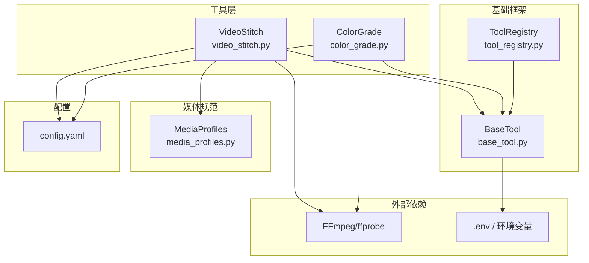
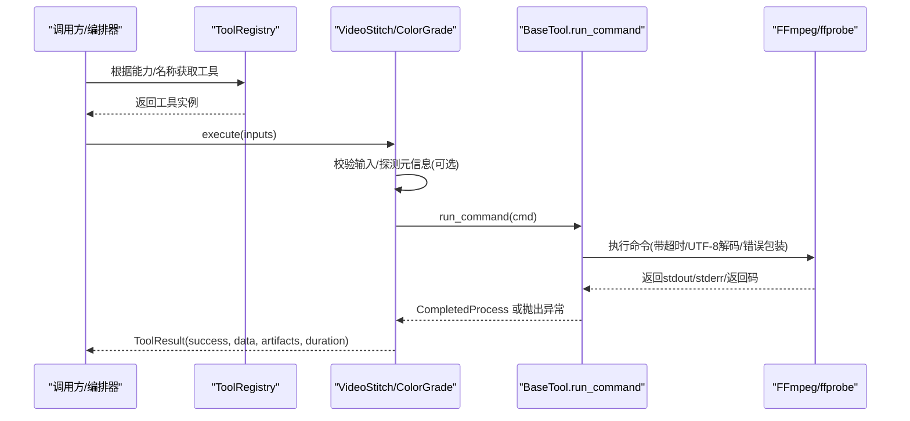
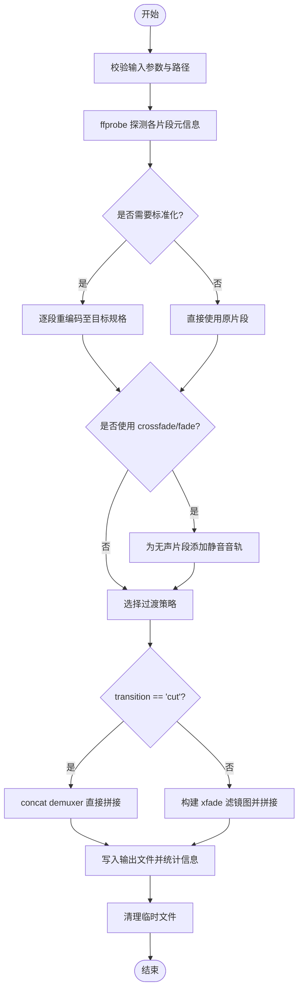
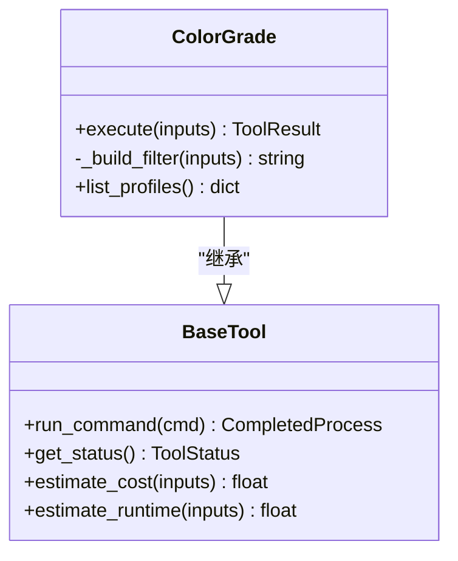
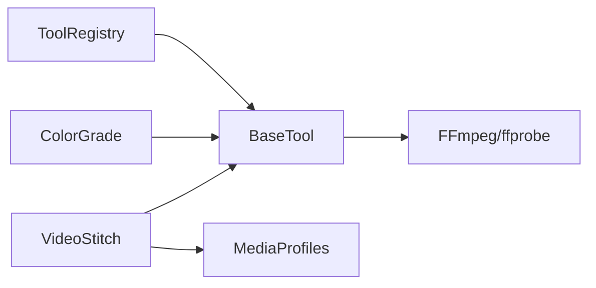

# 视频处理工具

<cite>
**本文引用的文件**   
- [tools/video/video_stitch.py](file://tools/video/video_stitch.py)
- [tools/enhancement/color_grade.py](file://tools/enhancement/color_grade.py)
- [tools/base_tool.py](file://tools/base_tool.py)
- [tools/tool_registry.py](file://tools/tool_registry.py)
- [lib/media_profiles.py](file://lib/media_profiles.py)
- [.agents/skills/ffmpeg/SKILL.md](file://.agents/skills/ffmpeg/SKILL.md)
- [config.yaml](file://config.yaml)
- [backlot/__main__.py](file://backlot/__main__.py)
</cite>

## 目录
1. [简介](#简介)
2. [项目结构](#项目结构)
3. [核心组件](#核心组件)
4. [架构总览](#架构总览)
5. [详细组件分析](#详细组件分析)
6. [依赖关系分析](#依赖关系分析)
7. [性能与优化](#性能与优化)
8. [故障排查指南](#故障排查指南)
9. [结论](#结论)
10. [附录：命令行与自动化示例](#附录命令行与自动化示例)

## 简介
本仓库提供一套面向视频生产的工具集，重点包括：
- 多段视频的无缝拼接（顺序拼接、交叉淡入淡出、黑场过渡）
- 转码与格式转换（分辨率、帧率、编码统一化）
- 空间布局合成（左右并排、上下堆叠、画中画）
- 色彩分级（内置滤镜预设与外部 LUT）
- FFmpeg 集成封装（参数配置、错误处理、资源管理）
- 工具注册与发现机制（能力枚举、状态检查、依赖校验）
- 媒体输出规范（平台化 Media Profile）

该文档从系统架构、组件职责、数据流、错误处理到性能调优进行系统化说明，并提供可操作的 CLI 使用示例与自动化工作流建议。

## 项目结构
- tools/video/video_stitch.py：视频拼接工具，封装 FFmpeg 的 concat、xfade、amix 等能力，支持自动标准化与预览生成。
- tools/enhancement/color_grade.py：色彩分级工具，基于 FFmpeg 滤镜链或 .cube LUT 实现。
- tools/base_tool.py：所有工具的基类，定义统一的执行接口、命令封装、依赖检测、结果对象、事件埋点等。
- tools/tool_registry.py：工具注册与发现，按能力/提供者/稳定性筛选，生成能力清单与运行期菜单。
- lib/media_profiles.py：平台化媒体输出规范（分辨率、帧率、编码、CRF、像素格式等）。
- .agents/skills/ffmpeg/SKILL.md：FFmpeg 常用操作参考与最佳实践。
- config.yaml：运行时默认输出格式、编码、分辨率、帧率、CRF 等全局配置。
- backlot/__main__.py：Backlot Web 服务入口（用于可视化与交互），非视频处理核心，但可作为工作流编排的前端入口。

**图表来源** 
- [tools/video/video_stitch.py:1-963](file://tools/video/video_stitch.py#L1-L963)
- [tools/enhancement/color_grade.py:1-213](file://tools/enhancement/color_grade.py#L1-L213)
- [tools/base_tool.py:1-481](file://tools/base_tool.py#L1-L481)
- [tools/tool_registry.py:1-493](file://tools/tool_registry.py#L1-L493)
- [lib/media_profiles.py:1-166](file://lib/media_profiles.py#L1-L166)
- [.agents/skills/ffmpeg/SKILL.md:1-433](file://.agents/skills/ffmpeg/SKILL.md#L1-L433)
- [config.yaml:1-20](file://config.yaml#L1-L20)

**章节来源**
- [tools/video/video_stitch.py:1-963](file://tools/video/video_stitch.py#L1-L963)
- [tools/enhancement/color_grade.py:1-213](file://tools/enhancement/color_grade.py#L1-L213)
- [tools/base_tool.py:1-481](file://tools/base_tool.py#L1-L481)
- [tools/tool_registry.py:1-493](file://tools/tool_registry.py#L1-L493)
- [lib/media_profiles.py:1-166](file://lib/media_profiles.py#L1-L166)
- [.agents/skills/ffmpeg/SKILL.md:1-433](file://.agents/skills/ffmpeg/SKILL.md#L1-L433)
- [config.yaml:1-20](file://config.yaml#L1-L20)

## 核心组件
- VideoStitch（视频拼接）
  - 能力：validate、stitch、preview_stitch、spatial（side_by_side、vertical_stack、picture_in_picture）
  - 输入：clips、transition（cut/crossfade/fade）、auto_normalize、target_resolution/target_fps、codec/crf/preset、profile、layout、pip_position/pip_scale/pip_margin 等
  - 输出：ToolResult（含 duration、file_size_bytes、artifacts、method 等）
  - 关键流程：探测元信息 → 兼容性校验 → 可选标准化重编码 → 选择过渡策略 → 调用 FFmpeg → 清理临时文件
- ColorGrade（色彩分级）
  - 能力：grade_preset、grade_lut、grade_custom
  - 输入：input_path、output_path、profile/lut_path/custom_vf、intensity、codec/crf
  - 输出：ToolResult（含 filter、duration_seconds、artifacts）
- BaseTool（工具基类）
  - 统一 execute() 接口、run_command() 子进程封装、依赖检测、结果对象 ToolResult、重试策略、幂等键、事件埋点
- ToolRegistry（工具注册表）
  - 自动发现 tools 包下的工具类，按 capability/provider/tier/status 查询，生成 provider_menu/support_envelope
- MediaProfiles（媒体规范）
  - 平台化 MediaProfile 常量与 ffmpeg_output_args 生成器

**章节来源**
- [tools/video/video_stitch.py:1-963](file://tools/video/video_stitch.py#L1-L963)
- [tools/enhancement/color_grade.py:1-213](file://tools/enhancement/color_grade.py#L1-L213)
- [tools/base_tool.py:1-481](file://tools/base_tool.py#L1-L481)
- [tools/tool_registry.py:1-493](file://tools/tool_registry.py#L1-L493)
- [lib/media_profiles.py:1-166](file://lib/media_profiles.py#L1-L166)

## 架构总览
下图展示从调用方到 FFmpeg 的完整调用链，以及工具间的协作关系。

**图表来源** 
- [tools/base_tool.py:411-454](file://tools/base_tool.py#L411-L454)
- [tools/video/video_stitch.py:148-174](file://tools/video/video_stitch.py#L148-L174)
- [tools/enhancement/color_grade.py:134-179](file://tools/enhancement/color_grade.py#L134-L179)
- [tools/tool_registry.py:118-134](file://tools/tool_registry.py#L118-L134)

## 详细组件分析

### VideoStitch（视频拼接）
- 功能要点
  - validate：探测 clips 元信息，比较分辨率、fps、编解码、采样率、声道数等，输出差异报告
  - stitch：顺序拼接；支持 cut（concat demuxer）、crossfade（xfade fade + acrossfade）、fade（xfade fadeblack + acrossfade）
  - preview_stitch：低分辨率快速预览（640x360、24fps、ultrafast）
  - spatial：side_by_side、vertical_stack、picture_in_picture（支持位置、缩放、边距）
- 关键实现
  - 自动标准化：当 clips 属性不一致且 auto_normalize=true 或 transition≠cut 时，先统一分辨率/帧率/编码/音频采样率
  - 无音频补充：对 crossfade/fade 场景，为无声片段注入静音 AAC 轨道，避免 acrossfade 失败
  - xfade 链式拼接：N 段 clip 通过复杂滤镜图逐步拼接，计算 offset 保证时间轴连续
  - 临时文件管理：.stitch_tmp 目录集中存放中间产物，finally 中清理
- 复杂度与性能
  - 验证阶段 O(N) 次 ffprobe 探测
  - 标准化重编码 O(N) 次 ffmpeg 转码
  - 拼接阶段：cut 为 copy（最快），crossfade/fade 需滤镜图构建与重编码
- 错误处理
  - 路径不存在、ffprobe 失败、xfade offset 计算保护、子进程异常包装为 ToolCommandError

**图表来源** 
- [tools/video/video_stitch.py:314-400](file://tools/video/video_stitch.py#L314-L400)
- [tools/video/video_stitch.py:441-476](file://tools/video/video_stitch.py#L441-L476)
- [tools/video/video_stitch.py:481-583](file://tools/video/video_stitch.py#L481-L583)
- [tools/video/video_stitch.py:584-736](file://tools/video/video_stitch.py#L584-L736)

**章节来源**
- [tools/video/video_stitch.py:1-963](file://tools/video/video_stitch.py#L1-L963)

### ColorGrade（色彩分级）
- 功能要点
  - 内置滤镜预设（cinematic_warm/cool、moody_dark、bright_clean、vintage_film、high_contrast、neutral）
  - 支持外部 .cube LUT 文件
  - 支持自定义 vf 字符串
  - intensity 混合：将原始画面与分级画面按比例叠加
- 关键实现
  - 优先级：custom_vf > lut_path > profile
  - 滤镜链构建：split+overlay 实现强度混合
  - 编码：默认复制音频，视频按 codec/crf 输出
- 错误处理
  - 输入不存在、未指定任何滤镜、FFmpeg 执行异常

**图表来源** 
- [tools/enhancement/color_grade.py:78-213](file://tools/enhancement/color_grade.py#L78-L213)
- [tools/base_tool.py:227-373](file://tools/base_tool.py#L227-L373)

**章节来源**
- [tools/enhancement/color_grade.py:1-213](file://tools/enhancement/color_grade.py#L1-L213)

### BaseTool（工具基类）
- 作用
  - 统一工具契约：name/version/tier/stability/execution_mode/determinism/runtime
  - 依赖检测：cmd/binary/env/python 模块
  - 子进程封装：跨平台解析可执行文件、UTF-8 解码、异常包装
  - 结果对象：ToolResult（success/data/artifacts/error/cost_usd/duration_seconds/seed/model）
  - 幂等键：idempotency_key_fields 组合哈希
  - 事件埋点：execute 装饰器记录 start/finish/error 事件（可选）
- 关键点
  - run_command 在 Windows 下通过 shutil.which 解析 .cmd/.bat 包装器
  - DependencyError 与 ToolCommandError 区分依赖缺失与命令执行失败

**章节来源**
- [tools/base_tool.py:1-481](file://tools/base_tool.py#L1-L481)

### ToolRegistry（工具注册表）
- 作用
  - 自动扫描 tools 包，注册所有 BaseTool 子类
  - 提供按 tier/capability/provider/status 的查询方法
  - 生成 support_envelope、provider_menu、capability_catalog 等运行期能力清单
- 关键点
  - discover(package_name="tools") 递归导入模块并注册
  - provider_menu_summary 汇总可用/不可用能力与安装提示

**章节来源**
- [tools/tool_registry.py:1-493](file://tools/tool_registry.py#L1-L493)

### MediaProfiles（媒体规范）
- 作用
  - 定义平台化 MediaProfile（分辨率、宽高比、fps、编码、CRF、像素格式、时长/大小限制等）
  - 提供 get_profile(name) 与 ffmpeg_output_args(profile) 生成器
- 关键点
  - 常见平台：YouTube、Instagram、TikTok、LinkedIn、Cinematic、Generic HD
  - 与 VideoStitch 的 _resolve_normalization_target 配合，实现“按平台输出”

**章节来源**
- [lib/media_profiles.py:1-166](file://lib/media_profiles.py#L1-L166)

## 依赖关系分析
- 外部依赖
  - FFmpeg/ffprobe：视频/音频处理与探测
  - requests（YingheVideo 使用，不在本文重点）
  - .env 环境变量：API Key、模型名、基础 URL 等
- 内部依赖
  - VideoStitch/ColorGrade 依赖 BaseTool 的统一接口
  - VideoStitch 依赖 MediaProfiles 的规范化输出
  - ToolRegistry 依赖 BaseTool 的类型信息与状态

**图表来源** 
- [tools/video/video_stitch.py:1-963](file://tools/video/video_stitch.py#L1-L963)
- [tools/enhancement/color_grade.py:1-213](file://tools/enhancement/color_grade.py#L1-L213)
- [tools/base_tool.py:1-481](file://tools/base_tool.py#L1-L481)
- [lib/media_profiles.py:1-166](file://lib/media_profiles.py#L1-L166)
- [tools/tool_registry.py:1-493](file://tools/tool_registry.py#L1-L493)

**章节来源**
- [tools/video/video_stitch.py:1-963](file://tools/video/video_stitch.py#L1-L963)
- [tools/enhancement/color_grade.py:1-213](file://tools/enhancement/color_grade.py#L1-L213)
- [tools/base_tool.py:1-481](file://tools/base_tool.py#L1-L481)
- [lib/media_profiles.py:1-166](file://lib/media_profiles.py#L1-L166)
- [tools/tool_registry.py:1-493](file://tools/tool_registry.py#L1-L493)

## 性能与优化
- FFmpeg 参数优化
  - CRF：质量-体积平衡（归档 18、生产 20-22、Web 预览 23-25、草稿 28+）
  - preset：slow/medium/fast/veryfast 影响编码速度与压缩效率
  - pix_fmt：yuv420p 提升兼容性
  - faststart：web 播放优化
- 拼接策略
  - cut 模式使用 concat demuxer 直接 copy，速度最快
  - crossfade/fade 需要滤镜图与重编码，耗时更高
- 标准化重编码
  - 仅在 clips 不兼容或 transition≠cut 时触发
  - 可通过 profile 或 target_resolution/target_fps 控制输出规格
- 预览模式
  - 降低分辨率与帧率、提高 CRF、使用 ultrafast 以快速预览
- 资源与并发
  - BaseTool.resource_profile 声明 CPU/RAM/VRAM/Disk/网络需求
  - ToolRegistry 可识别 GPU/网络依赖的工具，便于调度

[本节为通用指导，无需特定文件引用]

## 故障排查指南
- 常见问题
  - “高度不能被 2 整除”：scale 滤镜强制偶数尺寸
  - “浏览器无法播放”：确保 yuv420p、faststart、libx264
  - “速度变化后音画不同步”：使用 filter_complex 同时调整 setpts/atempo
  - “文件过大”：增大 CRF 或降低分辨率
  - “height not divisible by 2”：scale=trunc(iw/2)*2:trunc(ih/2)*2
  - “编码器未找到”：安装包含完整编解码器的 FFmpeg
  - “输出 0 字节”：查看完整 ffmpeg 输出定位错误
- 工具级错误
  - 依赖缺失：check_dependencies 抛出 DependencyError
  - 命令执行失败：run_command 抛出 ToolCommandError（包含 stderr/stdout）
  - 输入路径不存在：各工具在执行前校验
- 调试建议
  - 使用 dry_run 预检（VideoStitch）
  - 启用 ffprobe 输出 JSON 检查元信息
  - 查看 Backlot 日志（.studio/server.log）

**章节来源**
- [.agents/skills/ffmpeg/SKILL.md:395-433](file://.agents/skills/ffmpeg/SKILL.md#L395-L433)
- [tools/base_tool.py:304-328](file://tools/base_tool.py#L304-L328)
- [tools/base_tool.py:411-454](file://tools/base_tool.py#L411-L454)

## 结论
本项目以 BaseTool 为核心抽象，将 FFmpeg 的强大能力封装为可发现、可编排、可观测的视频处理工具。VideoStitch 提供多段视频无缝拼接与空间合成，ColorGrade 提供专业级色彩分级，MediaProfiles 保障平台化输出一致性。结合 ToolRegistry 的能力清单与 Backlot 的可视化界面，可构建端到端的视频生产流水线。

[本节为总结性内容，无需特定文件引用]

## 附录：命令行与自动化示例
- 环境准备
  - 安装 FFmpeg/ffprobe（Windows/macOS/Linux 分别参考 install_instructions）
  - 设置必要的环境变量（如 API Key 等）
- 使用 BaseTool.run_command 直接调用 FFmpeg
  - 示例：使用 concat demuxer 拼接两段视频（同规格）
  - 示例：使用 xfade 滤镜实现交叉淡入淡出
  - 示例：使用 scale+pad 统一分辨率并居中填充
- 批量处理脚本思路
  - 遍历输入目录，生成 concat_list.txt，调用 ffmpeg -f concat -safe 0 -i list.txt -c copy output.mp4
  - 对多段素材进行标准化重编码后再拼接
  - 使用 ffprobe 收集元信息，判断是否需要 auto_normalize
- 自动化工作流集成
  - 通过 ToolRegistry 动态发现工具并按能力编排
  - 使用 ToolResult.artifacts 传递中间产物路径
  - 结合 Backlot 的 serve/open/studio 命令启动 Web 界面进行监控与交互

[本节为概念性示例，不直接映射具体代码文件，故不附加“图表来源”和“章节来源”]