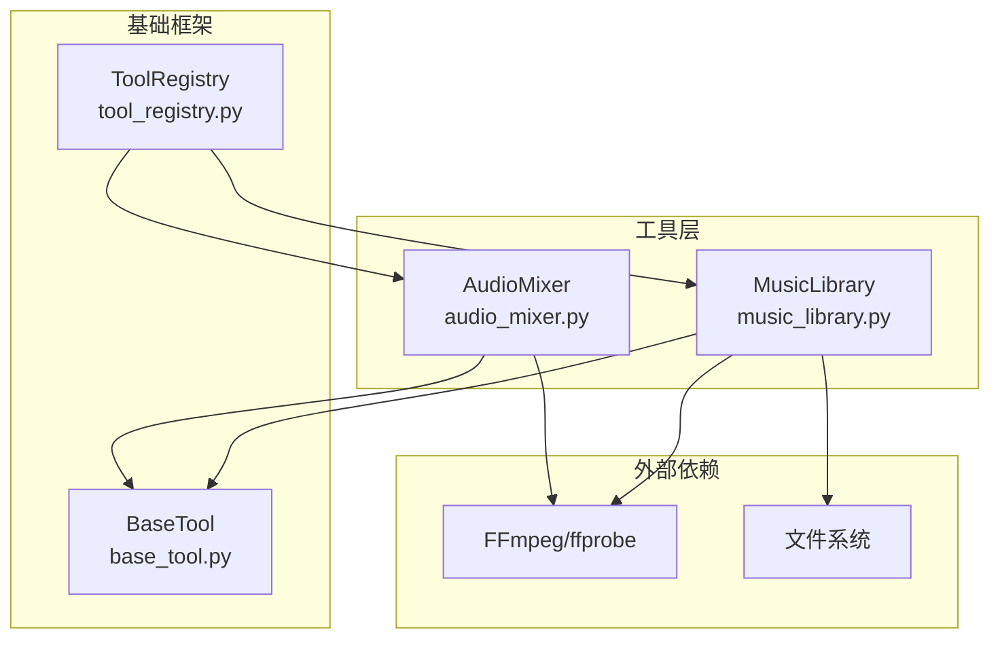
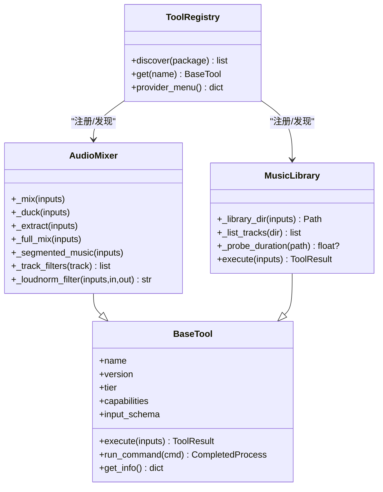
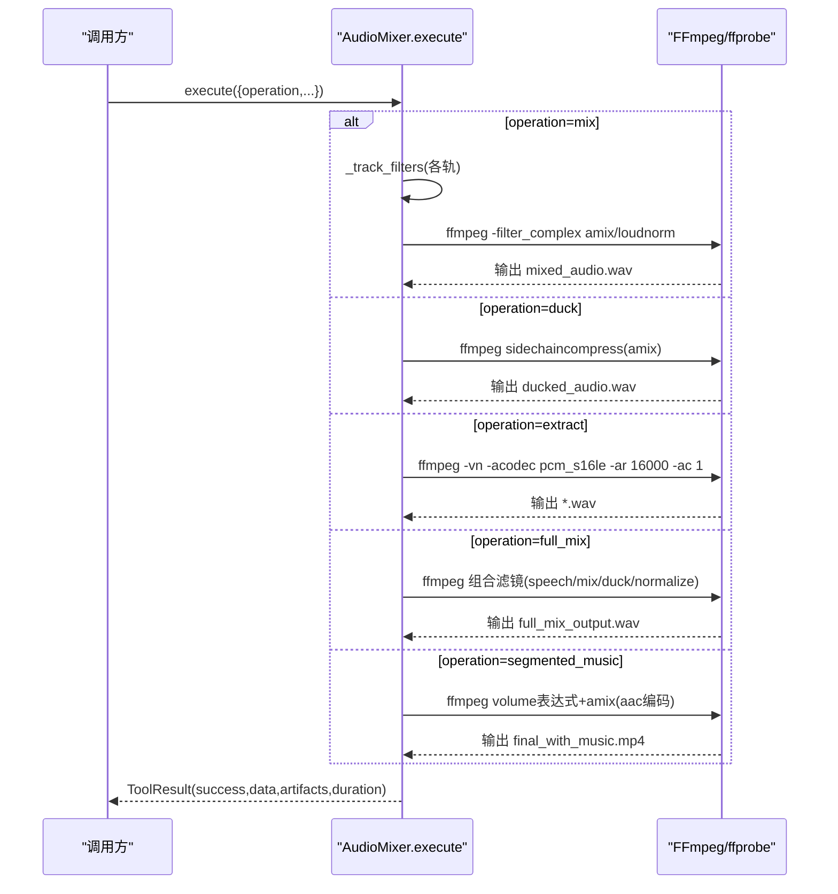
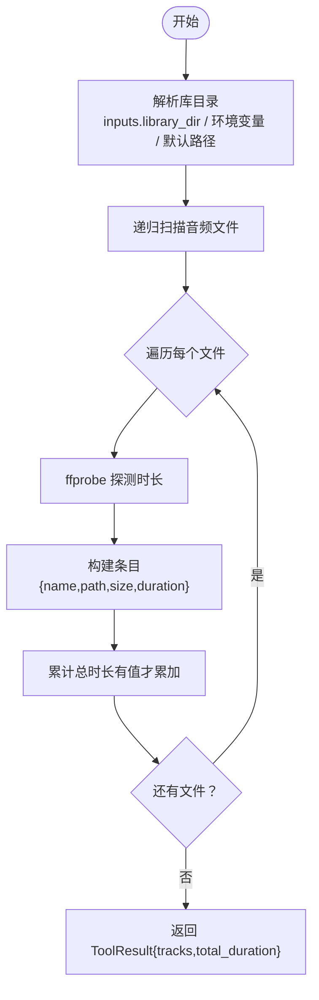
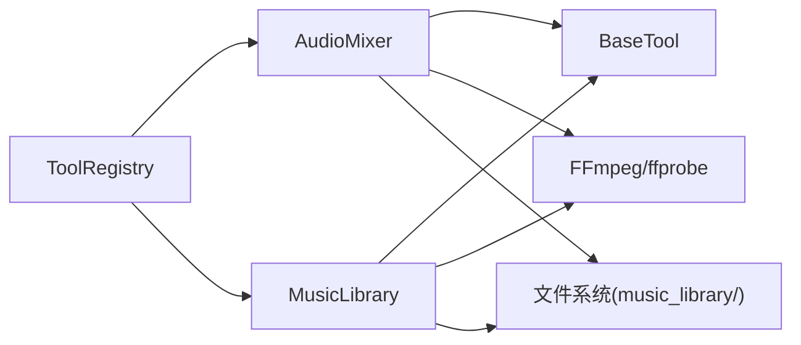

# 音频处理工具

<cite>
**本文引用的文件**   
- [tools/audio/audio_mixer.py](file://tools/audio/audio_mixer.py)
- [tools/audio/music_library.py](file://tools/audio/music_library.py)
- [tools/base_tool.py](file://tools/base_tool.py)
- [tools/tool_registry.py](file://tools/tool_registry.py)
- [config.yaml](file://config.yaml)
- [.agents/skills/ffmpeg/SKILL.md](file://.agents/skills/ffmpeg/SKILL.md)
- [.agents/skills/ffmpeg/reference.md](file://.agents/skills/ffmpeg/reference.md)
- [music_library/.gitkeep](file://music_library/.gitkeep)
</cite>

## 目录
1. [简介](#简介)
2. [项目结构](#项目结构)
3. [核心组件](#核心组件)
4. [架构总览](#架构总览)
5. [详细组件分析](#详细组件分析)
6. [依赖关系分析](#依赖关系分析)
7. [性能与质量优化](#性能与质量优化)
8. [故障排查指南](#故障排查指南)
9. [结论](#结论)
10. [附录：API 使用示例](#附录api-使用示例)

## 简介
本文件面向“音频处理工具”的文档，聚焦以下目标：
- 音频混合器：多轨混音、音量调整、淡入淡出、侧链压缩（人声优先）、响度标准化。
- 音乐库管理：本地音乐文件的索引、元数据提取（时长）与播放列表展示。
- 音频格式转换、降噪与音质优化：基于 FFmpeg 的实用方法与最佳实践。
- API 接口说明与调用示例：以工具契约为中心，提供可操作的输入输出规范。
- 音频质量评估与性能优化建议：结合平台目标与资源约束给出指导。

## 项目结构
本项目将音频能力拆分为两个独立工具：
- audio_mixer：封装 FFmpeg/pydub 的音频混合、抽离、侧链压缩与分段配乐等能力。
- music_library：扫描本地音乐库目录，列出可用曲目并尝试获取时长信息。

图表来源 
- [tools/audio/audio_mixer.py](file://tools/audio/audio_mixer.py)
- [tools/audio/music_library.py](file://tools/audio/music_library.py)
- [tools/base_tool.py](file://tools/base_tool.py)
- [tools/tool_registry.py](file://tools/tool_registry.py)

章节来源
- [tools/audio/audio_mixer.py:1-736](file://tools/audio/audio_mixer.py#L1-L736)
- [tools/audio/music_library.py:1-222](file://tools/audio/music_library.py#L1-L222)
- [tools/base_tool.py:1-481](file://tools/base_tool.py#L1-L481)
- [tools/tool_registry.py:1-493](file://tools/tool_registry.py#L1-L493)

## 核心组件
- AudioMixer（音频混合器）
  - 能力：mix（多轨混音）、duck（侧链压缩/人声优先）、extract（视频抽音）、full_mix（一键混音+侧链+标准化）、segmented_music（按时间段混入背景音乐）。
  - 关键特性：每轨音量/延迟/淡入淡出；统一响度标准化（loudnorm，支持 LUFS 目标）；FFmpeg filter_complex 构建复杂滤镜图。
  - 资源需求：CPU 2核、内存约 1GB、磁盘约 500MB。
- MusicLibrary（音乐库）
  - 能力：list_user_music_tracks（递归扫描指定目录，返回文件名、路径、大小、可选时长）。
  - 元数据来源：ffprobe 探测时长（若不可用则回退为 null）。
  - 资源需求：极低（仅文件扫描与可选 ffprobe）。

章节来源
- [tools/audio/audio_mixer.py:26-195](file://tools/audio/audio_mixer.py#L26-L195)
- [tools/audio/music_library.py:53-131](file://tools/audio/music_library.py#L53-L131)

## 架构总览
工具通过 BaseTool 抽象统一契约（execute、get_info、run_command 等），由 ToolRegistry 自动发现与编排。AudioMixer 与 MusicLibrary 均继承 BaseTool，并通过 run_command 调用 FFmpeg/ffprobe。

图表来源 
- [tools/base_tool.py:227-372](file://tools/base_tool.py#L227-L372)
- [tools/audio/audio_mixer.py:26-195](file://tools/audio/audio_mixer.py#L26-L195)
- [tools/audio/music_library.py:53-131](file://tools/audio/music_library.py#L53-L131)
- [tools/tool_registry.py:55-134](file://tools/tool_registry.py#L55-L134)

## 详细组件分析

### AudioMixer（音频混合器）
- 操作类型与用途
  - mix：多轨混音，支持每轨 volume/start_seconds/fade_in/fade_out。
  - duck：侧链压缩实现“人声出现时压低音乐”，支持简单参数或 tracks 数组两种输入。
  - extract：从视频中抽取音频（PCM 16kHz 单声道 WAV）。
  - full_mix：一键流程（混音+侧链+标准化），适合 compose-director 场景。
  - segmented_music：仅在指定时间段内混入背景音乐，边界平滑淡入淡出。
- 关键实现要点
  - _track_filters：逐轨生成音量、淡入淡出、延迟等滤镜链，确保 afade 作用于源样本而非延迟静音。
  - _loudnorm_filter：根据 loudnorm_target 动态构建 I/LRA/TP 参数，默认 -16 LUFS，支持平台化配置。
  - _duck/_full_mix：使用 sidechaincompress 进行侧链压缩，speech 作为 key 信号控制 music 压缩。
  - _segmented_music：使用 volume 表达式按时间段叠加音乐音量，amix 时关闭 normalize 避免对白被永久衰减。
- 错误处理
  - 输入校验（文件存在性、必要字段）、异常捕获后返回 ToolResult(success=False, error=...)。
- 资源与幂等
  - resource_profile 定义 CPU/内存/磁盘占用；idempotency_key_fields 用于缓存键生成。

图表来源 
- [tools/audio/audio_mixer.py:249-270](file://tools/audio/audio_mixer.py#L249-L270)
- [tools/audio/audio_mixer.py:272-331](file://tools/audio/audio_mixer.py#L272-L331)
- [tools/audio/audio_mixer.py:332-437](file://tools/audio/audio_mixer.py#L332-L437)
- [tools/audio/audio_mixer.py:439-469](file://tools/audio/audio_mixer.py#L439-L469)
- [tools/audio/audio_mixer.py:471-627](file://tools/audio/audio_mixer.py#L471-L627)
- [tools/audio/audio_mixer.py:629-736](file://tools/audio/audio_mixer.py#L629-L736)

章节来源
- [tools/audio/audio_mixer.py:1-736](file://tools/audio/audio_mixer.py#L1-L736)

### MusicLibrary（音乐库）
- 功能概述
  - 递归扫描 music_library 目录（可通过环境变量 MUSIC_LIBRARY_DIR 覆盖），收集 .mp3/.wav/.m4a/.aac/.flac/.ogg/.opus/.aiff/.aif 等扩展名文件。
  - 对每个文件统计 name/path/size_bytes，并尝试通过 ffprobe 获取 duration_seconds（失败则为 null）。
  - 返回 tracks 列表与 total_duration_seconds（当至少有一个成功探测时长时）。
- 状态与可用性
  - get_status：若目录下有音频文件则 AVAILABLE，否则 UNAVAILABLE。
- 资源与副作用
  - 纯读操作，无副作用；资源消耗极低。

图表来源 
- [tools/audio/music_library.py:134-150](file://tools/audio/music_library.py#L134-L150)
- [tools/audio/music_library.py:152-178](file://tools/audio/music_library.py#L152-L178)
- [tools/audio/music_library.py:189-222](file://tools/audio/music_library.py#L189-L222)

章节来源
- [tools/audio/music_library.py:1-222](file://tools/audio/music_library.py#L1-L222)

### 基础框架与注册机制
- BaseTool
  - 统一工具契约：execute、get_info、run_command、check_dependencies、estimate_runtime 等。
  - 事件埋点：execute 包装 Backlot 事件（start/finish/error），便于看板追踪。
  - 子进程执行：run_command 封装 subprocess，Windows 下自动解析可执行路径，UTF-8 解码 stderr/stdout。
- ToolRegistry
  - discover：自动导入 tools 包树，注册所有 BaseTool 子类实例。
  - provider_menu/support_envelope：汇总工具能力、状态、依赖与安装指引，供 Agent 预检与用户菜单展示。

章节来源
- [tools/base_tool.py:1-481](file://tools/base_tool.py#L1-L481)
- [tools/tool_registry.py:1-493](file://tools/tool_registry.py#L1-L493)

## 依赖关系分析
- 运行时依赖
  - FFmpeg/ffprobe：AudioMixer 与 MusicLibrary 的核心依赖。
  - Python 环境：BaseTool 依赖标准库与可选 dotenv（已内置加载逻辑）。
- 模块耦合
  - AudioMixer/MusicLibrary 强依赖 BaseTool 契约；ToolRegistry 负责发现与聚合。
- 外部集成
  - 文件系统：MusicLibrary 读取 music_library 目录；AudioMixer 读写输出路径。
  - 配置文件：config.yaml 定义默认输出格式、编解码器等（与音视频管线相关）。

图表来源 
- [tools/tool_registry.py:118-134](file://tools/tool_registry.py#L118-L134)
- [tools/base_tool.py:304-328](file://tools/base_tool.py#L304-L328)
- [tools/audio/music_library.py:134-150](file://tools/audio/music_library.py#L134-L150)
- [tools/audio/audio_mixer.py:36-41](file://tools/audio/audio_mixer.py#L36-L41)

章节来源
- [tools/tool_registry.py:1-493](file://tools/tool_registry.py#L1-L493)
- [tools/base_tool.py:1-481](file://tools/base_tool.py#L1-L481)
- [config.yaml:1-20](file://config.yaml#L1-L20)

## 性能与质量优化
- 混音与标准化
  - 使用 loudnorm 统一响度，推荐目标 LUFS：播客/Apple 常用 -16，YouTube/TikTok/IG 常用 -14。
  - full_mix 中 amix 前关闭 normalize 以避免对白被永久衰减（在分段配乐路径尤为重要）。
- 侧链压缩（Ducking）
  - 合理设置 threshold/ratio/attack/release 与 music_volume_during_speech，保证人声清晰且音乐自然过渡。
- 分段配乐
  - 使用 volume 表达式在边界做平滑淡入淡出，避免突兀切换。
- 格式与编码
  - 视频转码参考 FFmpeg Skill/Reference 中的 CRF/preset/bitrate 建议，兼顾质量与体积。
  - 音频采样率/位深：按需选择（如 16kHz 单声道用于语音预处理，44.1/48kHz 立体声用于最终输出）。
- 资源与并发
  - AudioMixer 预估 CPU 2核、内存约 1GB；批量任务注意磁盘 IO 与临时文件清理。

章节来源
- [tools/audio/audio_mixer.py:197-214](file://tools/audio/audio_mixer.py#L197-L214)
- [tools/audio/audio_mixer.py:691-703](file://tools/audio/audio_mixer.py#L691-L703)
- [.agents/skills/ffmpeg/SKILL.md:1-433](file://.agents/skills/ffmpeg/SKILL.md#L1-L433)
- [.agents/skills/ffmpeg/reference.md:1-174](file://.agents/skills/ffmpeg/reference.md#L1-L174)

## 故障排查指南
- 常见错误与定位
  - 未找到输入文件：检查 path 是否存在；AudioMixer 会返回明确错误信息。
  - FFmpeg 命令失败：run_command 抛出 ToolCommandError，包含 returncode/cmd/stderr/stdout 详情。
  - ffprobe 不可用：MusicLibrary 探测时长返回 None，不影响基本列表功能。
- 快速自检
  - 确认 ffmpeg/ffprobe 在 PATH 中；检查输出目录权限与空间。
  - 验证 tracks 数组 role 字段（speech/music/sfx/primary/secondary）是否符合预期。
  - 对于分段配乐，确认 segments 时间区间不重叠且小于视频时长。

章节来源
- [tools/base_tool.py:411-454](file://tools/base_tool.py#L411-L454)
- [tools/audio/audio_mixer.py:249-270](file://tools/audio/audio_mixer.py#L249-L270)
- [tools/audio/music_library.py:152-178](file://tools/audio/music_library.py#L152-L178)

## 结论
- AudioMixer 提供了完整的音频混合与后期处理能力，覆盖多轨混音、侧链压缩、标准化与分段配乐等关键场景。
- MusicLibrary 以极简方式暴露本地音乐资产，便于在提案阶段即做出音乐决策。
- 借助 BaseTool 与 ToolRegistry，工具具备统一的契约、可发现性与可观测性，便于 Agent 编排与用户交互。
- 结合 FFmpeg 最佳实践，可在质量与性能之间取得良好平衡。

## 附录：API 使用示例
以下为各操作的输入/输出要点（以路径引用代替具体代码片段）：
- 多轨混音（mix）
  - 输入关键字段：operation="mix"、tracks=[{path,role,volume,start_seconds,fade_in_seconds,fade_out_seconds}]、output_path、normalize。
  - 输出：ToolResult.data.output 指向混合后的音频文件。
  - 参考路径：[tools/audio/audio_mixer.py:272-331](file://tools/audio/audio_mixer.py#L272-L331)
- 侧链压缩（duck）
  - 简单输入：operation="duck"、primary_audio、secondary_audio、duck_level（dB）、output_path。
  - 高级输入：operation="duck"、tracks=[{path,role}], output_path。
  - 输出：ToolResult.data.output 指向压制后的音频文件。
  - 参考路径：[tools/audio/audio_mixer.py:332-437](file://tools/audio/audio_mixer.py#L332-L437)
- 视频抽音（extract）
  - 输入：operation="extract"、input_path、output_path（默认同名 .wav）。
  - 输出：ToolResult.data.output 指向 WAV 文件。
  - 参考路径：[tools/audio/audio_mixer.py:439-469](file://tools/audio/audio_mixer.py#L439-L469)
- 一键混音（full_mix）
  - 输入：operation="full_mix"、tracks=[speech/music/sfx]、ducking.enabled/params、normalize、output_path。
  - 输出：ToolResult.data.output 指向最终混音文件。
  - 参考路径：[tools/audio/audio_mixer.py:471-627](file://tools/audio/audio_mixer.py#L471-L627)
- 分段配乐（segmented_music）
  - 输入：operation="segmented_music"、video_path、music_path、segments=[{start,end}]、music_volume、fade_duration、output_path。
  - 输出：ToolResult.data.output 指向合成后的 MP4 文件。
  - 参考路径：[tools/audio/audio_mixer.py:629-736](file://tools/audio/audio_mixer.py#L629-L736)
- 音乐库列表（list_user_music_tracks）
  - 输入：library_dir（可选，默认取 MUSIC_LIBRARY_DIR 或项目根 music_library）。
  - 输出：ToolResult.data.tracks（含 name/path/size_bytes/duration_seconds）、total_duration_seconds。
  - 参考路径：[tools/audio/music_library.py:189-222](file://tools/audio/music_library.py#L189-L222)

章节来源
- [tools/audio/audio_mixer.py:272-736](file://tools/audio/audio_mixer.py#L272-L736)
- [tools/audio/music_library.py:189-222](file://tools/audio/music_library.py#L189-L222)
- [music_library/.gitkeep:1-2](file://music_library/.gitkeep#L1-L2)