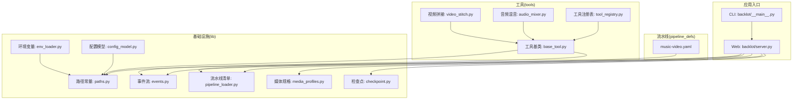
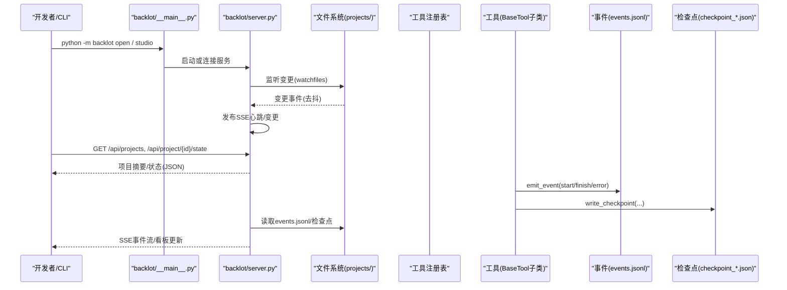
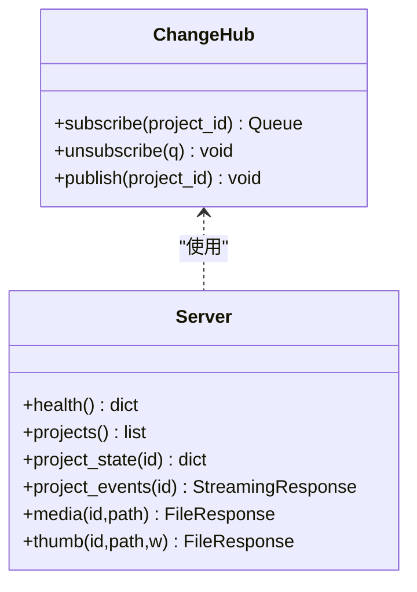
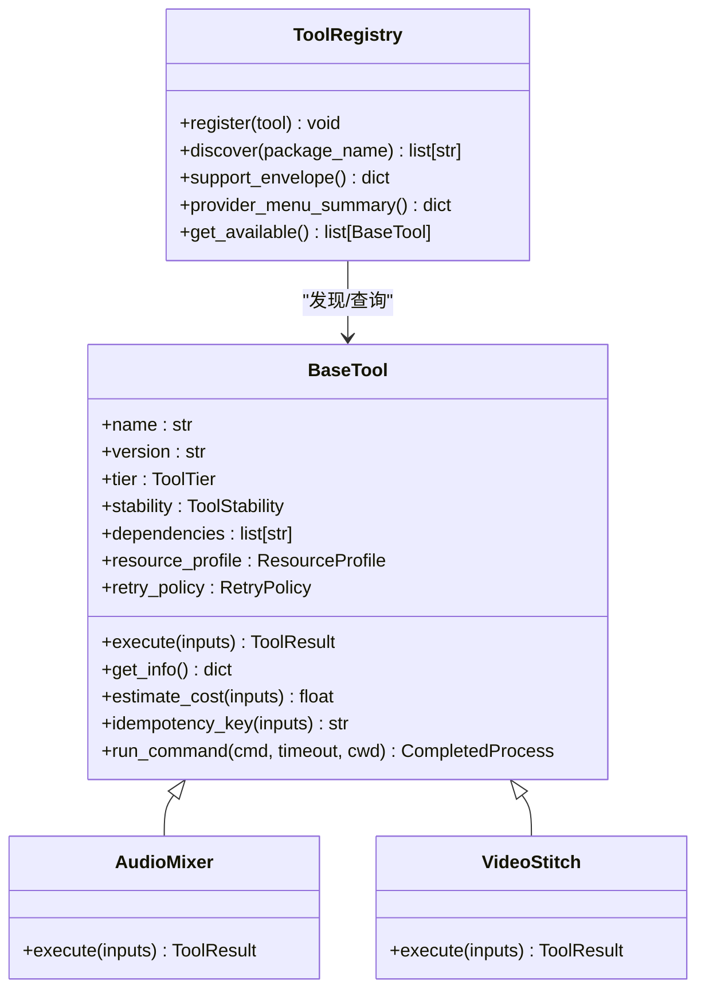
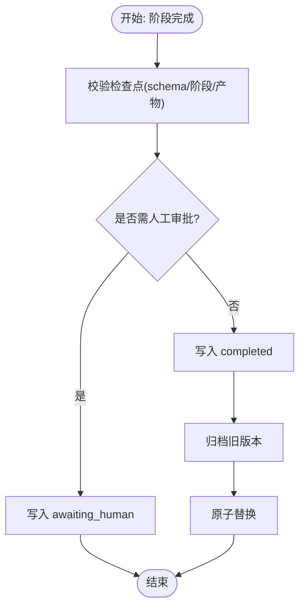
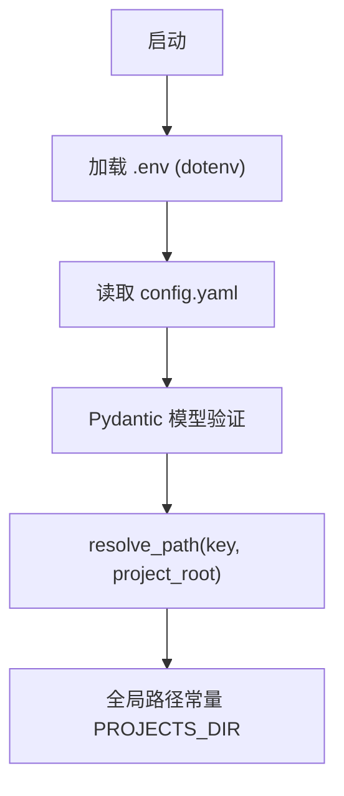
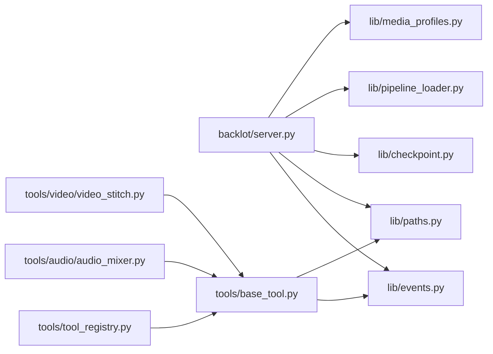

# 代码结构与规范

<cite>
**本文引用的文件**   
- [config.yaml](file://config.yaml)
- [requirements.txt](file://requirements.txt)
- [backlot/__main__.py](file://backlot/__main__.py)
- [backlot/server.py](file://backlot/server.py)
- [lib/config_model.py](file://lib/config_model.py)
- [lib/env_loader.py](file://lib/env_loader.py)
- [lib/paths.py](file://lib/paths.py)
- [lib/events.py](file://lib/events.py)
- [lib/pipeline_loader.py](file://lib/pipeline_loader.py)
- [lib/media_profiles.py](file://lib/media_profiles.py)
- [lib/checkpoint.py](file://lib/checkpoint.py)
- [tools/base_tool.py](file://tools/base_tool.py)
- [tools/tool_registry.py](file://tools/tool_registry.py)
- [tools/audio/audio_mixer.py](file://tools/audio/audio_mixer.py)
- [tools/video/video_stitch.py](file://tools/video/video_stitch.py)
- [pipeline_defs/music-video.yaml](file://pipeline_defs/music-video.yaml)
</cite>

## 目录
1. [简介](#简介)
2. [项目结构](#项目结构)
3. [核心组件](#核心组件)
4. [架构总览](#架构总览)
5. [详细组件分析](#详细组件分析)
6. [依赖关系分析](#依赖关系分析)
7. [性能与可扩展性](#性能与可扩展性)
8. [错误处理与日志记录](#错误处理与日志记录)
9. [配置与环境变量规范](#配置与环境变量规范)
10. [代码风格与最佳实践](#代码风格与最佳实践)
11. [代码审查清单与质量检查标准](#代码审查清单与质量检查标准)
12. [故障排查指南](#故障排查指南)
13. [结论](#结论)

## 简介
本仓库是一个面向音乐视频制作的“管道化”生产系统，包含：
- 可插拔的工具层（音视频处理、转码、混音等）
- 基于声明式 YAML 的流水线编排（阶段、产物、人工审批门控）
- 本地看板服务（Backlot），提供项目状态、SSE 事件流、媒体与缩略图服务
- 统一的配置模型与环境变量加载机制
- 完善的检查点与事件追踪，支持可视化进度与回放

目标读者包括新加入的开发者与维护者，帮助快速理解目录职责、模块依赖、接口约定与编码规范。

## 项目结构
- backlot：看板服务与前端资源（FastAPI + SSE + 静态 UI）
- lib：运行时配置、路径、事件、流水线清单加载、媒体规格等基础设施
- tools：工具基类与具体工具实现（音频、视频、增强、分析等）
- pipeline_defs：流水线定义（YAML）
- schemas：JSON Schema（制品、检查点、流水线清单、样式）
- skills：Agent 技能文档（导演脚本、元协议）
- .agents/skills：AI Agent 技能参考
- 根级配置文件：config.yaml、requirements.txt

**图表来源** 
- [backlot/__main__.py](file://backlot/__main__.py)
- [backlot/server.py](file://backlot/server.py)
- [lib/config_model.py](file://lib/config_model.py)
- [lib/env_loader.py](file://lib/env_loader.py)
- [lib/paths.py](file://lib/paths.py)
- [lib/events.py](file://lib/events.py)
- [lib/pipeline_loader.py](file://lib/pipeline_loader.py)
- [lib/media_profiles.py](file://lib/media_profiles.py)
- [lib/checkpoint.py](file://lib/checkpoint.py)
- [tools/base_tool.py](file://tools/base_tool.py)
- [tools/tool_registry.py](file://tools/tool_registry.py)
- [tools/audio/audio_mixer.py](file://tools/audio/audio_mixer.py)
- [tools/video/video_stitch.py](file://tools/video/video_stitch.py)
- [pipeline_defs/music-video.yaml](file://pipeline_defs/music-video.yaml)

**章节来源**
- [backlot/__main__.py](file://backlot/__main__.py)
- [backlot/server.py](file://backlot/server.py)
- [lib/config_model.py](file://lib/config_model.py)
- [lib/env_loader.py](file://lib/env_loader.py)
- [lib/paths.py](file://lib/paths.py)
- [lib/events.py](file://lib/events.py)
- [lib/pipeline_loader.py](file://lib/pipeline_loader.py)
- [lib/media_profiles.py](file://lib/media_profiles.py)
- [lib/checkpoint.py](file://lib/checkpoint.py)
- [tools/base_tool.py](file://tools/base_tool.py)
- [tools/tool_registry.py](file://tools/tool_registry.py)
- [tools/audio/audio_mixer.py](file://tools/audio/audio_mixer.py)
- [tools/video/video_stitch.py](file://tools/video/video_stitch.py)
- [pipeline_defs/music-video.yaml](file://pipeline_defs/music-video.yaml)

## 核心组件
- 配置模型与路径
  - 通过 Pydantic 模型加载 config.yaml，并提供 resolve_path 统一解析相对路径
  - 单点路径常量 PROJECTS_DIR 由环境变量覆盖，保证所有子系统一致
- 事件与检查点
  - BaseTool 自动包装 execute，向 events.jsonl 追加 start/finish/error 事件
  - 检查点写入前校验 schema，归档历史版本，强制人工审批门控
- 工具与注册表
  - BaseTool 抽象工具契约（能力、资源、重试、幂等键、成本估算）
  - ToolRegistry 自动发现并汇总工具能力，生成支持信封与提供者菜单
- 看板服务
  - FastAPI 提供健康检查、项目列表、SSE 事件流、媒体与缩略图服务
  - watchfiles 监听项目目录变更，去抖后推送给订阅者

**章节来源**
- [lib/config_model.py](file://lib/config_model.py)
- [lib/paths.py](file://lib/paths.py)
- [lib/events.py](file://lib/events.py)
- [lib/checkpoint.py](file://lib/checkpoint.py)
- [tools/base_tool.py](file://tools/base_tool.py)
- [tools/tool_registry.py](file://tools/tool_registry.py)
- [backlot/server.py](file://backlot/server.py)

## 架构总览
系统采用“声明式流水线 + 可插拔工具 + 实时看板”的分层架构：
- 声明层：pipeline_defs/*.yaml 描述阶段、产物、工具、审批门控
- 执行层：tools/* 实现具体能力，BaseTool 统一契约与观测
- 编排层：checkpoint.py 管理阶段推进与人工审批；pipeline_loader.py 读取清单
- 展示层：backlot/server.py 提供 API/SSE/静态页面，watchfiles 驱动实时更新

**图表来源** 
- [backlot/__main__.py](file://backlot/__main__.py)
- [backlot/server.py](file://backlot/server.py)
- [lib/events.py](file://lib/events.py)
- [lib/checkpoint.py](file://lib/checkpoint.py)
- [tools/base_tool.py](file://tools/base_tool.py)

## 详细组件分析

### Backlot 看板服务
- 职责
  - 提供 REST API：健康检查、项目列表、项目状态、组合扫描、媒体与缩略图
  - 提供 SSE 事件流：项目变更、聊天会话事件
  - 提供静态页面：library/studio/board/preview
- 关键设计
  - ChangeHub：按项目过滤的 fan-out 通知队列，避免无关项目风暴
  - watchfiles：后台任务监听 projects/ 变更，去抖后失效缓存并广播
  - 安全校验：路径穿越防护、未知项目 404、非图片视频返回友好错误
  - 缩略图缓存：按源文件+尺寸哈希缓存 JPEG，失败回退到原图或 404

**图表来源** 
- [backlot/server.py](file://backlot/server.py)

**章节来源**
- [backlot/server.py](file://backlot/server.py)

### 工具基类与注册表
- BaseTool
  - 统一属性：名称、版本、层级、稳定性、运行环境、依赖、能力、资源画像、重试策略、幂等键、副作用、回退工具、Agent 技能引用
  - 自动注入事件埋点：execute 被装饰器包裹，自动写入 start/finish/error
  - 子进程封装：run_command 统一错误处理与跨平台兼容
- ToolRegistry
  - 自动发现 tools/* 下的 BaseTool 子类，注册并维护状态
  - 生成支持信封、能力目录、提供者菜单、GPU/网络需求统计

**图表来源** 
- [tools/base_tool.py](file://tools/base_tool.py)
- [tools/tool_registry.py](file://tools/tool_registry.py)
- [tools/audio/audio_mixer.py](file://tools/audio/audio_mixer.py)
- [tools/video/video_stitch.py](file://tools/video/video_stitch.py)

**章节来源**
- [tools/base_tool.py](file://tools/base_tool.py)
- [tools/tool_registry.py](file://tools/tool_registry.py)
- [tools/audio/audio_mixer.py](file://tools/audio/audio_mixer.py)
- [tools/video/video_stitch.py](file://tools/video/video_stitch.py)

### 流水线清单与检查点
- 流水线清单（music-video.yaml）
  - 定义阶段顺序、所需产物、可用工具、人工审批默认值、成功标准
- 检查点（checkpoint.py）
  - 写入前校验 schema，归档历史版本，强制 gate 策略（awaiting_human → completed）
  - 合并 decision_log，供下游消费
- 事件（events.py）
  - 线程安全追加，容忍损坏行，按项目推断归属

**图表来源** 
- [lib/checkpoint.py](file://lib/checkpoint.py)
- [pipeline_defs/music-video.yaml](file://pipeline_defs/music-video.yaml)
- [lib/events.py](file://lib/events.py)

**章节来源**
- [lib/checkpoint.py](file://lib/checkpoint.py)
- [pipeline_defs/music-video.yaml](file://pipeline_defs/music-video.yaml)
- [lib/events.py](file://lib/events.py)

### 配置与环境变量
- 配置模型（config_model.py）
  - 从 config.yaml 加载，Pydantic 强类型校验，提供 resolve_path
- 环境变量（env_loader.py）
  - 加载 .env，提供 get_env/require_env
- 路径常量（paths.py）
  - PROJECTS_DIR 可由 OPENMONTAGE_PROJECTS_DIR 覆盖

**图表来源** 
- [lib/config_model.py](file://lib/config_model.py)
- [lib/env_loader.py](file://lib/env_loader.py)
- [lib/paths.py](file://lib/paths.py)
- [config.yaml](file://config.yaml)

**章节来源**
- [lib/config_model.py](file://lib/config_model.py)
- [lib/env_loader.py](file://lib/env_loader.py)
- [lib/paths.py](file://lib/paths.py)
- [config.yaml](file://config.yaml)

## 依赖关系分析
- 外部依赖
  - pyyaml、pydantic、jsonschema、python-dotenv、requests
  - fastapi、uvicorn、watchfiles（看板）
- 内部依赖
  - backlot/server.py 依赖 lib/events、lib/paths、lib/checkpoint、lib/pipeline_loader、lib/media_profiles
  - tools/base_tool.py 依赖 lib/events、lib.paths
  - tools/tool_registry.py 依赖 tools.base_tool
  - 具体工具依赖 ffmpeg/ffprobe（命令行）

**图表来源** 
- [backlot/server.py](file://backlot/server.py)
- [lib/events.py](file://lib/events.py)
- [lib/paths.py](file://lib/paths.py)
- [lib/checkpoint.py](file://lib/checkpoint.py)
- [lib/pipeline_loader.py](file://lib/pipeline_loader.py)
- [lib/media_profiles.py](file://lib/media_profiles.py)
- [tools/base_tool.py](file://tools/base_tool.py)
- [tools/tool_registry.py](file://tools/tool_registry.py)
- [tools/audio/audio_mixer.py](file://tools/audio/audio_mixer.py)
- [tools/video/video_stitch.py](file://tools/video/video_stitch.py)

**章节来源**
- [requirements.txt](file://requirements.txt)
- [backlot/server.py](file://backlot/server.py)
- [tools/base_tool.py](file://tools/base_tool.py)
- [tools/tool_registry.py](file://tools/tool_registry.py)

## 性能与可扩展性
- 事件与状态
  - events.jsonl 追加写，线程锁保护；读取容忍损坏行
  - 看板对 summary 做缓存，变更时失效
- 缩略图
  - 按源文件+尺寸哈希缓存 JPEG，并发 miss 使用临时文件名避免竞争
- 流水线清单
  - lru_cache 缓存 schema 与清单加载结果
- 扩展建议
  - 新增工具仅需继承 BaseTool，并在 tools/* 下注册
  - 新增流水线在 pipeline_defs/*.yaml 中声明即可

[本节为通用指导，不直接分析具体文件]

## 错误处理与日志记录
- 工具层
  - run_command 将 CalledProcessError 包装为 ToolCommandError，附带 stderr/stdout/detail
  - execute 异常捕获，返回 ToolResult(success=False, error=...)
- 看板服务
  - 健康检查、路径校验、未知项目、媒体不存在均返回明确 HTTP 状态码
  - SSE 心跳与断连清理
- 事件与检查点
  - emit_event 吞掉异常，确保观测不影响主流程
  - write_checkpoint 原子替换，归档历史，gate 违规抛出明确异常

**章节来源**
- [tools/base_tool.py](file://tools/base_tool.py)
- [backlot/server.py](file://backlot/server.py)
- [lib/events.py](file://lib/events.py)
- [lib/checkpoint.py](file://lib/checkpoint.py)

## 配置与环境变量规范
- 配置文件
  - config.yaml：检查点策略、输出默认参数、路径映射
- 环境变量
  - OPENMONTAGE_PROJECTS_DIR：覆盖项目根目录
  - BACKLOT_PORT、BACKLOT_HOST：看板端口与绑定地址
  - .env：API Key 等敏感信息（由 base_tool 与 registry 自动加载）
- 访问方式
  - 通过 OpenMontageConfig.load() 获取强类型配置
  - require_env/get_env 获取必需/可选环境变量

**章节来源**
- [config.yaml](file://config.yaml)
- [lib/config_model.py](file://lib/config_model.py)
- [lib/env_loader.py](file://lib/env_loader.py)
- [lib/paths.py](file://lib/paths.py)
- [backlot/__main__.py](file://backlot/__main__.py)
- [tools/base_tool.py](file://tools/base_tool.py)
- [tools/tool_registry.py](file://tools/tool_registry.py)

## 代码风格与最佳实践
- 命名与组织
  - Python 包与模块采用小写下划线命名；工具类以功能语义命名（如 AudioMixer、VideoStitch）
  - 公共接口集中在基类与注册表，具体实现保持内聚
- 类型与校验
  - 使用 Pydantic 模型进行配置强类型校验
  - JSON Schema 校验制品与检查点
- 可观测性
  - 所有工具调用必须产生事件（start/finish/error）
  - 检查点携带 cost_snapshot、review、metadata 等上下文
- 安全性
  - 路径穿越防护（server 端校验 project_id 与文件路径）
  - 仅允许读取项目目录内的媒体文件
- 可移植性
  - 子进程命令使用 shutil.which 解析 Windows 可执行名
  - 文本解码强制 UTF-8，errors="replace"

**章节来源**
- [tools/base_tool.py](file://tools/base_tool.py)
- [backlot/server.py](file://backlot/server.py)
- [lib/config_model.py](file://lib/config_model.py)
- [lib/checkpoint.py](file://lib/checkpoint.py)

## 代码审查清单与质量检查标准
- 新功能/工具
  - 是否继承 BaseTool 并实现 execute？
  - dependencies/install_instructions 是否完整？
  - resource_profile/retry_policy/idempotency_key 是否合理？
  - 是否通过 ToolRegistry 自动发现？
- 流水线
  - YAML 是否符合 schema？stage/human_approval_default 是否正确？
  - required_artifacts_in/produces/tools_available 是否匹配？
- 看板
  - 新增 API 是否包含健康检查与错误码？
  - SSE 是否包含心跳与断连清理？
  - 缩略图/媒体路径是否存在越界风险？
- 配置与环境
  - 新增配置项是否在 Pydantic 模型中声明？
  - 环境变量是否通过 require_env/get_env 访问？
- 测试与文档
  - 是否补充必要的单元测试/集成测试？
  - 是否更新相关 SKILL.md/README？

[本节为通用指导，不直接分析具体文件]

## 故障排查指南
- 看板无法启动
  - 检查 BACKLOT_PORT 占用与 BACKLOT_HOST 绑定
  - 查看 .studio/server.log 日志轮转内容
- 项目状态不更新
  - 确认 watchfiles 已安装且 PROJECTS_DIR 存在
  - 检查 events.jsonl 是否有 start/finish/error 事件
- 工具执行失败
  - 检查依赖（ffmpeg/ffprobe 是否可用）
  - 查看 ToolCommandError 的 detail 字段
- 检查点写入失败
  - 确认 stage 与 pipeline_type 匹配
  - 若需人工审批，先写 awaiting_human，再经 approve 后写 completed

**章节来源**
- [backlot/__main__.py](file://backlot/__main__.py)
- [backlot/server.py](file://backlot/server.py)
- [lib/events.py](file://lib/events.py)
- [tools/base_tool.py](file://tools/base_tool.py)
- [lib/checkpoint.py](file://lib/checkpoint.py)

## 结论
本项目以清晰的模块化分层、声明式流水线与可插拔工具为核心，结合实时看板与完备的可观测性，实现了从素材到成品的端到端制作流程。遵循本文档的结构与规范，新成员可以快速上手并贡献高质量代码。