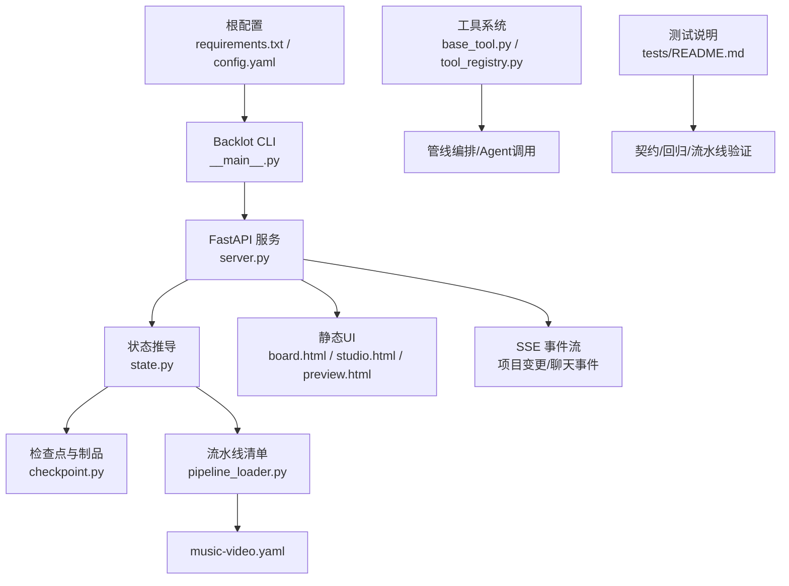
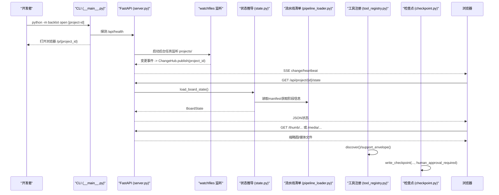
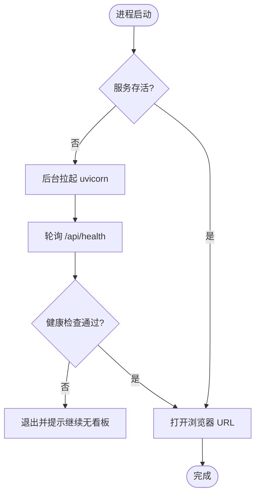
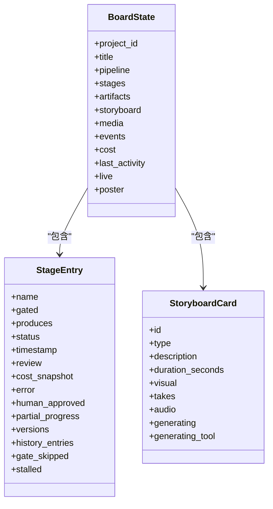
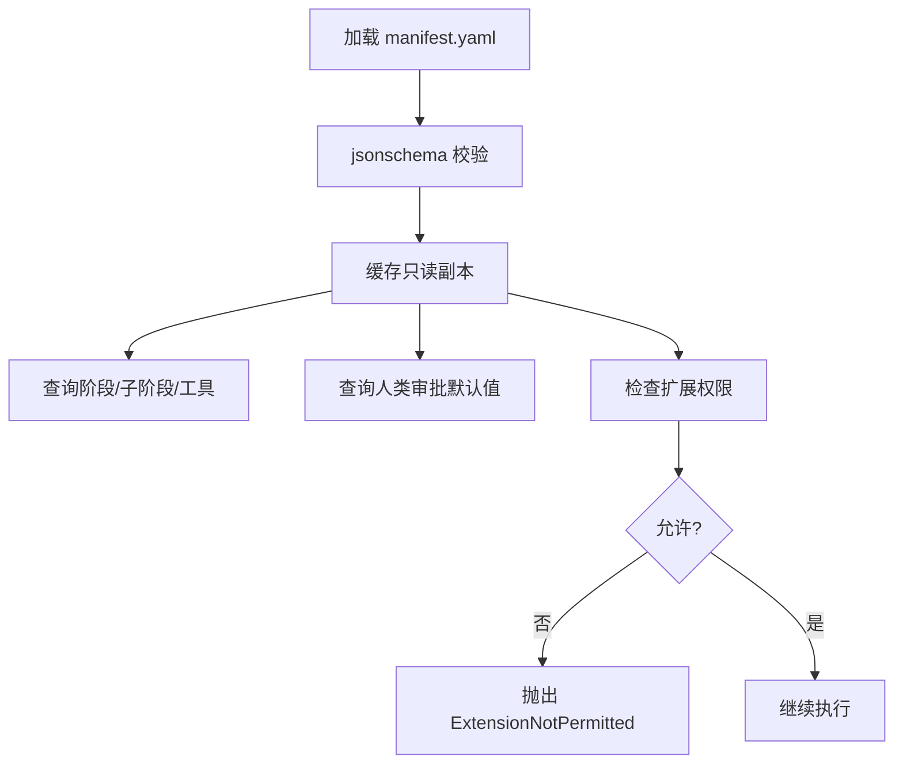
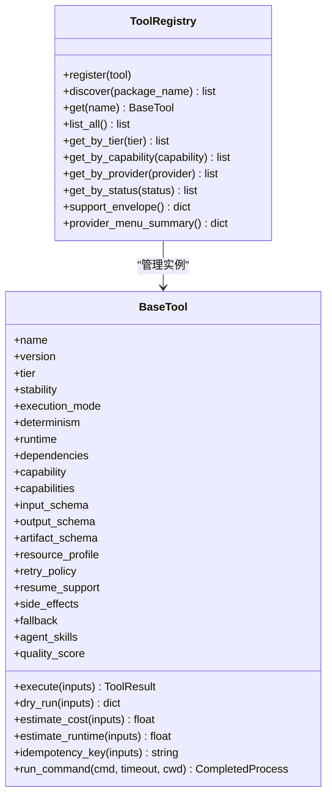
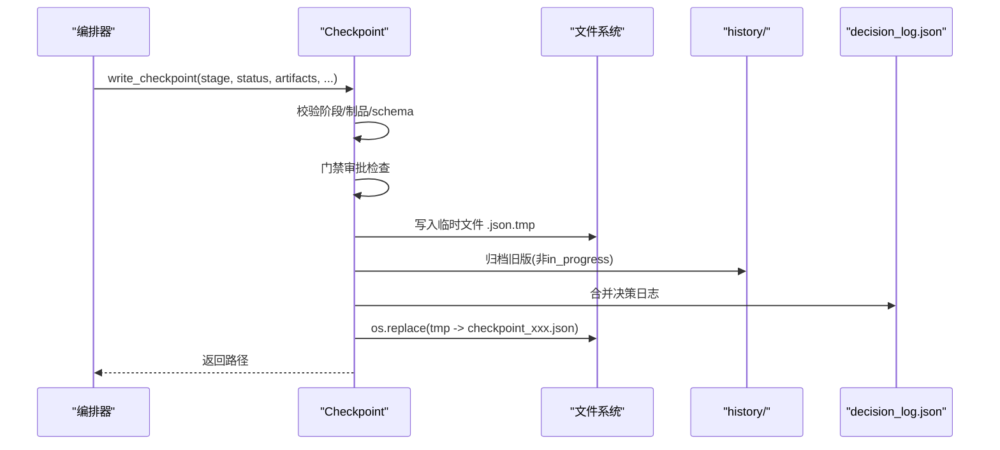
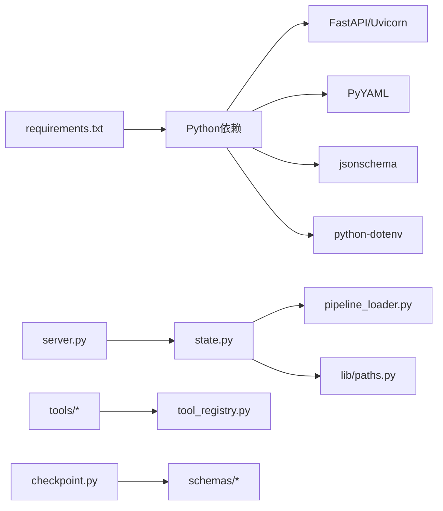

# 开发指南

<cite>
**本文引用的文件**   
- [requirements.txt](file://requirements.txt)
- [config.yaml](file://config.yaml)
- [backlot/__main__.py](file://backlot/__main__.py)
- [backlot/server.py](file://backlot/server.py)
- [backlot/README.md](file://backlot/README.md)
- [lib/config_model.py](file://lib/config_model.py)
- [lib/pipeline_loader.py](file://lib/pipeline_loader.py)
- [backlot/state.py](file://backlot/state.py)
- [tests/README.md](file://tests/README.md)
- [tools/base_tool.py](file://tools/base_tool.py)
- [tools/tool_registry.py](file://tools/tool_registry.py)
- [lib/checkpoint.py](file://lib/checkpoint.py)
- [pipeline_defs/music-video.yaml](file://pipeline_defs/music-video.yaml)
</cite>

## 目录
1. [简介](#简介)
2. [项目结构](#项目结构)
3. [核心组件](#核心组件)
4. [架构总览](#架构总览)
5. [详细组件分析](#详细组件分析)
6. [依赖关系分析](#依赖关系分析)
7. [性能考虑](#性能考虑)
8. [故障排除与调试](#故障排除与调试)
9. [结论](#结论)
10. [附录](#附录)

## 简介
本指南面向OpenMontage-MV项目的开发者，提供从环境搭建、代码结构与约定、测试策略、调试技巧、贡献流程到插件扩展与性能优化的完整说明。内容兼顾新手入门与高级实践，帮助你在本地快速运行“活看板”（Backlot），理解流水线编排、工具注册与检查点机制，并安全地扩展现有能力。

## 项目结构
- 根配置与依赖
  - requirements.txt：列出Python运行时依赖（FastAPI、Uvicorn、Pydantic、YAML、JSON Schema等）。
  - config.yaml：运行时配置（检查点策略、输出参数、路径映射）。
- Backlot（活看板）
  - backlot/__main__.py：CLI入口，支持open/serve/studio子命令，自动拉起服务并在浏览器打开。
  - backlot/server.py：FastAPI应用，提供项目状态、SSE事件流、媒体与缩略图、静态UI页面等接口。
  - backlot/state.py：只读状态推导，将projects/<id>/磁盘结构转换为可渲染的BoardState。
  - backlot/README.md：Backlot使用说明与设计要点。
- 流水线与配置模型
  - lib/config_model.py：基于Pydantic的配置模型，加载config.yaml并提供类型化访问。
  - lib/pipeline_loader.py：加载并校验pipeline_manifest，提供阶段顺序、工具集合、扩展权限等查询。
  - pipeline_defs/music-video.yaml：音乐视频流水线定义（阶段、产物、技能、工具、审查焦点等）。
- 工具系统与注册
  - tools/base_tool.py：BaseTool抽象基类，统一工具契约、执行装饰器、资源与重试策略、成本估算等。
  - tools/tool_registry.py：工具发现与注册中心，按能力/提供者/层级聚合与报告。
- 检查点与状态持久化
  - lib/checkpoint.py：检查点写入/读取、归档历史、门禁审批、决策日志合并与校验。
- 测试
  - tests/README.md：测试范围与用例来源说明（契约、QA、流水线）。

**图示来源** 
- [backlot/__main__.py:1-145](file://backlot/__main__.py#L1-L145)
- [backlot/server.py:1-504](file://backlot/server.py#L1-L504)
- [backlot/state.py:1-714](file://backlot/state.py#L1-L714)
- [lib/pipeline_loader.py:1-241](file://lib/pipeline_loader.py#L1-L241)
- [pipeline_defs/music-video.yaml:1-187](file://pipeline_defs/music-video.yaml#L1-L187)
- [tools/base_tool.py:1-481](file://tools/base_tool.py#L1-L481)
- [tools/tool_registry.py:1-493](file://tools/tool_registry.py#L1-L493)
- [lib/checkpoint.py:1-537](file://lib/checkpoint.py#L1-L537)
- [tests/README.md:1-14](file://tests/README.md#L1-L14)

**章节来源**
- [requirements.txt:1-12](file://requirements.txt#L1-L12)
- [config.yaml:1-20](file://config.yaml#L1-L20)
- [backlot/README.md:1-43](file://backlot/README.md#L1-L43)

## 核心组件
- Backlot服务与CLI
  - CLI负责启动/探测服务、轮询健康端点、自动打开浏览器；serve子命令以uvicorn前台运行。
  - FastAPI路由提供健康检查、项目列表、单项目状态、SSE事件流、缩略图与媒体、静态页面。
- 状态推导（BoardState）
  - 只读扫描project.json、meta.json、checkpoints、history、artifacts、events.jsonl，生成stage rail、storyboard、media、cost、live/stall标记。
- 流水线清单加载
  - 加载并校验manifest，暴露阶段顺序、子阶段、工具集合、人类审批默认值、扩展权限等。
- 工具系统
  - BaseTool定义统一契约，execute被自动装饰为发射Backlot事件；ToolRegistry负责发现、分组、能力汇总与菜单生成。
- 检查点与门禁
  - 写入前校验schema与产物约束，强制门禁审批策略，归档历史版本，合并决策日志。

**章节来源**
- [backlot/__main__.py:1-145](file://backlot/__main__.py#L1-L145)
- [backlot/server.py:1-504](file://backlot/server.py#L1-L504)
- [backlot/state.py:1-714](file://backlot/state.py#L1-L714)
- [lib/pipeline_loader.py:1-241](file://lib/pipeline_loader.py#L1-L241)
- [tools/base_tool.py:1-481](file://tools/base_tool.py#L1-L481)
- [tools/tool_registry.py:1-493](file://tools/tool_registry.py#L1-L493)
- [lib/checkpoint.py:1-537](file://lib/checkpoint.py#L1-L537)

## 架构总览
下图展示从CLI到服务、状态推导、流水线清单、工具注册与检查点的整体交互。

**图示来源** 
- [backlot/__main__.py:1-145](file://backlot/__main__.py#L1-L145)
- [backlot/server.py:1-504](file://backlot/server.py#L1-L504)
- [backlot/state.py:1-714](file://backlot/state.py#L1-L714)
- [lib/pipeline_loader.py:1-241](file://lib/pipeline_loader.py#L1-L241)
- [tools/tool_registry.py:1-493](file://tools/tool_registry.py#L1-L493)
- [lib/checkpoint.py:1-537](file://lib/checkpoint.py#L1-L537)

## 详细组件分析

### Backlot CLI与服务
- CLI子命令
  - open：若服务未运行则后台拉起，轮询健康端点成功后打开浏览器；支持直接打开特定项目或/studio。
  - serve：前台运行uvicorn，默认绑定127.0.0.1，可通过BACKLOT_HOST发布到局域网。
- FastAPI路由
  - 健康检查/api/health；项目列表/api/projects；项目状态/api/project/{id}/state；SSE事件流/api/project/{id}/events与/api/library/events；缩略图/thumb；媒体/media；静态页面/、/p/、/studio、/preview。
  - UI资源通过StaticFiles挂载，并通过中间件对SPA相关路径设置no-cache以便热更新。
- 变更监听与SSE
  - watchfiles监听projects/，过滤无关路径，去重后通过ChangeHub广播；SSE心跳保活，队列满时丢弃重复通知。

**图示来源** 
- [backlot/__main__.py:1-145](file://backlot/__main__.py#L1-L145)

**章节来源**
- [backlot/__main__.py:1-145](file://backlot/__main__.py#L1-L145)
- [backlot/server.py:1-504](file://backlot/server.py#L1-L504)

### 状态推导（BoardState）
- 输入源
  - project.json/meta.json标识项目身份与元数据；checkpoint_*.json与history/记录阶段状态与版本；artifacts/*.json为制品；events.jsonl为工具执行事件。
- 关键处理
  - 阶段轨道：根据manifest或回退阶段集构建rail，计算status、gate_skipped、versions、stalled等。
  - 故事板：scene_plan × script × asset_manifest关联，结合events推断generating状态，选择可视画面或快照。
  - 媒体发现：renders、snapshots、music等扫描，poster选取策略（优先图像，其次快照，最后最新渲染帧）。
  - 成本与活动：取最近checkpoint的cost_snapshot或制品总计；last_activity用于live窗口与停滞检测。
- 健壮性
  - 所有IO失败均降级返回空/默认值，绝不让看板崩溃。

**图示来源** 
- [backlot/state.py:1-714](file://backlot/state.py#L1-L714)

**章节来源**
- [backlot/state.py:1-714](file://backlot/state.py#L1-L714)

### 流水线清单加载与扩展控制
- 清单加载与缓存
  - 读取pipeline_defs/*.yaml，使用jsonschema校验；提供只读缓存接口供热路径使用。
- 阶段与工具
  - get_stage_order/get_stage_sub_stages提取阶段顺序与子阶段；get_required_tools收集各阶段声明的工具。
- 人类审批与审查焦点
  - get_stage_human_approval_default决定门禁默认值；get_stage_review_focus提供审查关注项。
- 扩展权限
  - check_extension_permitted限制custom_scripts/custom_playbooks/custom_skills/custom_tools的使用；get_permitted_extensions返回允许标志。

**图示来源** 
- [lib/pipeline_loader.py:1-241](file://lib/pipeline_loader.py#L1-L241)

**章节来源**
- [lib/pipeline_loader.py:1-241](file://lib/pipeline_loader.py#L1-L241)

### 工具系统与注册
- BaseTool契约
  - 统一字段：名称、版本、层级、稳定性、执行模式、确定性、运行时、依赖、能力、资源画像、重试策略、恢复支持、副作用、回退工具、Agent技能、质量指标等。
  - execute自动装饰：在成功/错误/耗时维度向events.jsonl写入start/finish/error事件，支持嵌套深度统计。
  - 辅助方法：dry_run、estimate_cost/estimate_runtime、idempotency_key、run_command（跨平台子进程封装）。
- ToolRegistry
  - discover：递归导入tools包，跳过基础模块，注册所有非抽象BaseTool子类。
  - 查询接口：按tier/capability/provider/status/stability筛选；support_envelope/capability_catalog/provider_menu汇总能力。
  - provider_menu_summary：生成“N of M configured”的人类可读摘要，便于Agent预检与引导安装。

**图示来源** 
- [tools/base_tool.py:1-481](file://tools/base_tool.py#L1-L481)
- [tools/tool_registry.py:1-493](file://tools/tool_registry.py#L1-L493)

**章节来源**
- [tools/base_tool.py:1-481](file://tools/base_tool.py#L1-L481)
- [tools/tool_registry.py:1-493](file://tools/tool_registry.py#L1-L493)

### 检查点与门禁审批
- 写入流程
  - 解析/回填pipeline_type；校验阶段有效性；门禁审批强制（manifest或调用方要求）；临时文件写入+原子替换；归档历史版本；合并决策日志。
- 校验与约束
  - validate_checkpoint校验checkpoint schema与制品schema；必需产物约束（如script→brief、assets→asset_manifest等）。
- 读取与导航
  - read_checkpoint/get_latest_checkpoint/get_completed_stages/get_next_stage配合manifest阶段顺序推进流水线。

**图示来源** 
- [lib/checkpoint.py:1-537](file://lib/checkpoint.py#L1-L537)

**章节来源**
- [lib/checkpoint.py:1-537](file://lib/checkpoint.py#L1-L537)

### 音乐视频流水线（示例）
- 阶段序列：idea → proposal → storyboard → assets → edit → compose → publish
- 关键约束：最多23个镜头，每个4-15秒；连续时间线无重叠/空隙；ASS卡拉OK字幕烧录；ffmpeg端到端合成。
- 工具与技能：各阶段声明可用工具与所需Agent技能；compose阶段必须video_stitch与audio_mixer，可选color_grade。

**章节来源**
- [pipeline_defs/music-video.yaml:1-187](file://pipeline_defs/music-video.yaml#L1-L187)

## 依赖关系分析
- Python依赖
  - FastAPI/Uvicorn用于HTTP服务与ASGI；Pydantic/YAML/JSON Schema用于配置与校验；requests/python-dotenv用于网络与环境变量。
- 模块耦合
  - server.py依赖state.py进行状态推导；state.py依赖pipeline_loader.py与paths；tools.base_tool与tool_registry强耦合；checkpoint.py依赖schemas与paths。
- 外部集成
  - watchfiles用于文件系统监听；PIL/FFmpeg用于缩略图与视频帧抽取；subprocess用于外部命令执行。

**图示来源** 
- [requirements.txt:1-12](file://requirements.txt#L1-L12)
- [backlot/server.py:1-504](file://backlot/server.py#L1-L504)
- [backlot/state.py:1-714](file://backlot/state.py#L1-L714)
- [lib/pipeline_loader.py:1-241](file://lib/pipeline_loader.py#L1-L241)
- [tools/tool_registry.py:1-493](file://tools/tool_registry.py#L1-L493)
- [lib/checkpoint.py:1-537](file://lib/checkpoint.py#L1-L537)

**章节来源**
- [requirements.txt:1-12](file://requirements.txt#L1-L12)

## 性能考虑
- 文件系统监听与SSE
  - watchfiles批量变更聚合，ChangeHub队列限流与去抖，避免无关项目噪声；SSE心跳保活，队列满丢弃重复通知。
- 缩略图与媒体
  - 缩略图按宽度缓存至磁盘，并发miss使用唯一临时文件名避免竞态；视频抽帧超时保护；图片缩放使用PIL。
- 状态推导优化
  - summarize_project仅做轻量摘要；load_board_state限制events数量；last_activity仅扫描关键文件mtime。
- 流水线清单缓存
  - lru_cache缓存manifest与schema加载，热路径避免重复解析与校验。
- 工具执行
  - execute装饰器统计耗时与成本；run_command强制UTF-8解码避免Unicode异常；资源画像与重试策略可配置。

[本节为通用性能建议，不直接分析具体文件]

## 故障排除与调试
- 常见问题
  - 服务无法启动：检查端口占用与BACKLOT_PORT；查看.studio/server.log；确认依赖已安装。
  - 看板无变化：确认watchfiles可用；检查projects/目录权限；手动刷新浏览器。
  - 缩略图缺失：确认FFmpeg/PIL可用；检查媒体后缀是否受支持；查看thumb缓存目录。
  - 门禁审批失败：确保awaiting_human→completed且human_approved=True；检查manifest中human_approval_default。
  - 工具不可用：检查dependencies/env变量；使用registry.provider_menu_summary定位缺少的环境变量或二进制。
- 调试技巧
  - 使用serve子命令前台运行，观察控制台日志；在浏览器Network面板查看SSE事件；查看events.jsonl追踪工具调用链。
  - 针对Windows路径与编码问题，注意run_command的UTF-8解码与shutil.which解析。
- 测试策略
  - 契约测试：工具继承BaseTool契约，registry.discover应发现固定数量工具。
  - QA测试：ass_parser对真实ASS文件；video_stitch+audio_mixer+ASS烧录对fixture；yinghe_video对在线API。
  - 流水线测试：pipeline_loader校验music-video.yaml；checkpoint读写与门禁往返。

**章节来源**
- [backlot/README.md:1-43](file://backlot/README.md#L1-L43)
- [tests/README.md:1-14](file://tests/README.md#L1-L14)
- [tools/base_tool.py:1-481](file://tools/base_tool.py#L1-L481)
- [tools/tool_registry.py:1-493](file://tools/tool_registry.py#L1-L493)
- [lib/checkpoint.py:1-537](file://lib/checkpoint.py#L1-L537)

## 结论
OpenMontage-MV以Backlot为核心可视化层，结合严格的流水线清单、工具契约与检查点门禁，形成可扩展、可观测、可回放的音乐视频生产流水线。遵循本指南的环境搭建、代码约定与测试策略，你将能快速上手并安全扩展能力。

[本节为总结，不直接分析具体文件]

## 附录
- 环境搭建
  - 安装依赖：pip install -r requirements.txt
  - 配置：编辑config.yaml调整输出参数与路径；如需API密钥，在项目根目录创建.env（由base_tool与tool_registry自动加载）。
  - 启动：python -m backlot open [project-id] 或 python -m backlot serve --port 4750
- 代码约定
  - 新增工具：继承BaseTool，实现execute，声明dependencies/capabilities/resource_profile；无需手动注册，discover会自动发现。
  - 新增流水线：在pipeline_defs/添加manifest，遵循schema；必要时启用extensions.*白名单。
  - 检查点：使用write_checkpoint，遵守阶段产物与门禁策略；read_checkpoint读取状态。
- 贡献流程
  - 提交前运行测试（参考tests/README.md）；确保lint与类型检查通过；PR描述包含变更影响与验证步骤。
- 插件开发指南
  - 工具插件：在tools/下新建模块，定义BaseTool子类；通过registry.capability_catalog验证能力。
  - 技能插件：在.agents/skills/或skills/下新增技能文档，供Agent引用。
  - 流水线扩展：在pipeline_defs/新增manifest，按需启用custom_scripts/custom_playbooks/custom_skills。
- 性能优化建议
  - 合理设置SSE心跳与队列大小；避免频繁全量扫描，利用watchfiles增量；缩略图缓存命中优先；工具重试与超时策略调优。

[本节为补充信息，不直接分析具体文件]