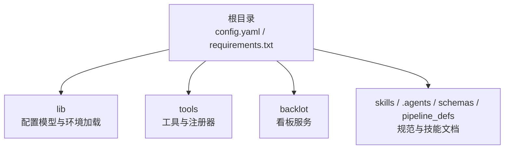
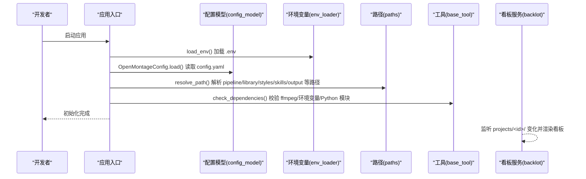
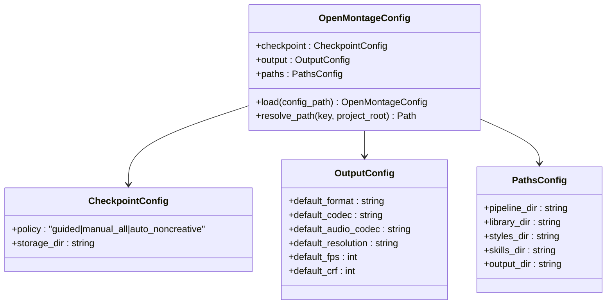
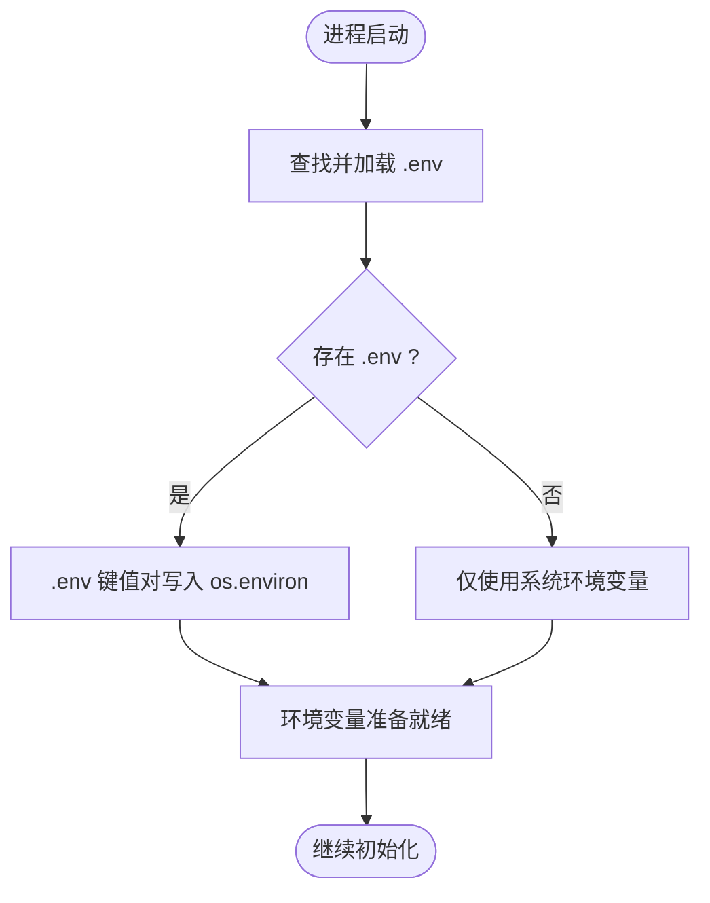
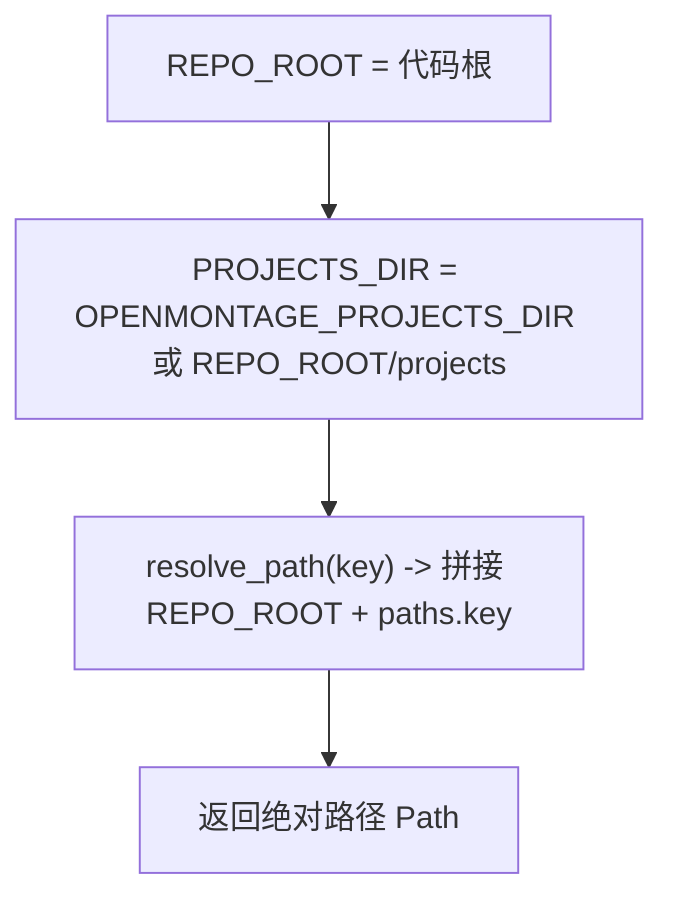
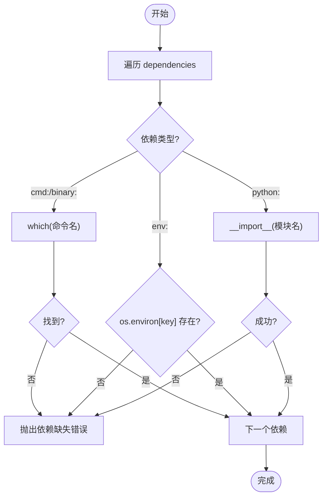
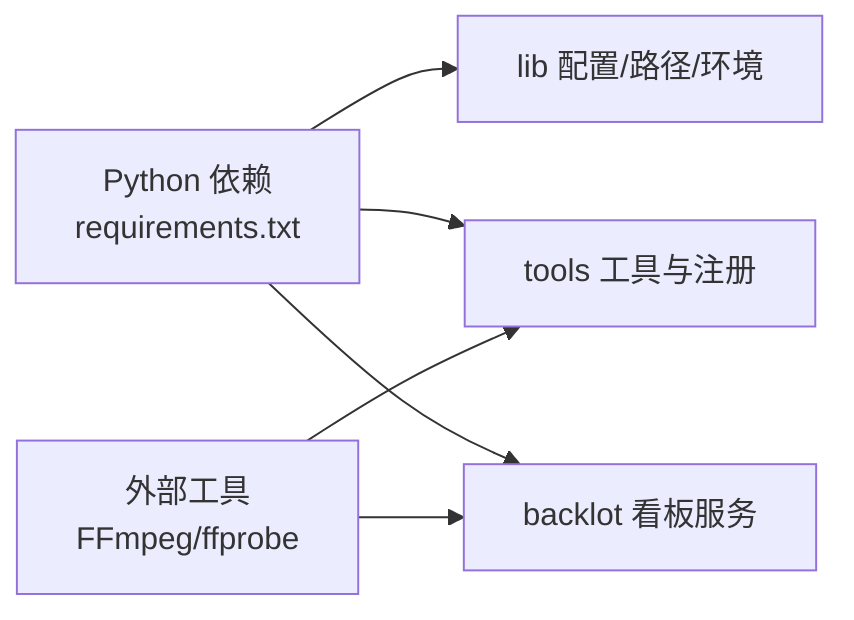

# 开发环境搭建

<cite>
**本文引用的文件**   
- [config.yaml](file://config.yaml)
- [requirements.txt](file://requirements.txt)
- [lib/config_model.py](file://lib/config_model.py)
- [lib/env_loader.py](file://lib/env_loader.py)
- [lib/paths.py](file://lib/paths.py)
- [.agents/skills/ffmpeg/SKILL.md](file://.agents/skills/ffmpeg/SKILL.md)
- [.agents/skills/ffmpeg/reference.md](file://.agents/skills/ffmpeg/reference.md)
- [backlot/README.md](file://backlot/README.md)
- [tools/base_tool.py](file://tools/base_tool.py)
- [tools/tool_registry.py](file://tools/tool_registry.py)
- [AGENT_GUIDE.md](file://AGENT_GUIDE.md)
</cite>

## 目录
1. [简介](#简介)
2. [项目结构](#项目结构)
3. [核心组件](#核心组件)
4. [架构总览](#架构总览)
5. [详细组件分析](#详细组件分析)
6. [依赖关系分析](#依赖关系分析)
7. [性能考虑](#性能考虑)
8. [故障排除指南](#故障排除指南)
9. [结论](#结论)
10. [附录](#附录)

## 简介
本指南面向首次接触 OpenMontage-MV 的开发者，目标是帮助你在最短时间内完成本地开发环境的搭建与验证。内容涵盖：
- Python 版本要求与依赖安装
- 配置文件 config.yaml 各项设置说明
- 环境变量与路径配置（含 .env 加载机制）
- FFmpeg 等外部工具的安装与配置
- Backlot 看板服务启动方式
- Docker 容器化部署建议
- 常见问题排查与解决方案

## 项目结构
仓库采用“能力分层 + 工具注册”的组织方式：
- lib：运行时配置、路径与环境变量加载
- tools：工具实现与注册（视频、音频、字幕等）
- backlot：本地看板服务（基于 FastAPI + Uvicorn）
- schemas/pipeline_defs/skills/.agents：规范、流水线定义与技能文档
- 根目录：配置与依赖清单

**章节来源**
- [config.yaml:1-20](file://config.yaml#L1-L20)
- [requirements.txt:1-12](file://requirements.txt#L1-L12)

## 核心组件
- 配置模型：OpenMontageConfig 提供 checkpoint/output/paths 三类配置的强类型访问与默认值
- 环境变量加载：支持 .env 文件自动加载，并提供 get_env/require_env 便捷方法
- 路径解析：统一 REPO_ROOT 与 PROJECTS_DIR，支持通过环境变量覆盖项目根目录
- 工具依赖检查：BaseTool.check_dependencies 校验命令、环境变量与 Python 模块是否就绪

**章节来源**
- [lib/config_model.py:1-70](file://lib/config_model.py#L1-L70)
- [lib/env_loader.py:1-35](file://lib/env_loader.py#L1-L35)
- [lib/paths.py:1-18](file://lib/paths.py#L1-L18)
- [tools/base_tool.py:304-327](file://tools/base_tool.py#L304-L327)

## 架构总览
下图展示了运行期配置加载、环境变量注入与路径解析的关键流程，以及 Backlot 看板如何读取项目产物进行可视化。

**图表来源**
- [lib/config_model.py:51-62](file://lib/config_model.py#L51-L62)
- [lib/env_loader.py:15-21](file://lib/env_loader.py#L15-L21)
- [lib/paths.py:13-18](file://lib/paths.py#L13-L18)
- [tools/base_tool.py:304-327](file://tools/base_tool.py#L304-L327)
- [backlot/README.md:1-43](file://backlot/README.md#L1-L43)

## 详细组件分析

### 配置系统（config.yaml 与 OpenMontageConfig）
- checkpoint：策略与存储目录
  - policy：guided/manual_all/auto_noncreative
  - storage_dir：检查点保存目录
- output：输出编码参数
  - default_format：mp4
  - default_codec：libx264
  - default_audio_codec：aac
  - default_resolution：1920x1080
  - default_fps：30
  - default_crf：23
- paths：关键目录
  - pipeline_dir、library_dir、styles_dir、skills_dir、output_dir

**图表来源**
- [lib/config_model.py:22-49](file://lib/config_model.py#L22-L49)
- [config.yaml:1-20](file://config.yaml#L1-L20)

**章节来源**
- [lib/config_model.py:1-70](file://lib/config_model.py#L1-L70)
- [config.yaml:1-20](file://config.yaml#L1-L20)

### 环境变量与 .env 加载
- 自动加载 .env：在应用或工具导入时尝试从项目根目录加载 .env
- 提供 get_env()/require_env() 获取可选或必需的环境变量
- 工具层也会自行加载 .env，确保 API Key 等敏感信息可用

**图表来源**
- [lib/env_loader.py:15-21](file://lib/env_loader.py#L15-L21)
- [tools/base_tool.py:25-60](file://tools/base_tool.py#L25-L60)
- [tools/tool_registry.py:86-116](file://tools/tool_registry.py#L86-L116)

**章节来源**
- [lib/env_loader.py:1-35](file://lib/env_loader.py#L1-L35)
- [tools/base_tool.py:25-60](file://tools/base_tool.py#L25-L60)
- [tools/tool_registry.py:86-116](file://tools/tool_registry.py#L86-L116)

### 路径解析与项目根目录
- REPO_ROOT：代码仓库根目录
- PROJECTS_DIR：项目工作区根目录，可通过 OPENMONTAGE_PROJECTS_DIR 覆盖
- OpenMontageConfig.resolve_path()：将相对路径解析为绝对路径

**图表来源**
- [lib/paths.py:13-18](file://lib/paths.py#L13-L18)
- [lib/config_model.py:64-69](file://lib/config_model.py#L64-L69)

**章节来源**
- [lib/paths.py:1-18](file://lib/paths.py#L1-L18)
- [lib/config_model.py:64-69](file://lib/config_model.py#L64-L69)

### 工具依赖检查（FFmpeg、环境变量、Python 模块）
- BaseTool.check_dependencies() 会检查：
  - cmd:/binary: 外部命令是否在 PATH
  - env: 环境变量是否存在
  - python: Python 模块是否可导入

**图表来源**
- [tools/base_tool.py:304-327](file://tools/base_tool.py#L304-L327)

**章节来源**
- [tools/base_tool.py:304-327](file://tools/base_tool.py#L304-L327)

### Backlot 看板服务
- 只读看板，实时展示生产进度、脚本、分镜、事件与成本
- 通过 watchfiles 监听 projects/ 目录变更，浏览器 SSE 刷新
- 常用命令：open <project-id>、serve --port 4750

**章节来源**
- [backlot/README.md:1-43](file://backlot/README.md#L1-L43)

## 依赖关系分析
- Python 依赖：pyyaml、pydantic、jsonschema、python-dotenv、requests、fastapi、uvicorn、watchfiles
- 外部工具：FFmpeg（视频/音频处理）、ffprobe（媒体信息）
- 运行时：FastAPI + Uvicorn（Backlot 服务）

**图表来源**
- [requirements.txt:1-12](file://requirements.txt#L1-L12)

**章节来源**
- [requirements.txt:1-12](file://requirements.txt#L1-L12)

## 性能考虑
- 编码质量与速度：CRF 与 preset 的权衡（见 FFmpeg 参考）
- 分辨率与帧率：默认 1920x1080/30fps，按需调整
- 流式优化：-movflags faststart 提升网页播放体验
- I/O 监控：Backlot 通过事件日志与检查点增量更新，避免全量重算

[本节为通用指导，不直接分析具体文件]

## 故障排除指南
- FFmpeg 未安装或未加入 PATH
  - 现象：check_dependencies 报错找不到命令
  - 解决：安装 FFmpeg 并确保命令行可用；参考 FFmpeg 技能文档中的常见问题
- .env 未生效
  - 现象：必需环境变量缺失导致工具初始化失败
  - 解决：在项目根目录创建 .env 并写入 KEY=VALUE；确认未被系统环境变量覆盖
- 路径解析异常
  - 现象：无法定位 pipeline/library/styles/skills/output 目录
  - 解决：检查 config.yaml 中 paths.* 配置；必要时设置 OPENMONTAGE_PROJECTS_DIR
- Backlot 无法打开或无数据
  - 现象：看板空白或无法连接
  - 解决：确认 projects/<id>/ 下有产物；使用 serve --port 指定端口后重试

**章节来源**
- [.agents/skills/ffmpeg/SKILL.md:223-236](file://.agents/skills/ffmpeg/SKILL.md#L223-L236)
- [tools/base_tool.py:304-327](file://tools/base_tool.py#L304-L327)
- [lib/env_loader.py:24-34](file://lib/env_loader.py#L24-L34)
- [lib/paths.py:13-18](file://lib/paths.py#L13-L18)
- [backlot/README.md:1-43](file://backlot/README.md#L1-L43)

## 结论
通过本指南，你可以快速完成 OpenMontage-MV 的开发环境搭建：安装 Python 依赖、配置 config.yaml、准备 .env 与 FFmpeg、启动 Backlot 看板，并通过依赖检查确保一切就绪。遇到问题时，可依据故障排除章节逐项定位与修复。

[本节为总结性内容，不直接分析具体文件]

## 附录

### 一、Python 版本与依赖安装
- 建议使用 Python 3.10+（Pydantic v2、FastAPI 等现代库兼容性更佳）
- 安装步骤：
  1) 进入项目根目录
  2) 创建虚拟环境（推荐）
  3) 安装依赖：pip install -r requirements.txt

**章节来源**
- [requirements.txt:1-12](file://requirements.txt#L1-L12)

### 二、config.yaml 配置项详解
- checkpoint.policy：检查点策略（guided/manual_all/auto_noncreative）
- checkpoint.storage_dir：检查点存储目录
- output.default_format：默认封装格式（mp4）
- output.default_codec：视频编码器（libx264）
- output.default_audio_codec：音频编码器（aac）
- output.default_resolution：默认分辨率（1920x1080）
- output.default_fps：默认帧率（30）
- output.default_crf：默认码率控制（23）
- paths.pipeline_dir：流水线目录
- paths.library_dir：素材库目录
- paths.styles_dir：风格目录
- paths.skills_dir：技能目录
- paths.output_dir：输出目录

**章节来源**
- [config.yaml:1-20](file://config.yaml#L1-L20)
- [lib/config_model.py:22-49](file://lib/config_model.py#L22-L49)

### 三、环境变量与路径设置
- .env 文件位置：项目根目录
- 常用变量：
  - OPENMONTAGE_PROJECTS_DIR：覆盖项目工作区根目录
  - 第三方 API Key：由工具通过 env: 前缀声明，需写入 .env
- 加载顺序：系统环境变量优先于 .env；若已存在则不会覆盖

**章节来源**
- [lib/env_loader.py:15-21](file://lib/env_loader.py#L15-L21)
- [lib/paths.py:17](file://lib/paths.py#L17)
- [tools/base_tool.py:25-60](file://tools/base_tool.py#L25-L60)
- [tools/tool_registry.py:86-116](file://tools/tool_registry.py#L86-L116)

### 四、FFmpeg 安装与配置
- 安装方式：
  - Windows：官方安装包或包管理器（如 Chocolatey）
  - macOS：Homebrew 安装
  - Linux：apt/yum/dnf 安装
- 验证：命令行执行 ffmpeg -version 与 ffprobe -version
- 常见用法与问题参考：
  - 技能文档包含 GIF 转 MP4、缩放、压缩、提取音频、裁剪、变速、拼接、淡入淡出、平台优化等
  - 常见问题包括高度非偶数、浏览器不可播、音画不同步、文件过大等

**章节来源**
- [.agents/skills/ffmpeg/SKILL.md:1-433](file://.agents/skills/ffmpeg/SKILL.md#L1-L433)
- [.agents/skills/ffmpeg/reference.md:1-174](file://.agents/skills/ffmpeg/reference.md#L1-L174)

### 五、Docker 容器化部署（建议）
- 基础镜像：选择带 FFmpeg 的 Python 镜像（如 python:3.11-slim 并安装 ffmpeg）
- 构建步骤：
  1) 复制 requirements.txt 并安装依赖
  2) 复制项目源码
  3) 暴露端口（如需运行 Backlot）
  4) 挂载 volumes 用于 projects/ 与输出目录
- 运行示例思路：
  - 通过环境变量传入 OPENMONTAGE_PROJECTS_DIR
  - 将 .env 以只读卷挂载到容器内
- 注意：
  - 确保容器内 ffmpeg 可用
  - 合理分配 CPU/内存，尤其是视频编码阶段

[本节为概念性指导，不直接分析具体文件]

### 六、Backlot 看板服务快速上手
- 启动服务：python -m backlot serve --port 4750
- 打开看板：python -m backlot open <project-id>
- 数据来源：projects/<id>/ 下的 artifacts、events.jsonl、checkpoint_* 等

**章节来源**
- [backlot/README.md:1-43](file://backlot/README.md#L1-L43)

### 七、预检与最小可用验证
- 预检要点：
  - 发现 yinghe_video 工具并确认可用（API Key 已配置）
  - 确认 ffmpeg 在 PATH 中
- 最小验证：
  - 初始化一个项目工作区
  - 打开 Backlot 看板观察状态

**章节来源**
- [AGENT_GUIDE.md:66-84](file://AGENT_GUIDE.md#L66-L84)