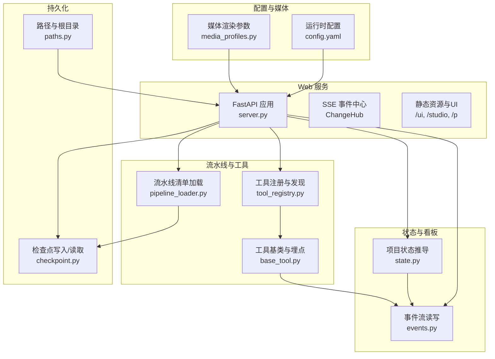
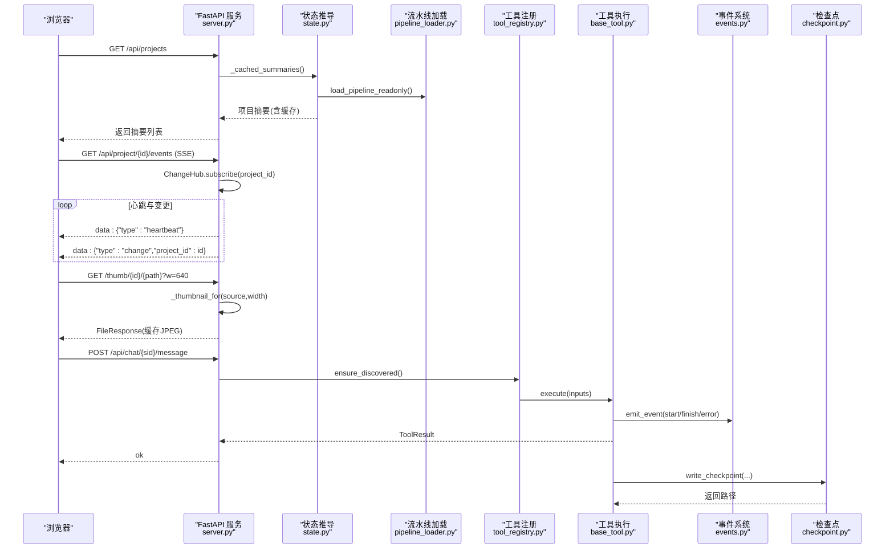
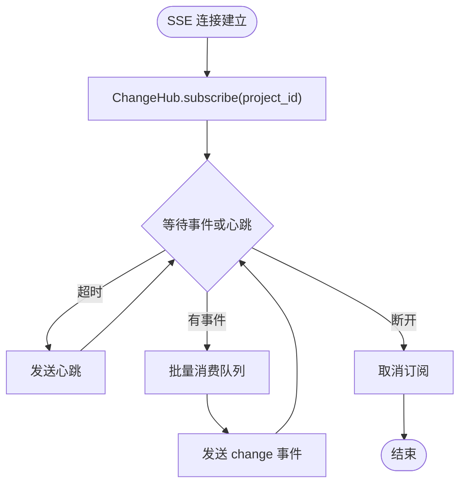
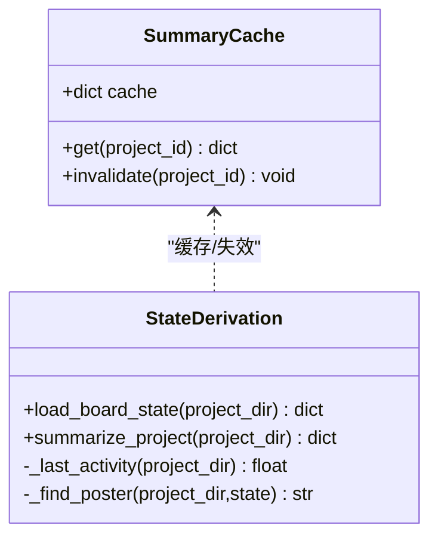
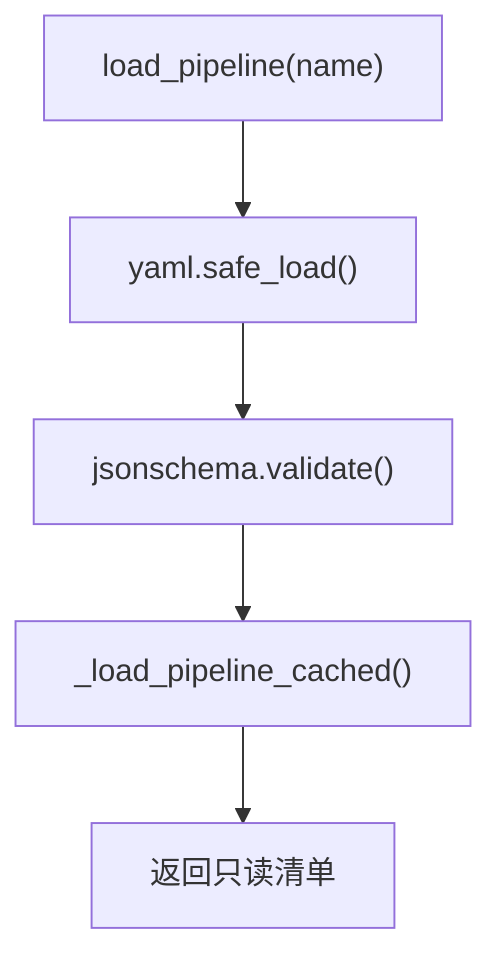
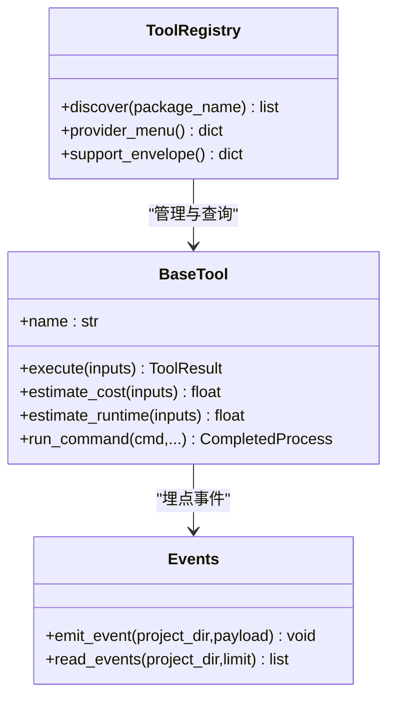
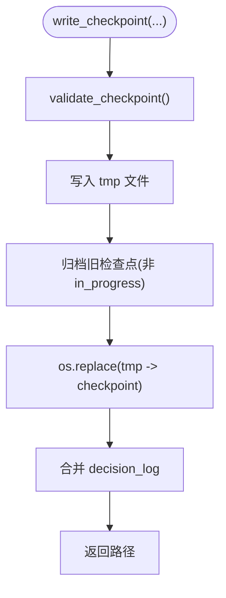
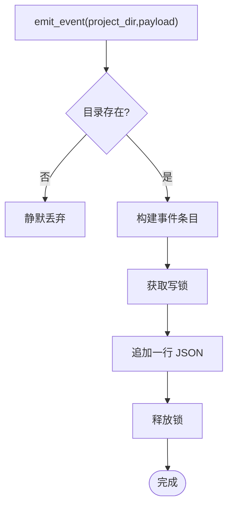
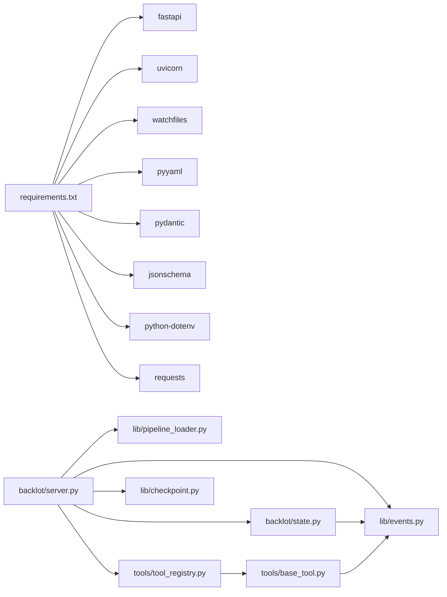
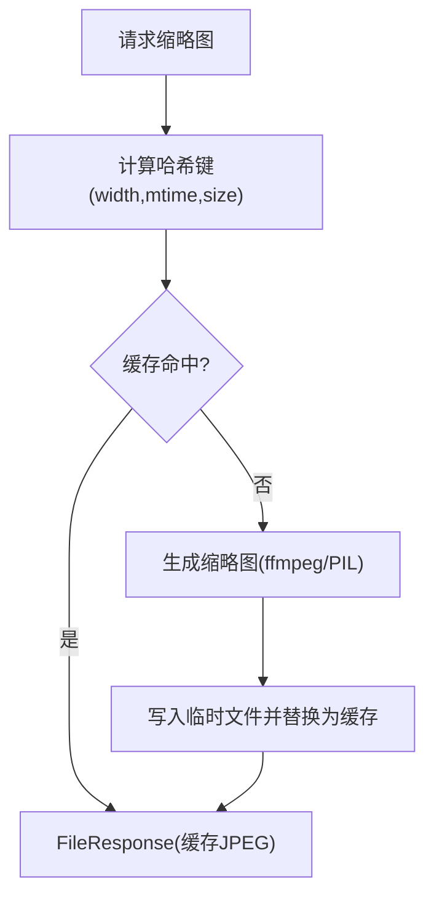

# 性能优化

<cite>
**本文引用的文件**   
- [config.yaml](file://config.yaml)
- [requirements.txt](file://requirements.txt)
- [backlot/server.py](file://backlot/server.py)
- [backlot/state.py](file://backlot/state.py)
- [lib/pipeline_loader.py](file://lib/pipeline_loader.py)
- [tools/tool_registry.py](file://tools/tool_registry.py)
- [tools/base_tool.py](file://tools/base_tool.py)
- [lib/events.py](file://lib/events.py)
- [lib/checkpoint.py](file://lib/checkpoint.py)
- [lib/paths.py](file://lib/paths.py)
- [lib/media_profiles.py](file://lib/media_profiles.py)
</cite>

## 目录
1. [简介](#简介)
2. [项目结构](#项目结构)
3. [核心组件](#核心组件)
4. [架构总览](#架构总览)
5. [详细组件分析](#详细组件分析)
6. [依赖关系分析](#依赖关系分析)
7. [性能考量与优化策略](#性能考量与优化策略)
8. [故障排查指南](#故障排查指南)
9. [结论](#结论)
10. [附录](#附录)

## 简介
本文件聚焦于 OpenMontage-MV 项目的性能分析与优化策略，覆盖 Web 服务器（FastAPI + SSE）的并发与响应优化、媒体处理管道的吞吐与延迟优化、内存与资源管理最佳实践、数据库/文件系统查询优化与缓存策略、异步 I/O 优化方法、负载均衡与水平扩展方案，以及性能监控指标与基准测试方法。目标是帮助开发者快速定位瓶颈并实施有效优化。

## 项目结构
- Web 服务层：基于 FastAPI 的 Backlot 服务，提供 REST API、SSE 事件流、静态 UI、缩略图与媒体访问。
- 状态与看板：项目状态推导、时间线、媒体扫描、故事板组装。
- 流水线与工具：流水线清单加载与校验、工具注册与能力发现、执行与事件埋点。
- 持久化与检查点：阶段检查点写入、归档、决策日志合并、幂等与门控。
- 配置与路径：运行时配置、统一路径源、媒体渲染参数。

**图表来源** 
- [backlot/server.py:151-406](file://backlot/server.py#L151-L406)
- [backlot/state.py:586-656](file://backlot/state.py#L586-L656)
- [lib/pipeline_loader.py:39-70](file://lib/pipeline_loader.py#L39-L70)
- [tools/tool_registry.py:118-134](file://tools/tool_registry.py#L118-L134)
- [tools/base_tool.py:148-224](file://tools/base_tool.py#L148-L224)
- [lib/events.py:77-118](file://lib/events.py#L77-L118)
- [lib/checkpoint.py:336-467](file://lib/checkpoint.py#L336-L467)
- [lib/paths.py:13-18](file://lib/paths.py#L13-L18)
- [config.yaml:1-20](file://config.yaml#L1-L20)
- [lib/media_profiles.py:22-58](file://lib/media_profiles.py#L22-L58)

**章节来源**
- [backlot/server.py:151-406](file://backlot/server.py#L151-L406)
- [backlot/state.py:586-656](file://backlot/state.py#L586-L656)
- [lib/pipeline_loader.py:39-70](file://lib/pipeline_loader.py#L39-L70)
- [tools/tool_registry.py:118-134](file://tools/tool_registry.py#L118-L134)
- [tools/base_tool.py:148-224](file://tools/base_tool.py#L148-L224)
- [lib/events.py:77-118](file://lib/events.py#L77-L118)
- [lib/checkpoint.py:336-467](file://lib/checkpoint.py#L336-L467)
- [lib/paths.py:13-18](file://lib/paths.py#L13-L18)
- [config.yaml:1-20](file://config.yaml#L1-L20)
- [lib/media_profiles.py:22-58](file://lib/media_profiles.py#L22-L58)

## 核心组件
- Web 服务与 SSE：FastAPI 路由、中间件、SSE 心跳与去抖、变更分发。
- 状态推导与缓存：项目摘要缓存、懒加载、错误降级。
- 流水线清单加载：YAML 解析与 JSON Schema 校验，lru_cache 加速。
- 工具注册与执行：自动发现、能力报告、执行埋点、成本/时长估算。
- 事件系统：append-only 事件日志，线程安全写入，容错读取。
- 检查点机制：原子写入、历史归档、门控审批、决策日志合并。
- 路径与配置：统一根路径、运行时输出参数、媒体渲染参数。

**章节来源**
- [backlot/server.py:43-82](file://backlot/server.py#L43-L82)
- [backlot/server.py:151-406](file://backlot/server.py#L151-L406)
- [backlot/state.py:76-108](file://backlot/state.py#L76-L108)
- [lib/pipeline_loader.py:27-46](file://lib/pipeline_loader.py#L27-L46)
- [tools/tool_registry.py:118-134](file://tools/tool_registry.py#L118-L134)
- [tools/base_tool.py:148-224](file://tools/base_tool.py#L148-L224)
- [lib/events.py:77-118](file://lib/events.py#L77-L118)
- [lib/checkpoint.py:336-467](file://lib/checkpoint.py#L336-L467)
- [lib/paths.py:13-18](file://lib/paths.py#L13-L18)
- [config.yaml:1-20](file://config.yaml#L1-L20)
- [lib/media_profiles.py:22-58](file://lib/media_profiles.py#L22-L58)

## 架构总览
下图展示请求从浏览器到后端各层的调用链，包括 SSE 事件推送、媒体与缩略图服务、状态推导与缓存、流水线清单加载、工具执行与事件记录、检查点写入。

**图表来源** 
- [backlot/server.py:185-242](file://backlot/server.py#L185-L242)
- [backlot/server.py:329-347](file://backlot/server.py#L329-L347)
- [backlot/state.py:76-108](file://backlot/state.py#L76-L108)
- [lib/pipeline_loader.py:39-70](file://lib/pipeline_loader.py#L39-L70)
- [tools/tool_registry.py:118-134](file://tools/tool_registry.py#L118-L134)
- [tools/base_tool.py:148-224](file://tools/base_tool.py#L148-L224)
- [lib/events.py:77-118](file://lib/events.py#L77-L118)
- [lib/checkpoint.py:336-467](file://lib/checkpoint.py#L336-L467)

## 详细组件分析

### Web 服务器与 SSE 并发优化
- 变更分发器 ChangeHub：每个订阅者独立队列，按 project_id 过滤，避免无关项目风暴；队列满时丢弃重复通知，保证低延迟。
- SSE 心跳与去抖：固定间隔心跳，批量消费队列，减少网络抖动；客户端侧也做 debounce。
- 静态资源与缓存控制：UI 资源强制 no-cache，媒体与缩略图使用正常缓存策略，提升首屏与回放体验。
- 缩略图生成：视频抽帧与图片缩放后落盘缓存，并发命中通过唯一临时文件名避免竞态。

**图表来源** 
- [backlot/server.py:43-82](file://backlot/server.py#L43-L82)
- [backlot/server.py:185-242](file://backlot/server.py#L185-L242)

**章节来源**
- [backlot/server.py:43-82](file://backlot/server.py#L43-L82)
- [backlot/server.py:185-242](file://backlot/server.py#L185-L242)
- [backlot/server.py:329-347](file://backlot/server.py#L329-L347)

### 状态推导与缓存策略
- 项目摘要缓存：_summary_cache 按项目维度缓存 expensive 的 summarize_project 结果，watcher 变更时失效。
- 懒加载与降级：JSON 读取失败、缺失工件、半写检查点均优雅降级，不阻塞看板。
- 活动窗口与停滞检测：基于 mtime 的活动窗口与停滞阈值，辅助识别卡住的阶段。

**图表来源** 
- [backlot/server.py:76-108](file://backlot/server.py#L76-L108)
- [backlot/state.py:586-656](file://backlot/state.py#L586-L656)
- [backlot/state.py:563-579](file://backlot/state.py#L563-L579)

**章节来源**
- [backlot/server.py:76-108](file://backlot/server.py#L76-L108)
- [backlot/state.py:586-656](file://backlot/state.py#L586-L656)
- [backlot/state.py:563-579](file://backlot/state.py#L563-L579)

### 流水线清单加载与校验
- YAML 解析与 JSON Schema 校验：确保清单结构正确，避免运行期异常。
- lru_cache 加速：_load_manifest_schema 与 _load_pipeline_cached 缓存 schema 与清单，降低热路径开销。
- 条件子阶段与工具收集：按需过滤活跃子阶段，汇总所需工具集合。

**图表来源** 
- [lib/pipeline_loader.py:27-46](file://lib/pipeline_loader.py#L27-L46)
- [lib/pipeline_loader.py:49-70](file://lib/pipeline_loader.py#L49-L70)

**章节来源**
- [lib/pipeline_loader.py:27-46](file://lib/pipeline_loader.py#L27-L46)
- [lib/pipeline_loader.py:49-70](file://lib/pipeline_loader.py#L49-L70)

### 工具注册、执行与事件埋点
- 自动发现与注册：遍历 tools 包，注册 BaseTool 子类，支持能力分组、提供者菜单。
- 执行埋点：BaseTool.execute 被装饰器包装，自动发射 start/finish/error 事件，统计耗时与成本。
- 资源与重试：ResourceProfile、RetryPolicy 描述工具资源需求与重试策略。

**图表来源** 
- [tools/base_tool.py:148-224](file://tools/base_tool.py#L148-L224)
- [tools/base_tool.py:227-372](file://tools/base_tool.py#L227-L372)
- [tools/tool_registry.py:118-134](file://tools/tool_registry.py#L118-L134)
- [lib/events.py:77-118](file://lib/events.py#L77-L118)

**章节来源**
- [tools/base_tool.py:148-224](file://tools/base_tool.py#L148-L224)
- [tools/base_tool.py:227-372](file://tools/base_tool.py#L227-L372)
- [tools/tool_registry.py:118-134](file://tools/tool_registry.py#L118-L134)
- [lib/events.py:77-118](file://lib/events.py#L77-L118)

### 检查点写入与归档
- 原子写入：先写 .tmp，再 os.replace，避免损坏当前检查点。
- 历史归档：非 in_progress 的检查点覆盖前复制到 history，保留审计轨迹。
- 门控审批：根据清单 human_approval_default 强制人工审批流程。
- 决策日志合并：将 decision_log 合并到项目级文件，并在相关工件中引用。

**图表来源** 
- [lib/checkpoint.py:336-467](file://lib/checkpoint.py#L336-L467)
- [lib/checkpoint.py:263-300](file://lib/checkpoint.py#L263-L300)
- [lib/checkpoint.py:306-334](file://lib/checkpoint.py#L306-L334)

**章节来源**
- [lib/checkpoint.py:336-467](file://lib/checkpoint.py#L336-L467)
- [lib/checkpoint.py:263-300](file://lib/checkpoint.py#L263-L300)
- [lib/checkpoint.py:306-334](file://lib/checkpoint.py#L306-L334)

### 事件系统与异步 I/O
- Append-only 事件日志：线程锁保护写入，跨进程无同步，容忍撕裂行。
- 项目推断：从输入参数推断项目目录，避免误写。
- 读取容错：跳过 malformed 行，限制读取数量。

**图表来源** 
- [lib/events.py:77-118](file://lib/events.py#L77-L118)

**章节来源**
- [lib/events.py:77-118](file://lib/events.py#L77-L118)

## 依赖关系分析
- 外部依赖：FastAPI、uvicorn、watchfiles、pyyaml、pydantic、jsonschema、python-dotenv、requests。
- 内部依赖：server 依赖 state、events、pipeline_loader、tool_registry、checkpoint；state 依赖 events、paths；base_tool 依赖 events；tool_registry 依赖 base_tool。

**图表来源** 
- [requirements.txt:1-12](file://requirements.txt#L1-L12)
- [backlot/server.py:151-406](file://backlot/server.py#L151-L406)
- [backlot/state.py:586-656](file://backlot/state.py#L586-L656)
- [lib/pipeline_loader.py:39-70](file://lib/pipeline_loader.py#L39-L70)
- [tools/tool_registry.py:118-134](file://tools/tool_registry.py#L118-L134)
- [tools/base_tool.py:148-224](file://tools/base_tool.py#L148-L224)
- [lib/events.py:77-118](file://lib/events.py#L77-L118)
- [lib/checkpoint.py:336-467](file://lib/checkpoint.py#L336-L467)

**章节来源**
- [requirements.txt:1-12](file://requirements.txt#L1-L12)
- [backlot/server.py:151-406](file://backlot/server.py#L151-L406)
- [backlot/state.py:586-656](file://backlot/state.py#L586-L656)
- [lib/pipeline_loader.py:39-70](file://lib/pipeline_loader.py#L39-L70)
- [tools/tool_registry.py:118-134](file://tools/tool_registry.py#L118-L134)
- [tools/base_tool.py:148-224](file://tools/base_tool.py#L148-L224)
- [lib/events.py:77-118](file://lib/events.py#L77-L118)
- [lib/checkpoint.py:336-467](file://lib/checkpoint.py#L336-L467)

## 性能考量与优化策略

### Web 服务器性能调优与并发处理
- 使用 uvicorn 生产模式（多 worker），结合反向代理（如 Nginx）进行静态资源与媒体文件的直接转发，减少 Python 进程压力。
- SSE 心跳与去抖：服务端固定心跳间隔，客户端 debounce 250ms，降低频繁刷新带来的 CPU 与带宽消耗。
- 变更分发器队列限流：maxsize=64，满则丢弃，避免积压导致内存增长与延迟上升。
- 静态资源缓存：UI 资源 no-cache 便于开发迭代，媒体与缩略图启用浏览器缓存，减少重复传输。
- 中间件最小化：仅对 UI 路径设置 no-cache，其他路径保持默认缓存策略。

**章节来源**
- [backlot/server.py:185-242](file://backlot/server.py#L185-L242)
- [backlot/server.py:397-405](file://backlot/server.py#L397-L405)
- [backlot/server.py:43-82](file://backlot/server.py#L43-L82)

### 媒体处理管道优化技巧
- 缩略图缓存：按内容哈希与宽度生成唯一键，首次生成后落盘 JPEG，后续直接 FileResponse 返回。
- 并发安全：使用 UUID 临时文件名，避免并发竞争导致的覆盖问题。
- 视频抽帧：ffmpeg 命令抽取关键帧，超时与错误处理防止阻塞。
- 媒体参数：通过 config.yaml 与 media_profiles.py 统一分辨率、编码、CRF，平衡质量与体积。

**图表来源** 
- [backlot/server.py:460-500](file://backlot/server.py#L460-L500)
- [config.yaml:6-12](file://config.yaml#L6-L12)
- [lib/media_profiles.py:22-58](file://lib/media_profiles.py#L22-L58)

**章节来源**
- [backlot/server.py:460-500](file://backlot/server.py#L460-L500)
- [config.yaml:6-12](file://config.yaml#L6-L12)
- [lib/media_profiles.py:22-58](file://lib/media_profiles.py#L22-L58)

### 内存管理与资源释放最佳实践
- 只读清单与状态：pipeline_loader 返回只读清单，避免意外修改引发重算。
- 事件写入锁：单线程串行写入，避免并发写冲突；读取端容忍坏行。
- 检查点归档：仅归档非 in_progress 的检查点，减少不必要的 I/O。
- 会话与任务清理：SSE 连接断开后取消订阅，后台 watch 任务在 shutdown 时取消。

**章节来源**
- [lib/pipeline_loader.py:39-46](file://lib/pipeline_loader.py#L39-L46)
- [lib/events.py:26-29](file://lib/events.py#L26-L29)
- [lib/checkpoint.py:263-300](file://lib/checkpoint.py#L263-L300)
- [backlot/server.py:154-163](file://backlot/server.py#L154-L163)

### 数据库查询优化与缓存策略
- 本项目以文件系统为主，未引入传统数据库；通过 JSON 文件与索引式扫描替代查询。
- 缓存策略：_summary_cache 按项目维度缓存 expensive 操作；pipeline 清单与 schema 使用 lru_cache。
- 读取限制：read_events(limit=250) 限制事件读取量，避免大文件全量加载。

**章节来源**
- [backlot/server.py:76-108](file://backlot/server.py#L76-L108)
- [lib/pipeline_loader.py:27-46](file://lib/pipeline_loader.py#L27-L46)
- [lib/events.py:98-118](file://lib/events.py#L98-L118)

### 异步处理与 I/O 优化
- asyncio.to_thread：将阻塞 I/O（如 JSON 读取、PIL 处理）放入线程池，避免阻塞事件循环。
- SSE 长连接：使用 StreamingResponse 与 EventSource，减少轮询开销。
- watchfiles 异步监听：awatch 异步监听项目目录变化，批量去重后发布。

**章节来源**
- [backlot/server.py:170-177](file://backlot/server.py#L170-L177)
- [backlot/server.py:132-149](file://backlot/server.py#L132-L149)
- [backlot/server.py:185-242](file://backlot/server.py#L185-L242)

### 负载均衡与水平扩展方案
- 多 worker 部署：uvicorn 启动多个 worker 进程，配合反向代理进行请求分发。
- 无状态服务：Backlot 服务本身无状态，适合水平扩展；状态与事件落盘，支持多实例共享存储。
- 静态资源与媒体：通过 CDN 或反向代理缓存，减轻后端压力。

[本节为概念性内容，无需源码引用]

### 性能监控指标与基准测试方法
- 指标采集：
  - 工具执行耗时与成本：BaseTool 埋点记录 duration_s、cost_usd。
  - SSE 心跳与事件速率：观察事件频率与堆积情况。
  - 缩略图命中率：统计缓存命中与生成次数。
  - 检查点写入延迟：测量 tmp 写入与 replace 耗时。
- 基准测试：
  - 压测 SSE：模拟多客户端连接，观察心跳与事件延迟。
  - 媒体生成：批量生成缩略图，统计吞吐与内存峰值。
  - 清单加载：多次加载 pipeline 清单，验证 lru_cache 效果。
  - 事件写入：并发写入 events.jsonl，验证锁与容错。

**章节来源**
- [tools/base_tool.py:148-224](file://tools/base_tool.py#L148-L224)
- [backlot/server.py:185-242](file://backlot/server.py#L185-L242)
- [backlot/server.py:460-500](file://backlot/server.py#L460-L500)
- [lib/checkpoint.py:336-467](file://lib/checkpoint.py#L336-L467)

## 故障排查指南
- SSE 断连：检查客户端 EventSource 重连逻辑与服务端心跳；确认 ChangeHub 订阅是否及时取消。
- 缩略图生成失败：确认 ffmpeg 可用性与权限；检查输入文件类型与大小；查看临时文件是否成功替换。
- 清单加载异常：检查 YAML 语法与 JSON Schema 校验；确认路径与权限。
- 事件丢失：检查 events.jsonl 是否存在损坏行；确认写入锁与目录权限。
- 检查点门控违规：确认 human_approval_required 与 human_approved 字段；查看清单中的 gate 配置。

**章节来源**
- [backlot/server.py:185-242](file://backlot/server.py#L185-L242)
- [backlot/server.py:460-500](file://backlot/server.py#L460-L500)
- [lib/pipeline_loader.py:49-70](file://lib/pipeline_loader.py#L49-L70)
- [lib/events.py:98-118](file://lib/events.py#L98-L118)
- [lib/checkpoint.py:378-405](file://lib/checkpoint.py#L378-L405)

## 结论
通过合理的缓存策略、异步 I/O、事件驱动与原子写入，OpenMontage-MV 在 Web 服务、媒体处理与流水线编排方面实现了高吞吐与低延迟。结合监控指标与基准测试，可持续优化性能瓶颈，保障系统在大规模项目与并发场景下的稳定性与可扩展性。

[本节为总结性内容，无需源码引用]

## 附录
- 运行时配置：config.yaml 定义输出格式、编码、分辨率、FPS、CRF 等。
- 媒体参数：lib/media_profiles.py 提供平台化渲染参数，便于统一输出。
- 路径管理：lib/paths.py 提供统一根路径，便于测试与多环境切换。

**章节来源**
- [config.yaml:1-20](file://config.yaml#L1-L20)
- [lib/media_profiles.py:22-58](file://lib/media_profiles.py#L22-L58)
- [lib/paths.py:13-18](file://lib/paths.py#L13-L18)