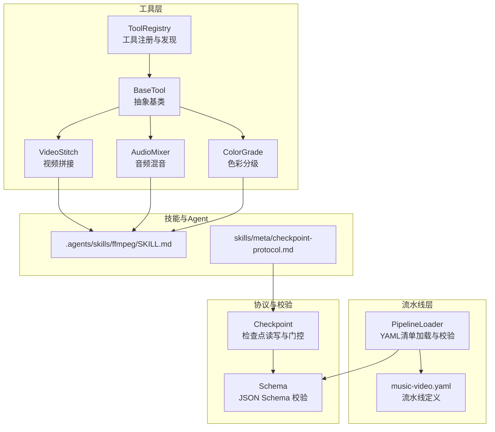
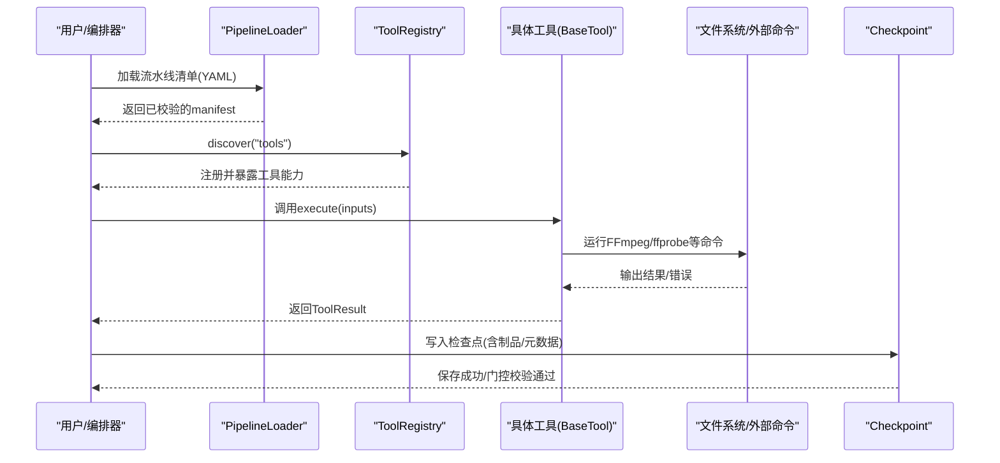
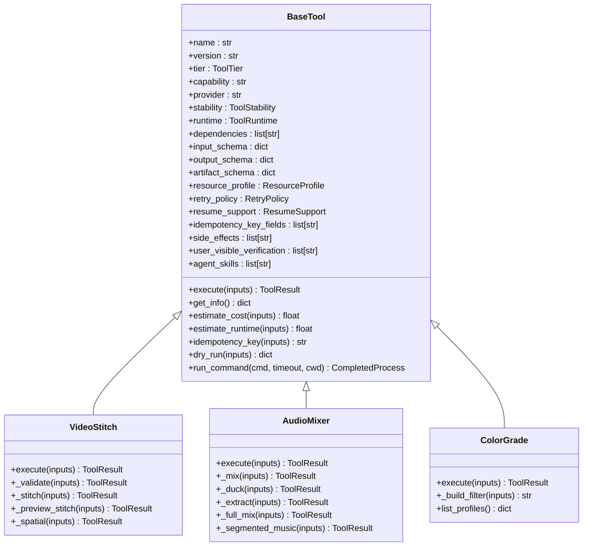
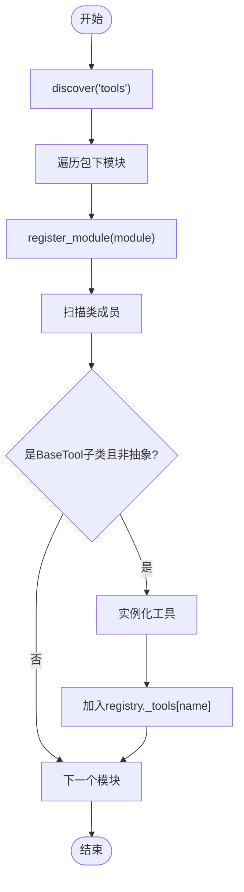
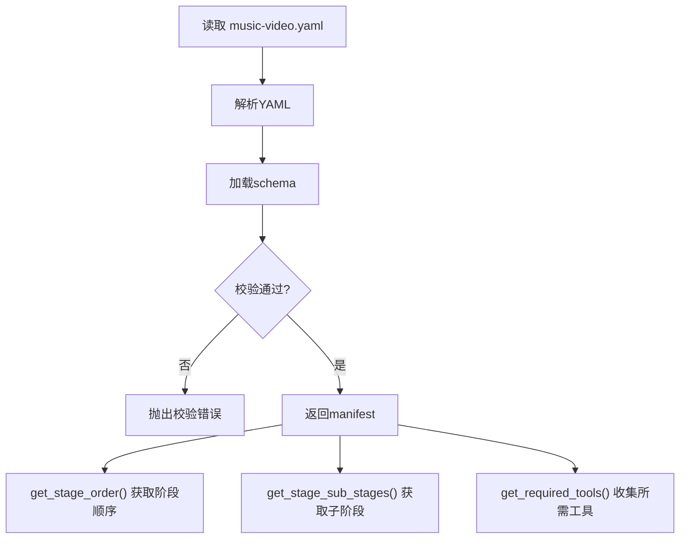
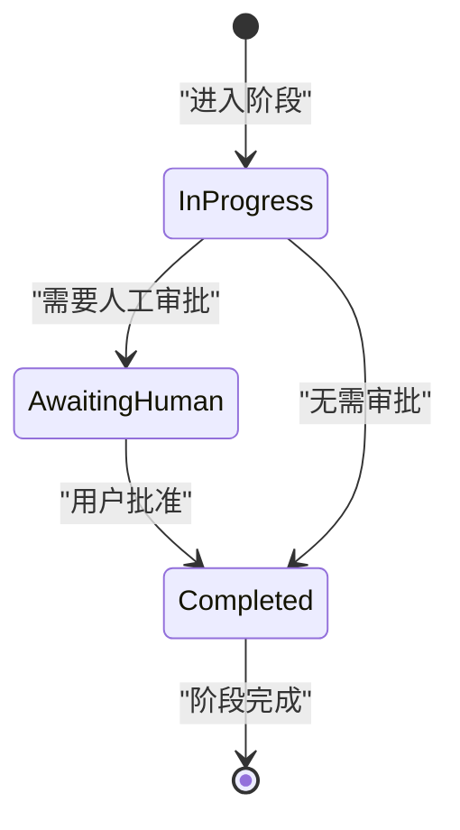
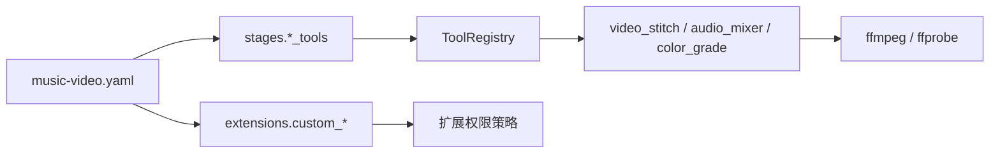

# 插件开发指南

<cite>
**本文引用的文件**   
- [tools/base_tool.py](file://tools/base_tool.py)
- [tools/tool_registry.py](file://tools/tool_registry.py)
- [lib/pipeline_loader.py](file://lib/pipeline_loader.py)
- [pipeline_defs/music-video.yaml](file://pipeline_defs/music-video.yaml)
- [schemas/pipelines/pipeline_manifest.schema.json](file://schemas/pipelines/pipeline_manifest.schema.json)
- [lib/checkpoint.py](file://lib/checkpoint.py)
- [skills/meta/checkpoint-protocol.md](file://skills/meta/checkpoint-protocol.md)
- [tools/video/video_stitch.py](file://tools/video/video_stitch.py)
- [tools/audio/audio_mixer.py](file://tools/audio/audio_mixer.py)
- [tools/enhancement/color_grade.py](file://tools/enhancement/color_grade.py)
- [.agents/skills/ffmpeg/SKILL.md](file://.agents/skills/ffmpeg/SKILL.md)
</cite>

## 目录
1. [简介](#简介)
2. [项目结构](#项目结构)
3. [核心组件](#核心组件)
4. [架构总览](#架构总览)
5. [详细组件分析](#详细组件分析)
6. [依赖关系分析](#依赖关系分析)
7. [性能考量](#性能考量)
8. [故障排查指南](#故障排查指南)
9. [结论](#结论)
10. [附录](#附录)

## 简介
本指南面向希望为 OpenMontage-MV 扩展功能的开发者，系统讲解如何基于 BaseTool 创建自定义工具、如何进行工具注册与依赖声明、技能定义文件的格式与语法、以及流水线（Pipeline）的扩展点与阶段定制方法。文档包含视频处理、音频处理、图像增强等类型的插件示例，并提供测试与验证最佳实践、发布与版本管理建议，帮助开发者快速扩展现有能力并构建新的工具插件。

## 项目结构
OpenMontage-MV 将“工具”“流水线”“技能”“检查点协议”等解耦组织：
- tools：所有工具实现与注册机制
- lib：通用库（流水线加载、检查点、路径与环境等）
- pipeline_defs：以 YAML 声明式定义的流水线清单
- schemas：JSON Schema 用于校验制品与流水线清单
- skills：指令驱动的技能文档（Layer 3），指导 Agent 如何使用工具与流程
- .agents/skills：Agent 侧参考技能（如 FFmpeg 使用规范）

图表来源
- [tools/base_tool.py:227-398](file://tools/base_tool.py#L227-L398)
- [tools/tool_registry.py:55-134](file://tools/tool_registry.py#L55-L134)
- [lib/pipeline_loader.py:49-71](file://lib/pipeline_loader.py#L49-L71)
- [pipeline_defs/music-video.yaml:1-187](file://pipeline_defs/music-video.yaml#L1-L187)
- [lib/checkpoint.py:336-467](file://lib/checkpoint.py#L336-L467)
- [schemas/pipelines/pipeline_manifest.schema.json:1-162](file://schemas/pipelines/pipeline_manifest.schema.json#L1-L162)
- [.agents/skills/ffmpeg/SKILL.md:1-200](file://.agents/skills/ffmpeg/SKILL.md#L1-L200)
- [skills/meta/checkpoint-protocol.md:1-201](file://skills/meta/checkpoint-protocol.md#L1-L201)

章节来源
- [tools/base_tool.py:227-398](file://tools/base_tool.py#L227-L398)
- [tools/tool_registry.py:55-134](file://tools/tool_registry.py#L55-L134)
- [lib/pipeline_loader.py:49-71](file://lib/pipeline_loader.py#L49-L71)
- [pipeline_defs/music-video.yaml:1-187](file://pipeline_defs/music-video.yaml#L1-L187)
- [lib/checkpoint.py:336-467](file://lib/checkpoint.py#L336-L467)
- [schemas/pipelines/pipeline_manifest.schema.json:1-162](file://schemas/pipelines/pipeline_manifest.schema.json#L1-L162)
- [.agents/skills/ffmpeg/SKILL.md:1-200](file://.agents/skills/ffmpeg/SKILL.md#L1-L200)
- [skills/meta/checkpoint-protocol.md:1-201](file://skills/meta/checkpoint-protocol.md#L1-L201)

## 核心组件
- BaseTool：所有工具的抽象基类，统一身份、依赖、能力、资源、重试、幂等、执行、成本估算、状态报告等契约。子类必须实现 execute(inputs) -> ToolResult。
- ToolRegistry：集中注册与发现工具，支持按能力、提供者、层级、状态查询，生成支持信封与能力菜单。
- PipelineLoader：加载并校验 YAML 流水线清单，提供阶段顺序、子阶段、所需工具、扩展权限等查询。
- Checkpoint：检查点写入/读取、门控策略、历史归档、决策日志合并，保障可恢复性与审计。
- 具体工具示例：VideoStitch（视频）、AudioMixer（音频）、ColorGrade（图像增强）。

章节来源
- [tools/base_tool.py:227-398](file://tools/base_tool.py#L227-L398)
- [tools/tool_registry.py:55-134](file://tools/tool_registry.py#L55-L134)
- [lib/pipeline_loader.py:49-71](file://lib/pipeline_loader.py#L49-L71)
- [lib/checkpoint.py:336-467](file://lib/checkpoint.py#L336-L467)
- [tools/video/video_stitch.py:29-147](file://tools/video/video_stitch.py#L29-L147)
- [tools/audio/audio_mixer.py:26-196](file://tools/audio/audio_mixer.py#L26-L196)
- [tools/enhancement/color_grade.py:78-133](file://tools/enhancement/color_grade.py#L78-L133)

## 架构总览
下图展示从流水线清单到工具执行的端到端流程，包括注册、发现、校验、执行与检查点记录。

图表来源
- [lib/pipeline_loader.py:49-71](file://lib/pipeline_loader.py#L49-L71)
- [tools/tool_registry.py:118-134](file://tools/tool_registry.py#L118-L134)
- [tools/base_tool.py:394-408](file://tools/base_tool.py#L394-L408)
- [tools/video/video_stitch.py:148-174](file://tools/video/video_stitch.py#L148-L174)
- [lib/checkpoint.py:336-467](file://lib/checkpoint.py#L336-L467)

## 详细组件分析

### 继承 BaseTool 创建自定义工具
- 必须实现的接口：execute(inputs) -> ToolResult
- 推荐声明的属性：
  - name/version/tier/capability/provider/stability/runtime/determinism/execution_mode
  - dependencies（cmd:/binary:/env:/python:）
  - input_schema/output_schema/artifact_schema
  - resource_profile/retry_policy/resume_support/idempotency_key_fields
  - side_effects/user_visible_verification/agent_skills
- 自动行为：
  - __init_subclass__ 自动包装 execute() 以发射 Backlot 事件
  - get_status()/check_dependencies() 自动检测依赖满足情况
  - idempotency_key() 基于指定字段计算缓存键
  - dry_run() 预检不产生副作用

图表来源
- [tools/base_tool.py:227-398](file://tools/base_tool.py#L227-L398)
- [tools/video/video_stitch.py:29-147](file://tools/video/video_stitch.py#L29-L147)
- [tools/audio/audio_mixer.py:26-196](file://tools/audio/audio_mixer.py#L26-L196)
- [tools/enhancement/color_grade.py:78-133](file://tools/enhancement/color_grade.py#L78-L133)

章节来源
- [tools/base_tool.py:227-398](file://tools/base_tool.py#L227-L398)
- [tools/video/video_stitch.py:29-147](file://tools/video/video_stitch.py#L29-L147)
- [tools/audio/audio_mixer.py:26-196](file://tools/audio/audio_mixer.py#L26-L196)
- [tools/enhancement/color_grade.py:78-133](file://tools/enhancement/color_grade.py#L78-L133)

### 工具注册机制与依赖声明
- 注册方式：
  - ToolRegistry.register_module(module) 扫描模块中所有非抽象的 BaseTool 子类并实例化注册
  - ToolRegistry.discover(package_name="tools") 递归导入包内模块并注册
- 依赖声明：
  - cmd:/binary: 检查系统命令是否存在
  - env: 检查环境变量是否设置
  - python: 尝试 import 模块
- 状态与能力：
  - get_status() 基于 check_dependencies() 判定 AVAILABLE/UNAVAILABLE/DEGRADED
  - support_envelope()/provider_menu()/capability_catalog() 生成能力视图

图表来源
- [tools/tool_registry.py:118-134](file://tools/tool_registry.py#L118-L134)
- [tools/tool_registry.py:73-84](file://tools/tool_registry.py#L73-L84)
- [tools/base_tool.py:304-328](file://tools/base_tool.py#L304-L328)

章节来源
- [tools/tool_registry.py:55-134](file://tools/tool_registry.py#L55-L134)
- [tools/base_tool.py:304-328](file://tools/base_tool.py#L304-L328)

### 技能定义文件格式与语法
- 技能文件位于 .agents/skills 或 skills 目录，采用 Markdown 描述 Agent 应遵循的步骤、前置条件、工具调用约定、产物结构与审查要点。
- 示例：
  - .agents/skills/ffmpeg/SKILL.md：FFmpeg 常用操作与注意事项
  - skills/meta/checkpoint-protocol.md：检查点协议与门控策略
  - skills/pipelines/music-video/idea-director.md：音乐视频 idea 阶段的步骤与产物

章节来源
- [.agents/skills/ffmpeg/SKILL.md:1-200](file://.agents/skills/ffmpeg/SKILL.md#L1-L200)
- [skills/meta/checkpoint-protocol.md:1-201](file://skills/meta/checkpoint-protocol.md#L1-L201)
- [skills/pipelines/music-video/idea-director.md:1-81](file://skills/pipelines/music-video/idea-director.md#L1-L81)

### 流水线扩展点与阶段定制
- 流水线清单（YAML）由 schema 约束，声明 stages、required_skills、extensions、reference_input、orchestration 等。
- 扩展点：
  - extensions.custom_scripts/custom_playbooks/custom_skills/custom_tools：控制允许的能力扩展类型
  - stages.sub_stages：阶段内的子阶段，可按 condition 激活
  - stages.required_tools/optional_tools/tools_available：声明可用工具集合
- 加载与校验：
  - load_pipeline(name, defs_dir) 读取 YAML 并通过 JSON Schema 校验
  - get_stage_order/get_stage_sub_stages/get_required_tools 等辅助函数

图表来源
- [lib/pipeline_loader.py:49-71](file://lib/pipeline_loader.py#L49-L71)
- [schemas/pipelines/pipeline_manifest.schema.json:1-162](file://schemas/pipelines/pipeline_manifest.schema.json#L1-L162)
- [pipeline_defs/music-video.yaml:1-187](file://pipeline_defs/music-video.yaml#L1-L187)

章节来源
- [lib/pipeline_loader.py:49-71](file://lib/pipeline_loader.py#L49-L71)
- [schemas/pipelines/pipeline_manifest.schema.json:1-162](file://schemas/pipelines/pipeline_manifest.schema.json#L1-L162)
- [pipeline_defs/music-video.yaml:1-187](file://pipeline_defs/music-video.yaml#L1-L187)

### 视频处理插件示例：VideoStitch
- 功能：多片段拼接、转场（cut/crossfade/fade-through-black）、空间布局（左右/上下/PiP）、预览、自动标准化
- 关键输入：operation、clips、output_path、transition、auto_normalize、target_resolution/target_fps、codec/crf/preset、layout、pip_*
- 关键输出：ToolResult.data.operation/data.output/data.duration 等，artifacts=[output_path]
- 依赖：cmd:ffmpeg、cmd:ffprobe；可选 pydub（其他工具）

章节来源
- [tools/video/video_stitch.py:29-147](file://tools/video/video_stitch.py#L29-L147)
- [tools/video/video_stitch.py:148-174](file://tools/video/video_stitch.py#L148-L174)
- [tools/video/video_stitch.py:481-583](file://tools/video/video_stitch.py#L481-L583)

### 音频处理插件示例：AudioMixer
- 功能：多轨混音、语音优先的 Ducking、提取音频、完整混音（full_mix）、分段背景音乐
- 关键输入：operation、tracks、primary_audio/secondary_audio、ducking、normalize/loudnorm_target、segments
- 关键输出：ToolResult.data.operation/data.output/data.normalized 等，artifacts=[output_path]
- 依赖：cmd:ffmpeg；pydub 可选

章节来源
- [tools/audio/audio_mixer.py:26-196](file://tools/audio/audio_mixer.py#L26-L196)
- [tools/audio/audio_mixer.py:249-271](file://tools/audio/audio_mixer.py#L249-L271)
- [tools/audio/audio_mixer.py:471-627](file://tools/audio/audio_mixer.py#L471-L627)

### 图像增强插件示例：ColorGrade
- 功能：内置 LUT/滤镜曲线/均衡参数组合，支持 .cube LUT 与强度混合
- 关键输入：input_path、output_path、profile/lut_path/custom_vf、intensity、codec/crf
- 关键输出：ToolResult.data.filter/data.profile 等，artifacts=[output_path]
- 依赖：cmd:ffmpeg

章节来源
- [tools/enhancement/color_grade.py:78-133](file://tools/enhancement/color_grade.py#L78-L133)
- [tools/enhancement/color_grade.py:134-179](file://tools/enhancement/color_grade.py#L134-L179)
- [tools/enhancement/color_grade.py:181-207](file://tools/enhancement/color_grade.py#L181-L207)

### 检查点与门控策略
- 检查点协议：每个阶段完成后写入 checkpoint，支持 in_progress 增量进度、awaiting_human 门控、completed 完成态
- 门控强制：若 manifest 或调用方要求 human_approval_default/human_approval_required，则不能直接写 completed 而需 awaiting_human
- 历史归档：覆盖前将旧检查点归档至 history/，保留审计轨迹
- 决策日志：合并 decision_log 到项目级文件，并在相关制品中引用

图表来源
- [skills/meta/checkpoint-protocol.md:1-201](file://skills/meta/checkpoint-protocol.md#L1-L201)
- [lib/checkpoint.py:336-467](file://lib/checkpoint.py#L336-L467)

章节来源
- [skills/meta/checkpoint-protocol.md:1-201](file://skills/meta/checkpoint-protocol.md#L1-L201)
- [lib/checkpoint.py:336-467](file://lib/checkpoint.py#L336-L467)

## 依赖关系分析
- 工具与外部依赖：
  - ffmpeg/ffprobe：视频/音频处理核心
  - Python 模块：按需 import（如 pydub）
  - 环境变量：API Key 等（通过 env: 声明）
- 流水线与工具关联：
  - stages.required_tools/optional_tools/tools_available 声明阶段可用的工具
  - get_required_tools() 汇总所需工具集合
- 扩展权限控制：
  - extensions.custom_* 控制脚本/玩法/技能/工具扩展开关

图表来源
- [pipeline_defs/music-video.yaml:1-187](file://pipeline_defs/music-video.yaml#L1-L187)
- [lib/pipeline_loader.py:152-162](file://lib/pipeline_loader.py#L152-L162)
- [tools/tool_registry.py:118-134](file://tools/tool_registry.py#L118-L134)

章节来源
- [pipeline_defs/music-video.yaml:1-187](file://pipeline_defs/music-video.yaml#L1-L187)
- [lib/pipeline_loader.py:152-162](file://lib/pipeline_loader.py#L152-L162)
- [tools/tool_registry.py:118-134](file://tools/tool_registry.py#L118-L134)

## 性能考量
- 工具执行开销：
  - VideoStitch 可能触发多次 FFmpeg 重编码与滤镜链，注意 auto_normalize 与 transition 选择
  - AudioMixer full_mix 复杂 filter graph，合理拆分与复用中间流
  - ColorGrade 使用 LUT/曲线时注意分辨率与质量参数
- 资源与重试：
  - 通过 resource_profile 声明 CPU/RAM/VRAM/Disk/Network
  - retry_policy 配置最大重试次数与退避策略
- 幂等与缓存：
  - idempotency_key_fields 决定缓存键，避免重复计算
- 估计成本与时长：
  - estimate_cost()/estimate_runtime() 可用于前端提示与预算控制

[本节为通用指导，不直接分析具体文件]

## 故障排查指南
- 依赖缺失：
  - check_dependencies() 会抛出 DependencyError，根据 install_instructions 安装或设置环境变量
- 命令失败：
  - run_command() 捕获 CalledProcessError 并封装为 ToolCommandError，包含 stderr/stdout/detail
- 流水线清单校验失败：
  - load_pipeline() 使用 JSON Schema 校验，定位字段错误
- 检查点门控违规：
  - write_checkpoint() 在 gated stage 写 completed 且未 human_approved=True 时抛出校验错误

章节来源
- [tools/base_tool.py:304-328](file://tools/base_tool.py#L304-L328)
- [tools/base_tool.py:456-481](file://tools/base_tool.py#L456-L481)
- [lib/pipeline_loader.py:49-71](file://lib/pipeline_loader.py#L49-L71)
- [lib/checkpoint.py:336-467](file://lib/checkpoint.py#L336-L467)

## 结论
通过 BaseTool 的统一契约、ToolRegistry 的自动发现与能力聚合、PipelineLoader 的声明式流水线与扩展点、以及 Checkpoint 的可恢复与门控机制，OpenMontage-MV 提供了完善的插件生态。开发者只需遵循输入/输出 Schema、声明依赖与资源、实现 execute()，即可无缝集成到现有流水线与 Agent 工作流中。结合技能文档与 FFmpeg 等参考知识，能够快速构建高质量的视频、音频与图像增强插件。

[本节为总结性内容，不直接分析具体文件]

## 附录

### 如何从零创建一个新工具插件
- 新建模块：tools/<category>/<your_tool>.py
- 继承 BaseTool，声明 name/version/tier/capability/provider/stability/runtime/determinism/execution_mode
- 声明 dependencies（cmd:/binary:/env:/python:）、install_instructions、agent_skills
- 定义 input_schema/output_schema/artifact_schema、resource_profile、retry_policy、idempotency_key_fields、side_effects、user_visible_verification
- 实现 execute(inputs) -> ToolResult，内部调用 run_command() 执行外部命令或第三方库
- 确保 ToolRegistry.discover("tools") 能自动发现并注册

章节来源
- [tools/base_tool.py:227-398](file://tools/base_tool.py#L227-L398)
- [tools/tool_registry.py:118-134](file://tools/tool_registry.py#L118-L134)

### 如何在流水线中启用新工具
- 在 pipeline_defs/*.yaml 的 stages 中声明 required_tools/optional_tools/tools_available
- 如需扩展自定义工具，确保 extensions.custom_tools: true
- 使用 get_required_tools() 与 registry.get_by_capability() 进行可用性检查

章节来源
- [pipeline_defs/music-video.yaml:1-187](file://pipeline_defs/music-video.yaml#L1-L187)
- [lib/pipeline_loader.py:152-162](file://lib/pipeline_loader.py#L152-L162)
- [tools/tool_registry.py:153-168](file://tools/tool_registry.py#L153-L168)

### 插件测试与验证最佳实践
- 单元测试：
  - 构造最小 inputs，断言 ToolResult.success 与 artifacts 存在
  - 模拟外部命令失败，验证 ToolCommandError 与错误信息
- 集成测试：
  - 准备真实媒体文件，验证 FFmpeg 命令链路
  - 校验 output 文件属性（分辨率、帧率、时长）
- 流水线集成：
  - 在 staging 环境运行完整流水线，确认检查点与门控策略生效
  - 使用 provider_menu_summary() 检查能力与依赖状态

[本节为通用指导，不直接分析具体文件]

### 插件发布与版本管理
- 版本号：在工具类 version 字段维护语义化版本
- 稳定性：stability 标记 experimental/beta/production
- 依赖说明：dependencies 与 install_instructions 保持最新
- 能力变更：更新 input_schema/output_schema 与 capabilities
- 流水线兼容：必要时调整 stages.tools_available 与 extensions 策略

[本节为通用指导，不直接分析具体文件]