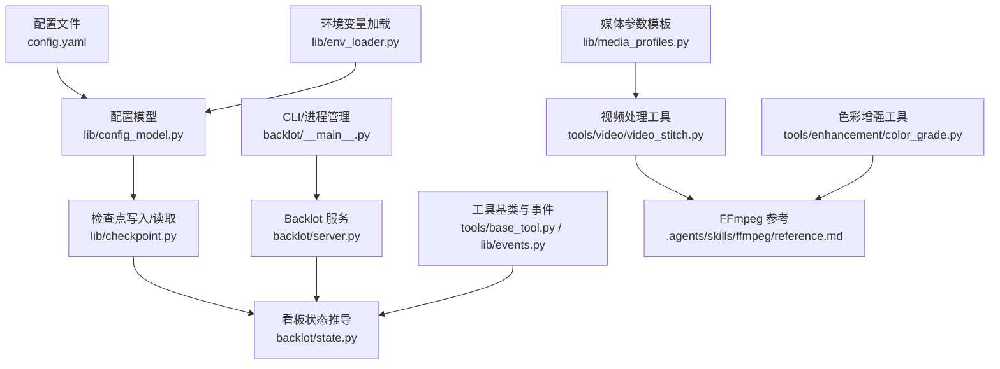
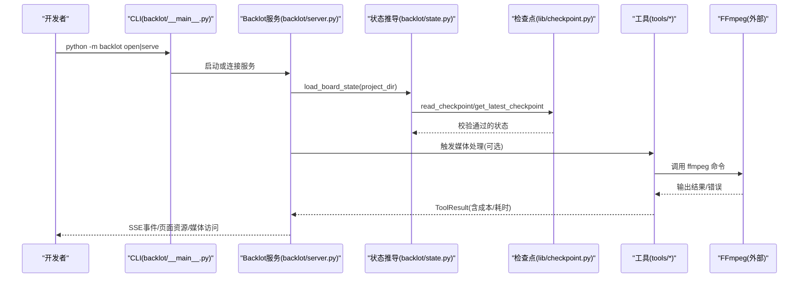
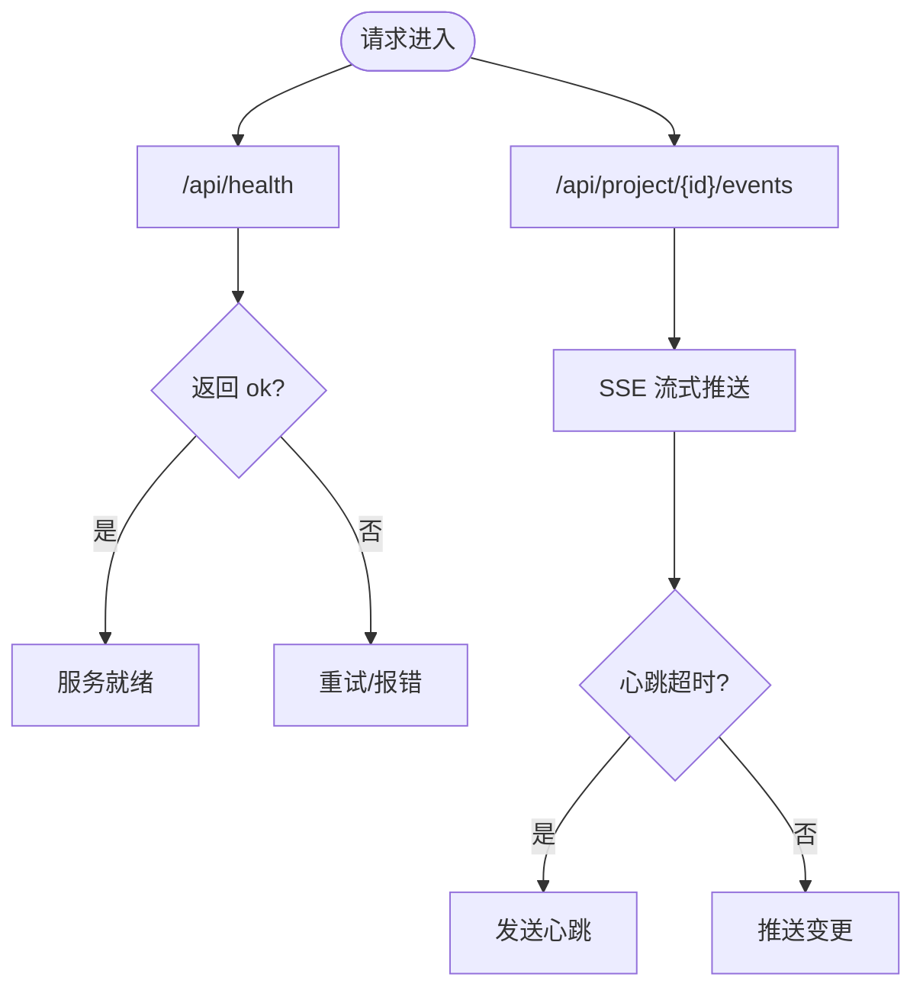
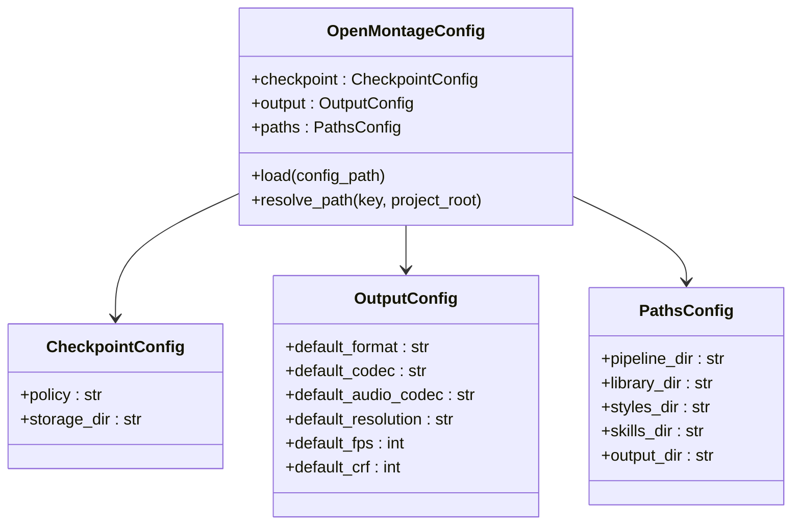
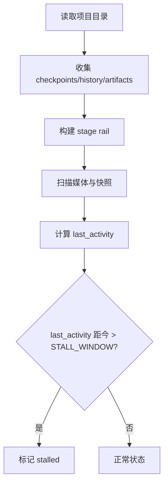
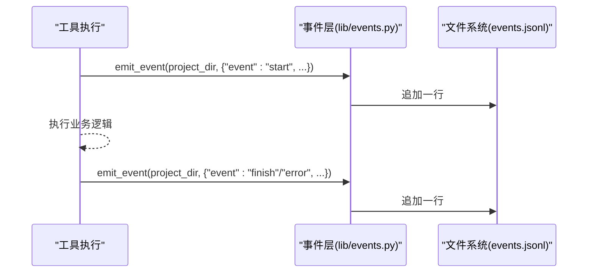
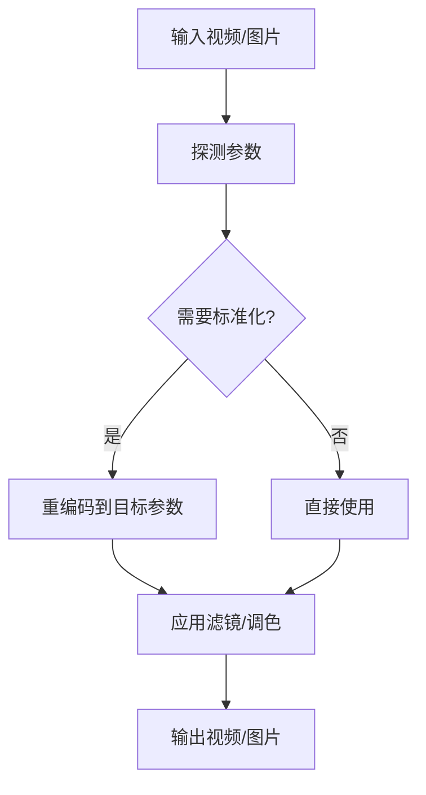
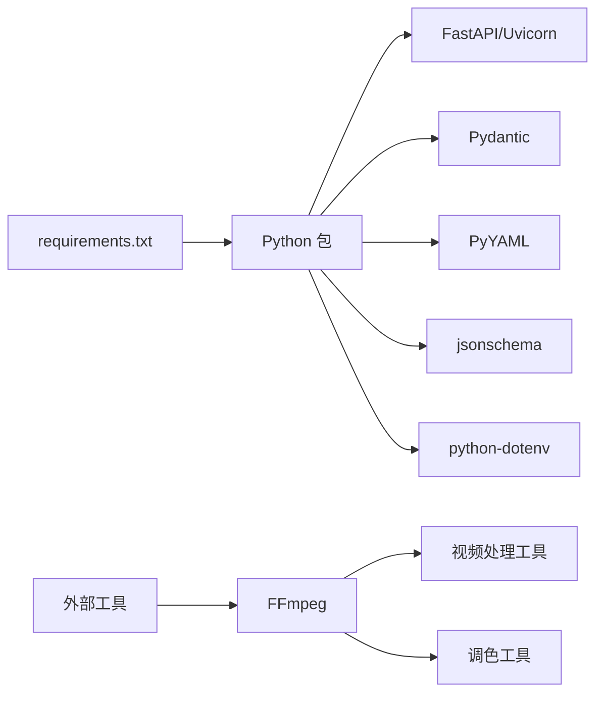

# 故障排除与FAQ

<cite>
**本文引用的文件**   
- [config.yaml](file://config.yaml)
- [requirements.txt](file://requirements.txt)
- [backlot/__main__.py](file://backlot/__main__.py)
- [lib/config_model.py](file://lib/config_model.py)
- [lib/env_loader.py](file://lib/env_loader.py)
- [backlot/server.py](file://backlot/server.py)
- [lib/checkpoint.py](file://lib/checkpoint.py)
- [backlot/state.py](file://backlot/state.py)
- [tools/base_tool.py](file://tools/base_tool.py)
- [lib/events.py](file://lib/events.py)
- [tools/video/video_stitch.py](file://tools/video/video_stitch.py)
- [tools/enhancement/color_grade.py](file://tools/enhancement/color_grade.py)
- [lib/media_profiles.py](file://lib/media_profiles.py)
- [.agents/skills/ffmpeg/reference.md](file://.agents/skills/ffmpeg/reference.md)
</cite>

## 目录
1. [简介](#简介)
2. [项目结构](#项目结构)
3. [核心组件](#核心组件)
4. [架构总览](#架构总览)
5. [详细组件分析](#详细组件分析)
6. [依赖关系分析](#依赖关系分析)
7. [性能注意事项](#性能注意事项)
8. [故障排除指南](#故障排除指南)
9. [常见问题解答（FAQ）](#常见问题解答faq)
10. [结论](#结论)
11. [附录](#附录)

## 简介
本指南面向使用 OpenMontage-MV 的开发者与维护者，聚焦于开发、部署与运行过程中常见问题的快速定位与修复。内容涵盖：
- 配置错误诊断与修复
- 依赖冲突与环境问题排查
- 第三方服务集成（如 FFmpeg）常见问题
- 日志分析与错误追踪技巧
- 性能问题定位与优化建议
- 社区支持与反馈渠道

目标是帮助你在最短时间内恢复工作流，减少阻塞性问题的影响。

## 项目结构
OpenMontage-MV 采用“管道+看板”的架构：
- 配置与运行时模型：config.yaml、lib/config_model.py、lib/env_loader.py
- 看板服务（Backlot）：backlot/server.py、backlot/__main__.py
- 检查点与状态：lib/checkpoint.py、backlot/state.py
- 工具与媒体处理：tools/*（FFmpeg 相关）、lib/media_profiles.py
- 事件记录：lib/events.py

**图表来源** 
- [config.yaml:1-20](file://config.yaml#L1-L20)
- [lib/config_model.py:1-70](file://lib/config_model.py#L1-L70)
- [lib/env_loader.py:1-35](file://lib/env_loader.py#L1-L35)
- [lib/checkpoint.py:1-120](file://lib/checkpoint.py#L1-L120)
- [backlot/state.py:1-120](file://backlot/state.py#L1-L120)
- [backlot/server.py:150-220](file://backlot/server.py#L150-L220)
- [backlot/__main__.py:1-145](file://backlot/__main__.py#L1-L145)
- [tools/base_tool.py:1-200](file://tools/base_tool.py#L1-L200)
- [lib/events.py:77-118](file://lib/events.py#L77-L118)
- [tools/video/video_stitch.py:410-475](file://tools/video/video_stitch.py#L410-L475)
- [tools/enhancement/color_grade.py:78-165](file://tools/enhancement/color_grade.py#L78-L165)
- [lib/media_profiles.py:150-165](file://lib/media_profiles.py#L150-L165)
- [.agents/skills/ffmpeg/reference.md:1-57](file://.agents/skills/ffmpeg/reference.md#L1-L57)

**章节来源**
- [config.yaml:1-20](file://config.yaml#L1-L20)
- [lib/config_model.py:1-70](file://lib/config_model.py#L1-L70)
- [lib/env_loader.py:1-35](file://lib/env_loader.py#L1-L35)
- [backlot/server.py:150-220](file://backlot/server.py#L150-L220)
- [backlot/__main__.py:1-145](file://backlot/__main__.py#L1-L145)

## 核心组件
- 配置模型与路径解析：提供类型化配置、默认值与相对路径解析，确保一致的项目布局。
- Backlot 服务：FastAPI 应用，提供健康检查、项目列表、SSE 实时事件、媒体与缩略图服务。
- 检查点系统：校验阶段、产物与策略，支持归档历史、决策日志合并与门控审批。
- 看板状态推导：只读、防御式解析，保证 UI 不崩溃，并检测停滞任务。
- 工具基类与事件：统一工具执行接口，自动记录 start/finish/error 事件到 events.jsonl。
- 媒体处理：基于 FFmpeg 的视频拼接、转码、调色等能力，配合媒体参数模板。

**章节来源**
- [lib/config_model.py:1-70](file://lib/config_model.py#L1-L70)
- [backlot/server.py:150-220](file://backlot/server.py#L150-L220)
- [lib/checkpoint.py:100-172](file://lib/checkpoint.py#L100-L172)
- [backlot/state.py:586-656](file://backlot/state.py#L586-L656)
- [tools/base_tool.py:148-200](file://tools/base_tool.py#L148-L200)
- [lib/events.py:77-118](file://lib/events.py#L77-L118)
- [tools/video/video_stitch.py:410-475](file://tools/video/video_stitch.py#L410-L475)
- [tools/enhancement/color_grade.py:78-165](file://tools/enhancement/color_grade.py#L78-L165)
- [lib/media_profiles.py:150-165](file://lib/media_profiles.py#L150-L165)

## 架构总览
下图展示了从 CLI 启动、服务运行、状态推导到媒体处理的端到端流程。

**图表来源** 
- [backlot/__main__.py:81-117](file://backlot/__main__.py#L81-L117)
- [backlot/server.py:151-214](file://backlot/server.py#L151-L214)
- [backlot/state.py:586-656](file://backlot/state.py#L586-L656)
- [lib/checkpoint.py:470-503](file://lib/checkpoint.py#L470-L503)
- [tools/base_tool.py:148-200](file://tools/base_tool.py#L148-L200)
- [tools/video/video_stitch.py:410-475](file://tools/video/video_stitch.py#L410-L475)

## 详细组件分析

### Backlot 服务与健康检查
- 健康检查端点用于确认服务是否就绪；CLI 在启动前会轮询该端点。
- SSE 事件通道用于实时更新看板状态，心跳间隔固定，避免长连接超时。
- 静态资源与媒体路由包含安全校验，防止越权访问。

**图表来源** 
- [backlot/server.py:166-169](file://backlot/server.py#L166-L169)
- [backlot/server.py:185-214](file://backlot/server.py#L185-L214)
- [backlot/__main__.py:35-41](file://backlot/__main__.py#L35-L41)

**章节来源**
- [backlot/server.py:151-214](file://backlot/server.py#L151-L214)
- [backlot/__main__.py:35-41](file://backlot/__main__.py#L35-L41)

### 检查点系统与门控策略
- 检查点写入时进行严格校验：阶段合法性、产物完整性、JSON Schema 验证。
- 门控策略强制“awaiting_human”过渡，禁止跳过人工审批直接标记完成。
- 历史归档与决策日志合并保障可追溯性与审计。

**图表来源** 
- [lib/config_model.py:22-49](file://lib/config_model.py#L22-L49)
- [lib/config_model.py:44-70](file://lib/config_model.py#L44-L70)

**章节来源**
- [lib/checkpoint.py:104-172](file://lib/checkpoint.py#L104-L172)
- [lib/checkpoint.py:336-467](file://lib/checkpoint.py#L336-L467)
- [lib/config_model.py:22-49](file://lib/config_model.py#L22-L49)

### 看板状态推导与停滞检测
- 只读、防御式解析，遇到损坏 JSON 或丢失产物时降级显示，不抛异常。
- 根据最后活动时间判断“live”，对长时间无活动的 in_progress 阶段标记为“stalled”。

**图表来源** 
- [backlot/state.py:586-656](file://backlot/state.py#L586-L656)
- [backlot/state.py:628-636](file://backlot/state.py#L628-L636)

**章节来源**
- [backlot/state.py:586-656](file://backlot/state.py#L586-L656)

### 工具执行与事件记录
- 工具基类在执行前后自动记录 start/finish/error 事件，便于看板展示活动与生成状态。
- 事件写入失败不影响工具执行，遵循“非致命”原则。

**图表来源** 
- [tools/base_tool.py:148-200](file://tools/base_tool.py#L148-L200)
- [lib/events.py:77-118](file://lib/events.py#L77-L118)

**章节来源**
- [tools/base_tool.py:148-200](file://tools/base_tool.py#L148-L200)
- [lib/events.py:77-118](file://lib/events.py#L77-L118)

### 媒体处理与 FFmpeg 集成
- 视频拼接、转码、调色等功能通过调用 FFmpeg 实现。
- 媒体参数模板提供平台化的编码参数，便于一致性输出。
- FFmpeg 参考文档覆盖常用滤镜与编解码选项。

**图表来源** 
- [tools/video/video_stitch.py:410-475](file://tools/video/video_stitch.py#L410-L475)
- [tools/enhancement/color_grade.py:134-165](file://tools/enhancement/color_grade.py#L134-L165)
- [lib/media_profiles.py:150-165](file://lib/media_profiles.py#L150-L165)
- [.agents/skills/ffmpeg/reference.md:1-57](file://.agents/skills/ffmpeg/reference.md#L1-L57)

**章节来源**
- [tools/video/video_stitch.py:410-475](file://tools/video/video_stitch.py#L410-L475)
- [tools/enhancement/color_grade.py:134-165](file://tools/enhancement/color_grade.py#L134-L165)
- [lib/media_profiles.py:150-165](file://lib/media_profiles.py#L150-L165)
- [.agents/skills/ffmpeg/reference.md:1-57](file://.agents/skills/ffmpeg/reference.md#L1-L57)

## 依赖关系分析
- Python 依赖：PyYAML、Pydantic、jsonschema、python-dotenv、requests、FastAPI、Uvicorn、watchfiles。
- 外部依赖：FFmpeg（命令行工具）。
- 运行时配置：config.yaml 与 .env 环境变量共同决定行为。

**图表来源** 
- [requirements.txt:1-12](file://requirements.txt#L1-L12)
- [tools/video/video_stitch.py:410-475](file://tools/video/video_stitch.py#L410-L475)
- [tools/enhancement/color_grade.py:78-165](file://tools/enhancement/color_grade.py#L78-L165)

**章节来源**
- [requirements.txt:1-12](file://requirements.txt#L1-L12)

## 性能注意事项
- 看板状态推导为只读且防御式，避免大文件解析导致的卡顿；必要时限制事件读取数量。
- 缩略图缓存降低重复生成开销；并发缺失时避免竞争写同一临时文件。
- SSE 心跳与队列限流防止消息风暴；忽略无关路径变更减少无效通知。
- 媒体处理尽量复用参数模板，减少不必要的重编码。

[本节为通用指导，不直接分析具体文件]

## 故障排除指南

### 一、环境与依赖问题
- 症状：导入失败、模块未找到、端口占用、服务无法启动。
- 排查步骤：
  - 确认已安装 requirements.txt 中列出的依赖。
  - 检查 .env 是否存在且格式正确（键=值，支持注释与引号）。
  - 确认 BACKLOT_PORT 和 BACKLOT_HOST 环境变量设置合理。
  - 查看 .studio/server.log 获取启动与运行期日志。
- 修复方法：
  - 重新安装依赖：pip install -r requirements.txt
  - 修正 .env 中的变量名或值，确保不被覆盖。
  - 更换端口或释放占用端口后重启服务。

**章节来源**
- [requirements.txt:1-12](file://requirements.txt#L1-L12)
- [lib/env_loader.py:15-35](file://lib/env_loader.py#L15-L35)
- [backlot/__main__.py:28-33](file://backlot/__main__.py#L28-L33)
- [backlot/__main__.py:43-78](file://backlot/__main__.py#L43-L78)

### 二、配置错误诊断
- 症状：路径解析失败、默认参数不生效、项目布局异常。
- 排查步骤：
  - 检查 config.yaml 的 checkpoint/output/paths 字段是否符合预期。
  - 使用配置模型的 resolve_path 验证相对路径是否正确解析。
  - 确认项目根目录下存在 pipeline/library/styles/skills/output 等目录。
- 修复方法：
  - 修正 config.yaml 中的路径与参数。
  - 确保项目初始化时创建了标准子目录结构。

**章节来源**
- [config.yaml:1-20](file://config.yaml#L1-L20)
- [lib/config_model.py:51-70](file://lib/config_model.py#L51-L70)
- [lib/checkpoint.py:178-227](file://lib/checkpoint.py#L178-L227)

### 三、检查点与门控违规
- 症状：写入检查点时报错、阶段无法推进、审批被拒绝。
- 排查步骤：
  - 检查阶段名称是否在有效集合内。
  - 确认产物结构与 JSON Schema 匹配。
  - 若阶段要求人工审批，需先写入 awaiting_human，再经批准后写入 completed。
- 修复方法：
  - 修正阶段名与产物字段。
  - 遵循门控流程，补充 human_approved=True 后再标记完成。

**章节来源**
- [lib/checkpoint.py:104-172](file://lib/checkpoint.py#L104-L172)
- [lib/checkpoint.py:336-467](file://lib/checkpoint.py#L336-L467)

### 四、看板状态与停滞检测
- 症状：看板不更新、任务卡住、活动指示不刷新。
- 排查步骤：
  - 检查 events.jsonl 是否有新事件写入。
  - 查看 last_activity 时间戳是否持续更新。
  - 确认 watchfiles 是否可用，监听 projects/ 目录变更。
- 修复方法：
  - 修复事件写入权限或路径。
  - 确保 watchfiles 已安装并可监听目录。
  - 手动刷新看板或等待心跳。

**章节来源**
- [lib/events.py:77-118](file://lib/events.py#L77-L118)
- [backlot/state.py:586-656](file://backlot/state.py#L586-L656)
- [backlot/server.py:132-149](file://backlot/server.py#L132-L149)

### 五、媒体处理与 FFmpeg 问题
- 症状：转码失败、滤镜报错、缩略图不可用、输出质量异常。
- 排查步骤：
  - 确认 FFmpeg 已安装且在 PATH 中。
  - 检查输入文件格式与编码是否受支持。
  - 查看工具调用的命令行参数与返回值。
- 修复方法：
  - 安装或更新 FFmpeg。
  - 调整滤镜链或编解码参数，参考 FFmpeg 参考文档。
  - 使用媒体参数模板保持一致性。

**章节来源**
- [tools/video/video_stitch.py:410-475](file://tools/video/video_stitch.py#L410-L475)
- [tools/enhancement/color_grade.py:134-165](file://tools/enhancement/color_grade.py#L134-L165)
- [.agents/skills/ffmpeg/reference.md:1-57](file://.agents/skills/ffmpeg/reference.md#L1-L57)

### 六、日志分析与错误追踪
- 关键日志位置：
  - .studio/server.log：Backlot 服务启动与运行日志。
  - 项目目录下的 events.jsonl：工具执行事件记录。
- 分析方法：
  - 搜索关键字：error、exception、timeout、returncode。
  - 结合时间戳与上下文定位问题阶段。
  - 关注心跳与事件序列，识别中断或卡死。

**章节来源**
- [backlot/__main__.py:43-78](file://backlot/__main__.py#L43-L78)
- [lib/events.py:77-118](file://lib/events.py#L77-L118)

### 七、第三方服务集成常见问题
- 症状：API 调用失败、密钥缺失、网络超时。
- 排查步骤：
  - 检查 .env 中的 API Key 与 URL 配置。
  - 确认网络连通性与代理设置。
  - 查看工具返回的错误详情与堆栈。
- 修复方法：
  - 修正密钥与端点配置。
  - 增加重试与退避策略（如适用）。
  - 隔离失败调用，避免级联错误。

**章节来源**
- [tools/base_tool.py:25-60](file://tools/base_tool.py#L25-L60)
- [tools/base_tool.py:456-480](file://tools/base_tool.py#L456-L480)

### 八、性能问题排查与优化
- 症状：渲染缓慢、UI 卡顿、内存占用高。
- 排查步骤：
  - 监控工具执行时长与资源消耗。
  - 检查是否频繁重编码或重复生成缩略图。
  - 评估事件数量与 SSE 推送频率。
- 优化建议：
  - 使用合适的媒体参数模板，避免过度转码。
  - 启用缩略图缓存与条件刷新。
  - 限制事件读取数量与队列大小。

[本节为通用指导，不直接分析具体文件]

### 九、社区支持与问题反馈
- 建议渠道：
  - 查阅项目 README 与 AGENTS.md 中的说明。
  - 在 GitHub Issues 提交问题，附上日志与复现步骤。
  - 参与讨论区或论坛，分享经验与解决方案。
- 反馈模板：
  - 环境信息（操作系统、Python 版本、依赖版本）
  - 配置片段（脱敏）
  - 错误日志与事件记录
  - 复现步骤与期望行为

[本节为通用指导，不直接分析具体文件]

## 常见问题解答（FAQ）

- Q1：为什么服务启动后浏览器打不开看板？
  - 检查健康端点是否返回 200；确认端口未被占用；查看 .studio/server.log 是否有启动错误。
  - 参考：[backlot/__main__.py:35-41](file://backlot/__main__.py#L35-L41)、[backlot/server.py:166-169](file://backlot/server.py#L166-L169)

- Q2：检查点写入失败，提示阶段无效或产物缺失？
  - 确认阶段名称合法，产物符合 Schema；若需人工审批，先写入 awaiting_human。
  - 参考：[lib/checkpoint.py:104-172](file://lib/checkpoint.py#L104-L172)、[lib/checkpoint.py:336-467](file://lib/checkpoint.py#L336-L467)

- Q3：看板不更新或任务卡住？
  - 检查 events.jsonl 是否有新事件；确认 last_activity 更新时间；验证 watchfiles 监听。
  - 参考：[lib/events.py:77-118](file://lib/events.py#L77-L118)、[backlot/state.py:586-656](file://backlot/state.py#L586-L656)

- Q4：FFmpeg 命令执行失败？
  - 确认 FFmpeg 已安装且在 PATH；检查输入格式与滤镜语法；查看返回码与错误输出。
  - 参考：[tools/video/video_stitch.py:410-475](file://tools/video/video_stitch.py#L410-L475)、[.agents/skills/ffmpeg/reference.md:1-57](file://.agents/skills/ffmpeg/reference.md#L1-L57)

- Q5：如何定位性能瓶颈？
  - 监控工具执行时长与资源使用；检查是否重复转码或生成；优化参数模板与缓存策略。
  - 参考：[lib/media_profiles.py:150-165](file://lib/media_profiles.py#L150-L165)

## 结论
本指南围绕配置、依赖、检查点、看板、工具与媒体处理等核心环节，提供了系统化的故障排除方法与优化建议。通过日志分析、错误追踪与性能调优，开发者可以快速定位并解决问题，提升开发与使用体验。遇到问题时，请优先检查环境与配置，其次关注日志与事件，最后结合工具与媒体处理细节进行深入排查。

[本节为总结性内容，不直接分析具体文件]

## 附录
- 常用命令：
  - 启动服务：python -m backlot serve --port N
  - 打开看板：python -m backlot open [project-id]
  - 打开 Studio：python -m backlot studio
- 关键路径：
  - 配置文件：config.yaml
  - 环境变量：.env
  - 服务日志：.studio/server.log
  - 事件记录：projects/<project_id>/events.jsonl

[本节为补充信息，不直接分析具体文件]