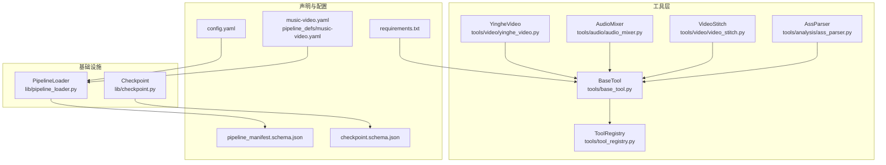
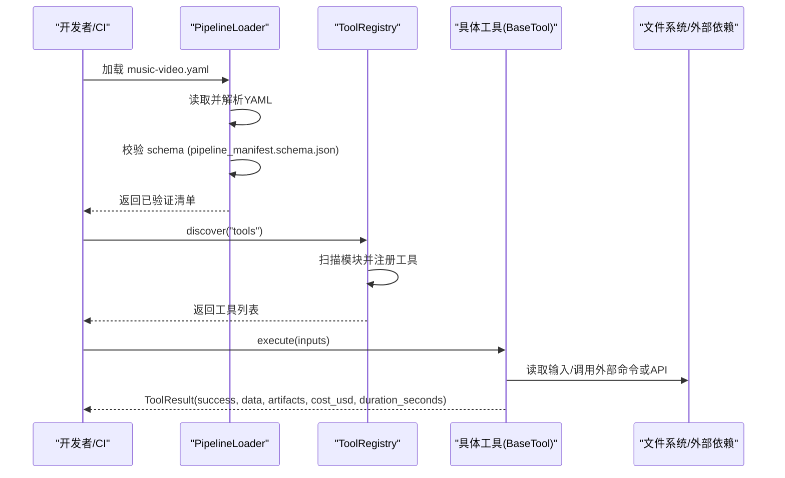
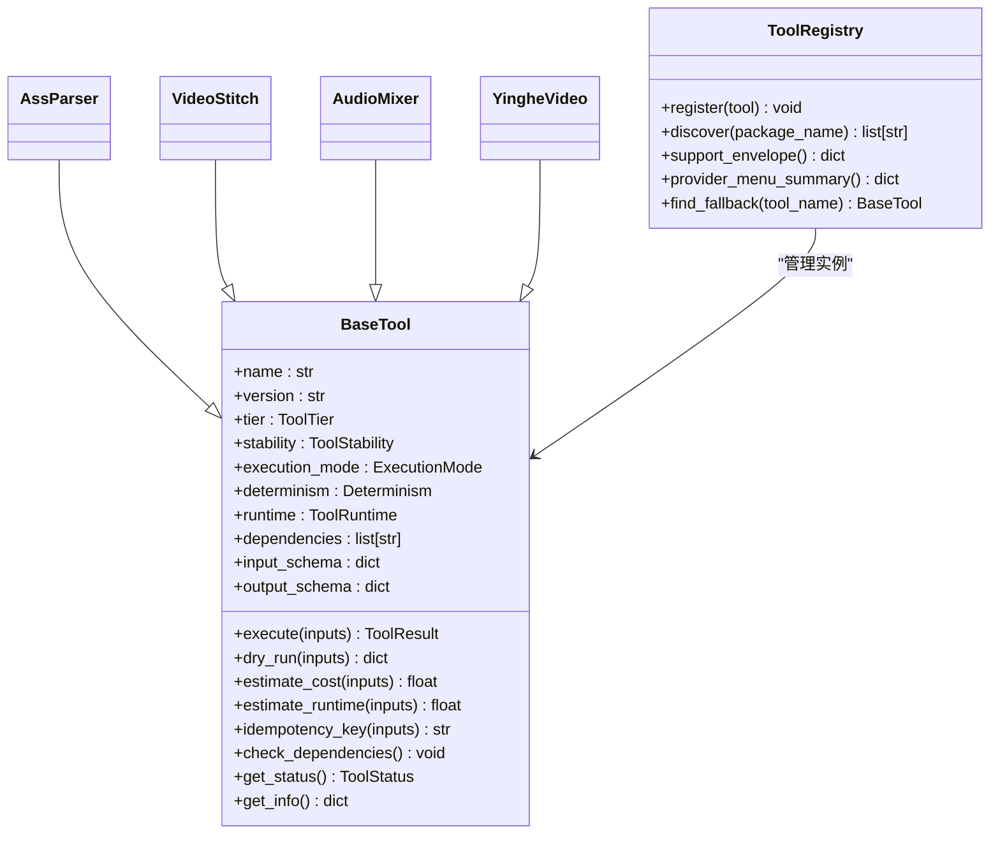

# 测试指南

<cite>
**本文引用的文件**   
- [tests/README.md](file://tests/README.md)
- [tools/base_tool.py](file://tools/base_tool.py)
- [tools/tool_registry.py](file://tools/tool_registry.py)
- [lib/pipeline_loader.py](file://lib/pipeline_loader.py)
- [lib/checkpoint.py](file://lib/checkpoint.py)
- [tools/analysis/ass_parser.py](file://tools/analysis/ass_parser.py)
- [tools/video/video_stitch.py](file://tools/video/video_stitch.py)
- [tools/audio/audio_mixer.py](file://tools/audio/audio_mixer.py)
- [tools/video/yinghe_video.py](file://tools/video/yinghe_video.py)
- [pipeline_defs/music-video.yaml](file://pipeline_defs/music-video.yaml)
- [schemas/pipelines/pipeline_manifest.schema.json](file://schemas/pipelines/pipeline_manifest.schema.json)
- [schemas/checkpoints/checkpoint.schema.json](file://schemas/checkpoints/checkpoint.schema.json)
- [config.yaml](file://config.yaml)
- [requirements.txt](file://requirements.txt)
</cite>

## 目录
1. [简介](#简介)
2. [项目结构](#项目结构)
3. [核心组件](#核心组件)
4. [架构总览](#架构总览)
5. [详细组件分析](#详细组件分析)
6. [依赖关系分析](#依赖关系分析)
7. [性能考量](#性能考量)
8. [故障排查指南](#故障排查指南)
9. [结论](#结论)
10. [附录](#附录)

## 简介
本测试指南面向OpenMontage-MV项目的开发者与质量保障人员，系统化说明测试框架选择与配置、单元测试/集成测试/端到端测试的编写方法，以及BaseTool接口契约测试策略。文档覆盖ASS解析器、视频处理工具、音频混音工具的测试用例示例，流水线加载器的验证测试，测试数据管理与fixture使用，持续集成与自动化流程，帮助团队建立高质量、可维护、覆盖率可控的测试体系。

## 项目结构
本项目采用分层与按功能组织相结合的结构：
- tools/: 工具实现（BaseTool基类与各具体工具）
- lib/: 基础设施（流水线加载、检查点持久化等）
- pipeline_defs/: 声明式流水线定义（YAML）
- schemas/: JSON Schema（流水线清单、检查点、制品等）
- tests/: 测试用例（当前为说明性README）

**图表来源** 
- [tools/base_tool.py:227-397](file://tools/base_tool.py#L227-L397)
- [tools/tool_registry.py:55-134](file://tools/tool_registry.py#L55-L134)
- [lib/pipeline_loader.py:49-70](file://lib/pipeline_loader.py#L49-L70)
- [lib/checkpoint.py:140-171](file://lib/checkpoint.py#L140-L171)
- [pipeline_defs/music-video.yaml:1-187](file://pipeline_defs/music-video.yaml#L1-L187)
- [schemas/pipelines/pipeline_manifest.schema.json:1-162](file://schemas/pipelines/pipeline_manifest.schema.json#L1-L162)
- [schemas/checkpoints/checkpoint.schema.json:1-47](file://schemas/checkpoints/checkpoint.schema.json#L1-L47)
- [config.yaml:1-20](file://config.yaml#L1-L20)
- [requirements.txt:1-12](file://requirements.txt#L1-L12)

**章节来源**
- [tests/README.md:1-14](file://tests/README.md#L1-L14)

## 核心组件
- BaseTool抽象基类：统一工具契约（身份、能力、依赖、执行、成本估算、健康状态、幂等键、副作用、回退等），并提供execute装饰器用于事件埋点与耗时统计。
- ToolRegistry：工具注册与发现，支持按层级、能力、提供者、状态筛选，生成支持信封与提供者菜单摘要。
- PipelineLoader：加载并校验流水线清单YAML，提供阶段顺序、子阶段、所需工具、扩展权限等查询。
- Checkpoint：检查点读写与校验，结合JSON Schema与制品Schema进行强约束，支持人工审批门控与归档历史。

关键测试要点：
- 契约一致性：所有工具必须满足BaseTool契约（name/version/tier/capability/input_schema/output_schema等）。
- 注册发现：registry.discover()应能自动发现全部工具（README指出6个工具）。
- 流水线清单：music-video.yaml需通过schema校验；阶段顺序、工具可用性、扩展权限需验证。
- 检查点：write/read/gate round-trip在projects/下有效，且符合checkpoint.schema.json。

**章节来源**
- [tools/base_tool.py:227-397](file://tools/base_tool.py#L227-L397)
- [tools/tool_registry.py:55-134](file://tools/tool_registry.py#L55-L134)
- [lib/pipeline_loader.py:49-70](file://lib/pipeline_loader.py#L49-L70)
- [lib/checkpoint.py:140-171](file://lib/checkpoint.py#L140-L171)
- [tests/README.md:1-14](file://tests/README.md#L1-L14)

## 架构总览
下图展示从流水线清单到工具执行的端到端路径，包括校验、注册、执行与结果产出。

**图表来源** 
- [lib/pipeline_loader.py:49-70](file://lib/pipeline_loader.py#L49-L70)
- [tools/tool_registry.py:118-134](file://tools/tool_registry.py#L118-L134)
- [tools/base_tool.py:394-407](file://tools/base_tool.py#L394-L407)

## 详细组件分析

### BaseTool接口与契约测试策略
- 身份字段与枚举：name/version/tier/stability/execution_mode/determinism/runtime等必须完整且合理。
- 能力与模式：capability/capabilities/provider/supports/best_for/not_good_for等描述工具用途与限制。
- 依赖声明：dependencies支持cmd:/env:/python:前缀，check_dependencies需正确检测。
- 执行契约：execute(inputs) -> ToolResult，包含success/data/artifacts/error/cost_usd/duration_seconds/seed/model等。
- 幂等键：idempotency_key_fields决定缓存键计算。
- 副作用与回退：side_effects/fallback/fallback_tools用于安全与降级。
- 资源与重试：resource_profile/retry_policy指导运行环境与容错。
- 事件埋点：execute被装饰器包装，记录start/finish/error事件（非致命）。

建议测试：
- 单元：构造最小inputs，断言ToolResult字段完整性与类型；覆盖错误分支（如文件不存在、依赖缺失）。
- 契约：遍历所有工具实例，断言必需字段存在且类型正确；断言get_info()输出结构与Schema一致。
- 依赖：mock环境变量/二进制/模块，验证check_dependencies抛出DependencyError或成功。

**章节来源**
- [tools/base_tool.py:227-397](file://tools/base_tool.py#L227-L397)
- [tools/base_tool.py:304-327](file://tools/base_tool.py#L304-L327)
- [tools/base_tool.py:376-407](file://tools/base_tool.py#L376-L407)

### ToolRegistry发现与能力报告
- discover(package_name)递归导入工具模块并注册，跳过base_tool与tool_registry自身。
- support_envelope/capability_catalog/provider_catalog/tier_summary/provider_menu/provider_menu_summary等用于能力汇总与用户展示。
- find_fallback根据fallback/fallback_tools与可用性返回替代工具。

建议测试：
- 单元：clear后discover，断言工具数量与名称集合；按tier/capability/provider/status过滤结果。
- 集成：provider_menu_summary中composition_runtimes与capabilities聚合逻辑；setup_offers启发式提取env变量修复项。

**章节来源**
- [tools/tool_registry.py:55-134](file://tools/tool_registry.py#L55-L134)
- [tools/tool_registry.py:198-230](file://tools/tool_registry.py#L198-L230)
- [tools/tool_registry.py:249-314](file://tools/tool_registry.py#L249-L314)
- [tools/tool_registry.py:316-471](file://tools/tool_registry.py#L316-L471)

### AssParser（ASS字幕解析）
- 功能：UTF-8优先、GBK回退；[Events] Dialogue提取；去卡拉OK/覆盖标签；歌手角色映射；时间H:MM:SS.cs转秒。
- 输入：input_path（必需）；输出：lines、total_duration、singers、gaps等。
- 确定性：Deterministic，适合回归测试。

建议测试：
- 单元：构造不同编码ASS文本（含BOM、CJK缺失、控制字符），断言解码回退与garble处理。
- 边界：空文件、无Dialogue行、时间戳非法行跳过；排序与gap计算（intro/interlude/outro推断）。
- 集成：对真实ASS文件进行端到端解析，断言line_count、encoding、gaps合理性。

**章节来源**
- [tools/analysis/ass_parser.py:102-149](file://tools/analysis/ass_parser.py#L102-L149)
- [tools/analysis/ass_parser.py:153-244](file://tools/analysis/ass_parser.py#L153-L244)

### VideoStitch（视频拼接）
- 功能：validate/stitch/preview_stitch/spatial（侧边/竖排/PiP）；crossfade/fade过渡；自动规范化；ffprobe探测。
- 依赖：ffmpeg/ffprobe；可选pydub（音频处理）。
- 输入：operation及对应参数；输出：ToolResult包含duration/file_size_bytes/artifacts等。

建议测试：
- 单元：_probe_clip解析元数据；_needs_normalization判断；_stitch_cut/_stitch_crossfade/_stitch_fade_through_black命令构建。
- 集成：多clip拼接（cut/crossfade/fade），断言输出时长≈输入总和；空间布局输出分辨率与位置。
- 异常：缺少clip、ffprobe失败、转换失败重试策略。

**章节来源**
- [tools/video/video_stitch.py:148-174](file://tools/video/video_stitch.py#L148-L174)
- [tools/video/video_stitch.py:256-308](file://tools/video/video_stitch.py#L256-L308)
- [tools/video/video_stitch.py:314-399](file://tools/video/video_stitch.py#L314-L399)
- [tools/video/video_stitch.py:481-583](file://tools/video/video_stitch.py#L481-L583)
- [tools/video/video_stitch.py:584-633](file://tools/video/video_stitch.py#L584-L633)
- [tools/video/video_stitch.py:635-657](file://tools/video/video_stitch.py#L635-L657)
- [tools/video/video_stitch.py:741-774](file://tools/video/video_stitch.py#L741-L774)

### AudioMixer（音频混音）
- 功能：mix/duck/extract/full_mix/segmented_music；支持音量、淡入淡出、延迟、响度标准化（loudnorm）。
- 依赖：ffmpeg；pydub可选。
- 输入：operation与tracks/primary_audio/secondary_audio等；输出：ToolResult包含artifacts与处理信息。

建议测试：
- 单元：_track_filters生成滤镜链；_full_mix组合speech/music/sfx并应用sidechaincompress。
- 集成：多轨道混音与duck效果；segmented_music按时间段混合背景音乐。
- 异常：输入文件不存在、ffmpeg命令失败、normalize目标范围越界。

**章节来源**
- [tools/audio/audio_mixer.py:249-270](file://tools/audio/audio_mixer.py#L249-L270)
- [tools/audio/audio_mixer.py:272-330](file://tools/audio/audio_mixer.py#L272-L330)
- [tools/audio/audio_mixer.py:332-437](file://tools/audio/audio_mixer.py#L332-L437)
- [tools/audio/audio_mixer.py:439-469](file://tools/audio/audio_mixer.py#L439-L469)
- [tools/audio/audio_mixer.py:471-627](file://tools/audio/audio_mixer.py#L471-L627)
- [tools/audio/audio_mixer.py:629-736](file://tools/audio/audio_mixer.py#L629-L736)

### YingheVideo（异步视频生成API）
- 功能：text_to_video/image_to_video；任务创建、轮询、下载；支持模型、比例、时长、水印等。
- 依赖：VIDEO_API_KEY（可选BASE_URL/MODEL）；网络请求。
- 输入：prompt与操作参数；输出：ToolResult包含task_id、output、duration、ratio等。

建议测试：
- 单元：_build_content组装请求体；_config读取环境变量；status判定AVAILABLE/UNAVAILABLE。
- 集成：模拟API响应（成功/失败/超时），断言轮询与下载逻辑；幂等键避免重复计费。
- 异常：未设置API Key、任务拒绝、下载失败。

**章节来源**
- [tools/video/yinghe_video.py:39-126](file://tools/video/yinghe_video.py#L39-L126)
- [tools/video/yinghe_video.py:149-263](file://tools/video/yinghe_video.py#L149-L263)

### 流水线加载器验证测试
- load_pipeline(name, defs_dir)读取YAML并通过jsonschema.validate校验。
- list_pipelines列出可用清单；get_stage_order/get_required_tools/get_stage_skill等辅助函数。
- check_extension_permitted强制扩展权限开关。

建议测试：
- 单元：无效YAML触发ValidationError；缺失stage/name/version报错；extensions权限校验。
- 集成：music-video.yaml加载成功；阶段顺序与工具集合正确；条件子阶段过滤。

**章节来源**
- [lib/pipeline_loader.py:49-70](file://lib/pipeline_loader.py#L49-L70)
- [lib/pipeline_loader.py:73-76](file://lib/pipeline_loader.py#L73-L76)
- [lib/pipeline_loader.py:125-149](file://lib/pipeline_loader.py#L125-L149)
- [lib/pipeline_loader.py:152-162](file://lib/pipeline_loader.py#L152-L162)
- [lib/pipeline_loader.py:201-228](file://lib/pipeline_loader.py#L201-L228)

### 检查点读写与门控测试
- write_checkpoint校验checkpoint.schema.json与制品Schema；支持human_approval门控与历史归档。
- read_checkpoint/get_latest_checkpoint/get_completed_stages/get_next_stage用于状态推进。

建议测试：
- 单元：无效stage/status/artifacts触发Checkpoin tValidationError；门控违规抛出明确错误。
- 集成：写入后读取一致；latest checkpoint按mtime获取；completed stages与next stage推导正确。

**章节来源**
- [lib/checkpoint.py:140-171](file://lib/checkpoint.py#L140-L171)
- [lib/checkpoint.py:336-467](file://lib/checkpoint.py#L336-L467)
- [lib/checkpoint.py:470-537](file://lib/checkpoint.py#L470-L537)

## 依赖关系分析
- BaseTool是所有工具的基类，ToolRegistry负责发现与聚合。
- PipelineLoader依赖JSON Schema校验YAML；Checkpoint依赖artifact schema与checkpoint schema。
- 工具可能依赖外部命令（ffmpeg/ffprobe）、环境变量（API Key）、Python模块（requests/pydub）。

**图表来源** 
- [tools/base_tool.py:227-397](file://tools/base_tool.py#L227-L397)
- [tools/tool_registry.py:55-134](file://tools/tool_registry.py#L55-L134)
- [tools/analysis/ass_parser.py:102-149](file://tools/analysis/ass_parser.py#L102-L149)
- [tools/video/video_stitch.py:29-46](file://tools/video/video_stitch.py#L29-L46)
- [tools/audio/audio_mixer.py:26-42](file://tools/audio/audio_mixer.py#L26-L42)
- [tools/video/yinghe_video.py:39-56](file://tools/video/yinghe_video.py#L39-L56)

**章节来源**
- [tools/base_tool.py:227-397](file://tools/base_tool.py#L227-L397)
- [tools/tool_registry.py:55-134](file://tools/tool_registry.py#L55-L134)

## 性能考量
- 工具执行耗时：BaseTool.execute装饰器记录duration_seconds，可用于基准测试与回归监控。
- FFmpeg命令：大量I/O与编解码，建议使用小样本素材进行快速回归，大样本用于夜间全量。
- API轮询：YingheVideo轮询间隔与超时需配置合理，避免阻塞测试进程。
- 缓存与幂等：idempotency_key_fields可用于减少重复计算与网络请求。

[本节为通用指导，不直接分析具体文件]

## 故障排查指南
- 依赖缺失：check_dependencies抛出DependencyError，确认cmd/env/python依赖是否满足。
- 流水线清单错误：load_pipeline抛出FileNotFoundError或jsonschema.ValidationError，检查YAML结构与schema。
- 检查点门控：write_checkpoint在human_approval_required=True时禁止直接completed，需先awaiting_human。
- FFmpeg命令失败：run_command捕获CalledProcessError并封装ToolCommandError，查看stderr/stdout定位问题。
- API Key缺失：YingheVideo返回错误提示安装说明，确保.env或环境变量设置。

**章节来源**
- [tools/base_tool.py:304-327](file://tools/base_tool.py#L304-L327)
- [lib/pipeline_loader.py:49-70](file://lib/pipeline_loader.py#L49-L70)
- [lib/checkpoint.py:336-467](file://lib/checkpoint.py#L336-L467)
- [tools/base_tool.py:411-454](file://tools/base_tool.py#L411-L454)
- [tools/video/yinghe_video.py:149-156](file://tools/video/yinghe_video.py#L149-L156)

## 结论
通过统一的BaseTool契约、强大的ToolRegistry发现机制、严格的流水线清单与检查点Schema校验，OpenMontage-MV具备完善的测试基础。建议以单元测试覆盖核心逻辑与边界条件，集成测试验证工具间协作与外部依赖，端到端测试走通music-video流水线。配合CI自动化与覆盖率指标，持续提升代码质量与交付稳定性。

[本节为总结性内容，不直接分析具体文件]

## 附录

### 测试框架与配置建议
- 推荐框架：pytest（插件生态丰富，易于并行与覆盖率统计）。
- 依赖管理：requirements.txt中已包含pyyaml、jsonschema、requests等；测试环境需额外安装pytest、pytest-cov、pytest-mock等。
- 配置文件：config.yaml提供默认输出格式、分辨率、FPS等；测试可通过临时覆盖或fixture注入。

**章节来源**
- [requirements.txt:1-12](file://requirements.txt#L1-L12)
- [config.yaml:1-20](file://config.yaml#L1-L20)

### 单元测试编写要点
- 每个工具至少覆盖：
  - 正常路径：最小inputs，断言ToolResult字段与artifacts。
  - 错误路径：缺失文件、非法参数、依赖缺失、外部命令失败。
  - 边界条件：空输入、极短/超长时长、特殊字符、编码回退。
- 使用mock隔离外部依赖（文件系统、subprocess、requests）。

[本节为通用指导，不直接分析具体文件]

### 集成测试编写要点
- 工具协作：video_stitch + audio_mixer + ASS burn-in，使用fixture clips与ASS文件。
- 流水线加载：load_pipeline_readonly缓存行为与热更新场景。
- 检查点流转：write/read/gate round-trip，验证completed/awaiting_human状态推进。

**章节来源**
- [tests/README.md:10-14](file://tests/README.md#L10-L14)
- [lib/pipeline_loader.py:39-46](file://lib/pipeline_loader.py#L39-L46)
- [lib/checkpoint.py:336-467](file://lib/checkpoint.py#L336-L467)

### 端到端测试编写要点
- 基于music-video.yaml，从ASS解析到最终MV合成，验证产物完整性与质量。
- 使用真实或仿真API（YingheVideo）与FFmpeg环境，确保跨平台兼容。

**章节来源**
- [pipeline_defs/music-video.yaml:1-187](file://pipeline_defs/music-video.yaml#L1-L187)
- [tools/video/yinghe_video.py:149-263](file://tools/video/yinghe_video.py#L149-L263)

### 测试数据管理与Fixture使用指南
- 固定数据：准备少量但代表性的ASS文件、短视频片段、音频轨，置于tests/fixtures/。
- Fixture设计：按工具维度提供inputs与expected outputs；共享common fixtures（如临时目录、mock env）。
- 清理策略：测试前后清理临时文件与artifacts，避免污染。

[本节为通用指导，不直接分析具体文件]

### 持续集成与自动化测试流程
- CI步骤：
  - 安装依赖（pip install -r requirements.txt）
  - 运行单元测试（pytest --cov=tools --cov=lib）
  - 运行集成测试（标记@integration）
  - 运行端到端测试（标记@endtoend，可选）
  - 生成覆盖率报告与HTML
- 并行执行：pytest-xdist加速；分模块并行提升速度。
- 失败告警：通知渠道（邮件/IM）与失败日志归档。

[本节为通用指导，不直接分析具体文件]

### 覆盖率目标与维护建议
- 目标：核心模块（tools/base_tool.py、tools/tool_registry.py、lib/pipeline_loader.py、lib/checkpoint.py）≥80%；工具实现≥70%。
- 维护：新增功能同步补充测试；定期审查覆盖率趋势与热点未覆盖区域。

[本节为通用指导，不直接分析具体文件]