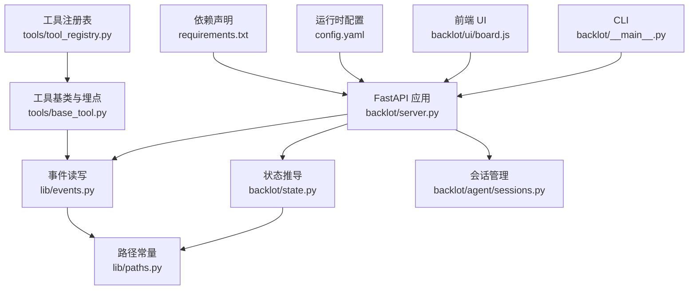
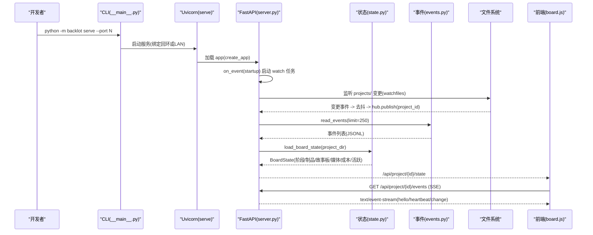
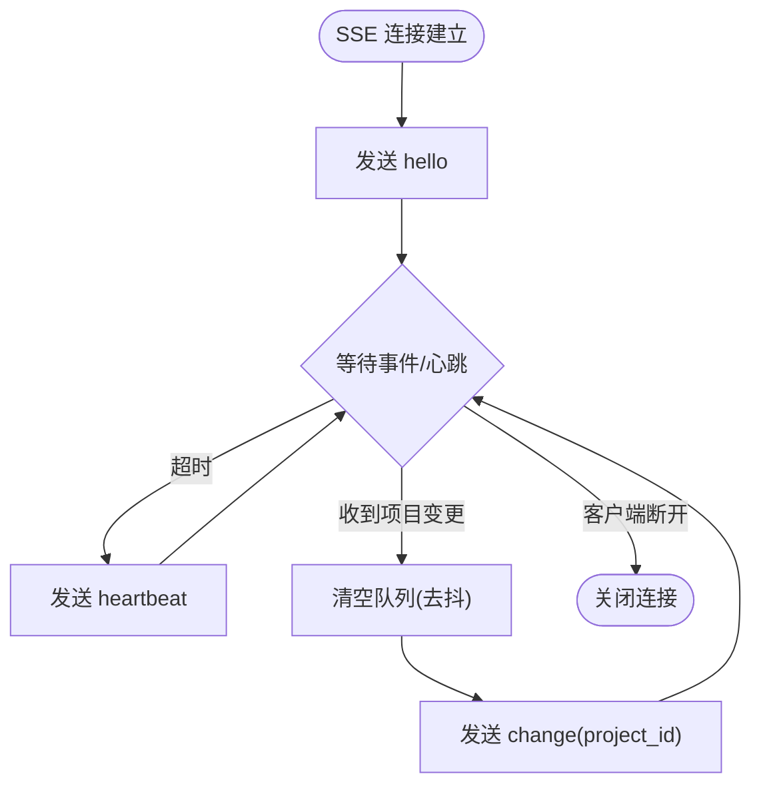
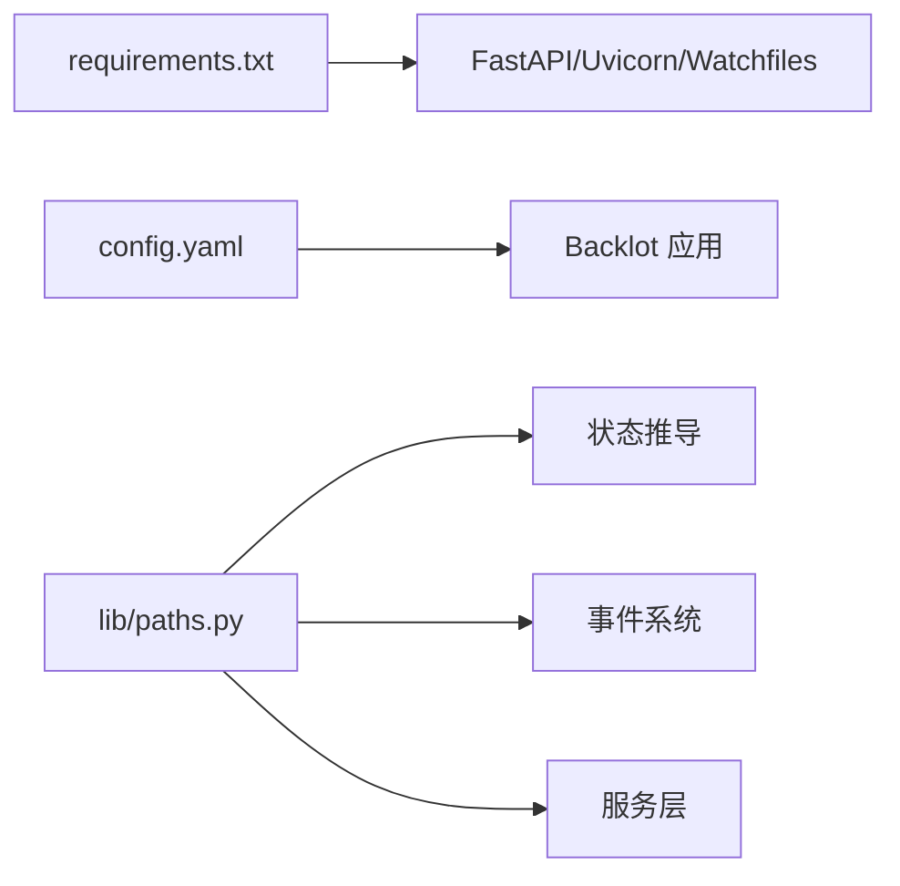

# 调试与工具

<cite>
**本文引用的文件**   
- [server.py](file://backlot/server.py)
- [state.py](file://backlot/state.py)
- [events.py](file://lib/events.py)
- [__main__.py](file://backlot/__main__.py)
- [paths.py](file://lib/paths.py)
- [base_tool.py](file://tools/base_tool.py)
- [tool_registry.py](file://tools/tool_registry.py)
- [sessions.py](file://backlot/agent/sessions.py)
- [board.js](file://backlot/ui/board.js)
- [config.yaml](file://config.yaml)
- [requirements.txt](file://requirements.txt)
</cite>

## 目录
1. [简介](#简介)
2. [项目结构](#项目结构)
3. [核心组件](#核心组件)
4. [架构总览](#架构总览)
5. [详细组件分析](#详细组件分析)
6. [依赖关系分析](#依赖关系分析)
7. [性能考虑](#性能考虑)
8. [故障排查指南](#故障排查指南)
9. [结论](#结论)
10. [附录](#附录)

## 简介
本文件面向开发者，系统化梳理 OpenMontage-MV 的调试技巧与常用开发工具，覆盖 FastAPI 应用调试模式、日志配置、状态管理断点设置、SSE 事件流监控、性能分析与内存泄漏检测、网络请求与 API 测试方法，以及常见问题诊断步骤。目标是帮助你在开发过程中快速定位并解决问题。

## 项目结构
本项目采用“服务 + 状态 + 事件 + 工具”的分层组织：
- 服务层（FastAPI）：提供 REST 接口、静态页面、SSE 事件流、缩略图与媒体访问
- 状态层：将项目目录转换为可渲染的 BoardState，包含阶段轨道、制品、故事板、媒体清单等
- 事件层：append-only 的事件日志，用于实时活动追踪与生成态展示
- 工具层：统一的 BaseTool 抽象与注册表，自动注入 Backlot 事件埋点
- CLI：后台启动服务、打开浏览器、端口与环境控制

图表来源 
- [__main__.py:110-117](file://backlot/__main__.py#L110-L117)
- [server.py:151-168](file://backlot/server.py#L151-L168)
- [state.py:586-656](file://backlot/state.py#L586-L656)
- [events.py:77-118](file://lib/events.py#L77-L118)
- [sessions.py:36-115](file://backlot/agent/sessions.py#L36-L115)
- [paths.py:13-18](file://lib/paths.py#L13-L18)
- [base_tool.py:148-224](file://tools/base_tool.py#L148-L224)
- [tool_registry.py:212-231](file://tools/tool_registry.py#L212-L231)
- [board.js:672-700](file://backlot/ui/board.js#L672-L700)
- [config.yaml:1-20](file://config.yaml#L1-L20)
- [requirements.txt:8-12](file://requirements.txt#L8-L12)

章节来源
- [__main__.py:110-117](file://backlot/__main__.py#L110-L117)
- [server.py:151-168](file://backlot/server.py#L151-L168)
- [state.py:586-656](file://backlot/state.py#L586-L656)
- [events.py:77-118](file://lib/events.py#L77-L118)
- [sessions.py:36-115](file://backlot/agent/sessions.py#L36-L115)
- [paths.py:13-18](file://lib/paths.py#L13-L18)
- [base_tool.py:148-224](file://tools/base_tool.py#L148-L224)
- [tool_registry.py:212-231](file://tools/tool_registry.py#L212-L231)
- [board.js:672-700](file://backlot/ui/board.js#L672-L700)
- [config.yaml:1-20](file://config.yaml#L1-L20)
- [requirements.txt:8-12](file://requirements.txt#L8-L12)

## 核心组件
- FastAPI 服务与 SSE：健康检查、项目列表、项目状态、SSE 事件流、缩略图与媒体、UI 路由与中间件
- 状态系统：从项目目录读取 checkpoint、history、artifacts、events，构建 stage rail、storyboard、media、cost、live/stall 标记
- 事件系统：append-only JSONL，线程安全写入，按项目推断归属，供 board 实时刷新
- 工具埋点：BaseTool 自动包装 execute，记录 start/finish/error，驱动 events.jsonl
- 会话系统：Studio 聊天会话持久化、事件回放、审批与中断、项目识别
- CLI：后台启动 uvicorn、端口与环境变量、日志轮转

章节来源
- [server.py:151-242](file://backlot/server.py#L151-L242)
- [state.py:586-656](file://backlot/state.py#L586-L656)
- [events.py:77-118](file://lib/events.py#L77-L118)
- [base_tool.py:148-224](file://tools/base_tool.py#L148-L224)
- [sessions.py:36-115](file://backlot/agent/sessions.py#L36-L115)
- [__main__.py:110-117](file://backlot/__main__.py#L110-L117)

## 架构总览
下图展示了从 CLI 到 FastAPI、状态推导、事件流与前端展示的完整链路。

图表来源 
- [__main__.py:110-117](file://backlot/__main__.py#L110-L117)
- [server.py:151-168](file://backlot/server.py#L151-L168)
- [server.py:132-149](file://backlot/server.py#L132-L149)
- [server.py:185-214](file://backlot/server.py#L185-L214)
- [state.py:586-656](file://backlot/state.py#L586-L656)
- [events.py:98-118](file://lib/events.py#L98-L118)
- [board.js:672-700](file://backlot/ui/board.js#L672-L700)

## 详细组件分析

### FastAPI 应用与调试模式
- 启动方式：通过 CLI 的 serve 子命令以 uvicorn 运行；默认绑定 127.0.0.1，可通过 BACKLOT_HOST 暴露到 LAN
- 健康检查：/api/health 用于进程存活探测
- 文档开关：创建时关闭 docs/redoc，减少干扰
- 中间件：对 UI 相关路径强制 no-cache，便于热更新
- 调试建议：
  - 使用 uvicorn 的 --log-level debug 输出更详细的请求与异常栈
  - 在 create_app 中增加 @app.middleware("http") 打印请求耗时与入参摘要
  - 利用 /api/health 做进程存活探针与自动化重启策略

章节来源
- [__main__.py:110-117](file://backlot/__main__.py#L110-L117)
- [server.py:151-168](file://backlot/server.py#L151-L168)
- [server.py:397-404](file://backlot/server.py#L397-L404)

### 状态管理系统与断点设置
- 入口：load_board_state 聚合 checkpoint、history、artifacts、events，计算 stage rail、storyboard、media、cost、live/stall
- 关键断点位置：
  - _collect_checkpoints/_collect_history：校验 checkpoint/historic 解析是否成功
  - _build_stage_rail：验证 gated 阶段审计逻辑
  - _build_storyboard：场景卡片组装与生成态判断
  - _scan_media：媒体扫描与排序
  - _last_activity：最近活动时间戳计算
- 调试技巧：
  - 在函数返回前打印关键字段（project_id、stages、storyboard.scenes.length、media.renders.length、last_activity、live）
  - 针对 stalled 分支打点，确认 STALL_WINDOW_SECONDS 阈值是否符合预期
  - 使用 Python 调试器（pdb/ipdb）在 load_board_state 调用处设置断点，观察 Path 与 JSON 解析结果

章节来源
- [state.py:586-656](file://backlot/state.py#L586-L656)
- [state.py:116-140](file://backlot/state.py#L116-L140)
- [state.py:143-222](file://backlot/state.py#L143-L222)
- [state.py:401-493](file://backlot/state.py#L401-L493)
- [state.py:500-532](file://backlot/state.py#L500-L532)
- [state.py:563-579](file://backlot/state.py#L563-L579)

### SSE 事件流与监控
- 项目事件流：/api/project/{id}/events，订阅者仅接收该项目 id，避免无关项目风暴
- 库级事件流：/api/library/events，广播所有项目变更
- 心跳机制：每 15 秒发送 heartbeat，防止代理/浏览器断开
- 去抖合并：队列满则丢弃，已唤醒保证至少一次通知
- 监控要点：
  - 前端根据 event.type 处理 hello/heartbeat/change
  - 后端 watch 任务对 projects/ 递归监听，过滤忽略目录，批量去重后发布
  - 若前端长时间无 change，检查 hub 队列大小与 is_disconnected 行为

图表来源 
- [server.py:185-214](file://backlot/server.py#L185-L214)
- [server.py:216-242](file://backlot/server.py#L216-L242)
- [server.py:132-149](file://backlot/server.py#L132-L149)

章节来源
- [server.py:185-242](file://backlot/server.py#L185-L242)
- [server.py:132-149](file://backlot/server.py#L132-L149)

### 工具埋点与事件写入
- BaseTool.execute 被自动包装，记录 start/finish/error，附带 tool、scene_id、depth、output_path、duration_s、success、cost_usd
- 项目归属推断：优先显式 project_dir/project_path，其次从输入路径推断（output/input/video/audio/image/file_path）
- 写入策略：线程锁保护，O_APPEND 追加，失败静默丢弃，确保不影响主流程
- 调试建议：
  - 在 emit_event 前后打印 payload，确认 project_dir 推断正确
  - 检查 events.jsonl 行格式与时间戳，确保前端能正确排序与匹配 start/finish
  - 对于嵌套调用（selector→provider），关注 depth 字段避免重复统计

章节来源
- [base_tool.py:148-224](file://tools/base_tool.py#L148-L224)
- [events.py:46-74](file://lib/events.py#L46-L74)
- [events.py:77-96](file://lib/events.py#L77-L96)
- [events.py:98-118](file://lib/events.py#L98-L118)

### Studio 会话与事件回放
- 会话持久化：.studio/sessions/<id>.jsonl，支持重启恢复
- 事件回放：wait_events(after_seq, timeout) 阻塞等待新事件，支持最大回溯条数
- 项目识别：首次出现 projects/<id> 路径即绑定当前会话
- 审批与中断：request_approval/interrupt 与 resolve_approval 协作
- 调试建议：
  - 在 wait_events 处设置断点，观察 seq 增长与 timeout 行为
  - 检查 _detect_project 正则匹配与 PROJECTS_DIR 存在性
  - 使用 /api/chat/{session_id}/events 进行端到端验证

章节来源
- [sessions.py:36-115](file://backlot/agent/sessions.py#L36-L115)
- [sessions.py:125-134](file://backlot/agent/sessions.py#L125-L134)
- [sessions.py:136-148](file://backlot/agent/sessions.py#L136-L148)
- [sessions.py:159-178](file://backlot/agent/sessions.py#L159-L178)

### 前端活动面板与事件消费
- 活动面板基于 events.jsonl 渲染，start/finish 配对显示并行任务
- 未闭合的 start 会作为“正在生成”提示
- 调试建议：
  - 在 board.js 的活动渲染函数内打断点，查看 open Map 的状态变化
  - 检查 ts 排序与 slice(-10) 限制，确保最新 10 条可见

章节来源
- [board.js:672-700](file://backlot/ui/board.js#L672-L700)

## 依赖关系分析
- 运行时依赖：fastapi、uvicorn、watchfiles 等由 requirements.txt 声明
- 路径常量：REPO_ROOT 与 PROJECTS_DIR 为单一事实源，影响 checkpoint、事件、board 监听
- 配置项：config.yaml 定义 checkpoint/output/paths 等运行时参数

图表来源 
- [requirements.txt:8-12](file://requirements.txt#L8-L12)
- [paths.py:13-18](file://lib/paths.py#L13-L18)
- [config.yaml:1-20](file://config.yaml#L1-L20)

章节来源
- [requirements.txt:8-12](file://requirements.txt#L8-L12)
- [paths.py:13-18](file://lib/paths.py#L13-L18)
- [config.yaml:1-20](file://config.yaml#L1-L20)

## 性能考虑
- 文件监听优化：watchfiles 递归监听 projects/，忽略 node_modules/.git/__pycache__/.cache 等噪声目录，批量去重后发布
- 事件读取限制：read_events 默认 limit=250，避免大文件全量读取
- 缩略图缓存：按内容哈希与宽度生成缓存键，并发写临时文件避免竞态
- 建议：
  - 监控 watch 任务的变更速率与 hub 队列长度
  - 评估 STALL_WINDOW_SECONDS/LIVE_WINDOW_SECONDS 阈值对 live/stalled 标记的影响
  - 对大项目启用只读快照或增量扫描，降低 load_board_state 开销

章节来源
- [server.py:118-149](file://backlot/server.py#L118-L149)
- [events.py:98-118](file://lib/events.py#L98-L118)
- [server.py:460-500](file://backlot/server.py#L460-L500)
- [state.py:563-579](file://backlot/state.py#L563-L579)

## 故障排查指南
- 服务无法启动
  - 检查 BACKLOT_PORT 与 BACKLOT_HOST 环境变量
  - 查看 .studio/server.log 轮转日志，确认 uvicorn 启动与端口占用
  - 使用 curl http://127.0.0.1:{port}/api/health 验证健康端点
- SSE 无事件
  - 确认 watchfiles 可用且 projects/ 存在
  - 检查 hub 订阅队列与 is_disconnected 行为
  - 查看 events.jsonl 是否有 start/finish/error 条目
- 状态为空或错误
  - 检查 checkpoint_*.json 与 artifacts/*.json 是否存在且可读
  - 在 load_board_state 断点处打印 stages/artifacts/storyboard/media
  - 关注 stalled/live 标记与 last_activity 时间戳
- 工具执行失败
  - 查看 base_tool 的 ToolCommandError 与 DependencyError
  - 检查 dependencies/env/cmd/binary 是否满足
  - 确认 events.jsonl 中的 error 条目与 duration_s/cost_usd
- 会话卡住
  - 检查 sessions.jsonl 是否损坏，尝试重建会话
  - 使用 interrupt 终止运行中的 turn，再重新发消息
  - 确认 wait_events 的 after_seq 与 MAX_EVENT_REPLAY 限制

章节来源
- [__main__.py:43-78](file://backlot/__main__.py#L43-L78)
- [server.py:185-242](file://backlot/server.py#L185-L242)
- [state.py:586-656](file://backlot/state.py#L586-L656)
- [base_tool.py:456-480](file://tools/base_tool.py#L456-L480)
- [sessions.py:136-148](file://backlot/agent/sessions.py#L136-L148)

## 结论
通过统一的路径常量、append-only 事件系统与自动埋点的工具基类，OpenMontage-MV 提供了高内聚、低耦合的可观测性与可调试性。结合 FastAPI 中间件、SSE 心跳、watch 去抖与前端活动面板，开发者可以高效定位问题、监控运行状态并进行性能调优。建议在关键路径添加断点与日志，配合健康检查与日志轮转，形成完整的开发与运维闭环。

## 附录
- 常用命令
  - 启动服务：python -m backlot serve --port N
  - 打开看板：python -m backlot open [project-id]
  - 打开 Studio：python -m backlot studio
- 环境变量
  - BACKLOT_PORT：服务端口
  - BACKLOT_HOST：绑定地址（默认 127.0.0.1）
  - OPENMONTAGE_PROJECTS_DIR：项目根目录
- 调试工具推荐
  - 网络：curl/httpie/postman 测试 REST 与 SSE
  - 日志：tail -f .studio/server.log 与 events.jsonl
  - 性能：cProfile/py-spy/memory_profiler 分析 CPU/内存热点
  - 前端：浏览器开发者工具 Network/Sources/Pipeline 面板