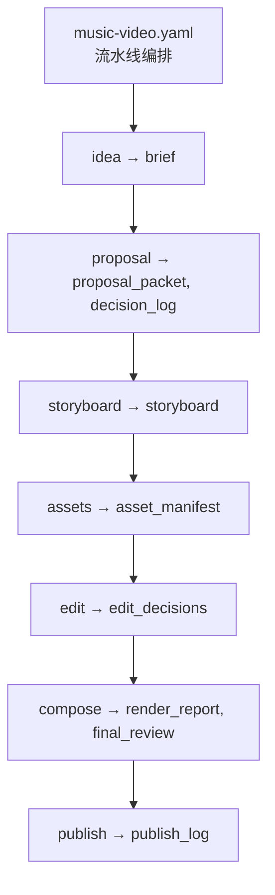
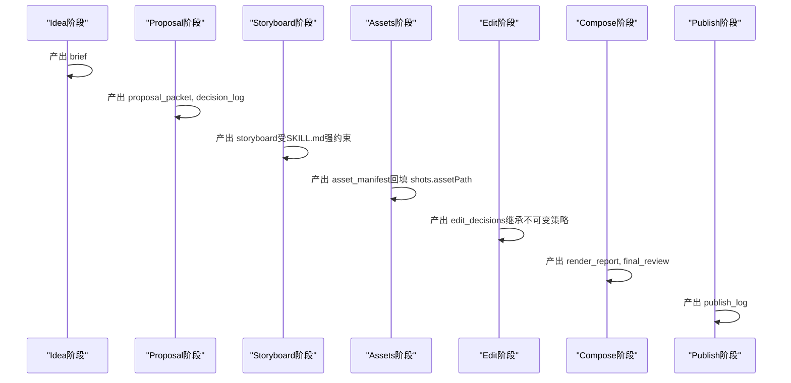
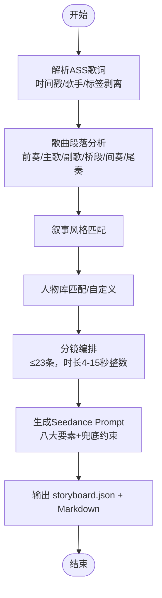
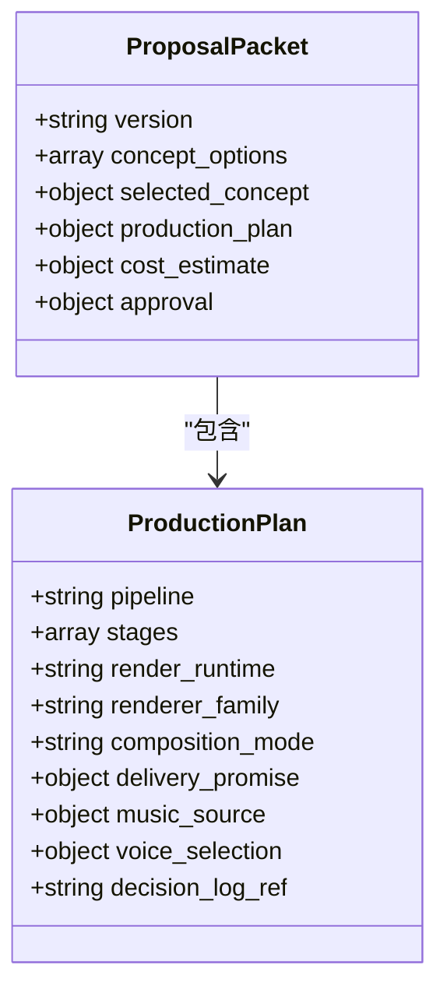
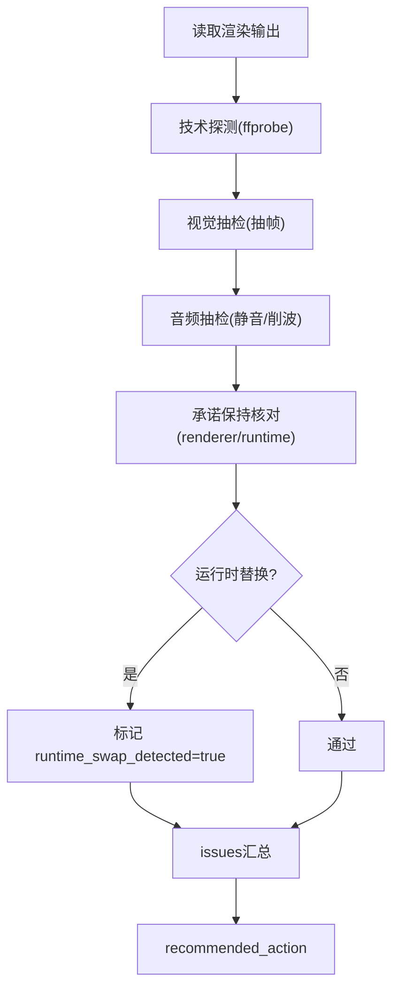
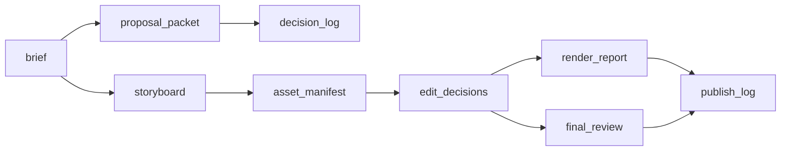

# 制品Schema定义

<cite>
**本文引用的文件**   
- [schemas/artifacts/brief.schema.json](file://schemas/artifacts/brief.schema.json)
- [schemas/artifacts/decision_log.schema.json](file://schemas/artifacts/decision_log.schema.json)
- [schemas/artifacts/review.schema.json](file://schemas/artifacts/review.schema.json)
- [schemas/artifacts/storyboard.schema.json](file://schemas/artifacts/storyboard.schema.json)
- [schemas/artifacts/proposal_packet.schema.json](file://schemas/artifacts/proposal_packet.schema.json)
- [schemas/artifacts/edit_decisions.schema.json](file://schemas/artifacts/edit_decisions.schema.json)
- [schemas/artifacts/final_review.schema.json](file://schemas/artifacts/final_review.schema.json)
- [schemas/artifacts/publish_log.schema.json](file://schemas/artifacts/publish_log.schema.json)
- [schemas/artifacts/render_report.schema.json](file://schemas/artifacts/render_report.schema.json)
- [schemas/artifacts/asset_manifest.schema.json](file://schemas/artifacts/asset_manifest.schema.json)
- [schemas/artifacts/__init__.py](file://schemas/artifacts/__init__.py)
- [pipeline_defs/music-video.yaml](file://pipeline_defs/music-video.yaml)
- [.agents/skills/mv-storyboard/SKILL.md](file://.agents/skills/mv-storyboard/SKILL.md)
- [tools/analysis/ass_parser.py](file://tools/analysis/ass_parser.py)
</cite>

## 目录
1. [简介](#简介)
2. [项目结构](#项目结构)
3. [核心制品与Schema总览](#核心制品与schema总览)
4. [架构概览](#架构概览)
5. [详细组件分析](#详细组件分析)
6. [依赖关系分析](#依赖关系分析)
7. [性能与校验特性](#性能与校验特性)
8. [故障排查指南](#故障排查指南)
9. [结论](#结论)
10. [附录：扩展与自定义最佳实践](#附录扩展与自定义最佳实践)

## 简介
本文件系统化梳理 OpenMontage-MV 流水线中的“制品”（Artifacts）及其 JSON Schema 定义，覆盖 MV 制作流程中关键阶段的数据结构与验证规则。内容包含字段含义、数据类型、必填项与约束、典型数据示例与使用场景，以及制品间的关联关系与数据流转路径，并提供 Schema 扩展与自定义的最佳实践。

## 项目结构
- 制品Schema集中位于 schemas/artifacts/*.schema.json，统一由 schemas/artifacts/__init__.py 提供加载与校验能力。
- 流水线编排定义在 pipeline_defs/music-video.yaml，明确各阶段输入/输出制品及成功标准。
- 分镜脚本生成技能位于 .agents/skills/mv-storyboard/SKILL.md，定义了从ASS歌词到分镜脚本的七步流程与强约束（如镜头时长整数秒、4-15秒、最多23个分镜等）。
- ASS解析工具 tools/analysis/ass_parser.py 为确定性实现，负责歌词时间戳、歌手角色映射与标签剥离，供分镜阶段使用。

**图表来源** 
- [pipeline_defs/music-video.yaml:36-187](file://pipeline_defs/music-video.yaml#L36-L187)

**章节来源**
- [pipeline_defs/music-video.yaml:1-187](file://pipeline_defs/music-video.yaml#L1-L187)
- [schemas/artifacts/__init__.py:1-45](file://schemas/artifacts/__init__.py#L1-L45)

## 核心制品与Schema总览
以下按流水线阶段顺序说明各制品的Schema要点、必填字段与关键约束。每个条目给出字段语义、类型与校验规则，并附“实际数据示例”和“使用场景”。

### 创意简报（brief）
- 用途：idea 阶段产出，描述视频创意方向、目标平台、时长、风格基调与参考材料等。
- 必填字段：version、title、hook、key_points、tone、style、target_platform、target_duration_seconds
- 关键字段与约束：
  - version：固定字符串常量
  - target_platform：枚举值限定平台
  - key_points：非空数组，至少一项
  - target_duration_seconds：数值且大于等于1
  - angle_options：可选，用于提供2-3个角度选项供选择
- 实际数据示例（示意）：
  - title: “品牌夏日焕新短片”
  - hook: “用一次日落，开启全新自我”
  - key_points: ["夏日主题", "年轻化表达", "社交传播钩子"]
  - tone: “轻松活力”
  - style: “清新日系”
  - target_platform: “tiktok”
  - target_duration_seconds: 30
- 使用场景：作为后续提案包与分镜脚本的创意基线，贯穿资产生成与剪辑决策。

**章节来源**
- [schemas/artifacts/brief.schema.json:1-49](file://schemas/artifacts/brief.schema.json#L1-L49)

### 决策日志（decision_log）
- 用途：记录生产过程中的重要决策，确保可审计、可回溯，防止隐性系统行为。
- 必填字段：version、project_id、decisions
- decisions 数组每项必填：decision_id、stage、category、subject、options_considered、selected、reason
- options_considered 每项必填：option_id、label、score、reason；支持 rejected_because
- 其他字段：user_visible、user_approved、confidence（范围0-1）
- 实际数据示例（示意）：
  - category: “provider_selection”
  - subject: “TTS提供商选择”
  - options_considered: [{option_id:"a", label:"A提供商", score:0.8, reason:"音色自然"}, {option_id:"b", label:"B提供商", score:0.6, reason:"成本低"}]
  - selected: "a"
  - reason: "综合质量优先"
- 使用场景：提案阶段锁定渲染器家族与运行时、编辑阶段保留不可变策略、最终评审核对运行时一致性。

**章节来源**
- [schemas/artifacts/decision_log.schema.json:1-104](file://schemas/artifacts/decision_log.schema.json#L1-L104)

### 评审记录（review）
- 用途：阶段性评审发现与处置，支持多轮次（round 1-2）。
- 必填字段：version、stage、findings
- stage：枚举限制阶段名（idea、script、scene_plan、assets、edit、compose、publish）
- findings 每项必填：id、severity、description；disposition 默认 pending
- 实际数据示例（示意）：
  - stage: “assets”
  - round: 1
  - findings: [{id:"F001", severity:"critical", description:"片段时长与分镜不一致", disposition:"accepted"}]
- 使用场景：在各阶段checkpoint后触发，驱动修正或放行。

**章节来源**
- [schemas/artifacts/review.schema.json:1-36](file://schemas/artifacts/review.schema.json#L1-L36)

### 分镜脚本（storyboard）
- 用途：基于ASS歌词生成的MV分镜结构化数据，用于AI视频生成（Seedance），并补充OpenMontage惯例字段。
- 必填字段：meta、characters、shots
- meta 必填：songName、assFile、songStyle、emotionalTone、duration、shotCount、narrativeStyle、storyline、visualTone；支持 language、tempo、generateTime、provenance
- characters：人物配置列表，必填 id、source、role、age、style、description；details 可选
- songSections：歌曲段落结构，必填 type、start、end、duration；typeName 中文名称
- shots：分镜数组，minItems=1，maxItems=23；每项必填18个维度（如 shotNumber、name、startTime、endTime、duration、lyrics、singer、songSection、shotType、shotSize、cameraAngle、cameraMovement、sceneDescription、characterAction、colorTone、lighting、emotionalAtmosphere、pacing、transition、seedancePrompt）；M8增补 assetPath、referenceImages
- 关键约束：
  - duration 整数秒，范围4-15
  - 分镜总数不超过23
  - seedancePrompt需满足八大要素自检
- 实际数据示例（示意）：
  - meta.duration: 180
  - meta.shotCount: 18
  - shots[0].duration: 6
  - shots[0].seedancePrompt: “电影级MV风格…（含画质、稳定、无字幕、无水印兜底）”
- 使用场景：assets阶段依据分镜生成素材；edit阶段对齐时间轴；compose阶段合成与烧录字幕。

**章节来源**
- [schemas/artifacts/storyboard.schema.json:1-289](file://schemas/artifacts/storyboard.schema.json#L1-L289)
- [.agents/skills/mv-storyboard/SKILL.md:314-389](file://.agents/skills/mv-storyboard/SKILL.md#L314-L389)

### 提案包（proposal_packet）
- 用途：预生产提案，包含概念选项、制作计划、成本估算与审批门控。
- 必填字段：version、concept_options、selected_concept、production_plan、cost_estimate、approval
- concept_options：至少3个不同方向，必填 id、title、hook、narrative_structure、visual_approach、target_duration_seconds、why_this_works；支持 suggested_playbook、target_audience、target_platform、key_points、core_message、cta、tone、grounded_in
- production_plan：必填 pipeline、stages、render_runtime；包含 quality_tradeoffs、alternative_paths、delivery_promise、renderer_family、composition_mode、art_direction、taste_profile、music_source、voice_selection、decision_log_ref、provider_rankings
- cost_estimate：必填 total_estimated_usd、line_items、budget_verdict；支持 budget_cap_usd、savings_options
- approval：必填 status（pending/approved/approved_with_changes/rejected）；支持 user_notes、approved_budget_usd
- 实际数据示例（示意）：
  - renderer_family: “cinematic-trailer”
  - render_runtime: “ffmpeg”
  - composition_mode: “atelier”
  - delivery_promise.promise_type: “motion_led”
- 使用场景：作为后续各阶段不可变策略的来源（如 renderer_family、render_runtime、composition_mode），任何变更需记录于 decision_log。

**章节来源**
- [schemas/artifacts/proposal_packet.schema.json:1-379](file://schemas/artifacts/proposal_packet.schema.json#L1-L379)

### 剪辑决策（edit_decisions）
- 用途：编辑阶段的剪辑方案，包括 cuts、overlays、audio、subtitles、transitions 等。
- 必填字段：version、cuts、render_runtime
- cuts：每项必填 id、source、in_seconds、out_seconds；支持 speed、layer、transform、transition_in/out、transition_duration、reason
- overlays：每项必填 asset_id、start_seconds、end_seconds、position；支持 animation、opacity
- audio：narration.segments、music（volume、fade_in/out、ducking）、sfx
- subtitles：enabled、style、source、font、font_size、color、outline_color、background、position、max_words_per_line
- transitions：全局转场列表
- 不可变字段：renderer_family、render_runtime、composition_mode（继承自提案包，未经决策不得更改）
- bespoke：当 composition_mode='atelier' 时必填 entry、composition_id、art_direction；支持 props_path、public_dir、scale、crf、concurrency
- slideshow_risk_score：幻灯片风险评分
- 实际数据示例（示意）：
  - cuts[0].speed: 1.0
  - audio.music.ducking.enabled: true
  - subtitles.style: “karaoke”
- 使用场景：compose阶段据此进行音视频拼接、字幕烧录与渲染。

**章节来源**
- [schemas/artifacts/edit_decisions.schema.json:1-234](file://schemas/artifacts/edit_decisions.schema.json#L1-L234)

### 最终评审（final_review）
- 用途：对渲染输出的自检，证明compose阶段已检查实际输出再呈现给用户。
- 必填字段：version、output_path、status、checks
- checks：technical_probe、visual_spotcheck、audio_spotcheck、promise_preservation、subtitle_check；可选 transcript_comparison、atelier
- promise_preservation：核对交付承诺与实际运行时的匹配，检测运行时替换（runtime_swap_detected）
- atelier：仅当 composition_mode='atelier' 时填充，检查是否违规引用库存素材
- 实际数据示例（示意）：
  - status: “pass”
  - checks.subtitle_check.subtitles_present: true
  - checks.promise_preservation.runtime_swap_detected: false
- 使用场景：若 status 为 revise 或 fail，则不应将视频作为完成品呈现用户。

**章节来源**
- [schemas/artifacts/final_review.schema.json:1-171](file://schemas/artifacts/final_review.schema.json#L1-L171)

### 发布日志（publish_log）
- 用途：记录各平台发布/导出结果。
- 必填字段：version、entries
- entries 每项必填：platform、status、timestamp；支持 url、video_id、visibility、export_path、metadata_used、error
- 实际数据示例（示意）：
  - platform: “youtube”
  - status: “published”
  - visibility: “public”
- 使用场景：归档发布结果，便于追踪与回滚。

**章节来源**
- [schemas/artifacts/publish_log.schema.json:1-41](file://schemas/artifacts/publish_log.schema.json#L1-L41)

### 渲染报告（render_report）
- 用途：compose阶段渲染后的输出报告。
- 必填字段：version、outputs
- outputs：每项必填 path、format、resolution、duration_seconds；支持 codec、audio_codec、fps、file_size_bytes、platform_target
- 附加信息：render_time_seconds、warnings、verification_notes、render_grammar、slideshow_risk_score、decision_log_ref、final_review_ref
- 实际数据示例（示意）：
  - outputs[0].codec: “h264”
  - outputs[0].fps: 30
  - render_grammar: “cinematic-trailer”
- 使用场景：作为发布前的质量与规格凭证，并与 final_review 建立审计链接。

**章节来源**
- [schemas/artifacts/render_report.schema.json:1-64](file://schemas/artifacts/render_report.schema.json#L1-L64)

### 资产清单（asset_manifest）
- 用途：记录资产生成/获取的清单。
- 必填字段：version、assets
- assets 每项必填：id、type、path、source_tool、scene_id；支持 prompt、seed、model、cost_usd、duration_seconds、resolution、format、quality_score、subtype、generation_summary、provider、license、original_url、voice_performance
- voice_performance：适用于旁白资产的语音表现契约（source_section_id、delivery_cues_applied、provider_text_used、provider_settings、sample_approved、sample_path、review_notes）
- 实际数据示例（示意）：
  - type: “video”
  - subtype: “generated”
  - voice_performance.sample_approved: true
- 使用场景：edit阶段引用具体素材路径，compose阶段进行拼接与混音。

**章节来源**
- [schemas/artifacts/asset_manifest.schema.json:1-63](file://schemas/artifacts/asset_manifest.schema.json#L1-L63)

## 架构概览
下图展示MV流水线中各阶段与制品的关系，以及关键校验点与不可变策略的传递。

**图表来源** 
- [pipeline_defs/music-video.yaml:36-187](file://pipeline_defs/music-video.yaml#L36-L187)

## 详细组件分析

### 分镜脚本（storyboard）深度分析
- 数据来源：ASS歌词解析（tools/analysis/ass_parser.py）+ SKILL.md 七步流程
- 强约束：
  - 分镜数量 ≤ 23
  - 每个分镜时长为整数秒且在4-15秒范围内
  - seedancePrompt必须包含八大要素与强制兜底约束
  - 同一场景内人物着装一致
- 数据流：
  - ass_parser 输出歌词行与时间戳
  - Agent 根据SKILL.md进行段落识别、叙事风格匹配、人物匹配、分镜编排与prompt生成
  - 输出 storyboard.json 与Markdown双格式

**图表来源** 
- [.agents/skills/mv-storyboard/SKILL.md:314-389](file://.agents/skills/mv-storyboard/SKILL.md#L314-L389)
- [tools/analysis/ass_parser.py:1-200](file://tools/analysis/ass_parser.py#L1-L200)

**章节来源**
- [schemas/artifacts/storyboard.schema.json:1-289](file://schemas/artifacts/storyboard.schema.json#L1-L289)
- [.agents/skills/mv-storyboard/SKILL.md:1-598](file://.agents/skills/mv-storyboard/SKILL.md#L1-L598)
- [tools/analysis/ass_parser.py:1-200](file://tools/analysis/ass_parser.py#L1-L200)

### 提案包（proposal_packet）与不可变策略
- 关键不可变字段：renderer_family、render_runtime、composition_mode
- 任何变更必须在 decision_log 中记录类别（如 render_runtime_selection、composition_mode）
- delivery_promise 明确交付形态（motion_led/source_led等）与质量底线

**图表来源** 
- [schemas/artifacts/proposal_packet.schema.json:1-379](file://schemas/artifacts/proposal_packet.schema.json#L1-L379)

**章节来源**
- [schemas/artifacts/proposal_packet.schema.json:1-379](file://schemas/artifacts/proposal_packet.schema.json#L1-L379)
- [schemas/artifacts/decision_log.schema.json:1-104](file://schemas/artifacts/decision_log.schema.json#L1-L104)

### 最终评审（final_review）与运行时一致性
- 检查项涵盖技术探测、视觉抽检、音频抽检、承诺保持、字幕校验
- promise_preservation 检测运行时替换（runtime_swap_detected）
- atelier 模式额外检查是否违规引入库存素材

**图表来源** 
- [schemas/artifacts/final_review.schema.json:1-171](file://schemas/artifacts/final_review.schema.json#L1-L171)

**章节来源**
- [schemas/artifacts/final_review.schema.json:1-171](file://schemas/artifacts/final_review.schema.json#L1-L171)

## 依赖关系分析
- 制品间依赖：
  - idea 产出 brief
  - proposal 依赖 brief，产出 proposal_packet 与 decision_log
  - storyboard 依赖 brief 与 proposal_packet
  - assets 依赖 storyboard，产出 asset_manifest 并回填 shots.assetPath
  - edit 依赖 storyboard 与 asset_manifest，产出 edit_decisions
  - compose 依赖 edit_decisions 与 asset_manifest，产出 render_report 与 final_review
  - publish 依赖 render_report 与 final_review，产出 publish_log
- 校验与加载：
  - schemas/artifacts/__init__.py 提供 load_schema 与 validate_artifact，统一校验入口

**图表来源** 
- [pipeline_defs/music-video.yaml:36-187](file://pipeline_defs/music-video.yaml#L36-L187)
- [schemas/artifacts/__init__.py:1-45](file://schemas/artifacts/__init__.py#L1-L45)

**章节来源**
- [pipeline_defs/music-video.yaml:36-187](file://pipeline_defs/music-video.yaml#L36-L187)
- [schemas/artifacts/__init__.py:1-45](file://schemas/artifacts/__init__.py#L1-L45)

## 性能与校验特性
- 校验机制：所有制品均通过JSON Schema进行强校验，确保数据结构与约束正确性（如枚举、最小/最大长度、数值范围等）。
- 分镜约束：分镜数量上限23、时长整数秒4-15秒，避免过长或过短导致生成失败或质量下降。
- 运行时一致性：final_review 检测运行时替换，保障提案阶段锁定的技术栈不被静默变更。
- 资源与成本：asset_manifest 与 proposal_packet 的成本估算字段有助于预算控制与优化。

[本节为通用指导，不直接分析具体文件]

## 故障排查指南
- 常见校验失败：
  - brief 缺少必填字段或 target_platform 不在枚举
  - storyboard 分镜数量超过23或时长不在4-15秒
  - edit_decisions 未继承 renderer_family/render_runtime/composition_mode
  - final_review 检测到运行时替换或字幕缺失
- 定位方法：
  - 使用 schemas/artifacts/__init__.py 的 validate_artifact 进行快速校验
  - 查看 decision_log 中相关决策记录，确认是否有意变更
  - 检查 storyboard 的 seedancePrompt 是否符合八大要素与兜底约束

**章节来源**
- [schemas/artifacts/__init__.py:1-45](file://schemas/artifacts/__init__.py#L1-L45)
- [schemas/artifacts/storyboard.schema.json:1-289](file://schemas/artifacts/storyboard.schema.json#L1-L289)
- [schemas/artifacts/edit_decisions.schema.json:1-234](file://schemas/artifacts/edit_decisions.schema.json#L1-L234)
- [schemas/artifacts/final_review.schema.json:1-171](file://schemas/artifacts/final_review.schema.json#L1-L171)

## 结论
本文件全面梳理了 MV 流水线中的核心制品及其Schema定义，明确了各字段的含义、类型、必填项与约束，并通过流程图与时序图展示了数据流转与校验关键点。遵循这些Schema与约束，可有效提升自动化生产的稳定性与可追溯性。

[本节为总结性内容，不直接分析具体文件]

## 附录：扩展与自定义最佳实践
- 扩展字段：
  - 在对象中使用 additionalProperties=false 时，新增字段需在Schema中显式声明
  - 对于可选扩展，建议使用 metadata 字段承载向后兼容的自定义信息
- 自定义枚举：
  - 谨慎扩展枚举值，确保下游处理逻辑同步更新
  - 在 decision_log 中记录枚举变更的原因与影响
- 版本管理：
  - 所有Schema均包含 version 字段，升级时需考虑兼容性
  - 在 pipeline 编排中明确各阶段对Schema版本的依赖
- 校验集成：
  - 使用 schemas/artifacts/__init__.py 的统一接口进行校验
  - 在CI/CD中加入Schema校验步骤，防止非法数据进入流水线

[本节为通用指导，不直接分析具体文件]