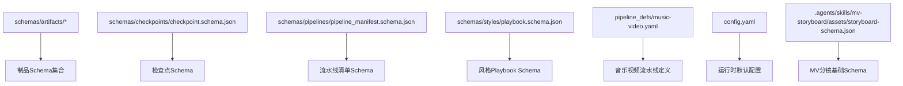
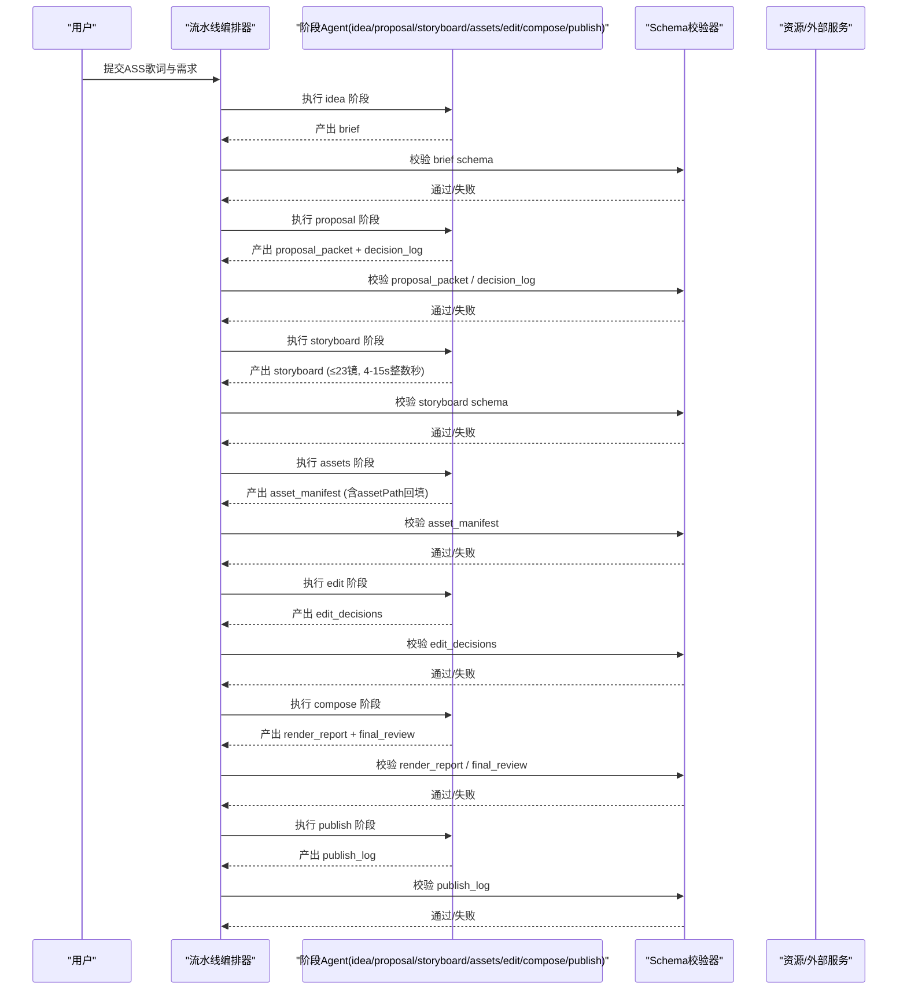
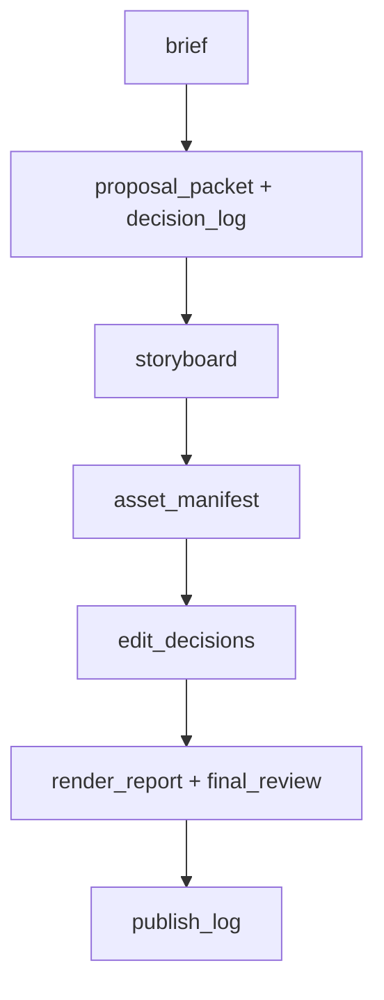
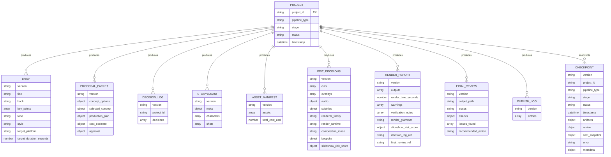

# 数据模型与Schema

<cite>
**本文引用的文件**
- [schemas/artifacts/brief.schema.json](file://schemas/artifacts/brief.schema.json)
- [schemas/artifacts/decision_log.schema.json](file://schemas/artifacts/decision_log.schema.json)
- [schemas/artifacts/review.schema.json](file://schemas/artifacts/review.schema.json)
- [schemas/artifacts/storyboard.schema.json](file://schemas/artifacts/storyboard.schema.json)
- [schemas/artifacts/asset_manifest.schema.json](file://schemas/artifacts/asset_manifest.schema.json)
- [schemas/artifacts/edit_decisions.schema.json](file://schemas/artifacts/edit_decisions.schema.json)
- [schemas/artifacts/final_review.schema.json](file://schemas/artifacts/final_review.schema.json)
- [schemas/artifacts/proposal_packet.schema.json](file://schemas/artifacts/proposal_packet.schema.json)
- [schemas/artifacts/publish_log.schema.json](file://schemas/artifacts/publish_log.schema.json)
- [schemas/artifacts/render_report.schema.json](file://schemas/artifacts/render_report.schema.json)
- [schemas/checkpoints/checkpoint.schema.json](file://schemas/checkpoints/checkpoint.schema.json)
- [schemas/pipelines/pipeline_manifest.schema.json](file://schemas/pipelines/pipeline_manifest.schema.json)
- [schemas/styles/playbook.schema.json](file://schemas/styles/playbook.schema.json)
- [.agents/skills/mv-storyboard/assets/storyboard-schema.json](file://.agents/skills/mv-storyboard/assets/storyboard-schema.json)
- [pipeline_defs/music-video.yaml](file://pipeline_defs/music-video.yaml)
- [config.yaml](file://config.yaml)
</cite>

## 目录
1. [引言](#引言)
2. [项目结构](#项目结构)
3. [核心组件](#核心组件)
4. [架构总览](#架构总览)
5. [详细组件分析](#详细组件分析)
6. [依赖关系分析](#依赖关系分析)
7. [性能考量](#性能考量)
8. [故障排查指南](#故障排查指南)
9. [结论](#结论)
10. [附录](#附录)

## 引言
本文件系统化梳理 OpenMontage-MV 的数据模型与 JSON Schema 定义，覆盖制品（brief、decision_log、review、storyboard、asset_manifest、edit_decisions、final_review、proposal_packet、publish_log、render_report）、检查点（checkpoint）与流水线清单（pipeline_manifest）的字段、类型与验证规则。同时说明 MV 分镜脚本的约束、数据实体关系、版本与迁移策略、安全与隐私要求、访问控制以及 Schema 扩展最佳实践。

## 项目结构
本项目将数据模型以 JSON Schema 形式集中管理在 schemas 目录下，按 artifacts、checkpoints、pipelines、styles 分类；流水线定义以 YAML 声明式配置位于 pipeline_defs；运行时默认输出与路径等配置位于 config.yaml。

图表来源
- [schemas/artifacts/brief.schema.json](file://schemas/artifacts/brief.schema.json)
- [schemas/checkpoints/checkpoint.schema.json](file://schemas/checkpoints/checkpoint.schema.json)
- [schemas/pipelines/pipeline_manifest.schema.json](file://schemas/pipelines/pipeline_manifest.schema.json)
- [schemas/styles/playbook.schema.json](file://schemas/styles/playbook.schema.json)
- [pipeline_defs/music-video.yaml](file://pipeline_defs/music-video.yaml)
- [config.yaml](file://config.yaml)
- [.agents/skills/mv-storyboard/assets/storyboard-schema.json](file://.agents/skills/mv-storyboard/assets/storyboard-schema.json)

章节来源
- [pipeline_defs/music-video.yaml](file://pipeline_defs/music-video.yaml)
- [config.yaml](file://config.yaml)

## 核心组件
- 制品（Artifacts）：描述生产各阶段产出的结构化数据，如创意简报、决策日志、分镜脚本、资产清单、剪辑决策、渲染报告、最终审查、提案包、发布日志等。
- 检查点（Checkpoint）：每个流水线阶段的完整可恢复快照，包含状态、时间戳、产物映射、成本快照与错误信息。
- 流水线清单（Pipeline Manifest）：声明式定义流水线名称、版本、阶段、工具、产物、评审关注点、成功标准、子阶段与编排策略。
- 风格 Playbook：统一视觉语言、排版、动效、音频与质量规则的样式规范。
- MV 分镜脚本：基于 ASS 歌词的结构化分镜，约束镜头数量、时长、运镜与提示词，并支持人物一致性与参考图绑定。

章节来源
- [schemas/artifacts/brief.schema.json](file://schemas/artifacts/brief.schema.json)
- [schemas/artifacts/decision_log.schema.json](file://schemas/artifacts/decision_log.schema.json)
- [schemas/artifacts/review.schema.json](file://schemas/artifacts/review.schema.json)
- [schemas/artifacts/storyboard.schema.json](file://schemas/artifacts/storyboard.schema.json)
- [schemas/artifacts/asset_manifest.schema.json](file://schemas/artifacts/asset_manifest.schema.json)
- [schemas/artifacts/edit_decisions.schema.json](file://schemas/artifacts/edit_decisions.schema.json)
- [schemas/artifacts/final_review.schema.json](file://schemas/artifacts/final_review.schema.json)
- [schemas/artifacts/proposal_packet.schema.json](file://schemas/artifacts/proposal_packet.schema.json)
- [schemas/artifacts/publish_log.schema.json](file://schemas/artifacts/publish_log.schema.json)
- [schemas/artifacts/render_report.schema.json](file://schemas/artifacts/render_report.schema.json)
- [schemas/checkpoints/checkpoint.schema.json](file://schemas/checkpoints/checkpoint.schema.json)
- [schemas/pipelines/pipeline_manifest.schema.json](file://schemas/pipelines/pipeline_manifest.schema.json)
- [schemas/styles/playbook.schema.json](file://schemas/styles/playbook.schema.json)
- [.agents/skills/mv-storyboard/assets/storyboard-schema.json](file://.agents/skills/mv-storyboard/assets/storyboard-schema.json)

## 架构总览
下图展示从输入到输出的关键数据流与校验点，强调“提案锁定”、“决策审计”、“分镜硬约束”和“最终自审”。

图表来源
- [pipeline_defs/music-video.yaml](file://pipeline_defs/music-video.yaml)
- [schemas/artifacts/brief.schema.json](file://schemas/artifacts/brief.schema.json)
- [schemas/artifacts/proposal_packet.schema.json](file://schemas/artifacts/proposal_packet.schema.json)
- [schemas/artifacts/decision_log.schema.json](file://schemas/artifacts/decision_log.schema.json)
- [schemas/artifacts/storyboard.schema.json](file://schemas/artifacts/storyboard.schema.json)
- [schemas/artifacts/asset_manifest.schema.json](file://schemas/artifacts/asset_manifest.schema.json)
- [schemas/artifacts/edit_decisions.schema.json](file://schemas/artifacts/edit_decisions.schema.json)
- [schemas/artifacts/render_report.schema.json](file://schemas/artifacts/render_report.schema.json)
- [schemas/artifacts/final_review.schema.json](file://schemas/artifacts/final_review.schema.json)
- [schemas/artifacts/publish_log.schema.json](file://schemas/artifacts/publish_log.schema.json)

## 详细组件分析

### 制品：Brief（创意简报）
- 目的：由 Idea Explorer Agent 产出的创意简报，定义标题、钩子、要点、基调、风格、目标平台与时长等。
- 关键字段与约束
  - version: 固定字符串
  - title/hook/key_points/tone/style/target_platform/target_duration_seconds: 必填
  - target_platform: 枚举值限定平台
  - key_points: 非空数组
  - angle_options: 可选角度选项数组，每项需 name/description
- 业务规则
  - 目标时长必须大于等于1秒
  - 平台选择限制为指定枚举
  - 额外属性禁止（additionalProperties=false）

章节来源
- [schemas/artifacts/brief.schema.json](file://schemas/artifacts/brief.schema.json)

### 制品：Decision Log（决策日志）
- 目的：记录生产中所有重要选择的审计轨迹，防止隐藏行为，便于审阅与防上下文漂移。
- 关键字段与约束
  - decisions: 数组，每项包含 decision_id、stage、category、subject、options_considered、selected、reason 等必填
  - category: 枚举涵盖管线选择、提供者选择、渲染器族选择、渲染运行期选择、组合模式、剧本选择、降级审批、预算权衡、音乐来源、动作承诺、概念选择、语音选择、能力扩展、剧本覆盖、视觉准确性检查等
  - options_considered: 评估的所有选项（含被拒），每项含 option_id、label、score（0-1）、reason、rejected_because
  - user_visible/user_approved/confidence: 用户可见性、是否经用户批准、置信度（0-1）
- 业务规则
  - 任何运行时替换（如 render_runtime_selection）必须记录决策
  - 评分标准化为 0-1，拒绝原因必须填写

章节来源
- [schemas/artifacts/decision_log.schema.json](file://schemas/artifacts/decision_log.schema.json)

### 制品：Review（阶段评审）
- 目的：结构化记录 Reviewer 在各阶段的发现与处置。
- 关键字段与约束
  - stage: 枚举限定阶段（idea/script/scene_plan/assets/edit/compose/publish）
  - round: 轮次 1-2
  - findings: 数组，每项含 id、severity（critical/suggestion/nitpick）、description，可选 category/disposition/agent_response
- 业务规则
  - 处置默认 pending，允许接受/拒绝/待定

章节来源
- [schemas/artifacts/review.schema.json](file://schemas/artifacts/review.schema.json)

### 制品：Storyboard（MV分镜脚本）
- 目的：基于 ASS 歌词生成的结构化分镜，用于 Seedance AI 视频生成；OpenMontage 增补 provenance、assetPath、referenceImages，并将原文字约束落为硬约束（shots maxItems 23、duration 整数 4-15 秒）。
- 关键字段与约束
  - meta: 歌曲名、ASS源文件、风格、情感基调、语言、时长、节奏、分镜总数（1-23）、叙事风格、故事线、视觉基调、生成时间、provenance（生成者、流水线、工具版本、seed策略）
  - characters: 人物列表，含来源（人物库/自定义）、角色（女主/男主）、年龄、风格、描述与细节（发型、上装、外套、下装、鞋子、饰品）
  - songSections: 段落结构（前奏/主歌A/B/预副歌/副歌/桥段/间奏/尾奏），起止时间与歌手
  - shots: 分镜数组（1-23），每项必填 shotNumber/name/startTime/endTime/duration/lyrics/singer/songSection/shotType/shotSize/cameraAngle/cameraMovement/sceneDescription/characterAction/colorTone/lighting/emotionalAtmosphere/pacing/transition/seedancePrompt；新增 assetPath（可空）与 referenceImages（可空）
  - duration: 整数秒且 4-15
- 业务规则
  - 每镜仅一种运镜方式，不得叠加
  - 空镜服务于叙事而非填充
  - 同一场景内人物着装一致性
  - seedancePrompt 需满足八要素自检与强制约束包（质量、稳定性、无字幕、无水印；双人镜双保险）

章节来源
- [schemas/artifacts/storyboard.schema.json](file://schemas/artifacts/storyboard.schema.json)
- [.agents/skills/mv-storyboard/assets/storyboard-schema.json](file://.agents/skills/mv-storyboard/assets/storyboard-schema.json)

### 制品：Asset Manifest（资产清单）
- 目的：记录资产生成器产出的素材清单。
- 关键字段与约束
  - assets: 数组，每项含 id/type/path/source_tool/scene_id 必填；type 枚举（image/video/audio/narration/music/sfx/diagram/animation/code_snippet/subtitle/font/lut）
  - 其他字段：prompt/seed/model/cost_usd/duration_seconds/resolution/format/quality_score/subtype/generation_summary/provider/license/original_url
  - voice_performance: 旁白配音契约（source_section_id、delivery_cues_applied、provider_text_used、provider_settings、sample_approved、sample_path、review_notes）
- 业务规则
  - cost_usd/duration_seconds 非负
  - quality_score 0-1

章节来源
- [schemas/artifacts/asset_manifest.schema.json](file://schemas/artifacts/asset_manifest.schema.json)

### 制品：Edit Decisions（剪辑决策）
- 目的：编辑阶段产出的剪辑方案，包括 cuts、overlays、audio（narration/music/sfx）、subtitles、transitions、renderer_family/render_runtime/composition_mode、bespoke（atelier 模式）与幻灯片风险评分。
- 关键字段与约束
  - cuts: 片段列表，含 id/source/in_seconds/out_seconds/speed/layer/transform/transition_in/out/duration/reason
  - overlays: 叠加层，含 asset_id/start/end/position/animation/opacity
  - audio: 旁白/音乐/SFX 配置，支持淡入淡出、ducking（布尔或对象）
  - subtitles: 字幕开关、样式、字体、颜色、位置、每行字数上限
  - renderer_family/render_runtime/composition_mode: 提案阶段锁定，编辑不得更改（除非有决策日志覆盖）
  - bespoke: atelier 模式必需，含 entry/composition_id/art_direction/props_path/public_dir/scale/crf/concurrency
  - slideshow_risk_score: 幻灯片风险评估（average/verdict）
- 业务规则
  - 剪辑必须覆盖整首歌曲时长
  - 转场与速度参数受范围约束

章节来源
- [schemas/artifacts/edit_decisions.schema.json](file://schemas/artifacts/edit_decisions.schema.json)

### 制品：Final Review（最终审查）
- 目的：对渲染输出的自审，证明 Agent 在呈现给用户前已检查实际视频。若 status 为 revise/fail，不得视为完成。
- 关键字段与约束
  - output_path/status（pass/revise/fail）
  - checks: technical_probe（容器/分辨率/fps/音频/编解码/文件大小/issues）、visual_spotcheck（采样帧数≥4、黑帧/破损叠加/缺失素材/不可读文本/issues）、audio_spotcheck（旁白/音乐/意外静音/削波/混音清晰度/issues）、promise_preservation（交付承诺/渲染器族/运行期/运行期替换检测/运动比例/静默降级/issues）、subtitle_check（预期/存在/覆盖率/时序漂移/issues）、transcript_comparison（可选，转录匹配/词准确率/issues）、atelier（仅限 atelier 模式：库存复用检测/违规导入/艺术方向声明/issues）
  - issues_found/recommended_action（present_to_user/re_render/revise_edit/revise_assets/block/re_author）
- 业务规则
  - 运行期替换未获批准即构成合同违约
  - 若检测到违规导入（atelier），渲染失败

章节来源
- [schemas/artifacts/final_review.schema.json](file://schemas/artifacts/final_review.schema.json)

### 制品：Proposal Packet（提案包）
- 目的：制作前的提案，包含概念选项、生产计划、成本估算与审批门禁。用户批准后方可生成资产或花费资金。
- 关键字段与约束
  - concept_options: ≥3个不同概念，含 id/title/hook/narrative_structure/visual_approach/target_duration_seconds/key_points/core_message/cta/tone/grounded_in/why_this_works
  - selected_concept: 选定概念及理由，支持用户修改项
  - production_plan: pipeline/stages/tools/approach/fallback_if_unavailable/quality_tradeoffs/alternative_paths/delivery_promise/renderer_family/render_runtime/composition_mode/art_direction/taste_profile/music_source/voice_selection/decision_log_ref/provider_rankings
  - cost_estimate: total_estimated_usd/line_items/budget_cap_usd/budget_verdict/savings_options
  - approval: status（pending/approved/approved_with_changes/rejected）/user_notes/approved_budget_usd
- 业务规则
  - renderer_family/render_runtime/composition_mode 在提案阶段锁定，后续变更需记录决策
  - delivery_promise 明确交付形态与质量底线

章节来源
- [schemas/artifacts/proposal_packet.schema.json](file://schemas/artifacts/proposal_packet.schema.json)

### 制品：Publish Log（发布日志）
- 目的：记录多平台发布/导出结果。
- 关键字段与约束
  - entries: 数组，每项含 platform/status（published/exported/failed/draft/pending_review）/timestamp/url/video_id/visibility/export_path/metadata_used/error
- 业务规则
  - timestamp 使用 ISO 8601

章节来源
- [schemas/artifacts/publish_log.schema.json](file://schemas/artifacts/publish_log.schema.json)

### 制品：Render Report（渲染报告）
- 目的：Composer Agent 渲染后产出的报告。
- 关键字段与约束
  - outputs: 数组，每项含 path/format/resolution/duration_seconds（必填），可选 codec/audio_codec/fps/file_size_bytes/platform_target
  - render_time_seconds/warnings/verification_notes/render_grammar/slideshow_risk_score/decision_log_ref/final_review_ref/metadata
- 业务规则
  - 至少一个输出
  - 渲染语法与最终审查引用用于审计关联

章节来源
- [schemas/artifacts/render_report.schema.json](file://schemas/artifacts/render_report.schema.json)

### 检查点：Checkpoint（阶段快照）
- 目的：每个流水线阶段后的完整可恢复快照。
- 关键字段与约束
  - version/project_id/pipeline_type/stage/status（completed/failed/awaiting_human/in_progress）/timestamp/date-time
  - style_playbook/checkpoint_policy（guided/manual_all/auto_noncreative）/human_approval_required/human_approved
  - artifacts: 任意键值映射（artifact name → data或文件路径）
  - review/cost_snapshot（total_spent_usd/total_reserved_usd/budget_remaining_usd）/error/metadata
- 业务规则
  - stage 需在运行时与流水线清单中的阶段列表校验

章节来源
- [schemas/checkpoints/checkpoint.schema.json](file://schemas/checkpoints/checkpoint.schema.json)

### 流水线清单：Pipeline Manifest（声明式定义）
- 目的：声明式定义流水线名称、版本、阶段、产物、工具、评审关注点、成功标准、子阶段与编排策略。
- 关键字段与约束
  - name/version/stages（name/agent/skill/required_artifacts_in/optional_artifacts_in/produces/preferred_tools/fallback_tools/required_tools/optional_tools/tools_available/review_focus/checkpoint_required/human_approval_default/success_criteria/sub_stages）
  - default_checkpoint_policy/reference_input/orchestration/extensions
- 业务规则
  - stages 至少一项
  - sub_stages 可按条件激活，支持独立工具与评审焦点

章节来源
- [schemas/pipelines/pipeline_manifest.schema.json](file://schemas/pipelines/pipeline_manifest.schema.json)

### 风格：Playbook（样式规范）
- 目的：统一视觉语言、排版、动效、音频与质量规则。
- 关键字段与约束
  - identity/category/mood/pace/best_for
  - visual_language/color_palette/composition/texture
  - typography/headings/body/code/stat_card/scale_system/weight_matrix
  - motion/transitions/animation_style/pacing_rules/entrance/exit
  - audio/voice_style/music_mood/music_volume/sfx_style/ducking_threshold_db/voice_variation_allowed/hero_moment_voice_shift/transition_voice_shift
  - asset_generation/image_prompt_prefix/image_negative_prompt/diagram_style/consistency_anchors
  - overlays/stat_card/key_term/code_block
  - quality_rules/taste_profile/chart_palette/color_rules/overrides
- 业务规则
  - color_rules 支持对比度与色盲安全检查
  - overrides 允许最多 20% 的场景偏离

章节来源
- [schemas/styles/playbook.schema.json](file://schemas/styles/playbook.schema.json)

### MV 流水线定义（music-video.yaml）
- 目的：将 mv-storyboard 技能（7步分镜生成）整合为完整流水线：解析歌词、分析歌曲结构、匹配叙事风格与人物、编排 18 维分镜（≤23 镜，每镜 4-15 秒整数秒），再进入资产生成、时间线剪辑、合成（原声+ASS卡拉OK字幕烧录）与交付。支持仅分镜交付（停止于 storyboard 阶段）当无歌曲音频时。
- 阶段与产物
  - idea → brief
  - proposal → proposal_packet + decision_log
  - storyboard → storyboard
  - assets → asset_manifest
  - edit → edit_decisions
  - compose → render_report + final_review
  - publish → publish_log
- 工具与评审
  - 各阶段 tools_available/required_tools/optional_tools 与 review_focus/success_criteria 明确约束
  - compose 阶段要求 video_stitch + audio_mixer，可选 color_grade

章节来源
- [pipeline_defs/music-video.yaml](file://pipeline_defs/music-video.yaml)

## 依赖关系分析
- 阶段依赖
  - proposal 依赖 brief
  - storyboard 依赖 brief + proposal_packet
  - assets 依赖 storyboard（可选 proposal_packet）
  - edit 依赖 storyboard + asset_manifest
  - compose 依赖 edit_decisions + asset_manifest（可选 storyboard）
  - publish 依赖 render_report + final_review（可选 storyboard）
- 产物校验链
  - 每个阶段产出均受对应 Schema 校验，确保类型、枚举、范围与必填字段正确
- 决策与锁定
  - renderer_family/render_runtime/composition_mode 在提案阶段锁定，后续变更需记录 decision_log
  - final_review 对运行期替换进行检测，未批准即视为违约

图表来源
- [pipeline_defs/music-video.yaml](file://pipeline_defs/music-video.yaml)
- [schemas/artifacts/brief.schema.json](file://schemas/artifacts/brief.schema.json)
- [schemas/artifacts/proposal_packet.schema.json](file://schemas/artifacts/proposal_packet.schema.json)
- [schemas/artifacts/decision_log.schema.json](file://schemas/artifacts/decision_log.schema.json)
- [schemas/artifacts/storyboard.schema.json](file://schemas/artifacts/storyboard.schema.json)
- [schemas/artifacts/asset_manifest.schema.json](file://schemas/artifacts/asset_manifest.schema.json)
- [schemas/artifacts/edit_decisions.schema.json](file://schemas/artifacts/edit_decisions.schema.json)
- [schemas/artifacts/render_report.schema.json](file://schemas/artifacts/render_report.schema.json)
- [schemas/artifacts/final_review.schema.json](file://schemas/artifacts/final_review.schema.json)
- [schemas/artifacts/publish_log.schema.json](file://schemas/artifacts/publish_log.schema.json)

章节来源
- [pipeline_defs/music-video.yaml](file://pipeline_defs/music-video.yaml)

## 性能考量
- 分镜约束优化：每镜 4-15 秒整数秒与 ≤23 镜限制有助于控制生成与合成耗时。
- 渲染运行期选择：ffmpeg 适合简单拼接与烧录，remotion/hyperframes 适合复杂合成但耗时更长。
- 资产复用与缓存：asset_manifest 中记录 provider/seed/model 等信息，利于缓存命中与重复生成加速。
- 并行与并发：compose 阶段可通过 concurrency 参数提升渲染效率（bespoke 模式）。

[本节为通用指导，不直接分析具体文件]

## 故障排查指南
- Schema 校验失败
  - 检查必填字段与枚举值是否正确（如 target_platform、stage、status 等）
  - 确认数值范围（如 duration 4-15、cost_usd ≥ 0、quality_score 0-1）
  - 注意 additionalProperties=false 禁止额外字段
- 分镜问题
  - 镜头数量超限或时长非整数/越界
  - 每镜运镜方式叠加导致冲突
  - seedancePrompt 未满足八要素自检或强制约束包
- 运行期替换检测
  - final_review 中 runtime_swap_detected=true 表示未批准替换，需回滚或记录决策
- 资产缺失或路径错误
  - asset_manifest.path 与实际文件不一致
  - storyboard.shots[].assetPath 未回填
- 字幕与时序漂移
  - subtitle_check 中 timing_drift_detected=true 需校对 ASS 与时间线

章节来源
- [schemas/artifacts/storyboard.schema.json](file://schemas/artifacts/storyboard.schema.json)
- [schemas/artifacts/final_review.schema.json](file://schemas/artifacts/final_review.schema.json)
- [schemas/artifacts/asset_manifest.schema.json](file://schemas/artifacts/asset_manifest.schema.json)

## 结论
OpenMontage-MV 通过严格的 JSON Schema 与声明式流水线清单，构建了从创意到交付的全链路数据治理体系。提案锁定、决策审计、分镜硬约束与最终自审共同保障质量与可追溯性。遵循本文档的扩展指南与最佳实践，可在保持兼容性的前提下持续演进数据模型与流程。

[本节为总结，不直接分析具体文件]

## 附录

### 数据实体关系（ER 概览）

图表来源
- [schemas/artifacts/brief.schema.json](file://schemas/artifacts/brief.schema.json)
- [schemas/artifacts/proposal_packet.schema.json](file://schemas/artifacts/proposal_packet.schema.json)
- [schemas/artifacts/decision_log.schema.json](file://schemas/artifacts/decision_log.schema.json)
- [schemas/artifacts/storyboard.schema.json](file://schemas/artifacts/storyboard.schema.json)
- [schemas/artifacts/asset_manifest.schema.json](file://schemas/artifacts/asset_manifest.schema.json)
- [schemas/artifacts/edit_decisions.schema.json](file://schemas/artifacts/edit_decisions.schema.json)
- [schemas/artifacts/render_report.schema.json](file://schemas/artifacts/render_report.schema.json)
- [schemas/artifacts/final_review.schema.json](file://schemas/artifacts/final_review.schema.json)
- [schemas/artifacts/publish_log.schema.json](file://schemas/artifacts/publish_log.schema.json)
- [schemas/checkpoints/checkpoint.schema.json](file://schemas/checkpoints/checkpoint.schema.json)

### 数据迁移路径与版本管理策略
- 版本字段
  - 所有制品与检查点均包含 version 字段，当前多为 const "1.0"，便于向后兼容与升级识别
- 迁移建议
  - 新增字段优先采用可选字段，避免破坏现有实例
  - 对枚举值进行扩展时需保留旧值兼容处理
  - 对范围约束（如 duration、cost_usd）放宽时需评估历史数据
- 流水线清单版本
  - pipeline_manifest.version 与 stage 定义变更需配合 decision_log 记录变更原因与影响
- 风格 Playbook 演进
  - 通过 overrides 与 taste_profile 渐进调整，避免大规模破坏性改动

章节来源
- [schemas/artifacts/brief.schema.json](file://schemas/artifacts/brief.schema.json)
- [schemas/artifacts/decision_log.schema.json](file://schemas/artifacts/decision_log.schema.json)
- [schemas/pipelines/pipeline_manifest.schema.json](file://schemas/pipelines/pipeline_manifest.schema.json)
- [schemas/styles/playbook.schema.json](file://schemas/styles/playbook.schema.json)

### 数据安全、隐私要求与访问控制
- 数据最小化
  - 仅在必要字段中存储敏感信息（如 original_url、license、provider）
- 审计与可追溯
  - decision_log 与 final_review 提供完整的决策与质量审计链
- 访问控制建议
  - 对资产路径与外部 URL 进行权限校验，避免越权访问
  - 对发布日志中的 visibility 字段进行严格管控（public/private/unlisted）
- 隐私合规
  - 人物描述与参考图像应避免包含个人身份信息
  - 字幕与转录内容需符合版权与隐私政策

[本节为通用指导，不直接分析具体文件]

### Schema 扩展指南与最佳实践
- 新增字段
  - 优先使用可选字段与默认值，避免破坏现有实例
  - 为新字段添加 description 与示例（examples）以提升可读性
- 枚举扩展
  - 保持向后兼容，必要时提供迁移脚本转换旧值
- 约束增强
  - 谨慎收紧范围（如 duration、cost_usd），先评估历史数据与下游依赖
- 文档化
  - 在 $id 与 title/description 中清晰表达用途与版本
  - 在 pipeline manifest 的 review_focus/success_criteria 中同步更新校验期望

章节来源
- [schemas/artifacts/storyboard.schema.json](file://schemas/artifacts/storyboard.schema.json)
- [schemas/pipelines/pipeline_manifest.schema.json](file://schemas/pipelines/pipeline_manifest.schema.json)