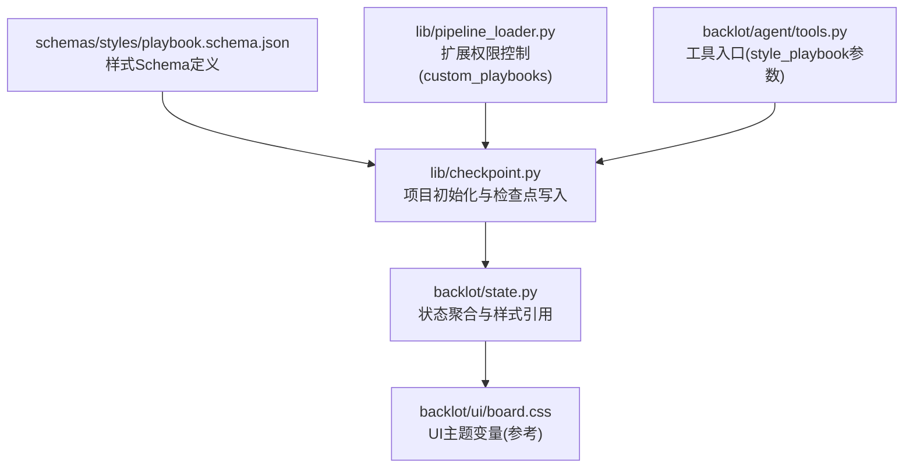
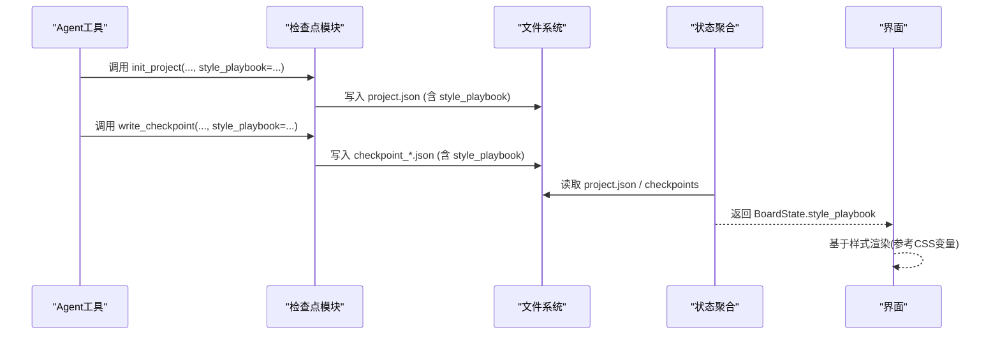
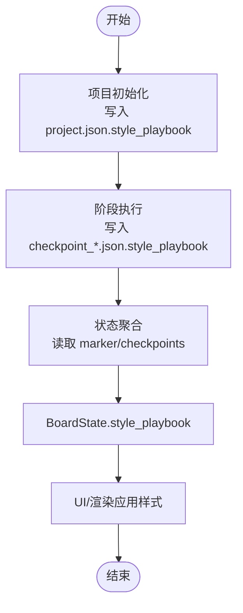
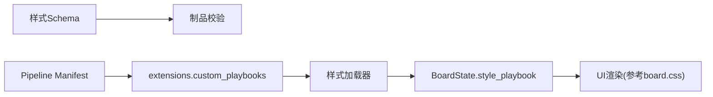

# 样式Schema

<cite>
**本文引用的文件**   
- [playbook.schema.json](file://schemas/styles/playbook.schema.json)
- [tools.py](file://backlot/agent/tools.py)
- [state.py](file://backlot/state.py)
- [checkpoint.py](file://lib/checkpoint.py)
- [pipeline_loader.py](file://lib/pipeline_loader.py)
- [board.css](file://backlot/ui/board.css)
</cite>

## 目录
1. [简介](#简介)
2. [项目结构](#项目结构)
3. [核心组件](#核心组件)
4. [架构总览](#架构总览)
5. [详细组件分析](#详细组件分析)
6. [依赖关系分析](#依赖关系分析)
7. [性能考虑](#性能考虑)
8. [故障排查指南](#故障排查指南)
9. [结论](#结论)
10. [附录](#附录)

## 简介
本文件为 OpenMontage-MV 的“样式Schema”提供权威文档，聚焦 Playbook 样式文件的 JSON Schema 定义与配置选项。内容涵盖视觉风格、色彩方案、字体设置、样式继承与主题切换、验证规则与默认值处理、动态加载与应用机制，以及样式定制与扩展的开发指南和最佳实践。读者可据此编写、校验、应用与扩展样式，确保视频管线在一致的审美规范下运行。

## 项目结构
样式Schema位于 schemas/styles 目录下，采用 JSON Schema Draft 2020-12 规范描述。Playbook 是贯穿项目的“设计系统”，通过项目标记（project.json）与阶段检查点（checkpoint_*.json）进行传递，并在 Backlot 状态中暴露给前端展示。

图表来源 
- [playbook.schema.json:1-285](file://schemas/styles/playbook.schema.json#L1-L285)
- [checkpoint.py:180-228](file://lib/checkpoint.py#L180-L228)
- [state.py:490-689](file://backlot/state.py#L490-L689)
- [pipeline_loader.py:200-241](file://lib/pipeline_loader.py#L200-L241)
- [tools.py:200-250](file://backlot/agent/tools.py#L200-L250)

章节来源
- [playbook.schema.json:1-285](file://schemas/styles/playbook.schema.json#L1-L285)
- [checkpoint.py:180-228](file://lib/checkpoint.py#L180-L228)
- [state.py:490-689](file://backlot/state.py#L490-L689)
- [pipeline_loader.py:200-241](file://lib/pipeline_loader.py#L200-L241)
- [tools.py:200-250](file://backlot/agent/tools.py#L200-L250)

## 核心组件
- 样式Schema（JSON Schema）：定义 Playbook 的结构、必填字段、枚举约束、数值范围、颜色格式等。
- 项目标记与检查点：在 project.json 与 checkpoint_*.json 中持久化 style_playbook 引用。
- 状态聚合：Backlot 将 style_playbook 暴露到 BoardState，供界面渲染与预览使用。
- 扩展权限：通过 pipeline manifest 的 extensions.custom_playbooks 开关控制是否允许自定义样式。

章节来源
- [playbook.schema.json:1-285](file://schemas/styles/playbook.schema.json#L1-L285)
- [checkpoint.py:180-228](file://lib/checkpoint.py#L180-L228)
- [checkpoint.py:410-430](file://lib/checkpoint.py#L410-L430)
- [state.py:490-689](file://backlot/state.py#L490-L689)
- [pipeline_loader.py:200-241](file://lib/pipeline_loader.py#L200-L241)

## 架构总览
Playbook 的生命周期从项目初始化开始，经由检查点流转，最终在状态层暴露给 UI。Schema 负责约束与校验；管道扩展开关负责安全边界；状态层负责聚合与透传。

图表来源 
- [tools.py:200-250](file://backlot/agent/tools.py#L200-L250)
- [checkpoint.py:180-228](file://lib/checkpoint.py#L180-L228)
- [checkpoint.py:410-430](file://lib/checkpoint.py#L410-L430)
- [state.py:490-689](file://backlot/state.py#L490-L689)

## 详细组件分析

### 样式Schema（Playbook）结构与语义
- identity：身份标识与基调
  - name：样式名称
  - category：类别枚举（如 motion-graphics、whiteboard、cinematic、minimalist、retro、custom）
  - mood：情绪描述
  - pace：节奏枚举（slow、deliberate、moderate、fast、rapid）
  - best_for：适用场景说明
- visual_language：视觉语言
  - color_palette：主色、强调色、背景、文本、柔和色的集合与约束
  - composition：构图策略描述
  - texture：纹理风格描述
- typography：排版体系
  - headings/body/code/stat_card：字体规格对象（font、weight、tracking、line_height、size_multiplier）
  - scale_system：比例系统（命名或自定义数值）
  - weight_matrix：角色权重映射（title、heading、body、caption）
- motion：动效与节奏
  - transitions：转场类型数组
  - animation_style：动画风格描述
  - pacing_rules：时长与过渡约束（最小/最大停留秒数、卡片停留、过渡时长）
  - entrance/exit：入场/出场风格
- audio：音频风格
  - voice_style/music_mood/sfx_style：声音风格描述
  - music_volume：音量范围[0,1]
  - ducking_threshold_db：避让阈值
  - voice_variation_allowed：是否允许段落间音色变化
  - hero_moment_voice_shift/transition_voice_shift：关键时刻与转场的语音变化提示
- asset_generation：素材生成
  - image_prompt_prefix/negative_prompt：图像提示前缀与负向提示
  - diagram_style：图表风格
  - consistency_anchors：一致性锚点列表
- overlays：覆盖层样式
  - stat_card/key_term/code_block：覆盖层样式对象（bg、border、text、radius、shadow、highlight）
- quality_rules：质量规则清单（字符串数组）
- taste_profile：品味画像（设计可读性、视觉方差、动效强度、信息密度、配色纪律、布局变化、参考策略、反模式、质量门禁）
- chart_palette：图表数据系列有序十六进制颜色数组（至少2项）
- color_rules：配色智能规则（和谐类型、对比度校验、色盲安全）
- overrides：场景级覆盖与例外
  - max_deviation_ratio：最大偏离比例（默认0.2，上限0.5）
  - scene_overrides：按场景的覆盖项（scene_id、reason、color_override、typography_override、motion_override）

章节来源
- [playbook.schema.json:1-285](file://schemas/styles/playbook.schema.json#L1-L285)

### 视觉风格配置与色彩方案
- 色彩体系由 primary/accent/background/text/muted 组成，配合 chart_palette 用于图表数据系列。
- color_rules 支持和谐类型（互补、类似、三角、分裂互补）、WCAG 2.1 对比度校验开关、色盲安全校验开关。
- 建议遵循最小可用原则：优先保证文本与背景的对比度，再考虑装饰性色彩。

章节来源
- [playbook.schema.json:27-47](file://schemas/styles/playbook.schema.json#L27-L47)
- [playbook.schema.json:163-189](file://schemas/styles/playbook.schema.json#L163-L189)

### 字体设置与排版体系
- 字体规格对象包含 font、weight、tracking、line_height、size_multiplier。
- scale_system 支持音乐比例命名（如 minor_second、golden）或自定义数值（>1）。
- weight_matrix 对 title/heading/body/caption 分别指定字重（100-900）。

章节来源
- [playbook.schema.json:48-82](file://schemas/styles/playbook.schema.json#L48-L82)
- [playbook.schema.json:218-230](file://schemas/styles/playbook.schema.json#L218-L230)

### 动效与节奏控制
- transitions 为转场类型数组，animation_style 描述整体动效风格。
- pacing_rules 规定场景与卡片的停留时间、过渡时长下限，保障观看体验。
- entrance/exit 定义元素进入与离开的风格。

章节来源
- [playbook.schema.json:83-108](file://schemas/styles/playbook.schema.json#L83-L108)

### 音频风格与语音行为
- voice_style/music_mood/sfx_style 描述声音风格。
- music_volume 限制在[0,1]。
- ducking_threshold_db 控制语音出现时的音频避让阈值。
- voice_variation_allowed 允许段落间音色变化以增强表现力。
- hero_moment_voice_shift/transition_voice_shift 提供关键瞬间与转场的语音变化指导。

章节来源
- [playbook.schema.json:109-132](file://schemas/styles/playbook.schema.json#L109-L132)

### 素材生成与一致性锚点
- image_prompt_prefix/negative_prompt 统一AI生成提示词风格。
- diagram_style 统一图表风格。
- consistency_anchors 确保跨镜头的一致性要素（人物、色调、构图等）。

章节来源
- [playbook.schema.json:133-147](file://schemas/styles/playbook.schema.json#L133-L147)

### 覆盖层样式（Overlays）
- stat_card/key_term/code_block 共享 overlay_style 对象，包括背景、边框、文本、圆角、阴影、高亮。

章节来源
- [playbook.schema.json:148-156](file://schemas/styles/playbook.schema.json#L148-L156)
- [playbook.schema.json:231-242](file://schemas/styles/playbook.schema.json#L231-L242)

### 质量规则与品味画像
- quality_rules：以字符串形式记录质量门禁与审查要点。
- taste_profile：量化维度（视觉方差、动效强度、信息密度等）与定性描述（设计可读性、参考策略、反模式、质量门禁）。

章节来源
- [playbook.schema.json:157-162](file://schemas/styles/playbook.schema.json#L157-L162)
- [playbook.schema.json:243-282](file://schemas/styles/playbook.schema.json#L243-L282)

### 样式继承与主题切换
- 继承机制：overrides.scene_overrides 支持按场景覆盖 color/typography/motion，实现局部主题切换与创意偏差。
- 主题切换：通过不同 Playbook 文件（不同 identity.category/name）在项目或阶段级别切换主题。
- 偏离控制：max_deviation_ratio 限制偏离默认样式的场景比例（默认0.2，上限0.5）。

章节来源
- [playbook.schema.json:190-216](file://schemas/styles/playbook.schema.json#L190-L216)

### 样式验证规则与默认值处理
- 必填字段：顶层 required 包含 identity、visual_language、typography、motion、audio、asset_generation、quality_rules。
- 类型与范围：颜色十六进制格式、数值范围（如 music_volume、pacing_rules 的最小值）、数组长度（chart_palette 至少2项）。
- 默认值：overrides.max_deviation_ratio 默认 0.2；voice_variation_allowed 默认 false。
- 校验方式：建议使用 JSON Schema 校验器（如 jsonschema）对 Playbook 与相关制品进行校验。

章节来源
- [playbook.schema.json:1-8](file://schemas/styles/playbook.schema.json#L1-L8)
- [playbook.schema.json:163-171](file://schemas/styles/playbook.schema.json#L163-L171)
- [playbook.schema.json:194-200](file://schemas/styles/playbook.schema.json#L194-L200)
- [playbook.schema.json:118-122](file://schemas/styles/playbook.schema.json#L118-L122)

### 样式的动态加载与应用机制
- 项目初始化：init_project 接受 style_playbook 并写入 project.json 标记。
- 检查点写入：write_checkpoint 可将 style_playbook 写入 checkpoint_*.json，便于阶段追溯。
- 状态聚合：load_board_state 从 marker 与 checkpoints 聚合 style_playbook，输出至 BoardState.style_playbook。
- 扩展权限：pipeline_loader.get_permitted_extensions 与 check_extension_permitted 控制 custom_playbooks 是否启用。

图表来源 
- [checkpoint.py:180-228](file://lib/checkpoint.py#L180-L228)
- [checkpoint.py:410-430](file://lib/checkpoint.py#L410-L430)
- [state.py:490-689](file://backlot/state.py#L490-L689)
- [pipeline_loader.py:200-241](file://lib/pipeline_loader.py#L200-L241)

章节来源
- [tools.py:200-250](file://backlot/agent/tools.py#L200-L250)
- [checkpoint.py:180-228](file://lib/checkpoint.py#L180-L228)
- [checkpoint.py:410-430](file://lib/checkpoint.py#L410-L430)
- [state.py:490-689](file://backlot/state.py#L490-L689)
- [pipeline_loader.py:200-241](file://lib/pipeline_loader.py#L200-L241)

### 样式定制与扩展开发指南
- 新增样式：创建新的 Playbook JSON，遵循 schema 约束，完善 identity/visual_language/typography/motion/audio/asset_generation/overlays/quality_rules/taste_profile/chart_palette/color_rules/overrides。
- 启用扩展：在 pipeline manifest 中设置 extensions.custom_playbooks=true，否则无法加载自定义样式。
- 集成校验：在制品写入前后调用 JSON Schema 校验，确保合规。
- 场景覆盖：通过 overrides.scene_overrides 针对特定 scene_id 进行颜色、排版、动效覆盖，并记录 reason。
- 主题切换：在不同项目或阶段使用不同的 Playbook 路径，实现主题切换。

章节来源
- [pipeline_loader.py:200-241](file://lib/pipeline_loader.py#L200-L241)
- [playbook.schema.json:190-216](file://schemas/styles/playbook.schema.json#L190-L216)

### 样式最佳实践与设计规范
- 色彩：优先满足 WCAG 对比度要求；使用 chart_palette 保持图表一致性；必要时开启 colorblind_safe。
- 字体：使用 scale_system 统一字号层级；weight_matrix 明确角色字重；避免过多字体族。
- 动效：合理设置 pacing_rules，避免过短停留导致阅读困难；转场类型与动画风格保持一致。
- 音频：music_volume 控制在舒适区间；合理使用 ducking_threshold_db 提升语音清晰度。
- 一致性：consistency_anchors 锁定关键视觉要素；taste_profile 中的 anti_patterns 规避常见错误。
- 覆盖：谨慎使用 overrides，控制 max_deviation_ratio，避免破坏整体一致性。

章节来源
- [playbook.schema.json:163-189](file://schemas/styles/playbook.schema.json#L163-L189)
- [playbook.schema.json:83-108](file://schemas/styles/playbook.schema.json#L83-L108)
- [playbook.schema.json:109-132](file://schemas/styles/playbook.schema.json#L109-L132)
- [playbook.schema.json:133-147](file://schemas/styles/playbook.schema.json#L133-L147)
- [playbook.schema.json:243-282](file://schemas/styles/playbook.schema.json#L243-L282)

## 依赖关系分析
- 样式Schema与制品校验：Playbook 作为设计系统输入，需与制品（artifacts）校验流程结合，确保下游消费一致。
- 管道扩展：custom_playbooks 开关决定是否能加载自定义样式，防止未授权扩展。
- 状态与UI：BoardState.style_playbook 为 UI 提供样式上下文；UI 可使用 CSS 变量（如 board.css）呈现主题。

图表来源 
- [pipeline_loader.py:200-241](file://lib/pipeline_loader.py#L200-L241)
- [state.py:490-689](file://backlot/state.py#L490-L689)
- [board.css:1-47](file://backlot/ui/board.css#L1-L47)

章节来源
- [pipeline_loader.py:200-241](file://lib/pipeline_loader.py#L200-L241)
- [state.py:490-689](file://backlot/state.py#L490-L689)
- [board.css:1-47](file://backlot/ui/board.css#L1-L47)

## 性能考虑
- 校验开销：JSON Schema 校验应在制品写入时进行，避免运行时重复校验。
- 状态聚合：BoardState 聚合过程应避免大文件解析，按需读取必要字段。
- 覆盖计算：overrides 的场景覆盖应缓存结果，减少重复计算。
- UI渲染：CSS 变量与主题切换应尽量减少重排与重绘。

## 故障排查指南
- 校验失败：检查必填字段、类型与范围、颜色格式、数组长度等是否符合 schema。
- 扩展未启用：确认 pipeline manifest 中 extensions.custom_playbooks=true。
- 样式未生效：检查 project.json 与 checkpoint_*.json 中 style_playbook 是否正确写入与读取。
- UI主题异常：核对 board.css 变量与样式映射，确保主题切换后变量更新。

章节来源
- [playbook.schema.json:1-8](file://schemas/styles/playbook.schema.json#L1-L8)
- [pipeline_loader.py:200-241](file://lib/pipeline_loader.py#L200-L241)
- [checkpoint.py:180-228](file://lib/checkpoint.py#L180-L228)
- [state.py:490-689](file://backlot/state.py#L490-L689)
- [board.css:1-47](file://backlot/ui/board.css#L1-L47)

## 结论
Playbook 样式Schema为视频管线提供了统一的审美与行为规范。通过严格的校验、清晰的继承与覆盖机制、以及可扩展的主题切换能力，团队可以在保证一致性的同时灵活应对创意需求。建议在开发过程中遵循最佳实践，持续优化校验与渲染性能，确保高质量交付。

## 附录
- 常用字段速查：identity、visual_language.color_palette、typography.scale_system、motion.pacing_rules、audio.music_volume、asset_generation.consistency_anchors、overlays.overlay_style、chart_palette、color_rules、overrides.max_deviation_ratio。
- 推荐工具：JSON Schema 校验库（如 jsonschema）、CSS 变量调试工具、状态查看器（BoardState）。