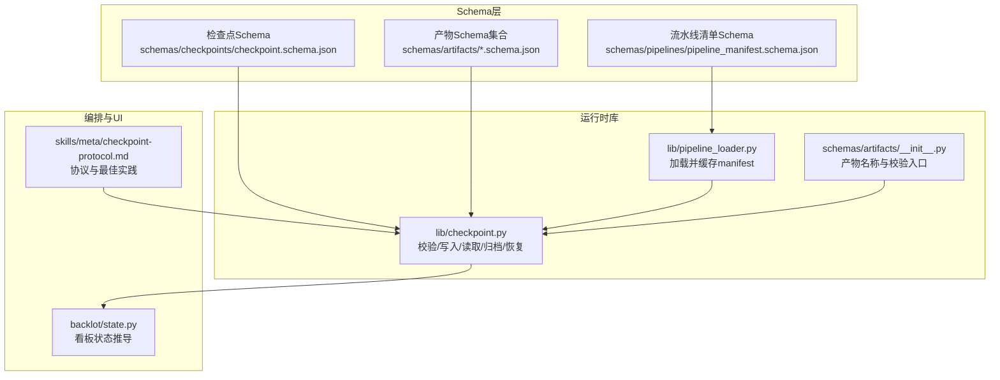
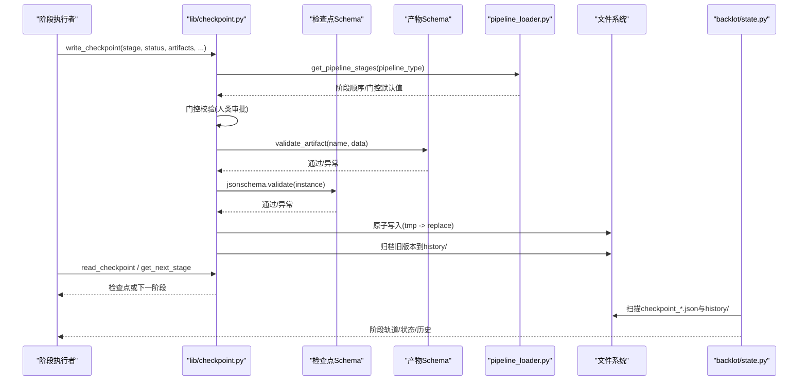
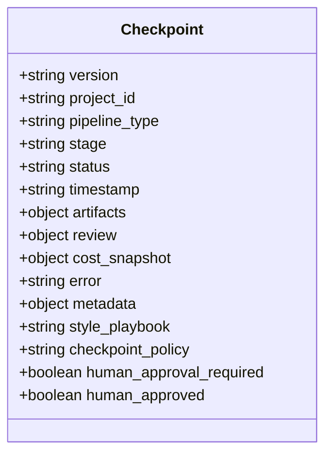
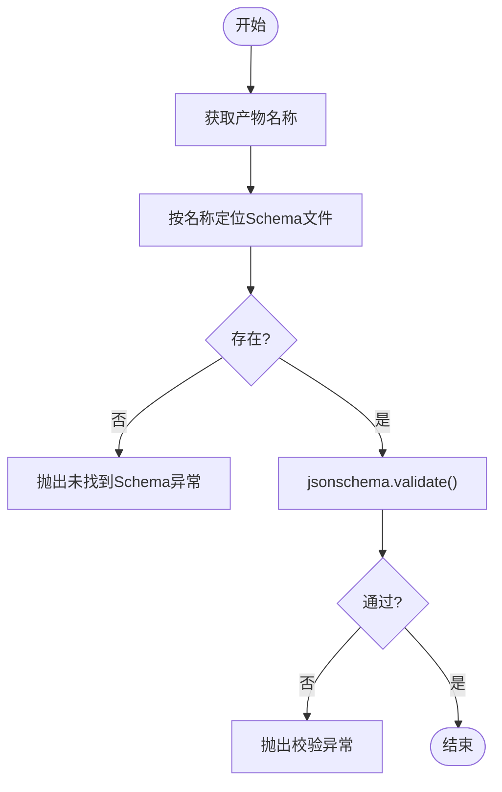
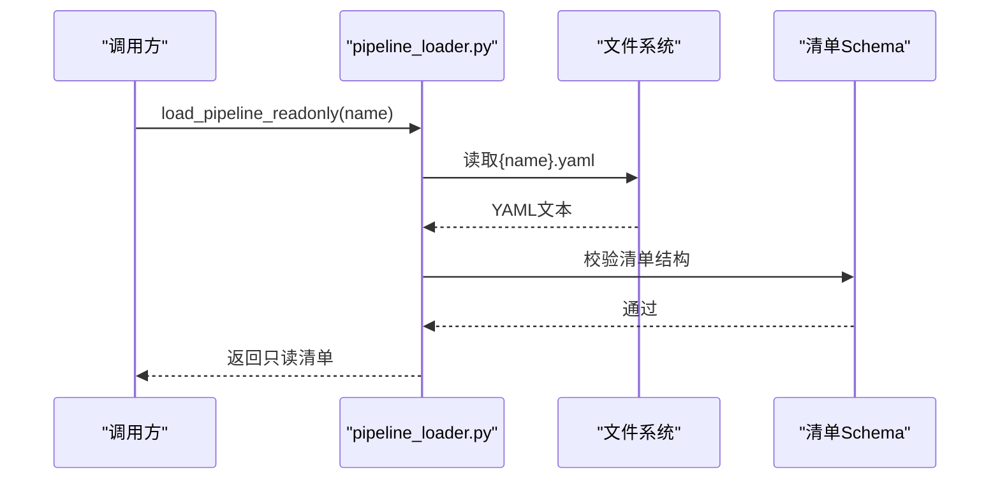
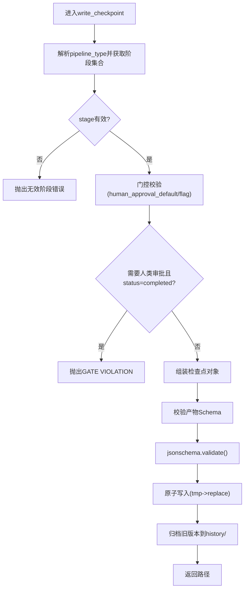
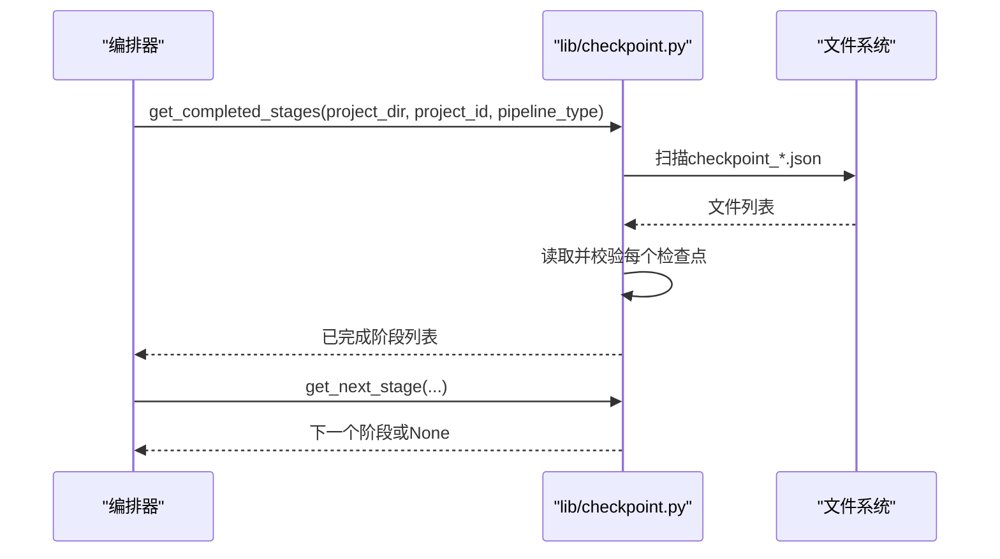
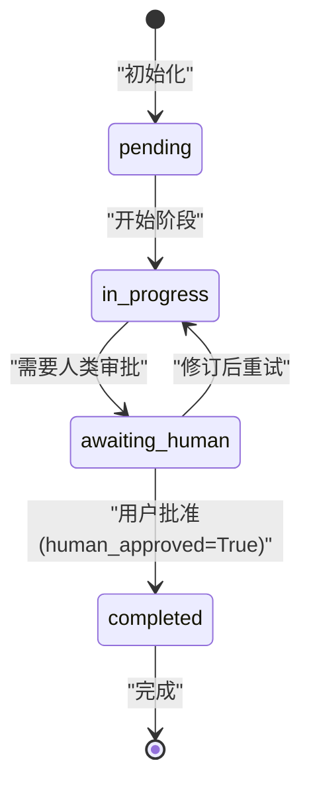
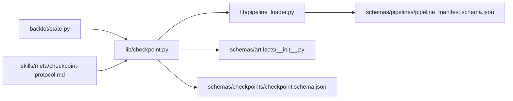

# 检查点Schema

<cite>
**本文引用的文件**   
- [checkpoint.schema.json](file://schemas/checkpoints/checkpoint.schema.json)
- [checkpoint.py](file://lib/checkpoint.py)
- [__init__.py（artifacts）](file://schemas/artifacts/__init__.py)
- [pipeline_manifest.schema.json](file://schemas/pipelines/pipeline_manifest.schema.json)
- [pipeline_loader.py](file://lib/pipeline_loader.py)
- [checkpoint-protocol.md](file://skills/meta/checkpoint-protocol.md)
- [state.py（backlot）](file://backlot/state.py)
- [proposal_packet.schema.json](file://schemas/artifacts/proposal_packet.schema.json)
- [asset_manifest.schema.json](file://schemas/artifacts/asset_manifest.schema.json)
- [decision_log.schema.json](file://schemas/artifacts/decision_log.schema.json)
- [render_report.schema.json](file://schemas/artifacts/render_report.schema.json)
</cite>

## 目录
1. [简介](#简介)
2. [项目结构](#项目结构)
3. [核心组件](#核心组件)
4. [架构总览](#架构总览)
5. [详细组件分析](#详细组件分析)
6. [依赖关系分析](#依赖关系分析)
7. [性能考虑](#性能考虑)
8. [故障排查指南](#故障排查指南)
9. [结论](#结论)
10. [附录](#附录)

## 简介
本文件系统化文档化流水线“检查点”的JSON Schema定义、数据结构与实现机制。内容覆盖：
- 检查点字段定义、数据验证规则与状态转换逻辑
- 版本控制与时间戳机制
- 检查点的创建、读取、更新与删除（归档）操作
- 在流水线恢复与回滚中的作用
- 序列化与反序列化的实现细节
- 最佳实践与性能优化建议

## 项目结构
检查点系统由三部分组成：
- Schema层：定义检查点与产物（Artifacts）的结构约束
- 运行时库：负责校验、写入、读取、归档与恢复流程
- 编排与UI：基于检查点驱动阶段推进、人类审批门控与可视化

**图表来源** 
- [checkpoint.schema.json:1-47](file://schemas/checkpoints/checkpoint.schema.json#L1-L47)
- [checkpoint.py:1-120](file://lib/checkpoint.py#L1-L120)
- [pipeline_loader.py:1-70](file://lib/pipeline_loader.py#L1-L70)
- [__init__.py（artifacts）:1-45](file://schemas/artifacts/__init__.py#L1-L45)
- [checkpoint-protocol.md:1-60](file://skills/meta/checkpoint-protocol.md#L1-L60)
- [state.py（backlot）:62-170](file://backlot/state.py#L62-L170)

**章节来源**
- [checkpoint.schema.json:1-47](file://schemas/checkpoints/checkpoint.schema.json#L1-L47)
- [checkpoint.py:1-120](file://lib/checkpoint.py#L1-L120)
- [pipeline_loader.py:1-70](file://lib/pipeline_loader.py#L1-L70)
- [__init__.py（artifacts）:1-45](file://schemas/artifacts/__init__.py#L1-L45)
- [checkpoint-protocol.md:1-60](file://skills/meta/checkpoint-protocol.md#L1-L60)
- [state.py（backlot）:62-170](file://backlot/state.py#L62-L170)

## 核心组件
- 检查点Schema：定义检查点对象的必填字段、类型与枚举值，确保跨阶段一致性
- 产物校验器：按产物名动态加载对应Schema进行强校验
- 流水线清单加载器：从YAML清单解析阶段顺序、门控策略等元信息
- 检查点运行时：提供校验、写入、读取、归档、恢复与下一步阶段计算
- 协议与最佳实践：指导何时写检查点、如何处理人类审批门控与部分进度

**章节来源**
- [checkpoint.schema.json:1-47](file://schemas/checkpoints/checkpoint.schema.json#L1-L47)
- [__init__.py（artifacts）:1-45](file://schemas/artifacts/__init__.py#L1-L45)
- [pipeline_loader.py:1-70](file://lib/pipeline_loader.py#L1-L70)
- [checkpoint.py:1-120](file://lib/checkpoint.py#L1-L120)
- [checkpoint-protocol.md:1-60](file://skills/meta/checkpoint-protocol.md#L1-L60)

## 架构总览
检查点系统在“写入时校验 + 读取时再校验”的双保险下保证数据完整性；通过清单驱动的“门控”策略强制人类审批；历史归档保留完整审计轨迹；看板根据检查点与历史构建阶段轨道与回放能力。

**图表来源** 
- [checkpoint.py:336-467](file://lib/checkpoint.py#L336-L467)
- [pipeline_loader.py:125-183](file://lib/pipeline_loader.py#L125-L183)
- [__init__.py（artifacts）:27-45](file://schemas/artifacts/__init__.py#L27-L45)
- [checkpoint.schema.json:1-47](file://schemas/checkpoints/checkpoint.schema.json#L1-L47)
- [state.py（backlot）:143-170](file://backlot/state.py#L143-L170)

## 详细组件分析

### 检查点Schema定义与字段说明
- 版本控制：固定为字符串常量，用于向后兼容与演进
- 项目标识与流水线类型：用于隔离多项目与多流水线
- 阶段与状态：阶段名需匹配清单或已知集合；状态枚举限定生命周期
- 时间戳：ISO 8601格式，UTC时间
- 产物映射：键为产物名，值为对象或路径引用；受产物Schema强校验
- 审阅与成本快照：可选，用于人类审批与预算追踪
- 错误与元数据：记录失败原因与扩展信息

**图表来源** 
- [checkpoint.schema.json:1-47](file://schemas/checkpoints/checkpoint.schema.json#L1-L47)

**章节来源**
- [checkpoint.schema.json:1-47](file://schemas/checkpoints/checkpoint.schema.json#L1-L47)

### 产物Schema与校验机制
- 产物名称白名单：集中管理，避免散乱命名
- 动态加载：按产物名查找对应JSON Schema并校验
- 严格模式：禁止额外属性，确保结构稳定

**图表来源** 
- [__init__.py（artifacts）:27-45](file://schemas/artifacts/__init__.py#L27-L45)

**章节来源**
- [__init__.py（artifacts）:1-45](file://schemas/artifacts/__init__.py#L1-L45)

### 流水线清单加载与阶段顺序
- 清单加载：从YAML读取并通过清单Schema校验
- 阶段顺序：按清单声明的顺序返回，支持子阶段展开
- 门控默认值：human_approval_default决定是否需要人类审批

**图表来源** 
- [pipeline_loader.py:39-70](file://lib/pipeline_loader.py#L39-L70)
- [pipeline_manifest.schema.json:1-162](file://schemas/pipelines/pipeline_manifest.schema.json#L1-L162)

**章节来源**
- [pipeline_loader.py:1-70](file://lib/pipeline_loader.py#L1-L70)
- [pipeline_manifest.schema.json:1-162](file://schemas/pipelines/pipeline_manifest.schema.json#L1-L162)

### 检查点写入流程与门控策略
- 阶段有效性校验：阶段名必须属于当前流水线的有效集合
- 门控策略：若清单或调用方要求人类审批，则禁止直接写入completed
- 产物校验：对已知产物名进行Schema校验
- 原子写入：先写临时文件，再替换，避免损坏
- 历史归档：非in_progress的旧版本被归档至history/

**图表来源** 
- [checkpoint.py:336-467](file://lib/checkpoint.py#L336-L467)

**章节来源**
- [checkpoint.py:336-467](file://lib/checkpoint.py#L336-L467)

### 检查点读取、最新选择与下一步阶段
- 读取单个阶段检查点：不存在返回None，存在则校验后返回
- 最新检查点：按文件mtime排序取最近一个
- 已完成阶段列表：过滤status=completed
- 下一步阶段：按清单顺序遍历，首个未完成即为下一步

**图表来源** 
- [checkpoint.py:470-537](file://lib/checkpoint.py#L470-L537)

**章节来源**
- [checkpoint.py:470-537](file://lib/checkpoint.py#L470-L537)

### 人类审批门控与状态转换
- 门控来源：清单human_approval_default或调用方human_approval_required
- 合法转换：awaiting_human → completed（需human_approved=True）
- 非法转换：跳过审批直接completed将触发GATE VIOLATION
- 看板展示：gated标记与审批状态用于界面提示

**图表来源** 
- [checkpoint.schema.json:1-47](file://schemas/checkpoints/checkpoint.schema.json#L1-L47)
- [checkpoint.py:378-406](file://lib/checkpoint.py#L378-L406)
- [state.py（backlot）:143-170](file://backlot/state.py#L143-L170)

**章节来源**
- [checkpoint.py:378-406](file://lib/checkpoint.py#L378-L406)
- [checkpoint.schema.json:1-47](file://schemas/checkpoints/checkpoint.schema.json#L1-L47)
- [state.py（backlot）:143-170](file://backlot/state.py#L143-L170)

### 检查点序列化与反序列化
- 序列化：使用标准JSON库，缩进输出便于阅读；先写临时文件再原子替换
- 反序列化：读取后统一走validate_checkpoint，确保结构一致
- 历史归档：复制而非移动，避免Windows打开文件导致的锁定问题

**章节来源**
- [checkpoint.py:452-467](file://lib/checkpoint.py#L452-L467)
- [checkpoint.py:470-481](file://lib/checkpoint.py#L470-L481)
- [checkpoint.py:263-300](file://lib/checkpoint.py#L263-L300)

### 检查点在恢复与回滚中的作用
- 恢复：get_next_stage结合read_checkpoint定位断点，继续生成
- 回滚：history/保存所有非in_progress的历史版本，可回溯审计与对比
- 看板回放：基于history_entries构建状态轨迹，支持逐步回放

**章节来源**
- [checkpoint.py:483-503](file://lib/checkpoint.py#L483-L503)
- [checkpoint.py:263-300](file://lib/checkpoint.py#L263-L300)
- [state.py（backlot）:143-170](file://backlot/state.py#L143-L170)

### 关键产物Schema示例
- proposal_packet：包含概念选项、生产计划、成本估算与审批状态
- asset_manifest：资产清单，含类型、路径、来源工具、成本等
- decision_log：决策日志，记录每步选择的选项、评分与理由
- render_report：渲染报告，含输出元数据与质量评估

**章节来源**
- [proposal_packet.schema.json:1-379](file://schemas/artifacts/proposal_packet.schema.json#L1-L379)
- [asset_manifest.schema.json:1-63](file://schemas/artifacts/asset_manifest.schema.json#L1-L63)
- [decision_log.schema.json:1-104](file://schemas/artifacts/decision_log.schema.json#L1-L104)
- [render_report.schema.json:1-64](file://schemas/artifacts/render_report.schema.json#L1-L64)

## 依赖关系分析
- 检查点运行时依赖清单加载器以获取阶段顺序与门控默认值
- 产物校验器依赖产物Schema集合，按名称动态加载
- 看板依赖检查点与历史目录构建阶段轨道与回放
- 协议文档指导调用方正确设置人类审批与部分进度

**图表来源** 
- [checkpoint.py:1-120](file://lib/checkpoint.py#L1-L120)
- [pipeline_loader.py:1-70](file://lib/pipeline_loader.py#L1-L70)
- [__init__.py（artifacts）:1-45](file://schemas/artifacts/__init__.py#L1-L45)
- [checkpoint.schema.json:1-47](file://schemas/checkpoints/checkpoint.schema.json#L1-L47)
- [pipeline_manifest.schema.json:1-162](file://schemas/pipelines/pipeline_manifest.schema.json#L1-L162)
- [state.py（backlot）:62-170](file://backlot/state.py#L62-L170)
- [checkpoint-protocol.md:1-60](file://skills/meta/checkpoint-protocol.md#L1-L60)

**章节来源**
- [checkpoint.py:1-120](file://lib/checkpoint.py#L1-L120)
- [pipeline_loader.py:1-70](file://lib/pipeline_loader.py#L1-L70)
- [__init__.py（artifacts）:1-45](file://schemas/artifacts/__init__.py#L1-L45)
- [checkpoint.schema.json:1-47](file://schemas/checkpoints/checkpoint.schema.json#L1-L47)
- [pipeline_manifest.schema.json:1-162](file://schemas/pipelines/pipeline_manifest.schema.json#L1-L162)
- [state.py（backlot）:62-170](file://backlot/state.py#L62-L170)
- [checkpoint-protocol.md:1-60](file://skills/meta/checkpoint-protocol.md#L1-L60)

## 性能考虑
- Schema与清单缓存：使用lru_cache减少重复IO与校验开销
- 原子写入：避免并发写入导致的数据损坏
- 历史归档：仅归档非in_progress版本，降低频繁心跳的磁盘压力
- 产物校验：仅在已知产物名上执行Schema校验，避免无谓开销
- 看板状态推导：按需读取与排序，避免全量扫描大目录

[本节为通用性能建议，不直接分析具体文件]

## 故障排查指南
- 阶段无效：确认pipeline_type与阶段名是否在清单或已知集合中
- 门控违规：检查是否满足人类审批条件，必要时改为awaiting_human并在批准后重写
- 产物校验失败：核对产物Schema与数据字段，确保类型与必填项正确
- 读取为空：确认checkpoint文件是否存在，或是否为in_progress状态
- 历史缺失：确认归档逻辑未被异常中断，检查history目录权限

**章节来源**
- [checkpoint.py:140-172](file://lib/checkpoint.py#L140-L172)
- [checkpoint.py:378-406](file://lib/checkpoint.py#L378-L406)
- [checkpoint.py:470-503](file://lib/checkpoint.py#L470-L503)

## 结论
检查点Schema与运行时共同构建了可靠的流水线状态持久化与恢复机制。通过严格的Schema校验、清单驱动的门控策略与历史归档，系统在保证数据一致性的同时提供了良好的可观测性与可审计性。遵循协议与最佳实践，可在复杂流水线中实现稳健的人类协作与自动化执行。

[本节为总结性内容，不直接分析具体文件]

## 附录
- 协议要点：在进入阶段时写入in_progress，在产出可用时写入completed或awaiting_human；人类审批不可跳过
- 恢复流程：启动时查询下一步阶段，若存在in_progress则加载部分进度继续
- 最佳实践：尽量包含review与cost_snapshot，便于审计与预算控制；对长耗时阶段频繁刷新partial_progress

**章节来源**
- [checkpoint-protocol.md:60-201](file://skills/meta/checkpoint-protocol.md#L60-L201)