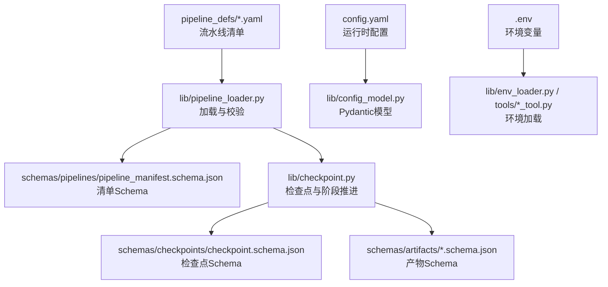
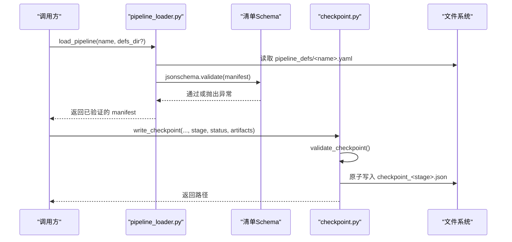
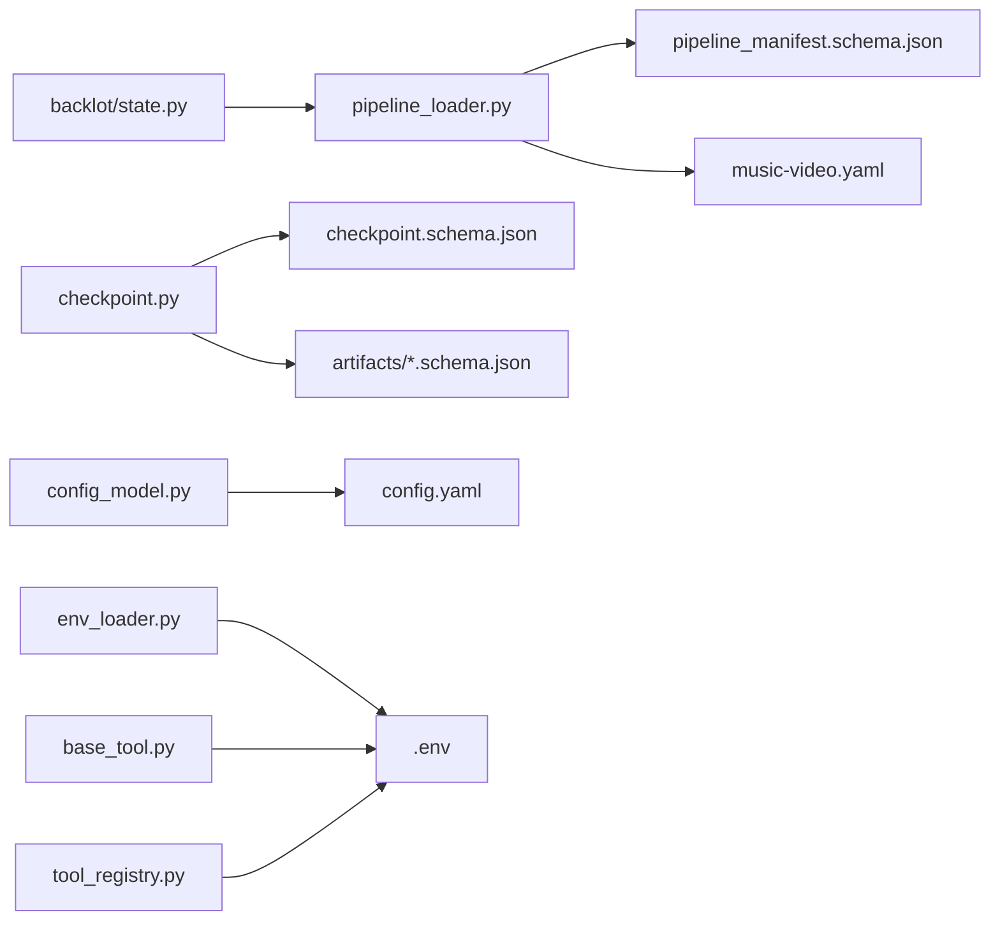

# 流水线Schema

<cite>
**本文引用的文件**   
- [pipeline_manifest.schema.json](file://schemas/pipelines/pipeline_manifest.schema.json)
- [music-video.yaml](file://pipeline_defs/music-video.yaml)
- [brief.schema.json](file://schemas/artifacts/brief.schema.json)
- [storyboard.schema.json](file://schemas/artifacts/storyboard.schema.json)
- [checkpoint.schema.json](file://schemas/checkpoints/checkpoint.schema.json)
- [pipeline_loader.py](file://lib/pipeline_loader.py)
- [checkpoint.py](file://lib/checkpoint.py)
- [config_model.py](file://lib/config_model.py)
- [env_loader.py](file://lib/env_loader.py)
- [base_tool.py](file://tools/base_tool.py)
- [tool_registry.py](file://tools/tool_registry.py)
- [state.py](file://backlot/state.py)
- [config.yaml](file://config.yaml)
</cite>

## 目录
1. [简介](#简介)
2. [项目结构](#项目结构)
3. [核心组件](#核心组件)
4. [架构总览](#架构总览)
5. [详细组件分析](#详细组件分析)
6. [依赖关系分析](#依赖关系分析)
7. [性能考虑](#性能考虑)
8. [故障排除指南](#故障排除指南)
9. [结论](#结论)
10. [附录](#附录)

## 简介
本文件系统化说明 OpenMontage-MV 的“流水线清单”（Pipeline Manifest）JSON Schema 定义与配置格式，覆盖：
- 流水线元数据、阶段定义、依赖关系与执行顺序
- 环境变量与参数配置加载机制
- 版本管理与兼容性检查
- 动态加载与执行机制
- 模板与自定义流水线开发指南
- 调试与故障排除方法

该文档面向开发者与维护者，兼顾非技术读者理解。

## 项目结构
OpenMontage-MV 将“流水线清单”以 YAML 形式声明在 pipeline_defs/ 下，并通过 JSON Schema 进行强校验。运行时由 Python 模块加载并解析，结合 checkpoint 机制实现可恢复的执行流程。

图表来源
- [pipeline_loader.py:15-70](file://lib/pipeline_loader.py#L15-L70)
- [pipeline_manifest.schema.json:1-162](file://schemas/pipelines/pipeline_manifest.schema.json#L1-162)
- [checkpoint.py:77-172](file://lib/checkpoint.py#L77-L172)
- [checkpoint.schema.json:1-47](file://schemas/checkpoints/checkpoint.schema.json#L1-47)
- [config_model.py:44-70](file://lib/config_model.py#L44-L70)
- [env_loader.py:15-34](file://lib/env_loader.py#L15-L34)

章节来源
- [pipeline_loader.py:15-70](file://lib/pipeline_loader.py#L15-L70)
- [config_model.py:44-70](file://lib/config_model.py#L44-L70)
- [env_loader.py:15-34](file://lib/env_loader.py#L15-L34)

## 核心组件
- 流水线清单（Manifest）：YAML 描述 name/version/stages 等元数据与阶段定义，受 JSON Schema 约束。
- 清单加载器（Loader）：读取 YAML、校验 Schema、缓存结果，并提供阶段顺序、工具集合、子阶段过滤等能力。
- 检查点系统（Checkpoint）：每个阶段完成后持久化快照，支持断点续跑、人类审批门控、审计追踪。
- 运行时配置（Config）：基于 Pydantic 的 config.yaml 模型，提供路径、输出参数、检查点策略等。
- 环境变量（Env）：从 .env 加载 API Key 等敏感信息，供工具使用。

章节来源
- [pipeline_manifest.schema.json:1-162](file://schemas/pipelines/pipeline_manifest.schema.json#L1-162)
- [pipeline_loader.py:27-76](file://lib/pipeline_loader.py#L27-L76)
- [checkpoint.py:140-172](file://lib/checkpoint.py#L140-L172)
- [config_model.py:44-70](file://lib/config_model.py#L44-L70)
- [env_loader.py:15-34](file://lib/env_loader.py#L15-L34)

## 架构总览
下图展示清单加载、校验、阶段顺序推导与检查点写入的关键交互。

图表来源
- [pipeline_loader.py:49-70](file://lib/pipeline_loader.py#L49-L70)
- [pipeline_manifest.schema.json:1-162](file://schemas/pipelines/pipeline_manifest.schema.json#L1-162)
- [checkpoint.py:336-467](file://lib/checkpoint.py#L336-L467)

## 详细组件分析

### 流水线清单 Schema（pipeline_manifest.schema.json）
- 顶层字段
  - name: 字符串，必填
  - version: 字符串，必填
  - description: 可选
  - category: 枚举，限定类别（如 music_video）
  - stability: 枚举（production/beta），表示稳定性
  - compatible_playbooks: 数组或对象（recommended/also_works/custom_allowed）
  - required_skills: 数组，声明所需技能路径
  - stages: 数组，至少一项，每项为阶段定义
  - default_checkpoint_policy: 枚举（guided/manual_all/auto_noncreative）
  - reference_input: 对象，声明参考视频输入支持
  - metadata: 任意对象
  - orchestration: 对象，编排器配置（模式、预算、最大修订次数等）
  - extensions: 对象，扩展权限开关（custom_scripts/playbooks/skills/tools）

- 阶段定义（stages[*]）关键字段
  - name: 必填
  - skill: 指令驱动阶段的技能路径（替代旧版 agent）
  - required_artifacts_in / optional_artifacts_in: 前置产物依赖
  - produces: 本阶段产出的产物名列表
  - preferred_tools / fallback_tools / required_tools / optional_tools / tools_available: 工具声明与可用性
  - review_focus / success_criteria: 审查关注点与成功标准
  - checkpoint_required / human_approval_default: 是否必须写检查点、是否默认需要人工审批
  - sub_stages: 可选子阶段，含条件激活（condition）与独立工具/审查焦点

- 兼容性与扩展
  - compatible_playbooks.custom_allowed 控制是否允许自定义剧本
  - extensions.* 控制脚本/剧本/技能/工具的启用

章节来源
- [pipeline_manifest.schema.json:1-162](file://schemas/pipelines/pipeline_manifest.schema.json#L1-162)

### 清单实例（music-video.yaml）
- 元数据：name、version、description、category、stability、default_checkpoint_policy
- extensions：开启 custom_scripts/playbooks/skills，禁用 custom_tools
- required_skills：列出 7 个导演技能 + meta/reviewer + meta/checkpoint-protocol
- stages：idea → proposal → storyboard → assets → edit → compose → publish
  - 各阶段明确 required_artifacts_in、produces、tools_available、review_focus、success_criteria
  - compose 阶段声明 required_tools（video_stitch、audio_mixer）与 optional_tools（color_grade）

章节来源
- [music-video.yaml:1-187](file://pipeline_defs/music-video.yaml#L1-L187)

### 产物 Schema（Artifacts）
- brief.schema.json：创意简报，包含标题、钩子、关键要点、风格、目标平台、时长等
- storyboard.schema.json：MV 分镜脚本，严格限制镜头数量（≤23）、单镜时长（整数 4-15 秒）、镜头元素与 Seedance 提示词；增补 provenance、assetPath、referenceImages 等字段

章节来源
- [brief.schema.json:1-49](file://schemas/artifacts/brief.schema.json#L1-L49)
- [storyboard.schema.json:1-289](file://schemas/artifacts/storyboard.schema.json#L1-L289)

### 检查点 Schema（Checkpoints）
- 字段包括 version、project_id、pipeline_type、stage、status、timestamp、artifacts、review、cost_snapshot、error、metadata 等
- status 枚举：completed/failed/awaiting_human/in_progress
- checkpoint_policy 与 human_approval_required/human_approved 配合实现门控

章节来源
- [checkpoint.schema.json:1-47](file://schemas/checkpoints/checkpoint.schema.json#L1-47)

### 清单加载与校验（pipeline_loader.py）
- 加载流程
  - 定位 pipeline_defs/<name>.yaml
  - 读取 YAML 并使用 jsonschema 校验清单
  - 使用 lru_cache 缓存 schema 与清单，避免重复 IO/校验
- 常用查询
  - get_stage_order：按清单顺序返回阶段名（含子阶段展开）
  - get_required_tools：汇总所有阶段与参考输入的工具集合
  - get_stage_skill / get_stage_human_approval_default / get_stage_review_focus：按阶段名检索
  - get_stage_sub_stages：按上下文条件过滤活跃子阶段
- 扩展权限
  - check_extension_permitted：强制检查 extensions.* 开关
  - get_permitted_extensions：返回当前清单允许的扩展项

章节来源
- [pipeline_loader.py:27-76](file://lib/pipeline_loader.py#L27-L76)
- [pipeline_loader.py:98-163](file://lib/pipeline_loader.py#L98-L163)
- [pipeline_loader.py:165-191](file://lib/pipeline_loader.py#L165-L191)
- [pipeline_loader.py:201-241](file://lib/pipeline_loader.py#L201-L241)

### 检查点与阶段推进（checkpoint.py）
- 阶段顺序与有效性
  - get_pipeline_stages：优先从清单获取阶段顺序，否则回退到内置稳定顺序
  - validate_checkpoint：校验 stage/status/artifacts 与清单一致性
- 门控（Gate Enforcement）
  - _stage_requires_approval：从清单读取 human_approval_default，若缺失则回退调用方传入值
  - write_checkpoint：当 gated=True 且 status=completed 时，必须 human_approved=True，否则抛错
- 历史归档与决策日志
  - _archive_superseded_checkpoint：将非 in_progress 的检查点归档至 history/
  - _merge_decision_log：合并 decision_log 到项目级决策日志，并在相关产物中回填引用
- 项目初始化与状态查询
  - init_project：创建标准目录结构与 project.json 标记
  - get_completed_stages / get_next_stage：根据已完成检查点推断下一步

章节来源
- [checkpoint.py:51-76](file://lib/checkpoint.py#L51-L76)
- [checkpoint.py:140-172](file://lib/checkpoint.py#L140-L172)
- [checkpoint.py:230-261](file://lib/checkpoint.py#L230-L261)
- [checkpoint.py:336-467](file://lib/checkpoint.py#L336-L467)
- [checkpoint.py:470-537](file://lib/checkpoint.py#L470-L537)

### 运行时配置与环境变量
- 运行时配置（config.yaml）
  - checkpoint.policy/storage_dir
  - output.*（格式、编解码、分辨率、帧率、CRF）
  - paths.*（pipeline_dir/library_dir/styles_dir/skills_dir/output_dir）
- Pydantic 模型（config_model.py）
  - OpenMontageConfig.load：从 config.yaml 加载并类型校验
  - resolve_path：相对路径解析
- 环境变量（.env）
  - env_loader.load_env：在项目根加载 .env
  - base_tool.py / tool_registry.py：导入时加载 .env，确保工具可用 API Key

章节来源
- [config.yaml:1-20](file://config.yaml#L1-L20)
- [config_model.py:44-70](file://lib/config_model.py#L44-L70)
- [env_loader.py:15-34](file://lib/env_loader.py#L15-L34)
- [base_tool.py:25-60](file://tools/base_tool.py#L25-L60)
- [tool_registry.py:86-116](file://tools/tool_registry.py#L86-L116)

### 前端/看板集成（Backlot）
- state.py 中的 _load_pipeline_meta：从清单加载阶段顺序与门控标志，用于 UI 渲染阶段轨道与审批提示

章节来源
- [state.py:62-96](file://backlot/state.py#L62-L96)

## 依赖关系分析
- 清单与 Schema
  - pipeline_loader.py 依赖 schemas/pipelines/pipeline_manifest.schema.json 进行强校验
- 阶段与产物
  - checkpoint.py 依赖 schemas/checkpoints/checkpoint.schema.json 与 schemas/artifacts/*.schema.json
- 运行期配置
  - config_model.py 依赖 config.yaml
  - env_loader.py 与 tools/* 依赖 .env
- 看板与清单
  - backlot/state.py 依赖 lib/pipeline_loader 获取阶段元数据

图表来源
- [pipeline_loader.py:49-70](file://lib/pipeline_loader.py#L49-L70)
- [checkpoint.py:77-172](file://lib/checkpoint.py#L77-L172)
- [config_model.py:52-62](file://lib/config_model.py#L52-L62)
- [env_loader.py:15-22](file://lib/env_loader.py#L15-L22)
- [base_tool.py:25-60](file://tools/base_tool.py#L25-L60)
- [tool_registry.py:86-116](file://tools/tool_registry.py#L86-L116)
- [state.py:62-96](file://backlot/state.py#L62-L96)

## 性能考虑
- 清单与 Schema 缓存
  - pipeline_loader 使用 lru_cache 缓存清单与 Schema，减少重复 IO 与校验开销
- 原子写入与最小锁竞争
  - checkpoint 写入先写临时文件再替换，避免部分写入导致损坏
- 阶段顺序稳定
  - get_pipeline_stages 在无清单时回退到稳定排序，保证确定性
- 产物校验延迟
  - 仅在必要时对产物进行 Schema 校验，避免频繁解析大对象

[本节为通用建议，不直接分析具体文件]

## 故障排除指南
- 清单校验失败
  - 现象：加载清单时报 jsonschema.ValidationError
  - 排查：核对 pipeline_manifest.schema.json 必填字段与枚举值；确认 YAML 键名与类型正确
  - 参考：清单加载与校验流程
- 阶段无效或顺序错误
  - 现象：get_next_stage 无法推进或报 stage 无效
  - 排查：确认 stages[*].name 与清单一致；检查 required_artifacts_in 是否满足
  - 参考：阶段顺序与有效性校验
- 门控违规（Gate Violation）
  - 现象：write_checkpoint 抛出 CheckpointValidationError，提示需 human_approved=True
  - 处理：将状态改为 awaiting_human，等待用户审批后再写 completed 并设置 human_approved=True
  - 参考：门控逻辑与错误消息
- 产物 Schema 校验失败
  - 现象：validate_checkpoint 报错 artifact 不符合 Schema
  - 排查：对照 artifacts/*.schema.json 字段与约束（如 storyboard 的镜头数与时长）
- 工具不可用
  - 现象：compose 阶段 required_tools 未满足
  - 排查：确认 tools_available/required_tools 声明与实际可用工具一致
- 环境变量缺失
  - 现象：工具启动时报缺少 API Key
  - 排查：确保 .env 存在且 key=value 格式正确；确认 base_tool/tool_registry 已加载 .env

章节来源
- [pipeline_loader.py:49-70](file://lib/pipeline_loader.py#L49-L70)
- [checkpoint.py:378-406](file://lib/checkpoint.py#L378-L406)
- [checkpoint.py:140-172](file://lib/checkpoint.py#L140-L172)
- [storyboard.schema.json:171-289](file://schemas/artifacts/storyboard.schema.json#L171-L289)
- [base_tool.py:25-60](file://tools/base_tool.py#L25-L60)
- [tool_registry.py:86-116](file://tools/tool_registry.py#L86-L116)

## 结论
OpenMontage-MV 的流水线体系以“清单即契约”为核心：YAML 清单经 JSON Schema 强校验，Python 加载器提供稳定的阶段顺序与工具集推导，检查点系统保障可恢复与可审计的执行流。通过 extensions 与 compatible_playbooks 实现灵活扩展与兼容性管理，结合 config.yaml 与 .env 完成运行时配置与环境注入。遵循本文档的规范与排障步骤，可高效开发与维护自定义流水线。

[本节为总结性内容，不直接分析具体文件]

## 附录

### 流水线清单字段速查
- 顶层：name、version、description、category、stability、compatible_playbooks、required_skills、stages、default_checkpoint_policy、reference_input、metadata、orchestration、extensions
- 阶段：name、skill、required_artifacts_in、optional_artifacts_in、produces、preferred_tools、fallback_tools、required_tools、optional_tools、tools_available、review_focus、checkpoint_required、human_approval_default、success_criteria、sub_stages

章节来源
- [pipeline_manifest.schema.json:1-162](file://schemas/pipelines/pipeline_manifest.schema.json#L1-162)

### 阶段依赖与执行顺序（示例：music-video）
- idea → proposal → storyboard → assets → edit → compose → publish
- 依赖关系由 required_artifacts_in 声明，顺序由清单顺序决定

章节来源
- [music-video.yaml:36-187](file://pipeline_defs/music-video.yaml#L36-L187)

### 环境变量与配置优先级
- .env：API Key 等敏感信息，导入时加载
- config.yaml：运行时参数，通过 Pydantic 模型加载与校验
- 代码默认值：当配置文件缺失时使用默认值

章节来源
- [env_loader.py:15-34](file://lib/env_loader.py#L15-L34)
- [config_model.py:52-62](file://lib/config_model.py#L52-L62)

### 自定义流水线开发指南
- 新建清单
  - 在 pipeline_defs/ 新增 <name>.yaml，遵循清单 Schema
  - 声明 stages、required_skills、extensions 等
- 产物与检查点
  - 各阶段产出需符合 artifacts/*.schema.json
  - 每阶段完成后调用 write_checkpoint，遵守门控协议
- 工具与技能
  - 在 stages[*].tools_available 声明可用工具
  - 在 required_skills 声明所需技能路径
- 兼容性与扩展
  - 使用 compatible_playbooks 指定兼容剧本
  - 通过 extensions.* 控制脚本/技能/工具启用

章节来源
- [pipeline_manifest.schema.json:1-162](file://schemas/pipelines/pipeline_manifest.schema.json#L1-162)
- [music-video.yaml:1-187](file://pipeline_defs/music-video.yaml#L1-L187)
- [checkpoint.py:336-467](file://lib/checkpoint.py#L336-L467)

### 调试与诊断技巧
- 打印阶段顺序：使用 get_stage_order(manifest, include_sub_stages=True)
- 查看已完成阶段：get_completed_stages(pipeline_dir, project_id, pipeline_type)
- 定位下一步：get_next_stage(pipeline_dir, project_id, pipeline_type)
- 检查门控：_stage_requires_approval(pipeline_type, stage)
- 查看产物校验错误：捕获 validate_checkpoint 的异常信息

章节来源
- [pipeline_loader.py:125-149](file://lib/pipeline_loader.py#L125-L149)
- [checkpoint.py:505-537](file://lib/checkpoint.py#L505-L537)
- [checkpoint.py:230-261](file://lib/checkpoint.py#L230-L261)