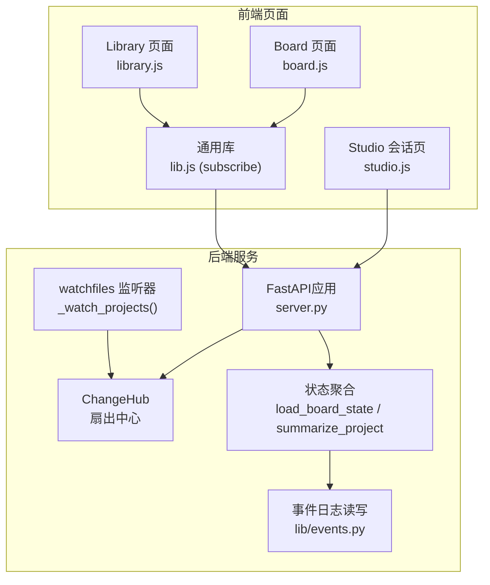
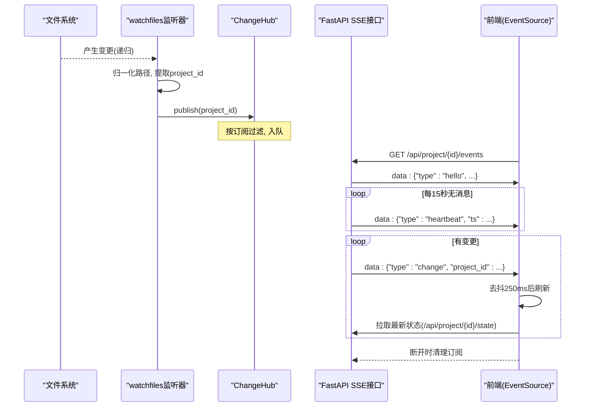
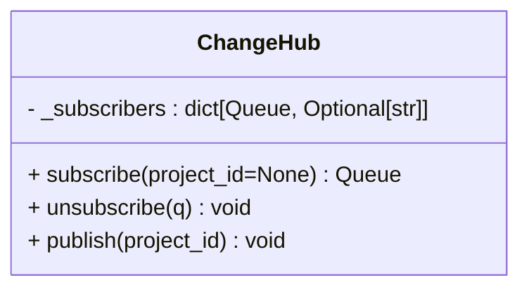
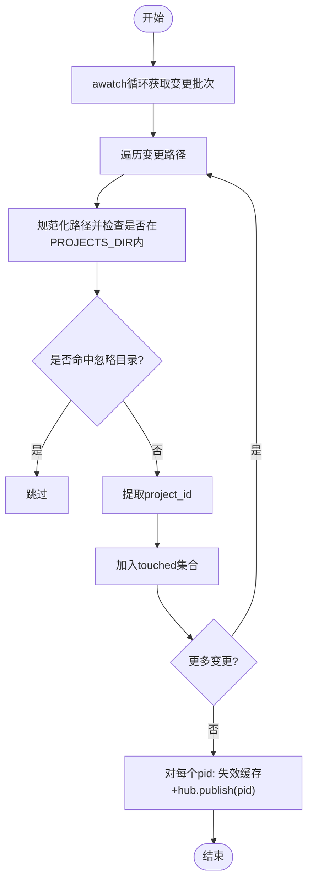
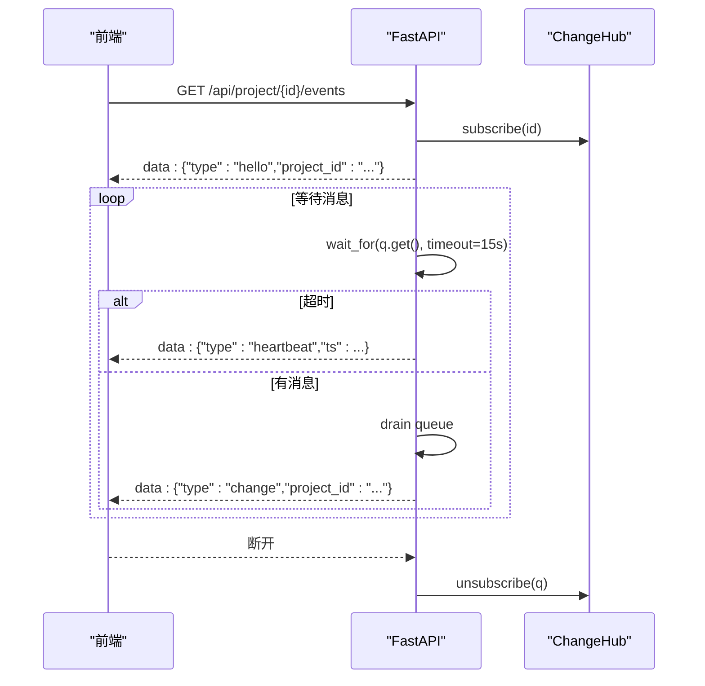
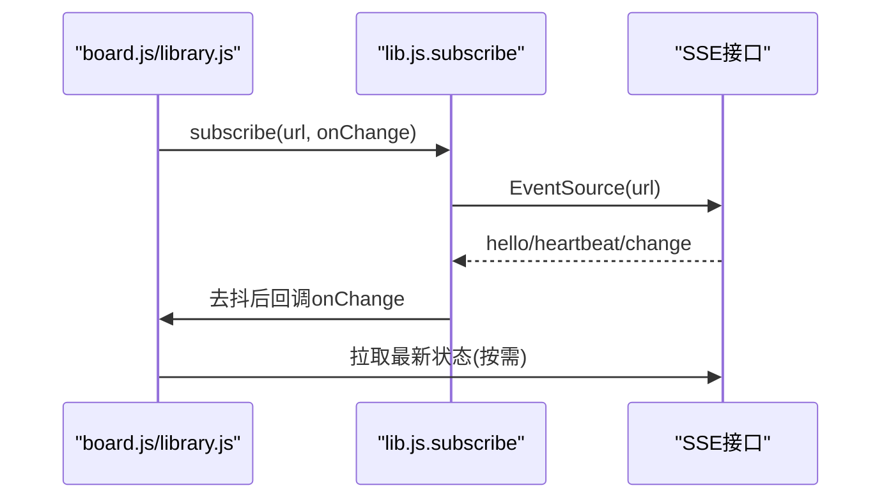
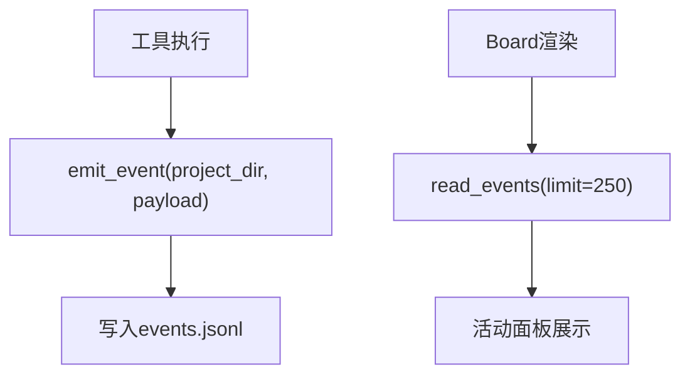
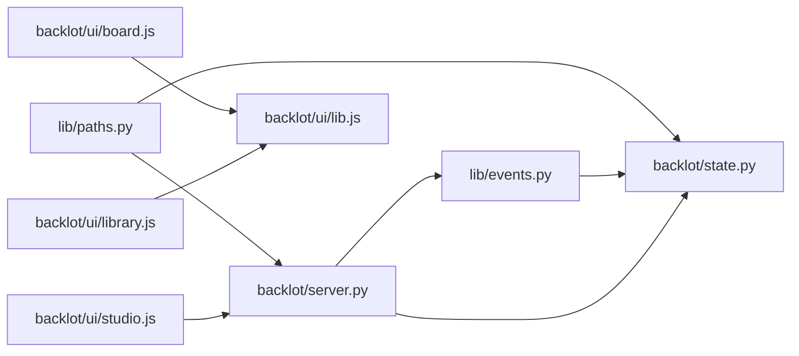

# 事件驱动架构

<cite>
**本文引用的文件**   
- [server.py](file://backlot/server.py)
- [events.py](file://lib/events.py)
- [state.py](file://backlot/state.py)
- [paths.py](file://lib/paths.py)
- [__main__.py](file://backlot/__main__.py)
- [board.js](file://backlot/ui/board.js)
- [library.js](file://backlot/ui/library.js)
- [studio.js](file://backlot/ui/studio.js)
- [lib.js](file://backlot/ui/lib.js)
</cite>

## 目录
1. [简介](#简介)
2. [项目结构](#项目结构)
3. [核心组件](#核心组件)
4. [架构总览](#架构总览)
5. [详细组件分析](#详细组件分析)
6. [依赖关系分析](#依赖关系分析)
7. [性能考量](#性能考量)
8. [故障排除指南](#故障排除指南)
9. [结论](#结论)

## 简介
本文件面向OpenMontage-MV的Backlot子系统，系统性阐述其事件驱动架构与SSE（Server-Sent Events）实时通信机制。重点包括：
- ChangeHub类的扇出模式、订阅管理与消息分发
- 基于watchfiles的文件监控如何触发事件流
- 前后端的事件同步策略（心跳、去抖、重连）
- 错误处理与连接管理
- 从“文件变更”到“前端更新”的完整数据流时序图与流程图
- 性能优化建议与常见问题排查

## 项目结构
Backlot以FastAPI为Web框架，提供REST API与SSE事件流；通过watchfiles监听projects目录变更，将变更广播给所有订阅者；前端使用EventSource订阅SSE并刷新UI。

图表来源
- [server.py:151-243](file://backlot/server.py#L151-L243)
- [server.py:132-149](file://backlot/server.py#L132-L149)
- [state.py:586-656](file://backlot/state.py#L586-L656)
- [events.py:77-96](file://lib/events.py#L77-L96)
- [board.js:1220-1229](file://backlot/ui/board.js#L1220-L1229)
- [library.js:88-92](file://backlot/ui/library.js#L88-L92)
- [studio.js:263-279](file://backlot/ui/studio.js#L263-L279)
- [lib.js:66-81](file://backlot/ui/lib.js#L66-L81)

章节来源
- [server.py:1-504](file://backlot/server.py#L1-L504)
- [state.py:1-714](file://backlot/state.py#L1-L714)
- [events.py:1-119](file://lib/events.py#L1-L119)
- [paths.py:1-18](file://lib/paths.py#L1-L18)
- [__main__.py:1-145](file://backlot/__main__.py#L1-L145)
- [board.js:1-1229](file://backlot/ui/board.js#L1-L1229)
- [library.js:1-92](file://backlot/ui/library.js#L1-L92)
- [studio.js:1-440](file://backlot/ui/studio.js#L1-L440)
- [lib.js:1-104](file://backlot/ui/lib.js#L1-L104)

## 核心组件
- ChangeHub：按项目过滤的扇出中心，维护每个订阅者的队列，支持按project_id精准投递，避免无关项目风暴。
- watchfiles监听器：后台协程持续扫描projects目录，合并批量变更，仅对受影响的项目发布通知。
- SSE接口：/api/project/{id}/events与/api/library/events，统一返回text/event-stream，包含hello、heartbeat、change三类消息。
- 状态聚合：load_board_state与summarize_project负责读取checkpoint、artifacts、events等，生成BoardState供前端渲染。
- 事件日志：lib/events.py提供emit_event/read_events，工具层写入events.jsonl，Board侧用于活动面板展示。
- 前端订阅：board.js与library.js通过lib.js的subscribe封装EventSource，自动去抖与重连。

章节来源
- [server.py:43-74](file://backlot/server.py#L43-L74)
- [server.py:132-149](file://backlot/server.py#L132-L149)
- [server.py:185-243](file://backlot/server.py#L185-L243)
- [state.py:586-656](file://backlot/state.py#L586-L656)
- [events.py:77-119](file://lib/events.py#L77-L119)
- [lib.js:66-81](file://backlot/ui/lib.js#L66-L81)
- [board.js:1220-1229](file://backlot/ui/board.js#L1220-L1229)
- [library.js:88-92](file://backlot/ui/library.js#L88-L92)

## 架构总览
下图展示了从文件系统变更到前端刷新的端到端流程，以及SSE心跳与重连机制。

图表来源
- [server.py:132-149](file://backlot/server.py#L132-L149)
- [server.py:185-214](file://backlot/server.py#L185-L214)
- [server.py:216-243](file://backlot/server.py#L216-L243)
- [lib.js:66-81](file://backlot/ui/lib.js#L66-L81)
- [board.js:1220-1229](file://backlot/ui/board.js#L1220-L1229)

## 详细组件分析

### ChangeHub：扇出与订阅管理
- 设计要点
  - 每个订阅者对应一个asyncio.Queue（最大容量64），防止内存无限增长。
  - subscribe(project_id?)可订阅特定项目或全量库事件。
  - publish(project_id)遍历所有订阅者，若订阅了特定项目则仅投递匹配项。
  - QueueFull时丢弃重复消息，因为已有pending唤醒足以触发一次刷新。
- 复杂度
  - 订阅O(1)，发布O(N)（N为订阅者数量）。
  - 队列操作均摊O(1)。
- 错误处理
  - put_nowait失败直接忽略，保证高吞吐下不阻塞。

图表来源
- [server.py:43-74](file://backlot/server.py#L43-L74)

章节来源
- [server.py:43-74](file://backlot/server.py#L43-L74)

### 文件监控与事件触发（watchfiles）
- 工作流
  - 启动时创建后台任务_watch_projects()。
  - awatch(PROJECTS_DIR, recursive=True, step=400)批量获取变更。
  - 对每条变更路径进行规范化与白名单过滤，提取project_id。
  - 去重后调用_invalidate_summary(pid)与hub.publish(pid)。
- 关键实现点
  - _project_of_change使用字符串比较快速判断是否属于projects根目录及忽略目录。
  - 批量变更场景下，touched集合确保每个项目只发布一次。
- 性能考虑
  - 避免在热路径中进行文件系统I/O，仅做字符串比较与集合操作。

图表来源
- [server.py:111-149](file://backlot/server.py#L111-L149)

章节来源
- [server.py:111-149](file://backlot/server.py#L111-L149)

### SSE接口与心跳机制
- 接口定义
  - /api/project/{project_id}/events：按项目订阅，首条hello携带project_id。
  - /api/library/events：全局订阅，change消息携带project_id。
- 心跳
  - 每15秒若无新消息，发送heartbeat，保持连接存活。
- 去抖与批处理
  - 收到一条change后，清空队列中其余条目，避免频繁刷新。
- 连接生命周期
  - 请求断开时立即unsubscribe，释放资源。

图表来源
- [server.py:185-214](file://backlot/server.py#L185-L214)
- [server.py:216-243](file://backlot/server.py#L216-L243)

章节来源
- [server.py:185-243](file://backlot/server.py#L185-L243)

### 前端订阅与同步策略
- lib.js.subscribe
  - 使用EventSource建立SSE连接。
  - 解析data.type，仅处理change类型。
  - 250ms去抖，避免短时间内多次刷新。
  - onerror由浏览器自动重连，无需手动处理。
- board.js
  - 进入项目板时订阅/api/project/{id}/events。
  - change事件触发refresh()拉取最新状态。
- library.js
  - 订阅/api/library/events，变化后重新渲染项目卡片网格。
- studio.js
  - 独立SSE通道/api/chat/{session_id}/events，用于会话事件流，具备seq去重与历史回放能力。

图表来源
- [lib.js:66-81](file://backlot/ui/lib.js#L66-L81)
- [board.js:1220-1229](file://backlot/ui/board.js#L1220-L1229)
- [library.js:88-92](file://backlot/ui/library.js#L88-L92)
- [studio.js:263-279](file://backlot/ui/studio.js#L263-L279)

章节来源
- [lib.js:66-81](file://backlot/ui/lib.js#L66-L81)
- [board.js:1220-1229](file://backlot/ui/board.js#L1220-L1229)
- [library.js:88-92](file://backlot/ui/library.js#L88-L92)
- [studio.js:263-279](file://backlot/ui/studio.js#L263-L279)

### 状态聚合与事件日志
- state.load_board_state
  - 读取checkpoint、history、artifacts、events等，组装BoardState。
  - 计算stages、storyboard、media、cost、live/idle状态。
- events.emit_event/read_events
  - emit_event追加一行JSON到events.jsonl，线程安全写锁。
  - read_events容错解析，忽略损坏行。

图表来源
- [events.py:77-119](file://lib/events.py#L77-L119)
- [state.py:586-656](file://backlot/state.py#L586-L656)

章节来源
- [events.py:77-119](file://lib/events.py#L77-L119)
- [state.py:586-656](file://backlot/state.py#L586-L656)

## 依赖关系分析
- server.py依赖：
  - backlot.state（状态聚合）、lib.events（事件日志）、watchfiles（文件监控）、fastapi（HTTP/SSE）。
- 前端依赖：
  - board.js/library.js依赖lib.js的subscribe封装。
  - studio.js独立处理会话事件流。
- 路径与配置：
  - lib.paths.py提供REPO_ROOT与PROJECTS_DIR，作为系统唯一真实路径源。
  - __main__.py提供CLI入口，默认绑定回环地址，可通过环境变量暴露。

图表来源
- [paths.py:1-18](file://lib/paths.py#L1-L18)
- [server.py:151-243](file://backlot/server.py#L151-L243)
- [state.py:1-714](file://backlot/state.py#L1-L714)
- [events.py:1-119](file://lib/events.py#L1-L119)
- [board.js:1-1229](file://backlot/ui/board.js#L1-L1229)
- [library.js:1-92](file://backlot/ui/library.js#L1-L92)
- [studio.js:1-440](file://backlot/ui/studio.js#L1-L440)

章节来源
- [paths.py:1-18](file://lib/paths.py#L1-L18)
- [server.py:151-243](file://backlot/server.py#L151-L243)
- [state.py:1-714](file://backlot/state.py#L1-L714)
- [events.py:1-119](file://lib/events.py#L1-L119)
- [board.js:1-1229](file://backlot/ui/board.js#L1-L1229)
- [library.js:1-92](file://backlot/ui/library.js#L1-L92)
- [studio.js:1-440](file://backlot/ui/studio.js#L1-L440)

## 性能考量
- 文件监控
  - 使用字符串比较与集合去重，避免每次变更都触发昂贵I/O。
  - step=400批量处理，降低awatch回调频率。
- 扇出与队列
  - 每个订阅者队列上限64，防止内存膨胀；满队列丢弃重复消息，利用pending唤醒保证最终一致性。
- SSE心跳
  - 15秒心跳维持长连接，减少空闲连接被中间设备断开的概率。
- 前端去抖
  - 250ms去抖避免短时间内的重复刷新，降低网络与渲染压力。
- 状态缓存
  - _summary_cache缓存项目摘要，变更时失效，避免全量解析大文件。
- 缩略图缓存
  - 基于SHA1与文件大小/时间戳生成缓存键，并发安全临时文件避免竞态。

章节来源
- [server.py:111-149](file://backlot/server.py#L111-L149)
- [server.py:43-74](file://backlot/server.py#L43-L74)
- [server.py:185-214](file://backlot/server.py#L185-L214)
- [lib.js:66-81](file://backlot/ui/lib.js#L66-L81)
- [server.py:85-109](file://backlot/server.py#L85-L109)
- [server.py:460-501](file://backlot/server.py#L460-L501)

## 故障排除指南
- SSE连接未建立
  - 检查服务器健康接口/api/health是否可达。
  - 确认防火墙/代理未拦截text/event-stream。
  - 查看浏览器控制台是否有EventSource错误；默认会自动重连。
- 收不到change消息
  - 确认订阅的是正确的project_id或全局库事件。
  - 检查watchfiles是否可用（缺失时降级为手动刷新）。
  - 验证PROJECTS_DIR是否正确，路径规范化是否命中忽略目录。
- 心跳频繁但无数据
  - 可能处于空闲状态，属正常行为；确认是否有文件变更。
- 前端重复刷新
  - 检查lib.js.subscribe的去抖逻辑是否生效；确认服务端未发送重复change。
- 缩略图加载失败
  - 非图片/视频格式会返回None；视频需ffmpeg可用；确认目标文件存在且路径安全校验通过。
- 会话事件不同步
  - 检查after参数与seq去重逻辑；确认服务端会话事件流是否正常。

章节来源
- [__main__.py:35-41](file://backlot/__main__.py#L35-L41)
- [server.py:132-138](file://backlot/server.py#L132-L138)
- [server.py:111-149](file://backlot/server.py#L111-L149)
- [lib.js:66-81](file://backlot/ui/lib.js#L66-L81)
- [server.py:329-347](file://backlot/server.py#L329-L347)
- [studio.js:263-279](file://backlot/ui/studio.js#L263-L279)

## 结论
OpenMontage-MV的Backlot子系统通过ChangeHub的扇出模式与watchfiles的文件监控，构建了高效、可扩展的SSE实时事件通道。前后端采用轻量协议（hello/heartbeat/change）与浏览器原生EventSource，结合去抖与心跳，实现了稳定可靠的实时同步。状态聚合与事件日志分离，保证了可读性与可观测性。整体架构简洁清晰，具备良好的性能与可维护性，适合大规模项目协作与实时可视化需求。