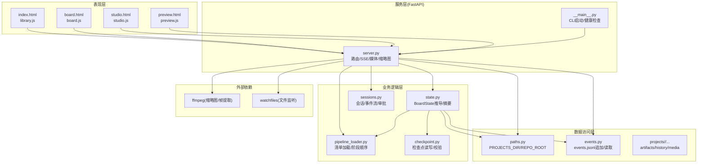
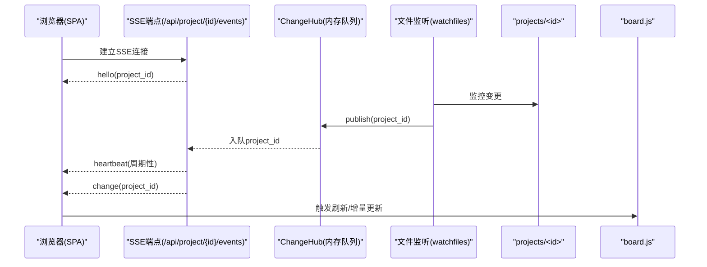
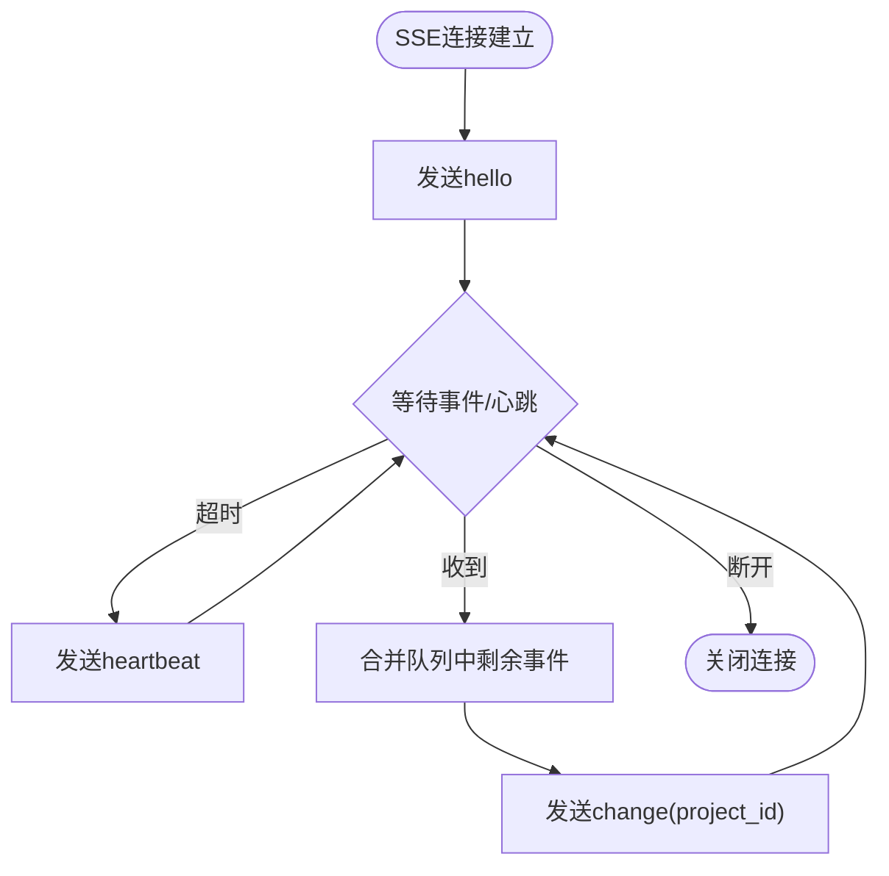
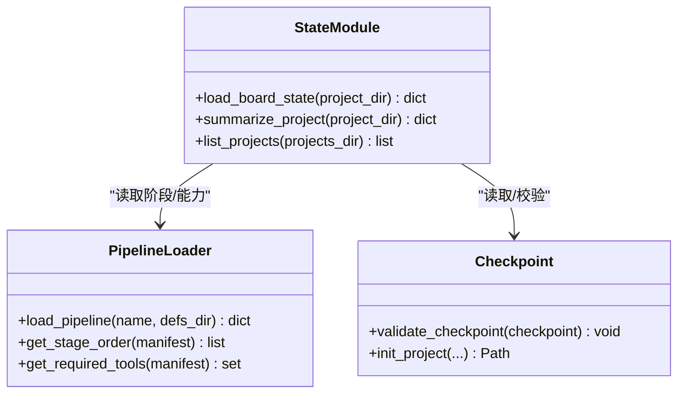
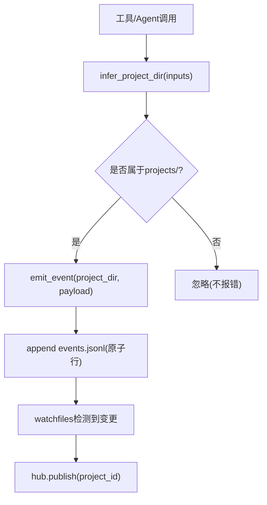
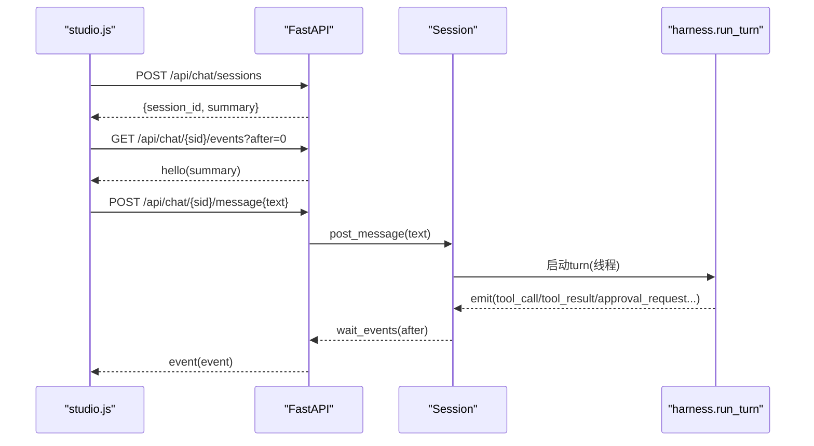
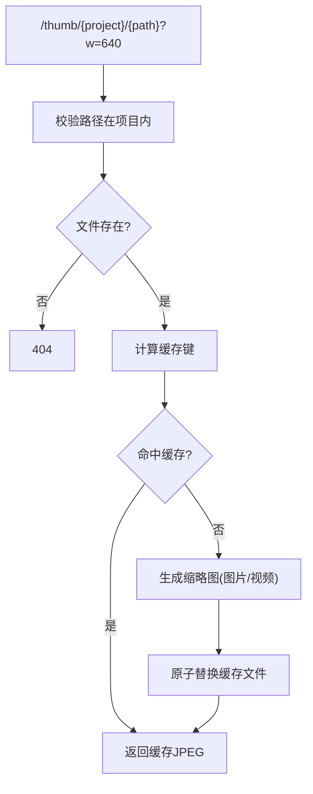
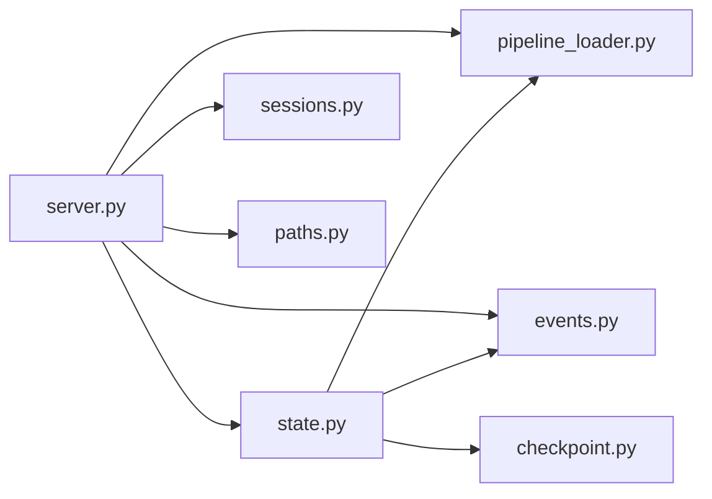
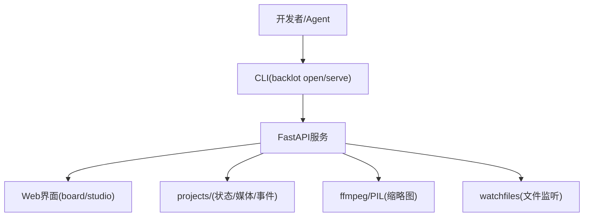
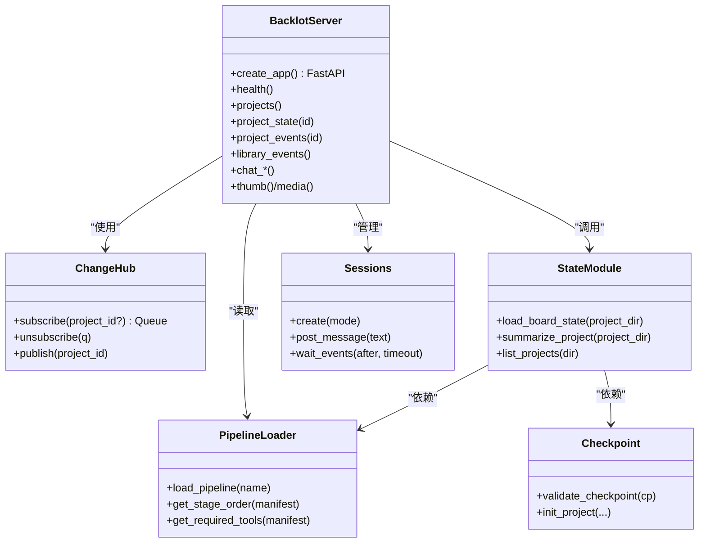

# 核心架构

<cite>
**本文引用的文件**   
- [backlot/__main__.py](file://backlot/__main__.py)
- [backlot/server.py](file://backlot/server.py)
- [backlot/state.py](file://backlot/state.py)
- [lib/events.py](file://lib/events.py)
- [lib/paths.py](file://lib/paths.py)
- [lib/pipeline_loader.py](file://lib/pipeline_loader.py)
- [pipeline_defs/music-video.yaml](file://pipeline_defs/music-video.yaml)
- [config.yaml](file://config.yaml)
- [backlot/ui/board.js](file://backlot/ui/board.js)
- [backlot/ui/studio.js](file://backlot/ui/studio.js)
- [backlot/agent/sessions.py](file://backlot/agent/sessions.py)
- [lib/checkpoint.py](file://lib/checkpoint.py)
</cite>

## 目录
1. [简介](#简介)
2. [项目结构](#项目结构)
3. [核心组件](#核心组件)
4. [架构总览](#架构总览)
5. [详细组件分析](#详细组件分析)
6. [依赖关系分析](#依赖关系分析)
7. [性能考量](#性能考量)
8. [故障排查指南](#故障排查指南)
9. [结论](#结论)
10. [附录](#附录)

## 简介
本文件面向OpenMontage-MV的“Backlot”子系统，系统化阐述其高层设计、架构模式与系统边界。重点包括：
- 事件驱动架构与SSE实时通信机制的实现
- 分层架构：表现层（Web界面）、业务逻辑层（状态管理、流水线编排）、数据访问层（文件系统、持久化）
- 组件交互、数据流与集成模式
- 技术决策、权衡与约束
- 基础设施需求、可扩展性与部署拓扑

## 项目结构
OpenMontage-MV采用“后端服务 + 前端SPA + 文件系统即状态”的结构：
- backlot：FastAPI服务、UI静态资源、CLI入口、会话管理
- lib：路径与事件、流水线清单加载、检查点读写等通用库
- pipeline_defs：以YAML声明的流水线定义
- schemas：JSON Schema校验规则
- tools：音视频处理工具集
- config.yaml：运行时配置



图表来源
- [backlot/server.py:151-406](file://backlot/server.py#L151-L406)
- [backlot/state.py:586-656](file://backlot/state.py#L586-L656)
- [lib/pipeline_loader.py:49-70](file://lib/pipeline_loader.py#L49-L70)
- [lib/checkpoint.py:178-200](file://lib/checkpoint.py#L178-L200)
- [lib/paths.py:13-18](file://lib/paths.py#L13-L18)
- [lib/events.py:77-119](file://lib/events.py#L77-L119)

章节来源
- [backlot/__main__.py:1-145](file://backlot/__main__.py#L1-L145)
- [backlot/server.py:1-504](file://backlot/server.py#L1-L504)
- [backlot/state.py:1-714](file://backlot/state.py#L1-L714)
- [lib/events.py:1-119](file://lib/events.py#L1-L119)
- [lib/paths.py:1-18](file://lib/paths.py#L1-L18)
- [lib/pipeline_loader.py:1-241](file://lib/pipeline_loader.py#L1-L241)
- [pipeline_defs/music-video.yaml:1-187](file://pipeline_defs/music-video.yaml#L1-L187)
- [config.yaml:1-20](file://config.yaml#L1-L20)

## 核心组件
- FastAPI应用与路由：提供REST API、SSE事件流、静态页面与媒体服务
- 变更中心ChangeHub：基于内存队列的扇出通知，按项目过滤，避免无关广播
- 文件系统监听器：使用watchfiles异步监听projects目录变化，去抖后发布事件
- BoardState推导：从checkpoints、artifacts、events、media扫描生成可渲染状态
- 流水线清单加载：YAML清单+JSON Schema校验，缓存并导出阶段顺序与能力
- 检查点系统：写入/校验checkpoint，维护历史版本，支撑恢复与治理
- 会话与会话事件：线程安全的事件流、审批、中断、持久化到.jsonl
- 缩略图与媒体服务：按需生成缩略图并缓存，支持Range请求

章节来源
- [backlot/server.py:43-74](file://backlot/server.py#L43-L74)
- [backlot/server.py:132-149](file://backlot/server.py#L132-L149)
- [backlot/state.py:586-656](file://backlot/state.py#L586-L656)
- [lib/pipeline_loader.py:27-46](file://lib/pipeline_loader.py#L27-L46)
- [lib/checkpoint.py:140-172](file://lib/checkpoint.py#L140-L172)
- [backlot/agent/sessions.py:36-115](file://backlot/agent/sessions.py#L36-L115)

## 架构总览
系统采用“事件驱动 + 文件系统即状态”的分层架构：
- 表现层：纯前端SPA，通过SSE订阅实时事件，轮询或增量更新UI
- 业务逻辑层：状态推导、流水线编排、会话管理与审批
- 数据访问层：对projects目录的只读解析与append-only事件写入



图表来源
- [backlot/server.py:185-214](file://backlot/server.py#L185-L214)
- [backlot/server.py:132-149](file://backlot/server.py#L132-L149)
- [backlot/ui/board.js:1-200](file://backlot/ui/board.js#L1-L200)

## 详细组件分析

### 事件驱动与SSE实时通信
- ChangeHub：为每个订阅者分配独立队列，支持按project_id过滤；队列满时丢弃多余消息，保证关键通知不阻塞
- 文件监听：awatch递归监听projects目录，忽略噪声目录，聚合变更并调用hub.publish
- SSE端点：/api/project/{id}/events与/api/library/events，心跳保活，批量合并burst，断线自动重连由客户端处理
- 会话事件：/api/chat/{session_id}/events，带seq游标，支持回放与去重



图表来源
- [backlot/server.py:185-214](file://backlot/server.py#L185-L214)
- [backlot/server.py:216-242](file://backlot/server.py#L216-L242)
- [backlot/server.py:302-325](file://backlot/server.py#L302-L325)

章节来源
- [backlot/server.py:43-74](file://backlot/server.py#L43-L74)
- [backlot/server.py:132-149](file://backlot/server.py#L132-L149)
- [backlot/server.py:185-242](file://backlot/server.py#L185-L242)
- [backlot/server.py:302-325](file://backlot/server.py#L302-L325)

### 分层架构：表现层（Web界面）
- board.js：渲染BoardState，展示阶段轨道、成本进度、场景卡片、媒体播放；通过SSE保持实时
- studio.js：聊天工作台，渲染用户/助手消息、工具调用卡、待办、审批按钮；通过SSE接收会话事件
- 静态资源：HTML/CSS/JS由FastAPI提供，带no-cache中间件确保开发期热更新

```mermaid
classDiagram
class BoardJS {
+renderSlate(state)
+renderRail(state)
+toggleDrawer(stageName)
+subscribe()
}
class StudioJS {
+postMessage(text)
+onToolCall(data)
+onApprovalRequest(data)
+connectEvents(sessionId)
}
class FastAPI {
+GET /p/{project_id}
+GET /studio
+GET /api/project/{id}/events
+GET /api/chat/{sid}/events
}
BoardJS --> FastAPI : "SSE/REST"
StudioJS --> FastAPI : "SSE/REST"
```

图表来源
- [backlot/ui/board.js:1-200](file://backlot/ui/board.js#L1-L200)
- [backlot/ui/studio.js:1-200](file://backlot/ui/studio.js#L1-L200)
- [backlot/server.py:365-406](file://backlot/server.py#L365-L406)

章节来源
- [backlot/ui/board.js:1-200](file://backlot/ui/board.js#L1-L200)
- [backlot/ui/studio.js:1-200](file://backlot/ui/studio.js#L1-L200)
- [backlot/server.py:365-406](file://backlot/server.py#L365-L406)

### 业务逻辑层：状态管理与流水线编排
- BoardState推导：汇总marker/meta、checkpoints、history、artifacts、events、media，计算live/stalled/cost/poster
- 流水线清单：YAML描述阶段、产物、工具、人类审批默认值；加载时进行JSON Schema校验，结果缓存
- 检查点：写入/校验checkpoint，维护历史版本，支撑恢复与治理；stage→canonical artifact映射严格校验



图表来源
- [backlot/state.py:586-656](file://backlot/state.py#L586-L656)
- [lib/pipeline_loader.py:49-70](file://lib/pipeline_loader.py#L49-L70)
- [lib/checkpoint.py:140-172](file://lib/checkpoint.py#L140-L172)

章节来源
- [backlot/state.py:586-656](file://backlot/state.py#L586-L656)
- [lib/pipeline_loader.py:49-70](file://lib/pipeline_loader.py#L49-L70)
- [lib/checkpoint.py:140-172](file://lib/checkpoint.py#L140-L172)

### 数据访问层：文件系统与持久化
- 路径统一：REPO_ROOT与PROJECTS_DIR作为单一事实源，环境变量覆盖
- 事件日志：events.jsonl追加写，线程锁保护单进程并发；读取容忍损坏行
- 媒体与缩略图：/media直接返回文件（Range），/thumb按需缩放/抽帧并缓存JPEG



图表来源
- [lib/paths.py:13-18](file://lib/paths.py#L13-L18)
- [lib/events.py:46-95](file://lib/events.py#L46-L95)
- [backlot/server.py:132-149](file://backlot/server.py#L132-L149)

章节来源
- [lib/paths.py:13-18](file://lib/paths.py#L13-L18)
- [lib/events.py:46-95](file://lib/events.py#L46-L95)
- [backlot/server.py:329-361](file://backlot/server.py#L329-L361)

### 会话与会话事件（Studio）
- Session类：线程安全的事件追加、条件变量等待、审批等待、中断信号
- 会话持久化：.jsonl记录元数据、消息、事件；重启后可重建会话
- Web接口：创建/删除会话、发消息、审批、中断、事件流



图表来源
- [backlot/agent/sessions.py:182-200](file://backlot/agent/sessions.py#L182-L200)
- [backlot/server.py:252-325](file://backlot/server.py#L252-L325)

章节来源
- [backlot/agent/sessions.py:36-115](file://backlot/agent/sessions.py#L36-L115)
- [backlot/server.py:252-325](file://backlot/server.py#L252-L325)

### 缩略图与媒体服务
- 缩略图策略：图片缩放、视频抽帧，SHA1键+时间戳/大小生成缓存文件名，并发安全临时文件
- 媒体服务：FileResponse原生支持Range，适合大文件流式传输



图表来源
- [backlot/server.py:329-347](file://backlot/server.py#L329-L347)
- [backlot/server.py:460-500](file://backlot/server.py#L460-L500)

章节来源
- [backlot/server.py:329-347](file://backlot/server.py#L329-L347)
- [backlot/server.py:460-500](file://backlot/server.py#L460-L500)

## 依赖关系分析
- 模块耦合：server依赖state、pipeline_loader、sessions、paths、events；state依赖paths、events、pipeline_loader、checkpoint
- 外部依赖：watchfiles用于文件监听，ffmpeg用于缩略图，PIL用于图片处理
- 无循环依赖：各层职责清晰，单向依赖



图表来源
- [backlot/server.py:151-406](file://backlot/server.py#L151-L406)
- [backlot/state.py:586-656](file://backlot/state.py#L586-L656)

章节来源
- [backlot/server.py:151-406](file://backlot/server.py#L151-L406)
- [backlot/state.py:586-656](file://backlot/state.py#L586-L656)

## 性能考量
- 事件风暴抑制：ChangeHub队列限长，合并burst，避免频繁刷新
- 文件系统监听优化：忽略噪声目录，字符串比较快速定位项目
- 摘要缓存：_cached_summaries缓存项目摘要，变更时失效
- 缩略图缓存：按内容哈希缓存，减少重复计算
- 媒体流式：FileResponse原生Range，降低带宽与内存占用
- 心跳保活：SSE心跳防止代理/浏览器超时

[本节为通用指导，无需特定文件引用]

## 故障排查指南
- 服务器未启动：CLI会尝试后台启动并轮询健康端点；失败则继续运行但不显示看板
- SSE断连：客户端应重连；服务端每15秒心跳，断线检测及时释放资源
- 项目不存在：_safe_project_dir校验并返回404
- 缩略图不可用：非图像/视频格式或ffmpeg失败将返回404或回退原始文件
- 事件丢失：events.jsonl可能因并发写入出现损坏行，读取时会跳过

章节来源
- [backlot/__main__.py:81-107](file://backlot/__main__.py#L81-L107)
- [backlot/server.py:185-214](file://backlot/server.py#L185-L214)
- [backlot/server.py:409-417](file://backlot/server.py#L409-L417)
- [backlot/server.py:329-347](file://backlot/server.py#L329-L347)
- [lib/events.py:98-119](file://lib/events.py#L98-L119)

## 结论
OpenMontage-MV的Backlot子系统以“文件系统即状态”为核心，结合事件驱动与SSE实现低延迟、高吞吐的实时协作体验。分层清晰、扩展性强，适合多项目并行与复杂流水线编排。通过严格的清单校验与检查点治理，保障生产可用性与可追溯性。

[本节为总结，无需特定文件引用]

## 附录

### 系统上下文图


图表来源
- [backlot/__main__.py:110-117](file://backlot/__main__.py#L110-L117)
- [backlot/server.py:151-406](file://backlot/server.py#L151-L406)

### 组件分解图


图表来源
- [backlot/server.py:151-406](file://backlot/server.py#L151-L406)
- [backlot/state.py:586-656](file://backlot/state.py#L586-L656)
- [lib/pipeline_loader.py:49-70](file://lib/pipeline_loader.py#L49-L70)
- [lib/checkpoint.py:140-172](file://lib/checkpoint.py#L140-L172)
- [backlot/agent/sessions.py:182-200](file://backlot/agent/sessions.py#L182-L200)

### 技术决策与权衡
- 选择SSE而非WebSocket：简单、易调试、天然心跳与重连语义，满足看板与聊天场景
- 文件系统即状态：简化一致性模型，便于备份/迁移与离线分析；代价是IO密集
- 清单驱动流水线：声明式、可验证、可演进；需要维护schema与manifest
- 缩略图缓存：平衡CPU与IO，提升首屏速度；需考虑磁盘空间与过期策略

[本节为概念说明，无需特定文件引用]

### 基础设施需求与部署拓扑
- 运行时依赖：Python环境、ffmpeg、watchfiles、PIL
- 存储：projects目录需稳定挂载，建议SSD以提升IO吞吐
- 网络：仅暴露HTTP端口，建议反向代理(nginx/caddy)做TLS与缓存控制
- 水平扩展：当前ChangeHub为进程内队列，多实例需引入外部消息总线(如Redis Pub/Sub)

[本节为通用指导，无需特定文件引用]