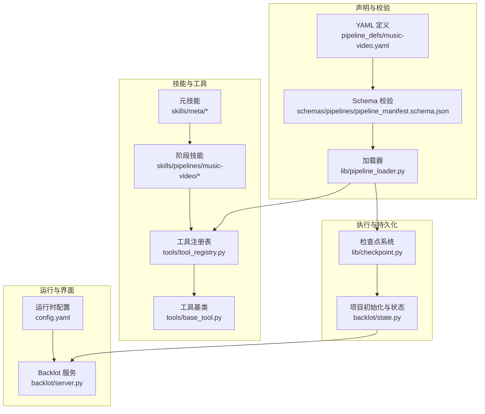
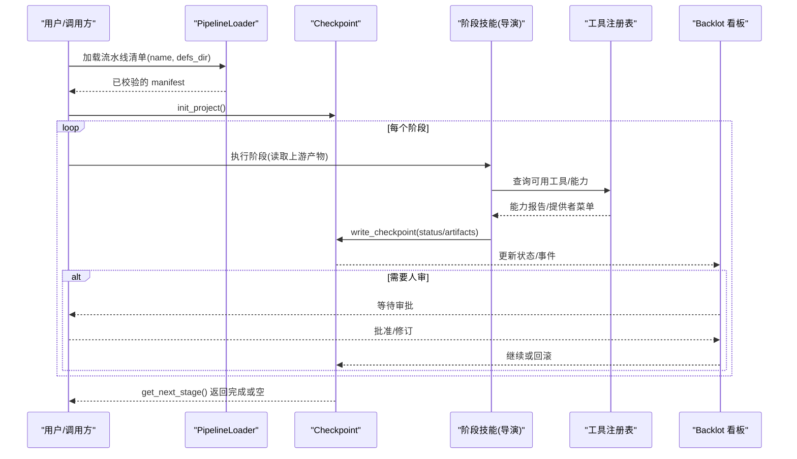
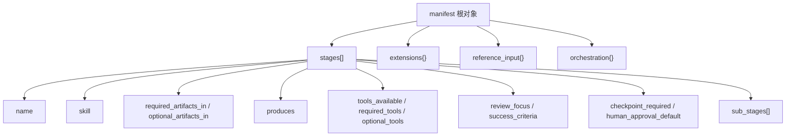
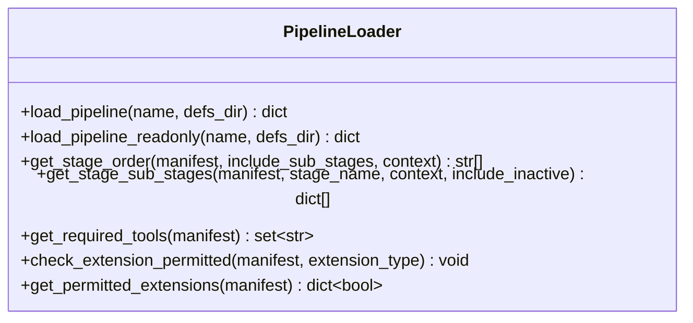
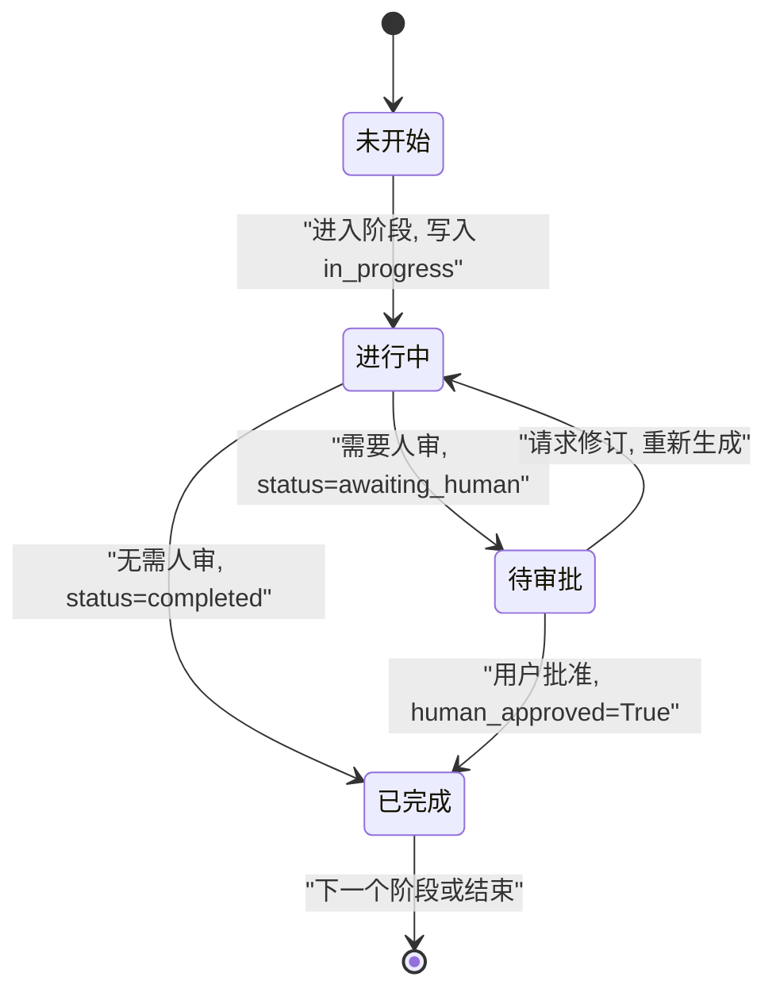
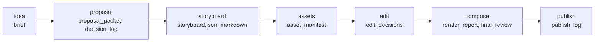
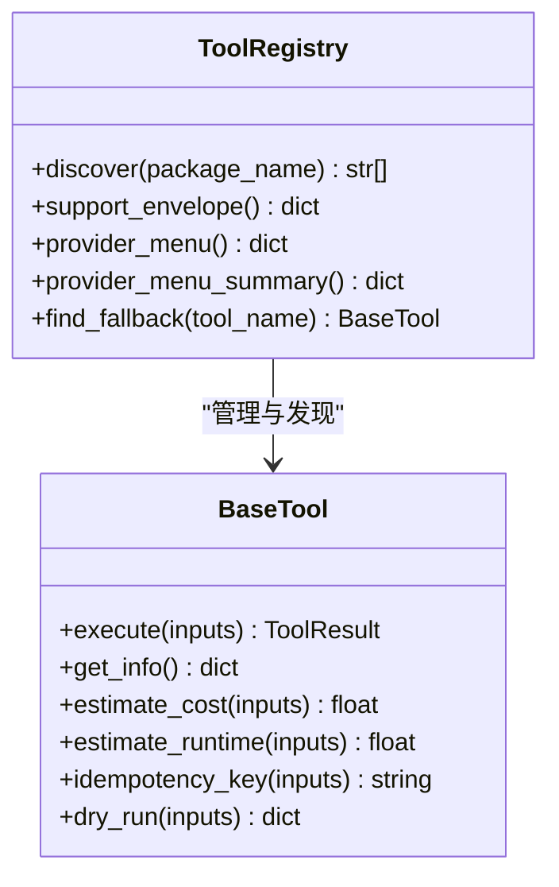
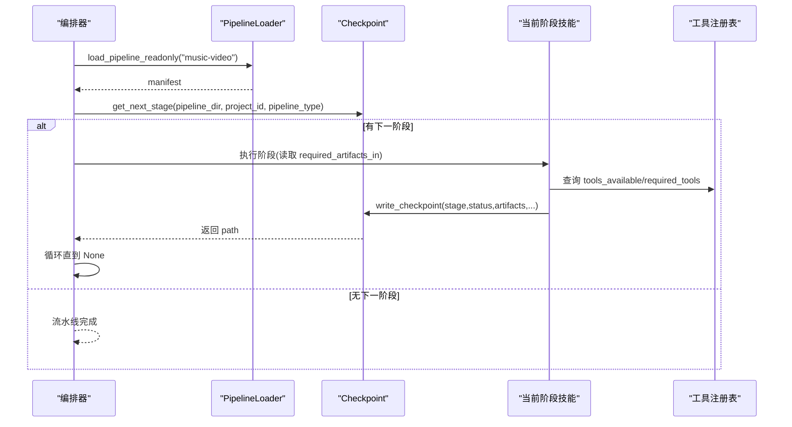
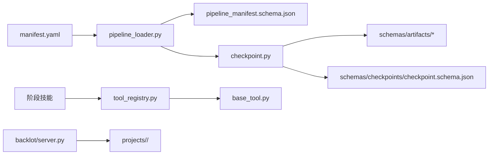

# 流水线编排系统

<cite>
**本文引用的文件**   
- [pipeline_loader.py](file://lib/pipeline_loader.py)
- [music-video.yaml](file://pipeline_defs/music-video.yaml)
- [pipeline_manifest.schema.json](file://schemas/pipelines/pipeline_manifest.schema.json)
- [checkpoint.py](file://lib/checkpoint.py)
- [config.yaml](file://config.yaml)
- [checkpoint-protocol.md](file://skills/meta/checkpoint-protocol.md)
- [reviewer.md](file://skills/meta/reviewer.md)
- [idea-director.md](file://skills/pipelines/music-video/idea-director.md)
- [proposal-director.md](file://skills/pipelines/music-video/proposal-director.md)
- [storyboard-director.md](file://skills/pipelines/music-video/storyboard-director.md)
- [asset-director.md](file://skills/pipelines/music-video/asset-director.md)
- [edit-director.md](file://skills/pipelines/music-video/edit-director.md)
- [compose-director.md](file://skills/pipelines/music-video/compose-director.md)
- [tool_registry.py](file://tools/tool_registry.py)
- [base_tool.py](file://tools/base_tool.py)
- [server.py](file://backlot/server.py)
</cite>

## 目录
1. [简介](#简介)
2. [项目结构](#项目结构)
3. [核心组件](#核心组件)
4. [架构总览](#架构总览)
5. [详细组件分析](#详细组件分析)
6. [依赖关系分析](#依赖关系分析)
7. [性能考虑](#性能考虑)
8. [故障排查指南](#故障排查指南)
9. [结论](#结论)
10. [附录](#附录)

## 简介
本文件系统化阐述 OpenMontage-MV 的“MV 流水线编排系统”，聚焦以下目标：
- YAML 流水线定义语法与结构（阶段、依赖、执行顺序）
- PipelineLoader 工作机制（加载、解析、上下文管理）
- 7 阶段 MV 制作流程（idea、proposal、storyboard、assets、edit、compose、publish）的职责与输入输出
- 技能（Skills）系统集成与扩展机制
- 流水线执行流程图与状态机图
- 自定义流水线开发与调试指南

## 项目结构
OpenMontage-MV 采用“声明式流水线 + 指令驱动技能”的分层设计：
- 声明式定义：pipeline_defs/*.yaml 描述阶段、产物、工具与策略
- 校验与加载：schemas/pipelines/* 提供 JSON Schema；lib/pipeline_loader.py 负责加载与缓存
- 执行与持久化：lib/checkpoint.py 实现检查点协议、门控与人审
- 技能体系：skills/meta/* 为元技能（评审、检查点协议），skills/pipelines/music-video/* 为各阶段导演技能
- 工具注册：tools/* 提供统一工具契约与发现机制
- 运行时配置：config.yaml 指定默认输出参数与路径
- 可视化与交互：backlot/* 提供看板、SSE 事件流与媒体预览

**图示来源** 
- [music-video.yaml:1-187](file://pipeline_defs/music-video.yaml#L1-L187)
- [pipeline_manifest.schema.json:1-162](file://schemas/pipelines/pipeline_manifest.schema.json#L1-L162)
- [pipeline_loader.py:1-241](file://lib/pipeline_loader.py#L1-L241)
- [checkpoint.py:1-537](file://lib/checkpoint.py#L1-L537)
- [tool_registry.py:1-493](file://tools/tool_registry.py#L1-L493)
- [base_tool.py:1-481](file://tools/base_tool.py#L1-L481)
- [config.yaml:1-20](file://config.yaml#L1-L20)
- [server.py:1-504](file://backlot/server.py#L1-L504)

**章节来源**
- [music-video.yaml:1-187](file://pipeline_defs/music-video.yaml#L1-L187)
- [pipeline_manifest.schema.json:1-162](file://schemas/pipelines/pipeline_manifest.schema.json#L1-L162)
- [pipeline_loader.py:1-241](file://lib/pipeline_loader.py#L1-L241)
- [config.yaml:1-20](file://config.yaml#L1-L20)

## 核心组件
- 流水线清单加载器（PipelineLoader）
  - 职责：读取 YAML、按 Schema 校验、缓存结果、暴露阶段顺序与能力查询接口
  - 关键函数：load_pipeline、get_stage_order、get_stage_sub_stages、get_required_tools、check_extension_permitted
- 检查点系统（Checkpoint）
  - 职责：阶段产物持久化、门控与人审、历史归档、恢复与下一步计算
  - 关键函数：write_checkpoint、read_checkpoint、get_next_stage、validate_checkpoint
- 技能系统（Skills）
  - 元技能：checkpoint-protocol、reviewer
  - 阶段技能：idea、proposal、storyboard、assets、edit、compose、publish
- 工具注册表（ToolRegistry）
  - 职责：自动发现、能力报告、提供者菜单、降级与回退
- 运行时配置（config.yaml）
  - 职责：默认输出格式、编解码、路径等

**章节来源**
- [pipeline_loader.py:1-241](file://lib/pipeline_loader.py#L1-L241)
- [checkpoint.py:1-537](file://lib/checkpoint.py#L1-L537)
- [tool_registry.py:1-493](file://tools/tool_registry.py#L1-L493)
- [base_tool.py:1-481](file://tools/base_tool.py#L1-L481)
- [config.yaml:1-20](file://config.yaml#L1-L20)

## 架构总览
下图展示从 YAML 到执行、再到可视化的端到端数据与控制流。

**图示来源** 
- [pipeline_loader.py:1-241](file://lib/pipeline_loader.py#L1-L241)
- [checkpoint.py:1-537](file://lib/checkpoint.py#L1-L537)
- [tool_registry.py:1-493](file://tools/tool_registry.py#L1-L493)
- [server.py:1-504](file://backlot/server.py#L1-L504)

## 详细组件分析

### YAML 流水线定义语法与结构
- 顶层字段
  - name/version/description/category/stability/default_checkpoint_policy
  - required_skills：该流水线所需的元技能与阶段技能
  - compatible_playbooks：兼容风格剧本策略
  - extensions：能力扩展开关（custom_scripts/playbooks/skills/tools）
  - reference_input：参考视频输入支持（supported/analysis_depth/analysis_tools）
  - orchestration：执行者编排配置（模式、预算、最大轮次等）
- stages 数组
  - name：阶段名
  - skill：指令驱动阶段对应的技能路径
  - required_artifacts_in / optional_artifacts_in：输入产物依赖
  - produces：本阶段产出的产物名
  - tools_available / required_tools / optional_tools：工具能力声明
  - review_focus / success_criteria：评审关注点与成功标准
  - checkpoint_required / human_approval_default：检查点与人审门控
  - sub_stages：子阶段（条件激活，用于样例/预览等）

**图示来源** 
- [pipeline_manifest.schema.json:1-162](file://schemas/pipelines/pipeline_manifest.schema.json#L1-L162)
- [music-video.yaml:1-187](file://pipeline_defs/music-video.yaml#L1-L187)

**章节来源**
- [pipeline_manifest.schema.json:1-162](file://schemas/pipelines/pipeline_manifest.schema.json#L1-L162)
- [music-video.yaml:1-187](file://pipeline_defs/music-video.yaml#L1-L187)

### PipelineLoader 工作机制
- 加载与校验
  - load_pipeline：读取 YAML → jsonschema 校验 → 返回只读 dict
  - _load_manifest_schema：缓存 schema 避免重复 IO
- 缓存与只读访问
  - load_pipeline_readonly：通过 lru_cache 缓存 manifest，供热路径使用
- 阶段与子阶段解析
  - get_stage_order：按 manifest 顺序返回阶段名；可包含 sub_stages（命名 <stage>.<sub_stage>）
  - get_stage_sub_stages：按 context 条件过滤活跃子阶段
- 能力与扩展
  - get_required_tools：汇总 stage/sub_stage/reference_input 的工具集合
  - check_extension_permitted / get_permitted_extensions：强制扩展权限控制

**图示来源** 
- [pipeline_loader.py:1-241](file://lib/pipeline_loader.py#L1-L241)

**章节来源**
- [pipeline_loader.py:1-241](file://lib/pipeline_loader.py#L1-L241)

### 检查点系统与状态机
- 写入与验证
  - write_checkpoint：组装 checkpoint 结构 → 校验 → 原子写入 → 归档旧版本 → 合并 decision_log
  - validate_checkpoint：校验 stage/status/artifacts/schema
- 门控与人审
  - 基于 manifest 的 human_approval_default 强制门控；违规写 completed 将抛出错误
- 恢复与下一步
  - read_checkpoint/get_latest_checkpoint/get_completed_stages/get_next_stage

**图示来源** 
- [checkpoint.py:1-537](file://lib/checkpoint.py#L1-L537)
- [checkpoint-protocol.md:1-201](file://skills/meta/checkpoint-protocol.md#L1-L201)

**章节来源**
- [checkpoint.py:1-537](file://lib/checkpoint.py#L1-L537)
- [checkpoint-protocol.md:1-201](file://skills/meta/checkpoint-protocol.md#L1-L201)

### 7 阶段 MV 制作流程
- idea（创意）
  - 输入：ASS 歌词文件
  - 处理：解析 ASS、三段信号识别段落、风格与情绪判断
  - 输出：brief 产物
  - 工具：ass_parser
  - 参考：[idea-director.md:1-81](file://skills/pipelines/music-video/idea-director.md#L1-L81)
- proposal（提案）
  - 输入：brief
  - 处理：叙事风格匹配、角色匹配、音乐计划、提供者确认、交付形态
  - 输出：proposal_packet、decision_log
  - 参考：[proposal-director.md:1-95](file://skills/pipelines/music-video/proposal-director.md#L1-L95)
- storyboard（分镜）
  - 输入：brief、proposal_packet
  - 处理：≤23 镜头、整数时长 4-15s、连续时间线、八要素 prompt、约束包
  - 输出：storyboard（JSON+Markdown）
  - 参考：[storyboard-director.md:1-93](file://skills/pipelines/music-video/storyboard-director.md#L1-L93)
- assets（素材）
  - 输入：storyboard（可选 proposal_packet）
  - 处理：逐镜头生成 clip、校验时长、回填 assetPath、刷新 partial_progress
  - 输出：asset_manifest
  - 工具：yinghe_video
  - 参考：[asset-director.md:1-63](file://skills/pipelines/music-video/asset-director.md#L1-L63)
- edit（剪辑决策）
  - 输入：storyboard、asset_manifest
  - 处理：按分镜时间线排列、对齐歌曲音频、转场与字幕计划、固定 ffmpeg 运行时
  - 输出：edit_decisions
  - 参考：[edit-director.md:1-58](file://skills/pipelines/music-video/edit-director.md#L1-L58)
- compose（合成）
  - 输入：edit_decisions、asset_manifest、原始 ASS
  - 处理：拼接画面、铺设音轨、烧录 ASS 卡拉 OK、可选调色、ffprobe 校验
  - 输出：render_report、final_review
  - 工具：video_stitch、audio_mixer、color_grade（可选）
  - 参考：[compose-director.md:1-56](file://skills/pipelines/music-video/compose-director.md#L1-L56)
- publish（发布）
  - 输入：render_report、final_review（可选 storyboard）
  - 处理：打包交付物（MV + storyboard.md + storyboard.json）、元数据校验
  - 输出：publish_log
  - 参考：[music-video.yaml:169-187](file://pipeline_defs/music-video.yaml#L169-L187)

**图示来源** 
- [music-video.yaml:36-187](file://pipeline_defs/music-video.yaml#L36-L187)
- [idea-director.md:1-81](file://skills/pipelines/music-video/idea-director.md#L1-L81)
- [proposal-director.md:1-95](file://skills/pipelines/music-video/proposal-director.md#L1-L95)
- [storyboard-director.md:1-93](file://skills/pipelines/music-video/storyboard-director.md#L1-L93)
- [asset-director.md:1-63](file://skills/pipelines/music-video/asset-director.md#L1-L63)
- [edit-director.md:1-58](file://skills/pipelines/music-video/edit-director.md#L1-L58)
- [compose-director.md:1-56](file://skills/pipelines/music-video/compose-director.md#L1-L56)

**章节来源**
- [music-video.yaml:36-187](file://pipeline_defs/music-video.yaml#L36-L187)
- [idea-director.md:1-81](file://skills/pipelines/music-video/idea-director.md#L1-L81)
- [proposal-director.md:1-95](file://skills/pipelines/music-video/proposal-director.md#L1-L95)
- [storyboard-director.md:1-93](file://skills/pipelines/music-video/storyboard-director.md#L1-L93)
- [asset-director.md:1-63](file://skills/pipelines/music-video/asset-director.md#L1-L63)
- [edit-director.md:1-58](file://skills/pipelines/music-video/edit-director.md#L1-L58)
- [compose-director.md:1-56](file://skills/pipelines/music-video/compose-director.md#L1-L56)

### 技能（Skills）系统集成与扩展
- 元技能
  - checkpoint-protocol：规定何时/如何写检查点、人审流程、恢复协议
  - reviewer：质量门禁，CHAI 三原则（准确、完整、建设性），跨 playbook 校验
- 阶段技能
  - 每个 director 文档明确前置资源、处理步骤、产物与检查点要求
- 扩展机制
  - extensions 白名单控制 custom_scripts/playbooks/skills/tools
  - tool_registry 自动发现工具并提供能力报告与提供者菜单
  - base_tool 统一契约（状态、成本估算、重试、幂等、资源画像）

**图示来源** 
- [base_tool.py:1-481](file://tools/base_tool.py#L1-L481)
- [tool_registry.py:1-493](file://tools/tool_registry.py#L1-L493)

**章节来源**
- [checkpoint-protocol.md:1-201](file://skills/meta/checkpoint-protocol.md#L1-L201)
- [reviewer.md:1-203](file://skills/meta/reviewer.md#L1-L203)
- [tool_registry.py:1-493](file://tools/tool_registry.py#L1-L493)
- [base_tool.py:1-481](file://tools/base_tool.py#L1-L481)

### 流水线执行流程图

**图示来源** 
- [pipeline_loader.py:1-241](file://lib/pipeline_loader.py#L1-L241)
- [checkpoint.py:1-537](file://lib/checkpoint.py#L1-L537)
- [tool_registry.py:1-493](file://tools/tool_registry.py#L1-L493)

## 依赖关系分析
- 组件耦合
  - PipelineLoader 与 schemas/pipelines 强耦合（Schema 校验）
  - Checkpoint 与 schemas/artifacts、schemas/checkpoints 强耦合（产物与检查点校验）
  - 阶段技能依赖 tools/* 的能力与状态
  - Backlot 服务仅读取 projects/ 目录，不写入，降低耦合
- 外部依赖
  - ffmpeg（compose 阶段音视频合成）
  - yinghe_video（唯一视频提供者）
  - watchfiles（Backlot 文件监听）

**图示来源** 
- [pipeline_loader.py:1-241](file://lib/pipeline_loader.py#L1-L241)
- [checkpoint.py:1-537](file://lib/checkpoint.py#L1-L537)
- [tool_registry.py:1-493](file://tools/tool_registry.py#L1-L493)
- [base_tool.py:1-481](file://tools/base_tool.py#L1-L481)
- [server.py:1-504](file://backlot/server.py#L1-L504)

**章节来源**
- [pipeline_loader.py:1-241](file://lib/pipeline_loader.py#L1-L241)
- [checkpoint.py:1-537](file://lib/checkpoint.py#L1-L537)
- [tool_registry.py:1-493](file://tools/tool_registry.py#L1-L493)
- [base_tool.py:1-481](file://tools/base_tool.py#L1-L481)
- [server.py:1-504](file://backlot/server.py#L1-L504)

## 性能考虑
- 清单加载缓存：lru_cache 缓存 manifest 与 schema，减少重复 IO 与校验
- 原子写入与归档：write_checkpoint 先写临时文件再替换，避免损坏；归档历史版本
- 增量恢复：in_progress 检查点与 partial_progress 提升长任务容错与续跑效率
- 工具能力预检：provider_menu_summary 聚合能力与安装提示，减少失败重试
- SSE 事件去抖：Backlot 对变更进行批处理与心跳保活，降低前端压力

[本节为通用指导，不直接分析具体文件]

## 故障排查指南
- 常见错误
  - 清单未找到或 Schema 校验失败：检查 pipeline_defs/*.yaml 与 schemas 一致性
  - 门控违规：在 gated 阶段写入 completed 但未设置 human_approved=True
  - 工具不可用：检查 .env 环境变量、二进制依赖、Python 模块是否安装
  - 时长不一致：assets 阶段需 ffprobe 校验 clip 时长并与 storyboard 一致
- 定位方法
  - 查看最近检查点：read_checkpoint/get_latest_checkpoint
  - 查看下一步：get_next_stage 确定卡在哪一阶段
  - 查看决策日志：decision_log.json 审计关键选择
  - 查看 Backlot 事件：/api/project/{id}/events 实时追踪工具调用

**章节来源**
- [checkpoint.py:1-537](file://lib/checkpoint.py#L1-L537)
- [tool_registry.py:1-493](file://tools/tool_registry.py#L1-L493)
- [server.py:1-504](file://backlot/server.py#L1-L504)

## 结论
OpenMontage-MV 以“声明式 YAML + 指令驱动技能 + 严格检查点协议”为核心，实现了高可靠、可恢复、可扩展的 MV 流水线编排。通过严格的 Schema 校验、门控与人审、工具能力注册与提供者菜单，系统在易用性与可控性之间取得平衡。建议在生产环境中启用必要的扩展权限与监控，结合 Backlot 看板进行可视化运维。

[本节为总结，不直接分析具体文件]

## 附录
- 自定义流水线开发步骤
  - 新增 YAML：在 pipeline_defs/ 下创建新清单，遵循 schema
  - 定义阶段：明确 required_artifacts_in、produces、tools_available、review_focus、success_criteria
  - 编写技能：在 skills/pipelines/<pipeline>/ 下为每个阶段编写 director 文档
  - 集成工具：在 tools/ 中实现 BaseTool 子类，并通过 registry 自动发现
  - 配置扩展：在 manifest.extensions 中开启所需能力
- 调试技巧
  - 使用 get_stage_order(include_sub_stages=True) 观察完整阶段序列
  - 在长阶段频繁写入 in_progress 检查点，便于中断恢复
  - 通过 provider_menu_summary 快速定位缺失的环境变量或依赖
  - 借助 Backlot 的 SSE 事件流与媒体预览接口定位问题

[本节为补充说明，不直接分析具体文件]