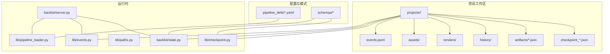
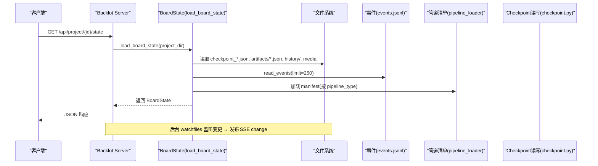
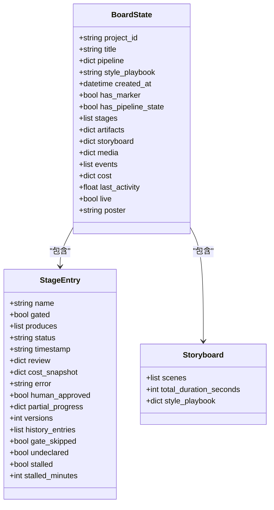
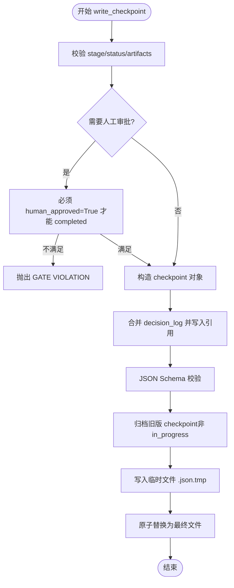
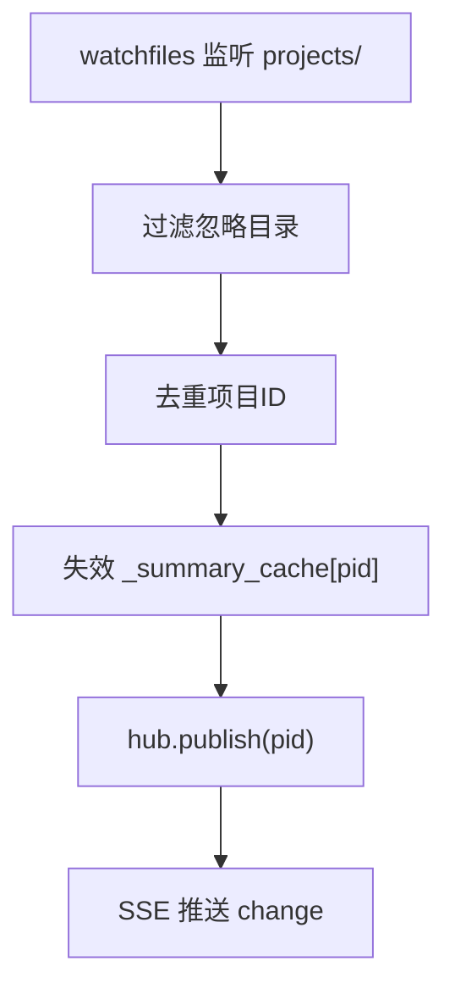
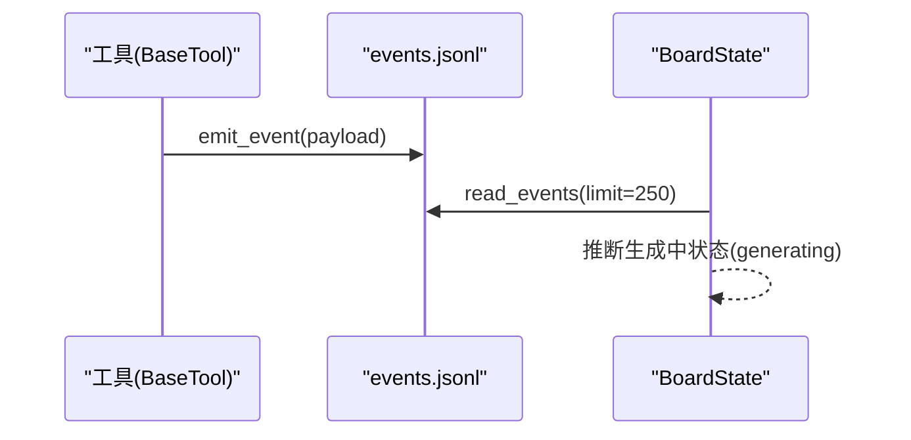
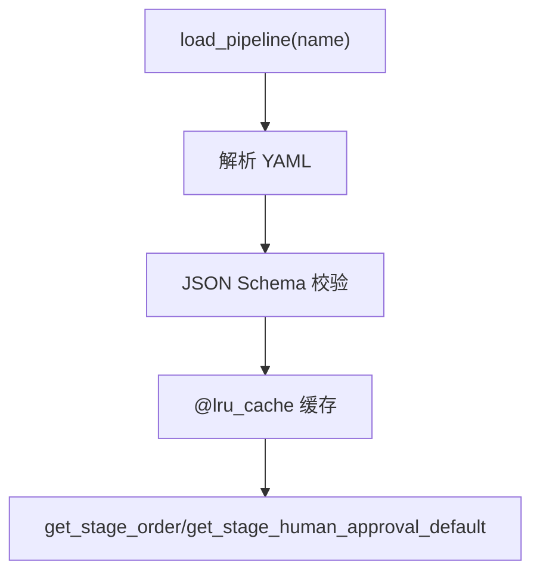
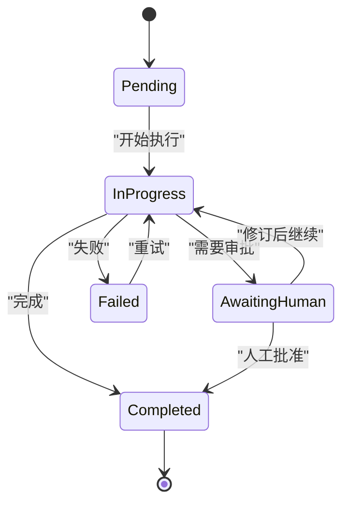
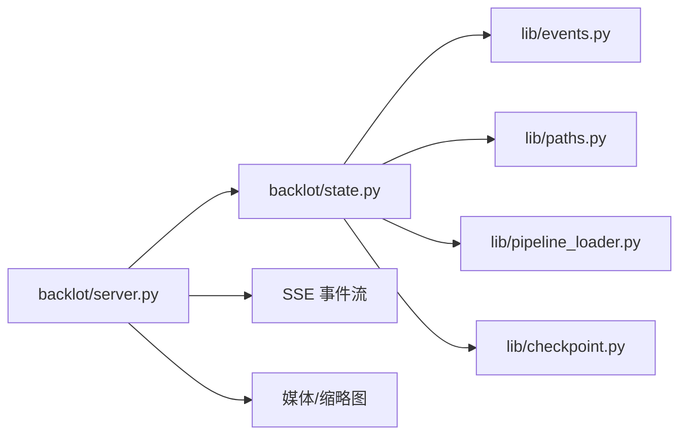

# 状态管理系统

<cite>
**本文引用的文件**   
- [backlot/state.py](file://backlot/state.py)
- [lib/checkpoint.py](file://lib/checkpoint.py)
- [schemas/checkpoints/checkpoint.schema.json](file://schemas/checkpoints/checkpoint.schema.json)
- [skills/meta/checkpoint-protocol.md](file://skills/meta/checkpoint-protocol.md)
- [backlot/server.py](file://backlot/server.py)
- [lib/events.py](file://lib/events.py)
- [lib/paths.py](file://lib/paths.py)
- [schemas/artifacts/__init__.py](file://schemas/artifacts/__init__.py)
- [lib/pipeline_loader.py](file://lib/pipeline_loader.py)
- [pipeline_defs/music-video.yaml](file://pipeline_defs/music-video.yaml)
</cite>

## 目录
1. [简介](#简介)
2. [项目结构](#项目结构)
3. [核心组件](#核心组件)
4. [架构总览](#架构总览)
5. [详细组件分析](#详细组件分析)
6. [依赖关系分析](#依赖关系分析)
7. [性能考量](#性能考量)
8. [故障排查指南](#故障排查指南)
9. [结论](#结论)
10. [附录](#附录)

## 简介
本文件系统化阐述 OpenMontage-MV 的状态管理机制，重点包括：
- BoardState 数据结构的设计与实现：如何从项目目录解析、构建并持久化渲染所需的状态。
- Checkpoint（检查点）协议：状态快照、版本控制、恢复机制与人审门控。
- 文件系统扫描算法、增量更新策略与缓存机制。
- 状态转换图与生命周期管理。
- 并发访问控制、数据一致性与错误恢复策略。
- 状态调试与诊断工具使用方法。

该文档面向不同技术背景的读者，提供由浅入深的说明与可视化图示。

## 项目结构
OpenMontage-MV 的状态系统围绕“项目工作区”展开，核心目录约定如下：
- projects/<project_id>/：每个项目的根目录，包含 checkpoint_*.json、artifacts/*.json、history/、renders/、assets/ 等。
- pipeline_defs/*.yaml：管道清单，声明阶段顺序、产物、门控策略等。
- schemas/*：JSON Schema 校验定义，涵盖 checkpoint、artifact、pipeline manifest 等。
- lib/*：共享库（checkpoint、events、paths、pipeline_loader 等）。
- backlot/*：Backlot 服务与 UI，负责读取状态、提供 API、SSE 事件流与媒体缩略图。

图表来源
- [backlot/state.py:1-714](file://backlot/state.py#L1-L714)
- [lib/checkpoint.py:1-537](file://lib/checkpoint.py#L1-L537)
- [lib/events.py:1-119](file://lib/events.py#L1-L119)
- [lib/paths.py:1-18](file://lib/paths.py#L1-L18)
- [lib/pipeline_loader.py:1-241](file://lib/pipeline_loader.py#L1-L241)
- [backlot/server.py:1-504](file://backlot/server.py#L1-L504)

章节来源
- [backlot/state.py:1-714](file://backlot/state.py#L1-L714)
- [lib/checkpoint.py:1-537](file://lib/checkpoint.py#L1-L537)
- [lib/events.py:1-119](file://lib/events.py#L1-L119)
- [lib/paths.py:1-18](file://lib/paths.py#L1-L18)
- [lib/pipeline_loader.py:1-241](file://lib/pipeline_loader.py#L1-L241)
- [backlot/server.py:1-504](file://backlot/server.py#L1-L504)

## 核心组件
- BoardState：对单个项目目录的只读视图，聚合阶段轨道、制品、故事板、媒体、事件、成本与活动性等信息。
- Checkpoint：阶段级可恢复快照，支持 schema 校验、门控审批、历史归档与原子写入。
- Events：追加型事件日志，驱动实时状态与生成中指示。
- Pipeline Loader：加载并缓存管道清单，提供阶段顺序、门控策略、工具能力等查询。
- Backlot Server：FastAPI 服务，暴露状态 API、SSE 事件流、媒体与缩略图服务，基于 watchfiles 增量刷新。

章节来源
- [backlot/state.py:1-714](file://backlot/state.py#L1-L714)
- [lib/checkpoint.py:1-537](file://lib/checkpoint.py#L1-L537)
- [lib/events.py:1-119](file://lib/events.py#L1-L119)
- [lib/pipeline_loader.py:1-241](file://lib/pipeline_loader.py#L1-L241)
- [backlot/server.py:1-504](file://backlot/server.py#L1-L504)

## 架构总览
BoardState 通过读取项目目录中的 checkpoint、artifacts、history、events 与媒体文件，结合管道清单，合成一个完整的渲染态；Backlot Server 通过 SSE 将变更推送给前端，并提供缩略图与媒体直链。

图表来源
- [backlot/server.py:174-178](file://backlot/server.py#L174-L178)
- [backlot/state.py:586-656](file://backlot/state.py#L586-L656)
- [lib/pipeline_loader.py:39-70](file://lib/pipeline_loader.py#L39-L70)
- [lib/events.py:98-119](file://lib/events.py#L98-L119)

## 详细组件分析

### BoardState 数据结构与实现
BoardState 是单一项目的只读视图，字段包括：
- 项目元信息：project_id、title、pipeline、style_playbook、created_at、has_marker、has_pipeline_state
- 阶段轨道：stages（名称、门控、产出、状态、时间戳、评审、成本快照、错误、人工批准、部分进度、版本数、历史轨迹、是否未声明）
- 制品：artifacts（来自 artifacts/*.json 与 checkpoint 内嵌制品）
- 故事板：storyboard（场景卡片、音频、视觉、生成中状态、时长、风格剧本）
- 媒体：media（renders/snapshots/music）
- 事件：events（最近 N 条）
- 成本：cost（优先取最新 checkpoint 的 cost_snapshot，否则回退到 asset_manifest 总计）
- 活动性：last_activity、live（基于最后活动时间窗口）
- 海报：poster（最佳封面路径）

关键实现要点：
- 防御式读取：任何 JSON 损坏或缺失均降级显示，不崩溃。
- 阶段轨道构建：优先使用 manifest 的阶段顺序与门控标志；未知阶段按回退顺序插入合适位置。
- 制品收集：artifacts/*.json 为主，回退到 checkpoint.artifacts 中路径或内联对象，严格限制仅允许项目内路径引用。
- 故事板组装：scene_plan × script × asset_manifest，结合 events 推断生成中状态；自动推导总时长。
- 媒体发现：扫描 renders、snapshots、verify、assets/music 与根目录媒体文件，排序与分类。
- 活动性检测：统计 checkpoint_*.json、events.jsonl、artifacts/*.json 的最后修改时间，判断 live/stalled。

图表来源
- [backlot/state.py:143-222](file://backlot/state.py#L143-L222)
- [backlot/state.py:401-493](file://backlot/state.py#L401-L493)
- [backlot/state.py:586-656](file://backlot/state.py#L586-L656)

章节来源
- [backlot/state.py:1-714](file://backlot/state.py#L1-L714)

### Checkpoint 协议与实现
Checkpoint 是阶段级快照，字段包括 version、project_id、pipeline_type、stage、status、timestamp、artifacts、review、cost_snapshot、error、metadata 等，并通过 JSON Schema 校验。

核心功能：
- 校验：validate_checkpoint 校验 stage/status/artifacts，以及 artifact 的 schema。
- 门控：根据 manifest 的 human_approval_default 与调用方传入的 human_approval_required 决定是否需要人工审批；若需审批却直接写 completed 且无 human_approved=True，抛出 GATE VIOLATION。
- 归档：_archive_superseded_checkpoint 在覆盖前将已完成/待审批的旧版拷贝至 history/，保留完整审计轨迹；in_progress 心跳不归档。
- 原子写入：先写入 .tmp，再 os.replace 原子替换，避免半写破坏。
- 决策日志合并：若 artifacts 包含 decision_log，则合并到项目级 decision_log.json，并在相关制品中写入引用。

图表来源
- [lib/checkpoint.py:336-467](file://lib/checkpoint.py#L336-L467)
- [lib/checkpoint.py:263-301](file://lib/checkpoint.py#L263-L301)
- [lib/checkpoint.py:140-172](file://lib/checkpoint.py#L140-L172)

章节来源
- [lib/checkpoint.py:1-537](file://lib/checkpoint.py#L1-L537)
- [schemas/checkpoints/checkpoint.schema.json:1-47](file://schemas/checkpoints/checkpoint.schema.json#L1-L47)
- [skills/meta/checkpoint-protocol.md:1-201](file://skills/meta/checkpoint-protocol.md#L1-L201)

### 文件系统扫描与增量更新
- 媒体扫描：_scan_media 遍历 renders、snapshots、verify、assets/music 与根目录媒体，按类型分类并记录 mtime/size。
- 活动性检测：_last_activity 统计 checkpoint_*.json、events.jsonl、artifacts/*.json 的最大 mtime，用于 live/stalled 判定。
- 增量更新：Backlot Server 使用 watchfiles 监听 projects/ 变更，过滤无关路径（node_modules/.git/__pycache__/.cache），去重后发布 SSE change，并失效对应项目的 summary 缓存。

图表来源
- [backlot/server.py:132-149](file://backlot/server.py#L132-L149)
- [backlot/server.py:78-108](file://backlot/server.py#L78-L108)
- [backlot/state.py:500-533](file://backlot/state.py#L500-L533)
- [backlot/state.py:563-579](file://backlot/state.py#L563-L579)

章节来源
- [backlot/server.py:1-504](file://backlot/server.py#L1-L504)
- [backlot/state.py:500-579](file://backlot/state.py#L500-L579)

### 事件系统与实时状态
- emit_event：线程安全追加写入 events.jsonl，失败静默丢弃，确保观测不阻塞生产。
- read_events：容错读取，跳过畸形行，支持 limit 裁剪。
- 生成中状态：BoardState 根据 events 的 start/finish/error 推断 scene 的 generating 状态，仅考虑顶层事件（depth=0）。

图表来源
- [lib/events.py:77-119](file://lib/events.py#L77-L119)
- [backlot/state.py:401-493](file://backlot/state.py#L401-L493)

章节来源
- [lib/events.py:1-119](file://lib/events.py#L1-L119)
- [backlot/state.py:401-493](file://backlot/state.py#L401-L493)

### 管道清单与阶段顺序
- pipeline_loader 加载 YAML 清单，缓存结果，提供阶段顺序、子阶段、工具能力、门控策略等查询。
- music-video.yaml 定义了 7 个阶段（idea/proposal/storyboard/assets/edit/compose/publish），全部 human_approval_default=false，默认 guided 策略。

图表来源
- [lib/pipeline_loader.py:49-70](file://lib/pipeline_loader.py#L49-L70)
- [lib/pipeline_loader.py:125-149](file://lib/pipeline_loader.py#L125-L149)
- [pipeline_defs/music-video.yaml:1-187](file://pipeline_defs/music-video.yaml#L1-L187)

章节来源
- [lib/pipeline_loader.py:1-241](file://lib/pipeline_loader.py#L1-L241)
- [pipeline_defs/music-video.yaml:1-187](file://pipeline_defs/music-video.yaml#L1-L187)

### 状态转换与生命周期
阶段状态机：pending → in_progress → awaiting_human → completed 或 failed。
- in_progress：心跳/部分进度，不归档历史。
- awaiting_human：需人工审批，禁止直接 completed。
- completed：归档旧版，进入下一阶段。
- failed：错误记录，可重试。

图表来源
- [lib/checkpoint.py:336-467](file://lib/checkpoint.py#L336-L467)
- [skills/meta/checkpoint-protocol.md:102-156](file://skills/meta/checkpoint-protocol.md#L102-L156)

章节来源
- [lib/checkpoint.py:1-537](file://lib/checkpoint.py#L1-L537)
- [skills/meta/checkpoint-protocol.md:1-201](file://skills/meta/checkpoint-protocol.md#L1-L201)

### 并发访问控制、数据一致性与错误恢复
- 并发写入：write_checkpoint 使用 .tmp + os.replace 原子替换，避免半写；events.jsonl 使用线程锁保证单进程追加一致性。
- 跨进程事件：append-only 设计容忍撕裂行，read_events 跳过畸形行，降级而非崩溃。
- 错误恢复：Checkpoint 校验失败抛出自定义异常；BoardState 读取失败降级为空或默认值；watcher 忽略无关路径与异常。
- 缓存一致性：Backlot 的 _summary_cache 在项目变更时失效，保证列表页最新。

章节来源
- [lib/checkpoint.py:452-467](file://lib/checkpoint.py#L452-L467)
- [lib/events.py:26-96](file://lib/events.py#L26-L96)
- [backlot/server.py:78-108](file://backlot/server.py#L78-L108)
- [backlot/state.py:586-656](file://backlot/state.py#L586-L656)

### 状态调试与诊断工具
- 健康检查：GET /api/health
- 项目列表：GET /api/projects（带 live/last_activity 排序）
- 项目状态：GET /api/project/{id}/state（完整 BoardState）
- 事件流：GET /api/project/{id}/events（SSE，含心跳）
- 媒体与缩略图：GET /media/{id}/{path}、GET /thumb/{id}/{path}?w=...
- 调试建议：
  - 查看 events.jsonl 确认工具调用与生成中状态。
  - 检查 checkpoint_*.json 与 history/ 以追踪版本与门控轨迹。
  - 使用 /api/projects 观察 live 与 last_activity，定位停滞阶段。
  - 审查 BoardState 的 stalled/stalled_minutes 字段识别卡住任务。

章节来源
- [backlot/server.py:166-242](file://backlot/server.py#L166-L242)
- [backlot/state.py:659-714](file://backlot/state.py#L659-L714)

## 依赖关系分析
- BoardState 依赖：
  - lib/events.read_events：读取事件流。
  - lib.paths.PROJECTS_DIR/REPO_ROOT：统一路径源。
  - lib.pipeline_loader.load_pipeline：加载管道清单。
  - lib.checkpoint.validate_checkpoint：校验 checkpoint。
- Backlot Server 依赖：
  - backlot.state.list_projects/load_board_state：状态聚合。
  - watchfiles：文件系统监听。
  - FastAPI：HTTP/SSE/静态资源。

图表来源
- [backlot/server.py:1-504](file://backlot/server.py#L1-L504)
- [backlot/state.py:1-714](file://backlot/state.py#L1-L714)
- [lib/events.py:1-119](file://lib/events.py#L1-L119)
- [lib/paths.py:1-18](file://lib/paths.py#L1-L18)
- [lib/pipeline_loader.py:1-241](file://lib/pipeline_loader.py#L1-L241)
- [lib/checkpoint.py:1-537](file://lib/checkpoint.py#L1-L537)

章节来源
- [backlot/server.py:1-504](file://backlot/server.py#L1-L504)
- [backlot/state.py:1-714](file://backlot/state.py#L1-L714)

## 性能考量
- 清单与 Schema 缓存：pipeline_loader 与 checkpoint 使用 lru_cache 减少重复解析与校验开销。
- 摘要缓存：_cached_summaries 缓存项目摘要，变更时失效，降低全量解析频率。
- 事件裁剪：read_events 支持 limit，避免大文件拖慢。
- 媒体缩略图：按需生成并缓存 JPEG，避免重复处理。
- 文件系统监听：watchfiles 批量变更去重，避免频繁刷新。

章节来源
- [lib/pipeline_loader.py:27-46](file://lib/pipeline_loader.py#L27-L46)
- [lib/checkpoint.py:98-102](file://lib/checkpoint.py#L98-L102)
- [backlot/server.py:78-108](file://backlot/server.py#L78-L108)
- [backlot/server.py:460-500](file://backlot/server.py#L460-L500)

## 故障排查指南
- 常见症状：
  - 项目不显示或状态陈旧：检查 PROJECTS_DIR 环境变量与 watchfiles 可用性。
  - 阶段卡住：查看 last_activity 与 stalled/stalled_minutes，确认 events.jsonl 是否有 finish 事件。
  - 门控违规：write_checkpoint 抛出 GATE VIOLATION，需改为 awaiting_human 并经人工批准。
  - 制品缺失：artifacts/*.json 不存在或路径越界，BoardState 会降级显示。
- 诊断步骤：
  - 调用 /api/project/{id}/state 获取完整 BoardState，检查 stages/history_entries 与 events。
  - 检查 history/ 下 checkpoint_*_{stamp}.json 以还原版本轨迹。
  - 审查 checkpoint_*.json 的 status/timestamp/human_approved/cost_snapshot。
  - 验证 pipeline manifest 的 human_approval_default 与 required_artifacts_in。

章节来源
- [lib/checkpoint.py:378-405](file://lib/checkpoint.py#L378-L405)
- [backlot/state.py:628-637](file://backlot/state.py#L628-L637)
- [backlot/server.py:174-178](file://backlot/server.py#L174-L178)

## 结论
OpenMontage-MV 的状态管理系统以 BoardState 为核心，结合 Checkpoint 协议、事件流与管道清单，实现了稳健、可恢复、可审计的项目状态管理。其设计强调“永不阻塞、永不崩溃”，通过防御式读取、原子写入、缓存与增量更新，在保证一致性的同时提升性能与用户体验。配合 Backlot 的实时事件与媒体服务，形成完整的开发—制作—交付闭环。

## 附录
- 术语表：
  - BoardState：项目状态的只读视图。
  - Checkpoint：阶段级快照，支持校验、门控与归档。
  - Artifacts：阶段产物，受 schema 约束。
  - Pipeline Manifest：YAML 定义的管道结构与策略。
  - SSE：服务器发送事件，用于实时通知。
- 参考路径：
  - 项目根：PROJECTS_DIR（可通过环境变量覆盖）
  - 仓库根：REPO_ROOT
  - 管道定义：pipeline_defs/*.yaml
  - 模式定义：schemas/*