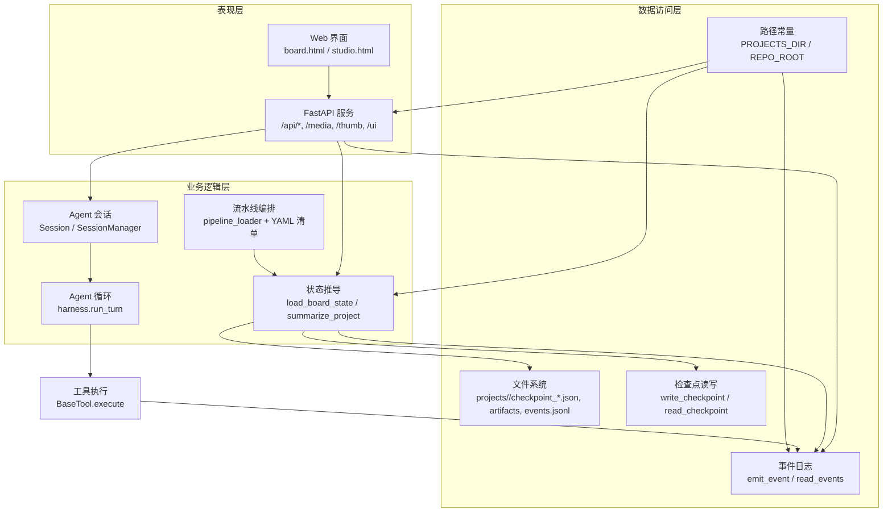
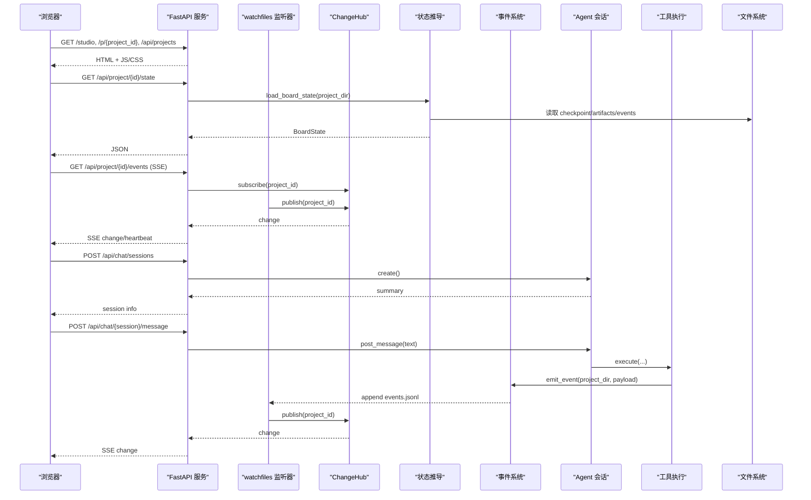
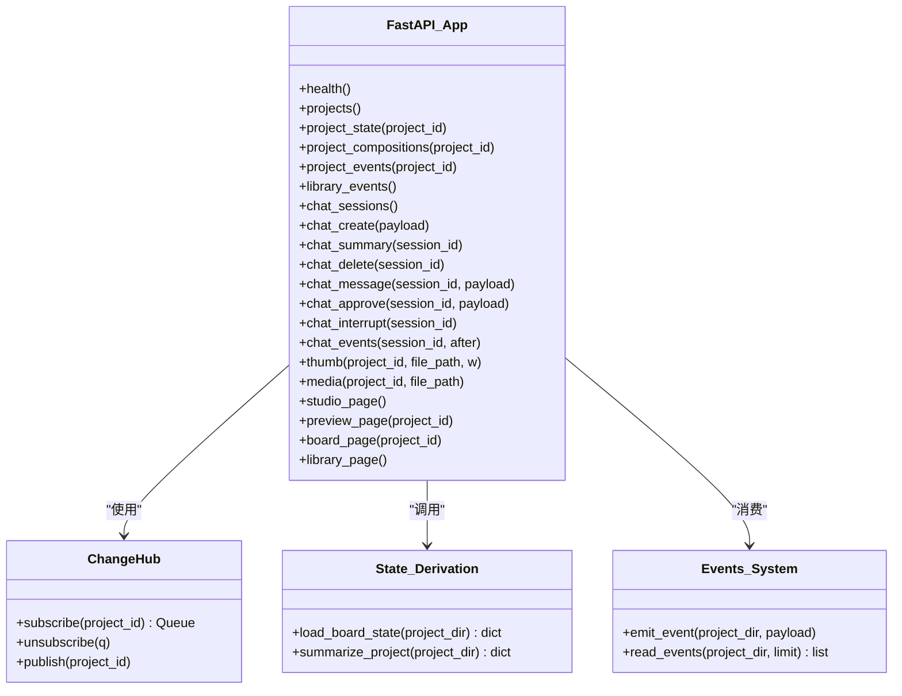
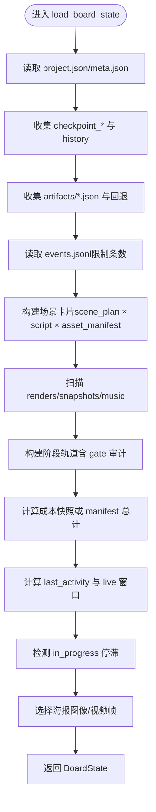
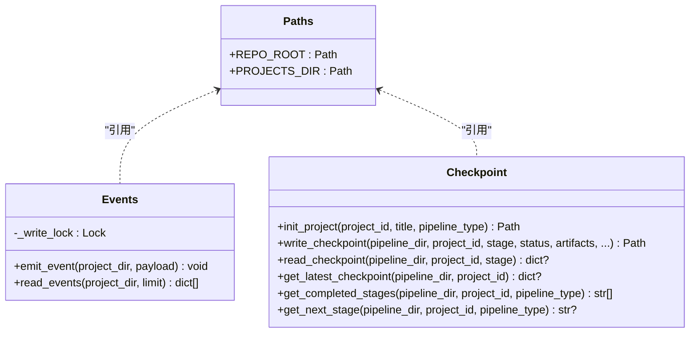
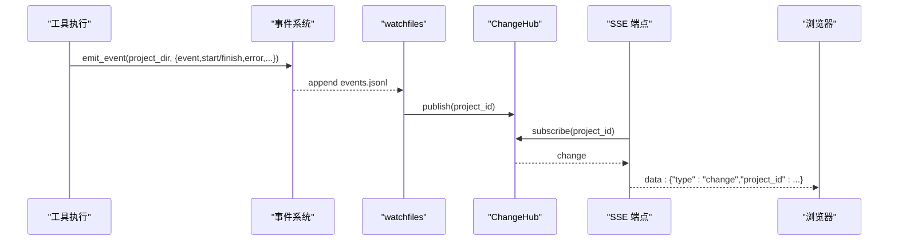
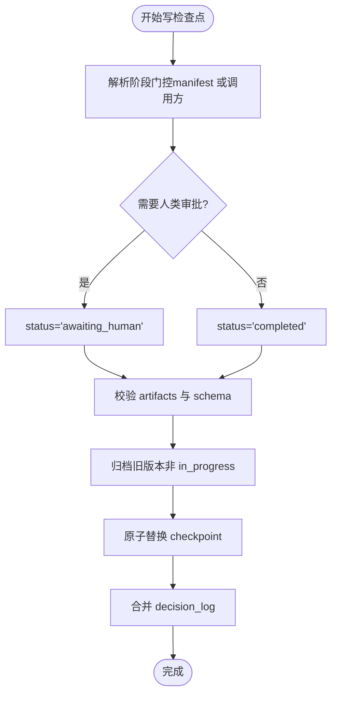
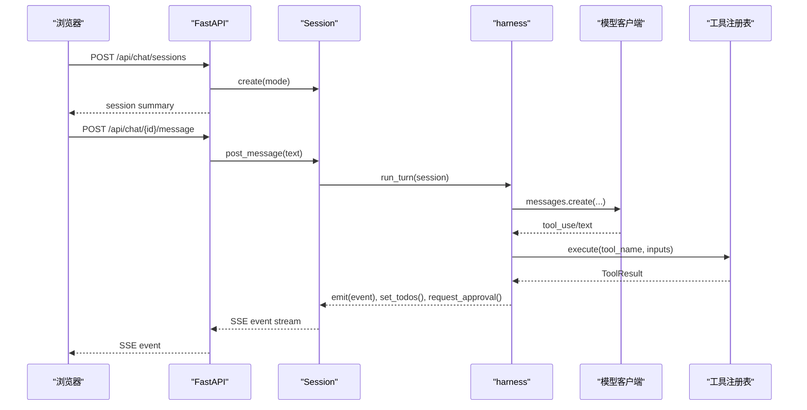
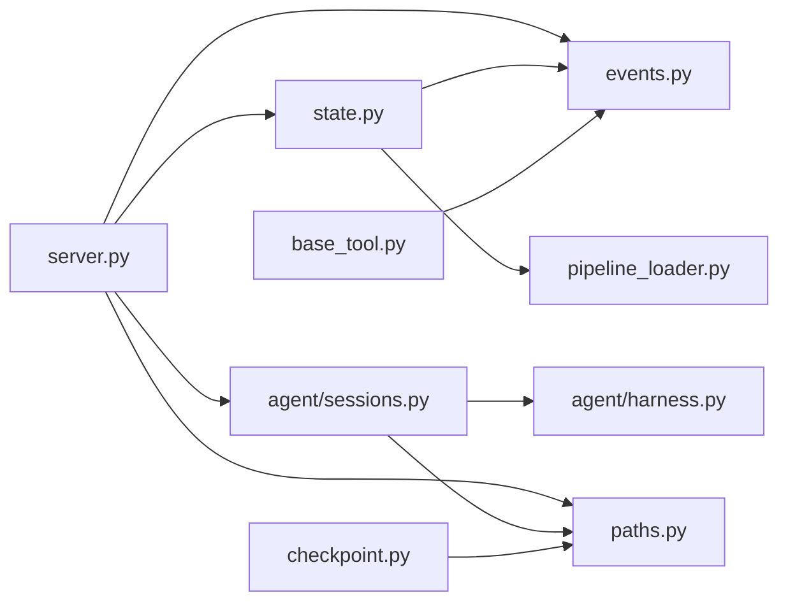

# 系统架构概览

<cite>
**本文引用的文件**   
- [backlot/server.py](file://backlot/server.py)
- [backlot/state.py](file://backlot/state.py)
- [lib/events.py](file://lib/events.py)
- [lib/paths.py](file://lib/paths.py)
- [backlot/__main__.py](file://backlot/__main__.py)
- [backlot/agent/sessions.py](file://backlot/agent/sessions.py)
- [pipeline_defs/music-video.yaml](file://pipeline_defs/music-video.yaml)
- [lib/pipeline_loader.py](file://lib/pipeline_loader.py)
- [tools/base_tool.py](file://tools/base_tool.py)
- [lib/checkpoint.py](file://lib/checkpoint.py)
- [config.yaml](file://config.yaml)
</cite>

## 目录
1. [简介](#简介)
2. [项目结构](#项目结构)
3. [核心组件](#核心组件)
4. [架构总览](#架构总览)
5. [详细组件分析](#详细组件分析)
6. [依赖关系分析](#依赖关系分析)
7. [性能考量](#性能考量)
8. [故障排查指南](#故障排查指南)
9. [结论](#结论)

## 简介
本文件为 OpenMontage-MV 的系统架构概览，面向希望理解整体设计与交互的技术与非技术读者。系统采用分层架构与事件驱动模式：表现层由 FastAPI + Web 界面组成；业务逻辑层包含状态管理、流水线编排与 Agent 会话；数据访问层基于文件系统与持久化（JSONL/JSON）。通过 SSE（Server-Sent Events）实现实时推送，结合 watchfiles 监听项目目录变更，形成“写入即更新”的看板体验。

## 项目结构
OpenMontage-MV 的核心目录与职责如下：
- backlot：Web 服务器、UI、Agent 会话与状态推导
- lib：共享库（路径、事件、流水线加载、检查点等）
- tools：工具基类与具体工具实现
- pipeline_defs：流水线定义（YAML）
- schemas：校验 Schema（JSON Schema）
- skills：Agent 技能说明
- config.yaml：运行时配置

图表来源
- [backlot/server.py:151-406](file://backlot/server.py#L151-L406)
- [backlot/state.py:586-656](file://backlot/state.py#L586-L656)
- [lib/events.py:77-118](file://lib/events.py#L77-L118)
- [lib/paths.py:13-18](file://lib/paths.py#L13-L18)
- [backlot/agent/sessions.py:36-106](file://backlot/agent/sessions.py#L36-L106)
- [lib/pipeline_loader.py:49-70](file://lib/pipeline_loader.py#L49-L70)
- [tools/base_tool.py:148-224](file://tools/base_tool.py#L148-L224)
- [lib/checkpoint.py:336-467](file://lib/checkpoint.py#L336-L467)

章节来源
- [backlot/server.py:1-504](file://backlot/server.py#L1-L504)
- [backlot/state.py:1-714](file://backlot/state.py#L1-L714)
- [lib/events.py:1-119](file://lib/events.py#L1-L119)
- [lib/paths.py:1-18](file://lib/paths.py#L1-L18)
- [backlot/__main__.py:1-145](file://backlot/__main__.py#L1-L145)
- [backlot/agent/sessions.py:1-326](file://backlot/agent/sessions.py#L1-L326)
- [pipeline_defs/music-video.yaml:1-187](file://pipeline_defs/music-video.yaml#L1-L187)
- [lib/pipeline_loader.py:1-241](file://lib/pipeline_loader.py#L1-L241)
- [tools/base_tool.py:1-481](file://tools/base_tool.py#L1-L481)
- [lib/checkpoint.py:1-537](file://lib/checkpoint.py#L1-L537)
- [config.yaml:1-20](file://config.yaml#L1-L20)

## 核心组件
- FastAPI 服务（Backlot）：提供 REST API、静态资源、媒体与缩略图服务、SSE 事件流、Studio 聊天接口。
- 状态推导（BoardState）：从项目目录读取 checkpoint、artifacts、events 并生成可渲染的状态。
- 事件系统（events.jsonl）：工具执行时追加事件，服务端通过 SSE 推送给前端。
- 流水线编排（Pipeline Manifest）：YAML 描述阶段、产物、工具与人类审批门控。
- Agent 会话（Sessions）：线程化的对话与会话状态，支持中断、审批、持久化。
- 检查点（Checkpoint）：阶段级状态持久化，含历史归档与决策日志合并。
- 路径常量（Paths）：统一 PROJECTS_DIR 与 REPO_ROOT，确保所有模块一致。

章节来源
- [backlot/server.py:151-406](file://backlot/server.py#L151-L406)
- [backlot/state.py:586-656](file://backlot/state.py#L586-L656)
- [lib/events.py:77-118](file://lib/events.py#L77-L118)
- [pipeline_defs/music-video.yaml:36-187](file://pipeline_defs/music-video.yaml#L36-L187)
- [backlot/agent/sessions.py:36-106](file://backlot/agent/sessions.py#L36-L106)
- [lib/checkpoint.py:336-467](file://lib/checkpoint.py#L336-L467)
- [lib/paths.py:13-18](file://lib/paths.py#L13-L18)

## 架构总览
下图展示系统的高层交互：浏览器通过 FastAPI 获取页面与 API，SSE 接收实时事件；后台 watchfiles 监听 projects/ 目录变化，触发 ChangeHub 广播；Agent 会话在独立线程运行，调用工具执行并写入事件；状态推导将文件系统内容转换为 BoardState 供前端渲染。

图表来源
- [backlot/server.py:151-406](file://backlot/server.py#L151-L406)
- [backlot/server.py:132-149](file://backlot/server.py#L132-L149)
- [backlot/state.py:586-656](file://backlot/state.py#L586-L656)
- [lib/events.py:77-118](file://lib/events.py#L77-L118)
- [backlot/agent/sessions.py:182-224](file://backlot/agent/sessions.py#L182-L224)
- [tools/base_tool.py:148-224](file://tools/base_tool.py#L148-L224)

## 详细组件分析

### 表现层（FastAPI + Web 界面）
- 路由与中间件：提供健康检查、项目列表、项目状态、组合扫描、SSE 事件流、缩略图与媒体服务、UI 页面路由与 no-cache 策略。
- SSE 事件：ChangeHub 按项目过滤订阅，避免无关项目风暴；心跳保活与去抖合并。
- 安全与校验：项目 ID 白名单校验，防止路径穿越；媒体与缩略图仅允许项目内路径。

图表来源
- [backlot/server.py:151-406](file://backlot/server.py#L151-L406)
- [backlot/server.py:43-74](file://backlot/server.py#L43-L74)
- [backlot/state.py:586-656](file://backlot/state.py#L586-L656)
- [lib/events.py:77-118](file://lib/events.py#L77-L118)

章节来源
- [backlot/server.py:151-406](file://backlot/server.py#L151-L406)
- [backlot/server.py:43-74](file://backlot/server.py#L43-L74)

### 业务逻辑层（状态管理、流水线引擎、Agent 会话）
- 状态管理：load_board_state 聚合 checkpoint、artifacts、events、media，计算 stage rail、成本、活跃窗口与停滞检测。
- 流水线引擎：YAML 清单定义阶段顺序、产物、工具与人类审批门控；pipeline_loader 负责加载与缓存。
- Agent 会话：Session 维护消息、事件、todo 与审批；harness 驱动模型调用与工具执行；支持中断与恢复。

图表来源
- [backlot/state.py:586-656](file://backlot/state.py#L586-L656)
- [backlot/state.py:244-264](file://backlot/state.py#L244-L264)
- [backlot/state.py:401-493](file://backlot/state.py#L401-L493)
- [backlot/state.py:500-532](file://backlot/state.py#L500-L532)
- [backlot/state.py:535-560](file://backlot/state.py#L535-L560)

章节来源
- [backlot/state.py:586-656](file://backlot/state.py#L586-L656)
- [lib/pipeline_loader.py:49-70](file://lib/pipeline_loader.py#L49-L70)
- [backlot/agent/sessions.py:36-106](file://backlot/agent/sessions.py#L36-L106)

### 数据访问层（文件系统、持久化）
- 路径常量：REPO_ROOT 与 PROJECTS_DIR 作为唯一真实源，环境变量覆盖便于测试与多环境。
- 事件系统：append-only 写入 events.jsonl，线程锁保证并发安全；读取容忍损坏行。
- 检查点：写前验证、原子替换、历史归档、决策日志合并；读时校验 schema。

图表来源
- [lib/paths.py:13-18](file://lib/paths.py#L13-L18)
- [lib/events.py:77-118](file://lib/events.py#L77-L118)
- [lib/checkpoint.py:178-227](file://lib/checkpoint.py#L178-L227)
- [lib/checkpoint.py:336-467](file://lib/checkpoint.py#L336-L467)

章节来源
- [lib/paths.py:13-18](file://lib/paths.py#L13-L18)
- [lib/events.py:77-118](file://lib/events.py#L77-L118)
- [lib/checkpoint.py:336-467](file://lib/checkpoint.py#L336-L467)

### 事件驱动架构的设计理念与实现
- 设计理念：以文件系统为单一事实源，工具执行产生事件，服务端监听变更并通过 SSE 推送到前端，实现“零轮询”的实时看板。
- 实现要点：
  - BaseTool.execute 自动包装 emit_event，按输入推断项目归属，记录 start/finish/error。
  - watchfiles 异步监听 projects/ 目录，过滤噪声路径，批量去抖后发布到 ChangeHub。
  - SSE 端点按项目订阅队列，心跳保活，丢弃多余事件以避免拥塞。

图表来源
- [tools/base_tool.py:148-224](file://tools/base_tool.py#L148-L224)
- [lib/events.py:77-118](file://lib/events.py#L77-L118)
- [backlot/server.py:132-149](file://backlot/server.py#L132-L149)
- [backlot/server.py:185-242](file://backlot/server.py#L185-L242)

章节来源
- [tools/base_tool.py:148-224](file://tools/base_tool.py#L148-L224)
- [lib/events.py:77-118](file://lib/events.py#L77-L118)
- [backlot/server.py:132-149](file://backlot/server.py#L132-L149)
- [backlot/server.py:185-242](file://backlot/server.py#L185-L242)

### 流水线编排与阶段门控
- 流水线清单：music-video.yaml 定义了 idea/proposal/storyboard/assets/edit/compose/publish 各阶段的产物、工具与人类审批默认值。
- 阶段门控：checkpoint 写入时根据 manifest 的 human_approval_default 强制审批流程，违规直接抛出校验错误。
- 阶段顺序：pipeline_loader 提供 get_stage_order 与子阶段解析，支持条件激活与工具集合汇总。

图表来源
- [pipeline_defs/music-video.yaml:36-187](file://pipeline_defs/music-video.yaml#L36-L187)
- [lib/checkpoint.py:336-467](file://lib/checkpoint.py#L336-L467)
- [lib/pipeline_loader.py:173-182](file://lib/pipeline_loader.py#L173-L182)

章节来源
- [pipeline_defs/music-video.yaml:36-187](file://pipeline_defs/music-video.yaml#L36-L187)
- [lib/checkpoint.py:336-467](file://lib/checkpoint.py#L336-L467)
- [lib/pipeline_loader.py:173-182](file://lib/pipeline_loader.py#L173-L182)

### Studio 聊天与 Agent 循环
- Session：线程安全的事件与消息持久化，支持中断、审批与摘要。
- Harness：模型调用、上下文预算、错误恢复（重试、降级、压缩）、工具执行与结果回传。
- 集成：FastAPI 暴露会话创建、消息发送、事件订阅与审批接口。

图表来源
- [backlot/agent/sessions.py:182-224](file://backlot/agent/sessions.py#L182-L224)
- [backlot/agent/harness.py:49-100](file://backlot/agent/harness.py#L49-L100)
- [backlot/server.py:244-326](file://backlot/server.py#L244-L326)

章节来源
- [backlot/agent/sessions.py:36-106](file://backlot/agent/sessions.py#L36-L106)
- [backlot/agent/harness.py:49-100](file://backlot/agent/harness.py#L49-L100)
- [backlot/server.py:244-326](file://backlot/server.py#L244-L326)

## 依赖关系分析
- 模块耦合：
  - server.py 依赖 state.py、events.py、sessions.py、paths.py。
  - state.py 依赖 events.py、paths.py、pipeline_loader.py。
  - sessions.py 依赖 harness.py、tools.py、paths.py。
  - base_tool.py 依赖 events.py 进行观测。
  - checkpoint.py 依赖 paths.py 与 schemas。
- 外部依赖：
  - FastAPI、uvicorn、watchfiles、yaml、jsonschema、anthropic（可选）。
- 潜在循环依赖：无直接循环；通过函数式导入与延迟导入避免。

图表来源
- [backlot/server.py:151-406](file://backlot/server.py#L151-L406)
- [backlot/state.py:586-656](file://backlot/state.py#L586-L656)
- [backlot/agent/sessions.py:36-106](file://backlot/agent/sessions.py#L36-L106)
- [tools/base_tool.py:148-224](file://tools/base_tool.py#L148-L224)
- [lib/checkpoint.py:336-467](file://lib/checkpoint.py#L336-L467)

章节来源
- [backlot/server.py:151-406](file://backlot/server.py#L151-L406)
- [backlot/state.py:586-656](file://backlot/state.py#L586-L656)
- [backlot/agent/sessions.py:36-106](file://backlot/agent/sessions.py#L36-L106)
- [tools/base_tool.py:148-224](file://tools/base_tool.py#L148-L224)
- [lib/checkpoint.py:336-467](file://lib/checkpoint.py#L336-L467)

## 性能考量
- 事件与监控：
  - watchfiles 批量处理变更，忽略噪声目录，减少 I/O 压力。
  - ChangeHub 队列限流与去抖，避免前端风暴。
- 状态推导：
  - summarize_project 轻量摘要用于库视图；完整 load_board_state 仅在详情请求时执行。
  - 缩略图缓存与并行缺失竞争保护（临时文件名），降低重复计算。
- 流水线与检查点：
  - pipeline_loader 使用 lru_cache 缓存清单与 schema。
  - checkpoint 写前校验与原子替换，避免部分写入导致的不一致。
- 网络与缓存：
  - UI 资源设置 no-cache，确保开发期修复即时生效；媒体响应保持正常缓存。

[本节为通用指导，不直接分析具体文件]

## 故障排查指南
- 常见问题定位：
  - 项目不可见：确认 PROJECTS_DIR 指向正确目录；检查 project.json 是否存在。
  - SSE 无更新：查看 events.jsonl 是否有新行；确认 ChangeHub 订阅是否匹配 project_id。
  - 工具执行无事件：检查 BaseTool.execute 包装是否生效；确认 infer_project_dir 能识别项目路径。
  - 检查点写入失败：查看 checkpoint 校验错误信息；确认 human_approval_required 与 human_approved 一致性。
  - 端口冲突或服务未启动：使用 backlot serve --port N；检查 .studio/server.log。
- 调试建议：
  - 启用 mock 模型（MODEL_ID=mock）验证端到端链路。
  - 增加日志级别，观察 watchfiles 与 SSE 心跳。
  - 手动刷新浏览器或使用 /api/health 检查服务状态。

章节来源
- [backlot/__main__.py:110-117](file://backlot/__main__.py#L110-L117)
- [backlot/server.py:166-172](file://backlot/server.py#L166-L172)
- [lib/events.py:77-118](file://lib/events.py#L77-L118)
- [tools/base_tool.py:148-224](file://tools/base_tool.py#L148-L224)
- [lib/checkpoint.py:336-467](file://lib/checkpoint.py#L336-L467)

## 结论
OpenMontage-MV 通过分层架构与事件驱动设计，实现了高内聚、低耦合的视频制作流水线系统。FastAPI 提供稳定可靠的 Web 服务，状态推导与检查点机制保障数据一致性与可追溯性，Agent 会话与工具执行形成闭环，SSE 与 watchfiles 带来实时反馈。该设计既满足生产环境的稳定性需求，也为扩展新的流水线与工具提供了清晰的边界与契约。

[本节为总结，不直接分析具体文件]