# 组件交互模式

<cite>
**本文引用的文件**   
- [backlot/server.py](file://backlot/server.py)
- [backlot/__main__.py](file://backlot/__main__.py)
- [backlot/state.py](file://backlot/state.py)
- [backlot/agent/harness.py](file://backlot/agent/harness.py)
- [backlot/agent/sessions.py](file://backlot/agent/sessions.py)
- [backlot/agent/tools.py](file://backlot/agent/tools.py)
- [tools/base_tool.py](file://tools/base_tool.py)
- [tools/tool_registry.py](file://tools/tool_registry.py)
- [lib/events.py](file://lib/events.py)
- [lib/config_model.py](file://lib/config_model.py)
- [lib/pipeline_loader.py](file://lib/pipeline_loader.py)
- [pipeline_defs/music-video.yaml](file://pipeline_defs/music-video.yaml)
- [config.yaml](file://config.yaml)
</cite>

## 目录
1. [简介](#简介)
2. [项目结构](#项目结构)
3. [核心组件](#核心组件)
4. [架构总览](#架构总览)
5. [详细组件分析](#详细组件分析)
6. [依赖关系分析](#依赖关系分析)
7. [性能考虑](#性能考虑)
8. [故障排查指南](#故障排查指南)
9. [结论](#结论)
10. [附录：接口规范与最佳实践](#附录接口规范与最佳实践)

## 简介
本文件系统化阐述 OpenMontage-MV 的“组件交互模式”，覆盖以下关键主题：
- REST API、SSE 事件流与异步任务协调
- Agent 系统与工具库的集成（注册、发现、调用）
- 中间件架构与请求处理管道（认证、日志、错误处理）
- 插件化架构设计原则与扩展点
- 组件交互序列图与接口规范
- 组件开发指南与最佳实践

OpenMontage-MV 以 FastAPI 作为 Web 服务层，通过 Backlot 看板与 Studio 聊天工作区驱动 AI Agent；Agent 通过工具集执行生产流程，并以事件系统记录状态变化，最终由看板实时呈现。

## 项目结构
- Web 服务与看板：backlot.server 提供 REST/SSE/静态资源；backlot.state 负责从项目目录推导看板状态；backlot.__main__ 提供 CLI 启动与浏览器打开能力。
- Agent 系统：backlot.agent.harness 实现对话循环与模型调用；sessions 管理会话、事件流与审批；tools 暴露给 Agent 的工具定义与处理器。
- 工具生态：tools.base_tool 定义统一工具契约与自动事件埋点；tools.tool_registry 集中注册与发现工具。
- 运行时配置与流水线：lib.config_model 加载 config.yaml；lib.pipeline_loader 加载并校验 pipeline manifest；pipeline_defs/*.yaml 声明阶段、技能与工具。
- 事件系统：lib.events 为每个项目维护 append-only 的事件日志，供看板与 UI 消费。

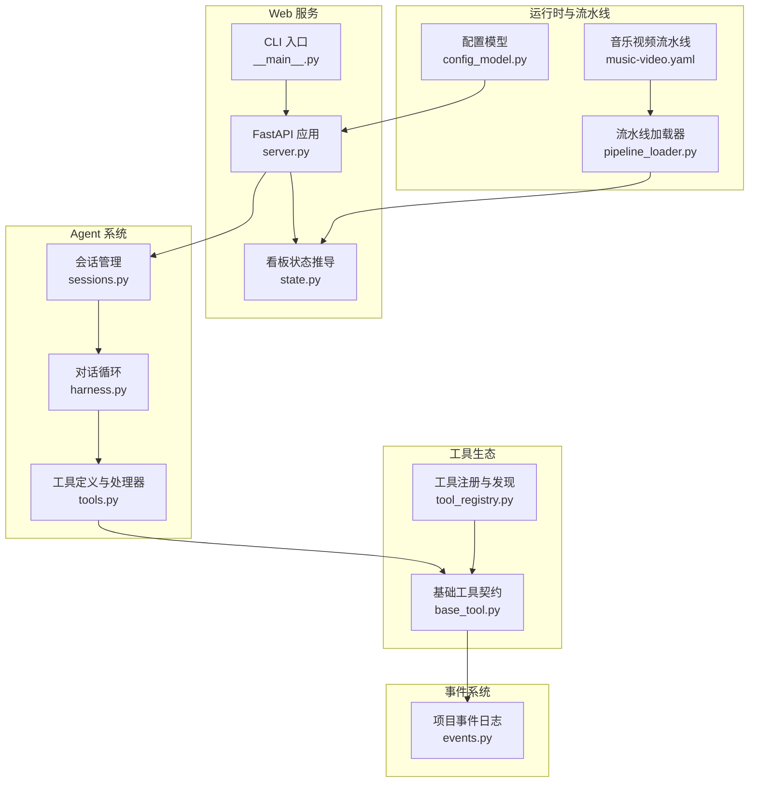

**图表来源** 
- [backlot/server.py:151-406](file://backlot/server.py#L151-L406)
- [backlot/__main__.py:120-145](file://backlot/__main__.py#L120-L145)
- [backlot/state.py:586-656](file://backlot/state.py#L586-L656)
- [backlot/agent/harness.py:268-390](file://backlot/agent/harness.py#L268-L390)
- [backlot/agent/sessions.py:36-120](file://backlot/agent/sessions.py#L36-L120)
- [backlot/agent/tools.py:370-511](file://backlot/agent/tools.py#L370-L511)
- [tools/base_tool.py:227-398](file://tools/base_tool.py#L227-L398)
- [tools/tool_registry.py:55-135](file://tools/tool_registry.py#L55-L135)
- [lib/events.py:77-119](file://lib/events.py#L77-L119)
- [lib/config_model.py:44-70](file://lib/config_model.py#L44-L70)
- [lib/pipeline_loader.py:49-71](file://lib/pipeline_loader.py#L49-L71)
- [pipeline_defs/music-video.yaml:1-187](file://pipeline_defs/music-video.yaml#L1-L187)

**章节来源**
- [backlot/server.py:151-406](file://backlot/server.py#L151-L406)
- [backlot/__main__.py:120-145](file://backlot/__main__.py#L120-L145)
- [backlot/state.py:586-656](file://backlot/state.py#L586-L656)
- [backlot/agent/harness.py:268-390](file://backlot/agent/harness.py#L268-L390)
- [backlot/agent/sessions.py:36-120](file://backlot/agent/sessions.py#L36-L120)
- [backlot/agent/tools.py:370-511](file://backlot/agent/tools.py#L370-L511)
- [tools/base_tool.py:227-398](file://tools/base_tool.py#L227-L398)
- [tools/tool_registry.py:55-135](file://tools/tool_registry.py#L55-L135)
- [lib/events.py:77-119](file://lib/events.py#L77-L119)
- [lib/config_model.py:44-70](file://lib/config_model.py#L44-L70)
- [lib/pipeline_loader.py:49-71](file://lib/pipeline_loader.py#L49-L71)
- [pipeline_defs/music-video.yaml:1-187](file://pipeline_defs/music-video.yaml#L1-L187)

## 核心组件
- FastAPI 服务与 SSE 事件分发：提供健康检查、项目列表、项目状态、媒体与缩略图、Studio 聊天与会话事件等接口；后台 watch 文件系统变更并通过 ChangeHub 广播。
- 看板状态推导：读取 checkpoint、artifacts、events，构建 stage rail、storyboard、media 与成本摘要，支持卡顿检测与海报选择。
- Agent 对话循环：封装模型客户端、重试与降级、上下文压缩、工具调用与结果回传；支持中断与审批门控。
- 会话管理：线程安全的事件流、持久化 JSONL、审批等待、项目 ID 自动识别。
- 工具契约与注册：BaseTool 统一接口、自动事件埋点、依赖检查、成本估算、幂等键；ToolRegistry 扫描与分组报告。
- 事件系统：append-only 写入 events.jsonl，按项目归因，零侵入观测。
- 配置与流水线：config.yaml 映射到 Pydantic 模型；pipeline loader 校验并缓存 manifest，提供阶段顺序、工具集合、人类审批默认值等。

**章节来源**
- [backlot/server.py:166-242](file://backlot/server.py#L166-L242)
- [backlot/state.py:586-656](file://backlot/state.py#L586-L656)
- [backlot/agent/harness.py:268-390](file://backlot/agent/harness.py#L268-L390)
- [backlot/agent/sessions.py:36-120](file://backlot/agent/sessions.py#L36-L120)
- [tools/base_tool.py:227-398](file://tools/base_tool.py#L227-L398)
- [tools/tool_registry.py:55-135](file://tools/tool_registry.py#L55-L135)
- [lib/events.py:77-119](file://lib/events.py#L77-L119)
- [lib/config_model.py:44-70](file://lib/config_model.py#L44-L70)
- [lib/pipeline_loader.py:49-71](file://lib/pipeline_loader.py#L49-L71)

## 架构总览
下图展示从浏览器到后端、再到 Agent 与工具的完整交互路径，以及事件如何回流至看板。

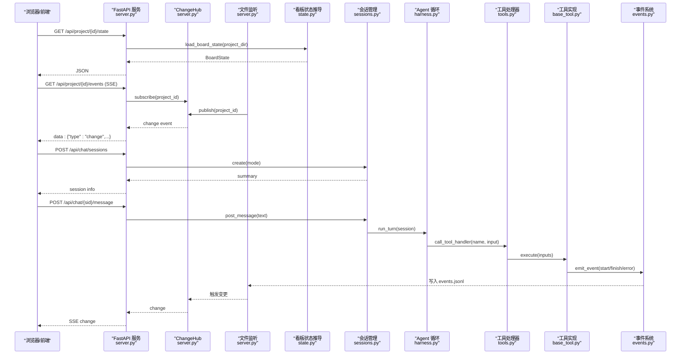

**图表来源** 
- [backlot/server.py:166-242](file://backlot/server.py#L166-L242)
- [backlot/server.py:132-149](file://backlot/server.py#L132-L149)
- [backlot/state.py:586-656](file://backlot/state.py#L586-L656)
- [backlot/agent/sessions.py:182-225](file://backlot/agent/sessions.py#L182-L225)
- [backlot/agent/harness.py:268-390](file://backlot/agent/harness.py#L268-L390)
- [backlot/agent/tools.py:475-511](file://backlot/agent/tools.py#L475-L511)
- [tools/base_tool.py:148-225](file://tools/base_tool.py#L148-L225)
- [lib/events.py:77-119](file://lib/events.py#L77-L119)

## 详细组件分析

### FastAPI 服务与 SSE 事件分发
- 健康检查与项目列表：/api/health、/api/projects
- 项目状态与组成：/api/project/{project_id}/state、/compositions
- SSE 事件流：/api/project/{project_id}/events、/api/library/events
- Studio 聊天与会话：/api/chat/* 系列端点，含消息、审批、中断、事件回放
- 媒体与缩略图：/media、/thumb，带范围请求与缓存
- 中间件：UI 资源 no-cache 策略

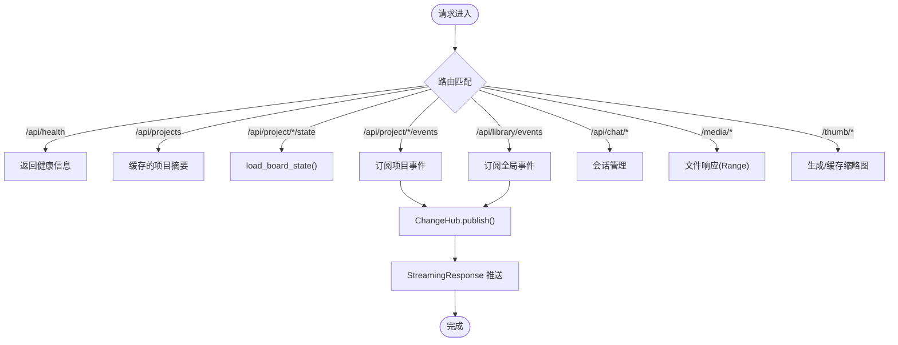

**图表来源** 
- [backlot/server.py:166-242](file://backlot/server.py#L166-L242)
- [backlot/server.py:456-504](file://backlot/server.py#L456-L504)

**章节来源**
- [backlot/server.py:151-406](file://backlot/server.py#L151-L406)

### 看板状态推导
- 读取 checkpoint_* 与 history，构建 stage rail
- 合并 artifacts（artifacts/*.json 与 checkpoint 内嵌）
- 构建 storyboard（scene_plan × script × asset_manifest + 事件推断 generating）
- 媒体扫描（renders、snapshots、music）
- 成本汇总与卡顿检测

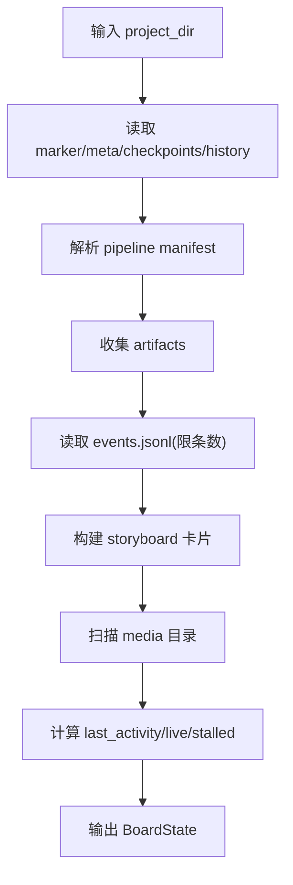

**图表来源** 
- [backlot/state.py:586-656](file://backlot/state.py#L586-L656)

**章节来源**
- [backlot/state.py:586-656](file://backlot/state.py#L586-L656)

### Agent 对话循环与工具调用
- 模型客户端初始化与重试/降级（429/529）
- 上下文预算控制与压缩（micro_compact、reactive_compact）
- 工具调用分发与结果回写
- 中断与审批门控（confirm 模式）

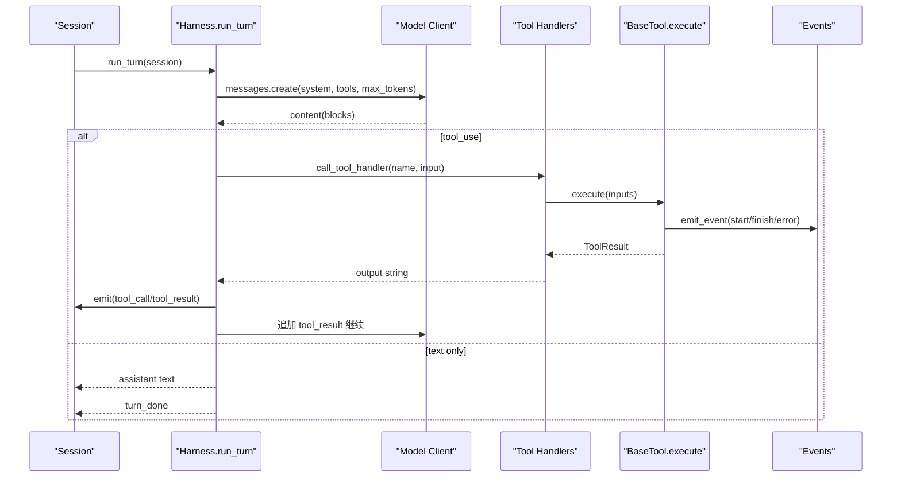

**图表来源** 
- [backlot/agent/harness.py:268-390](file://backlot/agent/harness.py#L268-L390)
- [backlot/agent/tools.py:475-511](file://backlot/agent/tools.py#L475-L511)
- [tools/base_tool.py:148-225](file://tools/base_tool.py#L148-L225)
- [lib/events.py:77-119](file://lib/events.py#L77-L119)

**章节来源**
- [backlot/agent/harness.py:268-390](file://backlot/agent/harness.py#L268-L390)
- [backlot/agent/tools.py:370-511](file://backlot/agent/tools.py#L370-L511)

### 会话管理与事件流
- 线程安全的事件追加与条件变量通知
- 持久化 JSONL（meta/msg/ev），重启恢复
- 项目 ID 自动识别（正则匹配 projects/<id>）
- 审批等待（阻塞直到用户 approve/interrupt）

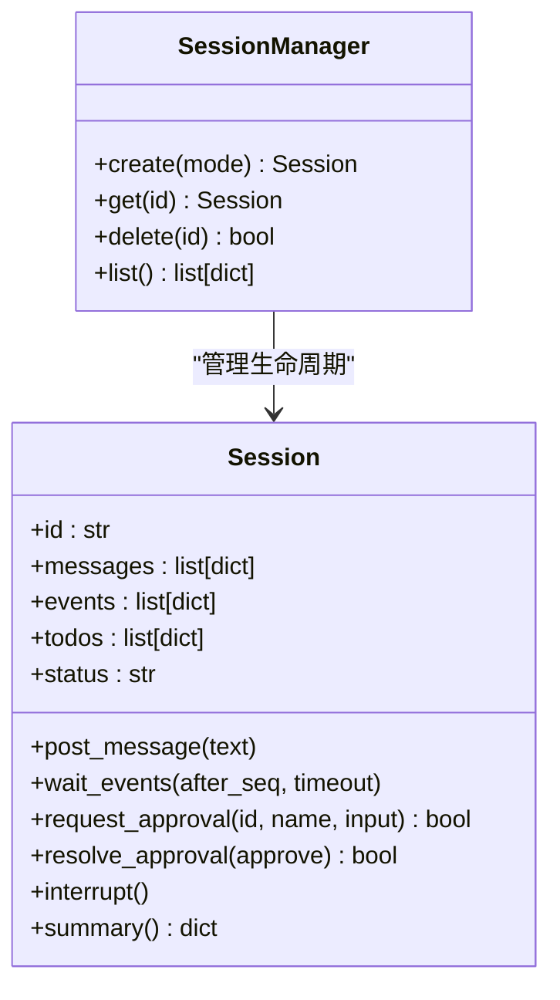

**图表来源** 
- [backlot/agent/sessions.py:36-120](file://backlot/agent/sessions.py#L36-L120)
- [backlot/agent/sessions.py:182-225](file://backlot/agent/sessions.py#L182-L225)
- [backlot/agent/sessions.py:269-326](file://backlot/agent/sessions.py#L269-L326)

**章节来源**
- [backlot/agent/sessions.py:36-120](file://backlot/agent/sessions.py#L36-L120)
- [backlot/agent/sessions.py:182-225](file://backlot/agent/sessions.py#L182-L225)
- [backlot/agent/sessions.py:269-326](file://backlot/agent/sessions.py#L269-L326)

### 工具契约与注册机制
- BaseTool 抽象类：身份、能力、资源画像、重试策略、幂等键、execute 接口、dry_run、run_command
- 自动事件埋点：_instrument_execute 包装 execute，写入 start/finish/error 事件
- ToolRegistry：模块扫描、按 tier/capability/provider/status 查询、支持 envelope/catalog/menu 聚合

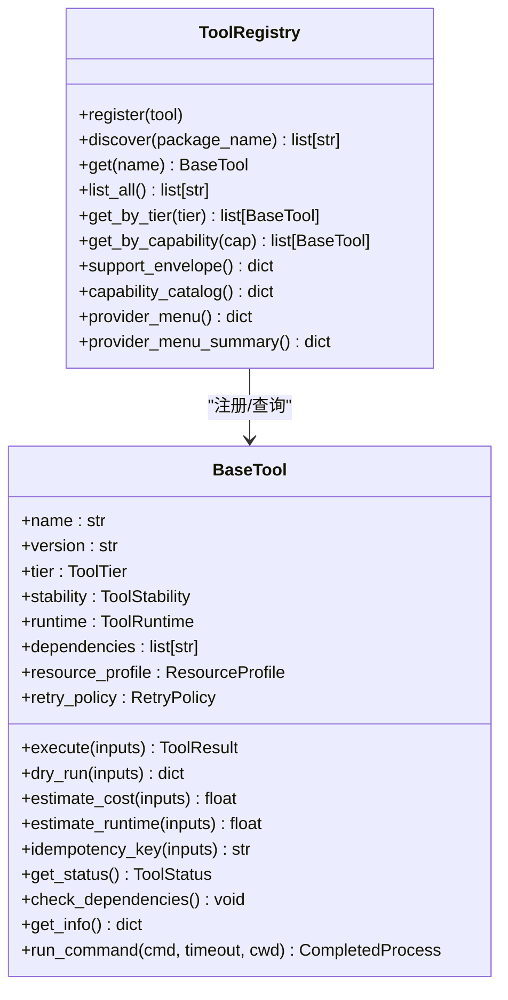

**图表来源** 
- [tools/base_tool.py:227-398](file://tools/base_tool.py#L227-L398)
- [tools/base_tool.py:148-225](file://tools/base_tool.py#L148-L225)
- [tools/tool_registry.py:55-135](file://tools/tool_registry.py#L55-L135)
- [tools/tool_registry.py:198-315](file://tools/tool_registry.py#L198-L315)

**章节来源**
- [tools/base_tool.py:227-398](file://tools/base_tool.py#L227-L398)
- [tools/base_tool.py:148-225](file://tools/base_tool.py#L148-L225)
- [tools/tool_registry.py:55-135](file://tools/tool_registry.py#L55-L135)
- [tools/tool_registry.py:198-315](file://tools/tool_registry.py#L198-L315)

### 事件系统与看板联动
- 事件写入：emit_event(project_dir, payload)，线程锁保护，失败静默
- 事件读取：read_events(project_dir, limit)，容错解析
- 看板使用：load_board_state 读取 events 推断生成中场景与工具

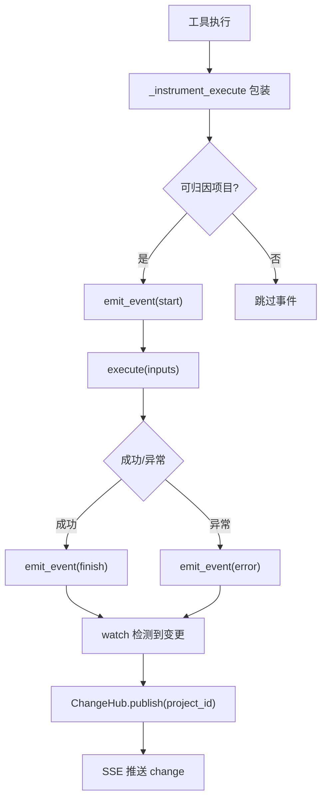

**图表来源** 
- [tools/base_tool.py:148-225](file://tools/base_tool.py#L148-L225)
- [lib/events.py:77-119](file://lib/events.py#L77-L119)
- [backlot/server.py:132-149](file://backlot/server.py#L132-L149)

**章节来源**
- [lib/events.py:77-119](file://lib/events.py#L77-L119)
- [tools/base_tool.py:148-225](file://tools/base_tool.py#L148-L225)
- [backlot/server.py:132-149](file://backlot/server.py#L132-L149)

### 配置与流水线
- config.yaml → OpenMontageConfig（Pydantic），提供路径与输出参数
- pipeline_loader 加载并校验 YAML，提供阶段顺序、工具集合、人类审批默认值
- music-video.yaml 定义 7 个阶段（idea/proposal/storyboard/assets/edit/compose/publish）及所需技能与工具

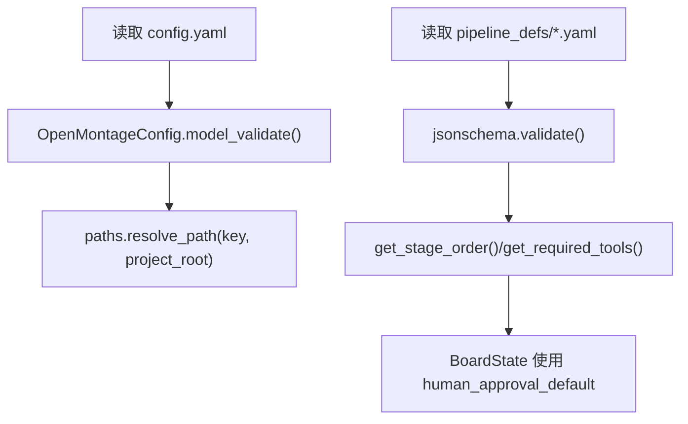

**图表来源** 
- [lib/config_model.py:44-70](file://lib/config_model.py#L44-L70)
- [lib/pipeline_loader.py:49-71](file://lib/pipeline_loader.py#L49-L71)
- [pipeline_defs/music-video.yaml:1-187](file://pipeline_defs/music-video.yaml#L1-L187)

**章节来源**
- [lib/config_model.py:44-70](file://lib/config_model.py#L44-L70)
- [lib/pipeline_loader.py:49-71](file://lib/pipeline_loader.py#L49-L71)
- [pipeline_defs/music-video.yaml:1-187](file://pipeline_defs/music-video.yaml#L1-L187)

## 依赖关系分析
- 服务层依赖 state、sessions、events、config_model
- Agent 层依赖 harness、tools、sessions
- 工具层依赖 base_tool、tool_registry、events
- 流水线层依赖 pipeline_loader、schemas

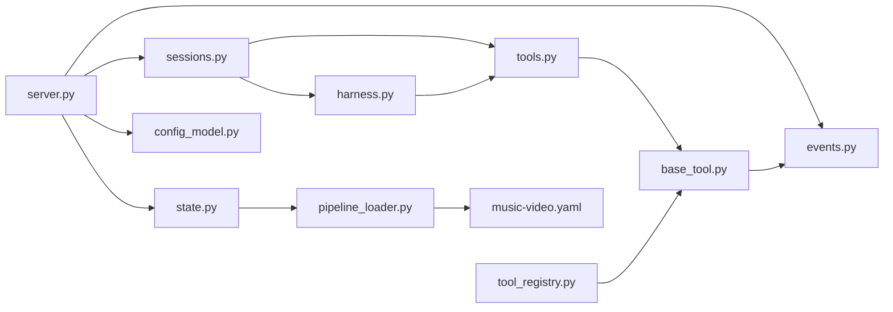

**图表来源** 
- [backlot/server.py:151-406](file://backlot/server.py#L151-L406)
- [backlot/state.py:586-656](file://backlot/state.py#L586-L656)
- [backlot/agent/sessions.py:36-120](file://backlot/agent/sessions.py#L36-L120)
- [backlot/agent/harness.py:268-390](file://backlot/agent/harness.py#L268-L390)
- [backlot/agent/tools.py:370-511](file://backlot/agent/tools.py#L370-L511)
- [tools/base_tool.py:227-398](file://tools/base_tool.py#L227-L398)
- [tools/tool_registry.py:55-135](file://tools/tool_registry.py#L55-L135)
- [lib/pipeline_loader.py:49-71](file://lib/pipeline_loader.py#L49-L71)
- [pipeline_defs/music-video.yaml:1-187](file://pipeline_defs/music-video.yaml#L1-L187)

**章节来源**
- [backlot/server.py:151-406](file://backlot/server.py#L151-L406)
- [backlot/state.py:586-656](file://backlot/state.py#L586-L656)
- [backlot/agent/sessions.py:36-120](file://backlot/agent/sessions.py#L36-L120)
- [backlot/agent/harness.py:268-390](file://backlot/agent/harness.py#L268-L390)
- [backlot/agent/tools.py:370-511](file://backlot/agent/tools.py#L370-L511)
- [tools/base_tool.py:227-398](file://tools/base_tool.py#L227-L398)
- [tools/tool_registry.py:55-135](file://tools/tool_registry.py#L55-L135)
- [lib/pipeline_loader.py:49-71](file://lib/pipeline_loader.py#L49-L71)
- [pipeline_defs/music-video.yaml:1-187](file://pipeline_defs/music-video.yaml#L1-L187)

## 性能考虑
- SSE 心跳与去抖：SSE_HEARTBEAT_SECONDS 定期心跳，队列满丢弃避免拥塞
- 文件监听批量处理：awatch 步长与集合去重，减少无效事件
- 缩略图缓存：按内容哈希与宽度生成 JPEG，并发临时文件避免竞争
- 看板状态推导限制：events 读取限制条数，历史归档分离
- Agent 上下文压缩：micro_compact 与 reactive_compact 降低 token 消耗
- 流水线清单缓存：lru_cache 避免重复解析与校验

**章节来源**
- [backlot/server.py:186-242](file://backlot/server.py#L186-L242)
- [backlot/server.py:132-149](file://backlot/server.py#L132-L149)
- [backlot/server.py:460-504](file://backlot/server.py#L460-L504)
- [backlot/state.py:586-656](file://backlot/state.py#L586-L656)
- [backlot/agent/harness.py:152-167](file://backlot/agent/harness.py#L152-L167)
- [lib/pipeline_loader.py:27-36](file://lib/pipeline_loader.py#L27-L36)

## 故障排查指南
- 服务未启动或端口占用：使用 CLI open/serve 命令，查看 .studio/server.log 旋转日志
- SSE 无事件：确认 watchfiles 可用；检查项目目录变更是否被忽略（node_modules/.git 等）
- 看板状态为空：检查 checkpoint_* 与 artifacts/*.json 是否存在且可读；events.jsonl 是否损坏
- Agent 无法调用模型：设置 MODEL_ID 与 ANTHROPIC_API_KEY；检查 429/529 重试与降级
- 工具不可用：运行 registry.provider_menu_summary() 查看依赖与环境变量缺失；确保 .env 正确加载
- 审批卡住：确认 resolve_approval 被调用；检查 SessionBusyError 与中断信号

**章节来源**
- [backlot/__main__.py:28-117](file://backlot/__main__.py#L28-L117)
- [backlot/server.py:132-149](file://backlot/server.py#L132-L149)
- [backlot/state.py:586-656](file://backlot/state.py#L586-L656)
- [backlot/agent/harness.py:49-68](file://backlot/agent/harness.py#L49-L68)
- [tools/tool_registry.py:316-471](file://tools/tool_registry.py#L316-L471)
- [backlot/agent/sessions.py:159-178](file://backlot/agent/sessions.py#L159-L178)

## 结论
OpenMontage-MV 通过清晰的职责分层与标准化契约，实现了 Web 服务、Agent、工具与事件系统的松耦合协作。FastAPI 提供稳定可靠的 API 与 SSE 通道；Agent 循环具备健壮的重试与上下文管理能力；工具契约与注册机制使扩展新工具变得简单；事件系统为看板提供实时反馈。整体架构兼顾可扩展性、可观测性与鲁棒性。

## 附录：接口规范与最佳实践

### REST API 概览（节选）
- GET /api/health：健康检查
- GET /api/projects：项目摘要列表
- GET /api/project/{project_id}/state：项目看板状态
- GET /api/project/{project_id}/events：SSE 事件流
- POST /api/chat/sessions：创建会话
- POST /api/chat/{session_id}/message：发送消息
- GET /api/chat/{session_id}/events：会话事件回放
- GET /media/{project_id}/{file_path}：媒体文件（Range）
- GET /thumb/{project_id}/{file_path}?w=640：缩略图

**章节来源**
- [backlot/server.py:166-242](file://backlot/server.py#L166-L242)
- [backlot/server.py:329-361](file://backlot/server.py#L329-L361)

### Agent 工具定义（节选）
- bash：执行 shell 命令（PowerShell/sh）
- read_file/write_file/edit_file：仓库内文件读写
- glob/grep：文件搜索与内容检索
- init_project/write_checkpoint：项目初始化与阶段 checkpoint
- todo_write/list_skills/load_skill：任务与技能管理
- compact：上下文压缩

**章节来源**
- [backlot/agent/tools.py:370-511](file://backlot/agent/tools.py#L370-L511)

### 工具开发最佳实践
- 继承 BaseTool，实现 execute(inputs) -> ToolResult
- 声明 dependencies（cmd:/binary:/env:/python:）、resource_profile、retry_policy
- 使用 idempotency_key_fields 提升幂等性
- 在 dry_run 中估算成本与耗时
- 通过 ToolRegistry.register_module 自动发现
- 保持事件埋点非致命：任何异常不阻断主流程

**章节来源**
- [tools/base_tool.py:227-398](file://tools/base_tool.py#L227-L398)
- [tools/tool_registry.py:73-84](file://tools/tool_registry.py#L73-L84)

### 流水线扩展与权限
- extensions.custom_scripts/playbooks/skills/tools 需在 manifest 显式允许
- get_permitted_extensions() 获取允许标志
- check_extension_permitted() 强制校验

**章节来源**
- [lib/pipeline_loader.py:201-241](file://lib/pipeline_loader.py#L201-L241)

### 组件交互序列图（Studio 聊天端到端）
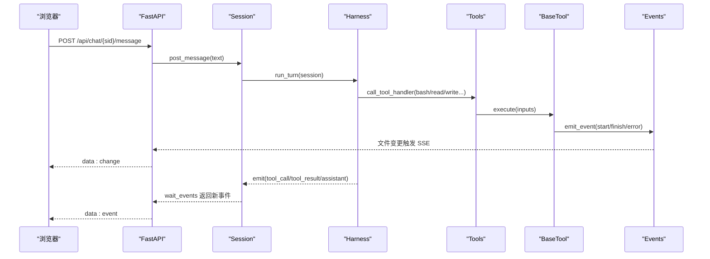

**图表来源** 
- [backlot/server.py:277-325](file://backlot/server.py#L277-L325)
- [backlot/agent/sessions.py:182-225](file://backlot/agent/sessions.py#L182-L225)
- [backlot/agent/harness.py:268-390](file://backlot/agent/harness.py#L268-L390)
- [backlot/agent/tools.py:475-511](file://backlot/agent/tools.py#L475-L511)
- [tools/base_tool.py:148-225](file://tools/base_tool.py#L148-L225)
- [lib/events.py:77-119](file://lib/events.py#L77-L119)